# Reliability, Observability & SRE — From Level 0 to Staff Engineer

> **The core idea in one sentence:** reliability is a *product feature with a number on it*. You choose what "good" means for users (SLI), how good is good enough (SLO), and spend the gap (the error budget) on shipping. Observability tells you *why* the number moved, and incident response, postmortems, resilience patterns and safe delivery keep it there.

This is the full-course edition of the interactive course. It teaches the Google SRE discipline (SLIs, SLOs, error budgets, burn-rate alerting) and the observability stack that measures it: **Prometheus + PromQL** for metrics and SLO maths, **OpenTelemetry** (API/SDK, zero-code agents, the Collector, OTLP) for instrumentation, **Grafana** for dashboards and **Jaeger** for traces. It then covers how to operate and learn (on-call, incident command, blameless postmortems), how to survive overload (load shedding, retries with budgets, circuit breakers, graceful degradation, the thundering herd), and how to change and scale safely (canaries, feature flags, expand/contract migrations, toil budgets, non-abstract large-system design, chaos engineering). Code samples use PromQL, Prometheus rule YAML, Collector YAML and Java 21. The hands-on lab runs locally with **Podman** (`podman compose`). Each chapter maps to an interactive lesson in [`lessons/`](lessons/0001-why-sre-reliability-as-a-target.html) and a cheat sheet in [`reference/`](reference/0001-sli-slo-error-budget-cheatsheet.html). Terms are defined in the [Glossary](GLOSSARY.md).

## Table of contents

| Part | Section | You will be able to… |
|---|---|---|
| I | [The SLO discipline](#part-i--the-slo-discipline) | Pick SLIs, set SLOs from data, compute budgets, write a policy with teeth, alert on burn rate |
| II | [Observability](#part-ii--observability) | Debug unknown-unknowns with metrics, traces and logs; design golden-signal telemetry; wire OTel → Prometheus |
| III | [Operating & learning](#part-iii--operating--learning) | Run an incident with clear roles and severities; write a blameless postmortem that reduces risk |
| IV | [Resilience](#part-iv--resilience) | Stop retry spirals and cascades; degrade gracefully; defuse thundering herds |
| V | [Change & scale (Staff+)](#part-v--change--scale-staff) | Ship through canaries and flags; budget toil; design a reliable system with real numbers |
| VI | [Verifying reliability](#part-vi--verifying-reliability) | Run chaos experiments and GameDays that turn hope into evidence |
| VII | [Staff-level judgement](#part-vii--staff-level-judgement) | Make the trade-offs, review designs, roll SLOs out across an org |
| — | [Capstone](#capstone-project) · [Lab](#hands-on-lab) · [Self-assessment](#self-assessment-checklist) · [Resources](#resources) · [Study plan](#study-plan-8-weeks) | Prove it end to end |

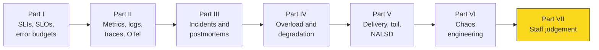

**How to study this guide (≈ 8 weeks):**

1. Read one chapter, then open its interactive lesson (the ▶ link at the end of each chapter) and step through the animation.
2. Answer the **Check yourself** questions *before* you expand them.
3. Keep the matching cheat sheet open while you do the exercises. The cheat sheets are written to be used during real work.
4. Run the [hands-on lab](#hands-on-lab) from Part II onward and turn every formula in this guide into a live PromQL query.
5. Pick one real service you own and carry it through the whole course: SLIs → SLO document → policy → burn-rate alerts → dashboards → runbook → postmortem template → degradation plan → canary gate → chaos experiment.

The lessons build on each other in a closed loop: **measure → alert → respond → learn → reduce risk → repeat**. Parts I–II build the *measure* and *alert* steps, Part III the *respond* and *learn* steps, and Parts IV–VI the *reduce risk* step.

---

# Part I — The SLO discipline

Part I replaces "does it work?" with a number everyone agrees on. You will be able to pick user-centred SLIs, set an SLO from measured data, express the error budget in minutes and in requests, write the policy that gives the budget teeth, and page on burn rate instead of on noise.

## 1.1 Why SRE — reliability as a measured target

### The builder's question stops working

A builder ships a feature and asks: *does it work?* At scale that question breaks into four questions it cannot answer:

| Question | Why "does it work?" fails |
|---|---|
| Is it reliable *enough*? | "Works" is binary. Users experience a percentage. |
| Do we ship the next feature or fix reliability? | Without a shared number this becomes an argument between product and ops. |
| How good should we be? | "As good as possible" means unbounded cost. |
| When do we wake someone up? | Paging on every blip burns out on-call. Never paging burns users. |

SRE answers all four with one instrument: **a measured target, agreed in advance**. Reliability stops being heroics and becomes engineering.

### SLI, SLO and SLA — three words, three jobs

| Term | What it is | Example | Owner |
|---|---|---|---|
| **SLI** (indicator) | A measurement of user experience: **good events ÷ valid events** | Proportion of checkout requests that return non-5xx in < 300 ms | Engineering |
| **SLO** (objective) | A target for an SLI over a window | 99.9% of checkouts succeed over a rolling 4 weeks | Product + engineering + SRE |
| **SLA** (agreement) | An SLO with an external consequence | 99.5% monthly, or service credits | Business / legal |

**The five-second test:** ask *"what happens if it's missed?"* If nothing contractual happens, it is an SLO. If money or credits change hands, it is an SLA. Keep the SLA looser than the internal SLO so the SLO warns you before the contract does.

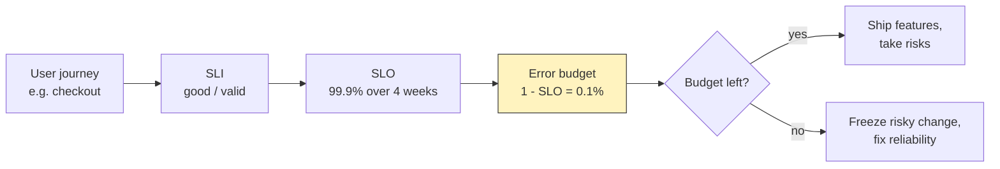

### Why 100% is the wrong target

- **Each extra nine costs roughly 10× more**: redundancy, testing, slower releases, more people on call.
- **Users can't tell the difference.** Their phone, Wi-Fi and ISP are already around 99% reliable. Your 99.999% hides behind their 99%.
- **100% means zero change.** Every deploy is a risk, so a 100% target forbids shipping.
- **The SLO is a floor and a ceiling.** Below it, users suffer. Far above it, you are over-investing and should spend the surplus on velocity.

| SLO | Budget per 30 days | Budget per year |
|---|---|---|
| 99% | 7.2 h | 3.65 days |
| 99.9% | 43.2 min | 8.77 h |
| 99.95% | 21.6 min | 4.38 h |
| 99.99% | 4.32 min | 52.6 min |
| 99.999% | 25.9 s | 5.26 min |

Read the table as a design constraint. At 99.99% a single 5-minute rollback blows the month, so you need automated detection plus automated rollback. Humans can't react in time.

### The error budget turns reliability into a decision

**Error budget = 1 − SLO.** At 99.9%, 0.1% of requests may fail, which is about 43 minutes of total outage per 30 days. The budget is not a failure allowance to be embarrassed about. It is **a resource to spend**: on releases, experiments, migrations and chaos tests.

- **Budget healthy** → ship. Product velocity wins by default.
- **Budget spent** → freeze risky change and fix reliability. Reliability wins by default.

Nobody argues in the moment, because the rule was agreed before the incident. Lesson 04 (§1.4) turns this into a written policy.

### The reliability maturity ladder

| Rung | State | Symptom |
|---|---|---|
| 0 | Greenfield: no monitoring, no target | Users report outages before you notice |
| 1 | Monitoring, but no SLO | Dashboards full of CPU graphs; alerts on causes; arguments about "is this bad?" |
| 2 | SLO, but no teeth | A nice number on a dashboard that changes nobody's behaviour |
| 3 | SLO + error-budget policy | The budget actually decides ship-vs-fix, and leadership backs it |

Most organisations stall on rung 2. This course gets you to rung 3.

### Don't SLO everything

Pick **a few critical user journeys** (log in, search, check out) and give each one or two SLIs. A hundred SLOs is the same as none, because nobody can act on them. Start with one service and one journey, and iterate.

**Good SLOs** are user-centred, measurable from data you already have or can cheaply get, achievable at present (not aspirational), few, and agreed by product, dev and ops. **Bad SLOs** measure infrastructure (CPU < 80%), are set to 100%, are copied from a vendor, or are never looked at.

▶ Interactive lesson: [Lesson 01 · Why SRE? Reliability as a measured target](lessons/0001-why-sre-reliability-as-a-target.html) · Cheat sheet: [SLI · SLO · Error budget](reference/0001-sli-slo-error-budget-cheatsheet.html)

**Check yourself**

<details><summary>Why is 100% reliability the wrong target to aim for?</summary>Each extra nine costs roughly 10× more, while users on their own flaky devices and networks can't tell the difference. You choose "reliable enough" and spend the rest as budget on shipping.</details>

<details><summary>You set "99.9% of logins succeed monthly", with no refund if missed. Is that an SLO or an SLA?</summary>An SLO: an internal target with no external penalty. Add a contractual consequence (credits, refunds) and it becomes an SLA.</details>

<details><summary>Your SLO is 99.99% over 30 days. How much downtime is that, and what does it force on your release process?</summary>About 4.3 minutes. One slow, human-driven rollback can spend the whole month, so the target forces automated canary analysis and automated rollback.</details>

## 1.2 Choosing good SLIs

### The measure-what's-easy trap

New teams reach for what's easy to graph: CPU, memory, host uptime, pod counts, queue depth. All of these can look **perfectly healthy while users can't check out**. They measure the machine, not the experience. An SLI must be a proxy for user happiness, measured from the user's side.

### The SLI shape is good events ÷ valid events

Always express an SLI as a **ratio of good events to valid events**, ×100%:

- It **ranges 0–100%**, so 0% means everything broken and 100% means everything fine. Anyone can read it.
- It **composes with the budget**: SLO 99.9% means 0.1% of valid events may be bad.
- It **gives uniform tooling**: one alerting recipe and one dashboard template for every SLI.

"Valid" matters as much as "good". Exclude events that shouldn't count: health checks, bots, synthetic probes and most client 4xx errors.

```promql
# Availability SLI: proportion of checkout requests that did not fail server-side
sum(rate(http_requests_total{job="checkout", code!~"5.."}[28d]))
/
sum(rate(http_requests_total{job="checkout"}[28d]))

# Latency SLI: proportion of requests faster than 300 ms (le="0.3" must be a real bucket)
sum(rate(http_request_duration_seconds_bucket{job="checkout", le="0.3"}[28d]))
/
sum(rate(http_request_duration_seconds_count{job="checkout"}[28d]))
```

### The SLI menu, by service type

| Service type | SLI types | Typical spec |
|---|---|---|
| **Request-driven** (APIs, web) | Availability, latency, quality | Proportion of valid requests served successfully / under X ms / without degraded content |
| **Pipeline** (batch, streaming) | Freshness, correctness, coverage | Proportion of records updated within X min / producing correct output / processed |
| **Storage** | Durability, latency, throughput | Proportion of written data that can be read back / reads under X ms |

**Start with availability and latency** for request-driven services. Pick **at most 5 SLI types** for the most critical functionality.

### Specification versus implementation

The **SLI specification** is the outcome that matters, independent of how you measure it: *"proportion of home-page loads that complete under 100 ms"*. The **SLI implementation** is that specification plus a measurement method: *"…as measured from the load balancer logs"*.

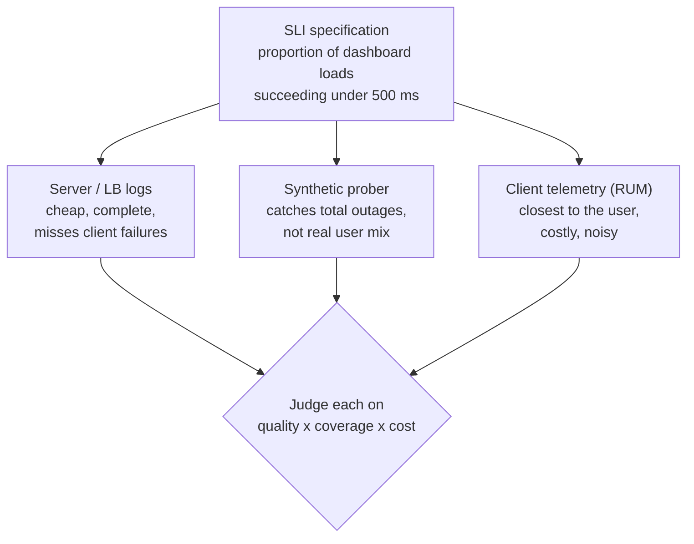

Measure **as close to the user as you can afford**. Server-side metrics are the usual starting point. Add a prober so a total outage (zero traffic, zero errors) is still visible.

### Ratios, not averages

Averages hide pain. If 90% of requests take 100 ms and 10% take 10 s, the **mean is about 1.1 s**, which looks tolerable, but one user in ten is waiting ten seconds. Express latency as **the proportion of requests under a threshold**, and use two thresholds to capture the shape of the distribution:

- 90% of requests < 100 ms (typical experience)
- 99% of requests < 400 ms (the tail)

### Latency and availability SLIs in Prometheus

**Bucket ratio vs `histogram_quantile`.** For SLIs, prefer the bucket ratio above. It is exact, cheap and composes with the budget. `histogram_quantile` estimates by interpolating inside buckets. It's fine for dashboards but not for SLO maths. Either way, **the SLO threshold must be an exact `le` bucket boundary**: with buckets at 0.25 and 0.5 you cannot measure "under 300 ms".

**Don't let errors flatter latency.** A fast 500 makes latency look great. Either add an `outcome="success|error"` label and compute latency over successes, or observe durations for successful requests only.

**Aggregate before the quantile.** `histogram_quantile(0.99, sum by (le) (rate(..._bucket[5m])))` is correct. Averaging per-instance p99s is mathematically meaningless.

**Status-code verdicts for a server-side availability SLI:**

| Response | Verdict | Reason |
|---|---|---|
| 2xx, 3xx | Good | Served |
| 5xx | Bad | Server failed |
| 429 | Bad (valid) | You throttled a legitimate user. That is your capacity problem. |
| Other 4xx | Excluded | The client's fault, outside your control |
| Health checks, bots, synthetics | Excluded | Not users |

Refined availability: `code=~"2..|3.."` over `code=~"2..|3..|5..|429"`.

**Recording rules** keep SLI queries cheap and consistent. Name them `level:metric:operation` and record at every window that alerting will need:

```yaml
groups:
  - name: slo-checkout-latency
    rules:
      - record: job:http_req_duration:good_le300ms:rate5m
        expr: sum by (job) (rate(http_request_duration_seconds_bucket{job="checkout", le="0.3"}[5m]))
      - record: job:http_req_duration:valid:rate5m
        expr: sum by (job) (rate(http_request_duration_seconds_count{job="checkout"}[5m]))
      - record: job:slo_latency_300ms:ratio_rate5m
        expr: job:http_req_duration:good_le300ms:rate5m / job:http_req_duration:valid:rate5m
      # repeat for 30m, 1h, 6h, 3d windows; use increase(...[28d]) for the budget window
```

Validate with `promtool check rules slo-rules.yml`. Generators such as **Sloth** emit the whole family of rules from a short SLO spec. **Native histograms** are the modern direction: high resolution without hand-picked buckets.

### The starter recipe

1. Pick **one application**. Others can come later.
2. Decide clearly **who the users are**, whose happiness you're optimising.
3. List their **critical journeys**: the common, important things they do.
4. Sketch the architecture and **classify components** as request, pipeline or storage.
5. Pick **≤ 5 SLI types** for the most critical functionality. Ship one and iterate. Don't let perfect be the enemy of measured.

▶ Interactive lesson: [Lesson 02 · Choosing good SLIs](lessons/0002-choosing-good-slis.html) · Cheat sheets: [Choosing SLIs — menu & method](reference/0002-sli-menu-cheatsheet.html), [Latency & availability SLIs in Prometheus](reference/0003-latency-sli-prometheus-recipe.html)

**Check yourself**

<details><summary>The journey is "load the dashboard". Which is the best-formed SLI: average load time, CPU of the dashboard pods, or the proportion of loads succeeding under 500 ms?</summary>The proportion of dashboard loads succeeding under 500 ms. A good SLI is good ÷ valid events of the user's outcome. It is not an average and not an infrastructure proxy.</details>

<details><summary>"Ratio of home-page loads under 100 ms" vs "ratio of loads under 100 ms, from the server logs": which is the implementation?</summary>The second. A specification states the outcome that matters. An implementation adds how you measure it, judged on quality, coverage and cost.</details>

<details><summary>Your latency SLO threshold is 300 ms, but your histogram buckets are 0.1, 0.25, 0.5, 1. What's wrong?</summary>There is no <code>le="0.3"</code> bucket, so the good-event count can't be read exactly. Add 0.3 as a bucket boundary, or move the threshold to an existing boundary.</details>

## 1.3 Setting the SLO and the error budget

### Start from data, not aspiration

1. **Measure about 4 weeks** of the SLI before committing.
2. **Round availability down** to two significant figures (97.123% → 97%).
3. **Round latency thresholds up** to a clean value (432 ms → 450 ms).
4. Write it down, get it signed, and revisit it.

**Worked example (SRE Workbook).** 3,663,253 valid requests in four weeks:

| SLI | Measured | SLO set | Budget (requests) |
|---|---|---|---|
| Availability | 97.123% | **97%** | 3% × 3,663,253 = **109,897** |
| Latency (p90) | 432 ms | **90% < 450 ms** | 10% = **366,325** |
| Latency (p99) | 891 ms | **99% < 900 ms** | 1% = **36,632** |

**The current-performance trap.** Don't simply set the SLO to today's number. If today is accidentally excellent, you lock in an expensive promise. If today is poor, users may already be unhappy. Today's data is the *starting point* for a conversation about what users need.

### Choosing the window

| Window | Strength | Weakness | Use for |
|---|---|---|---|
| **Rolling** (e.g. last 28 days) | Tracks recent user pain continuously | Harder to align with business reporting | Decision-making and alerting |
| **Calendar** (e.g. this month) | Lines up with reports and SLAs | Budget "resets" on the 1st even if users still hurt | SLA reporting |

Default to a **4-week rolling window** in whole weeks, so every window contains the same number of weekends.

### Budget arithmetic

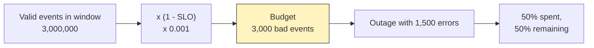

- **Budget (events) = (1 − SLO) × valid events.** 99.9% of 3,000,000 → 3,000 failures allowed.
- **Budget (time) = (1 − SLO) × window.** 4 weeks = 40,320 min, so 99.9% ≈ **40 min**, 99% ≈ 6.7 h, 99.95% ≈ 20 min, 99.99% ≈ 4 min.
- Track three numbers: **spent** (bad events so far), **remaining** (budget − spent) and **burn** (how fast it is being spent, covered in §1.5).

```promql
# Fraction of the 28-day budget remaining (99.9% availability SLO)
1 - (
  sum(increase(http_requests_total{job="checkout", code=~"5..|429"}[28d]))
  /
  (0.001 * sum(increase(http_requests_total{job="checkout", code=~"2..|3..|5..|429"}[28d])))
)
```

### The SLO document

An SLO only exists once it's written and agreed. The minimum SLO document contains the service and its users, the SLI specifications and implementations, the targets and window, the rationale (data and user research), the budget, links to the error-budget policy and dashboards, a review date, and **three signatures**:

| Signer | Commits to |
|---|---|
| **Product** | "This target is good enough for our users." |
| **Developers** | "We will spend engineering time on reliability when the budget is gone." |
| **Ops / SRE** | "This target is defensible and we can measure it." |

▶ Interactive lesson: [Lesson 03 · Setting the SLO & the error budget](lessons/0003-setting-slo-and-error-budget.html) · Cheat sheet: [Setting the SLO & budget maths](reference/0004-setting-slo-budget-math.html)

**Check yourself**

<details><summary>Why prefer a four-week rolling window over a calendar month for the decision-driving SLO?</summary>It tracks recent pain continuously, and whole weeks keep the weekend count constant, so the window doesn't carry weekday/weekend noise. Google's default is a four-week rolling window.</details>

<details><summary>SLO 99.9%, 2,000,000 valid requests in the window. What is the error budget?</summary>2,000 failed requests: (1 − 0.999) × 2,000,000.</details>

<details><summary>A full outage lasts 30 minutes. What fraction of a 99.9% / 4-week budget does it spend?</summary>About 74%: 30 min ÷ 40.32 min. One incident nearly empties the window.</details>

## 1.4 The error-budget policy

### A policy decides in advance

An SLO without consequences is a dashboard number (rung 2 of the ladder). The **error-budget policy** is a pre-agreed, written rule for what the organisation does as reliability drains. It is not a punishment. It is a way to stop re-arguing ship-vs-fix during every incident.

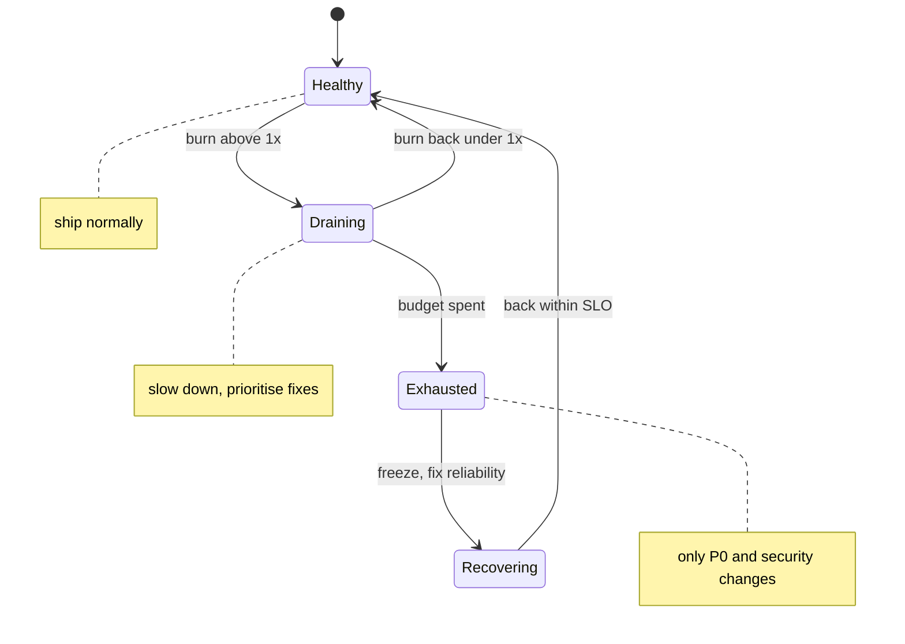

| State | Default action |
|---|---|
| **At or above SLO** | Release normally. |
| **Draining fast** (an optional amber state) | Slow down: smaller batches, more canary bake time, put reliability work at the top of the backlog. |
| **Exhausted** (your fault) | **Halt all changes except P0 incidents and security fixes until the service is back within SLO.** Engineers move to reliability work. |

### Cause matters

| Must fix (freeze applies) | May continue (no freeze) |
|---|---|
| Your own bug or procedural error | A company-wide network outage |
| A chance to soften a hard dependency (add a fallback, cache or timeout) | Another team's service that has already frozen for this |
| Errors that were mis-categorised and should never have counted | Out-of-scope users (load tests, penetration tests) |

### Thresholds that force learning

- **A single incident consuming > 20% of the 4-week budget** → a mandatory postmortem with at least one P0 action item.
- **A recurring class of outage consuming > 20% of budget in a quarter** → a P0 item on the next quarterly plan.

### Teeth come from escalation

Disagreements about the calculation or the policy escalate to a **named executive** (the CTO in Google's example). That signature is what makes the policy real. Changes cause roughly **70% of outages**, so the freeze targets the thing that most often breaks you.

A policy that works is:

1. **Written and specific**: states, thresholds and actions with no "use judgement".
2. **Approved by someone senior** enough to overrule a roadmap.
3. **Backed by an escalation path** for disputes.
4. **Explicit about exceptions**: P0 incidents, security fixes, and dependencies outside your control.
5. **Dated**: a revisit date, normally yearly or after the first freeze.

```markdown
Error-budget policy — <service>        Owner: <team>    Approver: <exec>    Review: <date>
SLOs: <link to SLO document>
1. Above SLO: releases proceed under normal process.
2. Budget exhausted over the trailing 4 weeks: all changes halted except P0 fixes and security
   fixes until the service is back within SLO; on-call and devs prioritise reliability items.
3. Out of scope: outages caused by <company-wide infra / frozen dependency / load tests>.
4. Any single incident > 20% of budget: postmortem with >= 1 P0 action item.
5. Recurring outage class > 20% of budget per quarter: P0 on the quarterly plan.
6. Disputes escalate to <named exec>.
```

▶ Interactive lesson: [Lesson 04 · The error-budget policy](lessons/0004-error-budget-policy.html) · Cheat sheet: [Error-budget policy template](reference/0005-error-budget-policy-template.html)

**Check yourself**

<details><summary>What is the primary purpose of an error-budget policy?</summary>To decide in advance what happens as the budget drains. It is the teeth that make an SLO more than a dashboard number.</details>

<details><summary>You exhausted your budget through your own bug, and a big feature is ready. What's the default action?</summary>Freeze releases except P0 and security fixes until you're back within SLO. Cause matters: a provider's outage might not trigger a freeze, but your own bug does.</details>

## 1.5 Burn-rate alerting on SLOs

### What makes an alert good

| Attribute | Meaning | Want |
|---|---|---|
| **Precision** | Share of alerts that were real, significant events | High: no crying wolf |
| **Recall** | Share of significant events that alerted | High: no silent outages |
| **Detection time** | How long until it fires | Short for big burns |
| **Reset time** | How long it keeps firing after the problem stops | Short: no zombie pages |

### Why naive alerts fail

| Approach | Failure |
|---|---|
| Error rate over 10 min ≥ the SLO's error rate | Good recall, terrible precision: a 10-minute blip consuming 0.02% of budget pages someone at 3 a.m. |
| Same, over a 36 h window | Good precision, but detection is slow and **reset is awful**: a 2-minute outage keeps firing for 36 hours |
| Add a `for: 1h` duration | Doesn't scale with severity: a total outage waits the same hour as a trickle. Spiky outages that reset the timer can burn 35% of budget and never alert. |

### Burn rate

**Burn rate** is how fast you're consuming budget relative to an even pace. At rate **N**, the window's whole budget is gone in **1/N of the window**.

| Burn rate | 30-day budget exhausted in |
|---|---|
| 1× | 30 days (exactly on target) |
| 6× | 5 days |
| 14.4× | 50 hours |
| 36× | 20 hours |
| 1000× | 43 minutes |

Two formulas do all the work:

- **Error-rate threshold = burn rate × (1 − SLO).** At 99.9%: 14.4× → 1.44% errors; 6× → 0.6%; 1× → 0.1%.
- **Budget consumed when it fires = burn rate × (alert window ÷ SLO period).** For example, spending 2% of a 30-day budget in 1 h means burn = 0.02 × 720 h ÷ 1 h = **14.4**.

### Multiwindow, multi-burn-rate alerts

The SRE Workbook's recommended starting point for a 99.9% / 30-day SLO:

| Severity | Long window | Short window | Burn rate | Budget consumed when it fires |
|---|---|---|---|---|
| **Page** | 1 h | 5 min | 14.4× | 2% |
| **Page** | 6 h | 30 min | 6× | 5% |
| **Ticket** | 3 days | 6 h | 1× | 10% |

The **long window** gives significance: a real chunk of budget is gone. The **short window** (≈ 1/12 of the long) proves *it is still happening now*. Fire only when **both** exceed the threshold.

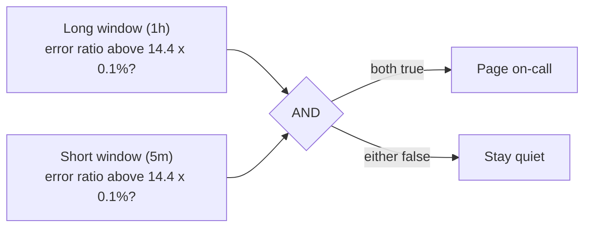

**How it plays out.** Errors start at t = 0 at well above 1.44%. The 5-minute window crosses the threshold within seconds. The 1-hour window crosses later, once enough of the hour is bad, and **the page fires** (for a total outage this takes under a minute). Errors stop. The 5-minute window drops below the threshold within about 5 minutes, so **the alert resets**. The 1-hour window alone would have kept paging for about another hour.

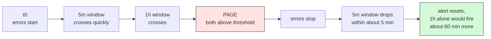

### The rules in Prometheus

Record the error ratio once per window. Codes 5xx and 429 are bad, and other 4xx are excluded (§1.2):

```yaml
groups:
  - name: slo-checkout-availability-recording
    rules:
      - record: job:slo_error:ratio_rate5m
        expr: |
          sum by (job) (rate(http_requests_total{job="checkout", code=~"5..|429"}[5m]))
          /
          sum by (job) (rate(http_requests_total{job="checkout", code=~"2..|3..|5..|429"}[5m]))
      # identical rules for ratio_rate30m, ratio_rate1h, ratio_rate6h, ratio_rate3d
```

Then alert on them. The annotations use Prometheus template syntax:


```yaml
groups:
  - name: slo-checkout-availability-alerts
    rules:
      - alert: ErrorBudgetBurn_Page
        expr: |
          (job:slo_error:ratio_rate1h{job="checkout"} > (14.4 * 0.001)
            and job:slo_error:ratio_rate5m{job="checkout"} > (14.4 * 0.001))
          or
          (job:slo_error:ratio_rate6h{job="checkout"} > (6 * 0.001)
            and job:slo_error:ratio_rate30m{job="checkout"} > (6 * 0.001))
        labels:
          severity: page
        annotations:
          summary: "{{ $labels.job }} is burning its error budget fast"
          description: "Error ratio {{ $value | humanizePercentage }}. Runbook: https://runbooks.example/checkout-slo"
      - alert: ErrorBudgetBurn_Ticket
        expr: |
          job:slo_error:ratio_rate3d{job="checkout"} > 0.001
            and job:slo_error:ratio_rate6h{job="checkout"} > 0.001
        labels:
          severity: ticket
        annotations:
          summary: "{{ $labels.job }} is slowly exhausting its error budget"
```


No `for:` clause is needed, because the short window already gives fast reset and debouncing.

### The low-traffic trap

At **10 requests per hour** a single failure is a 10% hourly error rate. At a 99.9% SLO that is a burn rate of 100× by the arithmetic (10% ÷ 0.1%). The lesson and the SRE Workbook quote it as "1000×". Either way, one failed request pages someone, and the whole month allows only about 7 failures. Fixes:

- **Generate synthetic traffic** (probers) so the denominator is meaningful.
- **Aggregate** related low-traffic services or endpoints into one SLO.
- **Choose a coarser target** or a longer window. Or accept that this service shouldn't page, and should open tickets instead.

▶ Interactive lesson: [Lesson 05 · Burn-rate alerting on SLOs](lessons/0005-burn-rate-alerting.html) · Cheat sheet: [Burn-rate alerting recipe](reference/0006-burn-rate-alerting-recipe.html)

**Check yourself**

<details><summary>What does a burn rate of 10× mean?</summary>You will exhaust the window's whole budget in one-tenth of the window, for example 3 days instead of 30. It does not mean you'll miss the SLO by a factor of ten.</details>

<details><summary>Why require the short window (≈ 1/12 of the long) as well as the long window before paging?</summary>So the alert stops firing soon after the problem resolves. The long window proves significance and the short window proves the problem is still happening. Requiring both gives fast reset and fewer false positives.</details>

<details><summary>What error-rate threshold does a 6× burn alert use for a 99.95% SLO?</summary>6 × (1 − 0.9995) = 6 × 0.0005 = 0.3%.</details>

---

# Part II — Observability

Part I told you *that* users are hurting. Part II tells you *where* and *why*. You will be able to choose the right signal for a question, design golden-signal telemetry that stays cheap, and wire an OpenTelemetry pipeline into Prometheus, Jaeger and Grafana.

## 2.1 Observability — metrics, logs and traces

### Monitoring versus observability

| | Monitoring | Observability |
|---|---|---|
| Answers | *That* something is wrong | *Why* it is wrong |
| Handles | Known-unknowns: failure modes you predicted and built a dashboard for | Unknown-unknowns: questions you didn't know you'd need to ask |
| Test | Does the dashboard turn red? | Can you answer a new question **without shipping new code**? |

A system is **properly instrumented** when you never have to add instrumentation in the middle of an incident.

### Three signals, three jobs

| Signal | What it is | Best at | Weak at |
|---|---|---|---|
| **Metrics** | Numeric time series (counters, gauges, histograms) with labels | Cheap aggregation, trends, alerting, SLOs | Per-request detail; high-cardinality slicing |
| **Traces** | A request's path as a tree of **spans** (one per operation/hop) with timing and **attributes** | *Where*: which hop is slow or failing | Aggregates; storing 100% is expensive, so sample |
| **Logs** | Timestamped events, ideally structured (JSON) | *Why*: the exact error message and context | Volume and cost; hard to aggregate |

### The 3 a.m. path: metric → trace → log

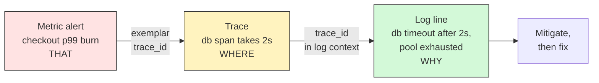

The glue is **correlation**. Every log line carries the `trace_id` and `span_id`, and histogram buckets carry **exemplars** (a sample `trace_id`), so you can jump from a spike on a graph to a real slow request and then to its logs.

### OpenTelemetry: instrument once, own your data

**OpenTelemetry (OTel)** is the vendor-neutral standard for producing telemetry:

- **One API and SDK per language** for traces, metrics and logs, plus **zero-code agents** that auto-instrument common frameworks.
- **Semantic conventions**: standard attribute names such as `http.request.method`, `http.route` and `http.response.status_code`, so dashboards work across services.
- **OTLP**, a wire protocol on gRPC `:4317` or HTTP `:4318`.
- **The Collector**: receivers → processors → exporters. It fans out to Prometheus (metrics), Tempo or Jaeger (traces), Loki (logs) or any vendor.

You instrument once, and changing backend becomes a Collector config change rather than a code change.

```java
// Manual span around a dependency call (OTel Java API)
Span span = tracer.spanBuilder("payment.charge").setSpanKind(SpanKind.CLIENT).startSpan();
try (Scope ignored = span.makeCurrent()) {
    span.setAttribute("payment.provider", provider);
    return paymentClient.charge(order);
} catch (Exception e) {
    span.recordException(e);
    span.setStatus(StatusCode.ERROR);
    throw e;
} finally {
    span.end();
}
```

### Three pillars are not observability

Having metrics, logs and traces doesn't make a system observable. Observability is the ability to **slice by arbitrary high-cardinality dimensions**: "errors are only on Android × Brazil × checkout-v3". Wide, structured events with many attributes make that possible.

### Cardinality: the cost of a label

Every unique combination of label values is a **separate time series**. Add `user_id` to a Prometheus metric and you create one series per user, a **cardinality explosion** that bloats memory and storage and slows queries.

| Dimension | Cardinality | Put it in |
|---|---|---|
| method, route template, status class, region | Low, bounded | Metric labels |
| user_id, order_id, request_id, raw URL | High, unbounded | Trace attributes, structured log fields, wide events |

▶ Interactive lesson: [Lesson 06 · Observability: metrics, logs & traces](lessons/0006-observability-metrics-logs-traces.html) · Cheat sheet: [Metrics, logs & traces](reference/0007-metrics-logs-traces.html)

**Check yourself**

<details><summary>A slow request fans out across six services. Which signal best shows which hop is slow?</summary>Traces. They stitch the request's spans across services with per-hop timing. Metrics say "that", traces say "where", logs say "why".</details>

<details><summary>Why is tagging a Prometheus metric with a raw user_id a bad idea?</summary>It creates a new time series for every user, a cardinality explosion. Keep metric labels low-cardinality and put high-cardinality detail in traces and logs.</details>

## 2.2 The four golden signals

### Page on symptoms, debug with causes

Alert on what users feel (symptoms: errors, slowness). Use causes (CPU, queue depth, GC) on dashboards when you debug. A cause-based page fires when users are fine and stays silent for failure modes you didn't predict.

### The signals

| Signal | Measure | Watch out for |
|---|---|---|
| **Latency** | Time to serve a request, as a distribution | Track **successful and failed latency separately**. A fast 500 flatters the number, and a slow error is worse than a fast one. |
| **Traffic** | Demand: requests/s, sessions, transactions/s, bytes/s | Use a unit meaningful to the service |
| **Errors** | Rate of failed requests | **Explicit** (5xx), **implicit** (200 with wrong content), and **by policy** (a "success" slower than 1 s counts as an error) |
| **Saturation** | How "full" the most constrained resource is | Systems degrade **before 100%**. Use p99 latency as the earliest warning, and predict ("disk full in 4 h"). Page only when it is about to become a problem. |

**Averages hide bursts.** CPU at 70% *average* can still be saturated for seconds at a time, which is enough to queue requests and spike p99 latency. Set a utilisation target with headroom and watch short-window tail latency.

### RED, USE and how they fit

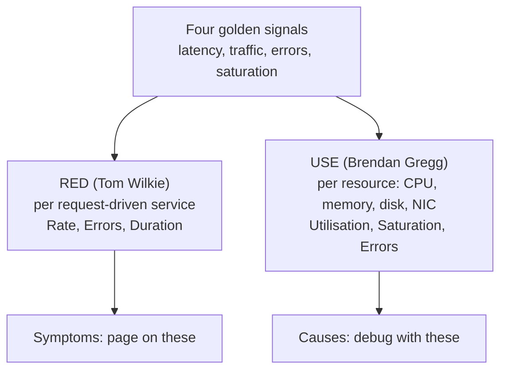

Golden signals ≈ **RED + saturation**. Use RED for every service endpoint and USE for every resource it depends on.

### Designing telemetry that stays cheap

- **Use OTel semantic-convention names**: `http.server.request.duration` (seconds, a histogram), not home-grown names.
- **Bound every label**: method, **templated route** (`/orders/{id}`, never the raw path), status class, region.
- **Pick histogram buckets deliberately**: roughly exponential (about ×2–×3 apart), dense around your SLO thresholds, and include each threshold exactly.
- **Remember the tail compounds.** A request that fans out to many backends waits for the slowest, so **a backend's p99 becomes the frontend's median**.
- **Choose resolution per purpose**: 10–15 s scrape for alerting, coarser for capacity trends. Don't keep per-second data for a year.

```java
DoubleHistogram duration = meter.histogramBuilder("http.server.request.duration")
    .setUnit("s")
    .setExplicitBucketBoundariesAdvice(List.of(0.025, 0.05, 0.1, 0.3, 1.0, 3.0, 10.0))
    .build();

duration.record(elapsedSeconds, Attributes.of(
    AttributeKey.stringKey("http.request.method"), "POST",
    AttributeKey.stringKey("http.route"), "/orders/{id}",
    AttributeKey.longKey("http.response.status_code"), 201L));
```

▶ Interactive lesson: [Lesson 07 · The four golden signals](lessons/0007-four-golden-signals.html) · Cheat sheet: [Golden signals, RED & USE](reference/0008-golden-signals-red-use.html)

**Check yourself**

<details><summary>CPU averages 70%, yet users see latency spikes. What's the golden-signals lesson?</summary>Saturation can bite below 100%, because bursts hide in the average. Set a utilisation target and watch short-window p99 latency.</details>

<details><summary>You're instrumenting a CPU, memory or disk resource. Which method fits?</summary>USE: utilisation, saturation and errors for each resource. RED fits request-driven services.</details>

<details><summary>Why should error latency be tracked separately from success latency?</summary>Fast failures (an instant 500) drag latency down and make a broken service look fast. Slow failures (timeouts) are the worst experience of all. Mixing them hides both.</details>

## 2.3 Instrumentation lab — Prometheus and OpenTelemetry

### The pipeline you'll build

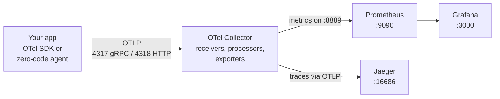

The Collector is the hub. Prometheus stores and queries metrics, Jaeger stores traces, Grafana renders dashboards.

### Two tracks

- **Track A — the OpenTelemetry Demo.** A realistic microservice shop with everything pre-wired. `git clone https://github.com/open-telemetry/opentelemetry-demo.git`, then from the repo run `podman compose up --force-recreate --remove-orphans --detach`. Browse `http://localhost:8080/` (shop), `/grafana/` and `/jaeger/ui/`. It's the fastest way to see golden signals and traces on real-looking traffic.
- **Track B — this course's minimal lab** in [`assets/lab/`](assets/lab/README.md): Collector, Prometheus, Jaeger and Grafana. You point **your own service** at it. See [Hands-on lab](#hands-on-lab).

### Zero-code instrumentation

| Runtime | Commands |
|---|---|
| Python | `pip install opentelemetry-distro opentelemetry-exporter-otlp` → `opentelemetry-bootstrap -a install` → `opentelemetry-instrument python app.py` |
| Node.js | `npm i @opentelemetry/api @opentelemetry/auto-instrumentations-node` → `node --require @opentelemetry/auto-instrumentations-node/register app.js` |
| Java | `java -javaagent:opentelemetry-javaagent.jar -jar app.jar` |

```sh
export OTEL_EXPORTER_OTLP_ENDPOINT=http://localhost:4318
export OTEL_EXPORTER_OTLP_PROTOCOL=http/protobuf   # needed when targeting :4318
export OTEL_SERVICE_NAME=my-service
```

### Golden signals in PromQL

The Collector's Prometheus exporter turns the OTel histogram `http.server.request.duration` into `http_server_request_duration_seconds_{bucket,count,sum}`:

```promql
# Traffic: requests per second (check /metrics for the label that carries your service name)
sum(rate(http_server_request_duration_seconds_count[5m]))

# Errors: 5xx ratio
sum(rate(http_server_request_duration_seconds_count{http_response_status_code=~"5.."}[5m]))
/
sum(rate(http_server_request_duration_seconds_count[5m]))

# Latency: p95 (aggregate by le first)
histogram_quantile(0.95, sum by (le) (rate(http_server_request_duration_seconds_bucket[5m])))
```

### The Collector configuration

```yaml
receivers:
  otlp:
    protocols:
      grpc:
        endpoint: 0.0.0.0:4317
      http:
        endpoint: 0.0.0.0:4318
processors:
  batch: {}
exporters:
  prometheus:
    endpoint: 0.0.0.0:8889      # Prometheus scrapes this
  otlp/jaeger:
    endpoint: jaeger:4317
    tls:
      insecure: true
  debug:
    verbosity: detailed         # echo telemetry to the Collector log while learning
service:
  pipelines:
    metrics:
      receivers: [otlp]
      processors: [batch]
      exporters: [prometheus, debug]
    traces:
      receivers: [otlp]
      processors: [batch]
      exporters: [otlp/jaeger, debug]
```

### Lab gotchas

- **Protocol and port must match.** Many SDKs default to **gRPC on :4317**. If you point at **:4318**, set `OTEL_EXPORTER_OTLP_PROTOCOL=http/protobuf`.
- **Metric names vary** with SDK version and exporter settings (unit suffixes, `_total`, dots → underscores). Check `http://localhost:8889/metrics` before writing queries.
- **Cardinality bites in labs too.** Auto-instrumentation can attach high-cardinality attributes, so review what reaches Prometheus.
- **Pin image versions** for anything beyond a lab. `:latest` drifts.
- **No data?** Read the Collector log (`podman compose logs otel-collector`). The `debug` exporter shows exactly what arrives.

▶ Interactive lesson: [Lesson 08 · Instrumentation lab: Prometheus + OpenTelemetry](lessons/0008-instrumentation-lab-prometheus-otel.html) · Cheat sheet: [Observability lab quickstart](reference/0009-observability-lab-quickstart.html)

**Check yourself**

<details><summary>What is the OpenTelemetry Collector's job in this stack?</summary>To receive, process and export telemetry to backends: receivers → processors → exporters. Prometheus stores metrics, Jaeger stores traces, Grafana renders dashboards.</details>

<details><summary>You want to follow one slow request across services. Which UI do you open?</summary>Jaeger (:16686), which shows the request's trace and its spans. Metrics are in Prometheus (:9090) and dashboards in Grafana (:3000).</details>

---

# Part III — Operating & learning

Measurement and alerts are worthless if the response is chaos and nobody learns. Part III covers how to run an incident and how to turn it into lasting risk reduction.

## 3.1 On-call and the incident lifecycle

### The unmanaged incident

The SRE book's story: Mary, on call, starts debugging alone. Colleagues jump in and change things without telling each other. Malcolm "helps" by making an untested change that makes it worse. Nobody updates the stakeholders, who then interrupt the responders for news. The failure is not technical. Nobody was **in command**, roles overlapped, and communication was ad hoc.

### Incident Command System roles

| Role | Does | Does **not** |
|---|---|---|
| **Incident Commander (IC)** | Holds the big picture, assigns roles, decides, keeps the single source of truth | Fix things hands-on |
| **Ops lead** | Leads the hands-on mitigation. **The only one who changes the system.** | Talk to stakeholders |
| **Comms lead** | Sends regular updates to stakeholders and users, and shields the responders | Debug |
| **Planning lead** | Tracks bugs to file, handoffs, changes to revert later, and food and sleep for long incidents | Run the response |

Roles **scale with the incident**. In a small one, one person wears every hat. The IC delegates as it grows. Whoever declares the incident is IC until they hand off explicitly.

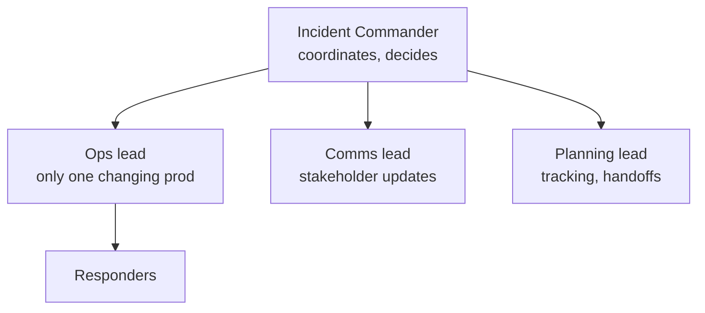

### Severity levels

| Severity | Definition | Response | Update cadence |
|---|---|---|---|
| **SEV1** | Broad outage, data loss or security breach; most users affected | All hands, IC, exec notification | ~every 30 min |
| **SEV2** | Significant or partial degradation; a key feature down for some users | IC and on-call team | ~hourly |
| **SEV3** | Minor; workaround exists; limited impact | Owning team | Next business day |

### The lifecycle

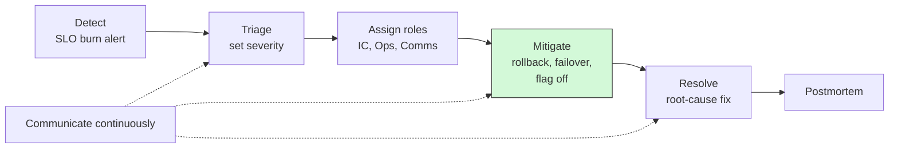

**Mitigate before you diagnose.** Roll back, fail over, drain a region or flip a kill switch to stop user pain first. Then find the root cause calmly. A rollback that turns out to be unnecessary costs minutes. A diagnosis done while users bleed costs budget.

### Communication rules

- **Fixed cadence.** Send updates on schedule even when there is no news ("still investigating, next update 14:30").
- **A single source of truth**: one incident doc or channel, **not hosted on the system that's down**.
- **Declare early.** Downgrading a declared incident is cheap. Declaring late is expensive.
- **Explicit handoff**: "You are now IC" must be said out loud and acknowledged, with state written in the doc.

### Sustainable on-call

Every page must be **actionable** and backed by a **runbook**. Rotations must be humane: enough people, follow-the-sun where possible, and compensation or time off. On-call engineers need the **authority to fix**, such as rolling back without asking. A noisy pager is a reliability bug, so fix it with Part I's burn-rate alerts.

▶ Interactive lesson: [Lesson 09 · On-call & the incident lifecycle](lessons/0009-oncall-incident-lifecycle.html) · Cheat sheet: [Incident response roles & severity](reference/0010-incident-response-roles-severity.html)

**Check yourself**

<details><summary>What does the Incident Commander primarily do?</summary>Coordinates and delegates. The IC does not fix things hands-on. They hold the single source of truth and hand all repair to the Ops lead. Separating command from firefighting is the whole point of ICS.</details>

<details><summary>Checkout is down. A rollback would likely restore it, but you don't yet know the cause. What do you do?</summary>Roll back to stop the bleeding, then diagnose calmly. Mitigate before you diagnose, and only the Ops lead changes the system.</details>

## 3.2 Blameless postmortems

### Blameless is about information

The goal of a postmortem is **information**: an accurate account of how the system allowed the failure. If people expect blame, they hide mistakes, and the next incident repeats. So **assume good intent**: everyone acted reasonably on what they knew at the time. **You can't fix people. You can fix systems.**

**Blameless is not "no accountability".** People remain accountable for *participating honestly* and for *completing action items*. What changes is the question, from "who did it?" to "how did the system let it happen?".

**"Human error" is a symptom, never a root cause.** "Sara dropped the production database" becomes "the admin tool let a one-character typo drop prod with no confirmation, no dry-run and no restore drill".

### When to write one (agree the triggers in advance)

- User-visible downtime or degradation beyond a threshold
- **Any data loss**
- On-call intervention (rollback, traffic rerouting)
- Resolution time above a threshold
- **Monitoring failure**, where a human found the problem first
- Any stakeholder asks for one
- **> 20% of the error budget** in one incident, which is mandatory under the policy (§1.4) and needs at least one P0 action

### The template

```markdown
Postmortem — <incident title> / <date>            Status: draft | reviewed    Authors: <names>
Impact: who was affected, how badly, for how long; error budget spent (% of 4-week budget)
Detection: how it was found; alert or human; was detection late, and why?
Timeline: key events, signals and decisions with timestamps (UTC)
Contributing factors: technical + process + organisational + knowledge gaps (no people)
What went well: defences that worked
What went poorly: defences that failed or were missing
Where we got lucky: near misses
Action items: | item | type (prevent/detect/mitigate) | owner | priority | ticket | due |
```

### Theater versus risk reduction

| Theater (weak) | Risk reduction (strong) |
|---|---|
| "Be more careful" | Add a confirmation guard or a dry-run-by-default flag |
| "Train people" | Automate the check, shrink the blast radius |
| "Add more monitoring" | Add *the specific alert* that would have caught this sooner |

Strong action items **change a default, automate a check, shrink the blast radius, or make failure visible sooner**. Each one is specific, **owned, prioritised and tracked to done**. An unowned action item is a wish.

### A culture that sustains it

- **Review.** A senior engineer checks the depth of the analysis and the priorities of the actions. An unreviewed postmortem never existed.
- **Share** widely into a searchable repository, so others learn without living through it.
- **Reward** people who surface problems. Never stigmatise a team with many postmortems; it usually means they are honest.

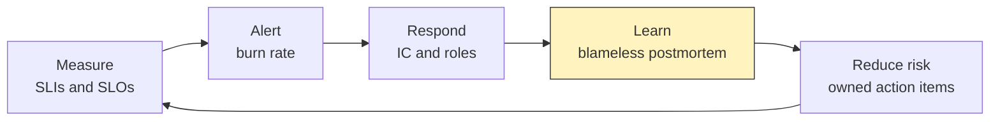

▶ Interactive lesson: [Lesson 10 · Blameless postmortems](lessons/0010-blameless-postmortems.html) · Cheat sheet: [Blameless postmortem template](reference/0011-blameless-postmortem-template.html)

**Check yourself**

<details><summary>What does "blameless" actually mean, and why?</summary>Focus on how the system allowed the failure, not on who erred, and assume good intent. Blame drives problems underground. You can't fix people; you can fix systems and processes.</details>

<details><summary>Which is the strongest action item: "be more careful with prod", "add more monitoring", or "add a confirmation guard so one typo can't drop prod"?</summary>The confirmation guard. It changes a default so the failure can't recur the same way. The other two are theater.</details>

---

# Part IV — Resilience

Systems fail under load in non-linear ways. A 1% overload can become a total outage through feedback loops. Part IV gives you the patterns that break those loops, and the techniques to keep the critical journey alive when capacity runs out.

## 4.1 Overload and cascading failure

### The retry spiral

A backend can serve **10,000 QPS**. Traffic rises to **10,100**, so about 100 requests/s fail. Clients retry, which makes load 10,200, then 10,300, and the failures snowball. Overloaded servers slow down, health checks time out and servers crash. **Their load shifts onto the survivors**, which then crash in turn. That is a cascading failure: a small initial fault amplified by feedback loops.

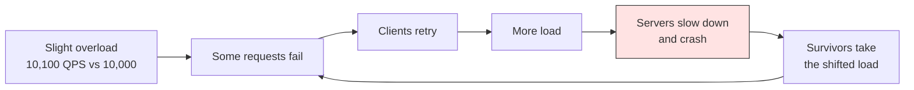

Recovery is not symmetric. A service that started cascading at 11k QPS may need incoming load **shed to around 1k** before it can recover: caches are cold, queues are full, and every restarted server is immediately flattened.

### Load shedding

Reject excess work **early and cheaply**, before collapse: return `503` (with `Retry-After`) once more than N requests are in flight. Do as much useful work as you can, and shed low-value traffic first. Under overload, switch the queue from **FIFO to LIFO or CoDel**: the oldest requests belong to users who have already given up.

```java
private final Semaphore inFlight = new Semaphore(MAX_IN_FLIGHT);

Response handle(Request request) {
    if (!inFlight.tryAcquire()) {
        return Response.status(503).header("Retry-After", "2").build();  // shed fast and cheap
    }
    try {
        return process(request);
    } finally {
        inFlight.release();
    }
}
```

### Retries, done right

- **Exponential backoff with jitter.** Randomise the wait so clients don't retry in synchronised waves: `sleep = random(0, min(cap, base × 2^attempt))`.
- **A retry budget.** Allow retries only while they are below about **10%** of requests. Past that, the dependency is unhealthy and retries only add load.
- **Retry at one layer only.** Retries multiply across layers: 3 layers × 3 attempts = 3³ = **27×** load on the bottom service.
- **Only retry idempotent operations**, or make them idempotent with idempotency keys.

```java
long backoffMillis(int attempt) {
    long ceiling = Math.min(MAX_BACKOFF_MS, BASE_BACKOFF_MS << attempt);
    return ThreadLocalRandom.current().nextLong(ceiling + 1);   // "full jitter"
}

boolean mayRetry() {                    // retry budget: retries <= 10% of requests
    return retries.get() < 0.1 * requests.get();
}
```

### Circuit breakers and bulkheads

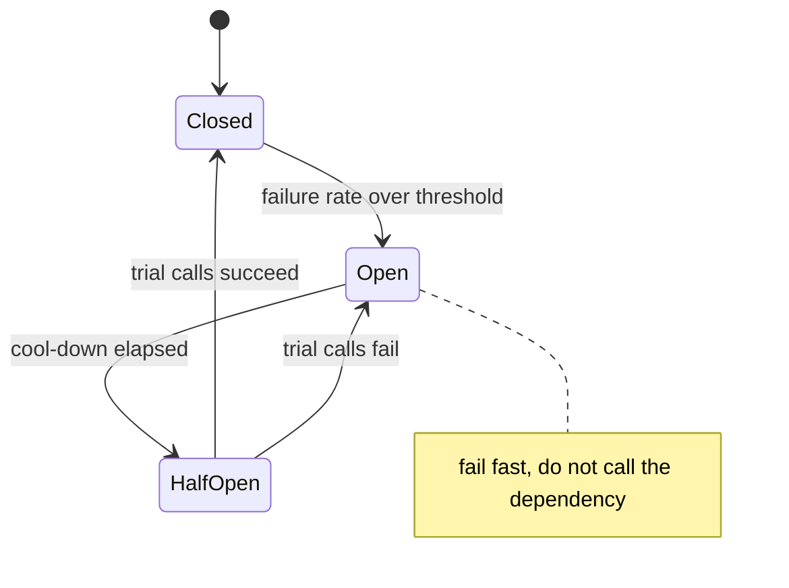

A **circuit breaker** stops calling a failing dependency, fails fast (or serves a fallback), and gives the dependency room to recover. Thresholds that are too sensitive make it **oscillate**. A **bulkhead** gives each dependency or tenant its own pool (threads, connections), so one slow dependency can't exhaust everything.

| Pattern | Purpose | Watch out |
|---|---|---|
| **Load shedding** | Reject excess fast before collapse | Shed low-value work first; send a clear signal |
| **Backoff + jitter** | Spread retry load, avoid synchronised waves | Idempotent operations only |
| **Retry budget** | Cap retry amplification (~10%) | Retry at one level only |
| **Circuit breaker** | Stop calling a failing dependency | Bad thresholds oscillate |
| **Bulkhead** | Isolate resource pools | Over-partitioning wastes capacity |
| **Graceful degradation** | Do less work per request (§4.2) | Exercise the path or it rots |

### Prevent, don't just react

**Load-test to the breaking point**: learn which resource fails first and *how* it fails. Then plan capacity with **N+2** headroom, so you can lose one instance to a planned update and one to an unplanned failure and still serve peak load.

▶ Interactive lesson: [Lesson 11 · Overload & cascading failure](lessons/0011-overload-cascading-failure.html) · Cheat sheet: [Overload & resilience patterns](reference/0012-overload-resilience-patterns.html)

**Check yourself**

<details><summary>Your backend is 1% overloaded and rejecting some requests. What will naive client retries do?</summary>Amplify the overload into a possible death spiral. Defend with backoff and jitter, a retry budget, retrying at one level only, and early load shedding.</details>

<details><summary>A dependency is failing and you want to stop hammering it so it can recover. Which pattern?</summary>A circuit breaker. It opens after repeated failures, fails fast without calling, then half-opens to test. A bulkhead isolates, load shedding protects you, and backoff still calls.</details>

## 4.2 Graceful degradation and the thundering herd

### Do less, stay up

**Load shedding drops requests. Graceful degradation reduces the work per request.** Under overload, serve a cached subset of results, use a cheaper ranking, serve slightly stale data, or drop the recommendations carousel while keeping checkout. **Preserve the critical journey**, and decide which features are droppable *before* the incident.

**Degraded mode rots.** It's your least-tested code path, and "the code path you never use is the one that doesn't work". Exercise it regularly (§6.1), **alert when it engages**, keep it simple, and give it a **kill switch** (an ops flag, §5.1).

### The herd family

Herds happen when independent things become **correlated** and hit a backend at the same instant.

| Herd | What synchronises |
|---|---|
| **Retry storm** | Everything fails together, so everything retries together |
| **Cache stampede** | A hot key expires and every request recomputes it at once |
| **Cold-cache restart** | Hit rate drops to about 0 and the backend is hammered |
| **Synchronised timers** | Midnight cron jobs, reconnect storms, TTLs set at the same moment |

### Latency cache or capacity cache?

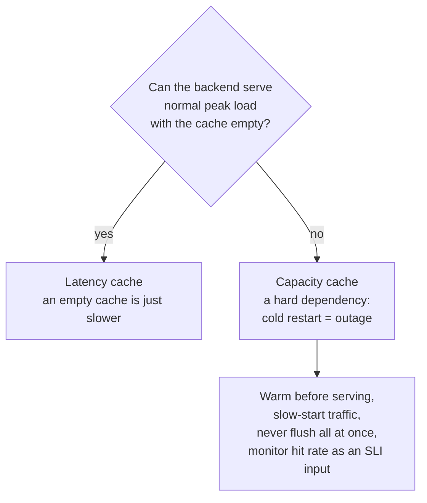

### Taming techniques

Every fix is one of three moves: **add randomness, dedupe, or ramp**.

| Technique | Move | Stops |
|---|---|---|
| **Jitter or stagger** retry waits, cache TTLs, cron times, reconnects | Randomness | Retry storms, synchronised timers, mass expiry |
| **Request coalescing (single-flight)**: one request recomputes, the rest wait for it | Dedupe | Cache stampede |
| **Refresh early / stale-while-revalidate** | Dedupe + randomness | Expiry misses on hot keys |
| **Slow start / gradual warm-up** | Ramp | Cold-cache restarts |
| **Rate limit (token bucket)** | Ramp | Bursts |
| **Gradual, off-peak config pushes** | Ramp | Self-made herds from all-at-once rollouts |

```java
private final ConcurrentHashMap<String, CompletableFuture<Price>> inFlight = new ConcurrentHashMap<>();

CompletableFuture<Price> price(String sku) {
    CompletableFuture<Price> mine = new CompletableFuture<>();
    CompletableFuture<Price> leader = inFlight.putIfAbsent(sku, mine);
    if (leader != null) {
        return leader;                                    // join the in-flight recompute
    }
    CompletableFuture.supplyAsync(() -> repository.loadPrice(sku)).whenComplete((value, error) -> {
        inFlight.remove(sku, mine);
        if (error != null) mine.completeExceptionally(error); else mine.complete(value);
    });
    return mine;
}
```

▶ Interactive lesson: [Lesson 12 · Graceful degradation & the thundering herd](lessons/0012-graceful-degradation-thundering-herd.html) · Cheat sheet: [Degradation & thundering herd](reference/0013-degradation-thundering-herd.html)

**Check yourself**

<details><summary>Under overload, what does graceful degradation mean?</summary>Doing less work per request, returning cheaper, lower-quality results (stale data, a subset, faster ranking) so the critical journey survives. It complements load shedding, which drops requests.</details>

<details><summary>A hot cache key expires and thousands of requests recompute it at the same instant. What's the best fix?</summary>Coalesce the recomputation (single-flight) and stagger or jitter key TTLs, ideally with early refresh. Shortening the TTL makes it worse.</details>

---

# Part V — Change & scale (Staff+)

Most outages are self-inflicted: we changed something. Part V makes change safe, keeps operational work from eating the team, and ends with the capstone skill: designing a reliable system from concrete numbers.

## 5.1 Progressive delivery — canary, flags and rollback

### Deploy is not release

Most incidents come from **binary or configuration pushes**. Progressive delivery separates two acts:

- **Deploy**: put the new code in production, dark, serving nobody.
- **Release**: expose it to users, gradually and reversibly.

### Canarying

Send a **small slice of real traffic** to the new version and **compare its SLIs against a control** running the old version at the same time, on the same kind of traffic. **Blast radius = canary size.**

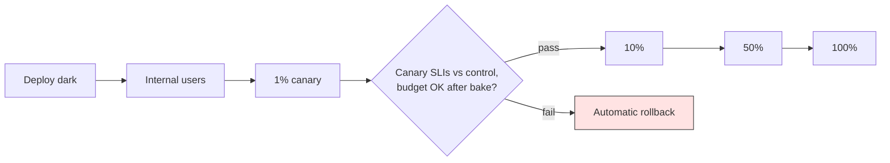

- **Bake time** at each step: long enough to see slow failures such as memory leaks or daily batch jobs.
- **Gate on the error budget**: with an exhausted budget the policy (§1.4) blocks the rollout.
- **Compare canary vs control, not canary vs yesterday.** Traffic mix and time of day change, and the control cancels that out.

### Feature flags

| Flag type | Owner | Lifetime | Example |
|---|---|---|---|
| **Release** | Developers | Short (days to weeks) | Hide an unfinished feature, then roll it out by percentage |
| **Experiment** | Product | Weeks | A/B test a new checkout layout |
| **Ops (kill switch)** | SRE / on-call | Long-lived | Turn off recommendations under load: graceful degradation on demand |

Make **flag state observable** (in traces, logs and the incident channel), give each flag a **human-readable description and owner**, and **pay down flag debt**: a stale release flag is dead code with a loaded trigger.

### Rollback must actually work

Rollback is only a safety net if it's **tested** (rehearse it), **schema-safe** and **mixed-version safe**: during a rollout old and new versions run side by side, and after a rollback old code meets whatever the new code wrote. Irreversible changes (data deletion, one-way migrations, external side effects) need extra safeguards: backups, dry runs and manual gates.

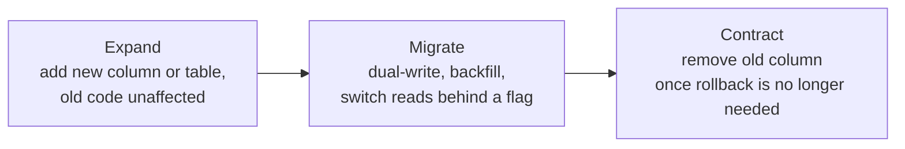

**Expand → migrate → contract** keeps every intermediate state backward compatible, so a rollback at any step is safe.

▶ Interactive lesson: [Lesson 13 · Progressive delivery: canary, flags & rollback](lessons/0013-progressive-delivery.html) · Cheat sheet: [Progressive delivery](reference/0014-progressive-delivery.html)

**Check yourself**

<details><summary>How does a canary release work?</summary>It sends a small slice of traffic to the new version and compares its signals with the control on real traffic. Blast radius = canary size. Widen gradually, with bake time.</details>

<details><summary>Why can a database schema change make rollback unsafe?</summary>The new schema may not work with the old code you roll back to. Use expand/contract (backward-compatible) migrations so rollback stays safe.</details>

## 5.2 Toil, automation and simplicity

### What toil is, and isn't

**Toil** is operational work that is **manual, repetitive, automatable, tactical, without enduring value, and O(n)**: it grows linearly with the service. Examples are re-running the same recovery script every week, hand-provisioning accounts and restarting a leaky pod.

**Not toil:** *overhead* (meetings, HR, planning), *grungy work with lasting value* (cleaning up alert config, migrating off a deprecated API), and *novel debugging*. Building automation and improving SLOs are engineering: they leave a permanent improvement.

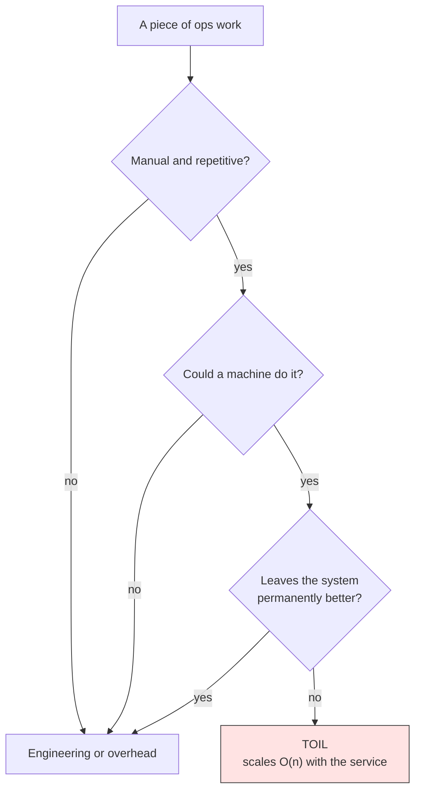

### The 50% cap

Left unchecked, toil grows with the service until it consumes **100% of the team's time**. Then nobody can engineer, and the curve never bends. SRE caps toil at **under 50%** of each engineer's time. **Breaching the cap is a signal**: the team redirects time into automation, or pushes operational work back to the developers who own the service.

### Automate the right thing, in the right order

Automating a bad process just **makes failure faster**. Simplify or delete the process first, then climb the ladder:

| Rung | What it looks like |
|---|---|
| 1. Manual | Someone remembers the steps |
| 2. Runbook | Written steps any on-call engineer can follow |
| 3. Human-triggered automation | One command or button runs the runbook |
| 4. Self-healing | The system detects the condition and fixes itself; humans are told afterwards |

### Simplicity is a reliability feature

> "There are two ways of constructing a software design: one way is to make it so simple that there are obviously no deficiencies, and the other way is to make it so complicated that there are no obvious deficiencies." — C.A.R. Hoare

- **Essential vs accidental complexity** (Brooks): the problem's inherent difficulty versus what we added. Fight the accidental kind relentlessly.
- **Boring is a virtue.** Choose well-understood technology for critical paths.
- **Delete dead code and dead flags.** Knight Capital lost **$440M in 45 minutes** when a deployment re-activated long-dead code through a repurposed flag.
- **Does it pay rent?** For every component, ask: does it remove more complexity than it adds? Does it shrink the blast radius? Does it have a clear owner? Can it be explained at 3 a.m.? If not, cut it.

▶ Interactive lesson: [Lesson 14 · Toil, automation & simplicity](lessons/0014-toil-automation-simplicity.html) · Cheat sheet: [Toil & simplicity](reference/0015-toil-and-simplicity.html)

**Check yourself**

<details><summary>Which is toil: manually rerunning the same recovery script every week, debugging a novel failure, or revising an SLO after new user-impact data?</summary>Rerunning the script. It's manual, repetitive, automatable and O(n). The other two leave a permanent improvement, so they're engineering.</details>

<details><summary>A teammate proposes adding a new service. What's the sharpest Staff+ question?</summary>"Does it remove more complexity than it adds?" In other words, does it pay rent: shrink the blast radius, have an owner, and stay explainable at 3 a.m.?</details>

## 5.3 NALSD — designing for reliability

### Non-abstract means numbers

**Non-abstract large-system design (NALSD)** turns the whiteboard into **concrete resource estimates**: QPS, bytes per day, machines and bandwidth, all of which must add up. Reliability is the top feature, so it's in the requirements from line one. **Sound assumptions beat perfect numbers**: state them, and the design can be checked.

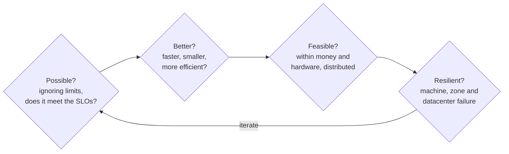

### Worked example — an ads-click dashboard (SRE Workbook, AdWords)

**Requirements as SLOs:** 99.9% of dashboard queries return in < 1 s, and the data is < 5 minutes old 99.9% of the time.

| Step | Estimate |
|---|---|
| Load | ~500,000 search queries/s, ~10,000 ad clicks/s |
| Data rate | 500k/s × ~100 B per log entry ≈ **50 MB/s** |
| Data per day | 50 MB/s × 86,400 s ≈ **4.3 TB/day** |
| Consequences | Scanning raw logs per query can't meet < 1 s, so **pre-aggregate**. 4 TB/day doesn't fit one machine, so **shard**. Plan **N+2** per zone. Buffering is allowed only as long as freshness (< 5 min) holds. |

### Back-of-envelope template

```text
1. Requirements AS SLOs   e.g. 99.9% < 1 s ; data < 5 min old
2. Load                   QPS, writes/s, users, peak vs average
3. Data                   QPS x bytes/entry -> MB/s -> GB-TB/day ; retention
4. Machines               load / per-machine capacity (+ overhead)
5. Redundancy             N+2 ; replicate across zones/regions
6. Bottleneck?            RAM? CPU? disk? bandwidth? -> reshape (shard, cache, pre-aggregate)
```

### The completeness test

A design isn't finished until it answers the operational questions too:

| Question | Covered by |
|---|---|
| **Measured?** SLOs, golden signals, observability | §1.1–1.3, §2.1, §2.2 |
| **Fails and degrades?** Overload, graceful degradation | §4.1, §4.2 |
| **Recovers?** Incident response, rollback | §3.1, §5.1 |
| **Changes safely?** Error-budget policy, canaries, flags | §1.4, §5.1 |
| **Owned and simple?** A clear owner, explainable at 3 a.m. | §3.1, §5.2 |

▶ Interactive lesson: [Lesson 15 · NALSD — designing for reliability](lessons/0015-nalsd-designing-for-reliability.html) · Cheat sheet: [NALSD & the reliable-design checklist](reference/0016-nalsd-reliable-design-checklist.html)

**Check yourself**

<details><summary>What does the "non-abstract" in NALSD demand?</summary>Concrete numbers (QPS, data size, machines, bandwidth) that must add up, iterated through possible → better → feasible → resilient. Capacity questions are not deferred to an ops team.</details>

<details><summary>By the SRE view, when is a system design incomplete?</summary>Until it explains how the system is monitored, how it fails and degrades, how it recovers, how it changes safely, and who owns it. That is the operational reality, not just the architecture.</details>

---

# Part VI — Verifying reliability

Everything so far is a claim: "we degrade gracefully", "rollback works", "the breaker opens". Part VI turns claims into evidence.

## 6.1 Chaos engineering — verify, don't hope

### A controlled experiment, not random breakage

Chaos engineering is *"the discipline of experimenting on a system in order to build confidence in the system's capability to withstand turbulent conditions in production."*

```mermaid
flowchart LR
    S["1 Steady state<br/>user-facing SLIs"] --> H["2 Hypothesis<br/>holds in control<br/>and experiment"]
    H --> I["3 Inject<br/>crash, latency,<br/>network cut"]
    I --> D{"4 Steady state<br/>diverged?"}
    D -- "no" --> C["More confidence,<br/>widen scope"]
    D -- "yes" --> X["Abort, found a weakness,<br/>file fix actions"]
    style X fill:#ffe3e3,stroke:#333
    style C fill:#d3f9d8,stroke:#333
```

1. **Steady state** is measurable, user-facing output: throughput, error rate, latency percentiles. That means your SLIs, not CPU.
2. **Hypothesise** that steady state holds in both the control and the experimental group.
3. **Inject** real-world events: an instance crash, added latency, a severed network, a dependency failure, resource exhaustion.
4. **Try to disprove** the hypothesis. The harder it is to break, the more confidence you have. A weakness becomes a fix target.

### Advanced principles

- **Hypothesise on the output**, not on internals. Verify *that* it works, not *how*.
- **Vary real-world events**, prioritised by impact × frequency.
- **Run in production** eventually. Start in staging, because only production has production's traffic and configuration.
- **Automate** experiments to run continuously, as Netflix's Chaos Monkey does.
- **Minimise the blast radius** and keep an **abort switch**. The abort condition is an SLO breach.

**Prerequisites:** observability (to see impact), SLOs (to define steady state) and mitigation or rollback (to stop it). Chaos on an unobserved, unresilient system is just an outage. **Tell on-call first.**

### GameDay run-sheet

| Step | Content |
|---|---|
| 1. Steady state | 1–2 SLIs and their current values |
| 2. Failure | One realistic event: kill an instance, add 300 ms to a dependency, block a downstream |
| 3. Hypothesis | "Tolerated because of `<resilience pattern from §4.1–4.2>`" |
| 4. Blast radius | The smallest useful scope. Abort condition = SLO breach. |
| 5. Run | Staging, then production. Observe and note surprises. |
| 6. Write-up | Postmortem style (§3.2), with action items filed |

**Tools:** Chaos Monkey, Gremlin, AWS Fault Injection Service, Chaos Mesh and LitmusChaos (Kubernetes).

▶ Interactive lesson: [Lesson 16 · Chaos engineering: verify, don't hope](lessons/0016-chaos-engineering.html) · Cheat sheet: [Chaos engineering & GameDays](reference/0017-chaos-engineering-gameday.html)

**Check yourself**

<details><summary>In a chaos experiment, what best defines "steady state"?</summary>A measurable, user-facing output such as your SLIs. Every server reporting healthy is not steady state. You hypothesise that steady state holds despite the injected failure.</details>

<details><summary>What is the most important safety rule when running a chaos experiment?</summary>Minimise the blast radius and keep an abort switch: the smallest experiment that still teaches you something. Grow scope as confidence grows, and tell on-call first.</details>

---

# Part VII — Staff-level judgement

The lessons give you the tools. A Staff engineer is valued for knowing **where to point them, how hard to push, and how to get an organisation to adopt them**. This part is about judgement: when the textbook answer is wrong, what to ask in a design review, and how to roll SLOs out without producing 400 dashboards nobody reads.

## 7.1 How much reliability, and where

```mermaid
flowchart TD
    A["New service or journey"] --> B{"On a critical<br/>user journey?"}
    B -- "no" --> C["Best effort: golden-signal<br/>dashboard, ticket-only alerts"]
    B -- "yes" --> D{"Users or contract<br/>need more than 99.9%?"}
    D -- "no" --> E["99% to 99.9% SLO,<br/>burn-rate pages,<br/>manual rollback OK"]
    D -- "yes" --> F{"Can you fund automated<br/>canary + rollback,<br/>N+2 multi-zone?"}
    F -- "no" --> G["Renegotiate the target<br/>or the scope; don't promise<br/>nines you can't operate"]
    F -- "yes" --> H["99.95%+ SLO, dependency<br/>budgets, chaos verification"]
    style G fill:#fff3bf,stroke:#333
```

**Dependency arithmetic.** A service can't be more available than its hard dependencies allow: three serial hard dependencies at 99.9% each cap you at about 99.7%. To promise more you must **soften dependencies** (caches, fallbacks, async queues, graceful degradation) or make them redundant.

## 7.2 Trade-offs you will be asked to make

| Decision | Option A | Option B | Staff heuristic |
|---|---|---|---|
| SLO tightness | Tight (99.99%) | Loose (99.5%) | Set it at the level where users *start to complain*, measured from data. Tighten only when it pays. |
| Window | 4-week rolling | Calendar month | Rolling for decisions and alerts, calendar for SLA reports |
| SLI source | Server-side metrics | Client telemetry / probers | Start server-side, add a prober for total-outage visibility, add RUM for critical web journeys |
| Alerting | Cause-based (CPU, queue) | Symptom-based (burn rate) | Page on symptoms. Causes go on dashboards and tickets. |
| Telemetry | Pre-aggregated metrics | Wide events / traces | Metrics for SLOs and alerts. Traces and wide events for debugging. Budget the cardinality. |
| Instrumentation | Vendor agent | OpenTelemetry | OTel for portability; let the Collector own the vendor choice |
| Overload | Shed load | Degrade | Both: degrade first to keep the critical journey, shed what's left |
| Rollout speed | Fast global push | Slow canary + bake | Speed scales with remaining budget. Exhausted budget means the slowest path. |
| Toil | Automate now | Tolerate | Automate when frequency × time × error risk exceeds build + maintenance cost; simplify first |

```mermaid
quadrantChart
    title Reliability investments, effort vs impact
    x-axis Low effort --> High effort
    y-axis Low impact --> High impact
    quadrant-1 Plan as projects
    quadrant-2 Do now
    quadrant-3 Fill-in work
    quadrant-4 Question it
    Burn rate alerts: [0.25, 0.85]
    Error budget policy: [0.2, 0.75]
    Canary with auto rollback: [0.6, 0.85]
    Multi region active active: [0.9, 0.55]
    Chaos GameDay: [0.4, 0.6]
    CPU alert tuning: [0.3, 0.15]
    Bespoke tracing backend: [0.85, 0.25]
```

## 7.3 Anti-patterns

| Anti-pattern | Why it hurts | Instead |
|---|---|---|
| SLO = current performance, or 100% | Locks in an accidental promise, or forbids change | Measure, round, negotiate (§1.3) |
| SLO without a policy | A number with no teeth (rung 2) | Signed policy with escalation (§1.4) |
| Paging on CPU, memory, pod restarts | Noise; misses unknown failure modes | Burn-rate pages on SLIs (§1.5) |
| `user_id` as a metric label | Cardinality explosion | Trace attributes / log fields (§2.1) |
| Averaging p99s across instances | Mathematically meaningless | `sum by (le)` then quantile, or bucket ratios (§1.2) |
| IC who also debugs | Nobody holds the big picture | Separate command from fixing (§3.1) |
| "Human error" root cause | Nothing changes, so it happens again | System fix that changes a default (§3.2) |
| Retries at every layer | 27× amplification | One layer, a budget, jitter (§4.1) |
| Untested degraded mode / rollback | Fails exactly when needed | Exercise it with GameDays (§6.1) |
| Automating a bad process | Faster failure | Simplify, then automate (§5.2) |

## 7.4 Design-review question bank

**User and SLO**
- Which user journeys does this serve, and what are their SLIs (good ÷ valid)?
- What SLO and window, from what data? Who signed it? What does the policy say when the budget is gone?
- What is the availability ceiling implied by your hard dependencies?

**Observability**
- How would you know users are hurting, before they tell you? Which burn-rate alerts page, and which only ticket?
- Can you go from an alert to a trace to a log line? Are `trace_id`s in your logs and exemplars on your histograms?
- What's the label cardinality of your top metrics? Which histogram buckets match your SLO thresholds?

**Failure and overload**
- What's the first resource to saturate, and at what load? Have you load-tested to the breaking point?
- Where are retries done, and how are they budgeted? Which calls are idempotent?
- What happens when each dependency is slow (not down)? Where are the timeouts, breakers and bulkheads?
- What does degraded mode serve, how is it triggered, and when was it last exercised?
- Is any cache a capacity cache? What happens after a full restart?

**Change**
- How is this deployed and released? What gates the canary, and does rollback work across schema versions?
- Which flags exist, who owns them, and when do they die?

**Operations and ownership**
- Who is on call, with which runbooks and what authority? What toil does this add per week, and does it scale O(n)?
- Does each component pay rent? Can it be explained at 3 a.m.?

## 7.5 Rolling out SLOs across an organisation

```mermaid
timeline
    title SLO adoption, one year
    section Quarter 1
        Pilot : one team and one critical journey : measure four weeks : first SLO document signed
    section Quarter 2
        Teeth : error budget policy with exec sign off : burn rate pages replace cause pages
    section Quarter 3
        Scale : SLO as code templates and generated rules : shared dashboards per journey
    section Quarter 4
        Govern : quarterly SLO reviews : budget status feeds roadmap planning
```

1. **Start where the pain is.** Pick a team that is suffering from pager noise or ship-vs-fix fights, and make them the visible success story.
2. **Get one executive sponsor** before the first freeze. A policy that is overruled the first time it bites is dead.
3. **Make the right thing the easy thing.** Provide a platform template (SLO spec → generated recording and alert rules, as Sloth does → dashboard). Teams should write a YAML file, not PromQL.
4. **Retire cause-based pages** as burn-rate alerts land. Measure success by pages per on-call shift and by the share of pages that were actionable.
5. **Review SLOs on a cadence.** Treat budget status as an input to quarterly planning, and loosen or tighten targets with data.
6. **Watch for SLO theatre**: hundreds of SLOs, targets nobody can explain, or budgets that never change a decision.

## 7.6 The SLO document template

```markdown
SLO document — <service>                    Status: draft | approved     Review: <date>
Owner: <team>          Approvers: Product <name> · Dev <name> · SRE <name>
Users and journeys: <who, which critical journeys>
SLIs (specification -> implementation):
  - Availability: proportion of valid <journey> requests not 5xx/429 -> LB metrics, codes ...
  - Latency: proportion of valid requests < 300 ms -> histogram le="0.3"
SLOs and window: 99.9% availability, 99% < 300 ms, 4-week rolling
Rationale: 4 weeks measured at <x>%, user research <link>, dependencies <list>
Error budget: <n> requests / ~40 min per 4 weeks · Policy: <link>
Alerting: multiwindow burn rate (14.4x/1h, 6x/6h page; 1x/3d ticket) · Dashboard: <link>
Exclusions and known gaps: <synthetics, bots, client 4xx; low-traffic endpoints>
```

---

# Capstone project

Carry **one real service** (or one you'd like to design) through the whole loop, and bring the result to a real design review.

```mermaid
flowchart LR
    A["SLIs and SLO doc<br/>(Part I)"] --> B["Burn-rate rules<br/>in the lab"]
    B --> C["Golden-signal dashboard,<br/>trace to log path"]
    C --> D["Runbook, roles,<br/>postmortem template"]
    D --> E["Degradation plan,<br/>retry and breaker policy"]
    E --> F["Canary gate,<br/>expand/contract plan"]
    F --> G["NALSD numbers,<br/>completeness test"]
    G --> H["GameDay that<br/>proves one claim"]
```

- [ ] State the top **SLI/SLO** (spec + implementation, window, budget in minutes and in requests), signed off by product, dev and SRE.
- [ ] Write the **error-budget policy**, with a named escalation executive.
- [ ] Implement **recording and burn-rate alert rules** and load them into the [lab](#hands-on-lab) Prometheus.
- [ ] Build a **golden-signals dashboard** and show one alert → trace → log path.
- [ ] Write a **runbook** for the page and a **postmortem template** with your triggers.
- [ ] Do the **back-of-envelope**: QPS, data per day, machines (+ N+2). Run *possible, better, feasible, resilient?*
- [ ] Run the **completeness test**: measured? fails and degrades? recovers? changes safely? owned and simple?
- [ ] Design one **GameDay** that verifies your weakest claim, and note your biggest remaining gap.

---

# Hands-on lab

The course ships a minimal, validated stack in [`assets/lab/`](assets/lab/README.md): an **OpenTelemetry Collector** (`otel/opentelemetry-collector-contrib`, ports 4317/4318, Prometheus exporter on 8889), **Prometheus** (`:9090`, scraping the Collector), **Jaeger** all-in-one (`:16686`, OTLP enabled) and **Grafana** (`:3000`, anonymous admin). The lab README and compose comments say `docker compose`. On this machine, run the same file with **Podman**:

```sh
podman machine start                 # macOS: once per boot
cd Observability/assets/lab
podman compose up -d                 # start Collector, Prometheus, Jaeger, Grafana
podman compose ps                    # all four should be running
podman compose logs -f otel-collector  # watch telemetry arrive (debug exporter)
podman compose down                  # stop and remove
```

| UI | URL | Use it for |
|---|---|---|
| Prometheus | http://localhost:9090 | PromQL, targets, rules, alerts |
| Jaeger | http://localhost:16686 | Traces and spans |
| Grafana | http://localhost:3000 | Dashboards over Prometheus |
| Collector metrics | http://localhost:8889/metrics | See the exact metric and label names before writing queries |

**Exercise 1 — instrument and look.** Run your service with zero-code instrumentation (§2.3), `OTEL_EXPORTER_OTLP_ENDPOINT=http://localhost:4318`, `OTEL_EXPORTER_OTLP_PROTOCOL=http/protobuf` and `OTEL_SERVICE_NAME=my-service`. Generate traffic with a loop of `curl` calls or any load tool. Query traffic, error ratio and p95 in Prometheus, then find a slow request in Jaeger.

**Exercise 2 — dashboards.** Grafana has no data source pre-provisioned. Add one: *Connections → Data sources → Prometheus*, URL `http://prometheus:9090` (the compose service name, not localhost). Build one panel per golden signal.

**Exercise 3 — SLO rules.** The lab's `prometheus.yml` has no `rule_files` yet. Create `slo-rules.yml` next to it with the recording and alert rules from §1.5, adapted to the OTel metric (`http_server_request_duration_seconds_count`, bad = `http_response_status_code=~"5..|429"`). Then:

```yaml
# prometheus.yml: add at top level
rule_files:
  - /etc/prometheus/slo-rules.yml
```

```yaml
# docker-compose.yml: add under services.prometheus.volumes
      - ./slo-rules.yml:/etc/prometheus/slo-rules.yml
```

```sh
podman run --rm -v "$PWD/slo-rules.yml:/rules.yml" --entrypoint promtool prom/prometheus:latest check rules /rules.yml
podman compose up -d                 # recreates Prometheus with the new mount
```

Open http://localhost:9090/rules and `/alerts`. Make your service return 500 for a share of requests and watch `ErrorBudgetBurn_Page` go pending, then firing. Stop the errors and watch it reset as the short window drains.

**Exercise 4 — chaos in miniature.** Run `podman compose stop jaeger` while traffic flows. Does your service's steady state (its SLIs) hold? What does the Collector log say? Then run `podman compose start jaeger`. Write it up with the GameDay run-sheet (§6.1).

**Notes.** The `otel-collector-internal` scrape target (`:8888`) may show as DOWN depending on the Collector's internal-telemetry settings. It's harmless for the exercises. Images use `:latest` for convenience, so pin versions for anything real.

---

# Self-assessment checklist

Without notes, can you:

- [ ] Explain SLI vs SLO vs SLA with the five-second test, and why 100% is the wrong target?
- [ ] Write good ÷ valid availability and latency SLIs in PromQL, with correct status-code verdicts and an exact `le` bucket?
- [ ] Turn four weeks of data into an SLO (round availability down, latency up) and compute the budget in requests and in minutes?
- [ ] State the default error-budget policy, the cause exceptions, the 20% postmortem trigger and why exec sign-off matters?
- [ ] Derive 14.4× / 6× / 1×, the thresholds for any SLO, and the budget consumed at firing, and explain why the short window exists?
- [ ] Explain the low-traffic trap and three fixes?
- [ ] Walk metric → trace → log for a 3 a.m. page, and say why `user_id` must not be a metric label?
- [ ] Name the four golden signals, the traps in each, and when to use RED vs USE?
- [ ] Draw the OTel → Collector → Prometheus/Jaeger → Grafana pipeline with ports, and fix a gRPC/HTTP port mismatch?
- [ ] Assign IC, Ops, Comms and Planning roles, pick a severity, and justify "mitigate before you diagnose"?
- [ ] Rewrite a "human error" root cause and a theater action item into system fixes?
- [ ] Explain the retry spiral, and design shedding, a retry budget, backoff with jitter, a breaker and a bulkhead?
- [ ] Tell a latency cache from a capacity cache, and fix a cache stampede three ways?
- [ ] Design a canary with a control, bake time and a budget gate, plus an expand/contract migration?
- [ ] Classify work as toil or not, and apply the 50% cap and the "pays rent?" test?
- [ ] Produce a NALSD back-of-envelope and run the completeness test?
- [ ] Design a chaos experiment with an SLI steady state, a hypothesis, a blast radius and an abort condition?

---

# Resources

**Canonical SRE**
- [Google — *Site Reliability Engineering* (SRE Book, free)](https://sre.google/sre-book/table-of-contents/): [SLOs](https://sre.google/sre-book/service-level-objectives/), [Embracing risk](https://sre.google/sre-book/embracing-risk/), [Monitoring distributed systems](https://sre.google/sre-book/monitoring-distributed-systems/), [Managing incidents](https://sre.google/sre-book/managing-incidents/), [Postmortem culture](https://sre.google/sre-book/postmortem-culture/), [Addressing cascading failures](https://sre.google/sre-book/addressing-cascading-failures/), [Eliminating toil](https://sre.google/sre-book/eliminating-toil/), [Simplicity](https://sre.google/sre-book/simplicity/)
- [Google — *The SRE Workbook* (free)](https://sre.google/workbook/table-of-contents/): [Implementing SLOs](https://sre.google/workbook/implementing-slos/), [Alerting on SLOs](https://sre.google/workbook/alerting-on-slos/), [Error-budget policy](https://sre.google/workbook/error-budget-policy/), [SLO document](https://sre.google/workbook/slo-document/), [Canarying releases](https://sre.google/workbook/canarying-releases/), [Non-abstract large-system design](https://sre.google/workbook/non-abstract-design/)
- [The Art of SLOs workshop](https://sre.google/resources/practices-and-processes/art-of-slos/) · [SRE books](https://sre.google/books/) · [SRE resources hub](https://sre.google/resources/)

**Observability and instrumentation**
- [OpenTelemetry docs](https://opentelemetry.io/docs/): [Observability primer](https://opentelemetry.io/docs/concepts/observability-primer/), [Collector quick start](https://opentelemetry.io/docs/collector/quick-start/), [Zero-code instrumentation](https://opentelemetry.io/docs/zero-code/), [OTel Demo](https://opentelemetry.io/docs/demo/) ([repo](https://github.com/open-telemetry/opentelemetry-demo))
- [Prometheus overview](https://prometheus.io/docs/introduction/overview/) · [Histograms and summaries](https://prometheus.io/docs/practices/histograms/) · [Grafana docs](https://grafana.com/docs/grafana/latest/)
- [Brendan Gregg — the USE method](https://www.brendangregg.com/usemethod.html) · [*Observability Engineering* (Majors, Fong-Jones, Miranda)](https://info.honeycomb.io/observability-engineering-oreilly-book-2022)

**Depth and judgement**
- [PagerDuty Incident Response](https://response.pagerduty.com/) · [PagerDuty postmortem process](https://response.pagerduty.com/after/post_mortem_process/)
- [AWS Builders' Library — Timeouts, retries and backoff with jitter](https://aws.amazon.com/builders-library/timeouts-retries-and-backoff-with-jitter/) · [Fowler — CircuitBreaker](https://martinfowler.com/bliki/CircuitBreaker.html) · [Fowler — Feature toggles](https://martinfowler.com/articles/feature-toggles.html)
- [Principles of Chaos Engineering](https://principlesofchaos.org/)

**Communities:** [r/sre](https://reddit.com/r/sre) · [r/devops](https://reddit.com/r/devops) · [CNCF Slack](https://slack.cncf.io/) (`#prometheus`, `#opentelemetry`) · [SREcon (USENIX)](https://www.usenix.org/srecon)

**In this repo:** [Glossary](GLOSSARY.md) · [Mission](MISSION.md) · [Notes](NOTES.md) · [Curated resources](RESOURCES.md) · [Event Sourcing guide](../event-sourcing/GUIDE.md) (the same depth-first format) · [Skills to upgrade](../02-skills-to-upgrade.md)

## Study plan (8 weeks)

| Week | Focus | Output |
|---|---|---|
| 1 | §1.1–1.2 SLIs | SLI specs and implementations for one real service; PromQL for each |
| 2 | §1.3–1.4 SLO and policy | Signed SLO document + error-budget policy draft |
| 3 | §1.5 Burn-rate alerting | Recording and alert rules passing `promtool`; old cause pages listed for removal |
| 4 | §2.1–2.3 Observability + lab | Lab running under Podman; service instrumented; alert → trace → log demo |
| 5 | §3.1–3.2 Incidents and postmortems | Runbook, severity table, postmortem template; one past incident rewritten blamelessly |
| 6 | §4.1–4.2 Resilience | Retry/timeout/breaker policy for each dependency; degradation and herd plan |
| 7 | §5.1–5.3 Change and scale | Canary gate design, expand/contract plan, toil inventory, NALSD numbers |
| 8 | §6.1 + Part VII + capstone | GameDay run, design-review pass with the question bank, capstone presented |

> **Final advice:** reliability work is persuasive only when it's measured. Lead with the user journey and the budget, not with tools, and make every proposal answer "which number does this move, and by how much?" That habit separates a Staff engineer from a very good operator.
