# Async & Messaging — From Level 0 to Staff Engineer

> **The core idea in one sentence:** a durable broker between producer and consumer *decouples them in time* — and every other topic in this guide (guarantees, idempotency, ordering, backpressure, outbox, sagas, CDC) is either a way to cash in on that decoupling or a way to pay for it safely.

This guide takes you from "I have only ever built synchronous request/response" to "I can design, build, operate and *say no to* an event-driven system, and defend the trade-offs in an architecture review." It is the long-form, single-file edition of the 19 interactive lessons and 19 cheat sheets in this folder. Code is **Kotlin + Spring Boot** (constructor injection, `KafkaTemplate`, `@KafkaListener`, `RabbitTemplate`, spring-cloud-aws), the main broker is **Apache Kafka**, with **RabbitMQ, SQS/SNS, Redis Streams and Pulsar** as contrasts, and change data capture uses **PostgreSQL + Debezium**. Canonical terms live in the [glossary](GLOSSARY.md).

---

## Table of contents

| Part | Section | You will be able to… |
|---|---|---|
| 1 | [Foundations](#part-1--foundations-why-async-topology-and-intent) | Justify sync vs async, pick a queue or a topic, explain why consumers ≤ partitions, name messages by intent |
| 2 | [Delivery semantics & Kafka exactly-once](#part-2--delivery-semantics-and-kafka-exactly-once) | Reason about at-most / at-least / effectively-once, explain Kafka EOS internals, and operate it |
| 3 | [Reliability patterns](#part-3--reliability-patterns-idempotency-ordering-backpressure-failure) | Build idempotent consumers, choose ordering keys, level load, contain poison messages |
| 4 | [Broker models & distributed workflows](#part-4--broker-models-and-distributed-workflows) | Choose log vs queue, choreography vs orchestration, fix dual writes, design sagas |
| 5 | [Evolution, history & operations](#part-5--evolution-history-and-operations) | Evolve schemas safely, judge event sourcing / CQRS, observe async flows |
| 6 | [Change data capture with PostgreSQL & Debezium](#part-6--change-data-capture-with-postgresql-and-debezium) | Predict CDC behaviour during snapshots, restarts, idle periods and failover |
| 7 | [Staff-level judgement](#part-7--staff-level-judgement) | Decide *when not to*, run the design review, write the ADR |
| — | [Capstone project](#capstone-project) | Prove it end to end with a Kotlin order saga |
| — | [Self-assessment & resources](#self-assessment-checklist) | Know when you're done |

```mermaid
flowchart LR
    P1["Part 1<br/>Why async, queue vs topic,<br/>consumer groups, intent"] --> P2["Part 2<br/>Delivery guarantees,<br/>Kafka exactly-once"]
    P2 --> P3["Part 3<br/>Idempotency, ordering,<br/>backpressure, DLQs"]
    P3 --> P4["Part 4<br/>Log vs queue, EDA,<br/>outbox, sagas"]
    P4 --> P5["Part 5<br/>Schemas, ES/CQRS,<br/>observability"]
    P5 --> P6["Part 6<br/>PostgreSQL CDC<br/>with Debezium"]
    P6 --> P7["Part 7<br/>Staff judgement:<br/>when not to, ADRs"]
    P7 --> CAP["Capstone<br/>Order saga in Kotlin"]
    style P7 fill:#f6e3e3,stroke:#7a2e2e,color:#000
```

**How to study this guide (≈ 6 weeks part-time, 3–5 h/week):**

1. Read one section, then open its **interactive lesson** (link at the end of every section) and step through the animation before you answer the "Check yourself" questions. Answer *before* you expand them.
2. Type the Kotlin snippets into a scratch Spring Boot app against a local Kafka (`podman compose up -d` from the capstone). Break things on purpose: kill a consumer mid-batch, add partitions, publish a poison message.
3. Keep the matching **cheat sheet** open while you work — they are the print-friendly compression of each lesson.
4. Read Part 7 twice. Write an ADR for one real async decision at work — including the decision *not* to add a broker.
5. Build the [Capstone](#capstone-project), milestone by milestone.

---

# Part 1 — Foundations: why async, topology and intent

The first four lessons build the vocabulary every later decision rests on: *why* you would put a broker in the path at all, *who* receives a message, *how* Kafka shares work across a consumer group, and *what kind* of message you are sending.

## 1.1 Why async? Temporal coupling and the four cracks

Start with the shape you know. An order service saves an order and calls the email service directly:

```kotlin
@Service
class OrderService(
    private val orderRepository: OrderRepository,
    private val emailClient: EmailClient,          // e.g. a Feign / RestClient call
) {
    fun placeOrder(order: Order): String {
        orderRepository.save(order)
        emailClient.sendConfirmation(order)        // blocks until Email replies
        return "OK"
    }
}
```

This is synchronous communication: the caller sends a request and holds its thread until the callee answers. Simple, direct, easy to reason about — and for a lot of code, exactly right. But it quietly assumes Email is **up right now**, **fast enough right now** and **able to keep up right now**. That assumption is **temporal coupling**: both services must be healthy at the same instant for the request to succeed.

| When… | …the synchronous call |
|---|---|
| **Email is down** | Your order fails too, although the order itself was fine. Failure cascades from a non-critical dependency into the critical path. |
| **Email is slow** | Caller latency = its own work + the slowest thing it calls. Waits stack up; threads pile on. |
| **Traffic spikes** | A burst of orders becomes an identical burst hammering Email in real time. No shock absorber; the weakest downstream buckles. |
| **You add a 3rd, 4th consumer** | Analytics, inventory, loyalty… the order service must know, call and wait for every one of them. Coupling grows with each addition. |

The root issue is not any single failure: **the sender's fate is tied to the receiver's, in real time.**

### The one structural move: a durable buffer in between

Asynchronous messaging makes one change. The producer hands a message to a **message broker** — infrastructure whose only job is to durably hold the message and deliver it when the consumer is ready. The code barely changes shape, but its meaning changes completely:

```kotlin
@Service
class OrderService(
    private val orderRepository: OrderRepository,
    private val kafkaTemplate: KafkaTemplate<String, OrderPlaced>,
) {
    fun placeOrder(order: Order): String {
        orderRepository.save(order)
        kafkaTemplate.send("order.placed", OrderPlaced.from(order))  // returns at once; no waiting on Email
        return "OK"
    }
}
```

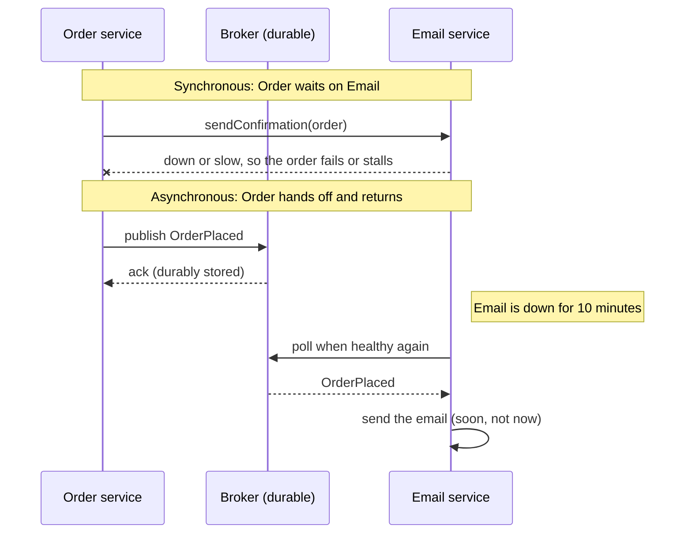

> 🧭 **Staff instinct:** async is not primarily about being *faster*. It is about **decoupling in time** — the producer no longer waits for, or depends on the liveness of, the consumer. The durable message is the primitive that buys it.

Chris Richardson's messaging pattern lists the payoff:

- **Loose runtime coupling** — sender and consumer need not know each other or be alive together. Add a fifth consumer without touching the producer.
- **Improved availability** — the broker buffers until the consumer recovers, so a downstream outage degrades gracefully instead of cascading.
- **Load leveling** — a spike becomes queue depth, not a stampede.
- **Many communication styles** — one published message can fan out to notifications, pub/sub subscribers and async request/reply.

And the bill, which a Staff engineer names in the same breath: a new piece of **critical infrastructure** to run highly available; **eventual** rather than immediate results; **no easy return value** (request/reply gets harder); and new failure modes — **duplicates, reordering and delay** — that the rest of this guide tames. You are trading simplicity for decoupling. Sometimes that trade is wrong.

### Now vs soon: the first-cut heuristic

Use **synchronous** when the caller *genuinely needs the answer to continue* ("is this card valid so I can show the next screen?"). Use **asynchronous** when the work must happen *soon, but not necessarily now*, and the caller should not be held hostage to it — email, analytics, search-index rebuilds, notifying other services. "Now vs soon" is a first cut; [Part 7](#71-when-to-go-async--and-when-not-to) sharpens it into a full decision framework.

▶ Interactive lesson: [Lesson 01 · Why async?](lessons/0001-why-async.html) · Cheat sheet: [Sync ↔ Async decision](reference/0001-sync-vs-async-cheatsheet.html)

**Check yourself**

<details><summary>What is the primary thing asynchronous messaging gives you over a direct call?</summary>It decouples producer and consumer in time. The broker durably holds the message, so the sender's success no longer depends on the receiver being up and fast right now. Speed is a side effect at best.</details>

<details><summary>A checkout must verify a credit card before showing the next screen. Sync or async?</summary>Synchronous. The caller cannot continue without the answer — that is the signature of a synchronous need. Async fits work that can happen soon, not now.</details>

<details><summary>Name three costs you accept the moment you add a broker.</summary>A new critical piece of infrastructure to keep highly available; eventual instead of immediate results (no easy return value); and duplicates, reordering and delay as new failure modes.</details>

## 1.2 Queues vs topics: one consumer, or many?

Every broker offers two delivery topologies, and the choice decides who sees a message:

- **Point-to-point (queue)** — each message is handled by **exactly one** consumer. Add consumers and they **compete** for messages, sharing the work (EIP's *competing consumers*). Use it to *distribute tasks*.
- **Publish–subscribe (topic)** — each subscriber gets **its own copy** of every message (*fan-out*). Use it to *announce facts* to independent parties.

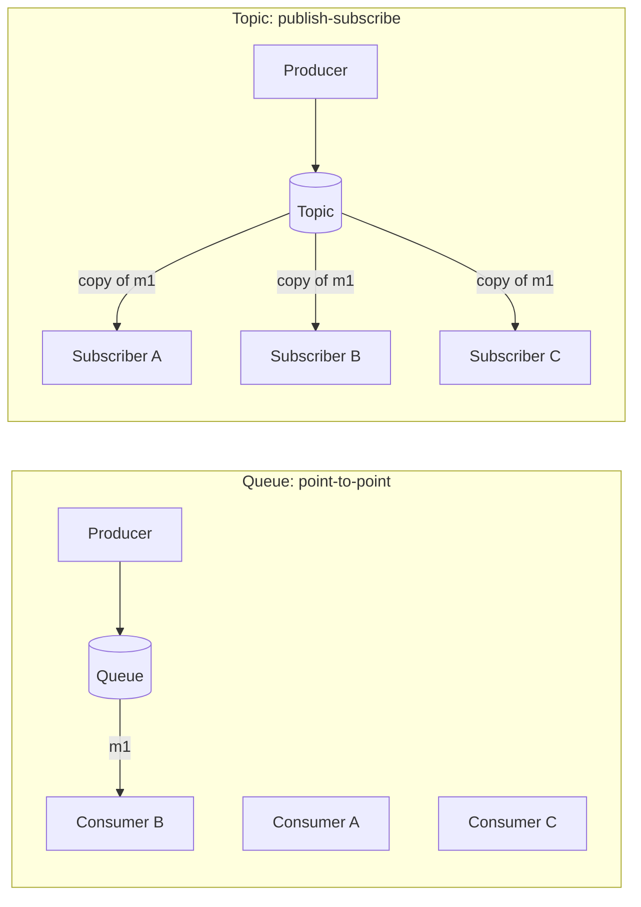

Same message, opposite outcome: the queue hands m1 to one consumer (B) and A and C get nothing; the topic delivers an independent copy to A, B and C. Getting this wrong is a classic incident: "we scaled the email worker to ten instances and every customer got ten emails" — ten *subscribers* on a topic means ten copies, because competing consumers only exist on a queue.

### In Kafka: the groupId decides

Kafka has only topics, but the **consumer group** turns them into either model. The same `groupId` on every instance = competing consumers (each record handled once by the group). Different `groupId`s = fan-out (each group gets every record):

```kotlin
// SAME groupId on every instance → competing consumers.
// Run 3 pods; Kafka shares the partitions; each order is handled once.
@Component
class FulfillmentListener(private val fulfillment: FulfillmentService) {
    @KafkaListener(topics = ["order.placed"], groupId = "fulfillment")
    fun handle(event: OrderPlaced) = fulfillment.reserveStock(event)
}

// DIFFERENT groupIds → publish-subscribe fan-out.
// Email and Analytics each receive their OWN copy of every order.
@Component
class EmailListener(private val email: EmailService) {
    @KafkaListener(topics = ["order.placed"], groupId = "email")
    fun handle(event: OrderPlaced) = email.sendConfirmation(event)
}

@Component
class AnalyticsListener(private val analytics: AnalyticsService) {
    @KafkaListener(topics = ["order.placed"], groupId = "analytics")
    fun handle(event: OrderPlaced) = analytics.record(event)
}
```

Inside one group, parallelism is capped by the **partition** count: 4 partitions and 6 consumers in one group → 4 work, 2 sit idle (section [1.3](#13-kafka-consumer-groups-why-consumers--partitions) explains why).

| Broker | Point-to-point (handled once) | Pub/sub fan-out (all get a copy) |
|---|---|---|
| **Kafka** | One consumer group on a topic | Multiple consumer groups on a topic |
| **RabbitMQ** | Consumers on one queue | Fanout/topic exchange → many queues |
| **AWS** | An **SQS** queue | An **SNS** topic → many SQS/HTTP subscribers |
| **Redis** | Stream + consumer group (`XREADGROUP`) | Pub/Sub, or multiple stream groups |
| **Pulsar** | `Shared` / `Key_Shared` subscription | Multiple subscriptions on a topic |

> 🧭 **Staff instinct:** ask "is this a *task* that must be done once, or a *fact* that several parties care about?" before you pick a channel. Tasks → queue semantics. Facts → topic semantics.

▶ Interactive lesson: [Lesson 02 · Queues vs topics](lessons/0002-queue-vs-topic.html) · Cheat sheet: [Queue ↔ Topic topology](reference/0002-queue-vs-topic-cheatsheet.html)

**Check yourself**

<details><summary>OrderPlaced must reach Fulfillment, Email and Analytics. Queue or topic?</summary>A topic (publish–subscribe). Three independent parties each need their own copy. On Kafka: three different consumer groups on one topic.</details>

<details><summary>A Kafka topic has 4 partitions; you run 6 consumers in one group. What happens?</summary>Four consumers each own one partition and work; two sit idle as hot standbys. A partition is never shared between consumers of the same group.</details>

## 1.3 Kafka consumer groups: why consumers ≤ partitions

This is the deepest Part 1 section because it explains behaviour you will see in production every week: idle pods, rebalance pauses during deploys, and the surprising side-effects of adding partitions.

### The invariant and its design reason

Confluent's architecture course states it in one sentence: *"The unit of parallelism is the partition… a partition can only be processed by one consumer"* in a group; *"we could add a fifth but it would sit idle since partitions cannot be shared."* A consumer may own several partitions; a partition is never split across consumers of the same group. Maximum useful parallelism = partition count.

The rule is not arbitrary. It buys the two guarantees Kafka's model rests on:

- **Ordering.** Kafka only promises order within a partition — an append-only log read sequentially by one cursor. Two readers would interleave unpredictably.
- **Offset ownership.** Progress is a single committed offset per `(group, partition)` in the internal `__consumer_offsets` topic. One owner ⇒ one writer ⇒ one unambiguous "processed up to here". Two owners would race on the commit and cause reprocessing or skips.

**Mental model:** a partition is a queue with a single bookmark. Sharing a bookmark between two readers is incoherent, so each partition gets one reader per group. The idle consumer is an honest consequence of the ordering + offset guarantees, not a missing feature.

### How the group protocol enforces it

No broker load-balances partitions onto consumers. In the **classic consumer-group protocol** the clients run a small embedded protocol, and "group membership is all the broker/coordinator knows about the group":

1. **FindCoordinator** — the broker hashes `group.id` modulo the `__consumer_offsets` partition count; the leader of that partition is the group's **group coordinator**.
2. **JoinGroup** — consumers send their subscriptions. The coordinator picks one (usually the first) as **group leader**, gives every member a `memberId`, and hands the leader the full member list.
3. **Assign, client-side** — the leader runs the configured **assignment strategy** and sends the plan in **SyncGroup**. Others send an empty SyncGroup and receive their slice. This is where consumers 5 and 6 get nothing.
4. **Heartbeat** — miss `session.timeout.ms` and the coordinator declares you dead and triggers a **rebalance**; your partitions go to survivors (that is how an idle standby gets promoted).

Kafka's newer consumer protocol (KIP-848) can compute assignments coordinator-side; the classic protocol is still what most deployments and the lesson animations show.

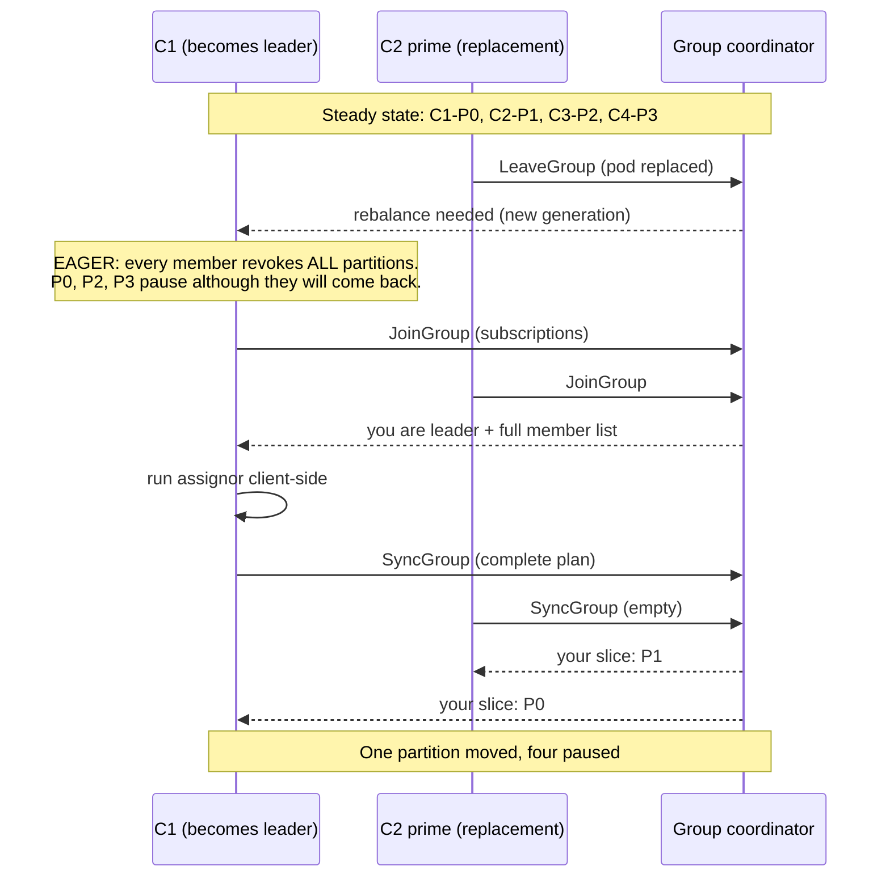

### Rebalances: two costs, three complementary fixes

The classic **eager** protocol is stop-the-world: on any membership change every consumer revokes *all* partitions, then waits for a fresh plan. That creates two distinct harms:

1. **Needless local-state rebuild** — a stateful consumer discards caches / state-store slices for partitions that will come straight back to it.
2. **Needless paused processing** — no partition has an owner while the group negotiates, even ones that are not moving.

| Fix | What it solves | How |
|---|---|---|
| `StickyAssignor` | Cost 1 (state rebuild) | Uses the previous assignment as input and keeps partitions with their current owner where it can; only the moved partition is rebuilt. Does not remove the eager pause. |
| `CooperativeStickyAssignor` | Cost 2 (global pause) | Two rounds: first revoke *only* the partitions that must move, then assign the now-unowned partitions. Unaffected partitions never stop. |
| **Static membership** (`group.instance.id`) | Rebalances caused by short planned restarts | A member with a stable, unique id does not send LeaveGroup on a planned stop; if it returns before `session.timeout.ms`, no rebalance happens at all. |

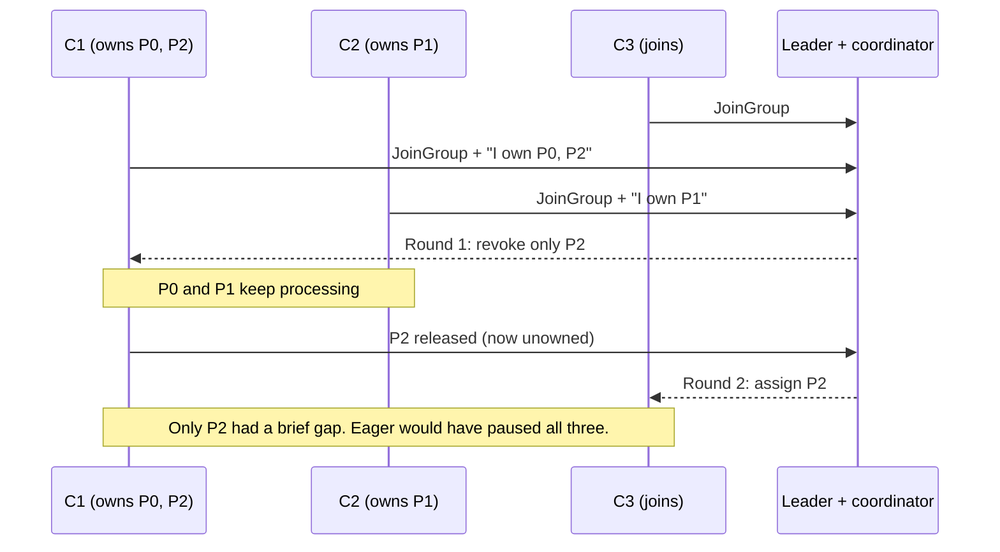

Static membership is a deliberate availability trade-off: if the member does *not* return before the session timeout, its partitions wait the full timeout before moving. Use a **unique, stable** identity such as a StatefulSet slot (`fulfillment-1`), never an ephemeral Deployment hostname; duplicate live ids cause one member to be fenced.

**The rolling-deploy picture.** Ten pods own ten partitions. Under eager rebalancing, replacing pod 1 revokes all ten partitions to move one; repeat for ten waves and the whole group stops ten times. Under cooperative rebalancing each wave revokes only the departing pod's partition — nine workers stay useful in every wave. The group may still rebalance on every membership change; the blast radius shrinks from the group to one partition.

### Assignment strategies

| Strategy | Behaviour & when to pick it |
|---|---|
| `RangeAssignor` (default) | Per-topic ranges. Enables **co-partitioned joins**: the same key lands on the same-indexed partition across topics → same consumer. Can **skew** load: 5 partitions / 3 consumers → C1 gets 2, C2 gets 2, C3 gets 1 *per topic*, and the skew compounds across topics. |
| `RoundRobinAssignor` | Spreads all partitions evenly across members. Better balance; loses the co-partition property. |
| `StickyAssignor` | Even, and preserves prior ownership across rebalances (less churn). |
| `CooperativeStickyAssignor` | Sticky + incremental cooperative rebalancing. The modern choice for large or frequently scaled groups. |

### What the design buys and what it costs

**Wins:** brokers stay dumb and scale (they store the log and track membership + offsets; coordination is client-side, which is part of why one cluster hosts tens of thousands of groups); strong per-partition ordering and single-writer offsets for free; automatic failover; elastic scaling up to the partition count with no code change.

**Costs:** parallelism is **capped by partition count**, decided largely up front; idle consumers waste money; over-partitioning is not free either (more file handles and broker memory, longer leader elections and failover, higher end-to-end latency, slower rebalances); changing the count reshuffles key→partition mapping; **hot partitions** from key skew overload one consumer while others idle; rebalances pause processing unless you adopt cooperative rebalancing + static membership.

**Partition-count heuristic:** `partitions = max(target_throughput / per_consumer_throughput, desired_max_consumers)`, rounded up for growth. It is far easier to run fewer consumers than partitions than to add partitions later — but avoid "thousands, just in case".

### Adding partitions is a routing change, not a resize

Kafka lets you increase a topic's partition count (never decrease). It does **not** redistribute existing data, and keyed records can map differently afterwards.

| After 4 → 6 partitions | Production consequence |
|---|---|
| **Only P4 and P5 are created** | P0–P3 are not split. Historic records and backlog stay put — an existing hot partition is not repaired. |
| **Future keyed routing can change** | With hash-modulo routing the same key can move to a new partition. Each partition stays ordered, but the key now has two independent histories. |
| **Clients discover new metadata** | The group must reassign before P4/P5 have owners. With no committed offset on a new partition, `auto.offset.reset=latest` can skip records written before the group starts reading it. |
| **Potential parallelism grows** | Real capacity grows only if you add consumers; otherwise the same consumers own more partitions. |
| **Topology assumptions change** | Co-partitioned topics, Kafka Streams joins (need matching counts and partitioning), explicit partition numbers, alerts and capacity plans all need review. |

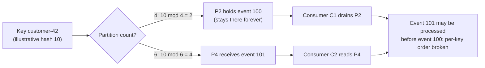

**Staff checklist before an in-place increase:** (1) which keys need strict historical order; (2) which streams/join inputs must stay co-partitioned; (3) how every consumer initialises offsets on new partitions; (4) which consumers absorb the new partitions; (5) how you will watch assignment churn, skipped-record risk, lag and broker capacity. If any answer is unsafe, create a versioned topic (`orders-v2`), cut each key over only after old work drains (or merge both histories by a sequence number), and migrate co-partitioned inputs together.

### In your stack: Spring Kafka knobs

In spring-kafka, listener `concurrency` is the number of consumer threads per app instance. **Total consumers = instances × concurrency**; anything beyond the partition count idles.

```kotlin
@Bean
fun kafkaListenerContainerFactory(
    cf: ConsumerFactory<String, OrderPlaced>,
): ConcurrentKafkaListenerContainerFactory<String, OrderPlaced> =
    ConcurrentKafkaListenerContainerFactory<String, OrderPlaced>().apply {
        consumerFactory = cf
        setConcurrency(4)   // 4 consumer threads; give the topic >= 4 partitions or some idle
    }
```

```yaml
spring:
  kafka:
    consumer:
      group-id: fulfillment
      properties:
        partition.assignment.strategy: org.apache.kafka.clients.consumer.CooperativeStickyAssignor
        session.timeout.ms: 45000          # miss heartbeats this long -> declared dead -> rebalance
        max.poll.interval.ms: 300000       # too-slow processing also triggers a rebalance
        group.instance.id: ${STABLE_MEMBER_ID}  # e.g. StatefulSet slot; survives a transient restart
```

> 🧭 **The bug this explains:** "We scaled to 20 pods but throughput flatlined." The topic had 8 partitions, so 12 pods were idle. More partitions may be the fix — but treat the increase as a controlled routing change.

▶ Interactive lesson: [Lesson 03 · Why consumers ≤ partitions](lessons/0003-kafka-consumer-groups-deep-dive.html) · Cheat sheet: [Kafka consumer group internals](reference/0003-kafka-consumer-groups-cheatsheet.html)

**Check yourself**

<details><summary>What is the deepest reason Kafka forbids two consumers of one group from sharing a partition?</summary>It preserves per-partition ordering and a single committed offset. One owner per (group, partition) gives one ordered cursor and one unambiguous offset writer in <code>__consumer_offsets</code>.</details>

<details><summary>Who actually computes which consumer gets which partition (classic protocol)?</summary>The elected group leader — a client — runs the assignor and sends the plan to the coordinator via SyncGroup. The coordinator only tracks membership and relays slices.</details>

<details><summary>Why can't adding partitions repair today's hot, backlogged P2 by itself?</summary>Historic records remain in P2. New partitions start empty and only change future routing; you also need more consumers to use the new capacity.</details>

## 1.4 Event vs command vs query: naming what flows

Before you pick a channel, decide what kind of message you are sending. The three intents differ in who decides what happens next:

| | Command | Event | Query |
|---|---|---|---|
| **Says** | "Do this" | "This happened" | "Tell me this" |
| **Name** | Imperative: `ShipOrder` | Past tense: `OrderShipped` | Interrogative: `GetStatus` |
| **Handlers** | One logical owner | Zero to many | One responder |
| **Reply?** | Maybe an ack/result | No | Yes — the data |
| **Channel** | Queue (point-to-point) | Topic (pub/sub) | Sync request/reply |
| **Who decides** | The sender | Each consumer | The responder |

The key is the **coupling inversion**. A command couples the sender to *what* must happen and *who* does it. An event inverts that: the publisher states a fact and is indifferent to who reacts — consumers decide. That is what lets you add a loyalty service months later without touching the order service.

```kotlin
// COMMAND — imperative; one owner; expresses intent to act
data class ShipOrder(val orderId: String, val address: Address)

// EVENT — past tense; a fact that already happened; publisher indifferent to reactors
data class OrderPlaced(val orderId: String, val customerId: String, val total: Money)

// QUERY — interrogative; asks for data and expects a reply
data class GetOrderStatus(val orderId: String)
```

```kotlin
// Command: one owner carries it out
kafkaTemplate.send("shipping.commands", order.id, ShipOrder(order.id, order.address))

@Component
class ShippingCommandListener(private val shipping: ShippingService) {
    @KafkaListener(topics = ["shipping.commands"], groupId = "shipping")
    fun handle(cmd: ShipOrder) = shipping.dispatch(cmd)
}

// Event: zero-to-many reactors, each its own group
kafkaTemplate.send("order.events", order.id, OrderPlaced(order.id, order.customerId, order.total))

@KafkaListener(topics = ["order.events"], groupId = "email")
fun confirm(e: OrderPlaced) = email.sendConfirmation(e)

// Added months later. The Order Service was never touched.
@KafkaListener(topics = ["order.events"], groupId = "loyalty")
fun award(e: OrderPlaced) = loyalty.awardPoints(e.customerId, e.total)

// Query: synchronous request/reply — fire-and-forget messaging is the wrong tool
@GetMapping("/orders/{id}/status")
fun status(@PathVariable id: String): OrderStatus = orderQueryService.status(id)
```

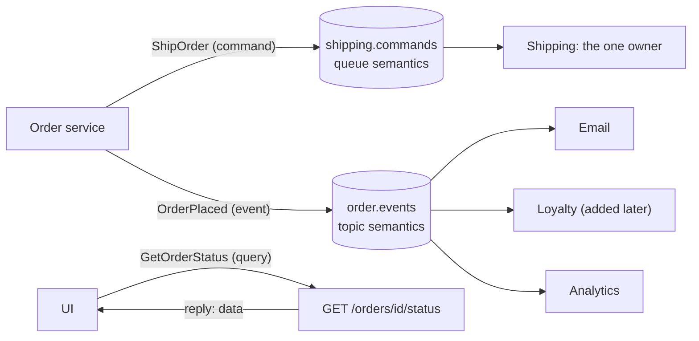

**Two traps:**

- **The passive-aggressive command** (Fowler): an "event" that the publisher actually expects a specific consumer to act on (`OrderNeedsShipping` that breaks things if Shipping ignores it). It is a command in disguise — the coupling is still there, only hidden. Name it as a command and send it to its owner.
- **The opposite trap:** turning everything into events hides the end-to-end flow — nobody can say what happens after `OrderPlaced` (the flow-visibility problem in [4.2](#42-choreography-vs-orchestration)).

▶ Interactive lesson: [Lesson 04 · Event vs command vs query](lessons/0004-event-command-query.html) · Cheat sheet: [Event / Command / Query intent](reference/0004-event-command-query-cheatsheet.html)

**Check yourself**

<details><summary>Is <code>OrderShipped</code> a command, an event or a query?</summary>An event: past tense, a fact that already happened, zero-to-many consumers, publisher indifferent to who reacts.</details>

<details><summary>A new loyalty programme must award points on every order. Should the order service send a command or should loyalty subscribe to an event?</summary>Subscribe to the existing <code>OrderPlaced</code> event with a new consumer group. The producer is untouched; the consumer decides what to do.</details>

---

# Part 2 — Delivery semantics and Kafka exactly-once

Part 2 answers the question every design review eventually asks: *"what happens if it crashes right here?"* First the general theory (any broker), then how Kafka implements exactly-once internally, then how to run it.

## 2.1 Delivery guarantees: at-most, at-least, effectively-once

A consumer must do two things — **do the work** and **record that it is done** (commit the offset / ack the message). They live in different systems, so they cannot be atomic. A crash between them forces a choice, and the *order* of the two steps decides your guarantee. Neha Narkhede's framing of the producer side is the same: when an ack is lost, the producer cannot know whether the write happened, so it must either retry (risking a duplicate) or not (risking loss). Both hops — producer → broker and broker → consumer — have this problem.

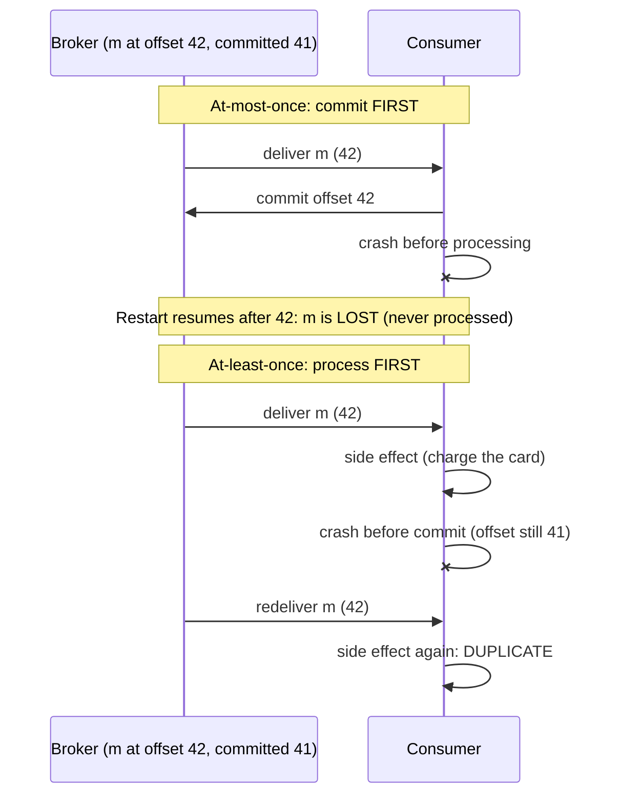

| Semantic | Fails by | Cost you pay | Choose when |
|---|---|---|---|
| **At-most-once** | Losing messages | Cheapest, simplest | Loss is acceptable: metrics, logs, live telemetry |
| **At-least-once** | Duplicates | You must make processing idempotent | The default for almost everything |
| **Exactly-once (effectively)** | Complexity / throughput | Dedup logic (Route A) or transaction coordination + latency (Route B) | Money, inventory, anything where a duplicate is a real bug |

> 🧭 **Staff one-liner:** exactly-once *delivery* is essentially impossible across a network; exactly-once *processing* (effectively-once) is achievable, but only with the consumer's cooperation.

### Route A — at-least-once + an idempotent consumer (works with any broker and any side effect)

```kotlin
@Component
class PaymentListener(
    private val processed: ProcessedMessageRepository,   // PK = (groupId, messageId)
    private val payments: PaymentService,
) {
    // Manual ack = at-least-once: advance the offset only AFTER the work succeeds.
    @KafkaListener(topics = ["order.events"], groupId = "payments")
    @Transactional                                       // ONE db tx: dedup mark + side effect
    fun on(rec: ConsumerRecord<String, OrderPlaced>, ack: Acknowledgment) {
        val id = ProcessedId("payments", rec.key())      // a stable, unique message id
        if (processed.existsById(id)) { ack.acknowledge(); return }   // duplicate -> skip

        payments.charge(rec.value())                     // the real, non-idempotent side effect
        processed.save(ProcessedMessage(id))             // mark done, atomically with the charge
        ack.acknowledge()                                // now safe to advance the offset
    }
}
```

The unique primary key on the processed-messages table is the backstop for the race where two deliveries pass `existsById` at once. Even better is a *naturally* idempotent operation (an upsert) that needs no dedup table — see [3.1](#31-idempotency-and-deduplication).

### Route B — Kafka exactly-once semantics (EOS) for Kafka → Kafka pipelines

For read-process-write *inside* Kafka, the idempotent producer + transactions + `read_committed` make the output write and the input offset commit atomic:

```yaml
spring:
  kafka:
    producer:
      acks: all
      transaction-id-prefix: tx-enrich-     # enables Kafka transactions
      properties:
        enable.idempotence: true
    consumer:
      isolation-level: read_committed       # ignore uncommitted/aborted records
```

```kotlin
// With a KafkaTransactionManager, the send + the input offset commit are atomic.
@KafkaListener(topics = ["orders"], groupId = "enrich")
@Transactional
fun enrich(order: Order) {
    kafkaTemplate.send("orders.enriched", order.id, enrich(order))
}
```

**EOS stops at Kafka's edge.** A database write, an email or a card charge inside that listener is *not* part of the Kafka transaction; it can still run twice. Hence the heuristic: **external side effects → at-least-once + idempotency, always. Kafka→Kafka stream processing → EOS. At-most-once → only when a dropped message is cheaper than a duplicate.** There is no free exactly-once: you pay in dedup logic or in transactional throughput.

▶ Interactive lesson: [Lesson 05 · Delivery guarantees](lessons/0005-delivery-guarantees.html) · Cheat sheet: [Delivery guarantees](reference/0005-delivery-guarantees-cheatsheet.html)

**Check yourself**

<details><summary>A consumer commits the offset, then processes, then crashes mid-processing. Which guarantee is that?</summary>At-most-once. The offset already says "done", so the message is never redelivered — it is lost, never duplicated.</details>

<details><summary>Your listener charges a card via an external API. Which route gives effectively-once?</summary>At-least-once delivery plus an idempotent consumer (dedup on a stable message id, ideally passing an idempotency key to the payment provider). Kafka EOS cannot cover an external side effect.</details>

## 2.2 Inside Kafka exactly-once: sequence numbers and read_committed

Kafka's EOS is three independent layers. Each stops a different duplicate.

### Layer 1 — the idempotent producer ("TCP for your writes")

Confluent's description: it "works in a way similar to TCP: each batch of messages sent to Kafka will contain a sequence number that the broker will use to dedupe any duplicate send."

- The broker assigns each producer a **Producer ID (PID)** at start-up.
- Every batch carries the PID and a **monotonically increasing sequence number per partition**.
- The partition leader remembers the **highest accepted sequence** per `(PID, partition)`. A resend with an already-seen sequence is **dropped but still acked**; a gap is rejected with `OutOfOrderSequenceException`.
- Sequence state is persisted in the replicated log, so a new leader after failover still recognises the retry.

It gives "exactly-once, in order, per partition" for one producer's retries, for "just a few extra numeric fields per batch". It does **not** dedupe application-level duplicates (you sent the same order twice on purpose), nor duplicates across a full producer restart unless you also use a `transactional.id`. Default-on since Kafka 3.0; requires `acks=all` and `max.in.flight.requests.per.connection ≤ 5`.

### Layer 2 — transactions (atomic read-process-write)

A processor reads A, writes B = F(A), and can still double-produce if it crashes after writing B but before committing A's offset. The key trick: **an offset commit is just another write to a topic** (`__consumer_offsets`). So writing B and committing A's offset can go in the **same transaction**, all-or-nothing: A is consumed iff B is produced. Two supporting mechanisms:

- **Zombie fencing** — a transactional producer registers a `transactional.id`, which bumps a **producer epoch**. Any older-epoch producer with the same id is a zombie; its writes are rejected.
- **Control markers** — the transaction coordinator tracks state in an internal log (`__transaction_state`) and writes a **commit or abort marker** into every partition the transaction touched.

### Layer 3 — `read_committed` (don't read what never happened)

Transactional messages are **appended to the log as they are produced**, before the commit/abort decision exists. So the log physically contains records from transactions that may abort.

- **`read_uncommitted` is the default.** It reads everything immediately — including records from transactions that later abort. Dirty reads.
- **`read_committed`** reads only up to the **Last Stable Offset (LSO)** — the offset just before the first still-open transaction — and uses the markers to **filter out aborted** records.

The cost: a long-running or **hung transaction stalls every `read_committed` consumer at the LSO** until it commits, aborts or hits `transaction.timeout.ms`. And the gotcha: build a transactional pipeline but forget the consumer isolation level and you silently get dirty reads and no exactly-once.

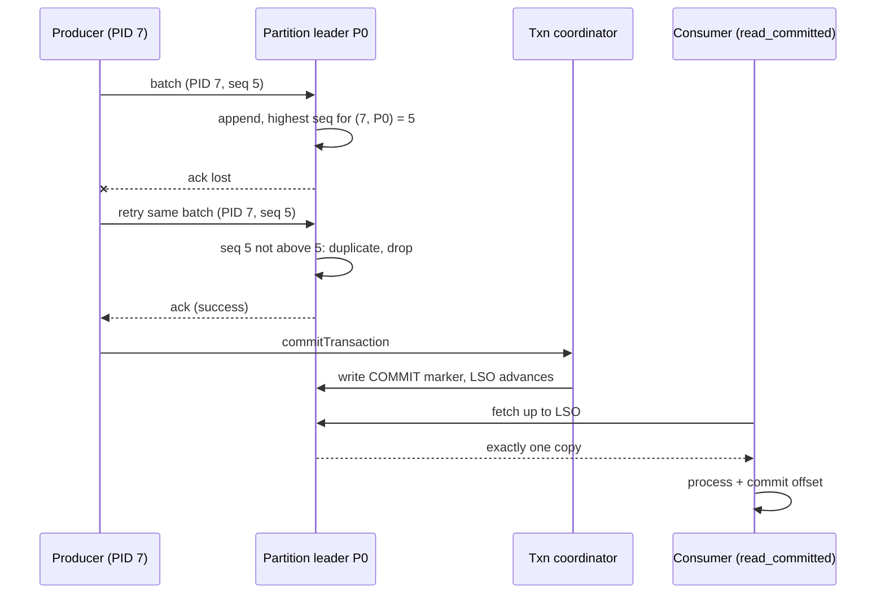

| Layer | Stops which duplicate | Mechanism |
|---|---|---|
| Idempotent producer | Producer-retry duplicate on a partition | PID + per-partition sequence numbers; broker dedup |
| Transactions | Reprocess & zombie-instance duplicates | Atomic write of output + offset commit; epoch fencing |
| `read_committed` | Reading aborted / uncommitted data | LSO read horizon + commit/abort markers |

▶ Interactive lesson: [Lesson 06 · Inside Kafka exactly-once](lessons/0006-kafka-exactly-once-internals.html) · Cheat sheet: [Inside Kafka exactly-once](reference/0006-kafka-exactly-once-internals-cheatsheet.html)

**Check yourself**

<details><summary>How does the broker recognise a producer retry as a duplicate?</summary>Same PID and same per-partition sequence number as a batch it already accepted. It drops the resend and still returns success.</details>

<details><summary>Why may a <code>read_committed</code> consumer not read past an open transaction?</summary>The transaction might still abort. Its records are already in the log, so the consumer stops at the LSO and later uses the commit/abort marker to deliver or filter them.</details>

<details><summary>You enabled transactions on the producer but left consumers at defaults. What do you get?</summary>Dirty reads and no exactly-once: the default isolation level is <code>read_uncommitted</code>, which delivers records from transactions that later abort.</details>

## 2.3 Operating Kafka exactly-once: lag, transactional.id and the commit dial

### A hung transaction looks like consumer lag

If a producer opens a transaction and then **hangs** (GC pause, stuck RPC, a bug between `beginTransaction` and `commitTransaction`), the LSO freezes while records pile up behind it. The `read_committed` consumer is healthy but blocked.

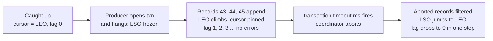

**The signature:** `records-lag-max` climbs **linearly**, there are **no processing errors**, throughput is **near zero**, then lag clears **in a single step**. Confirm by comparing the partition's **log-end offset with its LSO**: a wide, growing LEO − LSO gap means an open transaction, not a backlog. Real lag looks different: throughput is high and lag tracks load.

The safety net is `transaction.timeout.ms` (producer-side; the coordinator aborts transactions open longer than this), capped by the broker's `transaction.max.timeout.ms`. Set it tight enough that a wedged producer self-heals quickly, but longer than your worst legitimate transaction — or you abort healthy work.

### Choosing `transactional.id`

Two hard requirements, both from zombie fencing:

- **Stable across restarts** — a restarted instance must re-register the same id to bump the epoch and fence its own zombie. A random id per start defeats fencing.
- **Never shared by two concurrently active producers** — they would fence each other forever.

The old rule was **one id per input partition**, statically encoded (what Kafka Streams does with `applicationId + task`), otherwise a partition could move between ids with no fencing. Since **Kafka 2.5 (KIP-447)** fencing uses consumer-group metadata instead; Spring for Apache Kafka 3.0+ supports only `EOSMode.V2`, where you just need a **`transactionIdPrefix` unique per application instance** (Spring appends a counter):

```yaml
spring:
  kafka:
    producer:
      transaction-id-prefix: ${HOSTNAME}-tx-   # MUST be unique per instance (EOSMode.V2)
      properties:
        transaction.timeout.ms: 60000          # coordinator aborts a txn open longer than this
    consumer:
      isolation-level: read_committed           # or you silently lose exactly-once
```

Two operational gotchas: **(a) idle producer fencing** — a transactional producer idle longer than the broker's `transactional.id.expiration.ms` (default 7 days) can get a `ProducerFencedException` with no rebalance; set the producer factory's `maxAge` below that expiry. **(b) coordinator mapping** — every `transactional.id` hashes to one `__transaction_state` partition, so one broker coordinates it; a non-unique prefix quietly serialises or fences instances you meant to run in parallel.

### The commit-interval dial

Transaction overhead is **per commit, not per record**: registering partitions with the coordinator, a **marker to every partition** in the transaction, and 2–3 writes to the transaction log. Confluent's benchmark: for 1 KB records at max throughput, committing every **100 ms costs only ~3% throughput**; smaller messages or shorter intervals degrade more.

| Commit interval | Throughput | End-to-end latency | Reprocessed on crash |
|---|---|---|---|
| **Short** (few records/txn) | Low — per-commit overhead dominates | Low — consumers see data sooner | Little |
| **Long** (many records/txn) | High — overhead amortised | High — `read_committed` waits for the commit | More — a whole transaction redone |

The consumer side pays essentially nothing for `read_committed` (zero-copy is preserved; it just may not pass the LSO), so the dial trades **producer throughput against end-to-end latency**. **The Spring trap:** a record listener wraps *each record* in its own transaction — the worst case. Use batch listeners / larger `max.poll.records` so one transaction carries many records. Kafka Streams defaults to a 100 ms commit interval under EOS for exactly this reason.

▶ Interactive lesson: [Lesson 07 · Operating Kafka exactly-once](lessons/0007-operating-kafka-exactly-once.html) · Cheat sheet: [Operating Kafka exactly-once](reference/0007-operating-kafka-exactly-once-cheatsheet.html)

**Check yourself**

<details><summary>Lag climbs linearly, zero errors, near-zero throughput, then drops to 0 in one step. Diagnosis?</summary>A hung (open) transaction pinning the LSO for <code>read_committed</code> consumers, cleared by commit, abort or <code>transaction.timeout.ms</code>. Confirm with the LEO − LSO gap.</details>

<details><summary>With Spring Kafka 3.x (EOSMode.V2), what must be true of <code>transaction-id-prefix</code>?</summary>Unique per application instance and stable across that instance's restarts — e.g. derived from a stable hostname or StatefulSet slot. One id per input partition is no longer necessary.</details>

---

# Part 3 — Reliability patterns: idempotency, ordering, backpressure, failure

At-least-once delivery is the default, so the system must survive duplicates, keep the order that matters, absorb load it cannot process yet, and quarantine messages that will never succeed. These four lessons are the everyday toolkit.

## 3.1 Idempotency and deduplication

An operation is **idempotent** when applying it twice has the same effect as applying it once. microservices.io's idempotent consumer pattern: record the ids of processed messages and discard duplicates. Under at-least-once, idempotency is not an optimisation — it is the correctness mechanism.

| Naturally idempotent (replay = no-op) | NOT idempotent (replay = bug) |
|---|---|
| `SET status = 'PAID'` (assignment) | `balance = balance + 10` (increment) |
| `UPSERT` keyed by a stable id | `INSERT` a new row (duplicate rows) |
| `DELETE WHERE id = x` | Append to a log / list |
| Add to a set (`SADD`), `PUT` a full document | Send an email · charge a card · emit an event |

First try to **make the operation naturally idempotent** (assign absolute values, upsert by id). Only when you cannot, add a dedup store.

**Choosing the idempotency key** — best to worst: a **producer-generated UUID** created once per business action and reused on every retry; a **business key** (`orderId` + action) when it is truly unique per action; a **payload hash** (fragile — two legitimate identical actions collide, one changed timestamp breaks it); **never the broker offset** (a republish gets a new offset).

```kotlin
// PRODUCER: generate the key ONCE for this action, reuse it on every retry
val idemKey = UUID.randomUUID().toString()          // not regenerated per send attempt!
val record = ProducerRecord("payments", order.id, PaymentRequested(order.id, order.total))
record.headers().add("idempotency-key", idemKey.toByteArray())
kafkaTemplate.send(record)

// CONSUMER: dedup mark + side effect commit together
@KafkaListener(topics = ["payments"], groupId = "ledger")
@Transactional
fun on(rec: ConsumerRecord<String, PaymentRequested>) {
    val key = rec.headers().lastHeader("idempotency-key")
        ?.let { String(it.value()) } ?: error("missing idempotency key")

    if (processed.existsById(key)) return             // already handled; the unique PK is the backstop
    ledger.credit(rec.value())                        // the non-idempotent side effect, now guarded
    processed.save(ProcessedMessage(key))             // remembered atomically with the credit
}
```

```sql
-- Race-proof variant: let the unique key decide, then act only if the row was new
INSERT INTO processed_messages (consumer, message_id)
VALUES ('ledger', :key)
ON CONFLICT DO NOTHING;      -- 0 rows inserted => duplicate => skip the side effect
```

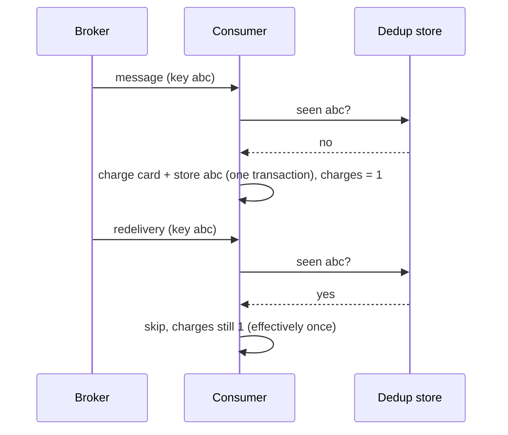

**External APIs:** carry the same key end to end. Stripe-style APIs accept an `Idempotency-Key` header; a retry with the same key returns the first result instead of charging twice.

```kotlin
fun charge(req: PaymentRequested, idemKey: String): ChargeResult =
    stripeClient.post("/v1/charges", req) {
        header("Idempotency-Key", idemKey)     // same key => the provider returns the first result
    }
```

**The dedup window** must exceed the longest gap between two deliveries of the same message: retries + DLQ redrive + consumer lag + replay from retention. Stripe prunes idempotency keys after 24 hours — a replay older than that is not protected by *their* store, only by yours.

| Broker | Native dedup |
|---|---|
| **SQS FIFO** | `MessageDeduplicationId` / content-based — only within a **5-minute** window |
| **Kafka** | Idempotent producer dedups producer retries per partition — not your app-level duplicates |
| **RabbitMQ** | None native (a community plugin exists) → rely on consumer idempotency |
| **GCP Pub/Sub** | Exactly-once delivery dedups within the ack deadline; exposes a stable `message_id` |
| **Redis** | Roll your own: `SET key val NX EX ttl` as a dedup store |

**Cascading duplicates:** if your consumer emits a new event, a duplicate input produces a duplicate output unless you derive the output id from the input key and publish through an outbox ([4.3](#43-the-transactional-outbox-and-the-dual-write-problem)).

▶ Interactive lesson: [Lesson 08 · Idempotency & deduplication](lessons/0008-idempotency-deduplication.html) · Cheat sheet: [Idempotency & deduplication](reference/0008-idempotency-cheatsheet.html)

**Check yourself**

<details><summary>Which is naturally idempotent: <code>SET status = 'PAID'</code> or <code>balance = balance + 10</code>?</summary><code>SET status = 'PAID'</code>. An absolute assignment replays as a no-op; an increment adds 10 again on every redelivery.</details>

<details><summary>What is the best source for an idempotency key?</summary>A producer-generated id (UUID) created once per business action and reused on every retry. Never the broker offset, which changes on republish.</details>

## 3.2 Ordering and partitioning

Kafka gives **no global order**, only order **within a partition**. The productive reframe: you rarely need global order; you need **per-entity order** ("all events of order 42 in sequence"). The message **key** is the tool: no key → round-robin / sticky spreading across partitions; with a key → `hash(key) mod N`, so every event for one key lands on one partition, in send order.

```kotlin
// The key IS the ordering boundary. All of one customer's events share a
// partition and stay strictly ordered; different customers run in parallel.
kafkaTemplate.send("order.events", order.customerId, OrderPlaced(order.id, order.customerId))
```

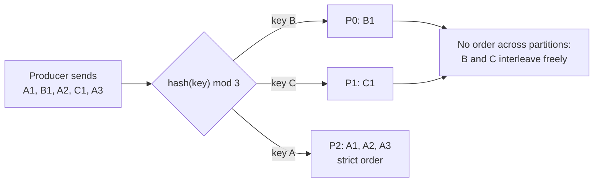

**The central tension:** the parallelism ceiling is the partition count, but the **ordering unit** is the key. A coarse key (one tenant) serialises everything for that tenant and creates hot partitions; a fine key (one order) maximises parallelism but loses cross-entity order. **Choose the smallest entity whose events must stay ordered relative to each other** (account for a ledger, order for an order lifecycle).

**How order gets lost in practice:**

| Cause | Fix |
|---|---|
| Producer retries with `max.in.flight.requests.per.connection > 1` and no idempotence (batch 2 lands before a retried batch 1) | `enable.idempotence=true` (keeps order with in-flight ≤ 5), or in-flight = 1 |
| Repartitioning (changing the partition count) | Treat as a migration ([1.3](#13-kafka-consumer-groups-why-consumers--partitions)) |
| Hot keys | Better key choice; split the hot entity; accept the ceiling |
| Consumer-side thread pools / async handoff / requeue-on-failure | Process a partition sequentially; for slow work, `pause()` the partition rather than fanning out |

```yaml
spring:
  kafka:
    producer:
      acks: all
      properties:
        enable.idempotence: true          # preserves order with retries (in-flight <= 5)
        # without idempotence: max.in.flight.requests.per.connection: 1
```

| Broker | Ordering model |
|---|---|
| **Kafka** | Strict within a partition; key → partition. Order unit = key. |
| **SQS FIFO** | Strict within a `MessageGroupId` ("processed one at a time, in strict order"); parallelism across groups. |
| **SQS Standard** | Best-effort only — no ordering guarantee. |
| **RabbitMQ** | One queue + one consumer = order; competing consumers or requeue-on-nack can reorder. Consistent-hash exchange for per-key routing. |
| **Pulsar** | `Key_Shared` subscription keeps per-key order with multiple consumers. |

▶ Interactive lesson: [Lesson 09 · Ordering & partitioning](lessons/0009-ordering-partitioning.html) · Cheat sheet: [Ordering & partitioning](reference/0009-ordering-partitioning-cheatsheet.html)

**Check yourself**

<details><summary>What ordering does Kafka guarantee?</summary>Order within a single partition only. Records with the same key go to the same partition, so you get per-key order — never a global order across partitions.</details>

<details><summary>Ledger entries must apply in order per bank account. What key?</summary>The account id: the smallest entity whose events must stay ordered. Different accounts still run in parallel.</details>

## 3.3 Backpressure and load leveling

**Load leveling:** a buffer between producer and consumer turns a traffic spike into queue depth that the consumer drains at its sustainable rate. **Backpressure:** the mechanism by which a slow consumer limits how fast work reaches it.

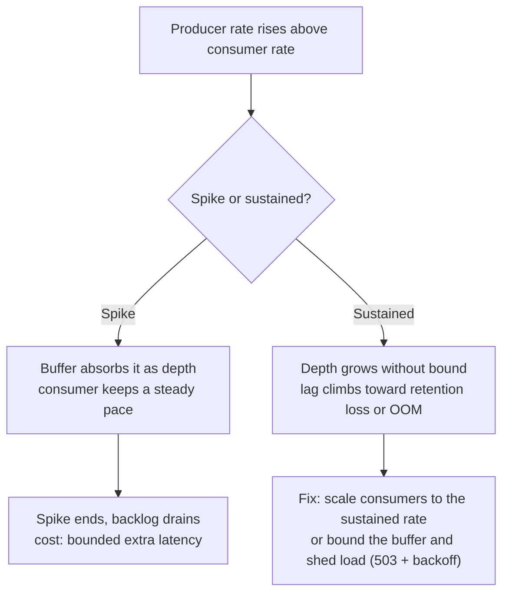

**Buffering is not capacity.** A queue absorbs bursts, not sustained overload. If lag is *steadily* rising, adding a bigger buffer only delays the incident.

**Pull vs push decides where backpressure comes from:**

- **Pull (Kafka, SQS):** the consumer fetches when ready, so backpressure is automatic — lag grows in the broker, the consumer is never overwhelmed.
- **Push (RabbitMQ):** the broker pushes to consumers; without a limit it floods them. The knob is **prefetch** (`basic.qos`): the maximum unacked messages per consumer. **0 means unlimited** — never use it in production.

```yaml
spring:
  rabbitmq:
    listener:
      simple:
        prefetch: 20          # at most 20 unacked messages per consumer
  kafka:
    consumer:
      max-poll-records: 200   # records per poll
      properties:
        max.poll.interval.ms: 300000   # process a batch within this or you're kicked from the group
```

**Watch the right metric:** lag / depth is the primary signal — Kafka consumer lag, SQS `ApproximateNumberOfMessagesVisible`, RabbitMQ queue depth. **Autoscale on lag** (e.g. KEDA), not CPU: an I/O-bound consumer can be far behind at 20% CPU. On Kafka, scaling stops at the partition count.

**Bound everything.** Unbounded in-memory queues turn overload into OOM. Use bounded buffers and **load shedding** (reject with 503 + exponential backoff at the edge) so backpressure propagates upstream instead of being hidden.

| System | Flow-control levers |
|---|---|
| **Kafka** (pull) | `max.poll.records`, fetch sizes, `pause()`/`resume()`, scale consumers ≤ partitions |
| **RabbitMQ** (push) | `basic.qos` prefetch per consumer; publisher `connection.blocked` under memory pressure |
| **SQS** (pull) | Long polling, batch size, visibility timeout; scale consumers on queue depth |
| **App / Reactive** | Reactor/Flow `request(n)` demand; bounded queues + 503 load shedding |

▶ Interactive lesson: [Lesson 10 · Backpressure & load leveling](lessons/0010-backpressure-load-leveling.html) · Cheat sheet: [Backpressure & load leveling](reference/0010-backpressure-load-leveling-cheatsheet.html)

**Check yourself**

<details><summary>Consumer lag has risen steadily for six hours with no spike. Bigger buffer or more capacity?</summary>More capacity (or shed load). Steady growth means sustained overload; a buffer only absorbs temporary bursts.</details>

<details><summary>RabbitMQ consumers are being flooded and run out of memory. Which knob?</summary>Set a bounded prefetch (<code>basic.qos</code>), e.g. 20 unacked messages per consumer. Prefetch 0 means unlimited.</details>

## 3.4 Retries, dead-letter queues and poison messages

First classify the failure, because retrying is only useful for one kind:

| Transient (retry it) | Permanent (don't retry — DLQ it) |
|---|---|
| Network blip, timeout | Malformed / unparseable message |
| Downstream `503` / rate limit | Business-rule violation (will never pass) |
| DB deadlock, brief lock contention | A bug in the handler |

A **poison message** fails every time. On an ordered partition or a single queue, retrying it forever causes **head-of-line blocking**: everything behind it waits.

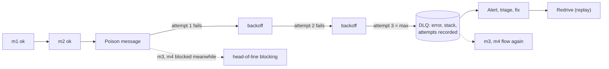

**Retry strategy:** **bounded attempts** (3–5); **exponential backoff** (0.5 s, 1 s, 2 s, 4 s); **jitter** so a fleet does not retry in lockstep; and choose **blocking** retries (simple, keeps order, stalls the partition) or **non-blocking** retries via separate retry topics (main topic keeps flowing, order is lost for the retried record).

```kotlin
// Blocking retry with backoff, then publish to <topic>.DLT
@Bean
fun errorHandler(template: KafkaTemplate<Any, Any>): DefaultErrorHandler {
    val recoverer = DeadLetterPublishingRecoverer(template)
    val backOff = ExponentialBackOffWithMaxRetries(3).apply {
        initialInterval = 500
        multiplier = 2.0
    }
    return DefaultErrorHandler(recoverer, backOff).apply {
        addNotRetryableExceptions(IllegalArgumentException::class.java)   // permanent: straight to DLT
    }
}

// Non-blocking retries: retry topics + a DLT, so the main topic never stalls
@RetryableTopic(attempts = "4", backoff = Backoff(delay = 1000, multiplier = 2.0))
@KafkaListener(topics = ["orders"], groupId = "fulfillment")
fun handle(order: Order) { /* ... */ }

@DltHandler
fun dead(order: Order) { /* park, alert, await triage */ }
```

Also wrap deserializers in `ErrorHandlingDeserializer`: a payload that cannot be parsed must reach the error handler (and the DLT) instead of crash-looping the container.

| Broker | DLQ mechanism |
|---|---|
| **SQS** | Native **redrive policy**: after `maxReceiveCount` failed receives (visibility timeout = retry delay) the message moves to the DLQ; redrive it back to reprocess. |
| **RabbitMQ** | Native **dead-letter exchange** (`x-dead-letter-exchange`): messages rejected (`nack`, requeue=false), TTL-expired or over a length limit route to the DLX. TTL + DLX gives delayed retry. |
| **Kafka** | No native DLQ — build it: Spring's `DeadLetterPublishingRecoverer` / `@RetryableTopic`, or Kafka Connect's `errors.deadletterqueue.topic.name`. |
| **Pulsar** | Native retry-letter topic + dead-letter topic per subscription. |

**A DLQ is a workflow, not a graveyard:** alert on *any* message arriving; store the reason, stack trace and attempt count; have an owner and a redrive tool; and beware replay loops (a redriven message that fails again must not cycle forever). Two couplings to remember: **retries require idempotency** (a retried message may have half-succeeded), and **retries/DLQs disturb ordering** — AWS advises against a DLQ on a FIFO queue when strict order matters, because skipping a message breaks the sequence.

▶ Interactive lesson: [Lesson 11 · Retries, DLQs & poison messages](lessons/0011-retries-dlq-poison-messages.html) · Cheat sheet: [Retries & dead-letter queues](reference/0011-retries-dlq-cheatsheet.html)

**Check yourself**

<details><summary>Why is "retry forever" dangerous on a Kafka partition?</summary>A poison message never succeeds, so it blocks every record behind it on that partition (head-of-line blocking) indefinitely.</details>

<details><summary>A message fails JSON parsing. Retry or DLQ?</summary>Straight to the DLQ: it is a permanent failure that no retry will fix. Mark parse/validation exceptions non-retryable.</details>

---

# Part 4 — Broker models and distributed workflows

Part 4 moves from single message hops to architecture: what kind of broker you are using, who coordinates a multi-service flow, how to publish reliably from a database-backed service, and how to keep data consistent across services without distributed transactions.

## 4.1 Log vs queue brokers

One question predicts almost every behavioural difference between brokers: **does reading delete the message?** Confluent's framing: a queue is *consume-and-delete* (a stream of tasks); a log is *append-and-retain* (a replayable stream of events).

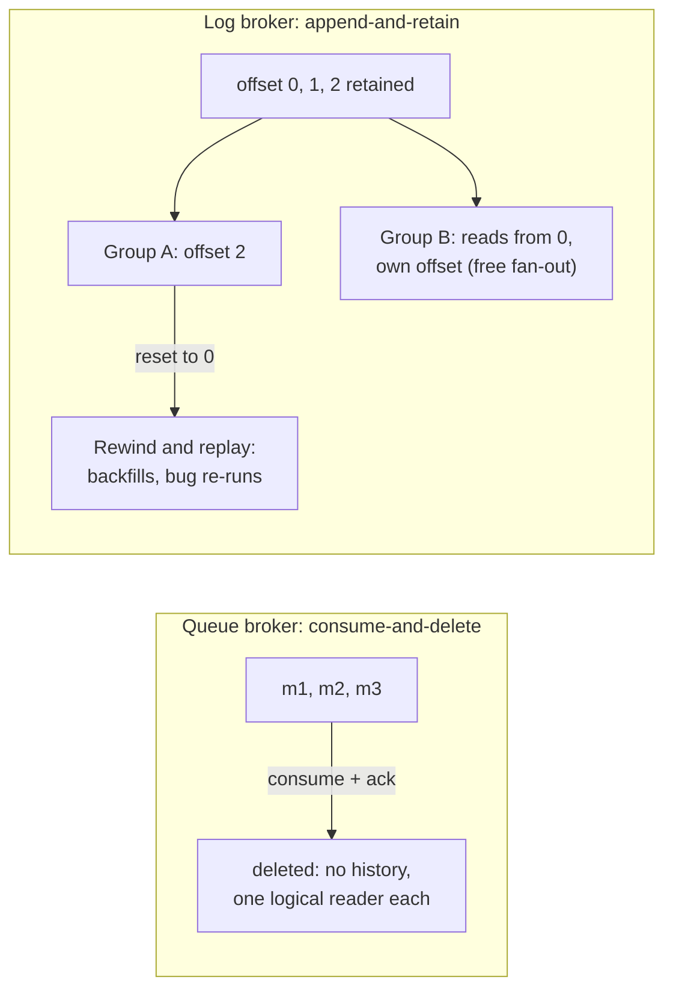

| Behaviour | Log-based (Kafka/Pulsar) | Queue-based (RabbitMQ/SQS) |
|---|---|---|
| **Replay / rewind** | Yes — seek to any retained offset | No — acked = deleted |
| **Fan-out** | Free — each group has its own offset on shared data | Needs a copy per consumer (exchange → N queues, SNS → N SQS) |
| **Ordering** | Intrinsic per partition | Fragile — competing consumers & requeue reorder |
| **Consumer tracking** | One offset per group/partition | Per-message ack state; redelivery on nack/timeout |
| **Parallelism** | Capped by partition count | Add competing consumers freely |
| **DLQ** | Built by you | Native (SQS redrive, RabbitMQ DLX) |
| **Per-message TTL / priority** | No (topic-wide retention) | Yes |

**Log internals worth knowing:** a partition is a sequence of **segment files** with an offset index; writes and reads are **sequential I/O** served largely from the OS **page cache**, and consumers are fed with **zero-copy** transfers — which is why Kafka is fast on commodity disks. Data leaves by **retention** (time/size), not by consumption. **Log compaction** (`cleanup.policy=compact`) keeps the latest value per key — a changelog of current state.

```yaml
spring.kafka.consumer.auto-offset-reset: earliest   # a NEW group reads from the start of retention
# at runtime: consumer.seekToBeginning(partitions)  # replay history
# topic config: cleanup.policy=compact              # keep the latest value per key
```

**Queue internals worth knowing:** per-message state (ready / unacked); redelivery via requeue (RabbitMQ) or visibility timeout (SQS); native priority, TTL and DLQ; RabbitMQ **quorum queues** (Raft-replicated) for durability.

| Reach for a LOG when… | Reach for a QUEUE when… |
|---|---|
| Multiple independent consumers of the same data | Distributing tasks to competing workers |
| Replay / reprocessing / event sourcing / stream processing | Per-message workflows, priority, TTL, request/reply |
| Very high throughput, ordered per key | Flexible consumer scaling beyond a partition count |
| An audit trail / source of truth of events | Complex routing (RabbitMQ exchanges) & native DLQs |

**Hybrids blur the line:** Pulsar separates serving from storage (BookKeeper) and offers both queue-like (`Shared`) and log-like subscriptions; AWS teams pair Kinesis (log) with SQS (queue); Redis Streams is a log with consumer groups and per-message acks.

▶ Interactive lesson: [Lesson 12 · Log vs queue brokers](lessons/0012-log-vs-queue-brokers.html) · Cheat sheet: [Log vs queue brokers](reference/0012-log-vs-queue-cheatsheet.html)

**Check yourself**

<details><summary>What single property lets a new consumer group reprocess last week's events on Kafka but not on SQS?</summary>The log retains messages after they are read (append-and-retain); a queue deletes them on ack (consume-and-delete).</details>

<details><summary>You need per-message priority and a native DLQ for a task pipeline. Log or queue?</summary>A queue (RabbitMQ or SQS): per-message priority/TTL and native dead-lettering are queue features.</details>

## 4.2 Choreography vs orchestration

A business flow that spans services (reserve stock → charge payment → ship) needs coordination. There are two styles:

- **Choreography** — services react to **events** and emit the next event. No one is in charge; the flow emerges.
- **Orchestration** — a coordinator sends **commands** and reacts to replies, holding the flow's state.

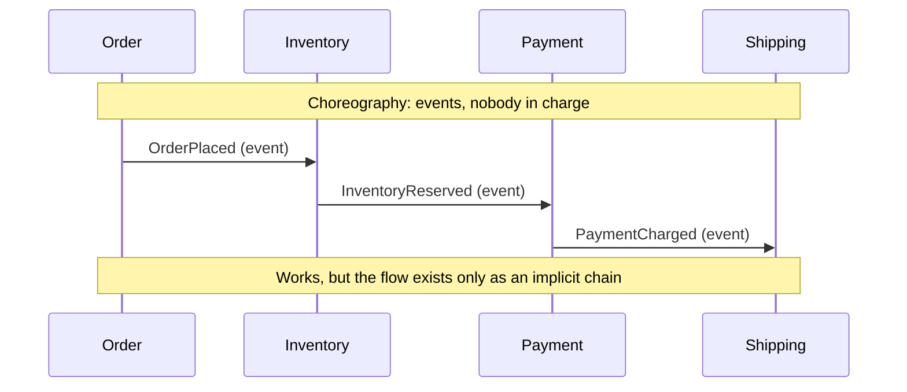

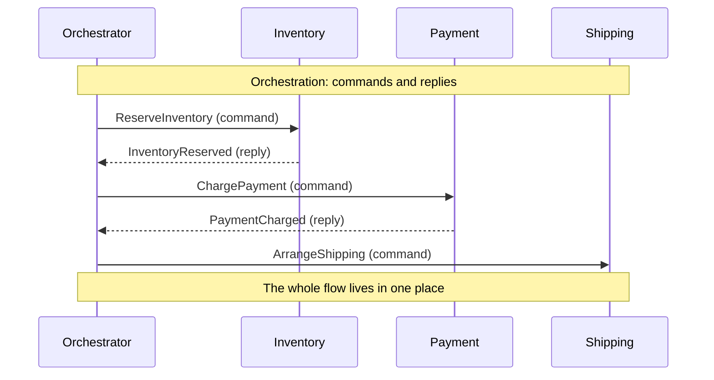

```kotlin
// CHOREOGRAPHY — each service reacts to an event and emits the next one
@KafkaListener(topics = ["order.events"], groupId = "inventory")
fun onOrderPlaced(e: OrderPlaced) {
    inventory.reserve(e.orderId, e.items)
    kafkaTemplate.send("inventory.events", e.orderId, InventoryReserved(e.orderId))   // no idea who's next
}

// ORCHESTRATION — the coordinator sends commands and reacts to replies
@KafkaListener(topics = ["order.events"], groupId = "orchestrator")
fun onOrderPlaced(e: OrderPlaced) =
    commands.send("inventory.commands", ReserveInventory(e.orderId, e.items))

@KafkaListener(topics = ["inventory.replies"], groupId = "orchestrator")
fun onInventoryReserved(r: InventoryReserved) =
    commands.send("payment.commands", ChargePayment(r.orderId))   // the orchestrator decides step 2
```

| | Choreography | Orchestration |
|---|---|---|
| **Coordination** | Events; each service decides its reaction | Commands; a coordinator decides |
| **Coupling** | Loose runtime coupling; process knowledge is diffuse | Services stay simple; coordinator couples to all of them |
| **Flow visibility** | Implicit — reconstruct from traces/logs | Explicit — one place holds the flow |
| **Add a step / reaction** | Subscribe a new consumer | Edit the orchestrator |
| **Error handling / compensation** | Scattered across services | Centralised (natural home for sagas) |
| **Main risk** | Nobody understands the whole flow | A god-orchestrator bottleneck |

**Fowler's flow-visibility trap:** with event notification "it can be hard to see such a flow as it's not explicit in any program text." Countermeasures: distributed tracing ([5.3](#53-observability-operations-and-when-not-to-use-messaging)) and an event catalog that documents producers and consumers.

**Heuristic:** simple flows with few steps and independent reactions → choreography. Complex flows with ordering, timeouts and compensation → orchestration. Most real systems are **hybrid**: orchestrate the core business transaction inside a bounded context, and publish events for everyone else to react to. Workflow engines (Temporal, AWS Step Functions, Camunda/Zeebe, Netflix Conductor) give you durable orchestration state, timers and retries instead of hand-rolled state machines.

▶ Interactive lesson: [Lesson 13 · Choreography vs orchestration](lessons/0013-choreography-orchestration.html) · Cheat sheet: [Choreography vs orchestration](reference/0013-choreography-orchestration-cheatsheet.html)

**Check yourself**

<details><summary>Payment charges the card because it subscribed to <code>InventoryReserved</code>. Which style?</summary>Choreography: Payment reacts to an event; no coordinator told it to act.</details>

<details><summary>What is the main risk of pure choreography as the flow grows?</summary>The flow-visibility trap: no single place shows the end-to-end process, so nobody understands or can safely change the whole flow.</details>

## 4.3 The transactional outbox and the dual-write problem

A service must update its database **and** publish an event. Those are two separate systems, and there is no atomic commit across them:

```kotlin
// DUAL WRITE — broken: the send is not part of the DB transaction
@Transactional
fun pay(orderId: String) {
    orders.markPaid(orderId)                                   // DB write (in the tx)
    kafkaTemplate.send("order.events", OrderPaid(orderId))     // separate system
}
```

Crash after the DB commit but before the send → **lost event** (DB says PAID; nobody downstream knows). Send first, then the DB rolls back → **phantom event** (downstream acts on something that never happened). `@Transactional` around both is a mirage: it only covers the database. 2PC/XA across a DB and Kafka is not a viable option in practice (Kafka does not participate in XA, and 2PC couples availability).

**The fix — the transactional outbox:** write the event as a row in an `outbox` table **in the same local ACID transaction** as the business change, and let a separate **message relay** publish committed rows.

```kotlin
// OUTBOX — the event is written atomically with the state, in ONE transaction
@Transactional
fun pay(orderId: String) {
    orders.markPaid(orderId)
    outbox.save(OutboxEvent(
        id = UUID.randomUUID().toString(),     // stable idempotency key for consumers
        topic = "order.events", key = orderId, payload = OrderPaid(orderId),
    ))
}

// Polling publisher — order preserved via ORDER BY id
@Scheduled(fixedDelay = 500)
@Transactional
fun relay() {
    outbox.findUnsentOrderById(limit = 100).forEach { e ->
        kafkaTemplate.send(e.topic, e.key, e.payload)
        e.markSent()                           // or delete the row
    }
}
```

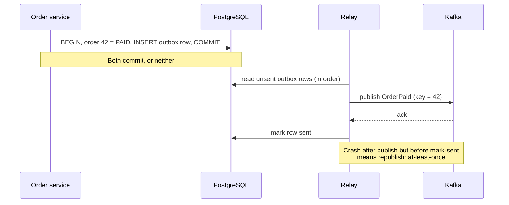

The guarantee: **the event is published if and only if the DB transaction commits.** Never lost, never phantom — but possibly **duplicated** (relay crash between publish and mark-sent), so consumers must be idempotent ([3.1](#31-idempotency-and-deduplication)).

| | Polling publisher | Transaction-log tailing (CDC) |
|---|---|---|
| **How** | A job `SELECT`s unsent rows, publishes, marks sent | A tool (Debezium) tails the DB WAL/binlog and streams outbox inserts to Kafka |
| **Pros** | Dead simple, no extra infra | Low latency, no polling load, no publish code |
| **Cons** | Polling lag + DB load; must `ORDER BY` to keep order | More infra (Debezium/Connect); log-format coupling |

Order: the polling relay keeps it with `ORDER BY` (and a single relay per partition key range); CDC inherits the commit order of the database log. Two more rules: the outbox is a **publishing mechanism, not a workflow engine**; and **prune sent rows** (or delete in the same transaction when using CDC — [Part 6](#68-outbox-via-cdc-and-the-fes-platform-pattern)) so the table does not grow forever. The [event sourcing guide](../event-sourcing/GUIDE.md) shows the variant where the event store itself removes the dual write.

▶ Interactive lesson: [Lesson 14 · The transactional outbox](lessons/0014-transactional-outbox.html) · Cheat sheet: [Transactional outbox](reference/0014-transactional-outbox-cheatsheet.html)

**Check yourself**

<details><summary>Why does <code>@Transactional</code> around a DB write and a <code>kafkaTemplate.send</code> not prevent dual-write bugs?</summary>The send is not part of the database transaction. A crash between them loses the event, and a rollback after the send creates a phantom event.</details>

<details><summary>Can the outbox relay publish the same event twice?</summary>Yes — if it crashes after publishing but before marking the row sent, it republishes on restart. The outbox gives at-least-once; consumers must be idempotent.</details>

## 4.4 The saga pattern

Each service owns its database, so a business transaction that spans services cannot use one ACID transaction. A **saga** is a sequence of **local transactions**, each publishing a message that triggers the next step; if a step fails, the saga runs **compensating transactions** that semantically undo the completed steps in reverse order. A compensation is **not a rollback**: the reservation really happened and other transactions may have seen it; `ReleaseInventory` is a new, forward transaction.

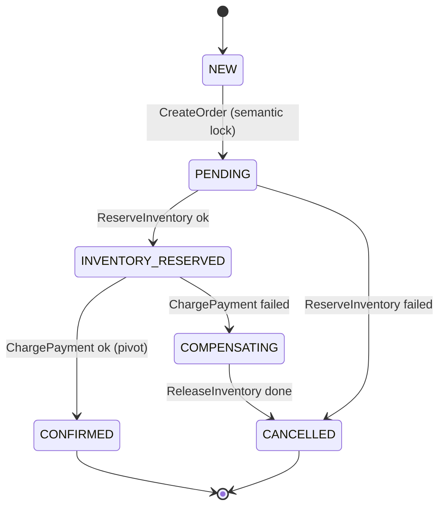

The `PENDING` status is a **semantic lock**: it tells everyone else "in progress, handle with care" while the saga runs. The end state is always consistent: either confirmed + reserved + charged, or cancelled + released + no charge.

```kotlin
// Orchestration saga — a state machine that drives steps and compensations
fun on(reply: SagaReply) = when (reply) {
    is InventoryReserved -> commands.send("payment.commands", ChargePayment(reply.sagaId))
    is PaymentFailed     -> commands.send("inventory.commands", ReleaseInventory(reply.sagaId))  // compensate
    is PaymentCharged    -> confirmOrder(reply.sagaId)                                          // pivot: commit the saga
    is InventoryReleased -> rejectOrder(reply.sagaId)
    else -> {}
}
```

Sagas can be **choreographed** (each service listens for events and knows its compensation — fine for 2–3 steps) or **orchestrated** (a saga orchestrator holds the state machine — better for more steps and explicit compensation).

**What sagas do not give you:**

- **Isolation (the "I" in ACID).** Other transactions see intermediate states (lost updates, dirty reads). Countermeasures: **semantic lock** (PENDING), **commutative updates**, **reread value** before overwriting, **versioning** of records.
- **Automatic rollback.** You write every compensation, and it must be idempotent and retriable.
- **Immediate consistency.** The system is eventually consistent while the saga runs.

**Order the steps around the pivot:** *compensatable* steps first (can be undone), then the **pivot transaction** (the go/no-go point — once it commits the saga will complete), then *retriable* steps that are guaranteed to succeed eventually. Put the step most likely to fail early.

**Building blocks:** an outbox per step (reliable publishing), idempotent handlers (at-least-once everywhere), a saga / correlation id on every message, durable saga state (or a workflow engine). **When not to:** if the data fits in one service's database, use a local transaction — a saga is the price of a service boundary, not a feature.

▶ Interactive lesson: [Lesson 15 · The saga pattern](lessons/0015-saga-pattern.html) · Cheat sheet: [The saga pattern](reference/0015-saga-cheatsheet.html)

**Check yourself**

<details><summary>Payment fails after inventory was reserved. What undoes the reservation?</summary>A compensating transaction (<code>ReleaseInventory</code>): a new local transaction that semantically undoes the step. There is no cross-service rollback.</details>

<details><summary>What is the purpose of the order's <code>PENDING</code> status during the saga?</summary>A semantic lock — it signals that the order is mid-saga so other operations treat it with care, compensating for the lack of isolation.</details>

---

# Part 5 — Evolution, history and operations

Messages outlive the code that wrote them, logs can become a system of record, and async flows have no call stack. Part 5 covers how to change contracts safely, when to make the log your database, and how to run (or decline to build) these systems.

## 5.1 Schema evolution and contracts

Every event is a **public contract** with three unforgiving properties: **independent deploys** (producer and consumer versions overlap in time), **retained history** (a log consumer replays months-old events, so every past version must stay readable), and **unknown consumers** (with pub/sub you may not know who subscribes).

Confluent Schema Registry frames evolution as **compatibility types** (default `BACKWARD`):

| Mode | Guarantee | Deploy order |
|---|---|---|
| **Backward** | New schema can read data written with the old one | **Consumers first** |
| **Forward** | Old schema can read data written with the new one | **Producers first** |
| **Full** | Both | Either |
| **Transitive** variants | Checked against *all* prior versions, not just the last | — |

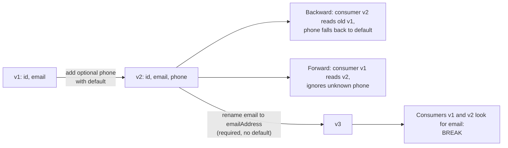

**Golden rules:** add fields as **optional with a default**; **never remove or rename a required field** (deprecate instead); **never change a field's type** (add a new field); **never reuse a field tag/number** (Protobuf) or position.

| Format | Evolution story |
|---|---|
| **Avro** | Built for evolution: reader and writer schemas resolved via defaults and aliases. Compact binary. The Schema Registry default. |
| **Protobuf** | Field numbers; add fields with new numbers, never reuse them; unknown fields preserved. Best practice: `BACKWARD_TRANSITIVE`. |
| **JSON (+ JSON Schema)** | Human-readable and flexible; no enforced schema unless you add JSON Schema; no compile-time safety, larger payloads. |

A **schema registry** stores schemas per subject, **enforces the compatibility rule at registration** (an incompatible schema is rejected before it ships), and lets messages carry a small schema id instead of the full schema. It turns "don't break consumers" from a hope into a build-time check.

```yaml
spring:
  kafka:
    producer:
      value-serializer: io.confluent.kafka.serializers.KafkaAvroSerializer
      properties:
        schema.registry.url: http://schema-registry:8081
```

```kotlin
// Avro field added compatibly — optional with a default:
//   { "name": "phone", "type": ["null", "string"], "default": null }

// JSON tolerant reader (forward compatibility): ignore fields you don't know
@JsonIgnoreProperties(ignoreUnknown = true)
data class OrderPlaced(val id: String, val email: String)
```

**Strategy:** pick a mode (usually `BACKWARD`) and **enforce it in CI** through the registry; evolve additively and review schemas like APIs; be a **tolerant reader** (Postel's law — ignore unknown fields, don't over-validate). When a breaking change is unavoidable, make a **new major version**: publish to a new topic (or add a version field), **dual-publish** old and new during the migration, move consumers, then retire the old one. Never break in place.

▶ Interactive lesson: [Lesson 16 · Schema evolution & contracts](lessons/0016-schema-evolution.html) · Cheat sheet: [Schema evolution & contracts](reference/0016-schema-evolution-cheatsheet.html)

**Check yourself**

<details><summary>Which change is safe: add an optional field with a default, rename a required field, or change a string to an int?</summary>Add an optional field with a default. Renames, removals and type changes of required fields break existing readers.</details>

<details><summary>Under <code>BACKWARD</code> compatibility, which side do you upgrade first?</summary>Consumers. Backward means the new schema reads old data, so new consumers can handle both old and new messages before producers switch.</details>

## 5.2 Event sourcing and CQRS

**Event sourcing** stores **the sequence of state-changing events as the source of truth**; current state is a *fold* (left reduce) over those events. Fowler's analogy is a version-control system: the commits are the truth, the working copy is derived. Because saving the event *is* the write, there is **no dual write** — the event store doubles as the publishing log.

```mermaid
flowchart LR
    E1["Deposited 100"] --> E2["Withdrawn 30"] --> E3["Deposited 50"]
    E3 --> F["fold: balance 120"]
    F --> CMD["withdraw 40: validate against 120,<br/>append Withdrawn 40, balance 80"]
    E2 -.->|"replay up to here"| TT["Time travel: balance was 70"]
    CMD --> PJ["Projection consumer builds<br/>read model: balance + txn count"]
```

```kotlin
sealed interface AccountEvent { val amount: Long }
data class Deposited(override val amount: Long) : AccountEvent
data class Withdrawn(override val amount: Long) : AccountEvent

data class Account(val balance: Long = 0) {
    fun apply(e: AccountEvent) = when (e) {
        is Deposited -> copy(balance = balance + e.amount)
        is Withdrawn -> copy(balance = balance - e.amount)
    }
    // decide: validate against current state, return NEW events (no mutation)
    fun withdraw(amount: Long): List<AccountEvent> {
        require(amount <= balance) { "insufficient funds" }
        return listOf(Withdrawn(amount))
    }
    companion object {
        fun rebuild(history: List<AccountEvent>) = history.fold(Account()) { acc, e -> acc.apply(e) }
    }
}

// Projection: a separate, query-optimised read model fed by the event stream
@KafkaListener(topics = ["account.events"], groupId = "summary-projection")
fun project(e: AccountEvent) = summaries.applyEvent(e)
```

**CQRS** (Greg Young, popularised by Fowler): use **a different model to update information than the one you use to read it**. Commands go to the write model (often an event-sourced aggregate); queries hit one or more read models built by projections. The two pair naturally, but either can exist without the other. The price is **eventual consistency** between write and read side.

| You gain | You pay |
|---|---|
| Complete audit trail + temporal queries ("what was the balance on 1 March?") | State must be derived; long streams need **snapshots** |
| Replay to fix bugs or build **new read models** later | **Event schema evolution** becomes critical — old events live forever |
| No dual write: the event store is the log | Replay must be deterministic (no external calls); GDPR erasure is hard (crypto-shredding) |
| Read and write sides scale and evolve independently | Eventual consistency, more moving parts, a steep learning curve |

**Judgement:** Fowler warns that for most systems CQRS adds risky complexity — use it in specific bounded contexts, not as a system-wide architecture. Event sourcing earns its cost where history *is* the business: finance and ledgers, compliance-heavy domains, trading, anything needing audit and temporal queries. For plain CRUD, it is overhead. The companion [event sourcing guide](../event-sourcing/GUIDE.md) covers aggregates, projections, snapshots, upcasting and the outbox in full depth.

▶ Interactive lesson: [Lesson 17 · Event sourcing & CQRS](lessons/0017-event-sourcing-cqrs.html) · Cheat sheet: [Event sourcing & CQRS](reference/0017-event-sourcing-cqrs-cheatsheet.html)

**Check yourself**

<details><summary>In an event-sourced system, how do you get an account's current balance?</summary>Replay (fold) its events from the start, or from a snapshot, applying each in order. The stored events are the truth; state is derived.</details>

<details><summary>What does CQRS separate?</summary>The write model (commands, invariants) from one or more read models (queries), kept in sync asynchronously, so each side is optimised independently.</details>

## 5.3 Observability, operations and when not to use messaging

**No call stack across async hops.** A request that crosses three services and two topics has no single stack trace; without propagation you get disconnected fragments. The fix is **distributed tracing with context propagated in message headers**: the W3C Trace Context `traceparent` header (`version-traceid-parentid-flags`) travels with each message, so every consumer continues the same trace.

```mermaid
sequenceDiagram
    participant O as Order service
    participant K as Kafka
    participant I as Inventory
    participant S as Shipping
    O->>K: OrderPlaced + traceparent (trace abc-123)
    K->>I: deliver, extract context, child span
    I->>K: InventoryReserved + traceparent (same trace)
    K->>S: deliver, child span
    Note over O,S: One waterfall in Jaeger/Tempo across all hops
```

```kotlin
// Spring Kafka + Micrometer Tracing: propagate trace context through headers
kafkaTemplate.setObservationEnabled(true)                                 // producer side
containerFactory.containerProperties.isObservationEnabled = true          // consumer side
// logs: put traceId/spanId into MDC so log lines join the trace
// logging.pattern.level: "%5p [${spring.application.name},%X{traceId},%X{spanId}]"
```

| Metric | Why | Lesson |
|---|---|---|
| **Consumer lag** | The #1 health signal; alert on sustained growth, autoscale on it | [3.3](#33-backpressure-and-load-leveling), [2.3](#23-operating-kafka-exactly-once-lag-transactionalid-and-the-commit-dial) |
| **DLQ depth / arrival rate** | Any arrival is a bug or bad data | [3.4](#34-retries-dead-letter-queues-and-poison-messages) |
| **End-to-end latency** | Produce timestamp → processed; what users feel | — |
| **Throughput in/out** | Producer rate vs consumer rate | — |
| **Rebalance frequency** | Rebalance storms stall consumption | [1.3](#13-kafka-consumer-groups-why-consumers--partitions) |
| **Producer error / retry rate** | Broker trouble, acks failures | [2.1](#21-delivery-guarantees-at-most-at-least-effectively-once) |

**Logs** must carry the correlation/trace id and the message key; a log line without them is noise in an async system.

**Runbook:** the lesson walks five incidents — lag climbing, DLQ filling, rebalance storm, schema break, poison message — each starting from the metric above; [7.5](#75-the-incident-runbook) turns them (plus hung transactions and stalled CDC slots) into a symptom → cause → first-move table.

**When NOT to use a broker:**

- The caller **needs an immediate answer** to continue (a query, a validation) → synchronous call.
- You need **strong read-your-writes** consistency → a local transaction.
- **Simple CRUD at low volume** with one consumer → a function call or a DB write.
- You find yourself **querying or updating messages** → that is a database, not a broker.
- **Passive-aggressive commands** (events that are really orders, waiting for a reply) → you built a distributed monolith with extra latency.
- **ES / CQRS / sagas on a simple domain** → complexity without payoff.

Reach for messaging when you need **decoupling in time, fan-out, load leveling or resilience to downstream outages** — and can afford the broker, eventual consistency and the operational weight. "Choose boring technology" applies: every broker is an innovation token.

**The journey in one line per lesson:** 01 temporal coupling → 02 topology → 03 consumer groups → 04 intent → 05 guarantees → 06–07 Kafka EOS → 08 idempotency → 09 ordering → 10 backpressure → 11 retries/DLQ → 12 log vs queue → 13 coordination → 14 outbox → 15 sagas → 16 contracts → 17 ES/CQRS → 18 operate it, or don't build it.

▶ Interactive lesson: [Lesson 18 · Observability & when not to](lessons/0018-observability-when-not-to.html) · Cheat sheet: [Observability & judgment](reference/0018-observability-when-not-cheatsheet.html)

**Check yourself**

<details><summary>How do you get one end-to-end trace across a Kafka hop?</summary>Propagate the trace context (W3C <code>traceparent</code>) in the message headers; the consumer extracts it and starts a child span of the same trace.</details>

<details><summary>The caller needs the result to render its next screen. Broker or not?</summary>Not. If the caller needs the answer now, use a synchronous call; a broker adds latency and eventual consistency for no benefit.</details>

---

# Part 6 — Change data capture with PostgreSQL and Debezium

Lesson 19 is an animated atlas of one pipeline: **PostgreSQL logical decoding → Debezium → Kafka**. It is the production form of the outbox relay ([4.3](#43-the-transactional-outbox-and-the-dual-write-problem)) and the most common way to turn a database into an event stream. The eight sections below follow its eight scenes; the lesson's link and checks are at the end of [6.9](#69-cdc-design-review-checklist).

## 6.1 One committed write, end to end

```mermaid
flowchart LR
    TX["App txn commits"] --> WAL["WAL record at an LSN<br/>(wal_level = logical)"]
    WAL --> DEC["Logical decoding +<br/>reorder buffer:<br/>emit only at COMMIT"]
    DEC --> SLOT["Replication slot<br/>restart_lsn / confirmed_flush_lsn"]
    SLOT --> PUB["pgoutput + publication<br/>filter"]
    PUB --> DBZ["Debezium task<br/>bounded ChangeEventQueue"]
    DBZ --> K["Kafka topic<br/>prefix.schema.table"]
    K -->|"Kafka commit, then<br/>flush-LSN feedback"| SLOT
```

The invariants to remember: the **reorder buffer only emits a transaction at COMMIT** — rolled-back work never appears. Debezium acknowledges an LSN to PostgreSQL only **after Kafka has accepted and committed** the records (the at-least-once invariant); only then may the slot release WAL. **A stalled slot pins WAL until the disk fills.**

## 6.2 What PostgreSQL must provide

- **WAL and `wal_level`:** `minimal` < `replica` < `logical`. Only `logical` writes the extra information decoding needs (costs more WAL).
- **Decoding:** an INSERT carries the new tuple; an UPDATE the new tuple and maybe the old key/row; a DELETE the old key/row. How much "old" data you get depends on **REPLICA IDENTITY**.
- **Reorder buffer:** changes are grouped per transaction and released at commit; large transactions **spill to disk** beyond `logical_decoding_work_mem`; TOASTed values are reassembled; the *snapbuild* machinery gives decoding a **historic catalog snapshot** so it interprets rows with the schema of the time.
- **Publication:** which tables (and which operations, row filters, column lists) are streamed. **pgoutput** is the built-in output plugin (since PG 10).
- **Replication slot:** per database, tracks `restart_lsn` (oldest WAL still needed) and `confirmed_flush_lsn` (consumer-acknowledged). **The oldest `restart_lsn` across slots decides how much WAL is retained.**

| Setting | Effect |
|---|---|
| `wal_level = logical` | Enables decoding; more WAL volume |
| Publication | Publish only the tables/ops you need |
| `REPLICA IDENTITY DEFAULT` | Old key = primary key only |
| `REPLICA IDENTITY FULL` | Full old row in UPDATE/DELETE; more WAL |
| Plugin `pgoutput` / `decoderbufs` / `wal2json` | pgoutput is standard and built in; decoderbufs (Protobuf) needs a preloaded library; wal2json support is removed from the pinned connector code |

```ini
# postgresql.conf
wal_level = logical
max_replication_slots = 10
max_wal_senders = 10
# max_slot_wal_keep_size = 10GB   -- a guard against disk exhaustion, not a cure (the slot is invalidated)
```

```sql
CREATE PUBLICATION dbz_publication FOR ALL TABLES;      -- or FOR TABLE ... (prefer explicit)
ALTER TABLE public.customers REPLICA IDENTITY FULL;     -- only where consumers need the full before-image
```

## 6.3 Debezium as a Kafka Connect source

The PostgreSQL connector runs **one task** (a slot is a serial stream). On start it validates the slot and publication, then a coordinator runs **snapshot, then streaming** (PostgreSQL adds a pre-snapshot catch-up). Streaming issues `START_REPLICATION SLOT … publication_names`, receives pgoutput messages (BEGIN, COMMIT, RELATION, INSERT, UPDATE, DELETE, TRUNCATE, MESSAGE), converts them to change events and enqueues them; Connect drains the queue via `poll()`.

**Offset subtlety:** Connect's `commit()` only marks a pending commit; the connector performs the real offset handling in a later `poll()` and then sends **asynchronous LSN feedback** to PostgreSQL. Feedback lags Kafka a little — by design.

| Property | Guidance |
|---|---|
| `plugin.name` | Set **`pgoutput` explicitly** (the pinned code default was `decoderbufs`) |
| `slot.name` | Unique per connector; **never shared** |
| `publication.name` / `publication.autocreate.mode` | Own the publication; `filtered` creates it for the include list only |
| `flush.lsn.source` | Default `true` — Debezium confirms LSNs; disabling it means you must advance the slot yourself |
| `slot.drop.on.stop` | `false` in production (dropping loses position) |
| `slot.failover` | PG 17+ failover slots survive primary failover |

## 6.4 Snapshot then stream

A new slot only sees transactions that commit **after** it was created, so existing rows need a snapshot. Debezium creates the slot with an **exported snapshot** and a consistent LSN anchor, reads tables with `SET TRANSACTION SNAPSHOT` under REPEATABLE READ (taking only ACCESS SHARE locks), and emits READ events (`op: r`). Writes during the snapshot land in WAL after the anchor; streaming starts **at the anchor**, so there is no gap and no double-apply of the snapshot.

```mermaid
sequenceDiagram
    participant DBZ as Debezium
    participant PG as PostgreSQL
    participant K as Kafka
    DBZ->>PG: create slot, export snapshot, anchor LSN
    DBZ->>PG: SET TRANSACTION SNAPSHOT (repeatable read)
    PG-->>DBZ: existing rows as of the anchor
    DBZ->>K: READ events (op r)
    Note over PG: concurrent writes go to WAL after the anchor
    DBZ->>PG: START_REPLICATION from the anchor LSN
    PG-->>DBZ: c / u / d changes, no gap
    DBZ->>K: change events
```

| `snapshot.mode` | Use |
|---|---|
| `initial` (default) | Snapshot once when no offsets exist, then stream |
| `initial_only` | Snapshot, then stop |
| `no_data` | Stream only (schema, no rows) |
| `when_needed` | Re-snapshot if offsets are missing or the WAL position is gone |
| `always` | Snapshot on every start |
| **Incremental** (signal) | Re-snapshot tables in **PK-ordered chunks** while streaming, using low/high watermarks; a streamed change wins over a buffered READ. Triggered via a signal table (read-only variants on PG 13+). |

## 6.5 Change events as a contract

The Kafka **key is the primary key**, so per-row order follows from per-partition order ([3.2](#32-ordering-and-partitioning)). The value is an envelope:

| Field | Meaning |
|---|---|
| `before` | Old row (null on create; PK-only under REPLICA IDENTITY DEFAULT; full under FULL) |
| `after` | New row (null on delete) |
| `op` | `r` snapshot read · `c` create · `u` update · `d` delete · `t` truncate · `m` message |
| `source` | Connector, db, schema, table, **`lsn`**, `txId`, `snapshot`, `sequence` |
| `transaction` / `ts_ms` | Optional transaction metadata; event timestamps |

Rules for consumers: **branch on `op`**, not on which fields are null. A delete is followed by a **tombstone** (key, null value) so compaction can remove the key. A **primary-key change** arrives as delete + tombstone + create. Unchanged TOASTed columns may arrive as the placeholder `__debezium_unavailable_value` unless the table uses REPLICA IDENTITY FULL. **Deduplicate by the source LSN** (plus sequence), not by the Kafka offset — a redelivered change gets a new offset.

## 6.6 Runtimes and delivery semantics

| Runtime | Notes |
|---|---|
| **Kafka Connect** | The standard: offsets in compacted Connect topics, tasks redistributed on failure |
| **Debezium Server** | Standalone (Quarkus) with sinks such as Kinesis, Pub/Sub, Pulsar, NATS, HTTP, Redis |
| **Embedded engine** | A library inside your app; **you own offsets and fault tolerance** |

**Semantics:** in normal operation the stream looks exactly-once; after a crash or restart it is **at-least-once** — changes since the last flushed LSN are re-sent. Consumers dedupe by source LSN. Kafka Connect's exactly-once source support is a separate, optional layer.

**Single Message Transforms (SMTs):** `topic.prefix` names topics `prefix.schema.table`; **ExtractNewRecordState** flattens the envelope to just the new row state; the **Outbox Event Router** turns rows of an outbox table into domain events (aggregate id as key, topic from a column, **ignores DELETEs**).

## 6.7 Operating the slot

The slot's position only advances when Debezium sends feedback, and feedback only happens when it has something to confirm. Two traps:

- **Quiet captured tables on a busy database:** WAL from other tables piles up behind the slot. Set `heartbeat.interval.ms` so Debezium regularly confirms progress.
- **An idle captured database** (or WAL generated by *other* databases on the same cluster): nothing to decode, so nothing to confirm. Use `heartbeat.action.query` to write a row **in the captured database**, and put that heartbeat table **in the publication**.

```properties
heartbeat.interval.ms=10000
heartbeat.action.query=INSERT INTO dbz_heartbeat.heartbeat (id, ts) VALUES (1, now()) ON CONFLICT (id) DO UPDATE SET ts = now()
# and in SQL: ALTER PUBLICATION dbz_pub ADD TABLE dbz_heartbeat.heartbeat;
```

```mermaid
flowchart TD
    A["Connector stopped or feedback stalls"] --> B["Slot restart_lsn frozen"]
    B --> C["WAL retained, disk fills"]
    B --> D["Catalog xmin held:<br/>vacuum blocked, xid pressure"]
    C --> E{"max_slot_wal_keep_size set?"}
    E -->|"no"| F["Primary runs out of disk"]
    E -->|"yes"| G["Slot invalidated:<br/>re-snapshot needed (when_needed)"]
```

**Rules:** one connector ↔ one slot ↔ one publication; `slot.drop.on.stop=false`; **monitor retained WAL per slot** from `pg_replication_slots` (`pg_current_wal_lsn()` minus `restart_lsn`) and alert on growth; watch Debezium JMX (`MilliSecondsBehindSource`, queue remaining capacity); size `max.queue.size` / `max.batch.size` deliberately. **Never drop a live slot** to "fix" disk usage without planning the re-snapshot. **Failover:** a logical slot lives on the primary — use PG 17+ failover slots or Patroni permanent slots so it survives a switchover.

## 6.8 Outbox via CDC and the FES platform pattern

CDC is the clean way to run the outbox ([4.3](#43-the-transactional-outbox-and-the-dual-write-problem)): the service writes business rows + an outbox row in one transaction; Debezium streams the outbox insert; the Outbox Event Router turns it into a domain event. A neat trick: **INSERT and DELETE the outbox row in the same transaction** — the INSERT is in the WAL and gets published, the router ignores the DELETE, and the table stays empty forever.

**Case study — Zalando Fabric Event Streams (FES):** an internal platform pattern that standardises **Debezium + pgoutput** as a bridge from PostgreSQL to Nakadi (and SQS). Teams declare a `FabricEventStream` resource; the postgres-operator configures `wal_level: logical`, the publication, a replication user and a **permanent Patroni slot**; rows are transformed (jq / `PostgresWalToGenericNakadiEvent`) into Nakadi DATA_CHANGE events; failures go to an SQS/Nakadi DLQ. The lesson's worked example (customs-data-checker, slot `fes_cdc`) and the ~59 `FabricEventStream` hits across 26+ repositories are **internal deployment evidence, not universal Debezium defaults** — treat them as one well-run instance of the pattern.

## 6.9 CDC design-review checklist

1. Is `wal_level=logical` set, with headroom in `max_replication_slots` / `max_wal_senders`?
2. Is the publication explicit (only the needed tables, ops and columns)?
3. Is REPLICA IDENTITY chosen per table based on what consumers need in `before`?
4. Is `plugin.name=pgoutput` set explicitly, with a unique `slot.name` per connector?
5. Is the snapshot mode decided, including the plan when WAL is missing (`when_needed`, incremental snapshots)?
6. Are consumers idempotent by source LSN and do they branch on `op` (tombstones, PK changes, TOAST placeholders)?
7. Are retained WAL per slot, connector lag and heartbeats monitored, with `max_slot_wal_keep_size` as a guard?
8. Does the slot survive failover (PG 17+ failover slots / Patroni permanent slots), and is schema change on captured tables governed like an API change?

▶ Interactive lesson: [Lesson 19 · PostgreSQL CDC with Debezium](lessons/0019-debezium-postgresql-cdc-atlas.html) · Cheat sheet: [Debezium ⇄ PostgreSQL CDC](reference/0019-debezium-postgresql-cdc-cheatsheet.html)

**Check yourself**

<details><summary>What allows the replication slot to release WAL?</summary>Debezium confirming the flushed LSN back to PostgreSQL — which it only does after the records are written and committed to Kafka. Until then the slot's restart_lsn pins the WAL.</details>

<details><summary>After the initial snapshot, where does streaming resume?</summary>At the consistent LSN anchor captured when the slot and exported snapshot were created, so changes made during the snapshot are streamed with no gap.</details>

<details><summary>The captured database is idle but WAL keeps growing because other databases on the cluster are busy. Fix?</summary>A heartbeat action query that writes a row in the captured database (with the heartbeat table in the publication), so Debezium has a change to confirm and the slot advances.</details>

---

# Part 7 — Staff-level judgement

Knowing the patterns is senior. Knowing **which ones not to use**, defending the trade-off in a review, and leaving the organisation with clear ownership is staff.

## 7.1 When to go async — and when not to

```mermaid
flowchart TD
    Q1{"Does the caller need<br/>the result to continue?"} -->|"yes"| SYNC["Synchronous call<br/>(timeouts, retries, circuit breaker)"]
    Q1 -->|"no"| Q2{"Multiple consumers,<br/>spiky load, or must survive<br/>a downstream outage?"}
    Q2 -->|"no"| LOCAL["Local transaction or<br/>a plain function call"]
    Q2 -->|"yes"| Q3{"Can the business accept<br/>eventual consistency?"}
    Q3 -->|"no"| SYNC
    Q3 -->|"yes"| Q4{"Need replay, history,<br/>or many readers?"}
    Q4 -->|"yes"| LOG["Log broker (Kafka)<br/>+ outbox + idempotent consumers"]
    Q4 -->|"no"| QUEUE["Queue broker (SQS / RabbitMQ)<br/>+ DLQ + idempotent workers"]
```

The default answer is **synchronous and boring**. Each "yes" toward async buys decoupling in time and costs you a broker to operate, eventual consistency, duplicates to handle and harder debugging. State the cost in the design doc, not just the benefit.

## 7.2 Choosing a broker

| | Kafka | RabbitMQ | SQS / SNS | Redis Streams | Pulsar |
|---|---|---|---|---|---|
| **Model** | Partitioned log | Smart broker, queues + exchanges | Managed queue + topic fan-out | In-memory log + groups | Log with queue-like subscriptions |
| **Replay** | Yes (retention, compaction) | No (except RabbitMQ Streams) | No | Limited by memory/trim | Yes |
| **Ordering** | Per partition/key | Per queue, single consumer | FIFO per `MessageGroupId` | Per stream | Per key (`Key_Shared`) |
| **DLQ** | Build it | Native DLX | Native redrive | Build it | Native |
| **Ops weight** | High (unless managed) | Medium | Lowest | Low (durability caveats) | High |
| **Sweet spot** | Event backbone, CDC, stream processing | Task routing, priorities, request/reply | AWS-native task queues, glue | Lightweight streams near a cache | Multi-tenant, geo-replicated streaming |

Prefer **what your platform already runs well**; a second broker is a long-term operational commitment.

## 7.3 Anti-patterns and failure modes

| Anti-pattern | Symptom | Fix |
|---|---|---|
| Dual write (DB + `send`) | Lost or phantom events | Outbox ([4.3](#43-the-transactional-outbox-and-the-dual-write-problem)) or CDC |
| Non-idempotent consumer | Double charges after a rebalance | Dedup by stable id ([3.1](#31-idempotency-and-deduplication)) |
| Retry forever | One poison message stalls a partition | Bounded backoff + DLQ ([3.4](#34-retries-dead-letter-queues-and-poison-messages)) |
| Unkeyed or tenant-wide key | Lost per-entity order / hot partition | Key by the smallest ordered entity ([3.2](#32-ordering-and-partitioning)) |
| Commands disguised as events | Distributed monolith, hidden coupling | Name intent honestly ([1.4](#14-event-vs-command-vs-query-naming-what-flows)) |
| Breaking schema in place | Consumers crash after a deploy | Registry + compatibility in CI ([5.1](#51-schema-evolution-and-contracts)) |
| DLQ as a graveyard | Silent data loss | Alert, owner, redrive tooling |
| Request/reply over a broker for reads | Latency, timeouts, correlation bugs | Synchronous query |
| Unmonitored replication slot | Primary disk fills | Retained-WAL alerts, heartbeats ([6.7](#67-operating-the-slot)) |
| Saga for single-service data | Complexity, no isolation | Local ACID transaction |

## 7.4 Trade-offs you must be able to articulate

| Choice | You gain | You pay |
|---|---|---|
| Async over sync | Availability, load leveling, fan-out | Eventual consistency, duplicates, tracing effort |
| Kafka EOS over idempotent consumer | No dedup code for Kafka→Kafka | Throughput, latency, hung-txn modes; useless for external effects |
| More partitions | Consumer parallelism | Rebalance cost, ordering only per key, repartitioning is a migration |
| Choreography over orchestration | Loose coupling, easy extension | Invisible flow, scattered compensation |
| Outbox via CDC over polling | Latency, no publish code | Debezium/Connect to run, WAL/slot operations |
| Event sourcing over state storage | Audit, replay, temporal queries | Schema evolution forever, snapshots, GDPR, learning curve |
| Long transaction commit interval | Producer throughput | End-to-end latency, more reprocessing on crash |

## 7.5 The incident runbook

| Symptom | Likely cause | First moves |
|---|---|---|
| Lag climbing, throughput high | Under-capacity | Scale consumers (≤ partitions), check slow dependency, shed load |
| Lag climbing linearly, ~0 throughput, no errors | Hung transaction pinning the LSO | Check LEO − LSO; find the stuck producer; `transaction.timeout.ms` ([2.3](#23-operating-kafka-exactly-once-lag-transactionalid-and-the-commit-dial)) |
| DLQ filling | Bad deploy, bad data, downstream contract change | Pause redrive, read stored reason, fix, redrive idempotently |
| Rebalance storm | Processing exceeds `max.poll.interval.ms`, pod churn | Smaller batches, static membership, cooperative assignor ([1.3](#13-kafka-consumer-groups-why-consumers--partitions)) |
| Deserialization errors after deploy | Incompatible schema | Roll back producer; enforce compatibility; `ErrorHandlingDeserializer` |
| One partition stuck, others fine | Poison message, blocking retries | Confirm DLQ routing; mark the exception non-retryable |
| Primary disk / WAL growing | Stalled replication slot | `pg_replication_slots` retained WAL; restart connector; heartbeat; plan re-snapshot before dropping ([6.7](#67-operating-the-slot)) |

## 7.6 Writing the ADR

```markdown
# ADR-NNN: <decision, e.g. Publish order events via a CDC outbox>

## Status
Proposed | Accepted | Superseded by ADR-MMM

## Context
- Flow and its consistency need (who must know, how fast, what if late?)
- Volume, burst profile, ordering unit, retention/replay needs
- Existing platform (broker, CDC, schema registry) and team skills

## Decision
- Sync or async, broker, topology (queue/topic), topic names and keys
- Delivery guarantee + idempotency strategy (key, dedup window)
- Retry/DLQ policy and owner; schema format + compatibility mode
- Coordination style (choreography/orchestration/saga) and compensations

## Consequences
- What gets better, what gets harder (consistency, ops, debugging)
- Metrics and alerts (lag, DLQ, end-to-end latency, slot WAL)
- Rollback / migration plan; the conditions that would make us revisit
```

## 7.7 Design-review question bank

**Necessity** — Does the caller need the answer now? What breaks if this message arrives 10 minutes late? Could a local transaction do it?

**Contract** — Is it an event, command or query? Who owns the topic and the schema? What compatibility mode, and is it enforced in CI? How does a breaking change ship?

**Delivery** — What happens if the process crashes right after the side effect but before the commit? What is the idempotency key and how long is the dedup window? Is there a dual write anywhere?

**Ordering & scale** — What is the ordering unit and the key? How many partitions, and what is the plan when we need more? What is the peak rate vs consumer capacity?

**Failure** — Which errors are transient vs permanent? What is the retry budget? Who is paged when the DLQ receives a message, and how is redrive done?

**Workflow** — Who knows the whole flow? What are the compensations, and are they idempotent? Where is the pivot step?

**Operations** — Which dashboards show lag, DLQ, latency and rebalances? Can one trace follow a business request across every hop? For CDC: who watches retained WAL?

## 7.8 Organisational aspects

- **Topic ownership:** every topic has one owning team (usually the producer), documented in a catalog; consumers do not get write access.
- **Event catalog:** a discoverable list of topics, schemas, producers, consumers and SLAs — the antidote to choreography's invisible flows (tools: AsyncAPI documents, schema registry browsing, internal portals).
- **Schema governance:** compatibility mode per subject enforced in CI; breaking changes need a migration plan and a deprecation window.
- **Platform over snowflakes:** standard libraries/templates for producers, consumers, retries, DLQs, tracing and outbox/CDC, so teams don't rebuild delivery semantics per service.
- **Teach the failure modes:** the most expensive incidents come from duplicate side effects, dual writes and unmonitored lag — make them part of onboarding and design-review checklists.

---

# Capstone project

The [capstone brief](capstone/capstone-brief.html) asks you to **build an event-driven order saga** in Kotlin, Spring Boot 4, Kafka and PostgreSQL, orchestration style, in seven milestones with a review after each. The scaffold lives in `capstone/order-saga` ([README](capstone/order-saga/README.md)): Kotlin 2.3 on JDK 21, Spring Boot 4.1, Spring Data JPA + Flyway, Spring Kafka, Micrometer Tracing with an OTLP exporter. Infrastructure runs with `podman compose up -d`: Kafka 3.9 in KRaft mode (topic auto-create off), PostgreSQL 16, Jaeger (OTLP 4317/4318, UI on 16686) and Kafka UI on 8080.

```mermaid
flowchart LR
    API["POST /orders"] --> OS["OrderService<br/>orders + outbox (one txn)"]
    OS --> RL["OutboxRelay"] --> OC["order.created"]
    OC --> ORC["SagaOrchestrator<br/>saga_instance state"]
    ORC --> IC["inventory.commands"] --> INV["Inventory<br/>dedup on processed_messages"]
    INV --> IR["inventory.replies"] --> ORC
    ORC --> PC["payment.commands"] --> PAY["Payment"]
    PAY --> PRP["payment.replies"] --> ORC
    ORC --> OE["order.events<br/>OrderConfirmed or OrderCancelled"]
```

Six topics with three partitions each; every message carries a `messageId` UUID; tables `orders`, `outbox`, `processed_messages` (PK consumer + message id), `inventory_item` (SKU-1 seeded with 100), `payment` and `saga_instance` (STARTED → INVENTORY_RESERVED → COMPLETED, or COMPENSATING → CANCELLED).

| Milestone | Build | Lessons |
|---|---|---|
| M0 | Stack up, app healthy, six topics visible, Jaeger reachable | — |
| M1 | `OrderService.placeOrder` writes order + outbox in one txn; `OutboxRelay.publishPending`; crash-test the relay | [4.3](#43-the-transactional-outbox-and-the-dual-write-problem), [3.2](#32-ordering-and-partitioning) |
| M2 | Idempotent inventory `onReserve` deduping on `processed_messages` | [3.1](#31-idempotency-and-deduplication), [2.1](#21-delivery-guarantees-at-most-at-least-effectively-once) |
| M3 | Orchestrator happy path: amount ≤ 1000 → CONFIRMED + `OrderConfirmed` | [4.2](#42-choreography-vs-orchestration), [4.4](#44-the-saga-pattern) |
| M4 | Compensation: amount > 1000 → payment fails → stock released → CANCELLED, no charge | [4.4](#44-the-saga-pattern) |
| M5 | `DefaultErrorHandler` + exponential backoff + `DeadLetterPublishingRecoverer` + `ErrorHandlingDeserializer`; poison → `<topic>.DLT` | [3.4](#34-retries-dead-letter-queues-and-poison-messages) |
| M6 | Idempotent producer, `acks=all`, keyed by orderId; stretch: transactions + `read_committed` | [2.1](#21-delivery-guarantees-at-most-at-least-effectively-once), [2.2](#22-inside-kafka-exactly-once-sequence-numbers-and-read_committed), [3.2](#32-ordering-and-partitioning) |
| M7 | One Jaeger trace per order across all hops; load test where lag rises then drains | [3.3](#33-backpressure-and-load-leveling), [5.3](#53-observability-operations-and-when-not-to-use-messaging) |

**Definition of done:** every order either **fully completes or fully compensates** — even when you kill the app mid-flow, redeliver messages or inject a poison message.

- [ ] No dual write anywhere; the outbox survives a crash test
- [ ] Every consumer is idempotent (redelivery leaves state unchanged)
- [ ] Compensation path proven with an amount > 1000
- [ ] Poison messages land in a DLT; the partition keeps flowing
- [ ] One trace per order in Jaeger; lag observed rising and draining
- [ ] Stretch: outbox for orchestrator commands, a CQRS read model, Schema Registry + Avro, split into separate services

---

# Self-assessment checklist

You are at staff level for async messaging when you can, without notes:

- [ ] Explain temporal coupling and decide sync vs async for a given flow, including when **not** to use a broker.
- [ ] Explain why Kafka consumers ≤ partitions, what a rebalance costs and how cooperative/static membership reduce it.
- [ ] Classify a message as event, command or query and name it accordingly.
- [ ] Derive at-most/at-least-once from commit order and pick the right route to effectively-once.
- [ ] Explain PID + sequence numbers, transactions, zombie fencing, markers, LSO and `read_committed` — and diagnose a hung transaction from metrics.
- [ ] Design an idempotency key and dedup window, including external APIs.
- [ ] Pick a partition key from the ordering requirement and list what breaks ordering.
- [ ] Distinguish a spike from sustained overload and choose the right backpressure lever per broker.
- [ ] Design a retry + DLQ policy and treat the DLQ as an owned workflow.
- [ ] Choose log vs queue from requirements (replay, fan-out, priority, DLQ).
- [ ] Choose choreography vs orchestration and design a saga with compensations, pivot and countermeasures.
- [ ] Implement the transactional outbox, polling or CDC, and explain its at-least-once guarantee.
- [ ] Evolve a schema safely and plan a breaking-change migration.
- [ ] Argue for or against event sourcing / CQRS for a specific domain.
- [ ] Trace a request across async hops and define the alerting set.
- [ ] Operate PostgreSQL CDC: slots, publications, replica identity, snapshots, heartbeats, retained WAL, failover.
- [ ] Write an ADR and run a design review with the question bank in [7.7](#77-design-review-question-bank).

---

# Resources (curated, high-signal)

**Books**

- Martin Kleppmann — *Designing Data-Intensive Applications* ([dataintensive.net](https://dataintensive.net/)), chapters 11 (stream processing) and 12.
- Gregor Hohpe & Bobby Woolf — *Enterprise Integration Patterns* ([patterns catalog](https://www.enterpriseintegrationpatterns.com/patterns/messaging/)).
- Shapira, Palino, Sivaram & Petty — *Kafka: The Definitive Guide* ([free from Confluent](https://www.confluent.io/resources/kafka-the-definitive-guide/)).
- Chris Richardson — *Microservices Patterns* and [microservices.io](https://microservices.io/patterns/communication-style/messaging.html) (saga, outbox, idempotent consumer, event sourcing).

**Essential articles and docs**

- Jay Kreps — [The Log: what every software engineer should know](https://engineering.linkedin.com/distributed-systems/log-what-every-software-engineer-should-know-about-real-time-datas-unifying).
- Confluent — [Exactly-once semantics in Kafka](https://www.confluent.io/blog/exactly-once-semantics-are-possible-heres-how-apache-kafka-does-it/), [Transactions in Apache Kafka](https://www.confluent.io/blog/transactions-apache-kafka/), [Consumer group protocol](https://developer.confluent.io/courses/architecture/consumer-group-protocol/), [Incremental cooperative rebalancing](https://www.confluent.io/blog/incremental-cooperative-rebalancing-in-kafka/), [Schema evolution](https://docs.confluent.io/platform/current/schema-registry/fundamentals/schema-evolution.html).
- Spring for Apache Kafka — [Transactions](https://docs.spring.io/spring-kafka/reference/kafka/transactions.html), [Non-blocking retries](https://docs.spring.io/spring-kafka/reference/retrytopic.html).
- Martin Fowler — [What do you mean by "Event-Driven"?](https://martinfowler.com/articles/201701-event-driven.html), [CQRS](https://martinfowler.com/bliki/CQRS.html), [Event Sourcing](https://martinfowler.com/eaaDev/EventSourcing.html).
- [Stripe idempotent requests](https://docs.stripe.com/api/idempotent_requests) · [RabbitMQ consumer prefetch](https://www.rabbitmq.com/docs/consumer-prefetch) · [Amazon SQS dead-letter queues](https://docs.aws.amazon.com/AWSSimpleQueueService/latest/SQSDeveloperGuide/sqs-dead-letter-queues.html) · [OpenTelemetry context propagation](https://opentelemetry.io/docs/concepts/context-propagation/).
- [PostgreSQL logical decoding](https://www.postgresql.org/docs/current/logicaldecoding-explanation.html) · [Debezium PostgreSQL connector](https://debezium.io/documentation/reference/stable/connectors/postgresql.html) · [Outbox Event Router](https://debezium.io/documentation/reference/stable/transformations/outbox-event-router.html).
- Dan McKinley — [Choose Boring Technology](https://mcfunley.com/choose-boring-technology).

**In this repo:** the [glossary](GLOSSARY.md), the [event sourcing guide](../event-sourcing/GUIDE.md) and the [skills roadmap](../02-skills-to-upgrade.md).

## Study plan (6 weeks, ~3–5 h/week)

| Week | Read | Do |
|---|---|---|
| 1 | Part 1 (lessons 01–04) | Run the capstone stack (M0); draw your team's flows as events/commands/queries |
| 2 | Part 2 (05–07) | M1 outbox; break a consumer between work and commit and observe both guarantees |
| 3 | Part 3 (08–11) | M2 + M5: idempotent inventory, DLT for a poison message |
| 4 | Part 4 (12–15) | M3 + M4: orchestrated saga with compensation |
| 5 | Part 5 (16–18) | M6 + M7: idempotent keyed producer, one trace per order, lag under load |
| 6 | Parts 6–7 (19 + judgement) | Run Debezium on the outbox table; write an ADR for a real flow at work |

> **Final advice:** default to synchronous and boring; go async for a reason you can name. Then assume every message arrives twice, late and out of order — and design so that none of it matters.
