# Event Sourcing — From Level 0 to Staff Engineer

> **The core idea in one sentence:** instead of storing *the current state* of your data, store *the sequence of facts (events) that led to it* — and derive every state, view, and report from that sequence.

This guide takes you from "never heard of it" to "I can decide whether my organisation should use it, design it, operate it in production, migrate to it, and defend the trade-offs in an architecture review." Code is in **Java 21** (records + sealed interfaces), storage in **PostgreSQL**, and integration via **Kafka** — but every concept is language-agnostic.

---

## Table of contents

| Level | Section | You will be able to… |
|---|---|---|
| 0 | [Foundations](#level-0--foundations-the-mental-model) | Explain event sourcing to anyone with a whiteboard |
| 1 | [Core mechanics](#level-1--core-mechanics-events-aggregates-and-the-event-store) | Build an event-sourced aggregate and an event store from scratch |
| 2 | [Read side & CQRS](#level-2--the-read-side-cqrs-and-projections) | Build projections, handle eventual consistency, rebuild read models |
| 3 | [Production engineering](#level-3--production-engineering) | Snapshots, subscriptions, ordering, outbox, sagas, idempotency |
| 4 | [Advanced topics](#level-4--advanced-topics) | Schema evolution, GDPR, testing, performance, migration from CRUD, DCB |
| 5 | [Staff-level judgement](#level-5--staff-level-judgement) | Decide *when* (and when *not*), lead design reviews, write the ADR |
| — | [Capstone project](#capstone-project) | Prove it end to end |
| — | [Self-assessment & resources](#self-assessment-checklist) | Know when you're done |

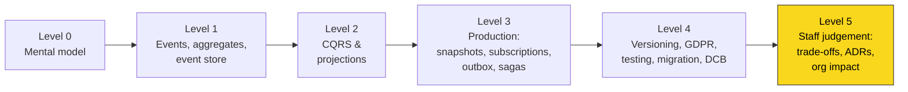

**How to study this guide (≈ 6–8 weeks part-time):**

1. Read Levels 0–1, then **type out** the Level 1 code yourself (don't copy-paste).
2. Read Level 2–3 and extend your code with projections + a subscription.
3. Read Level 4 and add versioning + tests.
4. Read Level 5 twice. Write an ADR for a real system at your company — even if the answer is "no, don't use event sourcing".
5. Build the [Capstone](#capstone-project).

---

# Level 0 — Foundations: the mental model

## 0.1 Two ways to remember the world

Imagine a bank account. There are two ways to store it.

**State-oriented (CRUD):** a row with the *current* balance.

| account_id | owner | balance |
|---|---|---|
| ACC-1 | Alice | 70 |

**Event-sourced:** an append-only list of *what happened*.

| # | event | data |
|---|---|---|
| 1 | AccountOpened | owner = Alice |
| 2 | MoneyDeposited | 100 |
| 3 | MoneyWithdrawn | 50 |
| 4 | MoneyDeposited | 20 |

Both tell you the balance is 70. But only the second one can answer:

- *"What was the balance last Tuesday?"*
- *"Why is it 70? Who changed it, when, and in what order?"*
- *"How many customers withdrew money within 5 minutes of depositing it?"* — a question nobody thought of when the system was built.

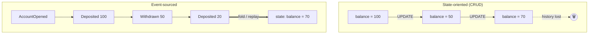

> **The key shift:** in CRUD the **state is the source of truth** and history (if any) is a side-effect (audit table, logs). In event sourcing the **events are the source of truth** and state is a side-effect — a *cache* you can throw away and recompute.

## 0.2 You already use event-sourced systems

| System | The "events" | The "derived state" |
|---|---|---|
| **Accounting ledger** | Journal entries (never erased; corrections are new entries) | Account balances, P&L |
| **Git** | Commits | Your working tree |
| **Database WAL / redo log** | Log records | Tables & indexes |
| **Kafka compacted topic / changelog** | Records | Materialised KTable |
| **Chess notation** | `1. e4 e5 2. Nf3 …` | The board position |
| **Redux / Elm** | Actions | App state (`state = reduce(state, action)`) |

Accountants have done event sourcing for 500+ years: you **never use an eraser** on a ledger. If you made a mistake, you add a *compensating* entry. Keep that image — it answers half the design questions you'll face.

## 0.3 The one equation

Event sourcing is a **left fold** over events:

```
currentState = events.foldLeft(initialState, evolve)   // evolve(state, event) → state   (pure)
newEvents    = decide(command, currentState)            // business rules; may reject
```

That's it. Everything else in this guide — snapshots, projections, versioning, sagas — is engineering around these two functions. (Some texts call `evolve` `apply`; they're the same thing.)

The two lines answer different questions. The **first** asks *"where are we now?"*: it turns past events into current state (read). The **second** asks *"what should happen next?"*: it turns a request plus current state into new events (write).

**The three ingredients**

- **`initialState`** is the state *before any event*. It is **not** the first event. For an account: "doesn't exist, balance 0". Think `sum = 0` before a loop.
- **`evolve(state, event) → state`** answers: "given the state so far and one more fact, what is the state now?" It only *applies* facts and never checks rules, because the event already happened and can't be refused. It is pure: no DB, no clock, no I/O.
- **`decide(command, state) → events`** holds the business rules. A command is a *request* ("withdraw 80"). If the rules pass, it returns the events to record. If they fail, it **rejects** the command (throws or returns an error) and **nothing is stored**.

**Worked example.** Stream `acc-42` = `[AccountOpened, MoneyDeposited(100), MoneyWithdrawn(30)]`:

| Step | State before | Event | `evolve` returns |
|---|---|---|---|
| start | — | — | `initialState` = { open: false, balance: 0 } |
| 1 | { open: false, balance: 0 } | `AccountOpened` | { open: true, balance: 0 } |
| 2 | { open: true, balance: 0 } | `MoneyDeposited(100)` | { open: true, balance: 100 } |
| 3 | { open: true, balance: 100 } | `MoneyWithdrawn(30)` | { open: true, balance: **70** } |

Now `decide` sees balance 70:
- `Withdraw(50)`: 50 ≤ 70, so it is **accepted** and returns `[MoneyWithdrawn(50)]`. The event is appended; the next fold gives 20.
- `Withdraw(500)`: 500 > 70, so it is **rejected** with "insufficient funds". It returns no events and the stream is unchanged. That is what "may reject" means.

```java
record Account(boolean open, long balance) {
  static final Account INITIAL = new Account(false, 0);          // initialState
}

static Account evolve(Account s, Event e) {                        // apply a fact; no rules
  return switch (e) {
    case AccountOpened o  -> new Account(true, s.balance());
    case MoneyDeposited d -> new Account(s.open(), s.balance() + d.amount());
    case MoneyWithdrawn w -> new Account(s.open(), s.balance() - w.amount());
  };
}

static List<Event> decide(Command c, Account s) {                  // rules live here
  return switch (c) {
    case Withdraw w when !s.open()                -> throw new DomainException("account closed");
    case Withdraw w when w.amount() > s.balance() -> throw new DomainException("insufficient funds");
    case Withdraw w                               -> List.of(new MoneyWithdrawn(w.amount()));
    // … Open, Deposit
  };
}

// One request, end to end:
Account state = events.stream().reduce(Account.INITIAL, Domain::evolve, (a, b) -> b); // 1. rebuild
List<Event> newEvents = decide(new Withdraw(50), state);                             // 2. decide
store.append("acc-42", expectedVersion, newEvents);                                   // 3. record
```

> **Why split them?** `decide` runs *once*, when the request arrives, and may say no. `evolve` runs *every time* state is rebuilt, possibly years later, and must always say yes. If you put a rule like "balance can't go negative" in `evolve`, changing that rule next year would make old history fail to load. Rules go in `decide`; `evolve` only records facts.

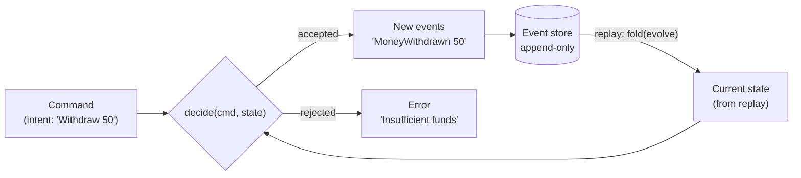

## 0.4 Vocabulary (learn these cold)

| Term | Meaning | Example |
|---|---|---|
| **Event** | An immutable fact that *happened* in the past. Named in past tense. | `OrderPlaced`, `PaymentCaptured` |
| **Command** | A *request/intent* to change something. Can be rejected. Imperative. | `PlaceOrder`, `CapturePayment` |
| **Query** | A request to read. Never changes state. | `GetOrderSummary` |
| **Aggregate** | A consistency boundary (DDD). One cluster of objects that must be consistent *together*; it validates commands and emits events. | `Order`, `BankAccount` |
| **Stream** | The ordered sequence of events for one aggregate instance. | `order-8f2c…` |
| **Stream version / revision** | Position of the last event in a stream. Used for optimistic concurrency. | `version = 4` |
| **Global position** | Position of an event across **all** streams. Used by projections. | `global_position = 1,204,889` |
| **Event store** | Database optimised for appending to streams and reading them back in order. | EventStoreDB/KurrentDB, Postgres table, Axon Server |
| **Rehydration** | Rebuilding aggregate state by replaying its stream. | `load("order-8f2c")` |
| **Projection** | A process that reads events and builds a *read model*. | "Orders by customer" table |
| **Read model / view** | Denormalised, query-optimised data derived from events. | Elasticsearch index, Redis hash |
| **Snapshot** | A cached state at version N, so you replay only from N+1. | `{balance: 70} @ v4000` |
| **Subscription** | A way for a projection/handler to receive events (catch-up, persistent). | |
| **Upcaster** | Function that transforms an old event version into the new shape at read time. | `V1 → V2` |
| **CQRS** | Command Query Responsibility Segregation — separate write model from read model(s). Often paired with ES, but independent. | |

### Event vs Command vs Message — a frequent interview trap

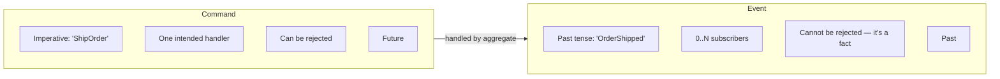

## 0.5 Why would anyone do this? (the honest list)

**Benefits**

1. **Complete, trustworthy audit log** — not a bolted-on audit table that drifts from reality; the log *is* the data. Regulators love it (finance, healthcare, insurance).
2. **Time travel / temporal queries** — reconstruct state at any point in time; debug "how did we get here?" by replaying production events locally.
3. **New read models for free** — invent a new view next year and backfill it from day-one history.
4. **Captures intent** — `AddressCorrected` vs `CustomerMoved` are different business facts, even if both just change the `address` column.
5. **Natural fit for event-driven architectures** — events are already there to publish.
6. **Write performance** — appends are the cheapest DB operation; no update-in-place contention.
7. **Business analytics** — data scientists get behavioural data (e.g. "items removed from cart") that CRUD throws away.

**Costs**

1. **Steep learning curve** and unfamiliar to most engineers → hiring/onboarding tax.
2. **Eventual consistency** on the read side — UX and product must accept it.
3. **Event schema evolution** is hard — events are forever.
4. **"Delete" is hard** (GDPR right to erasure).
5. **More moving parts** — projections, subscriptions, checkpoints, rebuilds.
6. **Querying the write side is limited** — you can't `SELECT … WHERE` across aggregates; you need projections.
7. **Easy to over-apply** — using it for a whole system instead of one bounded context is the #1 failure mode.

> 🧭 **Staff instinct:** event sourcing is a **per-bounded-context** decision, not a system-wide architecture. Most systems that succeed with it use it in 1–3 core domains (ledger, order lifecycle, claims) and plain CRUD everywhere else.

## 0.6 What event sourcing is NOT

| Misconception | Reality |
|---|---|
| "Event sourcing = using Kafka" | Kafka is a log/broker. It lacks per-entity streams with optimistic concurrency, which an ES write model needs. Kafka is great for *distributing* events, not usually for *sourcing* aggregates. (See §3.8.) |
| "Event sourcing = event-driven architecture" | EDA is about services communicating via events. ES is about how *one* service persists *its own* state. You can do either without the other. |
| "Event sourcing requires CQRS" | ES practically requires *some* read model, but CQRS is a separate pattern; you can do CQRS without ES. |
| "Events = CDC change records" | `orders.status changed from 2 to 3` is a *data* change, not a *business* event. ES events carry domain meaning. |
| "We'll replay everything to answer every query" | No — queries hit projections. Replay is for rehydrating *one* aggregate or rebuilding projections. |

---

# Level 1 — Core mechanics: events, aggregates and the event store

## 1.1 Designing good events

Events are your **permanent public contract with the future**. Get them right.

**Rules of thumb**

1. **Past tense, business language** (ubiquitous language): `InvoiceIssued`, not `InvoiceUpdated` or `SetInvoiceStatus`.
2. **Capture intent, not diffs:** `ShippingAddressCorrected` (typo) ≠ `CustomerRelocated` (moved house). Downstream behaviour differs (e.g. relocation triggers tax recalculation).
3. **Self-contained enough to be applied without lookups:** `apply()` must be pure — no DB calls, no clock, no random.
4. **Don't put derived state in events unless the derivation can change.** E.g. store `taxRate` used at the time, because the tax table will change later and replay must reproduce the *historical* result.
5. **Avoid "CRUD events"** (`OrderUpdated { allFields… }`) — they lose intent and turn ES into a slow audit table.
6. **Granularity:** one event per business fact. If a command produces multiple facts, emit multiple events atomically.
7. **Metadata vs data:** business data in the payload; technical context in metadata.

**Anatomy of an event envelope**

```json
{
  "eventId":        "0b6f9a8e-7d6c-4b1f-9a3e-2f0c1d8e9a11",
  "streamId":       "account-ACC-1",
  "streamVersion":  3,
  "globalPosition": 1204889,
  "eventType":      "MoneyWithdrawn",
  "schemaVersion":  2,
  "occurredAt":     "2026-10-22T12:01:33.120Z",
  "data": {
    "amount": { "value": "50.00", "currency": "EUR" },
    "channel": "ATM"
  },
  "metadata": {
    "correlationId": "req-77a1",
    "causationId":   "cmd-1f3e",
    "userId":        "user-42",
    "tenantId":      "tenant-eu-1",
    "traceparent":   "00-4bf92f3577b34da6a3ce929d0e0e4736-00f067aa0ba902b7-01"
  }
}
```

- **correlationId** — the whole business flow (same across all commands/events of one user request).
- **causationId** — the id of the message that *directly* caused this one. Together they let you draw the causal graph of any flow.

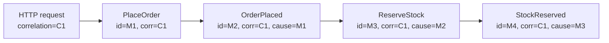

## 1.2 The aggregate: decide + evolve

The modern, testable way to write an event-sourced aggregate is the **Decider pattern** (popularised by Jérémie Chassaing): three pure functions.

```
initialState : State
decide       : (Command, State) -> List<Event>     // business rules, may throw
evolve       : (State, Event)   -> State           // pure state transition, never throws
```

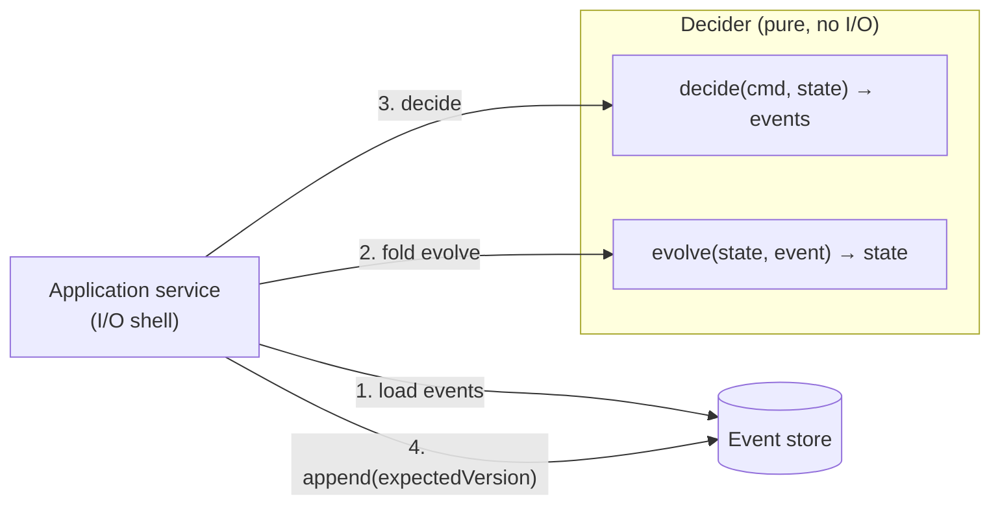

### Java 21 implementation — bank account

```java
// ---------- Events (sealed = exhaustive switch, compiler-checked) ----------
public sealed interface AccountEvent permits
        AccountEvent.AccountOpened,
        AccountEvent.MoneyDeposited,
        AccountEvent.MoneyWithdrawn,
        AccountEvent.AccountClosed {

    record AccountOpened(String accountId, String ownerId, String currency, Instant at) implements AccountEvent {}
    record MoneyDeposited(String accountId, BigDecimal amount, Instant at) implements AccountEvent {}
    record MoneyWithdrawn(String accountId, BigDecimal amount, Instant at) implements AccountEvent {}
    record AccountClosed(String accountId, String reason, Instant at) implements AccountEvent {}
}

// ---------- Commands ----------
public sealed interface AccountCommand permits
        AccountCommand.OpenAccount, AccountCommand.Deposit,
        AccountCommand.Withdraw, AccountCommand.CloseAccount {

    record OpenAccount(String accountId, String ownerId, String currency) implements AccountCommand {}
    record Deposit(String accountId, BigDecimal amount) implements AccountCommand {}
    record Withdraw(String accountId, BigDecimal amount) implements AccountCommand {}
    record CloseAccount(String accountId, String reason) implements AccountCommand {}
}

// ---------- State (only what decide() needs — NOT a full read model) ----------
public sealed interface AccountState {
    record NotOpened() implements AccountState {}
    record Open(String accountId, BigDecimal balance) implements AccountState {}
    record Closed(String accountId) implements AccountState {}
}

// ---------- The Decider ----------
public final class Account {

    public static final AccountState INITIAL = new AccountState.NotOpened();
    private static final BigDecimal OVERDRAFT_LIMIT = BigDecimal.ZERO;

    private Account() {}

    public static List<AccountEvent> decide(AccountCommand cmd, AccountState state, Clock clock) {
        var now = clock.instant();
        return switch (cmd) {
            case AccountCommand.OpenAccount c -> switch (state) {
                case AccountState.NotOpened n -> List.of(
                        new AccountEvent.AccountOpened(c.accountId(), c.ownerId(), c.currency(), now));
                default -> throw new DomainException("Account already exists");
            };
            case AccountCommand.Deposit c -> {
                var open = requireOpen(state);
                requirePositive(c.amount());
                yield List.of(new AccountEvent.MoneyDeposited(open.accountId(), c.amount(), now));
            }
            case AccountCommand.Withdraw c -> {
                var open = requireOpen(state);
                requirePositive(c.amount());
                if (open.balance().subtract(c.amount()).compareTo(OVERDRAFT_LIMIT.negate()) < 0) {
                    throw new DomainException("Insufficient funds");
                }
                yield List.of(new AccountEvent.MoneyWithdrawn(open.accountId(), c.amount(), now));
            }
            case AccountCommand.CloseAccount c -> {
                var open = requireOpen(state);
                if (open.balance().signum() != 0) throw new DomainException("Balance must be zero to close");
                yield List.of(new AccountEvent.AccountClosed(open.accountId(), c.reason(), now));
            }
        };
    }

    /** Pure. Never validates, never throws for business reasons: the event already happened. */
    public static AccountState evolve(AccountState state, AccountEvent event) {
        return switch (event) {
            case AccountEvent.AccountOpened e -> new AccountState.Open(e.accountId(), BigDecimal.ZERO);
            case AccountEvent.MoneyDeposited e -> {
                var o = (AccountState.Open) state;
                yield new AccountState.Open(o.accountId(), o.balance().add(e.amount()));
            }
            case AccountEvent.MoneyWithdrawn e -> {
                var o = (AccountState.Open) state;
                yield new AccountState.Open(o.accountId(), o.balance().subtract(e.amount()));
            }
            case AccountEvent.AccountClosed e -> new AccountState.Closed(e.accountId());
        };
    }

    public static AccountState rehydrate(List<AccountEvent> history) {
        AccountState s = INITIAL;
        for (var e : history) s = evolve(s, e);
        return s;
    }

    private static AccountState.Open requireOpen(AccountState s) {
        if (s instanceof AccountState.Open o) return o;
        throw new DomainException("Account is not open");
    }
    private static void requirePositive(BigDecimal amount) {
        if (amount.signum() <= 0) throw new DomainException("Amount must be positive");
    }
}
```

**Why this design is industry-grade**

- `decide` and `evolve` are **pure** → unit tests need no mocks, no DB, no Spring context.
- The **state is minimal**: only fields needed to enforce invariants (balance, status). Things like `ownerName` or `transactionHistory` belong in **read models**, not aggregate state. Bloated state is a classic smell.
- `evolve` **never throws** — an event is a fact. If replay throws, you have a bug or a broken migration, not a business error.
- **The clock is injected** — decide is deterministic in tests.
- The sealed hierarchy gives **compile-time exhaustiveness**: add a new event and every `switch` fails to compile until handled.

> The classic OO alternative (an `Account` class with `apply(event)` and `uncommittedChanges` list, as in Axon or Vernon's IDDD) is equivalent. Pick one style per codebase. The functional Decider is easier to test and reason about; the OO style is more familiar to Java teams. Both are "industry standard".

## 1.3 The event store

An event store needs only a handful of operations:

```java
public interface EventStore {
    /** Atomically append; fail if stream's current version != expectedVersion. */
    AppendResult append(String streamId, long expectedVersion, List<EventEnvelope> events);

    /** Read one stream in order (for rehydrating an aggregate). */
    List<EventEnvelope> readStream(String streamId, long fromVersion);

    /** Read ALL events across streams in global order (for projections). */
    List<EventEnvelope> readAll(long fromGlobalPosition, int maxCount);
}
```

### PostgreSQL schema (production-shaped)

```sql
CREATE TABLE events (
    global_position  BIGINT GENERATED ALWAYS AS IDENTITY PRIMARY KEY,
    event_id         UUID        NOT NULL UNIQUE,          -- idempotency
    stream_id        TEXT        NOT NULL,
    stream_version   BIGINT      NOT NULL,                 -- 1, 2, 3 … per stream
    event_type       TEXT        NOT NULL,
    schema_version   INT         NOT NULL DEFAULT 1,
    data             JSONB       NOT NULL,
    metadata         JSONB       NOT NULL DEFAULT '{}',
    occurred_at      TIMESTAMPTZ NOT NULL,
    recorded_at      TIMESTAMPTZ NOT NULL DEFAULT now(),
    tx_id            XID8        NOT NULL DEFAULT pg_current_xact_id(),  -- see §3.3
    CONSTRAINT uq_stream_version UNIQUE (stream_id, stream_version)      -- optimistic concurrency
);

CREATE INDEX ix_events_stream ON events (stream_id, stream_version);

-- Optional: one row per stream for cheap version checks & stream metadata
CREATE TABLE streams (
    stream_id      TEXT PRIMARY KEY,
    stream_type    TEXT   NOT NULL,
    version        BIGINT NOT NULL,
    archived       BOOLEAN NOT NULL DEFAULT false
);

-- Events are immutable. Enforce it.
REVOKE UPDATE, DELETE ON events FROM app_user;
```

The `UNIQUE (stream_id, stream_version)` constraint **is** the optimistic-concurrency mechanism: two writers that both loaded version 3 will both try to insert version 4; exactly one wins, the other gets a unique-violation → `ConcurrencyException`.

### Append with optimistic concurrency (JDBC)

```java
public final class PostgresEventStore implements EventStore {

    private final DataSource ds;
    private final EventSerializer serializer;

    @Override
    public AppendResult append(String streamId, long expectedVersion, List<EventEnvelope> events) {
        String sql = """
            INSERT INTO events (event_id, stream_id, stream_version, event_type, schema_version,
                                data, metadata, occurred_at)
            VALUES (?, ?, ?, ?, ?, ?::jsonb, ?::jsonb, ?)
            """;
        try (var conn = ds.getConnection()) {
            conn.setAutoCommit(false);
            try (var ps = conn.prepareStatement(sql)) {
                long v = expectedVersion;
                for (var e : events) {
                    ps.setObject(1, e.eventId());
                    ps.setString(2, streamId);
                    ps.setLong(3, ++v);
                    ps.setString(4, e.eventType());
                    ps.setInt(5, e.schemaVersion());
                    ps.setString(6, serializer.toJson(e.data()));
                    ps.setString(7, serializer.toJson(e.metadata()));
                    ps.setTimestamp(8, Timestamp.from(e.occurredAt()));
                    ps.addBatch();
                }
                ps.executeBatch();
                conn.commit();
                return new AppendResult(v);
            } catch (SQLException ex) {
                conn.rollback();
                if ("23505".equals(ex.getSQLState())) {          // unique_violation
                    throw new ConcurrencyException(streamId, expectedVersion, ex);
                }
                throw ex;
            }
        } catch (SQLException ex) {
            throw new EventStoreException(ex);
        }
    }

    @Override
    public List<EventEnvelope> readStream(String streamId, long fromVersion) {
        String sql = """
            SELECT * FROM events
             WHERE stream_id = ? AND stream_version > ?
             ORDER BY stream_version
            """;
        // … map rows → EventEnvelope (run upcasters here, see §4.1)
    }
}
```

### The command handler (application service)

```java
public final class AccountCommandHandler {

    private final EventStore store;
    private final EventMapper mapper;     // domain event <-> envelope
    private final Clock clock;

    public long handle(AccountCommand cmd, CommandMetadata meta) {
        String streamId = "account-" + accountIdOf(cmd);

        return Retry.onConcurrencyConflict(3, () -> {           // retry = reload + re-decide
            var history  = store.readStream(streamId, 0);
            var state    = Account.rehydrate(mapper.toDomain(history));
            long version = history.isEmpty() ? 0 : history.getLast().streamVersion();

            var newEvents = Account.decide(cmd, state, clock);

            return store.append(streamId, version, mapper.toEnvelopes(newEvents, meta)).newVersion();
        });
    }
}
```

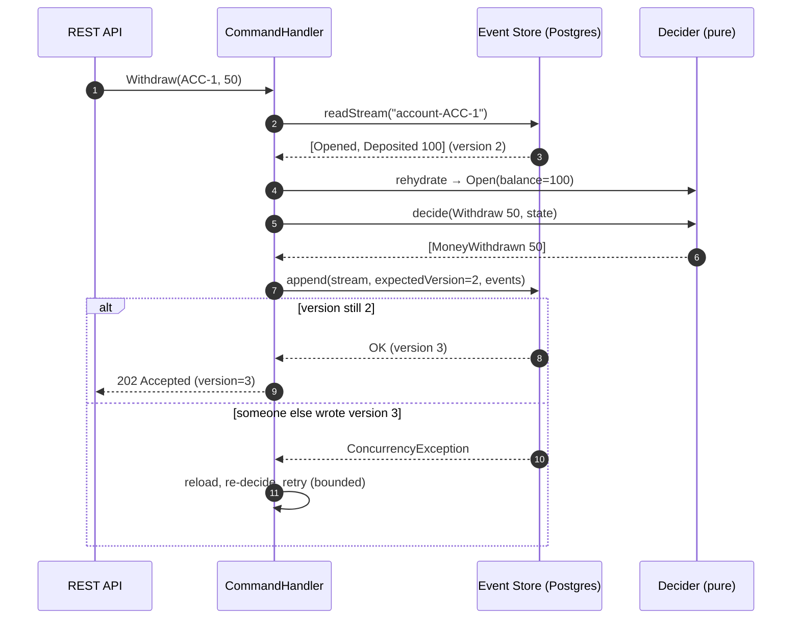

### Optimistic concurrency — why and how

Two tellers both see balance 100 and both withdraw 80. With CRUD and no locking you'd get −60. With ES + expected version:

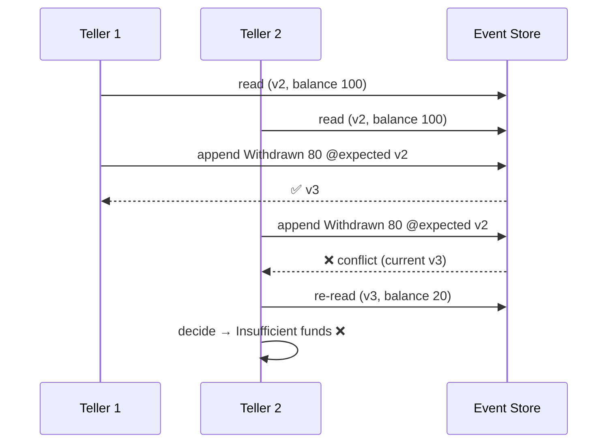

Expected-version options found in real stores (EventStoreDB/KurrentDB naming):

| Expected version | Meaning | Use for |
|---|---|---|
| `NoStream` | Stream must not exist | Creation commands (prevents duplicate create) |
| `Exact(n)` | Stream must be at exactly n | Normal commands |
| `StreamExists` | Stream must exist, any version | Rare |
| `Any` | No check | Append-only facts with no invariants (e.g. telemetry) — use sparingly |

You can also pass the version **from the client** (e.g. `If-Match: "3"` HTTP header / ETag) to detect *user-level* conflicts ("someone changed this order since you opened the page").

## 1.4 Stream design: what is "one stream"?

- **One stream per aggregate instance** (`order-123`) is the default and the right answer 95% of the time.
- Stream id convention: `{aggregateType}-{id}` → lets you build "category" projections (`$ce-order` in EventStoreDB).
- **Keep streams short-lived** where the domain allows. A stream that grows forever (e.g. `inventory-sku-42` with 10M events) is a design smell — see "closing the books" (§4.6).

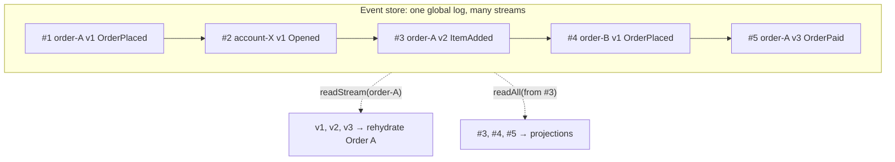

## 1.5 Level 1 exercises

1. Implement the `Account` decider + an **in-memory** event store (a `Map<String, List<Event>>` with version check). Write tests (see §4.3 for the Given/When/Then style).
2. Swap in the Postgres store. Write a test that fires two concurrent withdrawals and asserts exactly one succeeds.
3. Model a **shopping cart**: `CartCreated`, `ItemAdded`, `ItemRemoved`, `CartCheckedOut`. Invariant: cannot modify after checkout; max 50 items.
4. Write down three events for your *current* work domain. Have a colleague read only the event names — can they tell the business story?

---

# Level 2 — The read side: CQRS and projections

## 2.1 Why you need a read side

The write model (event streams) is great at "give me everything about **order-123**" and terrible at "give me all orders over €500 placed in Berlin last week". You solve this with **projections** that turn events into query-optimised **read models**.

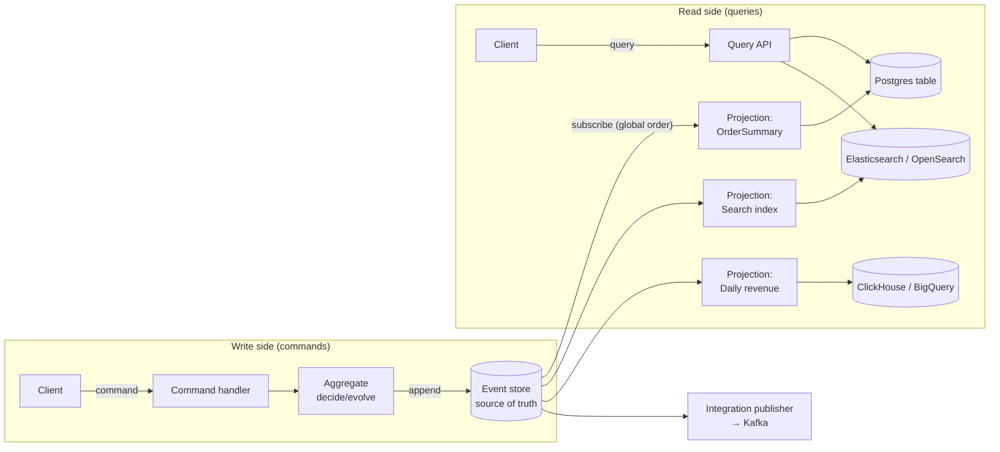

**CQRS** = use different models for writing and reading. With event sourcing it's nearly mandatory because the write model can't serve arbitrary queries. Key consequence: **reads are eventually consistent** with writes (typically milliseconds to seconds).

## 2.2 Writing a projection

A projection is just another fold, but over the **global** stream and into a database:

```java
public final class AccountBalanceProjection implements Projection {

    private final JdbcTemplate jdbc;

    @Override public String name() { return "account-balance-v1"; }

    @Override
    @Transactional   // read-model update + checkpoint in ONE transaction
    public void handle(EventEnvelope env) {
        switch (env.event()) {
            case AccountEvent.AccountOpened e -> jdbc.update("""
                INSERT INTO rm_account_balance (account_id, owner_id, balance, last_position)
                VALUES (?, ?, 0, ?)
                ON CONFLICT (account_id) DO NOTHING
                """, e.accountId(), e.ownerId(), env.globalPosition());

            case AccountEvent.MoneyDeposited e -> jdbc.update("""
                UPDATE rm_account_balance
                   SET balance = balance + ?, last_position = ?
                 WHERE account_id = ? AND last_position < ?     -- idempotency guard
                """, e.amount(), env.globalPosition(), e.accountId(), env.globalPosition());

            case AccountEvent.MoneyWithdrawn e -> jdbc.update("""
                UPDATE rm_account_balance
                   SET balance = balance - ?, last_position = ?
                 WHERE account_id = ? AND last_position < ?
                """, e.amount(), env.globalPosition(), e.accountId(), env.globalPosition());

            case AccountEvent.AccountClosed e -> jdbc.update(
                "UPDATE rm_account_balance SET status='CLOSED', last_position=? WHERE account_id=?",
                env.globalPosition(), e.accountId());

            default -> { /* ignore events this projection doesn't care about */ }
        }
        jdbc.update("""
            INSERT INTO projection_checkpoints (name, position) VALUES (?, ?)
            ON CONFLICT (name) DO UPDATE SET position = EXCLUDED.position
            """, name(), env.globalPosition());
    }
}
```

### The three properties every projection must have

| Property | Why | How |
|---|---|---|
| **Idempotent** | Delivery is at-least-once; you *will* see duplicates after crashes. | Store last processed position per row (as above) or per projection; `UPSERT`; dedupe on `event_id`. |
| **Checkpointed** | Resume from where you stopped, not from zero. | Save `globalPosition` — ideally **in the same transaction** as the read-model write (exactly-once *effect*). |
| **Rebuildable** | Bugs happen; requirements change. | Projection must be able to start from position 0 into a fresh table. Never write to a read model from anywhere else. |

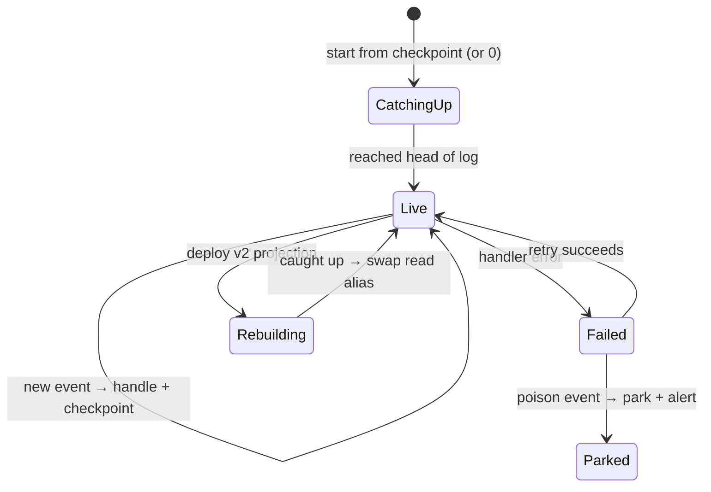

## 2.3 Rebuilding projections with zero downtime (blue/green)

Changing a projection's logic = rebuild. Production pattern:

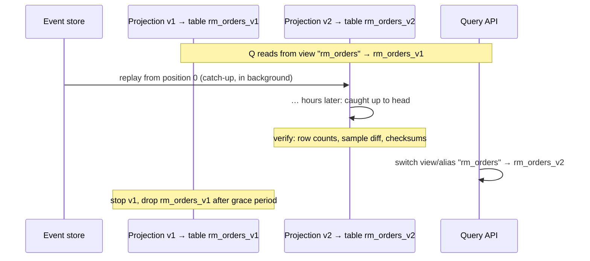

Tips:
- Name projections with a version (`orders-summary-v2`) so v1 and v2 can run side-by-side with separate checkpoints.
- For Elasticsearch/OpenSearch use **index aliases**; for Postgres use a view or a `search_path` swap.
- Rebuild speed matters: batch writes (`COPY`, bulk API), disable non-essential indexes during catch-up, parallelise by stream-id hash if the projection is per-entity.
- Measure: "time to rebuild the slowest projection" is a key operational SLO. If it's days, you've lost one of ES's main benefits.

## 2.4 Types of projections

| Type | Example | Notes |
|---|---|---|
| **Per-entity (document)** | `OrderDetails` per order | Easiest; parallelisable by stream |
| **List / search** | "Orders for customer X" | Usually a table with indexes or a search index |
| **Aggregating** | Revenue per day | Beware of non-commutative operations; prefer storing inputs |
| **Cross-stream join** | Order with customer name | Projection must also consume `CustomerRenamed`; keep a local lookup table |
| **In-memory** | Hot leaderboard | Rebuild on startup; needs fast catch-up or snapshot |
| **Live / ad-hoc** | One-off analytics query over history | Run a temporary projection, throw it away |
| **Integration publisher** | Push to Kafka | A "projection" whose output is another system (see §3.6) |

## 2.5 Eventual consistency: dealing with it in UX and APIs

The #1 objection from product teams: *"I clicked save and the list doesn't show my change."* Staff engineers solve this pragmatically:

| Technique | How | Trade-off |
|---|---|---|
| **Return the result from the command** | Command handler returns new version / computed values; UI updates optimistically | Simplest; covers most cases |
| **Read-your-writes via position token** | Command returns `globalPosition`; query passes `?minPosition=…`; query API waits (bounded, e.g. 2s) until projection checkpoint ≥ token | Strong UX, small latency cost |
| **Inline / synchronous projection** | Update critical read model in the **same transaction** as the append (possible when event store and read model share Postgres — Marten calls this "inline projections") | Couples write latency to projection; fine for 1–2 critical views |
| **Read from the aggregate** | For "get by id" just rehydrate the stream | Always consistent; only works by id |
| **Push to the client** | WebSocket/SSE notification when projection updated | Best UX, more infra |
| **Design the UI** | "Your order is being processed" | Often the business is fine with it — *ask* |

```java
// Read-your-writes: wait until the projection has caught up to the caller's write
public OrderView getOrder(String orderId, Optional<Long> minPosition) {
    minPosition.ifPresent(p -> checkpoints.awaitAtLeast("orders-summary-v2", p, Duration.ofSeconds(2)));
    return repo.findById(orderId).orElseThrow(NotFound::new);
}
```

## 2.6 Level 2 exercises

1. Build an `AccountBalance` projection and a `TransactionsByDay` projection. Kill the process mid-catch-up; verify no double counting on restart.
2. Change the `TransactionsByDay` logic, deploy as `v2`, rebuild side-by-side, swap.
3. Implement read-your-writes with a position token.

---

# Level 3 — Production engineering

## 3.1 Snapshots

Replaying 50 events is microseconds. Replaying 500,000 is not. A **snapshot** stores the aggregate state at version N.

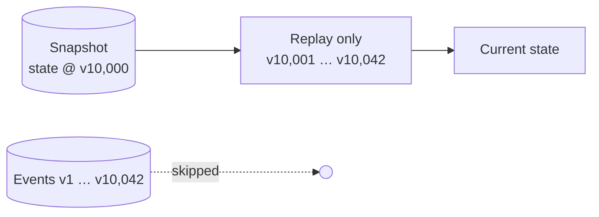

```sql
CREATE TABLE snapshots (
    stream_id       TEXT PRIMARY KEY,
    stream_version  BIGINT NOT NULL,
    schema_version  INT    NOT NULL,   -- snapshot shape version!
    state           JSONB  NOT NULL,
    created_at      TIMESTAMPTZ NOT NULL DEFAULT now()
);
```

```java
AccountState load(String streamId) {
    var snap = snapshots.find(streamId)
            .filter(s -> s.schemaVersion() == CURRENT_SNAPSHOT_SCHEMA);   // stale shape? ignore it
    AccountState state = snap.map(Snapshot::state).orElse(Account.INITIAL);
    long from = snap.map(Snapshot::streamVersion).orElse(0L);
    for (var e : store.readStream(streamId, from)) state = Account.evolve(state, e);
    return state;
}
```

**Staff-level rules for snapshots**

1. **Snapshots are a cache, never a source of truth.** Delete them all and the system must still work (slower).
2. **Don't add them until you measure a need.** Many aggregates never exceed ~100 events. Premature snapshotting adds a schema you must version.
3. **Version the snapshot schema.** When aggregate state changes shape, ignore old snapshots and rebuild from events.
4. **Take snapshots asynchronously** (e.g. every N events, by a background process) — don't slow the command path.
5. **If you need snapshots because streams are huge, first ask whether the aggregate boundary is wrong** (§4.6 closing the books).

## 3.2 Subscriptions: how events reach projections and handlers

| Model | Description | Examples |
|---|---|---|
| **Polling catch-up** | Consumer polls `readAll(fromPosition)` in a loop | Simple Postgres stores, Marten async daemon |
| **Push catch-up** | Store pushes from a position, consumer tracks checkpoint | EventStoreDB/KurrentDB catch-up subscriptions |
| **Persistent / competing consumers** | Server tracks checkpoint, load-balances events across consumers (ordering weakened) | EventStoreDB persistent subscriptions |
| **Via a broker** | Events forwarded to Kafka; consumers use consumer groups | Common in microservice estates |
| **LISTEN/NOTIFY + poll** | Postgres `NOTIFY` as a wake-up signal, then poll | Lowers latency of polling |

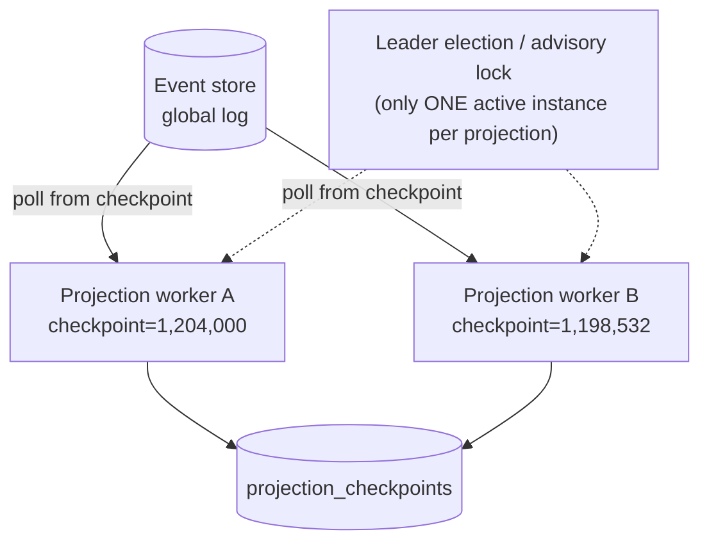

**Run exactly one active instance per projection** (or per partition of a projection), otherwise two instances will race and reorder updates. Use a Postgres advisory lock, Kubernetes lease, ShedLock, or the store's built-in coordination.

```java
// Single active instance per projection using a Postgres advisory lock
boolean leader = jdbc.queryForObject("SELECT pg_try_advisory_lock(hashtext(?))", Boolean.class, projection.name());
if (!leader) return;   // another pod owns it; try again later
```

## 3.3 The global ordering "gap" problem (a classic production bug)

With a Postgres `IDENTITY`/`SEQUENCE` as global position, **sequence numbers are assigned at insert time but become visible at commit time.** Transactions commit out of order:

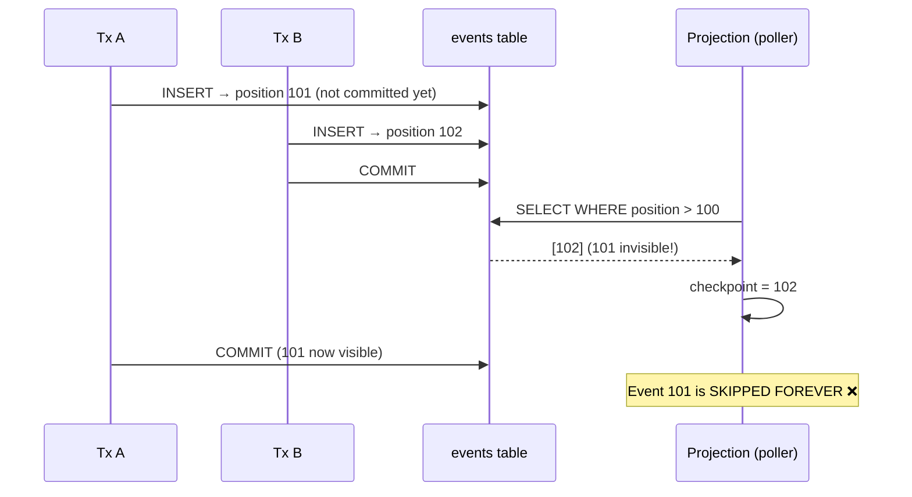

**Fixes used in practice:**

1. **Transaction-id visibility filter** (used by several Postgres stores): store `pg_current_xact_id()` per row and only read rows whose transaction is older than the oldest still-running transaction:
   ```sql
   SELECT * FROM events
    WHERE global_position > :checkpoint
      AND tx_id < pg_snapshot_xmin(pg_current_snapshot())
    ORDER BY global_position
    LIMIT 500;
   ```
2. **Gap detection with timeout** — if you see a gap, wait (e.g. up to a few seconds) for it to fill; if it doesn't (rolled-back tx leaves permanent holes), skip it. This is how Marten's async daemon "high-water mark" works conceptually.
3. **Serialise appends** (single writer / table lock) — simple, caps throughput.
4. Use a purpose-built store (EventStoreDB/KurrentDB, Axon Server) that guarantees a gap-free, commit-ordered `$all` stream.

> 🧭 This exact bug has bitten many home-grown event stores. In a design review, **ask how global ordering and visibility are guaranteed** — it separates people who've run ES in production from people who've read about it.

## 3.4 Idempotency on the command side

Clients retry. Load balancers retry. Users double-click.

- **Creation commands:** use `expectedVersion = NoStream` with a client-supplied id → duplicate create fails safely.
- **Other commands:** accept an `Idempotency-Key`; store the processed key (in event metadata or a dedupe table) and return the original result on replay.
- **Deterministic event ids:** derive `eventId = UUIDv5(commandId + index)` so a retried append hits the `UNIQUE(event_id)` constraint instead of duplicating.

## 3.5 Domain events vs integration events

This is one of the most important — and most commonly botched — distinctions.

| | **Domain events** (internal) | **Integration events** (public) |
|---|---|---|
| Audience | Your own bounded context | Other teams/services |
| Stored in | Event store (source of truth) | Kafka topic / broker |
| Granularity | Fine (`ItemAddedToCart`) | Coarse, stable (`OrderSubmitted` with full summary) |
| Change frequency | Can evolve with your model | Versioned contract; changes need consumer coordination |
| Contains | Exactly what's needed to rebuild state | What consumers need (often enriched) |

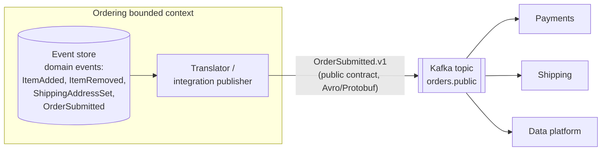

> ⚠️ **Anti-pattern: publishing your raw event store to the whole company.** You've now made your internal model a public API — every refactor becomes a cross-team migration. Publish *integration* events through an anti-corruption layer.

## 3.6 Publishing reliably — no dual writes

Never do this:

```java
store.append(stream, v, events);   // ✅ committed
kafka.send(topic, events);         // 💥 crash here → consumers never hear about it
```

With event sourcing **the event store already is your outbox**. Run a subscription (like a projection) that reads the global log from a checkpoint and publishes to Kafka. At-least-once delivery + idempotent consumers = effectively-once.

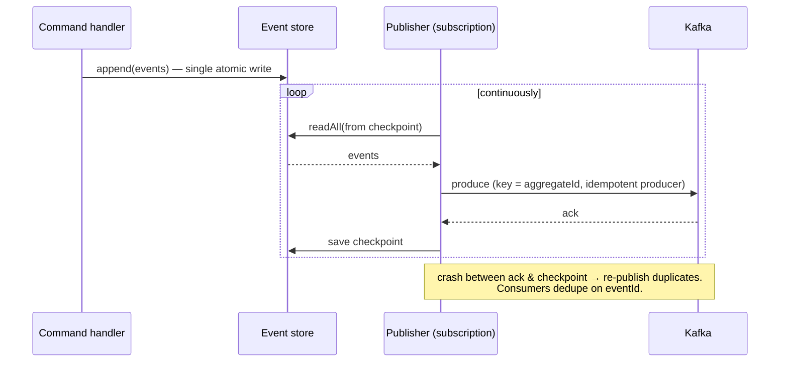

Partition the Kafka topic by **aggregate id** so per-aggregate ordering is preserved downstream.

## 3.7 Sagas / process managers across aggregates

An aggregate is a consistency boundary — **one command changes one aggregate** (one stream) in one transaction. Business processes spanning aggregates (or services) are coordinated by a **process manager** (stateful) or **choreography** (event → command reactions), with compensations instead of distributed transactions.

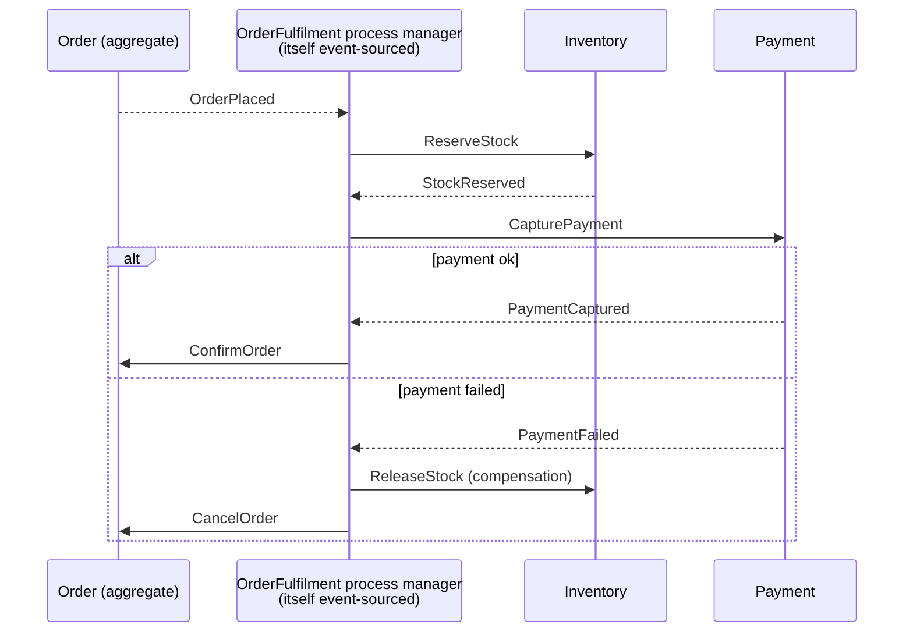

- A process manager is a great candidate for event sourcing itself: its state (`awaitingPayment`, timeouts) must survive restarts, and its history is a perfect debugging trail.
- Handle **timeouts** as events too (`PaymentTimeoutElapsed`, scheduled via a durable scheduler).
- Make every step **idempotent** — the process manager will re-send commands after a crash.

## 3.8 Can Kafka be my event store?

A favourite Staff interview question. Short answer: **Kafka is an excellent event *log* for distribution, but a poor *event store* for aggregate write models.**

| Requirement | Purpose-built event store | Kafka |
|---|---|---|
| Read one aggregate's events quickly | ✅ index by stream | ❌ a partition holds many aggregates; you'd scan or keep a separate state store |
| Optimistic concurrency per aggregate (`expectedVersion`) | ✅ | ❌ no conditional append per key |
| Millions of tiny streams | ✅ | ❌ topic-per-aggregate doesn't scale |
| Infinite retention as source of truth | ✅ | ⚠️ possible (tiered storage), but compaction semantics are about latest-value, not history |
| Fan-out to many consumers, high throughput | ⚠️ ok | ✅ excellent |

Teams *do* build ES on Kafka using Kafka Streams state stores + single-writer-per-partition, which sidesteps concurrency by serialising writes per partition. It works, but you're building an event store yourself. The common, well-trodden architecture is: **event store (EventStoreDB/KurrentDB, Postgres, Axon Server, DynamoDB…) as source of truth → Kafka for integration.**

## 3.9 Choosing an event store (2025–26 landscape)

| Option | Strengths | Watch out for |
|---|---|---|
| **PostgreSQL (DIY or library)** | Team already knows it; ACID; inline projections in same DB; easy ops | You own ordering/gaps, subscriptions, archiving. Libraries: **Marten** (.NET), **Emmett** (TS), **Eventuous** (.NET), **pg-event-store**-style libs, or your own (~500 LOC) |
| **KurrentDB** (formerly **EventStoreDB**) | Purpose-built: streams, `$all`, catch-up & persistent subscriptions, server-side projections, expected versions | Another database to operate; licensing changed over time — check current terms |
| **Axon Framework + Axon Server** (Java) | Full Java/Spring ecosystem: aggregates, sagas, event processors, snapshots, upcasters | Framework lock-in; Axon Server Enterprise for clustering |
| **Akka/Pekko Persistence** (JVM) | Actor-based, high throughput, pluggable journals (Cassandra, JDBC, DynamoDB) | Actor model learning curve; Akka licence changed (BSL) → Apache Pekko fork |
| **DynamoDB / Cosmos DB** | Serverless scale; conditional writes give `expectedVersion`; streams/change feed for subscriptions | No global ordering across partitions; per-item size limits |
| **Kafka (+ Streams)** | See §3.8 | See §3.8 |

**Staff heuristic:** if your team is new to ES and already runs Postgres, start with Postgres + a thin, well-tested event-store module. Graduate to a dedicated store when you hit concrete limits (throughput, subscriptions, ops pain) — not before.

## 3.10 Observability for event-sourced systems

Measure these from day one:

| Metric | Why |
|---|---|
| **Projection lag** (`head_position − checkpoint`, and in seconds) | Primary SLO of the read side; alert on it |
| **Append latency & conflict rate** | High conflict rate → aggregate too coarse or hot spot |
| **Events per stream (p50/p99/max)** | Detect unbounded streams before they hurt |
| **Rehydration time (p99)** | Tells you if/when you need snapshots |
| **Parked/poison events count** | Should be zero; any non-zero is an incident |
| **Rebuild duration per projection** | Operational readiness |

Propagate `correlationId`/`causationId` and W3C `traceparent` in event metadata so OpenTelemetry traces span command → append → projection → Kafka → downstream.

---

# Level 4 — Advanced topics

## 4.1 Event schema evolution (versioning)

Events are immutable and live forever, but your understanding of the domain changes. Greg Young's book *Versioning in an Event Sourced System* is the canonical reference. The strategies, in order of preference:

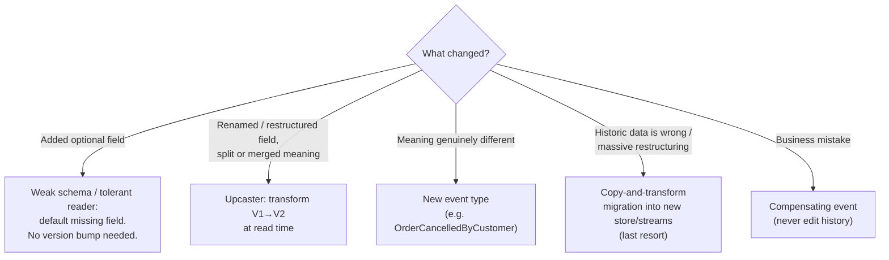

### Strategy 1 — Weak schema / tolerant reader
Use JSON with lenient deserialisation; new fields are optional with defaults; never remove or repurpose fields. Covers most changes.

```java
// Jackson: ignore unknown fields so old code can read new events (forward compatibility)
mapper.configure(DeserializationFeature.FAIL_ON_UNKNOWN_PROPERTIES, false);

// Defaults for fields that didn't exist in old events (backward compatibility)
record MoneyDeposited(String accountId, BigDecimal amount, Instant at, String channel) {
    MoneyDeposited { if (channel == null) channel = "UNKNOWN"; }
}
```

### Strategy 2 — Upcasting
Transform old raw events to the current shape **when reading**, before deserialising into domain types. Domain code only ever sees the latest version.

```java
public interface Upcaster {
    boolean canUpcast(String eventType, int schemaVersion);
    RawEvent upcast(RawEvent raw);    // returns next version (chainable: v1→v2→v3)
}

/** V1 had "amount": 50.00 (implicit EUR). V2 has "amount": {"value": "50.00", "currency": "EUR"} */
public final class MoneyDepositedV1toV2 implements Upcaster {
    public boolean canUpcast(String type, int v) { return type.equals("MoneyDeposited") && v == 1; }
    public RawEvent upcast(RawEvent raw) {
        ObjectNode data = raw.data().deepCopy();
        var amount = data.remove("amount");
        data.putObject("amount").put("value", amount.asText()).put("currency", "EUR");
        return raw.withData(data).withSchemaVersion(2);
    }
}
```

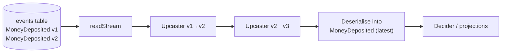

### Strategy 3 — New event type
If the meaning changed, it's a new fact. Keep handling the old type in `evolve` forever (or upcast it into the new type).

### Strategy 4 — Copy-and-transform (stream migration)
Read all events, transform, write into a new store/streams, switch over. Expensive, risky, and breaks the "immutable history" promise for auditors — keep the original store archived. Use only for big refactors (e.g. splitting an aggregate).

### Serialisation format choice

| Format | Pros | Cons |
|---|---|---|
| **JSON (JSONB)** | Human-readable, queryable in Postgres, weak-schema friendly | Bigger; no enforced schema |
| **Avro / Protobuf + Schema Registry** | Compact; compatibility checks in CI (BACKWARD/FORWARD/FULL) | Harder to inspect/debug; registry is a dependency |

Common mix: **JSON in the event store** (debuggability, flexibility), **Avro/Protobuf for public integration events on Kafka** (contract enforcement).

> 🧭 **Staff practice:** add a CI test that loads a corpus of *real historical event samples* (one per type × version) and asserts they still deserialise and `evolve` cleanly. This catches "harmless" refactors (renaming a record field!) that would brick replay in production.

## 4.2 GDPR, PII and the "right to be forgotten"

Immutability vs legal deletion obligations. Options:

| Technique | How | Notes |
|---|---|---|
| **Keep PII out of events** | Events reference `customerId`; PII lives in a separate, deletable CRUD store | Simplest; best default |
| **Crypto-shredding** | Encrypt PII fields with a **per-subject key** stored in a key vault; delete the key to "forget" | Events stay immutable; replay shows `[redacted]`. Most popular approach |
| **Stream deletion / truncation** | Delete or truncate the whole stream (e.g. `customer-123`) | Allowed by most stores; projections must handle tombstones |
| **Copy-transform excluding data** | Rewrite history without the subject | Heavy; last resort |

```mermaid
sequenceDiagram
    participant H as Handler
    participant KMS as Key store (per-subject keys)
    participant ES as Event store
    participant P as Projection
    H->>KMS: getOrCreateKey(customer-42)
    H->>ES: append CustomerRegistered{ email: ENC(k42, "a@b.com") }
    P->>KMS: getKey(customer-42)
    P->>P: decrypt → "a@b.com"
    Note over KMS: GDPR erasure request
    KMS->>KMS: DELETE key k42
    P->>KMS: getKey(customer-42) → not found
    P->>P: email = "[erased]"
```

Remember to also purge **read models, snapshots, Kafka topics, backups, data lake copies** — a Staff engineer owns the end-to-end data map, not just the event store.

## 4.3 Testing event-sourced systems

ES gives you the best unit-testing story in software: **Given (past events) / When (command) / Then (new events or error)**. No mocks, no DB.

```java
class AccountTest {

    private final Clock clock = Clock.fixed(Instant.parse("2026-01-01T10:00:00Z"), ZoneOffset.UTC);
    private final Instant t = clock.instant();

    @Test
    void withdraw_within_balance_emits_MoneyWithdrawn() {
        given(new AccountOpened("A1", "u1", "EUR", t),
              new MoneyDeposited("A1", new BigDecimal("100"), t))
        .when(new Withdraw("A1", new BigDecimal("30")))
        .then(new MoneyWithdrawn("A1", new BigDecimal("30"), t));
    }

    @Test
    void withdraw_beyond_balance_is_rejected() {
        given(new AccountOpened("A1", "u1", "EUR", t),
              new MoneyDeposited("A1", new BigDecimal("10"), t))
        .when(new Withdraw("A1", new BigDecimal("30")))
        .thenThrows(DomainException.class, "Insufficient funds");
    }

    // --- tiny DSL ---
    private Scenario given(AccountEvent... history) { return new Scenario(List.of(history)); }

    private final class Scenario {
        private final List<AccountEvent> history; private AccountCommand cmd;
        Scenario(List<AccountEvent> h) { history = h; }
        Scenario when(AccountCommand c) { cmd = c; return this; }
        void then(AccountEvent... expected) {
            assertEquals(List.of(expected), Account.decide(cmd, Account.rehydrate(history), clock));
        }
        void thenThrows(Class<? extends Throwable> type, String msg) {
            var ex = assertThrows(type, () -> Account.decide(cmd, Account.rehydrate(history), clock));
            assertEquals(msg, ex.getMessage());
        }
    }
}
```

**The testing pyramid for ES**

| Layer | What | Tooling |
|---|---|---|
| Decider unit tests | Given/When/Then on pure functions | JUnit 5 |
| **Property-based tests** | "For any sequence of valid commands, balance ≥ 0" / "evolve never throws for events decide produced" | jqwik |
| Projection tests | Given events → assert read-model rows; feed duplicates → assert idempotent | JUnit + Testcontainers (Postgres, run on Podman) |
| Event store contract tests | Concurrency conflict, ordering, gap handling under parallel load | Testcontainers |
| Schema compatibility tests | Historical event corpus still deserialises/upcasts | JUnit + golden files |
| **Replay tests** | Replay an anonymised production snapshot through new code; diff read models | Pre-release pipeline |

```java
// jqwik: invariant holds for ANY sequence of commands
@Property
void balance_never_negative(@ForAll("commandSequences") List<AccountCommand> cmds) {
    AccountState s = Account.INITIAL;
    for (var c : cmds) {
        try { for (var e : Account.decide(c, s, clock)) s = Account.evolve(s, e); }
        catch (DomainException ignored) { }
    }
    if (s instanceof AccountState.Open o) assertTrue(o.balance().signum() >= 0);
}
```

## 4.4 Consistency across aggregates: set validation & uniqueness

"Usernames must be unique" spans *all* user streams — no single aggregate can enforce it. Options:

1. **Reservation stream/table**: a separate `username-alice` stream (append with `NoStream`) or a unique-constraint table written in the same transaction as the append (if same DB).
2. **Ask the read model, accept rare races, compensate** — check a projection, then handle the rare duplicate with a compensating action. Ask the business how bad a duplicate *really* is.
3. **Make it a single aggregate** if the set is small (e.g. seats in one flight).
4. **Dynamic Consistency Boundary** (§4.5).

## 4.5 Dynamic Consistency Boundary (DCB) — the 2024+ frontier

Traditional ES forces you to pick aggregate boundaries up front, and cross-aggregate invariants become sagas. **DCB** (introduced by Sara Pellegrini & Milan Savić, adopted by Axon and others — see dcb.events) removes the fixed "one stream per aggregate" rule:

- Events are stored in **one log**, tagged (e.g. `course:c1`, `student:s7`).
- A command handler **queries the events relevant to its decision** by tags/types.
- On append, it passes an **append condition**: "fail if any event matching *this query* was appended after position P".

```mermaid
flowchart LR
    Cmd["SubscribeStudentToCourse(s7, c1)"] --> Q["Query events tagged<br/>course:c1 OR student:s7<br/>(types: CourseCapacityChanged,<br/>StudentSubscribed…)"]
    Q --> Dec["decide: course not full<br/>AND student < 5 courses"]
    Dec --> App["append StudentSubscribed<br/>tags: course:c1, student:s7<br/>condition: no new matching events since P"]
```

It enforces an invariant spanning "course" and "student" without a saga or a contrived aggregate. Trade-offs: newer, fewer production-proven stores, harder to scale (the conditional check is over a query, not a single stream). Know it, evaluate it, don't bet a core system on it without a spike.

## 4.6 Long-lived streams: "closing the books"

Accountants close the books every period and carry a balance forward. Do the same:

```mermaid
flowchart LR
    subgraph Y2025["stream: account-A1-2025"]
        a1["… 12,000 events …"] --> close["AccountingPeriodClosed<br/>closingBalance=8,412.00"]
    end
    subgraph Y2026["stream: account-A1-2026"]
        open["AccountingPeriodOpened<br/>openingBalance=8,412.00"] --> b1["new events…"]
    end
    close --> open
```

- Keeps streams small → fast rehydration, no snapshots needed.
- Old streams can be **archived** to cheap storage (S3/Glacier) while remaining replayable.
- Find the *natural lifecycle* in your domain: shift, day, billing cycle, season, policy term. "Snapshot because the stream is big" often means "you missed a lifecycle event".

## 4.7 Temporal queries & bi-temporality

- **As-of (system time):** "what did *we know* on 1 March?" → replay events with `recorded_at ≤ date`.
- **Valid time (business time):** "what was *true* on 1 March?" — requires a business `effectiveDate` in the event payload. A salary change recorded today but effective last month (a *retroactive event*) is common in HR, insurance, payroll.

```mermaid
flowchart LR
    E["SalaryChanged<br/>recorded_at = 2026-04-10<br/>effective_from = 2026-03-01"]
    E --> Q1["Q: What did payroll KNOW on 2026-03-31?<br/>A: old salary (system time)"]
    E --> Q2["Q: What WAS the salary on 2026-03-31?<br/>A: new salary (valid time)"]
```

Retroactive corrections then trigger *compensating* processes (e.g. `BackpayCalculated`). Bi-temporal modelling is a strong Staff-level differentiator in finance/insurance domains.

## 4.8 Performance & scaling

| Concern | Technique |
|---|---|
| Append throughput | Batch appends; keep transactions small; partition the events table (by `global_position` range or time); avoid hot aggregates |
| **Hot aggregates** (one stream with thousands of writes/sec) | Split the aggregate (e.g. per-shard counters), use commutative events with `expectedVersion=Any`, or model as a queue rather than an aggregate |
| Rehydration latency | Short streams → snapshots → in-memory aggregate cache (keyed by stream id, validated by version) |
| Projection throughput | Batch writes, parallelise by partition key, use `COPY`/bulk APIs, separate DB for read models |
| Storage growth | Archive closed streams to object storage; compress `data`; tiered storage |
| Multi-tenancy | `tenant_id` column + row-level security, or schema/database per tenant for isolation & per-tenant rebuilds |
| Multi-region | Usually single-writer region per aggregate (home region) + async replication; multi-writer requires conflict-free event design (CRDT-like) — avoid unless essential |

Rule of thumb numbers to sanity-check designs: a single Postgres primary on decent hardware can typically sustain thousands to low tens of thousands of small event appends/sec with batching; measure with your own payloads before committing.

## 4.9 Migrating from CRUD to event sourcing

You rarely get a greenfield. A safe path (strangler fig):

```mermaid
flowchart TB
    S1["Step 1: Pick ONE bounded context<br/>where history/audit has clear business value"]
    S2["Step 2: Seed streams with a<br/>'migration' event per entity<br/>(e.g. AccountImported{balance, status…})"]
    S3["Step 3: Route writes for that context<br/>through event-sourced aggregates"]
    S4["Step 4: Project events back into the<br/>LEGACY tables so old readers keep working"]
    S5["Step 5: Move readers to new projections<br/>one by one"]
    S6["Step 6: Decommission legacy tables"]
    S1 --> S2 --> S3 --> S4 --> S5 --> S6
```

- Be honest in naming: `AccountImported` / `LegacyStateSnapshotted` — don't fabricate fake historical events you don't actually know.
- Alternative intermediate step: **CDC (Debezium) from the legacy DB** to emit *change* events — useful for integration, but these are not domain events; don't call it event sourcing.
- Run **shadow mode**: process commands in both systems, compare resulting state, before cutting over.

## 4.10 Event Storming & Event Modeling (discovering events)

- **Event Storming** (Alberto Brandolini): workshop with orange sticky notes for domain events on a timeline, then commands (blue), aggregates (yellow), policies (lilac), read models (green), external systems (pink), hotspots (red). Best tool for discovering bounded contexts and aggregate boundaries.
- **Event Modeling** (Adam Dymitruk): a blueprint of the system as a timeline of UI → command → event → view "slices"; each slice is an independently buildable unit with Given/When/Then specs.

```mermaid
flowchart LR
    UI1["🖥️ Checkout screen"] --> C1["📘 PlaceOrder"] --> E1["🟧 OrderPlaced"] --> V1["🟩 Order status view"] --> UI2["🖥️ Order tracking"]
    E1 --> Pol["🟪 Policy: when OrderPlaced → ReserveStock"] --> C2["📘 ReserveStock"] --> E2["🟧 StockReserved"]
```

> 🧭 Staff engineers *facilitate* these workshops with product and domain experts. That is often the highest-leverage contribution — the code follows from a good model.

---

# Level 5 — Staff-level judgement

Everything above makes you a strong *implementer*. This level is what makes you **Staff**: deciding, influencing, de-risking, and multiplying others.

## 5.1 When to use event sourcing — the decision framework

```mermaid
flowchart TD
    A{"Is history / audit a<br/>first-class BUSINESS requirement?<br/>(regulation, disputes, 'why did this happen?')"}
    A -->|"No"| B{"Do you need many evolving<br/>read models / temporal analytics<br/>from the same behaviour?"}
    A -->|"Yes"| C{"Is the domain behaviour-rich<br/>(state machine, invariants,<br/>long-running lifecycle)?"}
    B -->|"No"| CRUD["✅ Use CRUD<br/>(+ outbox / CDC for events)"]
    B -->|"Yes"| C
    C -->|"No — mostly data entry"| AUD["✅ CRUD + audit log /<br/>temporal tables / CDC"]
    C -->|"Yes"| D{"Can the team & product accept<br/>eventual consistency on reads<br/>and invest in the learning curve?"}
    D -->|"No"| AUD
    D -->|"Yes"| ES["✅ Event-source THIS bounded context<br/>(not the whole system)"]
    style ES fill:#c8f7c5,stroke:#333,color:#000
    style CRUD fill:#e0e0e0,stroke:#333,color:#000
    style AUD fill:#e0e0e0,stroke:#333,color:#000
```

**Strong fits:** ledgers & payments, order/fulfilment lifecycles, insurance claims & policies, trading/booking, logistics tracking, healthcare records, workflow engines, collaborative editing, IoT device state, gaming (replays), compliance-heavy domains.

**Poor fits:** CMS/catalogue CRUD, user-profile settings, reference data, simple admin back-offices, anything where "the latest value" is all anyone will ever care about, systems needing strongly consistent ad-hoc cross-entity queries on the write path.

**Lighter alternatives that capture 70% of the value:**

| Need | Lighter alternative |
|---|---|
| Audit trail | Audit table written in the same transaction; DB temporal tables (SQL:2011, e.g. SQL Server system-versioned, MariaDB) |
| Publish events reliably | CRUD + **transactional outbox** |
| Downstream event stream from legacy DB | **CDC** (Debezium) |
| Undo / history for a document | Version table / append-only document revisions |

## 5.2 Anti-patterns & failure modes (what to catch in reviews)

| Anti-pattern | Symptom | Remedy |
|---|---|---|
| **ES everywhere** | Every microservice event-sourced "for consistency"; simple CRUD domains drowning in projections | Apply per bounded context, only where history has business value |
| **CRUD events** (`EntityUpdated`, `FieldChanged`) | Events look like diffs; no business intent | Model domain facts; run Event Storming with domain experts |
| **Event store as public integration bus** | Other teams consume your internal events; you can't refactor | Separate domain vs integration events (§3.5) |
| **Fat aggregate state** | Aggregate state = read model; slow rehydration; huge snapshots | Keep only invariant-relevant state; move the rest to projections |
| **God aggregate / long streams** | Concurrency conflicts, millions of events per stream | Re-draw boundaries; close the books (§4.6) |
| **Querying the event store for business reads** | `SELECT … FROM events WHERE data->>'customerId' = …` in request paths | Build a projection |
| **Side effects in `evolve`** | Emails re-sent on every replay! | Side effects only in reactors/subscriptions, never in state application |
| **Non-deterministic `evolve`** | Uses `now()`, random, external lookups → replay gives different state | Put all needed data in the event at decision time |
| **Dual write to broker** | Lost or phantom messages | Publish from the event store via subscription (§3.6) |
| **Ignoring the gap problem** | Projections silently skip events under load | §3.3 |
| **No versioning strategy** | First rename of a field breaks replay in prod | Upcasters + historical-event CI corpus (§4.1) |
| **Editing events in place to "fix" data** | Audit trail destroyed; projections diverge | Compensating events; copy-transform only as governed migration |
| **Projection writes from multiple places** | Can't rebuild deterministically | Read models are written *only* by their projection |
| **Synchronous everything** | Inline projections for every view → write latency explodes | Inline only for the 1–2 views that need it |

## 5.3 Trade-offs you must be able to articulate

```mermaid
quadrantChart
    title Event sourcing vs CRUD — where each wins
    x-axis Low value of history --> High value of history
    y-axis Simple behaviour --> Rich behaviour / invariants
    quadrant-1 Event sourcing shines
    quadrant-2 DDD + CRUD, consider ES later
    quadrant-3 Plain CRUD
    quadrant-4 CRUD + audit/temporal tables
    Ledger: [0.92, 0.85]
    Order lifecycle: [0.75, 0.78]
    Insurance claims: [0.85, 0.7]
    Pricing rules: [0.35, 0.72]
    User profile: [0.2, 0.15]
    Product catalogue: [0.3, 0.25]
    Access logs: [0.8, 0.1]
```

| Dimension | Event sourcing | CRUD |
|---|---|---|
| Audit / history | Intrinsic, complete | Bolted on, can drift |
| Write model queries | By id only | Arbitrary SQL |
| Read consistency | Eventual (unless inline) | Immediate |
| Schema change | Upcasters/versioning; history is forever | `ALTER TABLE` + migrate |
| Debugging | Replay exact history | Logs + guesswork |
| New features needing history | Backfill from day one | Data not captured |
| Delete (GDPR) | Hard: crypto-shredding | `DELETE` |
| Team familiarity | Low | High |
| Operational parts | Store, subscriptions, projections, checkpoints, snapshots | DB |

## 5.4 Writing the ADR (template)

A Staff engineer turns a decision into a durable, reviewable artefact.

```markdown
# ADR-042: Use event sourcing for the Claims bounded context

## Status
Proposed — 2026-10-22

## Context
- Regulators (e.g. local insurance authority) require full reconstruction of every claim decision.
- Current CRUD + audit table drifted from reality in 3 incidents in 2025 (links).
- Product wants 4 new analytics views on claim handling behaviour; data is not captured today.
- Team: 6 engineers, 1 with prior ES experience. Postgres is our standard datastore.

## Decision
- Event-source the Claim aggregate only. Policy, Customer and Document contexts stay CRUD.
- Event store: Postgres `events` table (append-only, optimistic concurrency via unique (stream, version)),
  global ordering via tx-id visibility filter.
- Read models: async projections in Postgres; one inline projection (ClaimStatus) for read-your-writes.
- Integration: public `claims.v1` Avro events on Kafka via store subscription; internal events never exposed.
- PII: no PII in events; reference CustomerId. Free-text notes encrypted with per-claim key (crypto-shredding).

## Consequences
+ Complete audit; temporal queries; new projections backfillable.
− Learning curve: 2-day workshop + pairing; ES champions in team.
− Eventual consistency in claim search (SLO: projection lag p99 < 2s).
− Must maintain upcasters; CI corpus of historic events.

## Alternatives considered
1. CRUD + transactional outbox + audit table — rejected: audit drift risk, no behavioural history.
2. Axon Framework/Server — deferred: adds framework + infra lock-in; revisit if throughput > 2k cmds/s.
3. KurrentDB — deferred: new infra to operate; revisit if subscription management becomes a burden.

## Reversibility / exit plan
Projections can materialise full current state into CRUD tables; we can stop appending and switch writes
to those tables if ES is abandoned (estimated 3–4 weeks).

## Success metrics (review in 6 months)
- Projection lag p99 < 2 s; rehydration p99 < 20 ms; zero parked events.
- Time to add a new read model < 1 sprint.
- Audit requests answered from projections, no engineer involvement.
```

> Notice the **exit plan** and **success metrics** — they're what make reviewers trust a bold architecture decision.

## 5.5 Design-review question bank

Use these when *reviewing* someone else's ES design (or to pre-empt them in your own):

**Domain & boundaries**
1. Why does *this* context need event sourcing? What business question does history answer?
2. What are the aggregates and their invariants? What's the expected events-per-stream over the aggregate's lifetime?
3. Which invariants span aggregates, and how are they enforced (saga, reservation, DCB, accepted risk)?

**Events**
4. Show me five event names. Do they read like the business narrative?
5. What's the versioning strategy? Where do upcasters live? How is compatibility tested in CI?
6. Where is PII, and how do we honour erasure requests across store, projections, snapshots, Kafka, backups?

**Consistency & ordering**
7. How is optimistic concurrency enforced? What's the retry policy for conflicts?
8. How is the global order guaranteed to be gap-free/commit-ordered for subscribers?
9. Which reads need read-your-writes, and how is it provided?

**Operations**
10. How long does the largest projection take to rebuild? What's the procedure and who's on call for it?
11. What are the SLOs for projection lag? What alerts exist?
12. What happens with a poison event? Where is it parked, who's paged?
13. Backup/restore: can we restore the store *and* rebuild all projections consistently? Has it been drilled?

**Integration & evolution**
14. Which events are public? What's their contract format and compatibility mode?
15. What's the exit strategy if ES turns out to be the wrong choice?

## 5.6 Organisational & people aspects (the actual Staff job)

- **Scope it deliberately.** Write the ADR; get explicit buy-in from product (eventual consistency) and compliance (GDPR approach).
- **Create a paved road.** A small internal library/module (event store client, decider base types, projection runner, upcaster registry, test DSL) so teams don't each reinvent the gap bug.
- **Grow champions.** Run Event Storming workshops; pair on the first aggregates; write a "how we do ES here" guide with examples from *your* domain.
- **Operational ownership.** Projections, rebuilds and subscriptions need runbooks and on-call ownership like any database.
- **Measure success honestly.** If after 6 months nobody uses history, temporal queries or new projections — be the one who says "we should simplify".
- **Communicate trade-offs in business language:** "We trade 1–2 s of search staleness for a complete, regulator-grade decision history and the ability to answer new analytics questions retroactively."

## 5.7 Real-world references worth studying

- **Accounting / banking cores** — double-entry ledgers are the archetype; many modern core-banking and payments platforms are event-sourced or ledger-based.
- **LMAX architecture** (Martin Fowler's write-up) — in-memory business logic processor that recovers state by replaying an input event log; shows ES for extreme low latency.
- **Git** — content-addressed history + derived working tree; branching = alternative histories.
- **Kafka Streams / ksqlDB changelogs, database WALs** — event sourcing at the infrastructure level.
- **Axon Framework case studies** and **KurrentDB (EventStoreDB) customer stories** — vendor material, but useful patterns from finance, logistics, gov.

(Treat vendor case studies critically: they show *possibility*, not proof that ES is right for you.)

---

# Capstone project

Build **"Ledgerly"** — an event-sourced wallet service. Aim for production shape, not features.

```mermaid
flowchart LR
    API["Spring Boot REST API<br/>POST /wallets, /deposit, /withdraw, /transfer"] --> CH["Command handlers<br/>(Decider: Wallet, Transfer PM)"]
    CH --> ES[("Postgres event store<br/>events, snapshots, checkpoints")]
    ES --> P1["Projection: WalletBalance (inline)"]
    ES --> P2["Projection: Statement (async)"]
    ES --> P3["Projection: DailyVolume (async, rebuildable v1→v2)"]
    ES --> PUB["Publisher → Kafka<br/>wallet.public.v1 (Avro)"]
    PUB --> K[["Kafka"]]
    K --> Fraud["Fraud consumer<br/>(idempotent)"]
```

**Requirements (tick each off):**

- [ ] `Wallet` decider with Given/When/Then tests and a jqwik property test (balance never negative).
- [ ] Postgres event store with optimistic concurrency; concurrent-withdraw test passes.
- [ ] `Transfer` between two wallets via an **event-sourced process manager** with compensation and timeout.
- [ ] Three projections; checkpoint in same transaction; idempotency test (replay duplicates).
- [ ] Gap-safe global reads (tx-id visibility filter) + a test with interleaved transactions.
- [ ] Blue/green rebuild of `DailyVolume` v1 → v2 with alias swap.
- [ ] Read-your-writes via position token on `GET /wallets/{id}/statement`.
- [ ] Upcaster: change `MoneyDeposited.amount` from number to `{value, currency}`; historical-event corpus test.
- [ ] Crypto-shredding of a `memo` field; erasure endpoint.
- [ ] Publisher to Kafka with idempotent producer, keyed by wallet id.
- [ ] Snapshots — only after you measure rehydration time with 100k events and decide it's needed.
- [ ] Metrics: projection lag, append latency, conflict rate, events per stream (Micrometer → Prometheus).
- [ ] An ADR for the project and a 1-page runbook ("projection stuck", "rebuild", "poison event").
- [ ] Run everything locally with **Podman** (`podman compose up`) and Testcontainers against the Podman socket.

**Stretch:** implement the same `Transfer` invariant with **DCB** (single append with a tag-based condition) and write a comparison note.

---

# Self-assessment checklist

You're at Staff level on this topic when you can, **without notes**:

- [ ] Explain ES, CQRS and EDA and how they differ, in two minutes, to a product manager.
- [ ] Write a decider for a new domain with pure `decide`/`evolve` and full GWT tests.
- [ ] Design an event store schema and explain how it provides optimistic concurrency **and** gap-free global ordering.
- [ ] Explain why Kafka is (usually) not your event store, and when it can be.
- [ ] Design projections that are idempotent, checkpointed and rebuildable; run a zero-downtime rebuild.
- [ ] Offer at least four UX/API strategies for eventual consistency.
- [ ] Choose between weak schema, upcasting, new event type and copy-transform for a given change.
- [ ] Design GDPR erasure for an event-sourced system end-to-end.
- [ ] Spot ten anti-patterns in a design doc.
- [ ] Decide *not* to use ES, and propose the lighter alternative, with a convincing argument.
- [ ] Write an ADR with alternatives, consequences, exit plan and success metrics.
- [ ] Facilitate an Event Storming session that produces aggregate boundaries.

---

# Resources (curated, high-signal)

**Foundational**
- Martin Fowler — *Event Sourcing* (2005) and *CQRS* bliki articles — martinfowler.com/eaaDev/EventSourcing.html, martinfowler.com/bliki/CQRS.html
- Martin Fowler — *What do you mean by "Event-Driven"?* (the 4 patterns: notification, event-carried state transfer, ES, CQRS)
- Greg Young — *CQRS Documents* (2010, PDF) and his talks ("CQRS and Event Sourcing", "A Decade of DDD, CQRS, Event Sourcing")
- Greg Young — *Versioning in an Event Sourced System* (Leanpub) — **the** reference for schema evolution
- Microsoft Azure Architecture Center — *Event Sourcing pattern* and *CQRS pattern*
- Chris Richardson — microservices.io: *Event sourcing*, *Saga*, *Transactional outbox*

**Books**
- Vaughn Vernon — *Implementing Domain-Driven Design* (aggregates, domain events)
- Eric Evans — *Domain-Driven Design* (bounded contexts, aggregates)
- Martin Kleppmann — *Designing Data-Intensive Applications* (ch. 11: streams, logs, "turning the database inside out")
- Alberto Brandolini — *Introducing EventStorming* (Leanpub)
- Scott Millett & Nick Tune — *Patterns, Principles, and Practices of Domain-Driven Design* (has ES chapters)

**Practitioner blogs & sites**
- Oskar Dudycz — event-driven.io (excellent, practical: projections, versioning, GDPR, Postgres, Marten/Emmett)
- Jérémie Chassaing — thinkbeforecoding.com (*Functional Event Sourcing Decider*)
- Mathias Verraes — verraes.net (*Patterns for Decoupling in Distributed Systems*, event design)
- Adam Dymitruk — eventmodeling.org
- dcb.events — Dynamic Consistency Boundary specification and articles
- Kurrent (EventStoreDB) docs & blog — kurrent.io
- AxonIQ docs & Axon Framework reference guide — docs.axoniq.io
- Marten docs (Postgres event store, async daemon, projections) — martendb.io — great to read even if you use Java

**Talks (search on YouTube)**
- Greg Young — "Event Sourcing" (GOTO / Code on the Beach)
- Martin Kleppmann — "Turning the database inside out"
- Jérémie Chassaing — "Functional Event Sourcing Decider"
- Oskar Dudycz — "Event Sourcing on production: lessons learned"
- Sara Pellegrini & Milan Savić — "Kill Aggregate!" (origin of DCB)

---

## Study plan (8 weeks, ~4–5 h/week)

| Week | Focus | Output |
|---|---|---|
| 1 | Level 0–1 reading; Fowler + Young articles | In-memory Account decider + tests |
| 2 | Postgres event store; optimistic concurrency | Concurrent-withdraw test passing |
| 3 | Level 2: projections, checkpoints, rebuild | 2 projections + idempotency test |
| 4 | Level 3: subscriptions, gap problem, outbox to Kafka | Gap-safe reader + Kafka publisher |
| 5 | Sagas/process managers; Kafka-as-store debate | Transfer PM with compensation |
| 6 | Level 4: versioning, GDPR, testing | Upcaster + corpus test + crypto-shredding |
| 7 | Migration, Event Storming, DCB | Run an Event Storming on a real domain at work |
| 8 | Level 5: ADR + design review | ADR for a real system; present it to your team |

> **Final advice:** the Staff signal is not "I built an event-sourced system". It's "I understood *why* our domain needed (or didn't need) it, made the trade-offs explicit, made it safe to operate, and made other engineers effective with it."
