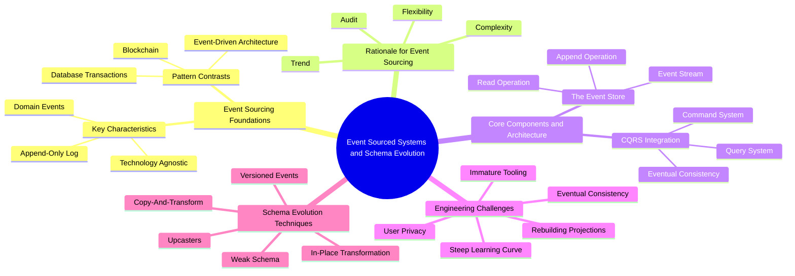
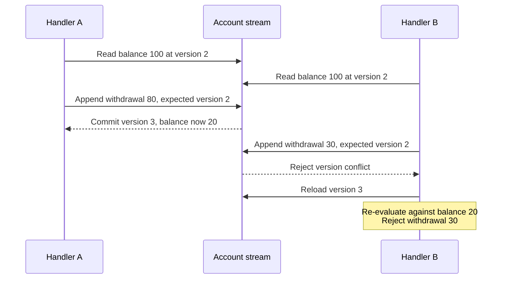
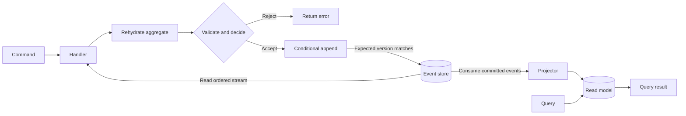
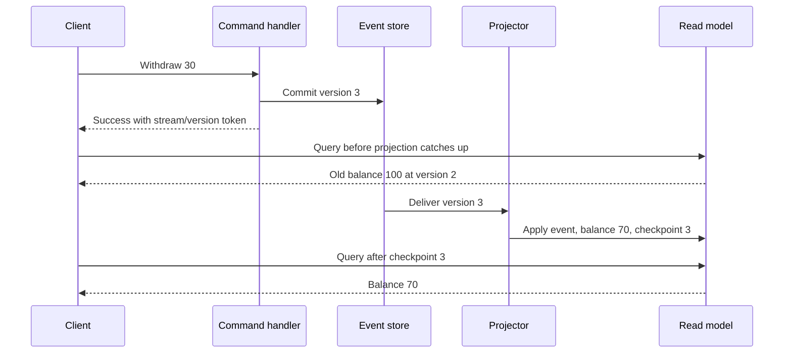
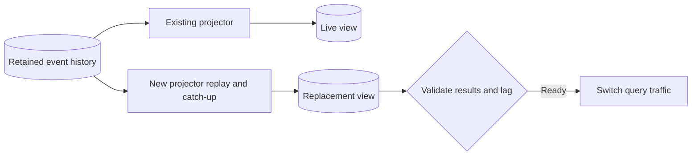
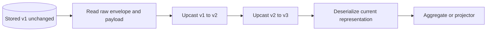

# Event Sourcing Short Notes

[Library home](../index.html) · [Event Sourcing course](index.html) · [Full guide](GUIDE.md)

**The core idea:** persist the facts that changed the business, then derive state from those facts. The event log is authoritative; aggregate state, snapshots, and query views are derived representations.

These revision notes follow the supplied mind map, **Event Sourced Systems and Schema Evolution**, and condense *Foundations of Event Sourcing.docx*. Assume basic familiarity with database records and application requests. Read the bold takeaways for a fast refresh, then the examples for the mechanics. Source and verification limits are recorded at the end.

## At a glance



Jump to: [Foundations](#1-event-sourcing-foundations) · [Rationale](#2-rationale-for-event-sourcing) · [Architecture](#3-core-components-and-architecture) · [Challenges](#4-engineering-challenges) · [Schema evolution](#5-schema-evolution-techniques).

## 1. Event Sourcing Foundations

### Key Characteristics

#### Append-Only Log — state changes stored as a sequential log

**Store history; compute current state.** A conventional current-state table might contain only `balance = 70`. An event stream explains how it became 70:

| Stream version | Persisted event | Balance after applying it |
|---|---|---:|
| 1 | `AccountOpened` | 0 |
| 2 | `MoneyDeposited(amount=100)` | 100 |
| 3 | `MoneyWithdrawn(amount=30)` | 70 |

**Replay**, also called **rehydration**, starts with an initial state and applies events in stream order:

```text
state = fold(initialState, orderedEvents, evolve)
evolve(balance, MoneyDeposited(100)) = balance + 100
evolve(balance, MoneyWithdrawn(30)) = balance - 30
```

For identical events, initial state, and deterministic application logic, reconstruction gives the same result. Replay applies recorded outcomes; it does not rerun today's command validation, send emails, or repeat payments. Record needed historical values in events rather than looking up changing external values during replay.

Append-only means ordinary business operations add events rather than rewrite old ones. A correction can be a new compensating fact. Retention, archival, and exceptional history migrations require explicit policies: unlimited retention is not a prerequisite of the pattern, and keeping every backup forever can conflict with privacy obligations.

#### Domain Events — aligned with real-world business processes

**A command requests; an event records an accepted fact.** `WithdrawMoney(30)` can fail; `MoneyWithdrawn(30)` says the withdrawal happened. Name events in the past tense and capture business meaning: `OrderPlaced` explains more than `RowUpdated`.

| Term | Meaning |
|---|---|
| Domain event | Immutable business fact used to reconstruct state. |
| Aggregate | Boundary within which business rules must remain consistent; often owns one stream. |
| Event stream | Ordered history of a particular aggregate instance. |
| Event store | Durable storage supporting stream reads and conditional appends. |
| Projection | State or a query view derived from events. |

An **invariant** is a rule that must remain true, such as “an account cannot be overdrawn.” Domain-Driven Design (DDD) helps identify these boundaries and establish shared business language; Event Storming discovers processes through their events.

#### Technology Agnostic — independent of a specific technology stack

**Event sourcing is a persistence pattern.** It can use a dedicated event database or a carefully designed relational implementation. Java, Kotlin, .NET, PostgreSQL, and messaging products are implementation choices.

Append-only access can simplify writes, but it does **not** guarantee higher throughput or eliminate database locks. A busy aggregate still has competing writers; storage, transaction, and index costs remain. CRUD can also use optimistic concurrency.

### Pattern Contrasts

#### Event-Driven Architecture — communication focus versus state storage

**EDA describes interaction; event sourcing describes authoritative persistence.** A CRUD service can publish `OrderPlaced` messages without being event-sourced. An event-sourced service can reconstruct state without publishing its internal events externally. EDA messages may also be durable; the distinction is their architectural role, not whether messages are transient.

Internal domain events and external integration events may have different contracts and granularity. Publishing every internal event directly couples consumers to internal domain changes.

#### Database Transactions — technical logs versus domain events

**A database log describes storage changes; a domain event describes business meaning.** A write-ahead log or Change Data Capture (CDC) stream might record a balance column changing from 100 to 70. `MoneyWithdrawn(30)` records the business action.

Database transactions remain useful in event-sourced systems: atomically committing an event batch and checking its expected version are transactional concerns. Event sourcing does not replace ACID transactions.

Other distinctions from the source:

| Pattern | Relationship to event sourcing |
|---|---|
| Current-state CRUD | Stores the latest state directly. Separate audit/history tables can retain history too. |
| Command sourcing | Logs requests as inputs; replaying requests can rerun decisions. Event sourcing stores their accepted outcomes. |
| CQRS | Separates command and query responsibilities/models. It can use CRUD persistence; event sourcing can exist without separate asynchronous read models. |

#### Blockchain — trust and consensus versus history and audits

**An append-only history does not require blockchain.** Blockchain commonly addresses agreement and trust across participants, using consensus and cryptographic mechanisms. Event sourcing primarily reconstructs application state and preserves business history within a system.

An event store is not automatically tamper-proof. Audit strength depends on access control, retention, provenance, backups, and any additional integrity mechanisms.

## 2. Rationale for Event Sourcing

### Audit — regulations and customer support

**History explains what happened and supports reconstruction.** Record the relevant actor, time, and context when needed; event sourcing cannot recover information never recorded. Support can trace why an order was cancelled, and investigators can reconstruct an aggregate at an earlier stream position.

Temporal queries need precise semantics: “recorded by this date” differs from “effective in the business on this date.” Late or backdated events require explicit time modeling. Auditability helps compliance but does not itself establish compliance.

### Flexibility — multiple views and data replication

**One history can feed several purpose-built views.** An order stream can populate a SQL support view, a search index, and a reporting model. New views can replay retained history without changing the write model.

Read workloads can scale separately. The cost is more storage, projector code, checkpoints, delivery/retry handling, and potentially stale views. Rebuilds work only when the required history and interpretation remain available.

### Complexity — managing process-driven business logic

**Events make meaningful transitions explicit.** For an order, `OrderPlaced → PaymentAuthorized → OrderShipped` exposes the process more clearly than scattered field updates. Aggregates decide which transition is allowed next.

For workflows spanning aggregates or services, the source distinguishes:

- **Choreographed saga:** participants react to events and emit follow-up events; control is distributed.
- **Process manager:** a coordinator records workflow progress and issues the next commands explicitly.

Both require handling failures, retries, and compensations; neither makes separate services one atomic transaction. Simple data-entry applications may gain little from this added machinery.

### Trend — early adoption driven by industry interest

**Popularity explains some adoption; it is not a business justification.** The source lists experimentation and architectural interest as motivations. Prefer a concrete need for business history, replay, or complex state transitions.

Avoid adopting it solely for fashion, generic performance promises, or a simple CRUD domain with little value in retained history. Unstable domain boundaries increase the cost of committing to long-lived event contracts.

## 3. Core Components and Architecture

### The Event Store

#### Event Stream — a sequence of events and numbers

**A stream version gives order within one stream.** Conceptually:

```text
account-42 = [(AccountOpened, 1), (MoneyDeposited(100), 2),
              (MoneyWithdrawn(30), 3)]
```

A version is not a timestamp or schema version. `account-42` version 3 and `account-99` version 3 are unrelated positions. Cross-stream processing needs explicit ordering/correlation rules; do not infer a global order from per-stream versions. Which component assigns versions depends on the store API; correctness depends on validating the append atomically.

#### Read Operation — reading streams from a given sequence

**Read an ordered suffix of a stream.** Using an explicitly inclusive convention:

```text
read(streamId, fromVersionInclusive)
read("account-42", 2) → events at versions 2, 3, ...
```

Use it to rehydrate an aggregate, resume a projector, or replay history. If a checkpoint means “last successfully processed version 2,” resume at **3** under this convention. Store APIs differ; mixing inclusive and exclusive meanings causes skipped or duplicate processing.

A **snapshot** caches aggregate state at version `k`. Load it, then replay from `k + 1`. Full replay applies `n` events; snapshot-assisted replay applies `n − k` events plus snapshot-loading cost. Snapshots reduce aggregate loading cost, are themselves versioned/invalidatable caches, and do not automatically accelerate arbitrary query-view rebuilds.

#### Append Operation — optimistic concurrency control validation

**Append only if the stream still has the version used for the decision.** The illustrative contract is:

```text
append(streamId, expectedVersion, newEvents)
```

Read, decide, then atomically check the expected version and append the entire event batch. Optimistic Concurrency Control (OCC) detects competing decisions:



Both original decisions saw enough money. Only A commits. B must reload and rerun validation; blindly retrying its old event would violate the invariant. OCC handles competing stream writes; repeated delivery of the same command still needs an idempotency policy.

### CQRS Integration

CQRS means **Command Query Responsibility Segregation**: command logic changes the business, query logic retrieves information. An event-sourced write model commonly feeds separate query views:



The event-store-to-projector arrow represents a reliable consumption path, such as a durable subscription. A database commit followed by an unprotected broker publish can lose notifications if the process crashes between them.

#### Command System — accept function and aggregate state changes

**Validate against authoritative aggregate state, then persist accepted facts.**

```text
state = fold(initialState, history, evolve)
accept(state, command) → newEvents OR rejection
evolve(state, event) → nextState
```

`accept`/`decide` checks today's rules for new requests. `evolve`/`apply` reconstructs state from facts already accepted. Replaying an old withdrawal should not reject it because today's withdrawal limit changed.

The source's baseline is one aggregate/stream per command decision. Keep required invariants inside that boundary; cross-aggregate workflows require explicit coordination. Some stores support broader transactions, but that is an additional capability, not an automatic guarantee.

#### Query System — projectors building projections for queries

**A projector consumes events; a projection is its resulting view.** `MoneyDeposited(100)` and `MoneyWithdrawn(30)` can update an account-summary row to `balance = 70` without replaying the full stream for each query.

| Projection mode | Mechanism | Main trade-off |
|---|---|---|
| Continuous asynchronous | Background consumer updates a stored view. | Fast queries; lag and consumer operations. |
| On demand | Build or refresh when queried. | Less work for rarely read views; query-time replay cost. |
| Synchronous transactional | Append events and update the view in the same database transaction. | Immediate consistency for that view; coupled writes and more work per transaction. |

Track progress, handle duplicate delivery idempotently, and avoid marking an event processed before its view update is safely committed. A crash between a balance update and checkpoint write can otherwise apply the same withdrawal twice. Multiple-stream projections need appropriate per-stream positions or a supported subscription checkpoint.

#### Eventual Consistency — the window between updates and queries

**A committed event can be ahead of its query view.** Example: version 3 is committed with balance 70, while the view still reflects version 2 with balance 100.



Convergence assumes delivery resumes and projector processing succeeds. “Eventually” gives no fixed deadline and does not repair a permanently failed consumer. Event sourcing alone does not require asynchronous views; this window comes from the chosen projection architecture.

## 4. Engineering Challenges

### Steep Learning Curve — shifting from current state to events

**Learn decisions and replay as separate mechanisms.** Engineers must reason about event contracts, aggregate boundaries, retries, lag, and long-lived history alongside ordinary application code. A framework can reduce boilerplate while hiding behavior needed to diagnose production failures.

Start with one aggregate and trace a successful command, a rejection, a version conflict, and a replay. Establish domain language before expanding. The source's untraceable numerical claims about development effort are not treated as general estimates here.

### Eventual Consistency — adapting to delayed information

**Design for stale views explicitly.**

| Situation | Response | Cost or limitation |
|---|---|---|
| Confirmation after a command | Show the committed command result. | Other views may still lag. |
| Immediate display update | Optimistically update the UI and reconcile failures. | Client state can diverge temporarily. |
| Read-your-own-writes required | Return a stream/version or subscription token; wait until the relevant view has processed it. | Extra latency; use a timeout and a pending response. |
| One view must update atomically | Co-locate its update with the append transaction. | Couples the view to write availability and transaction cost. |
| Financial or inventory decision | Rehydrate authoritative state and append under OCC. | An asynchronous display projection cannot enforce the invariant. |

A version token must identify the stream or compatible subscription position. Comparing unrelated stream version numbers does not establish freshness. Monitor projection lag and failed processing rather than promising instant convergence.

### Rebuilding Projections — performance bottlenecks on system rebuilds

**A rebuild reprocesses history into a new view; it does not change source events.** It is useful after projection bugs, corruption, or new query requirements. Cost depends on event count, deserialization/upcasting, projector work, and target-database writes.



Rebuild only affected views; bulk-write and parallelize independent work while preserving required order. Build beside the live view, catch up with ongoing writes, validate, then switch readers. Continue processing through the switch so a moving write frontier does not create a gap.

Filter or archive inactive streams only when the view's semantics permit it. Removing history indiscriminately can prevent future rebuilds. Fixing a projector can repair a derived view; it does not reverse wrong external payments or rewrite erroneous business decisions.

### User Privacy — GDPR and data deletion

**Immutable history needs a deliberate personal-data lifecycle.**

| Technique | How it works | What still needs attention |
|---|---|---|
| External PII storage | Keep personal details in a mutable store; events hold references. Delete/anonymize the external record when appropriate. | Identifiers may still be personal data; replay must tolerate missing details. |
| Crypto-shredding | Encrypt personal fields with a per-subject key; irreversibly destroy that key when erasure is required. | Key copies, recovery material, plaintext projections, and other replicas. |
| Tokenization | Store a token in events; resolve personal details through a protected vault. | Vault retention and any copied/resolved data. |
| Copy-and-transform | Copy history into a replacement store while removing prohibited data. | Old stores, backups, exports, and every downstream copy. |

Replay should handle erased details without inventing new business facts or crashing. These are engineering techniques supporting an erasure policy, **not automatic proof of GDPR compliance**; applicable obligations and exceptions must be assessed. Keeping the original store unchanged after a privacy migration may defeat its erasure purpose.

### Immature Tooling — lack of standardized frameworks and platforms

**Treat this mind-map label as the source's reported concern, not a verified current market ranking.** The practical risk is underestimating infrastructure: durable appends, OCC, subscriptions, retries, snapshots, checkpoints, backups, recovery, and schema evolution.

The source names EventStoreDB, Marten, and Axon as examples. Capabilities and restrictions depend on product/version and are not independently verified here. A general relational database can also support an event store when its guarantees are implemented correctly.

Kafka offers partitioned durable messaging; it does not automatically provide the per-aggregate expected-version append/read contract assumed here. It commonly distributes events downstream. Evaluate the actual consistency, retention, recovery, and operational requirements before choosing storage or building custom infrastructure.

## 5. Schema Evolution Techniques

**The paradox: historical data outlives the code that wrote it.** The schema includes serialized payloads, event type/version metadata, readers, decision logic, and projectors. JSON does not make a system schema-free. Changes must preserve both readability and historical meaning.

### Versioned Events — simple implementation with logic pollution

**Keep old events and explicitly recognize their versions.** Add an event-type or envelope schema version and handle every historical shape that remains readable.

- **Benefit:** easy initial adoption; no data rewrite.
- **Cost:** version branches and legacy handlers accumulate in aggregates and projections.
- **Use when:** only a few variants exist, or explicit versions support a later upcasting pipeline.

Schema version describes payload shape; stream version describes event position. An event at stream version 500 may still use schema version 1.

### Weak Schema — tolerant readers using minimal descriptions

**Ignore unknown fields and handle missing fields only when the historical meaning allows it.** Adding an optional `deliveryNote` can be compatible if old events legitimately mean “no note.” JSON readers and Avro/Protobuf contracts require compatible reader/writer configuration; format choice alone gives no guarantee.

- **Benefit:** low friction for compatible additive changes; stored history stays untouched.
- **Cost:** fallbacks spread, deprecated fields linger, and structural changes need explicit translation.
- **Limit:** a missing required value cannot be truthfully reconstructed without evidence. Do not guess a currency merely to satisfy a new class constructor.

### Upcasters — centralized transformation preserving immutability

**Translate old payloads in memory before current domain code consumes them.** An upcaster chain centralizes schema differences while leaving stored bytes unchanged.



The source's order example becomes:

**v1 — original stored payload:**

```json
{"orderId":"ORD-101","customerId":"CUS-1","amount":150.00}
```

**v2 — read-time representation with currency:**

```json
{"orderId":"ORD-101","customerId":"CUS-1","amount":150.00,"currency":"USD"}
```

**v3 — read-time representation with nested price:**

```json
{"orderId":"ORD-101","customerId":"CUS-1","price":{"amount":150.00,"currency":"USD"}}
```

The v1-to-v2 step is valid **only if the historical domain guarantees these orders were in USD**. Otherwise the missing currency requires a different resolution. Restructuring cannot recover facts never recorded.

- Keep transformations deterministic, focused, and free of changing external lookups.
- Advance and validate the envelope's schema version at each hop; reject unsupported versions or missing hops instead of silently assuming the target schema was reached.
- Test legacy fixtures through the full chain and compare reconstructed business state.
- Retain required hops while old events remain readable, including supported backups and archives.

**Trade-off:** clean domain handlers and unchanged history, but extra read/rebuild latency and more difficult ad-hoc queries over raw legacy payloads. Upcasting changes representation; it should not rerun business decisions under new rules.

### In-Place Transformation — direct updates for ad-hoc fixes

**Rewrite existing stored events directly.** This can produce a uniform store and remove read-time conversion work, but sacrifices the original immutable record.

It risks corrupting history and leaving snapshots and read views inconsistent with it. Reordering or renumbering events also invalidates positions/checkpoints; changing payloads alone does not automatically change their version numbers. Store support varies.

**Use only as an exceptional, controlled operation when the integrity and audit requirements permit it.** Prefer an appended business correction for a wrong business outcome, or read-time translation for a schema change. Backups, validation, and dependent-view repair remain necessary if history is rewritten.

### Copy-And-Transform — new streams from transformed events

**Read the source, transform into a separate target, validate, then switch.** This handles major restructuring, redaction, or measured overhead from long upcaster chains.

```text
Original history → deterministic transformation → replacement store
                 → validate state and event mappings
                 → catch up or pause writers → controlled cutover
```

The source remains unchanged during copying; the replacement log has transformed representations. Preserving the original does not make the replacement the identical audit artifact. Document lineage and validate business equivalence, except where an intentional correction/redaction changes it.

Costs include storage for both stores, processing time, live-write coordination, and rollback planning. Define mappings for changed event IDs, stream positions, consumer checkpoints, and snapshots. Do not introduce uncoordinated dual writes. Retire old upcasters only when no supported source or restored backup needs them; privacy-driven retirement must also address old copies.

### Choosing between the five techniques

| Technique | Stored source history changed? | Best fit | Main cost |
|---|---|---|---|
| Versioned events | No | Explicitly distinguish a few historical shapes. | Legacy handler branches. |
| Weak schema | No | Compatible additions with valid missing-field semantics. | Limited structural flexibility. |
| Upcasters | No | Normalize old shapes at read time. | Transformation code and read latency. |
| In-place transformation | Yes | Exceptional repair where history mutation is permitted. | Lost original history and dependent-state repair. |
| Copy-and-transform | No during copying; target is a new transformed history. | Large restructuring, redaction, or justified consolidation. | Migration, extra storage, validation, and cutover. |

A practical progression is **compatible readers plus explicit versions → upcasters when needed → copy-and-transform when its benefits justify migration**. These techniques can coexist; the progression is guidance, not a mandatory lifecycle. Do not migrate a store merely because it has several versions.

## Final recall checklist

- **Truth:** events are authoritative; state is reconstructed from them.
- **Decisions:** commands can fail; persisted events record accepted outcomes.
- **Replay:** deterministic application of facts, without repeating external side effects.
- **Concurrency:** expected-version append protects the decision; conflicts require re-evaluation.
- **Queries:** projectors build views; asynchronous views can lag and must handle replay/retries.
- **Recovery:** retained usable history supports rebuilding; snapshots and views are derived state.
- **Evolution:** preserve historical meaning while making old payloads readable by current code.
- **Judgment:** audit/replay benefits must justify modeling, operation, privacy, and migration costs.

## Sources and scope

1. **Supplied document:** *Foundations of Event Sourcing.docx*. Reviewed for these notes: foundations and pattern contrasts; rationales; event streams/read operations; command/query systems and consistency; engineering challenges; all five evolution strategies; and the order upcasting example. Repeated explanations and embedded conversational follow-up prompts have been omitted.
2. **Supplied structure:** *NotebookLM Mind Map (2).png*. Its five main branches and all child topics are represented above.
3. **Verification limit:** the document contains unresolved citation markers such as `more_horiz` and numeric references without recoverable source links. Its cited research, percentages, vendor restrictions, and version-dependent claims were not independently verified. These notes avoid presenting those as established measurements or current product guarantees. Technical qualifications distinguish necessary assumptions from broad statements in the source.

For deeper study, use the [full course guide](GUIDE.md), [schema-evolution lesson](lessons/0012-event-schema-evolution.html), and [privacy lesson](lessons/0013-gdpr-crypto-shredding-and-temporal-queries.html). The course's [primary-source reading list](RESOURCES.md) provides further references; listing them here does not claim they were reviewed for this condensation.
