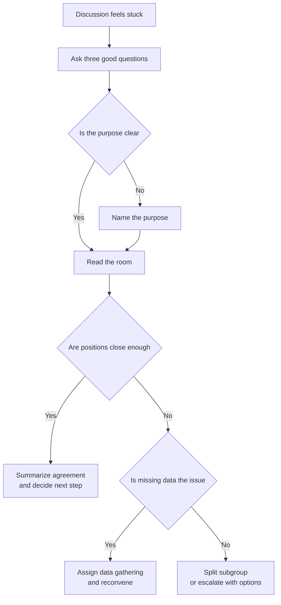
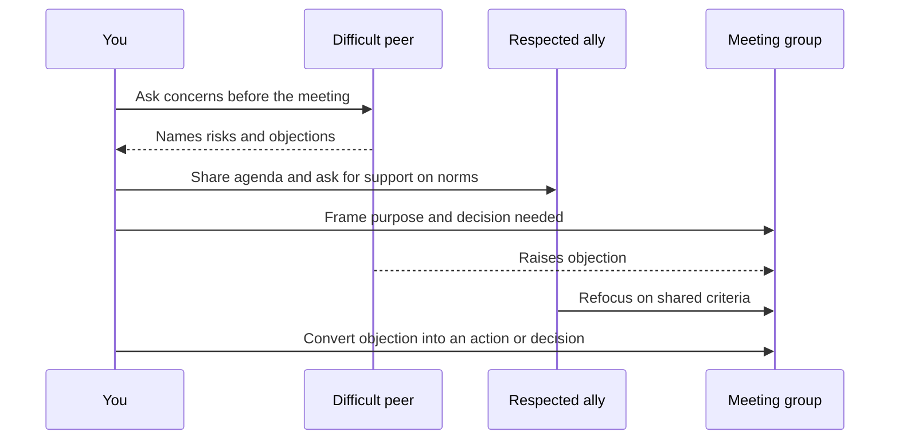
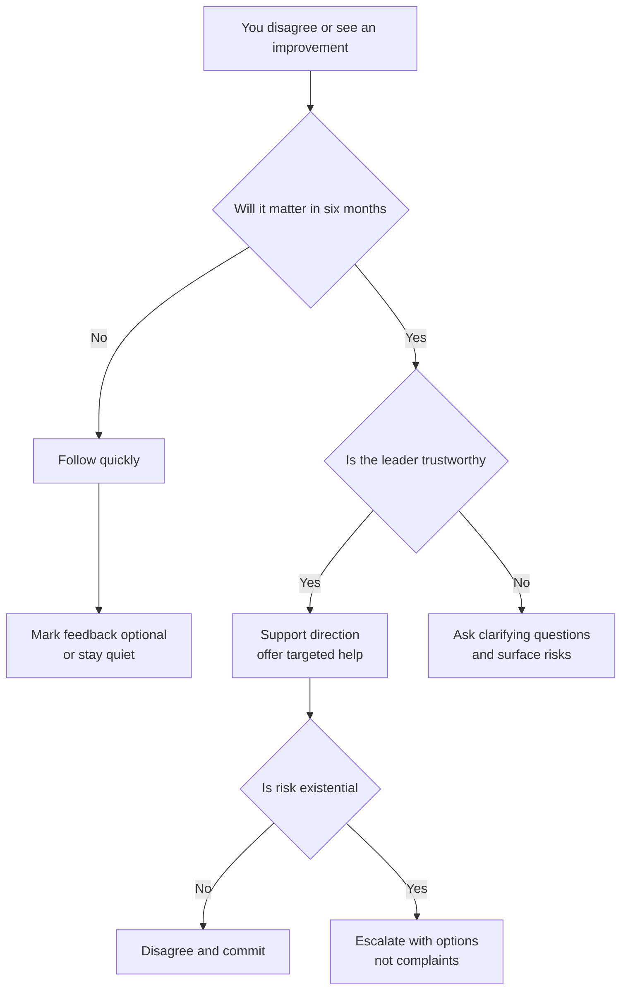
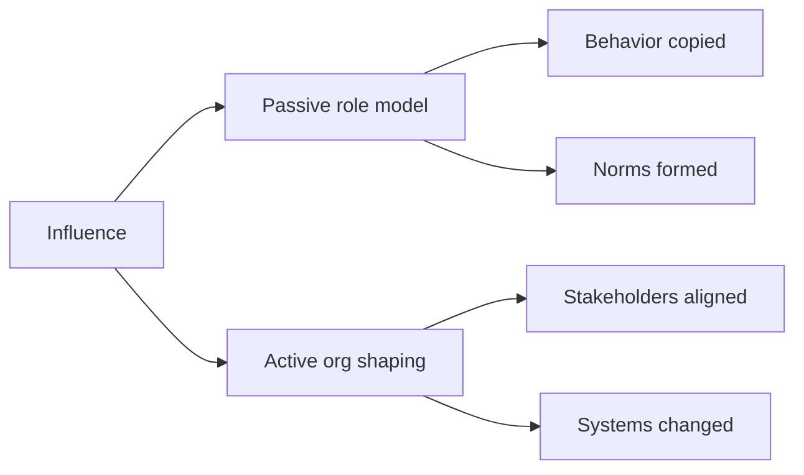

# B1 · Influence Without Authority
> How do you drive change across teams you do not manage?

**TL;DR**
- At Staff+, authority is borrowed: you steer through trust, context, and clarity, not command.
- “Never be wrong” means being accurate while creating space for others to contribute and improve the answer.
- Use three moves before asserting: ask good questions, define the purpose, and read the room.
- Difficult people are handled before the meeting, with allies, boundaries, and shared incentives.
- To lead well, follow well: choose battles, support trustworthy leaders quickly, and mark feedback as non-blocking when it is.
- Passive influence is being a role model; active influence is deliberately shaping decisions, norms, and outcomes.

Related: [skills overview](../02-skills-to-upgrade.md), [promotion playbook](../05-promotion-playbook.md), [self-assessment](../06-self-assessment-and-tracking.md). Sibling files: [B1](B1-influence-without-authority.md), [B2](B2-communication-and-executive-writing.md), [B3](B3-technical-and-project-leadership.md), [B4](B4-mentorship-and-sponsorship.md), [B5](B5-stakeholder-management-and-trust.md), [B6](B6-glue-work.md), [B7](B7-decision-making.md), [B8](B8-prioritization.md).

---

## 1. The Staff+ influence problem

Senior engineers often succeed by owning a component and being the best implementer in the room.
Staff and Principal engineers succeed when teams they do not manage make better decisions because of their involvement.
That shift changes the source of power.

You may have a title, but you usually do not control roadmaps, people allocation, product trade-offs, or team rituals.
The people you need to influence have their own managers, goals, deadlines, and local context.
Your authority is therefore borrowed from:

| Source of authority | How it is earned | How it is lost |
|---|---|---|
| Expertise | Clear reasoning, accurate judgment, useful patterns | Overstating certainty or being out of date |
| Trust | Keeping commitments, being fair, protecting people | Surprises, blame, or hidden agendas |
| Context | Understanding product, operations, and org constraints | Ignoring realities outside your specialty |
| Relationships | Helping people succeed before you need them | Only appearing when you want something |
| Executive sponsorship | Aligning with business priorities | Using escalation as a substitute for influence |

The paradox is that authority shrinks as scope grows.
You can no longer command the system directly.
You have to make the system want to move.

## 2. “Learn to never be wrong” without dominating the room

“Never be wrong” does not mean pretending to be infallible.
It means developing judgment, preparation, and communication habits that make your contributions reliably useful.
You are right in a Staff+ way when the group gets closer to the truth and still feels ownership of the answer.

The anti-pattern is sucking the oxygen out of the room.
It looks like:

- answering before others have processed the problem;
- correcting every imprecise statement;
- turning every discussion into a proof of your competence;
- winning by exhaustion, silence, or resignation;
- leaving peers technically convinced but socially disengaged.

That version of “being right” is fragile.
People may stop arguing because they agree, or because they no longer believe arguing is worth the cost.
Staff+ influence requires you to tell the difference.

A better standard is: be precise, generous, and explicit about what would change your mind.

| Less effective | More effective |
|---|---|
| “That will not work.” | “I see one risk: migration ordering. How are we thinking about that?” |
| “We already tried this.” | “We tried a similar approach in billing. The failure mode was load shape; maybe this context is different.” |
| “The right answer is X.” | “My current recommendation is X because of A and B. I would change it if C is true.” |
| “You are missing the point.” | “Can we separate the reliability goal from the implementation choice?” |

## 3. The three moves: questions, purpose, and room-reading

When a discussion gets messy, do not begin by pushing harder.
Use three moves.

First, listen through questions.
A useful rule is: ask three good questions before sharing your perspective.
Good questions reveal constraints, values, and assumptions.
They also lower defensiveness because people experience you as trying to understand rather than trying to win.

Second, define the purpose.
Many meetings fail because people are solving different problems.
One person wants a decision, another wants brainstorming, another wants risk review, and another wants status.
Reframing the purpose can unlock progress.
Do not overuse this move: constantly resetting purpose can create churn and make you feel like a process tax.

Third, read the room.
If people are close, summarize and converge.
If people are far apart, split into a subgroup, gather data, or escalate with options.
Escalation is not failure; premature escalation is.

Examples of questions that create movement:

- “What outcome are we optimizing for: latency, operability, cost, or time to learn?”
- “What would make this proposal unacceptable?”
- “Who has to live with this decision after launch?”
- “What evidence would change our minds?”

## 4. Handling difficult people without making the meeting about them

Difficult behavior is common in cross-team work: interruption, sarcasm, constant objections, status games, or refusal to decide.
Treat it as a leadership problem, not a personality contest.

The best work happens before the meeting.
If you expect conflict, align with the person beforehand.
Ask what they are worried about.
Give them a chance to shape the agenda.
Look for the legitimate concern under the difficult behavior.
Many “blockers” are protecting a real risk badly.

Also include someone they cannot be a jerk to.
That may be their manager, a respected peer, a product leader, an incident commander, or a customer-facing partner.
The goal is not intimidation.
The goal is to create a room where professional behavior is the easiest behavior.

Use a simple escalation ladder: private curiosity, shared framing, meeting boundary, structured decision, then manager or sponsor alignment.

## 5. To lead, you have to follow

Staff+ engineers often overestimate how many battles matter.
Influence is finite.
If you spend it on every naming debate, every local implementation preference, and every imperfect proposal, people learn that your involvement means delay.

Ask: “Will this matter to me in six months?”
If not, consider following.
Following is not passivity.
It is an active choice to support someone else’s leadership so the organization moves faster.

Give support quickly to trustworthy leaders.
If a peer has context, credibility, and a reasonable plan, back them.
You can still add feedback, but label it honestly.
Use phrases like:

- “Optional nit: this name may age poorly.”
- “Non-blocking concern: consider an escape hatch for rollout.”
- “I support the direction; this comment should not delay the decision.”
- “I am aligned. If helpful, I can review the migration plan.”

Following creates reciprocal influence.
People you support today are more likely to support your initiatives tomorrow, and they will trust that your objections are meaningful when you do object.

## 6. Passive versus active influence

Tanya Reilly’s distinction is useful: passive influence is being a role model; active influence is deliberately shaping the organization.
Both matter.

Passive influence includes how you review code, talk in incidents, admit mistakes, write documents, and handle ambiguity.
People copy the behavior of high-status engineers.
If you think out loud carelessly, others may treat speculation as direction.
If you dismiss a team casually, others may copy that contempt.

Active influence is more deliberate.
It includes building coalitions, writing strategy, aligning managers, pre-meeting stakeholders, creating rituals, and changing decision systems.

| Mode | What it sounds like | When to use it | Risk |
|---|---|---|---|
| Passive influence | “Here is how I approach incidents.” | Norms, craft, judgment, culture | Unintended signals |
| Active influence | “I want us to adopt this migration pattern.” | Direction, alignment, priorities | Overreach or fatigue |

Staff+ engineers combine both.
They are careful about the shadow they cast, and they deliberately intervene where the system needs help.

## 7. A practical influence operating model

Before entering an influence-heavy situation, write a one-page plan.
It does not need to be formal.
It should answer:

| Question | Why it matters |
|---|---|
| What decision or behavior needs to change? | Prevents vague “alignment” work |
| Who owns the decision? | Avoids influencing the wrong room |
| Who is impacted? | Reveals hidden stakeholders |
| What does each party care about? | Converts arguments into trade-offs |
| What proof is needed? | Replaces opinion loops with evidence |
| What is my fallback? | Keeps you from escalating emotionally |

## 8. Practice drills

- In your next design review, ask three substantive questions before stating your opinion.
- Pick one active initiative and list the real decision-maker, veto holders, and impacted teams.
- Rewrite one blocking code review comment as a non-blocking suggestion.
- Before a contentious meeting, pre-align with the person most likely to object.
- After a meeting, ask a trusted peer: “Did I create space, or did I dominate?”
- Identify one issue you care about but that will not matter in six months; deliberately follow.
- Keep a two-week influence log: goal, stakeholders, move used, result, and lesson.

## What "good" looks like at Staff+

- People seek your input early because it improves outcomes rather than slows them down.
- You can name the decision-maker, the real trade-off, and the missing evidence.
- Your objections are rare enough that they carry weight.
- You make others feel smarter and more capable after working with you.
- You support peer leaders visibly and quickly when their direction is sound.
- You can de-escalate conflict without avoiding hard truths.
- Your influence survives when you are not in the room.

## Common pitfalls

- Confusing being right with being effective.
- Using executive escalation before doing peer alignment.
- Reframing every discussion until people experience you as churn.
- Treating difficult people as enemies instead of constraints to manage.
- Giving “optional” feedback in a tone that sounds mandatory.
- Being a role model accidentally, especially when frustrated.
- Spending influence on small preferences and lacking it for existential issues.

## Further reading

- StaffEng, “Operating at Staff”: https://staffeng.com/guides/operating-at-staff/
- StaffEng, “Learn to never be wrong”: https://staffeng.com/guides/learn-to-never-be-wrong/
- StaffEng, “To lead, you have to follow”: https://staffeng.com/guides/to-lead-follow/
- The Pragmatic Engineer, “The Staff Engineer's Path”: https://newsletter.pragmaticengineer.com/p/the-staff-engineers-path
