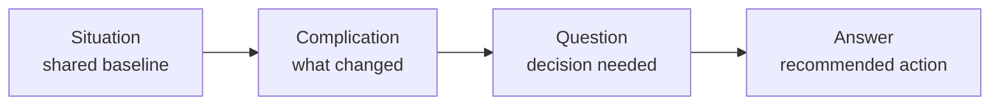
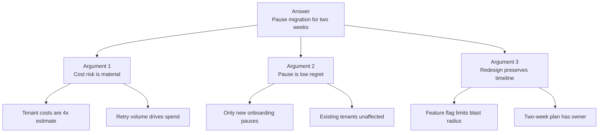
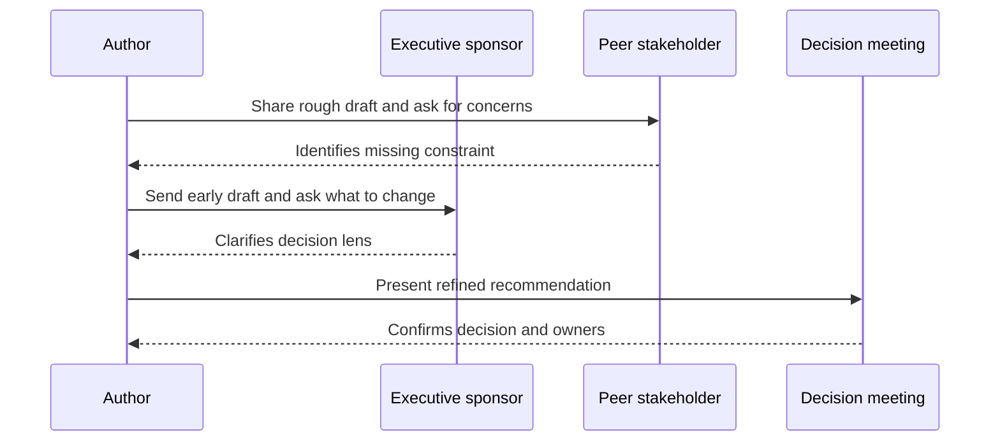
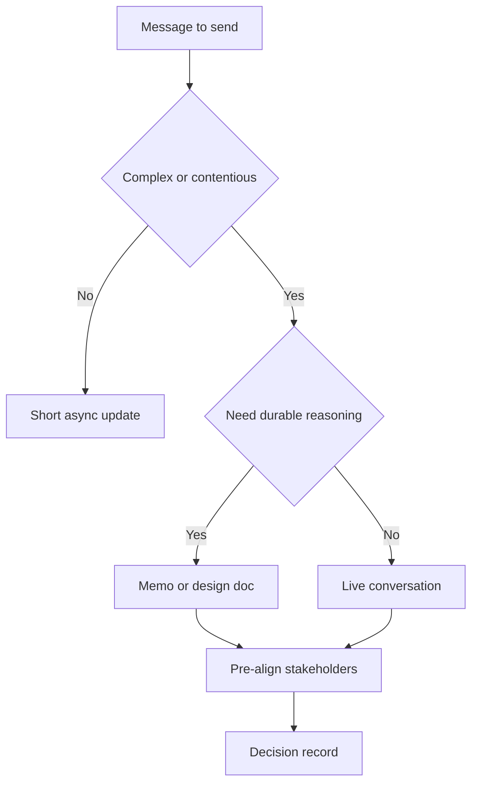

# B2 · Communication & Executive Writing
> How do you get a message to land with a busy executive who preprocesses reality their own way?

**TL;DR**
- Executive influence increasingly bounds Staff+ impact because strategy, funding, and priority decisions sit above team boundaries.
- Know why you are communicating: planning, status, or resolving misalignment; the goal is alignment, not victory.
- Lead with the answer, then support it with a small number of ordered arguments.
- Use SCQA to create a crisp opening and the Minto Pyramid to structure the body.
- Pre-align through nemawashi before the meeting; the meeting should confirm, not discover, the path.
- Never bring only a question to executives: bring a recommendation, trade-offs, and a reversible next step.

Related: [skills overview](../02-skills-to-upgrade.md), [promotion playbook](../05-promotion-playbook.md), [self-assessment](../06-self-assessment-and-tracking.md). Sibling files: [B1](B1-influence-without-authority.md), [B2](B2-communication-and-executive-writing.md), [B3](B3-technical-and-project-leadership.md), [B4](B4-mentorship-and-sponsorship.md), [B5](B5-stakeholder-management-and-trust.md), [B6](B6-glue-work.md), [B7](B7-decision-making.md), [B8](B8-prioritization.md).

---

## 1. Why executive communication becomes a hard limit

At Senior level, your impact can often travel through code, reviews, and team-level decisions.
At Staff+, your impact increasingly depends on whether leaders understand and act on your technical judgment.
Executives decide funding, sequencing, risk appetite, staffing, and cross-org trade-offs.
If your message does not land with them, your best technical work may remain local.

Executives also preprocess reality.
They carry a model of the business, customers, risks, teams, and prior failures.
They hear your message through that model.
Your job is not to defeat their model in a meeting.
Your job is to discover it, update it where necessary, and align your recommendation with the decision they need to make.

| Your default lens | Executive lens |
|---|---|
| Technical correctness | Business consequence |
| Complete context | Decision-relevant context |
| Elegant architecture | Risk, speed, and optionality |
| Local team constraints | Portfolio trade-offs |
| Proof of work | Confidence to act |

A Staff+ communication succeeds when a busy leader can repeat the point, explain the trade-off, and know what action is required.

## 2. Know why you are communicating

Before writing or presenting, identify the communication job.
Most executive communication falls into three buckets.

| Communication job | Primary question | Output |
|---|---|---|
| Planning | “What should we do?” | Direction, investment, sequencing |
| Status | “Are we on track?” | Confidence, risks, asks |
| Misalignment | “Why are we stuck?” | Shared model and decision |

If the job is planning, show options and recommend one.
If the job is status, surface reality early, including bad news.
If the job is resolving misalignment, extract their perspective and locate the disagreement.

The goal is not to win.
A winning presentation that leaves the executive unconvinced is a failure.
A successful conversation may change your recommendation because you learned a constraint you did not have.

A useful opening sentence is: “I am asking for a decision on X, with recommendation Y, because Z changed.”
That sentence forces clarity.

## 3. SCQA: a reliable executive opening

SCQA stands for Situation, Complication, Question, Answer.
It creates narrative tension without burying the conclusion.
It is especially useful when the audience lacks context or when the problem has evolved.

| Element | Purpose | Prompt |
|---|---|---|
| Situation | Establish shared baseline | “What is true and already accepted?” |
| Complication | Name the change or conflict | “What broke, changed, or became risky?” |
| Question | Frame the decision | “What must we decide or resolve?” |
| Answer | State the recommendation | “What should we do now?” |

Worked example:

- Situation: “We committed to migrate customer exports to the new data platform this half.”
- Complication: “The first two high-volume tenants exceeded our cost assumptions by 4x, and the current design makes cost proportional to retry volume.”
- Question: “Should we continue the migration as planned, or pause to redesign the retry path?”
- Answer: “Pause new tenant onboarding for two weeks, redesign retries behind a feature flag, and keep the existing committed tenants on the current path.”

SCQA prevents the common failure mode of beginning with background.
Executives do not need the whole journey first.
They need to know why the conversation matters.

## 4. The Minto Pyramid Principle

The Minto Pyramid Principle says to lead with the answer, then group supporting arguments logically.
For executive writing, keep the pyramid small.
Use no more than three top arguments, and no more than three sub-arguments under each.
Order by importance, not chronology.

Use pyramid structure for documents, emails, and presentations.
A strong executive memo can be only one page:

1. Answer and ask.
2. Three supporting points.
3. Risks and mitigations.
4. Decision needed and deadline.
5. Appendix for details.

The appendix matters because technical leaders often need evidence.
But the appendix should not be the main path.
If the reader must inspect logs, diagrams, or benchmark tables to understand your recommendation, the main narrative is not doing its job.

## 5. Nemawashi: pre-align before the meeting

Nemawashi is the practice of preparing the ground before a formal decision.
In Staff+ work, it means stakeholders should rarely encounter the recommendation for the first time in the meeting where you need commitment.

Send an early draft to an executive who will attend.
Ask: “What would make this clearer or more decision-ready for you?”
That question is powerful because it invites them into improving the message rather than reacting to it publicly.

Pre-alignment should include:

- the decision-maker;
- people who can veto or quietly undermine the plan;
- teams who will carry the operational burden;
- finance, security, legal, or support partners when relevant;
- a trusted peer who can tell you what is confusing.

The point is not politics for its own sake.
The point is respect for scarce attention and public decision dynamics.
A meeting is a poor place to discover that your framing conflicts with the executive’s priorities.

## 6. Executive communication rules

These rules are simple and hard.

| Rule | What it means in practice |
|---|---|
| Never fight feedback | Treat executive pushback as data about their model, not as an attack |
| Do not evade problems | Informing executives early creates absolution and options |
| Never present a question without an answer | Bring a recommendation, even if tentative |
| Avoid academic presentations | Do not build suspense toward the conclusion |
| No permanent decisions | Prefer reversible next steps and explicit review points |
| Name the ask | Decision, advice, escalation, funding, or awareness |

“Informing executives equals absolution” means that surprises are worse than bad news.
When you surface risk early, leaders can help.
When you hide it until the path is narrow, they inherit the problem without options.

Do not be evasive.
A sentence like “We are green, but there are some concerns” is worse than: “We are yellow because load tests failed at 60 percent of expected peak; we need one week to validate the mitigation.”

## 7. Tailor the message to audience and medium

Different audiences need different compression.
The same recommendation may become a Slack note, a one-page memo, a ten-minute verbal update, or a detailed design doc.

| Medium | Best for | Watch out for |
|---|---|---|
| Slack or Teams | Fast awareness, simple asks | Ambiguity and fragmented replies |
| Email | Broadcast alignment and record | Long threads that hide decisions |
| One-page memo | Executive decisions | Overloading with implementation detail |
| Design doc | Durable technical reasoning | Assuming executives will read every section |
| Live meeting | Trade-offs, commitment, conflict | Discovering misalignment too late |

Written async culture is valuable because it forces clearer thinking and gives quieter stakeholders time to engage.
It also creates a record.
But writing is not a substitute for conversation when trust is low, stakes are high, or disagreement is emotional.

## 8. A reusable executive memo template

Use this structure when stakes are high.

| Section | Content |
|---|---|
| Title | Decision or update in one sentence |
| Ask | What you need from the reader |
| Recommendation | The answer first |
| Why now | Situation and complication |
| Evidence | Three strongest reasons |
| Options | Recommended option plus alternatives |
| Risks | Top risks and mitigations |
| Decision record | Owner, date, next checkpoint |
| Appendix | Details for reviewers who need depth |

Before sending, delete anything that proves you worked hard but does not help the reader decide.
Executives do not reward completeness; they reward clarity that improves judgment.

## 9. Practice drills

- Rewrite your next status update with the answer in the first sentence.
- Convert a current technical concern into SCQA in four bullets.
- Take a long design doc and create a one-page executive summary.
- Before a meeting, send a draft to one stakeholder and ask what would make it more decision-ready.
- Practice saying: “My recommendation is X; the trade-off is Y; I would revisit if Z happens.”
- Review your last presentation and count how many slides passed before the answer appeared.
- Create a decision record for a recent reversible decision and schedule a review date.

## What "good" looks like at Staff+

- Executives can repeat your recommendation and why it matters.
- Your documents begin with the answer, not with a tour of the evidence.
- You surface risks early enough that leaders have options.
- You use meetings to confirm alignment, not to surprise stakeholders.
- You adapt depth and language to the audience without dumbing down the issue.
- Your asks are explicit: decision, funding, escalation, advice, or awareness.
- Your writing creates durable organizational memory.

## Common pitfalls

- Treating executive questions as attacks instead of model mismatch.
- Bringing a problem without a recommended path.
- Using academic buildup and revealing the conclusion at the end.
- Hiding bad news in vague green status.
- Sending dense technical documents to people who need decision summaries.
- Confusing pre-alignment with manipulation.
- Presenting “permanent” decisions when a reversible checkpoint would reduce fear.

## Further reading

- StaffEng, “Present to executives”: https://staffeng.com/guides/present-to-executives/
- Barbara Minto, “The Pyramid Principle” (book)
- Design Docs at Google: https://www.industrialempathy.com/posts/design-docs-at-google/
