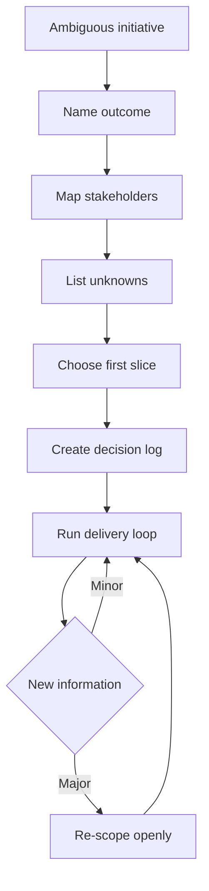
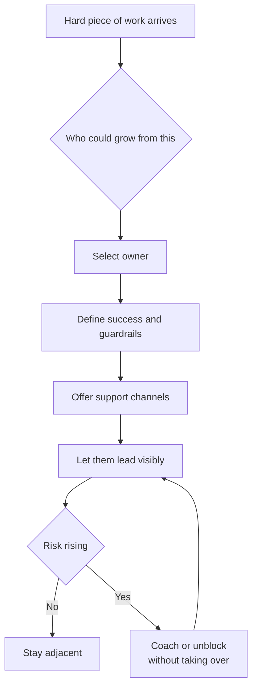
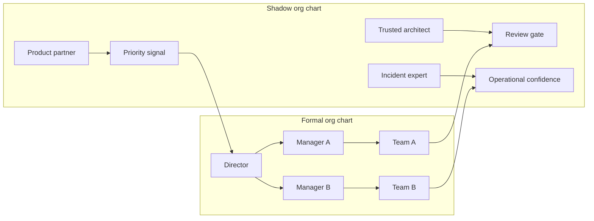
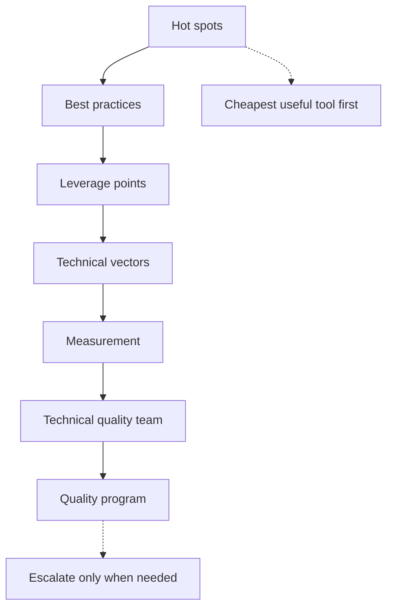

# B3 · Technical & Project Leadership
> How do you drive a big, ambiguous, multi-team initiative to a good outcome?

**TL;DR**
- Technical direction is part-time product management for technology: serve the organization’s real needs, not your favorite tools.
- Big projects require scoping ambiguity, breaking work down, and repeatedly talking to people who see the world differently.
- Aggressive delegation means giving hard, growth-producing work to others with enough scaffolding to succeed.
- Cross-team alignment depends on the shadow org chart as much as the formal one.
- Technical quality must be managed as a program, starting with the cheapest useful tool and escalating only when needed.
- Run projects with explicit kickoff, status, risks, unblocking, and landing rituals.

Related: [skills overview](../02-skills-to-upgrade.md), [promotion playbook](../05-promotion-playbook.md), [self-assessment](../06-self-assessment-and-tracking.md). Sibling files: [B1](B1-influence-without-authority.md), [B2](B2-communication-and-executive-writing.md), [B3](B3-technical-and-project-leadership.md), [B4](B4-mentorship-and-sponsorship.md), [B5](B5-stakeholder-management-and-trust.md), [B6](B6-glue-work.md), [B7](B7-decision-making.md), [B8](B8-prioritization.md).

---

## 1. Technical direction is product management for technology

A Staff+ engineer setting technical direction is acting as a part-time product manager for the technology organization.
The “product” is not a feature.
It is the engineering system: platforms, architecture, reliability, developer experience, security posture, cost profile, and delivery capability.

That means the work begins with customer discovery.
Your customers are product teams, operators, executives, compliance partners, support teams, and future engineers.
The question is not “What architecture do I like?”
The question is “What does the organization need the technology system to make easier, safer, cheaper, or faster?”

| Product management question | Technical leadership version |
|---|---|
| Who is the customer? | Which teams and users are constrained by this system? |
| What problem matters now? | What technical limitation blocks strategy or safety? |
| What is the smallest valuable slice? | What migration or platform step changes behavior soon? |
| How will we measure success? | What operational, delivery, or quality metric moves? |
| What trade-off are we making? | What do we defer to create leverage now? |

The trap is technology-centered leadership: starting with a favored framework, platform, or pattern and searching for a problem.
Staff+ leaders invert that.
They start with strategy, constraints, and user pain, then choose technology as a means.

## 2. Leading big projects: scoping the ambiguous

Big projects begin blurry.
The first job is not to write the perfect plan.
It is to turn ambiguity into bounded uncertainty.
You identify what is known, what is unknown, what must be decided, and what can safely wait.

The traits that matter are not glamour traits.
They are perseverance, courage, and a willingness to talk to other people.
Perseverance keeps the project alive after the first plan breaks.
Courage surfaces bad news and makes hard trade-offs visible.
Talking to people reveals hidden constraints before they explode.

A useful project scoping checklist:

- What outcome are we trying to create?
- Why now?
- Which teams must change behavior?
- What are the top three risks?
- What decisions are reversible?
- What dependency could silently block us?
- What is the first valuable slice?
- What would make us stop?

Do not confuse a detailed plan with control.
A plan is a communication tool and a learning hypothesis.
The real leadership skill is adjusting the plan without losing trust.

## 3. Aggressive delegation and creating space

At Senior level, you may be essential to the hardest work.
At Staff+, being essential to everything becomes a bottleneck.
You have to move from essential to adjacent.
Adjacent means close enough to guide, unblock, and protect quality, but not so central that work waits for you.

Aggressive delegation is not dumping work.
It means deliberately giving hard pieces to people who can grow from them, with scaffolding.
The goal is to create more leaders, not merely to reduce your calendar load.

Delegation should include:

| Element | Example |
|---|---|
| Outcome | “Reduce export failure rate below 0.5 percent.” |
| Authority | “You own the design review and final recommendation.” |
| Guardrails | “Do not change customer-facing APIs without product sign-off.” |
| Support | “I will review drafts and join escalation meetings if needed.” |
| Visibility | “You present the update in the platform sync.” |

When the work becomes theirs, let it be theirs.
Do not re-center yourself at the moment of success.
That is how you create space and build future Staff engineers.

## 4. Cross-team alignment and the shadow org chart

The formal org chart tells you reporting lines.
The shadow org chart tells you how work actually moves.
It includes trusted reviewers, incident veterans, product whisperers, informal architects, managers with veto power, and people whose silence signals risk.

Cross-team alignment requires both maps.
If you only follow the formal chart, you may miss the person everyone waits for before committing.
If you only follow the shadow chart, you may bypass accountable leaders and create resentment.

To navigate alignment:

1. Identify the accountable decision-maker.
2. Identify veto holders and high-trust influencers.
3. Meet teams in their context before asking for commitment.
4. Write down decisions and assumptions.
5. Make trade-offs explicit and visible.
6. Keep managers informed without turning every issue into escalation.

## 5. Managing technical quality as a program

Technical quality is not one cleanup epic.
It is a management system.
Start with the cheapest useful tool and escalate only when the cheaper tool is insufficient.

The escalating toolkit:

1. Hot spots: identify the places where defects, toil, incidents, or slow delivery cluster.
2. Best practices: publish simple guidance that prevents repeated mistakes.
3. Leverage points: improve the shared system that many teams touch.
4. Technical vectors: name directional bets, such as “move writes behind durable queues.”
5. Measurement: track signals that reveal whether quality is improving.
6. Technical-quality team: dedicate people when coordination cost is too high.
7. Quality program: create funding, governance, and portfolio-level accountability.

Quality programs fail when they are framed as morality.
“Good engineers write good code” does not move organizations.
Better framing is consequence-based: incidents, cycle time, customer trust, onboarding speed, compliance risk, cloud cost, or delivery predictability.

A quality metric should be actionable.
If no team can change behavior in response to it, it is a dashboard decoration.

## 6. Running the project day to day

A large initiative needs operating rituals.
The goal is not ceremony.
The goal is to keep reality visible and reduce coordination drag.

| Ritual | Purpose | Output |
|---|---|---|
| Kickoff | Align on why, scope, roles, and risks | Charter and owners |
| Weekly status | Make progress and risk visible | Written update |
| Risk review | Prevent surprises | Risk register and mitigations |
| Decision review | Resolve trade-offs | Decision log |
| Dependency sync | Unblock teams | Named asks and due dates |
| Landing review | Confirm adoption and cleanup | Rollout and closeout plan |

A good status update includes:

- overall color with reason;
- progress since last update;
- risks and decisions needed;
- asks by owner and date;
- next milestone;
- confidence level.

The project is not done when code merges.
It is done when the intended behavior changes, the system is operating safely, owners know what remains, and the organization has learned something durable.

## 7. Practice drills

- Take one ambiguous initiative and write a one-page charter: outcome, scope, owners, risks, first slice.
- Map the formal and shadow org chart for a current cross-team project.
- Identify one hard project piece you are currently holding and delegate it with guardrails.
- Create a risk register with probability, impact, owner, mitigation, and review date.
- Rewrite a technical quality argument in terms of customer, operational, or delivery consequences.
- Start a decision log for a project and record the first three decisions.
- Ask one adopting team what would make the initiative easier to consume.

## What "good" looks like at Staff+

- You connect technical direction to business and organizational needs.
- You break ambiguous work into slices that create learning and value.
- You make other engineers visible leaders of meaningful pieces.
- Teams understand the trade-offs even when they disagree.
- Risks are surfaced early, owned clearly, and revisited regularly.
- Technical quality work is prioritized by consequence and leverage.
- The initiative lands as changed behavior, not just merged code.

## Common pitfalls

- Starting with preferred technology instead of organizational need.
- Becoming the bottleneck because every hard decision routes through you.
- Delegating only easy work and keeping all growth opportunities.
- Ignoring informal influencers until they become blockers.
- Treating quality as a cleanup crusade rather than a managed program.
- Reporting green until a project is suddenly red.
- Declaring victory at launch while adoption, operations, and cleanup remain unfinished.

## Further reading

- StaffEng, “What do Staff engineers actually do?”: https://staffeng.com/guides/what-do-staff-engineers-actually-do/
- StaffEng, “Manage technical quality”: https://staffeng.com/guides/manage-technical-quality/
- StaffEng, “Create space for others”: https://staffeng.com/guides/create-space-for-others/
- The Pragmatic Engineer, “The Staff Engineer's Path”: https://newsletter.pragmaticengineer.com/p/the-staff-engineers-path
