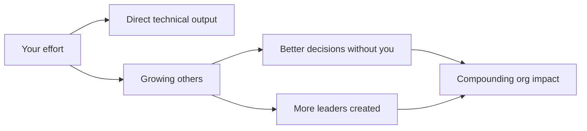
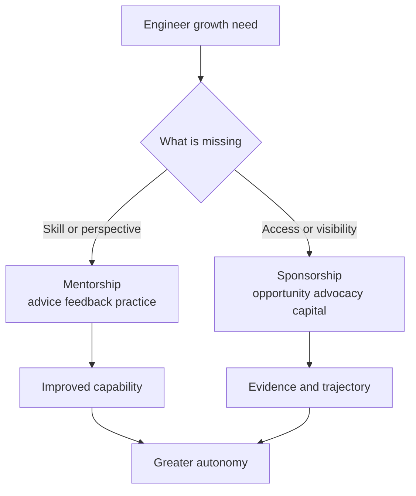
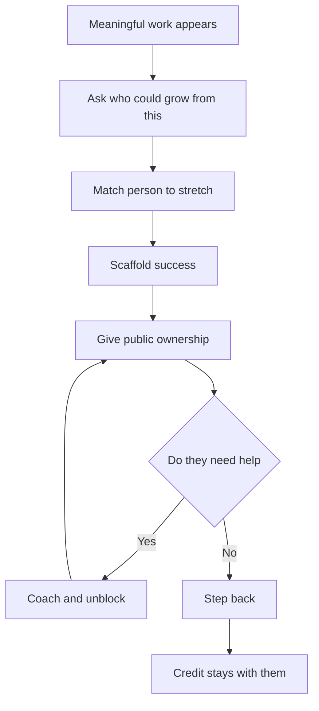
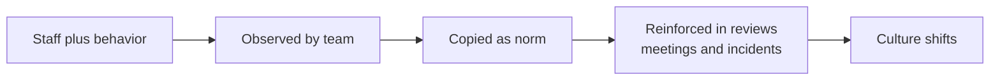

# B4 · Mentorship & Sponsorship
> How do you multiply your impact by growing the people around you?

**TL;DR**
- Staff+ impact compounds when you grow engineers whose future decisions no longer require you.
- Pair a little mentorship with considerably more sponsorship: advice helps, opportunity changes trajectories.
- Mentorship is guidance; sponsorship is spending your credibility to create access, visibility, and promotion evidence.
- Women and non-binary engineers are often over-mentored but under-sponsored, so opportunity allocation must be deliberate.
- Create space by asking “who could grow from this?” and then scaffolding success without taking credit back.
- Your role-model behavior is passive influence; people copy how high-status engineers act under pressure.

Related: [skills overview](../02-skills-to-upgrade.md), [promotion playbook](../05-promotion-playbook.md), [self-assessment](../06-self-assessment-and-tracking.md). Sibling files: [B1](B1-influence-without-authority.md), [B2](B2-communication-and-executive-writing.md), [B3](B3-technical-and-project-leadership.md), [B4](B4-mentorship-and-sponsorship.md), [B5](B5-stakeholder-management-and-trust.md), [B6](B6-glue-work.md), [B7](B7-decision-making.md), [B8](B8-prioritization.md).

---

## 1. The force-multiplier frame

Heroics create local wins.
Growing people changes the slope of the organization.
A Staff+ engineer who solves every hard problem personally may be admired, but a Staff+ engineer who creates five engineers capable of solving harder problems has changed the system.

Mentorship and sponsorship are force multipliers because they create future judgment, confidence, visibility, and opportunity.
They also reduce dependency on you.
That is not a loss of status.
It is evidence that your leadership scales.

The most effective pattern is a little mentorship and considerably more sponsorship.
Advice is useful, but access is often the bottleneck.
Many capable engineers do not need another private conversation about growth.
They need someone with credibility to say their name in the room where opportunities are assigned.

This is especially important for Staff and Principal promotion.
Promotion committees look for scope beyond personal execution.
Sponsoring others creates visible evidence that your impact travels through people and systems.

## 2. Mentorship versus sponsorship

Mentorship and sponsorship are related but different.
Confusing them leads to good intentions with weak outcomes.

| Dimension | Mentorship | Sponsorship |
|---|---|---|
| Core action | Give advice and feedback | Spend capital to create opportunity |
| Typical setting | Private conversation | Public or decision-making room |
| Currency | Time, experience, perspective | Credibility, trust, reputation |
| Output | Better understanding and skills | Stretch work, visibility, promotion evidence |
| Risk to you | Low | Meaningful, because your judgment is attached |
| Risk to them | Dependence if overdone | Exposure without support if careless |
| Example | “Here is how to structure the design doc.” | “Priya should lead this design; I will back her and review drafts.” |

Mentorship says, “I will help you get ready.”
Sponsorship says, “I believe you are ready enough, and I will help the organization see it.”
Both are valuable.
At Staff+, the underused lever is usually sponsorship.

## 3. The under-sponsorship problem

Research and lived experience show a repeated pattern: women and non-binary engineers are often over-mentored but under-sponsored.
They receive advice, coaching, and feedback, but fewer visible stretch opportunities and fewer senior advocates in decision rooms.

That pattern matters because promotions are not based only on potential.
They are based on evidence.
Evidence comes from opportunities: leading a project, presenting a decision, handling an incident, influencing a roadmap, mentoring others, or representing the team externally.
If opportunity distribution is uneven, promotion outcomes will be uneven even when talent is not.

A Staff+ engineer should ask:

- Who gets the visible work?
- Who gets “safe” advice but not risky opportunity?
- Whose work is repeated by someone else in higher-status rooms?
- Who is trusted privately but not named publicly?
- Who would benefit from sponsorship but is not in my usual network?

This is not charity.
It is talent stewardship.
Organizations waste capability when they fail to connect capable people to consequential work.

## 4. Concrete sponsorship actions menu

Anyone can be a sponsor.
You do not need to be a manager.
You need enough credibility, context, and willingness to spend some of your capital.

Use this menu weekly:

| Sponsorship action | Example |
|---|---|
| Suggest someone to lead a project | “Nadia has the right context to lead the migration workstream.” |
| Suggest someone to facilitate a postmortem | “Mateo handled the incident well; he should facilitate the follow-up.” |
| Suggest someone to give a talk | “This would be stronger if Chen presented the architecture story.” |
| Forward their work | Send a concise note to a broader audience with the author credited |
| Raise their name in decision rooms | “Before we assign this, has Sam been considered?” |
| Share their work in Slack | Link to the artifact and explain why it matters |
| Ask their manager about praise | “Would it be useful if I shared feedback on Aisha’s design leadership?” |
| Create a stretch role | “Can Jordan own the rollout plan while I advise?” |
| Protect ownership | Redirect credit back to the person doing the work |

The best sponsorship is specific.
Do not say “She is great.”
Say “She aligned three teams on the rollout plan, identified the data-loss risk, and changed the migration sequence to avoid customer impact.”

## 5. Create space for others

When meaningful work lands near you, ask: “Who could grow from this?”
That question changes your default from ownership to stewardship.

Creating space has three parts.
First, identify the growth opportunity.
Second, scaffold success.
Third, when it becomes theirs, let it be theirs.

Scaffolding may include reviewing drafts, rehearsing presentations, naming risks, joining the first stakeholder meeting, or helping frame the decision.
Scaffolding is not taking over.
If your support makes the work look like yours, the sponsorship has failed.

Keep a sponsorship journal.
Track names, opportunities, actions taken, feedback sent, and follow-up dates.
This prevents sponsorship from being limited to people who are top of mind.
It also gives you material for calibration, promotion packets, and manager conversations.

## 6. Mentorship done well

Mentorship still matters.
The goal is growing autonomy, not dependence.
A good mentoring relationship has a purpose, cadence, and exit condition.

| Mentoring element | Good practice |
|---|---|
| Goal | “Improve design leadership for cross-team projects.” |
| Cadence | Regular but time-bounded, such as six sessions |
| Preparation | Mentee brings agenda and artifacts |
| Feedback | Specific, behavioral, and tied to outcomes |
| Practice | Mentee applies advice between sessions |
| Autonomy | Mentor asks more questions over time |
| Exit | Relationship changes when goal is met |

Mentoring questions that build autonomy:

- “What options have you considered?”
- “What trade-off are you most worried about?”
- “Who needs to be aligned before this meeting?”
- “What would a Staff engineer do next?”
- “What support do you want from me, and what should remain yours?”

A dependency smell: the mentee waits for your approval before every move.
A growth smell: the mentee starts predicting your questions and answering them independently.

## 7. Being a role model as passive influence

High-status engineers are copied.
How you behave is how others behave.
If you interrupt, dismiss, catastrophize, or speculate carelessly, those behaviors become more acceptable.
If you ask clear questions, admit uncertainty, give credit, and stay calm under pressure, those behaviors spread too.

Be careful thinking out loud.
A Principal engineer saying “This service is a mess” may intend a casual observation.
A team may hear “Leadership has judged our work and the migration is doomed.”
Your words carry more organizational weight than you feel.

Role-model behaviors to practice:

- crediting people by name;
- separating critique of work from critique of people;
- admitting when new evidence changed your mind;
- asking quieter engineers for input without putting them on the spot;
- staying factual in incidents;
- making uncertainty explicit.

Passive influence is not enough on its own, but it sets the floor.
Active sponsorship built on poor role-model behavior will feel inconsistent and unsafe.

## 8. Practice drills

- Make a list of five engineers and one growth opportunity each could own.
- In the next planning cycle, suggest someone else for a visible leadership role.
- Forward one person’s work to a broader audience with specific praise and context.
- Ask a manager whether a piece of positive feedback would help an engineer’s growth record.
- Start a sponsorship journal with columns for person, opportunity, action, evidence, and follow-up.
- Convert one mentoring conversation from advice-giving to question-led coaching.
- After a win, publicly redirect credit to the person who owned the work.
- Audit your last month of sponsorship: who did you name, and who did you overlook?

## What "good" looks like at Staff+

- People around you take on larger, more ambiguous work over time.
- You create visible opportunities, not just private advice.
- Your sponsorship produces concrete promotion evidence for others.
- You notice uneven opportunity distribution and correct it deliberately.
- You scaffold stretch work without taking ownership back.
- Managers trust your feedback because it is specific and grounded in impact.
- Your behavior under pressure becomes a positive norm others copy.

## Common pitfalls

- Mentoring endlessly while never spending political capital.
- Sponsoring only people who already resemble you or are already visible.
- Giving someone a stretch role without support, then calling it empowerment.
- Taking back the microphone when the work succeeds.
- Providing vague praise that cannot be used in promotion evidence.
- Creating dependence through advice instead of autonomy through coaching.
- Forgetting that your casual comments are amplified by your role.

## Further reading

- Lara Hogan, “What does sponsorship look like?”: https://larahogan.me/blog/what-sponsorship-looks-like/
- StaffEng, “Create space for others”: https://staffeng.com/guides/create-space-for-others/
- StaffEng, “What do Staff engineers actually do?”: https://staffeng.com/guides/what-do-staff-engineers-actually-do/
- Harvard Business Review, “Women Are Over-Mentored (but Under-Sponsored)”: https://hbr.org/2010/08/women-are-over-mentored-but-un
