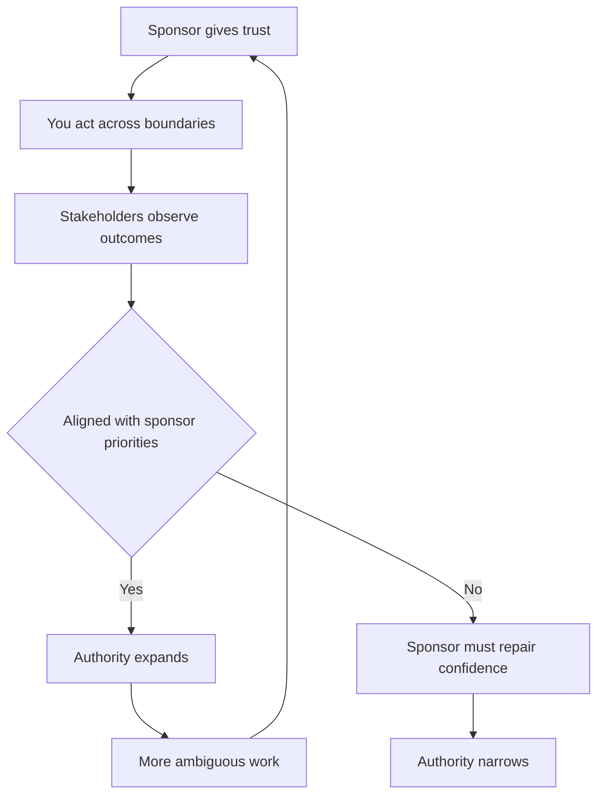
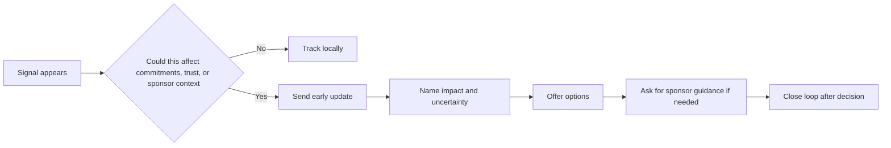
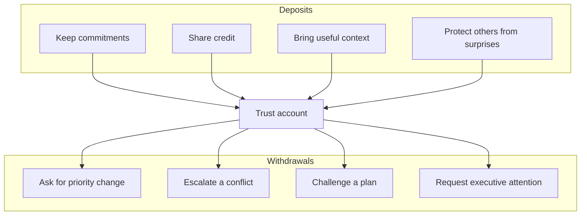
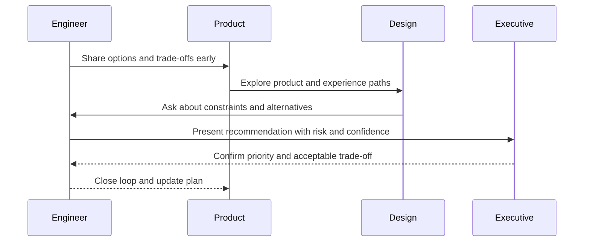

# B5 · Stakeholder Management, Trust & Political Capital
> How do you build and spend the trust that gives you borrowed authority?

Back to the main map: [Skills to upgrade](../02-skills-to-upgrade.md). Related leadership files: [B1 influence](B1-influence-without-authority.md), [B2 communication](B2-communication-and-executive-writing.md), [B3 technical leadership](B3-technical-and-project-leadership.md), [B4 mentorship](B4-mentorship-and-sponsorship.md), [B6 glue work](B6-glue-work.md), [B7 decisions](B7-decision-making.md), [B8 prioritization](B8-prioritization.md). Use this with the [promotion playbook](../05-promotion-playbook.md) and [self-assessment tracker](../06-self-assessment-and-tracking.md).

**TL;DR**
- Staff+ authority is usually proxied from a sponsor, most often your manager; stay aligned or your influence decays.
- Never surprise your manager, and do not let your sponsor surprise you; information flow is part of the job.
- Political capital is a bank account: deposits are reliability, context, generosity, and judgment; withdrawals are asks, escalations, and decisions.
- Build peer networks before you need them; the higher you go, the lonelier and more cross-functional the work becomes.
- Represent engineering in the room, not only your own opinion, and keep disagreeing compatible with alignment.

---

## 1. Borrowed authority: the Staff+ operating model

A Senior engineer can often lead from ownership: they own a service, a project, or a technical area.
A Staff+ engineer often leads across ownership boundaries.
That means your authority is not command authority.
It is borrowed, delegated, and continually renewed.

Rick Boone's analogy is useful: a Staff engineer can operate like the Hand of the King.
You may speak with influence because a sponsor has delegated trust to you.
But you still serve at the pleasure of that sponsor.
If your manager or executive sponsor cannot predict your moves, defend your judgment, or explain your work, your authority collapses.

Borrowed authority has four practical implications:

| Implication | What it means in practice |
|---|---|
| Alignment precedes autonomy | You earn freedom by showing your sponsor how you think. |
| Sponsorship is conditional | Your sponsor must believe your judgment helps their goals. |
| Surprises are expensive | A surprise makes your sponsor look uninformed or exposed. |
| You represent more than yourself | In cross-functional rooms, people may hear you as engineering. |

Borrowed authority is not fake authority.
It is how complex organizations scale judgment.
The trap is forgetting that the authority is proxied.
Your sponsor does not need to approve every action, but they do need to understand your direction, risks, and trade-offs.

## 2. Never surprise your manager

"Never surprise your manager" is not about obedience.
It is about resilience.
A manager can help you only if they know what is happening early enough to act.
A sponsor can defend your work only if they are not learning the situation from someone else.

Treat each surprise as an incident.
Ask what signal was missed, what reporting path failed, and what update cadence would have prevented it.
Common surprises include:

- A stakeholder is angry about a decision you thought was settled.
- A delivery date moved and your manager hears from Product first.
- You escalated in a meeting without warning your sponsor.
- A technical risk became urgent after weeks of private concern.
- A cross-team dependency slipped because no one owned the interface.

A good weekly update is short, regular, and decision-oriented:

| Section | Example content |
|---|---|
| Outcomes | "Search migration completed phase one; p95 latency down 18%." |
| Risks | "Data backfill confidence is lower than expected; mitigation by Friday." |
| Decisions needed | "Need sponsor call on whether to delay launch or reduce scope." |
| Stakeholder temperature | "Product aligned, Support concerned, Security needs pre-read." |
| Next moves | "Running alignment meeting Wednesday; will send options doc Tuesday." |

Do not wait until you have a complete answer.
Staff+ updates are valuable precisely when the situation is ambiguous.
A useful message says: "Here is what I know, what I do not know, what I am doing next, and when I will update you."

## 3. Do not let your sponsor surprise you

The reciprocal rule is just as important: do not let your sponsor surprise you.
If you only push information upward, you still might be steering against hidden priorities.
Managing up means learning the terrain your sponsor sees before you feel it.

Ask regularly:

- What are your top three priorities this quarter?
- What promises have you made upward that my work affects?
- Which stakeholders are most sensitive to this area?
- What risks would make you intervene?
- What would make this work obviously successful in your forum?

This is not flattery.
It is systems thinking applied to authority.
Your manager is also operating inside constraints: headcount, executive narratives, budget, reorgs, customer commitments, and political promises.
When you understand those constraints, you can make decisions that survive contact with the organization.

A simple managing-up rhythm:

1. Send a weekly written update.
2. Keep a running list of decisions and assumptions.
3. Ask what changed in leadership context.
4. Preview escalations before they happen.
5. After important meetings, send the interpretation you are acting on.

## 4. Political capital as a bank account

Tanya Reilly describes social or political capital like a bank account.
You pay in by being reliable, generous, truthful, and useful.
You spend it when you ask people to take risks, change plans, accept trade-offs, or trust your judgment over their local preference.

Deposits and withdrawals are not moral labels.
They are a way to reason about trust dynamics.
If you make repeated withdrawals without deposits, people experience you as expensive.
If you only deposit and never spend, you may become liked but ineffective.

The bank account metaphor helps you decide when to act.
Before a hard ask, ask:

- Have I shown that I understand their goals?
- Have I helped them before asking them to help me?
- Have I made the trade-off explicit rather than personal?
- Have I given them time to react privately before a public forum?
- Am I spending capital on something that truly matters?

Political capital is not manipulation.
Manipulation hides intent.
Healthy political capital makes intent legible and uses trust to move the organization toward better outcomes.

## 5. Build a peer network before you need it

The most consistent advice from Staff+ engineers is to build a network of peers.
The work gets lonelier as scope increases because fewer people share your exact context.
You need peers who can sanity-check your read of the room, introduce you to the right owner, and tell you when you are over-rotating.

Useful peer networks include:

| Network | Purpose |
|---|---|
| Staff+ peers in your company | Understand internal politics and precedent. |
| Product and Design leads | Shape product trade-offs before plans harden. |
| Operations, Support, Security, Legal | See risks engineering often misses. |
| External communities | Normalize challenges and learn patterns. |

The Rands Leadership Slack is an example of an external community where engineering leaders exchange practical advice.
External networks are not substitutes for internal trust, but they reduce isolation and broaden your pattern library.

Invest when nothing is on fire: ask what peers are worried about, review outside your team, share postmortem lessons, and keep a lightweight map of ownership and influence.

## 6. Managing up: help your boss succeed

Managing up means making your manager more effective: know how they are measured, which executives they influence, what risks they carry, and what evidence helps them advocate for engineering. Bring options instead of raw problems: "Here are three paths, the trade-off I recommend, and the decision I need." Do not treat your manager as a rubber stamp or a rescue service; use them to improve judgment and sponsorship.

## 7. Working with Product, Design, and executives

Cross-functional leadership is how technical reality enters product and business decisions. Represent all of engineering, not just your preference: gather context, distinguish "I think" from "Engineering is concerned", and translate trade-offs into business, user, reliability, and delivery terms.

| Partner | What they need from you |
|---|---|
| Product | Feasible options, sequencing, risk, user impact. |
| Design | Constraints early enough to shape experience. |
| Executives | Recommendation, business trade-off, confidence level. |
| Support and Success | Operational consequences and customer messaging. |

Late technical feedback often sounds like obstruction because the plan has already become identity, schedule, and promise.

## 8. Credibility and the trust equation

Credibility is more than being technically correct. Stakeholders ask whether you are competent, reliable, candid, empathetic, and optimizing for the shared goal rather than your favorite solution. You can be right and lose trust if you are late or dismissive; you can be uncertain and gain trust if you are honest, prepared, and useful.

Disagreeing while staying aligned requires a repeatable posture: state the shared goal, name the risk to that goal, offer a path, ask what constraints you are missing, and commit once the decision is made unless ethics or safety are at stake.

## 9. Retiring the safety-net expectation

Earlier in your career, a manager may catch missed stakeholders and absorb communication mistakes. At Staff+, you own the stakeholder system around your work: who needs to know, who can block, who is affected, who can amplify, and who needs pre-alignment. If you repeatedly need rescue after avoidable surprises, the organization will limit your scope.

## Practice drills

- Write a weekly sponsor update for your current work for four weeks. Keep it under 200 words and include risks, decisions, and stakeholder temperature.
- Make a stakeholder map for one initiative: sponsor, blockers, affected teams, hidden influencers, and decision forums.
- Before your next cross-functional meeting, meet one key stakeholder privately and ask what outcome they need.
- Choose one relationship where you need to make a deposit before a withdrawal. Make the deposit this week.
- After any surprise, run a 15-minute personal postmortem: what signal was missed, who learned too late, and what cadence changes?
- Ask your manager: "What promise have you made upward that my work most affects?"

## What "good" looks like at Staff+

- Your manager can explain your work, risks, and reasoning without asking you first.
- Stakeholders hear bad news from you early, with options.
- You know when you are speaking for yourself versus representing engineering.
- You spend political capital on high-leverage issues, not personal preferences.
- You have peer relationships across teams before a crisis requires them.
- You disagree clearly, then align visibly once a decision is made.
- Your sponsor trusts you with ambiguous rooms because you protect context and commitments.

## Common pitfalls

- Treating political capital as dirty instead of as the operating currency of trust.
- Confusing autonomy with independence from your sponsor.
- Updating only when work is green, which makes red status feel like a betrayal.
- Speaking as "engineering" without gathering engineering input.
- Escalating publicly before pre-aligning privately.
- Becoming liked but ineffective because you never spend trust.
- Spending capital on style preferences rather than material outcomes.

## Further reading

- StaffEng, "Staying aligned with authority": https://staffeng.com/guides/staying-aligned-with-authority/
- StaffEng, "Build a network of peers": https://staffeng.com/guides/network-of-peers/
- StaffEng, "What do Staff engineers actually do?": https://staffeng.com/guides/what-do-staff-engineers-actually-do/
- Rands Leadership Slack: https://randsinrepose.com/welcome-to-rands-leadership-slack/
