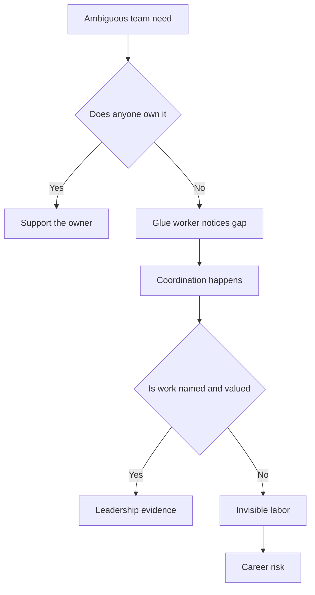
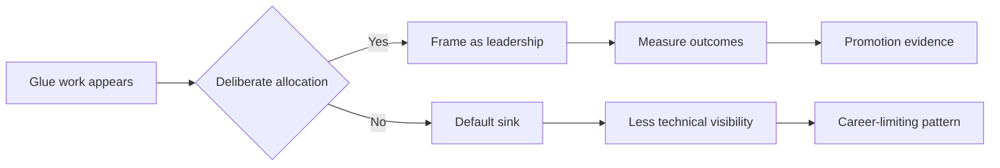
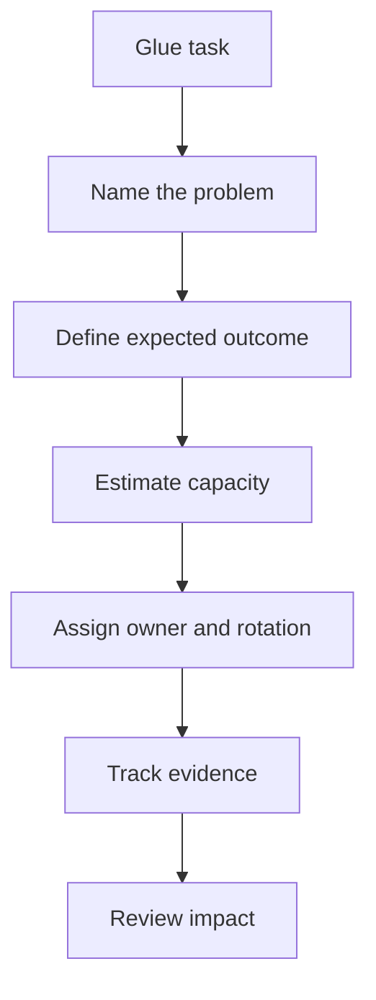
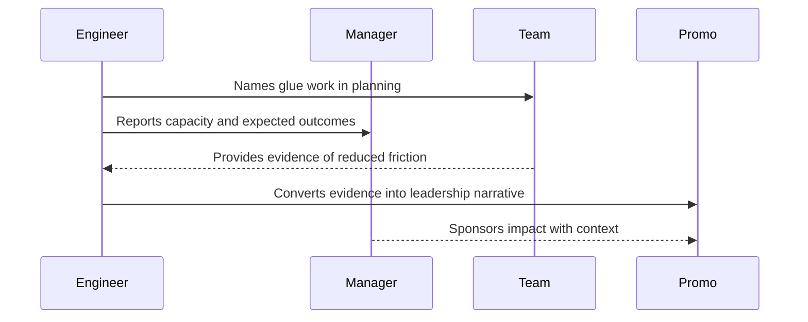

# B6 · Glue Work — Made Visible
> How do you handle the invisible work that holds teams together without letting it derail your career?

Back to the main map: [Skills to upgrade](../02-skills-to-upgrade.md). Related leadership files: [B1 influence](B1-influence-without-authority.md), [B2 communication](B2-communication-and-executive-writing.md), [B3 technical leadership](B3-technical-and-project-leadership.md), [B4 mentorship](B4-mentorship-and-sponsorship.md), [B5 stakeholders](B5-stakeholder-management-and-trust.md), [B7 decisions](B7-decision-making.md), [B8 prioritization](B8-prioritization.md). Track evidence in [self-assessment and tracking](../06-self-assessment-and-tracking.md) and package it with the [promotion playbook](../05-promotion-playbook.md).

**TL;DR**
- Glue work is the coordination, care, alignment, and question-asking that keeps teams effective.
- Managed deliberately, it demonstrates technical leadership; left unconscious, it can become career-limiting.
- The risk is highest when glue work is expected but not named, measured, rotated, or rewarded.
- Make glue work visible in planning, metrics, brag docs, and promotion packets.
- If you are junior or underrepresented, do not become the default sink for invisible work.
- Staff+ engineers advocate for the organization to value glue work instead of quietly exploiting it.

---

## 1. What glue work is

Tanya Reilly's "Being Glue" names a pattern many engineers recognize immediately.
Glue work is the work that holds a team together but is often not counted as engineering output.
It is not one task; it is a category of coordination and care that makes technical work possible.

Examples include:

- Onboarding junior engineers.
- Updating the roadmap so reality and plan stay connected.
- Talking to users or support to understand pain.
- Noticing dropped balls and quietly picking them up.
- Asking clarifying questions on design docs.
- Keeping everyone aligned across meetings, Slack, docs, and tickets.
- Translating between Product, Design, Engineering, Support, and leadership.
- Making sure decisions have owners and follow-up.

If this describes you, you may be the glue.
That can be good.
Teams need glue.
But careers are built on work the organization sees, values, and rewards.

Glue work is often the reason a team feels functional.
The problem is not the work itself.
The problem is invisible allocation and invisible credit.

## 2. The core tension

Glue work has a paradox.
Managed deliberately, it builds and demonstrates the skills expected at Staff+: influence, prioritization, systems thinking, mentoring, communication, and organizational judgment.
Left unconscious, it can push an engineer away from technical growth, away from promotable work, and even out of the industry.

| Managed deliberately | Left unconscious |
|---|---|
| Named in planning | Assumed as personality or helpfulness |
| Connected to outcomes | Treated as background hygiene |
| Distributed across team | Falls to the same person repeatedly |
| Included in promotion evidence | Missing from performance review |
| Paired with technical ownership | Replaces technical ownership |

The same action can be either leadership or trap depending on context.
Onboarding a new engineer can be a high-impact leadership contribution if it improves ramp time and is recognized.
It can be career-limiting if you do it repeatedly while others take the visible technical projects.

## 3. Promotable and non-promotable work

Organizations do not reward all useful work equally.
Promotable work is work that decision-makers associate with the next level.
Non-promotable work is necessary but rarely converted into advancement.

At Staff+, promotable glue work usually has these properties:

- It changes how a team or organization works, not only how one task gets finished.
- It reduces future coordination cost.
- It creates durable artifacts: docs, process, templates, dashboards, rituals, ownership maps.
- It develops other engineers.
- It improves delivery, quality, reliability, or decision-making.
- It is visible to the right stakeholders.

Non-promotable glue work often looks like:

- Always taking notes without being asked.
- Always scheduling meetings.
- Always smoothing conflict privately.
- Always onboarding because you are patient.
- Always cleaning tickets because you notice disorder.
- Always translating leadership messages without credit or authority.

This trap disproportionately affects underrepresented engineers.
People may expect them to do care work, coordination, emotional labor, or diversity work while evaluating them against technical output.
That is an allocation problem and a fairness problem.

## 4. Make glue work explicit in planning

Invisible work becomes more visible when it competes honestly for capacity.
Planning should name glue work as work.
If onboarding will take 20% of your time, say so.
If cross-team alignment is required, put it on the plan.
If a roadmap cleanup enables better prioritization, define the outcome.

A useful planning sentence:

"I will spend one day per week for six weeks on onboarding and alignment for the payments migration; expected outcomes are two ramped engineers, reduced review bottlenecks, and a decision log that prevents repeat debates."

Turn vague helpfulness into scoped leadership:

| Vague | Better |
|---|---|
| "Helping with onboarding" | "Reducing ramp time for two new engineers from six weeks to four." |
| "Keeping roadmap updated" | "Creating a single source of truth for migration dependencies." |
| "Asking questions" | "Surfacing unresolved API ownership and security assumptions before build." |
| "Keeping people aligned" | "Running weekly dependency sync until launch readiness is stable." |

Do not smuggle glue work into evenings or margins.
If it matters, it deserves capacity.
If it does not deserve capacity, ask why you are doing it.

## 5. Frame glue work as technical leadership

Glue work counts when it is connected to engineering outcomes.
The word "helped" is too weak.
Use verbs that show leadership and system change:

- aligned
- unblocked
- reduced
- clarified
- delegated
- accelerated
- de-risked
- standardized
- mentored
- operationalized

Instead of "I helped the team stay aligned," write:

"I created a dependency map and weekly decision review that reduced cross-team launch blockers from seven to two and allowed the team to cut scope before the freeze date."

Instead of "I onboarded juniors," write:

"I built a ramp plan, review checklist, and pairing rotation that made two new engineers independently ship production changes by week four."

This is not exaggeration.
It is translation.
Performance systems often miss invisible work unless you connect it to measurable outcomes.

## 6. Make glue work visible

Visibility is not vanity.
Visibility is how an organization learns what work mattered.
If the only record of your glue work is that things did not fall apart, your evidence will be weak.

Places to make glue work visible:

| Place | How to use it |
|---|---|
| Planning docs | Name coordination work as capacity and scope. |
| Weekly updates | Report risks reduced, decisions made, people unblocked. |
| Brag doc | Capture before and after evidence. |
| Promotion packet | Frame work as leadership, leverage, and organizational impact. |
| Retrospectives | Make invisible coordination part of the team learning. |
| Manager one-on-ones | Confirm whether the work maps to level expectations. |

Cross-link your evidence to [self-assessment and tracking](../06-self-assessment-and-tracking.md).
A brag doc is not only a list of accomplishments.
It is a memory system for outcomes that are otherwise easy to forget.

Visibility should happen while the work is happening, not only at review time.
Late visibility can sound like self-justification.
Early visibility helps the organization allocate and value the work correctly.

## 7. Distribute and rotate glue work

If the same person always performs glue work, the team has an unhealthy dependency.
Staff+ engineers should make glue work systematic enough to rotate.
That protects individuals and builds organizational capacity.

Rotatable glue work includes:

- Meeting facilitation.
- Note-taking and decision logging.
- On-call process cleanup.
- Roadmap hygiene.
- New-hire onboarding buddy work.
- Postmortem follow-up tracking.
- Design doc question review.

Some glue work should be owned by the person with the right context.
But repeated default assignment is a smell.
Ask: "Is this assigned because it is the best use of this person's growth path, or because they are reliable and no one else wants it?"

A rotation should define scope, time commitment, success criteria, training, rotation date, and recognition mechanism.

## 8. Protect against default-sink dynamics

Junior and underrepresented engineers are often asked, implicitly, to absorb notes, onboarding, emotional labor, and coordination. Be explicit: rotate the work, name it in planning, and ask what would make it count toward growth goals. A healthy Staff+ engineer notices when invisible work concentrates on people with less power.

## 9. Work the organization is built to ignore

StaffEng warns that some valuable work is structurally ignored or devalued. Glue work often sits there: it creates early wins, then struggles for support. Before investing heavily, connect it to customer pain, delivery risk, quality, reliability, or talent development; find a sponsor; or reduce and rotate the work so it does not become private unpaid infrastructure.

## 10. How to make glue work count

Glue work counts when you can show a before and after. Use metrics, artifacts, and stakeholder quotes: onboarding time, decision latency, blockers resolved, risks found before build, support escalations reduced, or engineers ramped. In your brag doc, capture the problem, action, outcome, beneficiaries, artifacts, and feedback, then translate it into the level language in [promotion playbook](../05-promotion-playbook.md).

| Glue work | Evidence |
|---|---|
| Onboarding | Time to first merged PR, independent on-call, new-hire survey. |
| Roadmap alignment | Fewer priority reversals and clearer dependency dates. |
| Design review | Risks found before build and decisions logged. |
| Coordination | Blockers resolved and launch readiness improved. |

## Practice drills

- For one week, write down every piece of glue work you do. Categorize it as planning, coordination, mentoring, emotional labor, or operational hygiene.
- Pick one recurring glue task and propose a rotation with a template.
- Convert one invisible contribution into a brag-doc bullet with before, action, and result.
- Ask your manager which glue work maps to your growth goals and which work should be reduced.
- In the next planning cycle, explicitly estimate glue capacity rather than absorbing it silently.
- Review a design doc by asking only clarifying questions that improve team reasoning, then record the impact.

## What "good" looks like at Staff+

- You perform glue work deliberately and connect it to engineering outcomes.
- You make invisible work visible without making everything about yourself.
- You protect junior and underrepresented engineers from default-sink dynamics.
- You create systems, templates, and rotations that reduce dependence on heroic coordinators.
- Your promotion evidence includes leadership impact, not only coding output.
- You challenge the organization to value necessary work it has historically ignored.
- You stop doing low-value glue work when it crowds out higher-leverage responsibilities.

## Common pitfalls

- Calling all coordination "glue work" without distinguishing high-leverage leadership from low-value chores.
- Assuming being helpful will automatically be rewarded.
- Waiting until review season to explain the impact.
- Letting glue work replace technical growth unintentionally.
- Becoming the private conflict sponge for the team.
- Taking on ignored work without a sponsor or path to recognition.
- Making work visible only as activity rather than outcomes.

## Further reading

- Tanya Reilly, "Being Glue": https://www.noidea.dog/glue
- Tanya Reilly, "The Staff Engineer's Path": https://noidea.dog/staff
- StaffEng, "Work on what matters": https://staffeng.com/guides/work-on-what-matters/
