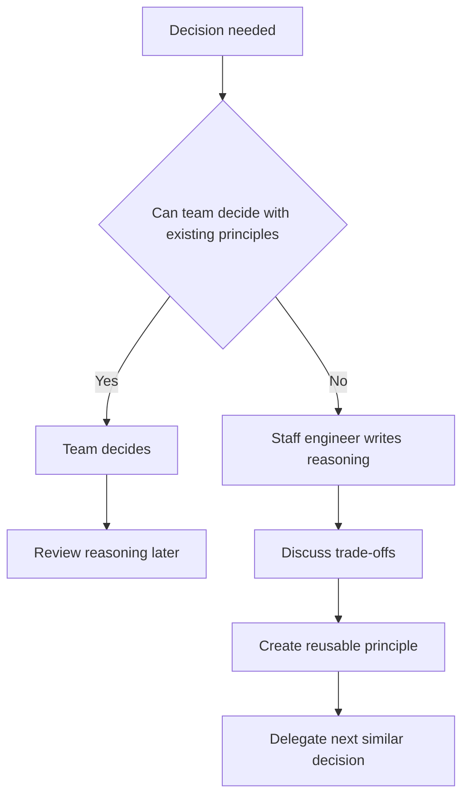
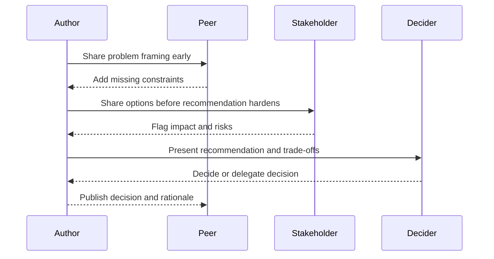
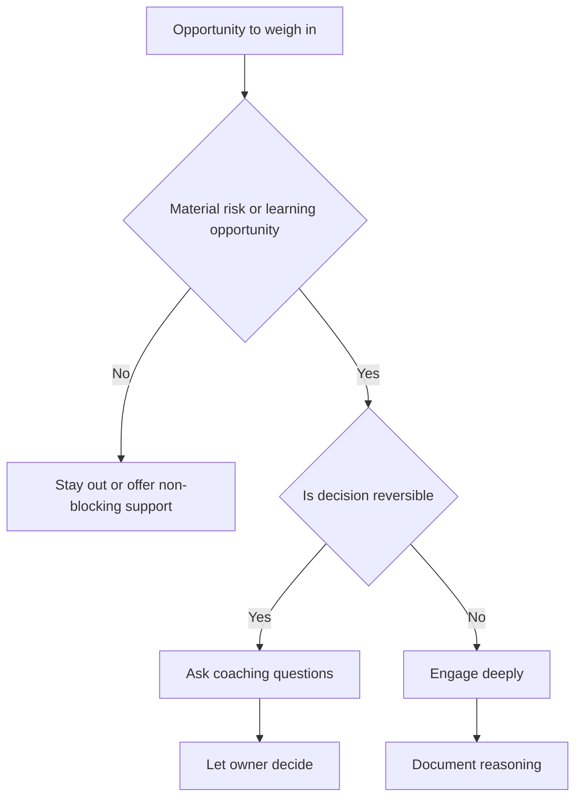
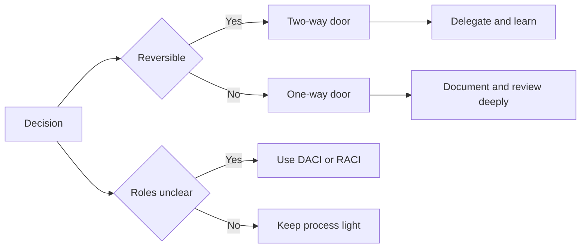

# B7 · Decision-Making & Disagreeing Productively
> How do you make good decisions at scale and disagree without damaging relationships?

Back to the main map: [Skills to upgrade](../02-skills-to-upgrade.md). Related leadership files: [B1 influence](B1-influence-without-authority.md), [B2 communication](B2-communication-and-executive-writing.md), [B3 technical leadership](B3-technical-and-project-leadership.md), [B4 mentorship](B4-mentorship-and-sponsorship.md), [B5 stakeholders](B5-stakeholder-management-and-trust.md), [B6 glue work](B6-glue-work.md), [B8 prioritization](B8-prioritization.md). Use evidence in the [promotion playbook](../05-promotion-playbook.md) and [self-assessment tracker](../06-self-assessment-and-tracking.md).

**TL;DR**
- At Staff+ scale, making decisions is less important than transferring judgment so teams decide well without you.
- Write down reasoning, circulate early, separate style from substance, and be willing to change your mind.
- Use decision frameworks such as DACI, RACI, one-way and two-way doors, and disagree-and-commit deliberately.
- Separate decision quality from outcome quality; good decisions can have bad outcomes under uncertainty.
- Productive disagreement combines safety, curiosity, calibrated questions, and clear escalation paths.

---

## 1. The real work is transferring judgment

At small scope, you can personally make many decisions.
At Staff+ scope, that does not scale.
If every important judgment waits for you, you become a bottleneck and the team stops developing decision muscle.

The real work is transferring judgment:

- Explain how you reason, not only what you decided.
- Show trade-offs and constraints.
- Let others make reversible decisions.
- Review decision quality after the fact.
- Create artifacts future teams can reuse.

A Staff+ engineer should aim for fewer decisions that depend on them and more decisions that reflect shared principles.
The best evidence of your leadership is often a high-quality decision made when you were not in the room.

This is why "just tell me what to do" is a leadership smell.
Sometimes speed requires a direct call.
But if every call stays opaque, the organization learns dependence rather than judgment.

## 2. Write it down: reasoning beats direction

Writing is the primary mechanism for scaling decisions.
A decision document should teach readers how to think.
It should not merely announce an answer.

The myth of the "Feynman algorithm" says: write down the problem, think very hard, write down the answer.
That skips the useful part.
In organizations, people need your intermediate reasoning:

- What goal are we optimizing for?
- What constraints matter most?
- What alternatives did we reject?
- What evidence changed our confidence?
- What assumptions would invalidate the decision?
- What should future teams copy or avoid?

A lightweight decision record can include:

| Section | Purpose |
|---|---|
| Context | Why this decision exists now. |
| Goals and non-goals | Prevents accidental scope expansion. |
| Options | Shows real alternatives. |
| Trade-offs | Makes values explicit. |
| Recommendation | States the call and confidence. |
| Revisit trigger | Defines when to change course. |

Writing reasoning also protects relationships.
People can disagree with the argument rather than guessing your motive.

## 3. Circulate early, before you crystallize

If you circulate a decision after your mind has hardened, review becomes theater.
People can sense when feedback is performative.
Early circulation creates better decisions and less resistance.

Use three passes:

1. Problem framing: "Are we solving the right problem?"
2. Option shaping: "What alternatives or constraints am I missing?"
3. Decision review: "Can you live with this recommendation?"

Early review is especially important when the decision crosses teams.
People support decisions more readily when they see their concerns represented, even if their preferred option is not chosen.

## 4. Separate style from substance

Staff+ engineers can accidentally become drive-by critics.
Because your opinion carries weight, casual style feedback may cause churn.
Before commenting, ask: "Would changing this affect the outcome?"

Substance feedback changes correctness, risk, strategy, cost, or learning.
Style feedback changes taste, personal preference, naming, formatting, or an implementation approach that is acceptable either way.

| Feedback type | Example | Should you give it? |
|---|---|---|
| Correctness | "This migration can lose writes during failover." | Yes. |
| Risk | "This assumes Security can review in one day." | Yes. |
| Strategy | "This optimizes local velocity but increases platform fragmentation." | Yes. |
| Preference | "I would have used a different library." | Usually no. |
| Style | "I dislike this diagram layout." | Only if it blocks understanding. |

When you do give style feedback, label it:

- "Non-blocking preference."
- "Nit, ignore if not useful."
- "Style only; not worth delaying."

Creating space for others means allowing acceptable decisions you would not personally make.

## 5. Change your mind visibly

Changing your mind is not weakness.
It is evidence that the conversation mattered.
When you change your mind, say what changed it.
That teaches the team which evidence is persuasive and rewards people for contributing.

Say what changed you: "The operational data changes my view" or "I optimized for build cost and missed support cost."

Do not use "strong opinions loosely held" as a license to dominate the room.
Strong opinions can be useful when they force clarity.
They become harmful when they make others spend all their energy dislodging you.

## 6. Do not weigh in on everything

At Staff+ level, attention is an intervention.
If you comment on every design doc, review every architecture choice, or join every debate, people may interpret your presence as required approval.
That slows the organization.

Ask whether your involvement adds unique value:

- Do I have context others lack?
- Is this decision irreversible or high blast radius?
- Is the team missing a principle I can teach?
- Am I needed to unblock a conflict?
- Would silence create risk, or would involvement create dependence?

Restraint is a form of leadership.
You create space by not filling every space.

## 7. Decision frameworks: choose the right tool

Frameworks are useful when they clarify roles, reversibility, or commitment.
They are harmful when they become process theater.
Use the lightest framework that prevents confusion.

| Framework | Best for | Key question | Watch out for |
|---|---|---|---|
| DACI | Cross-functional decisions | Who drives, approves, contributes, and is informed? | Confusing approver with consensus. |
| RACI | Operational ownership | Who is responsible, accountable, consulted, and informed? | Too many consulted people. |
| One-way door | Irreversible or costly decisions | Can we undo this cheaply? | Treating fear as irreversibility. |
| Two-way door | Reversible decisions | Can we learn by trying? | Over-documenting low-risk calls. |
| Disagree and commit | After debate and decision | Can I support execution despite disagreement? | Using it to silence dissent early. |

Disagree-and-commit is powerful only after real disagreement was allowed.
If dissent was unsafe, commitment becomes compliance.

## 8. Decision quality versus outcome quality

Annie Duke's "Thinking in Bets" popularized a crucial distinction: outcomes are not the same as decisions.
A good decision can lead to a bad outcome because of uncertainty.
A bad decision can get lucky.
Judging only by outcomes creates resulting: rewriting history based on what happened.

Evaluate decision quality by asking:

- Did we use the best available evidence?
- Did we consider base rates?
- Did we identify assumptions?
- Did we compare real alternatives?
- Did we match process weight to risk?
- Did we define revisit triggers?

Outcome quality still matters.
But learning requires separating what we controlled from what we did not.

| Case | Interpretation |
|---|---|
| Good decision, good outcome | Reinforce principle, but check for luck. |
| Good decision, bad outcome | Learn from uncertainty without blaming process unfairly. |
| Bad decision, good outcome | Do not let luck become precedent. |
| Bad decision, bad outcome | Fix reasoning, roles, and evidence paths. |

## 9. Deciding under uncertainty

Most important engineering decisions are made with incomplete information.
Waiting for certainty is often a decision to let events decide for you.
Good uncertainty practice includes:

- State confidence explicitly.
- Use base rates from similar projects.
- Identify leading indicators.
- Prefer reversible experiments when possible.
- Decide what evidence would change your mind.
- Create revisit dates before emotions attach to the plan.

A useful template:

"I am 70% confident in option B because it reduces migration risk and preserves customer commitments. The largest uncertainty is support load. If support tickets exceed X per week after beta, we should pause rollout and revisit option C."

This style gives others a place to contribute without turning every discussion into a referendum on your competence.

## 10. Productive disagreement

Productive disagreement requires both candor and safety.
Crucial Conversations frames high-stakes conversations around making it safe enough to discuss what matters.
Never Split the Difference emphasizes calibrated questions and tactical empathy.
Together, they produce a useful Staff+ posture: direct about the issue, curious about the person.

Use calibrated questions: "What problem are you solving?", "How would we know this works?", "What would make this unsafe?", and "What am I missing?"

Escalation is not failure.
It is a tool for resolving decisions at the right level of authority.
Escalate when the decision requires trade-offs local teams cannot make, when disagreement is stuck, or when risk exceeds delegated authority.
Escalate with a crisp summary: shared goal, options, trade-offs, recommendation, and decision needed.

## Practice drills

- Take one recent decision and write the reasoning after the fact. Include options, trade-offs, confidence, and revisit triggers.
- In your next design review, label every comment as blocking, risk, question, or non-blocking preference.
- Choose one reversible decision and explicitly delegate it.
- Run a premortem: "It is six months later and this decision failed. What happened?"
- Practice three calibrated questions before stating your opinion in a disagreement.
- Review a past bad outcome and separate decision quality from outcome quality.

## What "good" looks like at Staff+

- Teams make better decisions after working with you, even when you are absent.
- Your documents teach reasoning, not only conclusions.
- Stakeholders know who decides, who contributes, and when commitment begins.
- You change your mind when evidence warrants it and explain why.
- You avoid low-value drive-by opinions.
- You escalate cleanly with options and trade-offs, not drama.
- You make disagreement safer without making it soft or vague.

## Common pitfalls

- Treating every decision as if it needs Staff+ approval.
- Circulating documents only after the decision is already made.
- Giving style feedback that creates unnecessary churn.
- Using disagree-and-commit to shut down debate instead of ending it cleanly.
- Confusing confidence with certainty.
- Rewarding lucky outcomes and punishing unlucky good decisions.
- Escalating as a threat rather than as a decision tool.

## Further reading

- StaffEng, "Create space for others": https://staffeng.com/guides/create-space-for-others/
- StaffEng, "Learn to never be wrong": https://staffeng.com/guides/learn-to-never-be-wrong/
- Amazon Leadership Principles, including "Disagree and Commit": https://www.amazon.jobs/content/en/our-workplace/leadership-principles
- Annie Duke, "Thinking in Bets" (book)
