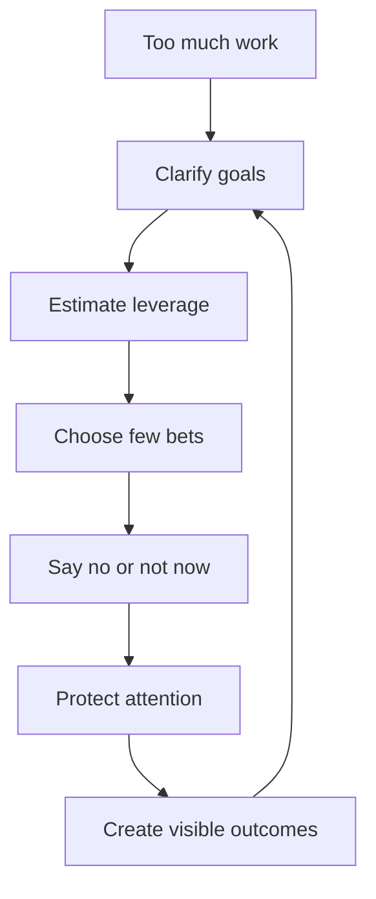
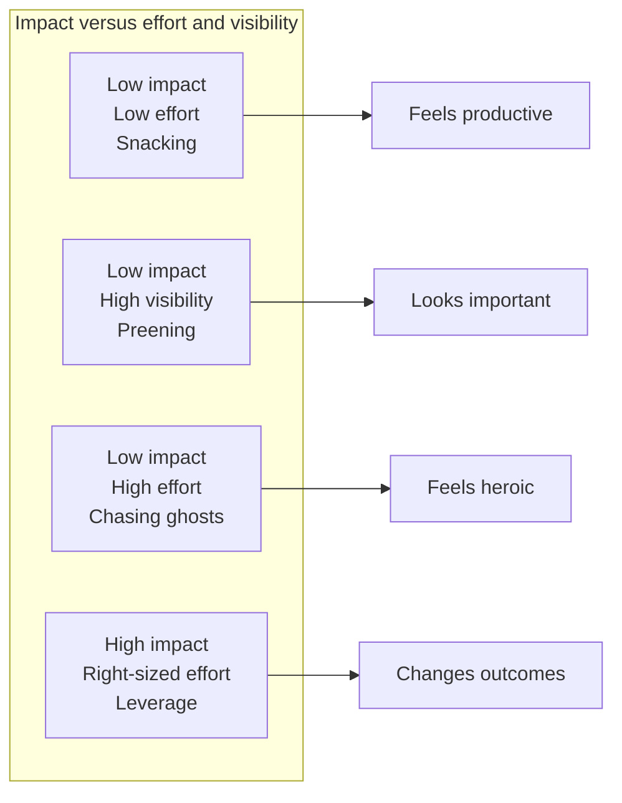
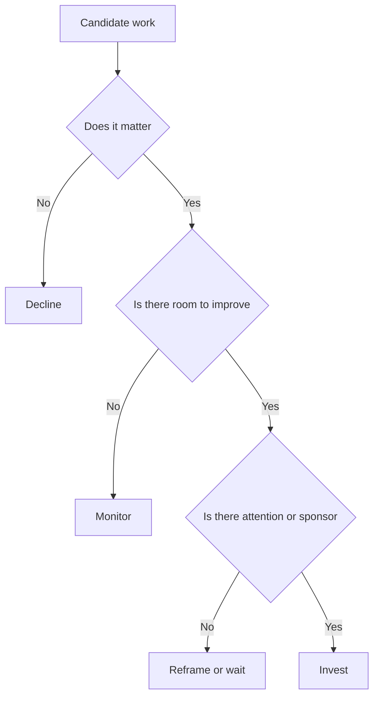
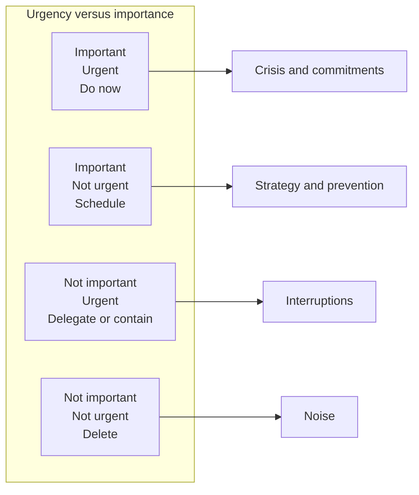

# B8 · Prioritization at Scale — "Work on What Matters"
> With more to do than time, how do you choose the work that actually creates leverage?

Back to the main map: [Skills to upgrade](../02-skills-to-upgrade.md). Related leadership files: [B1 influence](B1-influence-without-authority.md), [B2 communication](B2-communication-and-executive-writing.md), [B3 technical leadership](B3-technical-and-project-leadership.md), [B4 mentorship](B4-mentorship-and-sponsorship.md), [B5 stakeholders](B5-stakeholder-management-and-trust.md), [B6 glue work](B6-glue-work.md), [B7 decisions](B7-decision-making.md). Convert priorities into evidence with the [promotion playbook](../05-promotion-playbook.md) and [self-assessment tracker](../06-self-assessment-and-tracking.md).

**TL;DR**
- Senior+ roles require accomplishing more in less time; leverage mostly comes from what you choose not to do.
- Avoid snacking, preening, and chasing ghosts: low-impact work can feel productive, visible, or heroic while wasting scarce attention.
- Invest first in existential issues, then in important areas with room and attention.
- Use longer time horizons: Future You is a stakeholder in Present You's calendar.
- Prioritize for impact, leverage, and energy; sustainability beats heroics over a forty-year career.

---

## 1. Leverage starts with choice

At Senior levels, doing more can still work.
At Staff+ levels, the opportunity surface becomes too large.
There are more meetings, more documents, more incidents, more mentoring requests, more architecture questions, and more cross-team dependencies than one person can handle.

Leverage is the value created per unit of scarce attention.
That means prioritization is not an administrative task.
It is the core leadership mechanism.

You create leverage by choosing work that:

- Changes many decisions, not only one decision.
- Removes recurring friction.
- Develops other people.
- Reduces future risk.
- Aligns teams around a durable direction.
- Connects directly to business, customer, or reliability outcomes.

A Staff+ engineer is not promoted for being busy.
They are trusted because they can identify what matters before the organization has fully named it.

## 2. The three anti-patterns

StaffEng's "Work on what matters" names traps that feel like work but do not create enough leverage.
The three most common are snacking, preening, and chasing ghosts.

| Anti-pattern | What it feels like | Why it is dangerous |
|---|---|---|
| Snacking | Quick wins, easy fixes, inbox clearing. | Creates motion without meaningful progress. |
| Preening | Visible work that looks impressive. | Visibility can be mistaken for impact. |
| Chasing ghosts | Hard, vague, low-impact problems. | Burns effort on work the org will not value. |

Snacking is especially tempting during ambiguity.
When the important work feels unclear, easy work gives a sense of control.
But a calendar full of snacks can starve the strategic work.

Preening is low-impact but high-visibility work.
It is dangerous because companies often conflate visibility with impact.
A flashy migration, talk, dashboard, or architecture review may look important while failing to change outcomes.

Chasing ghosts is high-effort, low-impact work.
It often appears as an elegant technical problem no one has sponsored, a quality crusade with no adoption path, or a future risk with no plausible trigger.

The antidote is not contempt for small work.
Small work is sometimes necessary.
The antidote is honesty about whether the work deserves your Staff+ attention.

## 3. Invest first in existential issues

Existential issues are problems that can seriously damage the organization, product, customer trust, reliability, security, or strategic position.
They deserve attention even when they are politically awkward or technically unglamorous.

Examples:

- A reliability risk that could take down a core customer journey.
- A security gap with credible exposure.
- A platform constraint that will block the next product strategy.
- A talent or knowledge concentration risk around a critical system.
- A delivery commitment that is impossible under current assumptions.

Existential work often has three features:

1. The downside is large.
2. The organization is underestimating it.
3. A Staff+ engineer can create clarity, options, or momentum.

Do not confuse existential with loud.
The loudest problem may be a stakeholder's preference.
The existential problem may be a quiet architectural limit or team health issue.

## 4. Then invest where matter, room, and attention overlap

After existential issues, look for work that satisfies three conditions:

- It matters to the business, customers, reliability, or engineering system.
- There is room for meaningful improvement.
- The organization has enough attention or sponsorship to act.

Work the organization is built to ignore can produce early wins but may struggle for support.
Before committing, ask whether you can connect the work to an outcome leadership already values.
If not, you may need to build sponsorship first or choose a different lever.

## 5. Future You is a stakeholder

Staff+ prioritization requires a longer time horizon.
Ask: "What will Future You wish Present You had done?"

Future You often wishes Present You had:

- Written down the decision.
- Made the migration reversible.
- Built the dashboard before the incident.
- Trained another engineer before going on leave.
- Cleaned the ownership boundary before the reorg.
- Started the executive alignment before the deadline hardened.
- Said no to the low-leverage request.

Long-horizon work is rarely urgent when it is most valuable.
That is why you must telegraph what is coming.
Tell stakeholders what risk is forming, what investment will be needed, and what decision window is approaching.

## 6. Telegraph, tidy up, and create institutional memory

Telegraphing is the practice of making future constraints visible early.
It gives the organization time to adapt before urgency narrows options.

Tidy-up work is not random cleanup.
At Staff+ level, worthwhile tidy-up work increases future leverage:

- Simplifying an ownership boundary.
- Removing a recurring source of incidents.
- Clarifying a de facto architecture rule.
- Retiring a confusing process.
- Creating a decision log for a debated area.

Institutional memory matters because people leave, teams reorganize, and decisions repeat.
A short document can prevent months of recurring debate.

The best time to create memory is while context is fresh.
The second-best time is before the next team has to rediscover it under pressure.

## 7. Leverage and energy

Michelle Bu has advised considering what is energizing, not only what is impactful.
This is not self-indulgence.
Energy affects sustainability, creativity, and persistence.
A high-impact project that drains you completely may not be a good bet if it prevents the next three high-impact projects.

Use four questions:

| Question | Why it matters |
|---|---|
| Is it impactful? | Connects to outcomes. |
| Is it leveraged? | Multiplies beyond your direct effort. |
| Is it energizing enough? | Supports sustained performance. |
| Is it sponsored? | Increases chance of adoption. |

Sometimes you must do draining work because it matters.
But if all your important work is draining, redesign your portfolio.
Staff+ careers are long games.

## 8. No snacking: defend your time

"No snacking" does not mean ignoring small tasks.
It means refusing to let easy tasks consume the attention required for leverage.

Defend your time with explicit policies:

- Office hours for advisory requests.
- Written intake for architecture reviews.
- Clear criteria for joining meetings.
- Delegation paths for reversible decisions.
- Calendar blocks for deep work.
- A public list of current priorities and non-priorities.

Useful ways to say no:

- "I cannot take this on this week without dropping the migration review. Which is more important?"
- "This looks reversible; I trust the team to decide and I can review outcomes later."
- "I agree it is useful, but I do not think it is Staff+ leverage right now."
- "I can help frame the problem, but I should not be the owner."

Saying no is easier when your yes is visible.
People accept trade-offs more readily when they understand what your time is protecting.

## 9. Frameworks for prioritization

Frameworks do not make decisions for you.
They force explicit trade-offs.
Use them to structure judgment, not replace it.

The Eisenhower matrix separates urgency and importance:

High-output thinking asks: what output does this activity create, and can that output be multiplied?
Opportunity cost asks: what valuable work becomes impossible if I say yes?

A practical Staff+ prioritization filter:

1. Is this connected to a meaningful organizational goal?
2. Is there a clear owner and decision forum?
3. Is my involvement uniquely useful?
4. Can the work create durable leverage?
5. What will I stop doing to make room?
6. How will I know it worked?

## 10. Pacing: the forty-year career

Will Larson's "forty year career" is a reminder that sustainable pacing matters.
A career is not a single launch, reorg, incident, or promotion cycle.
Heroics can be necessary in rare moments, but heroics as an operating model destroy judgment.

Sustainable Staff+ pacing means choosing fewer better bets, alternating intensity with recovery, building systems instead of dependency, delegating growth opportunities, and keeping your tools sharp.

A tired Staff+ engineer often compensates with control: more reviews, more meetings, more direct decisions.
A sustainable Staff+ engineer creates systems that keep working without constant personal force.

## Practice drills

- Audit your calendar for one week. Mark each block as leverage, snack, preen, ghost, or necessary maintenance.
- Pick one current commitment and write the opportunity cost of continuing it.
- Create a "not doing" list and share it with your manager.
- Identify one Future You investment you can complete this month: decision log, dashboard, ownership map, or delegation plan.
- Use the matter-room-attention filter on five candidate projects.
- Practice saying no once this week with a trade-off statement rather than an apology.

## What "good" looks like at Staff+

- You can explain why your current work is the right work, not merely assigned work.
- Your calendar reflects your stated priorities.
- You stop or delegate work that is useful but not leveraged.
- You invest ahead of future constraints before they become emergencies.
- Your sponsor understands your trade-offs and can defend them.
- You avoid high-visibility low-impact work unless there is a strategic reason.
- You pace your contribution so your judgment remains sharp over years.

## Common pitfalls

- Mistaking busyness for impact.
- Saying yes to easy work because strategic work feels ambiguous.
- Pursuing visible work because promotion systems notice it, even when outcomes do not matter.
- Fighting ignored problems without sponsorship or adoption path.
- Treating all urgent requests as important.
- Letting your calendar be designed by other people's anxiety.
- Burning out and calling it commitment.

## Further reading

- StaffEng, "Work on what matters": https://staffeng.com/guides/work-on-what-matters/
- The Staff Engineer's Path, Pragmatic Engineer: https://newsletter.pragmaticengineer.com/p/the-staff-engineers-path
- Will Larson, "The forty year career": https://lethain.com/forty-year-career/
