# Leadership Skills (Part B)

> **The core idea in one sentence:** At Staff+, authority shrinks as scope grows: you lead through influence, communication and force-multiplication, not command.

For Senior engineers aiming at Staff or Principal who already have the technical chops and now need the skills the promotion is actually won on. Eight lessons cover Part B of [Skills to upgrade](../02-skills-to-upgrade.md): influence, executive communication, project leadership, sponsorship, trust, glue work, decision-making and prioritization. Each one ends with scenario quizzes and actions to run at work this week, and the evidence they produce feeds your brag doc and your [promotion packet](../05-promotion-playbook.md).

Self-contained deep dives for the **leadership / "soft"** skill areas in [../02-skills-to-upgrade.md](../02-skills-to-upgrade.md#part-b--leadership--soft-skills-the-biggest-differentiators). These are the biggest differentiators between Senior and Staff/Principal — the jump is *not* a technical one. Every chapter uses Mermaid diagrams, concrete practice drills, "what good looks like at Staff+", pitfalls, and further reading.

> **Counter-intuitive truth:** at Staff+, authority *shrinks* rather than grows — you lead through **influence, communication, and force-multiplication**, not command.

This is the long-form edition of the course. Each chapter is also an interactive lesson (quizzes, a “try it in your own system” task and a primary source) — start from the [course map](index.html) — and has a one-page cheat sheet linked at the top of each chapter below.

---

## Table of contents

| Code | Chapter | What you'll learn | Lesson |
|---|---|---|---|
| B1 | [Influence Without Authority](#b1--influence-without-authority) | "Learn to never be wrong": listen through questions, define the purpose, read the room; "to lead, you have to follow"; non-blocking feedback. | [Lesson 01](lessons/0001-influence-without-authority.html) |
| B2 | [Communication & Executive Writing](#b2--communication--executive-writing) | SCQA, the Minto Pyramid Principle, *nemawashi*, and the rules for presenting to executives. | [Lesson 02](lessons/0002-communication-and-executive-writing.html) |
| B3 | [Technical & Project Leadership](#b3--technical--project-leadership) | Leading cross-team initiatives, aggressive delegation, and managing technical quality as an escalating program. | [Lesson 03](lessons/0003-technical-and-project-leadership.html) |
| B4 | [Mentorship & Sponsorship](#b4--mentorship--sponsorship) | The difference between mentorship and sponsorship, concrete sponsorship actions, and "create space for others". | [Lesson 04](lessons/0004-mentorship-and-sponsorship.html) |
| B5 | [Stakeholder Management, Trust & Political Capital](#b5--stakeholder-management-trust--political-capital) | "Never surprise your manager", proxied authority, building a network of peers, and spending/earning trust. | [Lesson 05](lessons/0005-stakeholder-management-and-trust.html) |
| B6 | [Glue Work — Made Visible](#b6--glue-work--made-visible) | Tanya Reilly's concept: the invisible work that holds teams together, and how to make it count as leadership. | [Lesson 06](lessons/0006-glue-work.html) |
| B7 | [Decision-Making & Disagreeing Productively](#b7--decision-making--disagreeing-productively) | Write it down, circulate early, separate style from substance, change your mind, "disagree and commit". | [Lesson 07](lessons/0007-decision-making.html) |
| B8 | [Prioritization at Scale — "Work on What Matters"](#b8--prioritization-at-scale--work-on-what-matters) | Avoid snacking/preening/chasing ghosts; invest in existential issues; think on a longer time horizon. | [Lesson 08](lessons/0008-prioritization.html) |
| — | [Capstone project](#capstone-project) | Prove it end to end | — |
| — | [Self-assessment checklist](#self-assessment-checklist) and [study plan](#study-plan) | Know when you’re done | — |

## How the leadership skills reinforce each other

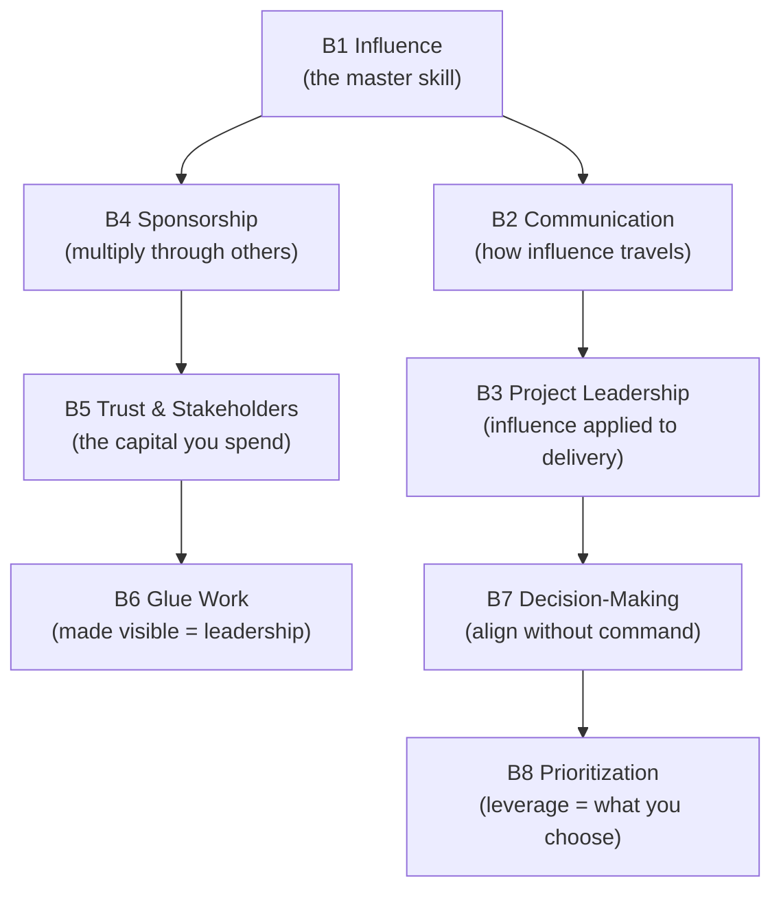

> **Rule of thumb:** most Senior engineers under-invest here and over-invest in the technical track. The promotion is usually won on **B1 (influence), B2 (communication), and B4 (sponsorship).**

## How to study this guide (≈ 8 weeks part-time, plus a 90-day capstone you run in your day job)

1. Do **one lesson a week**. Read it, take the three quizzes before re-reading, then run at least one **Try it** item at work the same week. Leadership skills grow through reps, not reading.
2. Keep **one running evidence doc** for the whole course: the influence log (Lesson 01), the sponsorship journal (Lesson 04) and glue-work outcomes (Lesson 06). It becomes your brag doc; see [06 · Self-assessment & tracking](../06-self-assessment-and-tracking.md).
3. Print the matching cheat sheet from `reference/` and keep it beside you in meetings. The scripts are meant to be said out loud.
4. After any meeting you led, ask one trusted peer: “Did I create space, or did I dominate?” Your own read of the room is the least reliable signal you have.
5. Read the **primary source** at the end of each lesson. Most are short StaffEng guides, and they are where the vocabulary promotion committees use comes from.
6. Use [GUIDE.md](GUIDE.md) to read end to end or to search. Use the HTML lessons for quizzes and drills. Pair this course with [Technical Skills (Part A)](../technical-skills/index.html); the promotion needs both.

---

# B1 — Influence Without Authority

> How do you drive change across teams you do not manage?

**TL;DR**
- At Staff+, authority is borrowed: you steer through trust, context, and clarity, not command.
- “Never be wrong” means being accurate while creating space for others to contribute and improve the answer.
- Use three moves before asserting: ask good questions, define the purpose, and read the room.
- Difficult people are handled before the meeting, with allies, boundaries, and shared incentives.
- To lead well, follow well: choose battles, support trustworthy leaders quickly, and mark feedback as non-blocking when it is.
- Passive influence is being a role model; active influence is deliberately shaping decisions, norms, and outcomes.

Related: [skills overview](../02-skills-to-upgrade.md), [promotion playbook](../05-promotion-playbook.md), [self-assessment](../06-self-assessment-and-tracking.md).

*Interactive lesson:* [Lesson 01 · Influence without authority](lessons/0001-influence-without-authority.html) · *Cheat sheet:* [Influence without authority cheat sheet](reference/0001-influence-without-authority-cheatsheet.html)

## 1.1 The Staff+ influence problem

Senior engineers often succeed by owning a component and being the best implementer in the room.
Staff and Principal engineers succeed when teams they do not manage make better decisions because of their involvement.
That shift changes the source of power.

You may have a title, but you usually do not control roadmaps, people allocation, product trade-offs, or team rituals.
The people you need to influence have their own managers, goals, deadlines, and local context.
Your authority is therefore borrowed from:

| Source of authority | How it is earned | How it is lost |
|---|---|---|
| Expertise | Clear reasoning, accurate judgment, useful patterns | Overstating certainty or being out of date |
| Trust | Keeping commitments, being fair, protecting people | Surprises, blame, or hidden agendas |
| Context | Understanding product, operations, and org constraints | Ignoring realities outside your specialty |
| Relationships | Helping people succeed before you need them | Only appearing when you want something |
| Executive sponsorship | Aligning with business priorities | Using escalation as a substitute for influence |

The paradox is that authority shrinks as scope grows.
You can no longer command the system directly.
You have to make the system want to move.

## 1.2 “Learn to never be wrong” without dominating the room

“Never be wrong” does not mean pretending to be infallible.
It means developing judgment, preparation, and communication habits that make your contributions reliably useful.
You are right in a Staff+ way when the group gets closer to the truth and still feels ownership of the answer.

The anti-pattern is sucking the oxygen out of the room.
It looks like:

- answering before others have processed the problem;
- correcting every imprecise statement;
- turning every discussion into a proof of your competence;
- winning by exhaustion, silence, or resignation;
- leaving peers technically convinced but socially disengaged.

That version of “being right” is fragile.
People may stop arguing because they agree, or because they no longer believe arguing is worth the cost.
Staff+ influence requires you to tell the difference.

A better standard is: be precise, generous, and explicit about what would change your mind.

| Less effective | More effective |
|---|---|
| “That will not work.” | “I see one risk: migration ordering. How are we thinking about that?” |
| “We already tried this.” | “We tried a similar approach in billing. The failure mode was load shape; maybe this context is different.” |
| “The right answer is X.” | “My current recommendation is X because of A and B. I would change it if C is true.” |
| “You are missing the point.” | “Can we separate the reliability goal from the implementation choice?” |

## 1.3 The three moves: questions, purpose, and room-reading

When a discussion gets messy, do not begin by pushing harder.
Use three moves.

First, listen through questions.
A useful rule is: ask three good questions before sharing your perspective.
Good questions reveal constraints, values, and assumptions.
They also lower defensiveness because people experience you as trying to understand rather than trying to win.

Second, define the purpose.
Many meetings fail because people are solving different problems.
One person wants a decision, another wants brainstorming, another wants risk review, and another wants status.
Reframing the purpose can unlock progress.
Do not overuse this move: constantly resetting purpose can create churn and make you feel like a process tax.

Third, read the room.
If people are close, summarize and converge.
If people are far apart, split into a subgroup, gather data, or escalate with options.
Escalation is not failure; premature escalation is.

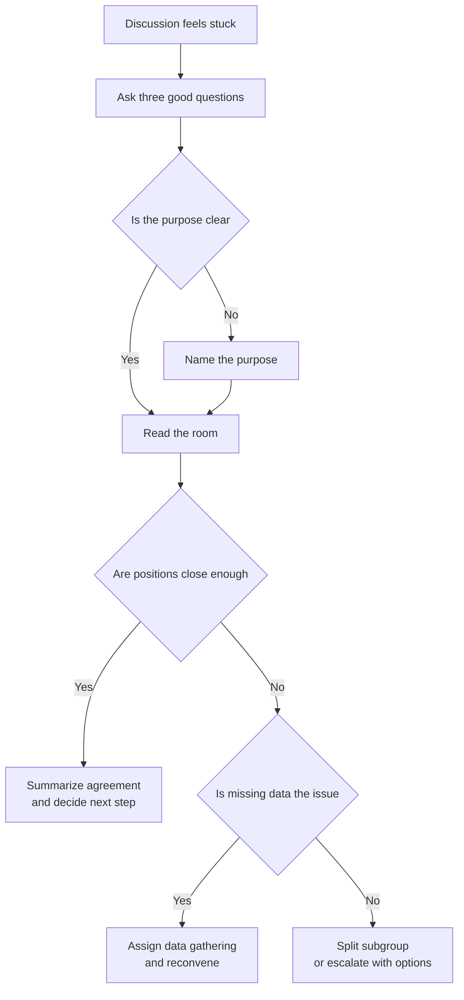

Examples of questions that create movement:

- “What outcome are we optimizing for: latency, operability, cost, or time to learn?”
- “What would make this proposal unacceptable?”
- “Who has to live with this decision after launch?”
- “What evidence would change our minds?”

## 1.4 Handling difficult people without making the meeting about them

Difficult behavior is common in cross-team work: interruption, sarcasm, constant objections, status games, or refusal to decide.
Treat it as a leadership problem, not a personality contest.

The best work happens before the meeting.
If you expect conflict, align with the person beforehand.
Ask what they are worried about.
Give them a chance to shape the agenda.
Look for the legitimate concern under the difficult behavior.
Many “blockers” are protecting a real risk badly.

Also include someone they cannot be a jerk to.
That may be their manager, a respected peer, a product leader, an incident commander, or a customer-facing partner.
The goal is not intimidation.
The goal is to create a room where professional behavior is the easiest behavior.

Use a simple escalation ladder: private curiosity, shared framing, meeting boundary, structured decision, then manager or sponsor alignment.

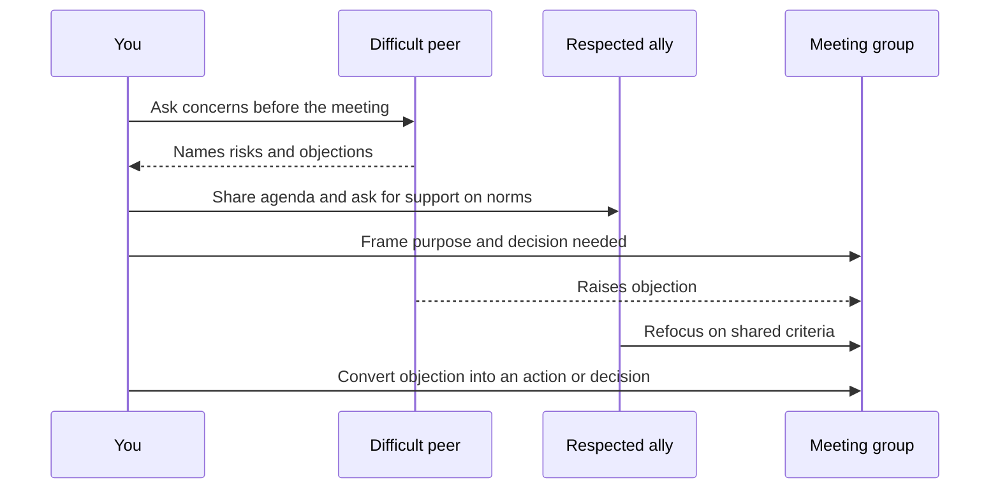

## 1.5 To lead, you have to follow

Staff+ engineers often overestimate how many battles matter.
Influence is finite.
If you spend it on every naming debate, every local implementation preference, and every imperfect proposal, people learn that your involvement means delay.

Ask: “Will this matter to me in six months?”
If not, consider following.
Following is not passivity.
It is an active choice to support someone else’s leadership so the organization moves faster.

Give support quickly to trustworthy leaders.
If a peer has context, credibility, and a reasonable plan, back them.
You can still add feedback, but label it honestly.
Use phrases like:

- “Optional nit: this name may age poorly.”
- “Non-blocking concern: consider an escape hatch for rollout.”
- “I support the direction; this comment should not delay the decision.”
- “I am aligned. If helpful, I can review the migration plan.”

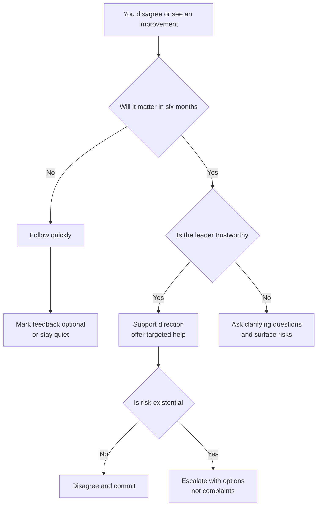

Following creates reciprocal influence.
People you support today are more likely to support your initiatives tomorrow, and they will trust that your objections are meaningful when you do object.

## 1.6 Passive versus active influence

Tanya Reilly’s distinction is useful: passive influence is being a role model; active influence is deliberately shaping the organization.
Both matter.

Passive influence includes how you review code, talk in incidents, admit mistakes, write documents, and handle ambiguity.
People copy the behavior of high-status engineers.
If you think out loud carelessly, others may treat speculation as direction.
If you dismiss a team casually, others may copy that contempt.

Active influence is more deliberate.
It includes building coalitions, writing strategy, aligning managers, pre-meeting stakeholders, creating rituals, and changing decision systems.

| Mode | What it sounds like | When to use it | Risk |
|---|---|---|---|
| Passive influence | “Here is how I approach incidents.” | Norms, craft, judgment, culture | Unintended signals |
| Active influence | “I want us to adopt this migration pattern.” | Direction, alignment, priorities | Overreach or fatigue |

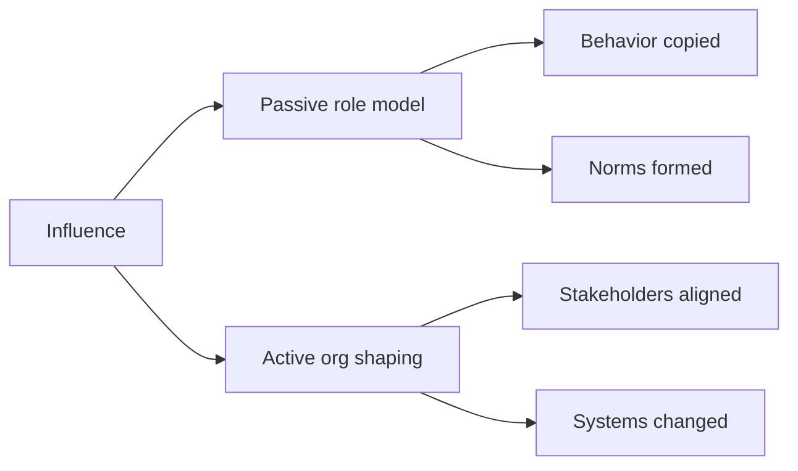

Staff+ engineers combine both.
They are careful about the shadow they cast, and they deliberately intervene where the system needs help.

## 1.7 A practical influence operating model

Before entering an influence-heavy situation, write a one-page plan.
It does not need to be formal.
It should answer:

| Question | Why it matters |
|---|---|
| What decision or behavior needs to change? | Prevents vague “alignment” work |
| Who owns the decision? | Avoids influencing the wrong room |
| Who is impacted? | Reveals hidden stakeholders |
| What does each party care about? | Converts arguments into trade-offs |
| What proof is needed? | Replaces opinion loops with evidence |
| What is my fallback? | Keeps you from escalating emotionally |

## 1.8 Practice drills

- In your next design review, ask three substantive questions before stating your opinion.
- Pick one active initiative and list the real decision-maker, veto holders, and impacted teams.
- Rewrite one blocking code review comment as a non-blocking suggestion.
- Before a contentious meeting, pre-align with the person most likely to object.
- After a meeting, ask a trusted peer: “Did I create space, or did I dominate?”
- Identify one issue you care about but that will not matter in six months; deliberately follow.
- Keep a two-week influence log: goal, stakeholders, move used, result, and lesson.

## 1.9 What "good" looks like at Staff+

- People seek your input early because it improves outcomes rather than slows them down.
- You can name the decision-maker, the real trade-off, and the missing evidence.
- Your objections are rare enough that they carry weight.
- You make others feel smarter and more capable after working with you.
- You support peer leaders visibly and quickly when their direction is sound.
- You can de-escalate conflict without avoiding hard truths.
- Your influence survives when you are not in the room.

## 1.10 Common pitfalls

- Confusing being right with being effective.
- Using executive escalation before doing peer alignment.
- Reframing every discussion until people experience you as churn.
- Treating difficult people as enemies instead of constraints to manage.
- Giving “optional” feedback in a tone that sounds mandatory.
- Being a role model accidentally, especially when frustrated.
- Spending influence on small preferences and lacking it for existential issues.

## 1.11 Further reading

- StaffEng, “Operating at Staff”: https://staffeng.com/guides/operating-at-staff/
- StaffEng, “Learn to never be wrong”: https://staffeng.com/guides/learn-to-never-be-wrong/
- StaffEng, “To lead, you have to follow”: https://staffeng.com/guides/to-lead-follow/
- The Pragmatic Engineer, “The Staff Engineer's Path”: https://newsletter.pragmaticengineer.com/p/the-staff-engineers-path

## 1.12 Check yourself

1. In a cross-team design review, a peer presents a queue-based migration. You see a real risk in the migration ordering and you are fairly sure you are right. What is your *first* move?
   - A. State the ordering flaw up front so the group does not waste time on a plan that will fail
   - B. Ask how they plan to sequence the migration, then ask what would make the plan unacceptable
   - C. Say nothing in the meeting and send the author a detailed written critique of the plan afterwards
   - D. Escalate to the director straight away, because a migration risk is too important to debate

2. A trusted peer with good context leads an API redesign. You would have named two resources differently and you prefer another pagination style, but the plan is sound. How do you respond?
   - A. Raise both points as blocking so the API stays consistent with the standards you care about
   - B. Hold your approval until the naming is settled, since names are hard to change after launch
   - C. Stay out of it completely, because any comment from you would undermine their leadership
   - D. Back the direction publicly and mark both points as optional, non-blocking suggestions

3. You expect a senior engineer from another team to derail Thursday’s decision meeting with repeated objections, as he did last time. What is the best preparation?
   - A. Meet him first to hear his concerns, let him shape the agenda, and invite a peer he respects
   - B. Leave him off the invite and brief him on the outcome once the decision has been made and recorded
   - C. Ask his manager to tell him to be more constructive before Thursday’s meeting takes place
   - D. Prepare a longer deck that pre-empts every single objection he raised in the last meeting

<details markdown="1">
<summary>Answers</summary>

1. **B** — questions surface constraints and lower defensiveness, and the author may find the risk themselves. Ask three good questions before you share your perspective: they reveal constraints and assumptions, and people experience you as trying to understand rather than trying to win.
2. **D** — support a trustworthy leader quickly and label the feedback so it cannot slow the decision. Ask “Will this matter in six months?” If not, follow quickly and mark feedback as optional. Rare objections carry weight; constant ones are noise.
3. **A** — the real work happens before the meeting: find the legitimate concern and make professional behaviour the easy path. Handle difficult behaviour before the meeting: ask what worries them, let them shape the agenda, and include someone they cannot be a jerk to. Many blockers are protecting a real risk badly.

</details>

**Try it in your own system**

- In your next design review, ask three substantive questions before you state any opinion. Note one thing you learned that you would otherwise have missed.
- Pick one live initiative and write a one-page influence plan: the decision or behaviour to change, who owns it, who is impacted, what each party cares about, the proof needed, and your fallback.
- Find a blocking review comment you wrote recently. Rewrite it as a labelled non-blocking suggestion, or delete it if it will not matter in six months.
- Before your next contentious meeting, spend 15 minutes 1:1 with the person most likely to object and ask what outcome they need.
- Keep a two-week influence log (goal, stakeholders, move used, result, lesson). Your best entry is cross-team-influence evidence for your brag doc.

---

# B2 — Communication & Executive Writing

> How do you get a message to land with a busy executive who preprocesses reality their own way?

**TL;DR**
- Executive influence increasingly bounds Staff+ impact because strategy, funding, and priority decisions sit above team boundaries.
- Know why you are communicating: planning, status, or resolving misalignment; the goal is alignment, not victory.
- Lead with the answer, then support it with a small number of ordered arguments.
- Use SCQA to create a crisp opening and the Minto Pyramid to structure the body.
- Pre-align through nemawashi before the meeting; the meeting should confirm, not discover, the path.
- Never bring only a question to executives: bring a recommendation, trade-offs, and a reversible next step.

Related: [skills overview](../02-skills-to-upgrade.md), [promotion playbook](../05-promotion-playbook.md), [self-assessment](../06-self-assessment-and-tracking.md).

*Interactive lesson:* [Lesson 02 · Executive communication](lessons/0002-communication-and-executive-writing.html) · *Cheat sheet:* [Executive communication cheat sheet](reference/0002-communication-and-executive-writing-cheatsheet.html)

## 2.1 Why executive communication becomes a hard limit

At Senior level, your impact can often travel through code, reviews, and team-level decisions.
At Staff+, your impact increasingly depends on whether leaders understand and act on your technical judgment.
Executives decide funding, sequencing, risk appetite, staffing, and cross-org trade-offs.
If your message does not land with them, your best technical work may remain local.

Executives also preprocess reality.
They carry a model of the business, customers, risks, teams, and prior failures.
They hear your message through that model.
Your job is not to defeat their model in a meeting.
Your job is to discover it, update it where necessary, and align your recommendation with the decision they need to make.

| Your default lens | Executive lens |
|---|---|
| Technical correctness | Business consequence |
| Complete context | Decision-relevant context |
| Elegant architecture | Risk, speed, and optionality |
| Local team constraints | Portfolio trade-offs |
| Proof of work | Confidence to act |

A Staff+ communication succeeds when a busy leader can repeat the point, explain the trade-off, and know what action is required.

## 2.2 Know why you are communicating

Before writing or presenting, identify the communication job.
Most executive communication falls into three buckets.

| Communication job | Primary question | Output |
|---|---|---|
| Planning | “What should we do?” | Direction, investment, sequencing |
| Status | “Are we on track?” | Confidence, risks, asks |
| Misalignment | “Why are we stuck?” | Shared model and decision |

If the job is planning, show options and recommend one.
If the job is status, surface reality early, including bad news.
If the job is resolving misalignment, extract their perspective and locate the disagreement.

The goal is not to win.
A winning presentation that leaves the executive unconvinced is a failure.
A successful conversation may change your recommendation because you learned a constraint you did not have.

A useful opening sentence is: “I am asking for a decision on X, with recommendation Y, because Z changed.”
That sentence forces clarity.

## 2.3 SCQA: a reliable executive opening

SCQA stands for Situation, Complication, Question, Answer.
It creates narrative tension without burying the conclusion.
It is especially useful when the audience lacks context or when the problem has evolved.

| Element | Purpose | Prompt |
|---|---|---|
| Situation | Establish shared baseline | “What is true and already accepted?” |
| Complication | Name the change or conflict | “What broke, changed, or became risky?” |
| Question | Frame the decision | “What must we decide or resolve?” |
| Answer | State the recommendation | “What should we do now?” |

Worked example:

- Situation: “We committed to migrate customer exports to the new data platform this half.”
- Complication: “The first two high-volume tenants exceeded our cost assumptions by 4x, and the current design makes cost proportional to retry volume.”
- Question: “Should we continue the migration as planned, or pause to redesign the retry path?”
- Answer: “Pause new tenant onboarding for two weeks, redesign retries behind a feature flag, and keep the existing committed tenants on the current path.”

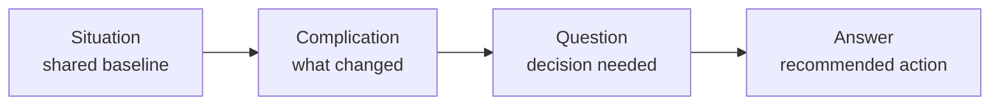

SCQA prevents the common failure mode of beginning with background.
Executives do not need the whole journey first.
They need to know why the conversation matters.

## 2.4 The Minto Pyramid Principle

The Minto Pyramid Principle says to lead with the answer, then group supporting arguments logically.
For executive writing, keep the pyramid small.
Use no more than three top arguments, and no more than three sub-arguments under each.
Order by importance, not chronology.

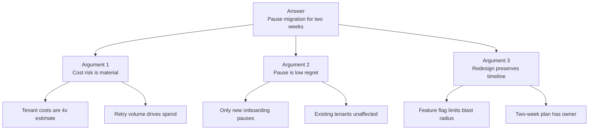

Use pyramid structure for documents, emails, and presentations.
A strong executive memo can be only one page:

1. Answer and ask.
2. Three supporting points.
3. Risks and mitigations.
4. Decision needed and deadline.
5. Appendix for details.

The appendix matters because technical leaders often need evidence.
But the appendix should not be the main path.
If the reader must inspect logs, diagrams, or benchmark tables to understand your recommendation, the main narrative is not doing its job.

## 2.5 Nemawashi: pre-align before the meeting

Nemawashi is the practice of preparing the ground before a formal decision.
In Staff+ work, it means stakeholders should rarely encounter the recommendation for the first time in the meeting where you need commitment.

Send an early draft to an executive who will attend.
Ask: “What would make this clearer or more decision-ready for you?”
That question is powerful because it invites them into improving the message rather than reacting to it publicly.

Pre-alignment should include:

- the decision-maker;
- people who can veto or quietly undermine the plan;
- teams who will carry the operational burden;
- finance, security, legal, or support partners when relevant;
- a trusted peer who can tell you what is confusing.

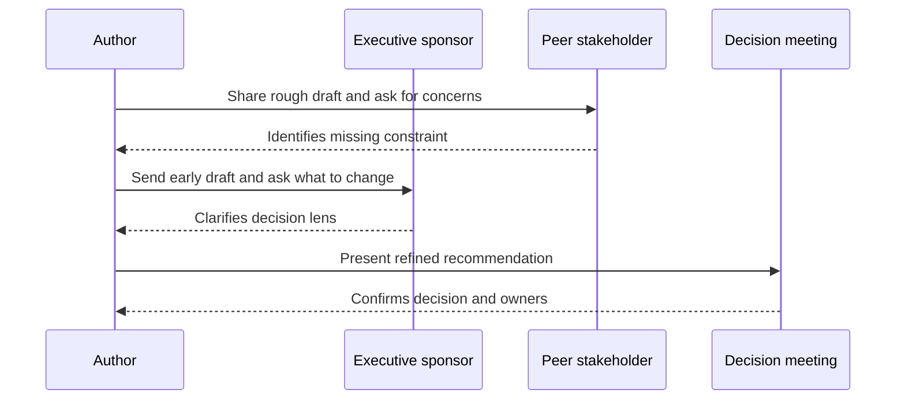

The point is not politics for its own sake.
The point is respect for scarce attention and public decision dynamics.
A meeting is a poor place to discover that your framing conflicts with the executive’s priorities.

## 2.6 Executive communication rules

These rules are simple and hard.

| Rule | What it means in practice |
|---|---|
| Never fight feedback | Treat executive pushback as data about their model, not as an attack |
| Do not evade problems | Informing executives early creates absolution and options |
| Never present a question without an answer | Bring a recommendation, even if tentative |
| Avoid academic presentations | Do not build suspense toward the conclusion |
| No permanent decisions | Prefer reversible next steps and explicit review points |
| Name the ask | Decision, advice, escalation, funding, or awareness |

“Informing executives equals absolution” means that surprises are worse than bad news.
When you surface risk early, leaders can help.
When you hide it until the path is narrow, they inherit the problem without options.

Do not be evasive.
A sentence like “We are green, but there are some concerns” is worse than: “We are yellow because load tests failed at 60 percent of expected peak; we need one week to validate the mitigation.”

## 2.7 Tailor the message to audience and medium

Different audiences need different compression.
The same recommendation may become a Slack note, a one-page memo, a ten-minute verbal update, or a detailed design doc.

| Medium | Best for | Watch out for |
|---|---|---|
| Slack or Teams | Fast awareness, simple asks | Ambiguity and fragmented replies |
| Email | Broadcast alignment and record | Long threads that hide decisions |
| One-page memo | Executive decisions | Overloading with implementation detail |
| Design doc | Durable technical reasoning | Assuming executives will read every section |
| Live meeting | Trade-offs, commitment, conflict | Discovering misalignment too late |

Written async culture is valuable because it forces clearer thinking and gives quieter stakeholders time to engage.
It also creates a record.
But writing is not a substitute for conversation when trust is low, stakes are high, or disagreement is emotional.

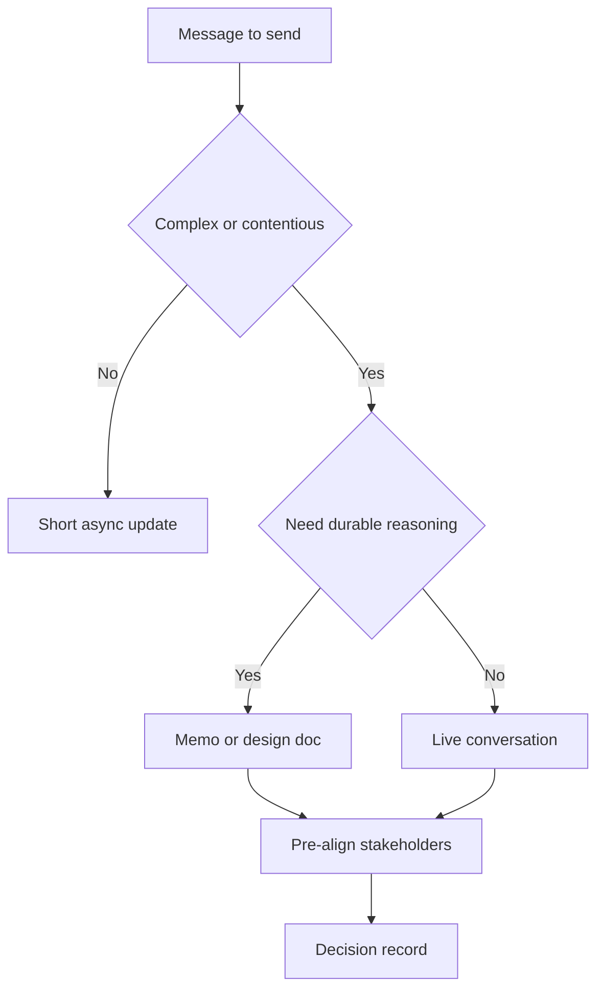

## 2.8 A reusable executive memo template

Use this structure when stakes are high.

| Section | Content |
|---|---|
| Title | Decision or update in one sentence |
| Ask | What you need from the reader |
| Recommendation | The answer first |
| Why now | Situation and complication |
| Evidence | Three strongest reasons |
| Options | Recommended option plus alternatives |
| Risks | Top risks and mitigations |
| Decision record | Owner, date, next checkpoint |
| Appendix | Details for reviewers who need depth |

Before sending, delete anything that proves you worked hard but does not help the reader decide.
Executives do not reward completeness; they reward clarity that improves judgment.

## 2.9 Practice drills

- Rewrite your next status update with the answer in the first sentence.
- Convert a current technical concern into SCQA in four bullets.
- Take a long design doc and create a one-page executive summary.
- Before a meeting, send a draft to one stakeholder and ask what would make it more decision-ready.
- Practice saying: “My recommendation is X; the trade-off is Y; I would revisit if Z happens.”
- Review your last presentation and count how many slides passed before the answer appeared.
- Create a decision record for a recent reversible decision and schedule a review date.

## 2.10 What "good" looks like at Staff+

- Executives can repeat your recommendation and why it matters.
- Your documents begin with the answer, not with a tour of the evidence.
- You surface risks early enough that leaders have options.
- You use meetings to confirm alignment, not to surprise stakeholders.
- You adapt depth and language to the audience without dumbing down the issue.
- Your asks are explicit: decision, funding, escalation, advice, or awareness.
- Your writing creates durable organizational memory.

## 2.11 Common pitfalls

- Treating executive questions as attacks instead of model mismatch.
- Bringing a problem without a recommended path.
- Using academic buildup and revealing the conclusion at the end.
- Hiding bad news in vague green status.
- Sending dense technical documents to people who need decision summaries.
- Confusing pre-alignment with manipulation.
- Presenting “permanent” decisions when a reversible checkpoint would reduce fear.

## 2.12 Further reading

- StaffEng, “Present to executives”: https://staffeng.com/guides/present-to-executives/
- Barbara Minto, “The Pyramid Principle” (book)
- Design Docs at Google: https://www.industrialempathy.com/posts/design-docs-at-google/

## 2.13 Check yourself

1. You have ten minutes with your VP to ask for a two-week pause on a migration, after the first tenants came in at 4x the cost estimate. How do you open?
   - A. Walk through the architecture and cost model first, so the VP can follow the logic to your conclusion
   - B. Show the cost data and ask the VP which of the possible options they would prefer to take
   - C. State the ask and your recommendation first, then the cost surprise that forces the decision now
   - D. Report that the migration is green overall, with some cost concerns to watch over the next month

2. Your recommendation conflicts with a priority the CTO set last quarter. The decision meeting is next Tuesday. What should you do this week?
   - A. Send the CTO an early draft and ask what would make it clearer or more decision-ready for them
   - B. Keep the draft private until Tuesday, so nobody can argue against it before you present it
   - C. Add more benchmark appendices, so the evidence becomes too strong for the CTO to simply dismiss
   - D. Ask your manager to present it instead, so the conflict with the CTO is not attached to you

3. Halfway through your proposal, an executive interrupts: “I don’t buy that this is a reliability risk at all.” What is the best response?
   - A. Re-explain the failure mode in more technical depth until the risk becomes clear to them
   - B. Concede the point quickly and move on, so the meeting stays friendly and on schedule
   - C. Point out that the teams have already agreed, so the decision mostly needs a formal sign-off
   - D. Ask what they are weighing it against, and treat the pushback as data about their model

<details markdown="1">
<summary>Answers</summary>

1. **C** — answer and ask first; the situation and complication justify it, and the detail goes to the appendix. Lead with the answer: “I am asking for a decision on X, with recommendation Y, because Z changed.” Supporting arguments follow in order of importance.
2. **A** — nemawashi. You invite the decision-maker to improve the message instead of reacting to it in public. Pre-align through nemawashi: the decision-maker and likely veto holders should never meet the recommendation for the first time in the meeting where you need commitment.
3. **D** — executive pushback is information about their model; extract their perspective, then align. Never fight feedback. The goal is alignment, not victory, and a good conversation may change your recommendation because you learned a constraint you did not have.

</details>

**Try it in your own system**

- Rewrite your next status update so the first sentence is the answer and the ask. Replace any “green, but…” with a colour, a reason and a date.
- Turn one live technical concern into four SCQA bullets. Send it to a peer and check that they can repeat your recommendation back in one sentence.
- Take a long design doc you own and produce a one-page memo: ask, recommendation, three reasons, risks, decision needed by when. Everything else goes in the appendix.
- Before your next decision meeting, send a draft to one attending leader and ask: “What would make this clearer or more decision-ready for you?”
- Count how many slides of your last presentation passed before the answer appeared, then rebuild it with the answer on slide one.

---

# B3 — Technical & Project Leadership

> How do you drive a big, ambiguous, multi-team initiative to a good outcome?

**TL;DR**
- Technical direction is part-time product management for technology: serve the organization’s real needs, not your favorite tools.
- Big projects require scoping ambiguity, breaking work down, and repeatedly talking to people who see the world differently.
- Aggressive delegation means giving hard, growth-producing work to others with enough scaffolding to succeed.
- Cross-team alignment depends on the shadow org chart as much as the formal one.
- Technical quality must be managed as a program, starting with the cheapest useful tool and escalating only when needed.
- Run projects with explicit kickoff, status, risks, unblocking, and landing rituals.

Related: [skills overview](../02-skills-to-upgrade.md), [promotion playbook](../05-promotion-playbook.md), [self-assessment](../06-self-assessment-and-tracking.md).

*Interactive lesson:* [Lesson 03 · Technical & project leadership](lessons/0003-technical-and-project-leadership.html) · *Cheat sheet:* [Project leadership cheat sheet](reference/0003-technical-and-project-leadership-cheatsheet.html)

## 3.1 Technical direction is product management for technology

A Staff+ engineer setting technical direction is acting as a part-time product manager for the technology organization.
The “product” is not a feature.
It is the engineering system: platforms, architecture, reliability, developer experience, security posture, cost profile, and delivery capability.

That means the work begins with customer discovery.
Your customers are product teams, operators, executives, compliance partners, support teams, and future engineers.
The question is not “What architecture do I like?”
The question is “What does the organization need the technology system to make easier, safer, cheaper, or faster?”

| Product management question | Technical leadership version |
|---|---|
| Who is the customer? | Which teams and users are constrained by this system? |
| What problem matters now? | What technical limitation blocks strategy or safety? |
| What is the smallest valuable slice? | What migration or platform step changes behavior soon? |
| How will we measure success? | What operational, delivery, or quality metric moves? |
| What trade-off are we making? | What do we defer to create leverage now? |

The trap is technology-centered leadership: starting with a favored framework, platform, or pattern and searching for a problem.
Staff+ leaders invert that.
They start with strategy, constraints, and user pain, then choose technology as a means.

## 3.2 Leading big projects: scoping the ambiguous

Big projects begin blurry.
The first job is not to write the perfect plan.
It is to turn ambiguity into bounded uncertainty.
You identify what is known, what is unknown, what must be decided, and what can safely wait.

The traits that matter are not glamour traits.
They are perseverance, courage, and a willingness to talk to other people.
Perseverance keeps the project alive after the first plan breaks.
Courage surfaces bad news and makes hard trade-offs visible.
Talking to people reveals hidden constraints before they explode.

A useful project scoping checklist:

- What outcome are we trying to create?
- Why now?
- Which teams must change behavior?
- What are the top three risks?
- What decisions are reversible?
- What dependency could silently block us?
- What is the first valuable slice?
- What would make us stop?

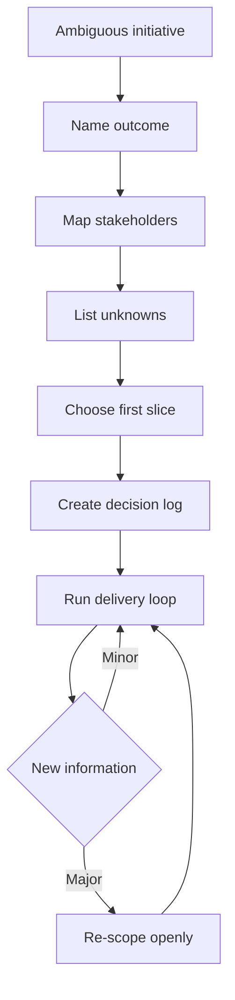

Do not confuse a detailed plan with control.
A plan is a communication tool and a learning hypothesis.
The real leadership skill is adjusting the plan without losing trust.

## 3.3 Aggressive delegation and creating space

At Senior level, you may be essential to the hardest work.
At Staff+, being essential to everything becomes a bottleneck.
You have to move from essential to adjacent.
Adjacent means close enough to guide, unblock, and protect quality, but not so central that work waits for you.

Aggressive delegation is not dumping work.
It means deliberately giving hard pieces to people who can grow from them, with scaffolding.
The goal is to create more leaders, not merely to reduce your calendar load.

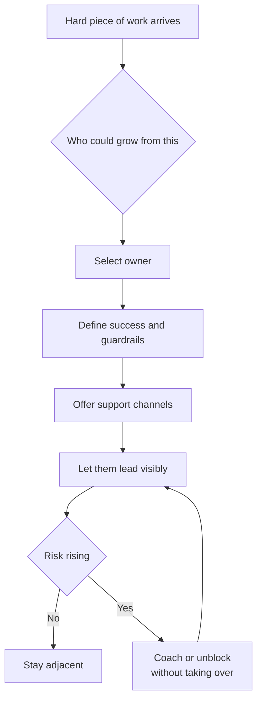

Delegation should include:

| Element | Example |
|---|---|
| Outcome | “Reduce export failure rate below 0.5 percent.” |
| Authority | “You own the design review and final recommendation.” |
| Guardrails | “Do not change customer-facing APIs without product sign-off.” |
| Support | “I will review drafts and join escalation meetings if needed.” |
| Visibility | “You present the update in the platform sync.” |

When the work becomes theirs, let it be theirs.
Do not re-center yourself at the moment of success.
That is how you create space and build future Staff engineers.

## 3.4 Cross-team alignment and the shadow org chart

The formal org chart tells you reporting lines.
The shadow org chart tells you how work actually moves.
It includes trusted reviewers, incident veterans, product whisperers, informal architects, managers with veto power, and people whose silence signals risk.

Cross-team alignment requires both maps.
If you only follow the formal chart, you may miss the person everyone waits for before committing.
If you only follow the shadow chart, you may bypass accountable leaders and create resentment.

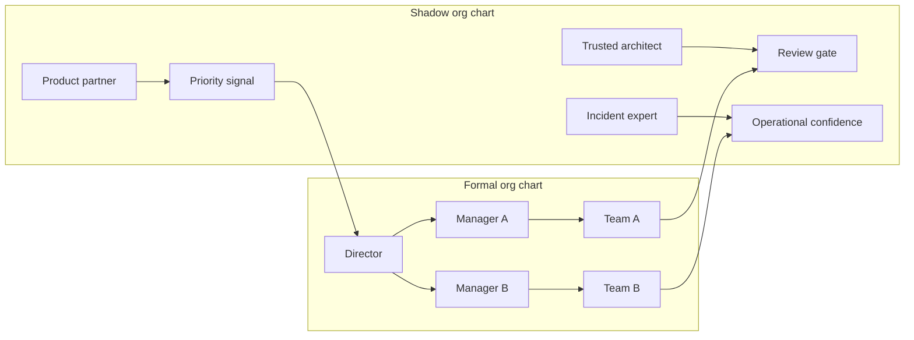

To navigate alignment:

1. Identify the accountable decision-maker.
2. Identify veto holders and high-trust influencers.
3. Meet teams in their context before asking for commitment.
4. Write down decisions and assumptions.
5. Make trade-offs explicit and visible.
6. Keep managers informed without turning every issue into escalation.

## 3.5 Managing technical quality as a program

Technical quality is not one cleanup epic.
It is a management system.
Start with the cheapest useful tool and escalate only when the cheaper tool is insufficient.

The escalating toolkit:

1. Hot spots: identify the places where defects, toil, incidents, or slow delivery cluster.
2. Best practices: publish simple guidance that prevents repeated mistakes.
3. Leverage points: improve the shared system that many teams touch.
4. Technical vectors: name directional bets, such as “move writes behind durable queues.”
5. Measurement: track signals that reveal whether quality is improving.
6. Technical-quality team: dedicate people when coordination cost is too high.
7. Quality program: create funding, governance, and portfolio-level accountability.

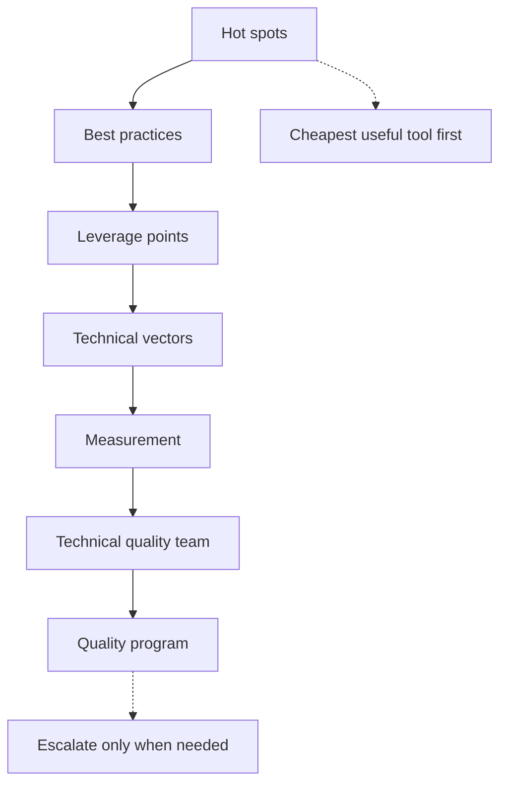

Quality programs fail when they are framed as morality.
“Good engineers write good code” does not move organizations.
Better framing is consequence-based: incidents, cycle time, customer trust, onboarding speed, compliance risk, cloud cost, or delivery predictability.

A quality metric should be actionable.
If no team can change behavior in response to it, it is a dashboard decoration.

## 3.6 Running the project day to day

A large initiative needs operating rituals.
The goal is not ceremony.
The goal is to keep reality visible and reduce coordination drag.

| Ritual | Purpose | Output |
|---|---|---|
| Kickoff | Align on why, scope, roles, and risks | Charter and owners |
| Weekly status | Make progress and risk visible | Written update |
| Risk review | Prevent surprises | Risk register and mitigations |
| Decision review | Resolve trade-offs | Decision log |
| Dependency sync | Unblock teams | Named asks and due dates |
| Landing review | Confirm adoption and cleanup | Rollout and closeout plan |

A good status update includes:

- overall color with reason;
- progress since last update;
- risks and decisions needed;
- asks by owner and date;
- next milestone;
- confidence level.

The project is not done when code merges.
It is done when the intended behavior changes, the system is operating safely, owners know what remains, and the organization has learned something durable.

## 3.7 Practice drills

- Take one ambiguous initiative and write a one-page charter: outcome, scope, owners, risks, first slice.
- Map the formal and shadow org chart for a current cross-team project.
- Identify one hard project piece you are currently holding and delegate it with guardrails.
- Create a risk register with probability, impact, owner, mitigation, and review date.
- Rewrite a technical quality argument in terms of customer, operational, or delivery consequences.
- Start a decision log for a project and record the first three decisions.
- Ask one adopting team what would make the initiative easier to consume.

## 3.8 What "good" looks like at Staff+

- You connect technical direction to business and organizational needs.
- You break ambiguous work into slices that create learning and value.
- You make other engineers visible leaders of meaningful pieces.
- Teams understand the trade-offs even when they disagree.
- Risks are surfaced early, owned clearly, and revisited regularly.
- Technical quality work is prioritized by consequence and leverage.
- The initiative lands as changed behavior, not just merged code.

## 3.9 Common pitfalls

- Starting with preferred technology instead of organizational need.
- Becoming the bottleneck because every hard decision routes through you.
- Delegating only easy work and keeping all growth opportunities.
- Ignoring informal influencers until they become blockers.
- Treating quality as a cleanup crusade rather than a managed program.
- Reporting green until a project is suddenly red.
- Declaring victory at launch while adoption, operations, and cleanup remain unfinished.

## 3.10 Further reading

- StaffEng, “What do Staff engineers actually do?”: https://staffeng.com/guides/what-do-staff-engineers-actually-do/
- StaffEng, “Manage technical quality”: https://staffeng.com/guides/manage-technical-quality/
- StaffEng, “Create space for others”: https://staffeng.com/guides/create-space-for-others/
- The Pragmatic Engineer, “The Staff Engineer's Path”: https://newsletter.pragmaticengineer.com/p/the-staff-engineers-path

## 3.11 Check yourself

1. You are asked to lead a vague initiative: “fix our deployment pain” across six teams. What is your first deliverable?
   - A. A one-page charter naming the outcome, why now, owners, top risks and the first valuable slice
   - B. A detailed twelve-month plan so that every team can see its exact tasks and deadlines up front
   - C. A reference architecture for the new deployment platform that you believe the teams really need
   - D. A survey of every team’s tooling preferences, before deciding whether the initiative should start

2. You own the hardest piece of a cross-team migration, the dual-write cutover design. A strong Senior engineer on another team wants to grow. What is the Staff move?
   - A. Keep the cutover yourself because it carries the most risk, and give them the runbook updates
   - B. Hand them the cutover and step away entirely, so they get full ownership and plenty of room to grow
   - C. Give them the cutover with an outcome, guardrails and review support, and let them present it
   - D. Co-own the cutover with them, and present the final design together at the platform sync

3. Two teams approved your migration plan in the formal review, but nothing has moved for three weeks. Engineers say they are “waiting for Priya to look at it”. Priya is on neither team. What is going on?
   - A. The teams are under-resourced, so ask their director to reprioritise both roadmaps this quarter
   - B. Priya is an informal review gate in the shadow org chart; meet her and fold in her concerns
   - C. The plan lacks detail, so write a more thorough design doc and circulate it to both teams again
   - D. Priya has no formal authority here, so remind the teams that the decision was already made

<details markdown="1">
<summary>Answers</summary>

1. **A** — the first job is to turn ambiguity into bounded uncertainty, not to write the perfect plan. Scope the ambiguous: name the outcome, map stakeholders, list unknowns, choose a first slice and start a decision log. Then re-scope openly when major new information arrives.
2. **C** — hard work, scaffolded: outcome, authority, guardrails, support and visibility, while you stay adjacent. Move from essential to adjacent: give hard, growth-producing work with outcome, authority, guardrails, support and visibility, then coach or unblock without taking over.
3. **B** — the shadow org chart shows how work really moves; engage the trusted reviewer, keep managers informed. Cross-team alignment needs both maps. The formal org chart gives accountable decision-makers; the shadow org chart gives trusted reviewers, veto holders and people whose silence signals risk.

</details>

**Try it in your own system**

- Write a one-page charter for the most ambiguous initiative you touch: outcome, why now, teams that must change behaviour, top three risks, first slice, and what would make you stop.
- Map the formal and the shadow org chart for one cross-team project, and mark the person everyone waits for before committing.
- Pick one hard piece of work you are holding and delegate it this week using the outcome, authority, guardrails, support and visibility checklist.
- Rewrite one technical-quality argument in terms of consequences (incidents, cycle time, cost, onboarding), and decide which rung of the quality toolkit it really needs.
- Start a decision log and a risk register (probability, impact, owner, mitigation, review date), and send one written status with colour, reason, asks and confidence.

---

# B4 — Mentorship & Sponsorship

> How do you multiply your impact by growing the people around you?

**TL;DR**
- Staff+ impact compounds when you grow engineers whose future decisions no longer require you.
- Pair a little mentorship with considerably more sponsorship: advice helps, opportunity changes trajectories.
- Mentorship is guidance; sponsorship is spending your credibility to create access, visibility, and promotion evidence.
- Women and non-binary engineers are often over-mentored but under-sponsored, so opportunity allocation must be deliberate.
- Create space by asking “who could grow from this?” and then scaffolding success without taking credit back.
- Your role-model behavior is passive influence; people copy how high-status engineers act under pressure.

Related: [skills overview](../02-skills-to-upgrade.md), [promotion playbook](../05-promotion-playbook.md), [self-assessment](../06-self-assessment-and-tracking.md).

*Interactive lesson:* [Lesson 04 · Mentorship & sponsorship](lessons/0004-mentorship-and-sponsorship.html) · *Cheat sheet:* [Sponsorship cheat sheet](reference/0004-mentorship-and-sponsorship-cheatsheet.html)

## 4.1 The force-multiplier frame

Heroics create local wins.
Growing people changes the slope of the organization.
A Staff+ engineer who solves every hard problem personally may be admired, but a Staff+ engineer who creates five engineers capable of solving harder problems has changed the system.

Mentorship and sponsorship are force multipliers because they create future judgment, confidence, visibility, and opportunity.
They also reduce dependency on you.
That is not a loss of status.
It is evidence that your leadership scales.

The most effective pattern is a little mentorship and considerably more sponsorship.
Advice is useful, but access is often the bottleneck.
Many capable engineers do not need another private conversation about growth.
They need someone with credibility to say their name in the room where opportunities are assigned.

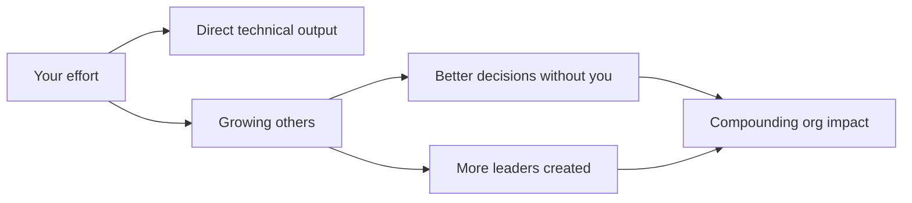

This is especially important for Staff and Principal promotion.
Promotion committees look for scope beyond personal execution.
Sponsoring others creates visible evidence that your impact travels through people and systems.

## 4.2 Mentorship versus sponsorship

Mentorship and sponsorship are related but different.
Confusing them leads to good intentions with weak outcomes.

| Dimension | Mentorship | Sponsorship |
|---|---|---|
| Core action | Give advice and feedback | Spend capital to create opportunity |
| Typical setting | Private conversation | Public or decision-making room |
| Currency | Time, experience, perspective | Credibility, trust, reputation |
| Output | Better understanding and skills | Stretch work, visibility, promotion evidence |
| Risk to you | Low | Meaningful, because your judgment is attached |
| Risk to them | Dependence if overdone | Exposure without support if careless |
| Example | “Here is how to structure the design doc.” | “Priya should lead this design; I will back her and review drafts.” |

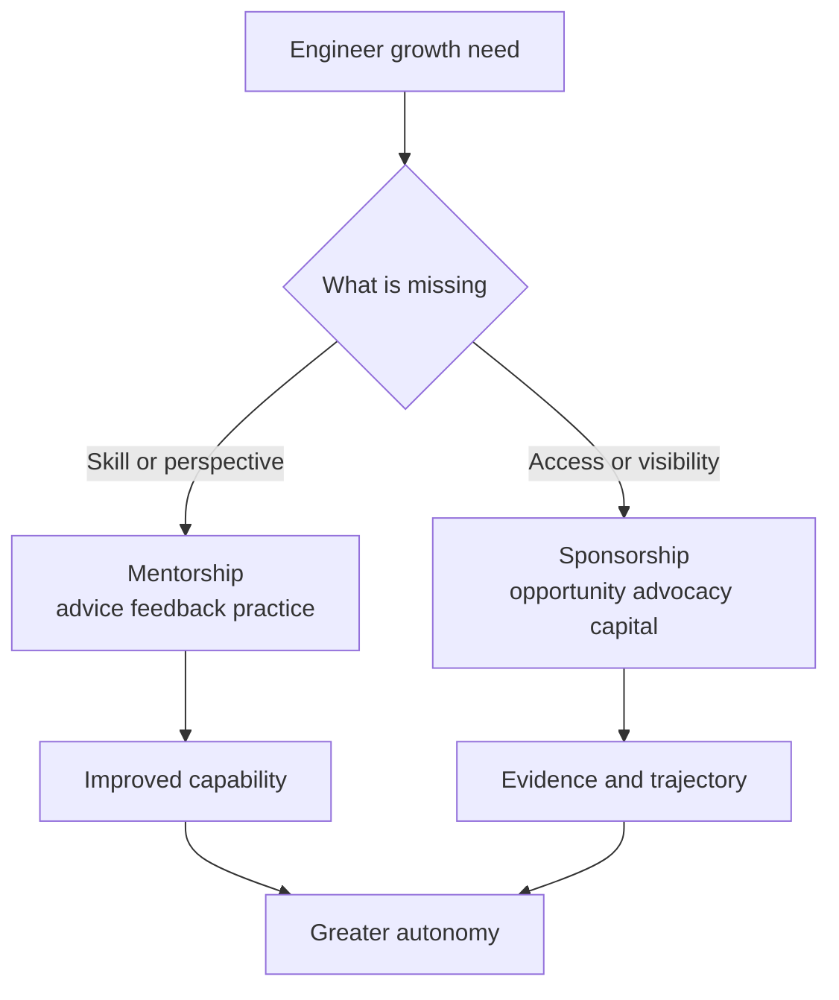

Mentorship says, “I will help you get ready.”
Sponsorship says, “I believe you are ready enough, and I will help the organization see it.”
Both are valuable.
At Staff+, the underused lever is usually sponsorship.

## 4.3 The under-sponsorship problem

Research and lived experience show a repeated pattern: women and non-binary engineers are often over-mentored but under-sponsored.
They receive advice, coaching, and feedback, but fewer visible stretch opportunities and fewer senior advocates in decision rooms.

That pattern matters because promotions are not based only on potential.
They are based on evidence.
Evidence comes from opportunities: leading a project, presenting a decision, handling an incident, influencing a roadmap, mentoring others, or representing the team externally.
If opportunity distribution is uneven, promotion outcomes will be uneven even when talent is not.

A Staff+ engineer should ask:

- Who gets the visible work?
- Who gets “safe” advice but not risky opportunity?
- Whose work is repeated by someone else in higher-status rooms?
- Who is trusted privately but not named publicly?
- Who would benefit from sponsorship but is not in my usual network?

This is not charity.
It is talent stewardship.
Organizations waste capability when they fail to connect capable people to consequential work.

## 4.4 Concrete sponsorship actions menu

Anyone can be a sponsor.
You do not need to be a manager.
You need enough credibility, context, and willingness to spend some of your capital.

Use this menu weekly:

| Sponsorship action | Example |
|---|---|
| Suggest someone to lead a project | “Nadia has the right context to lead the migration workstream.” |
| Suggest someone to facilitate a postmortem | “Mateo handled the incident well; he should facilitate the follow-up.” |
| Suggest someone to give a talk | “This would be stronger if Chen presented the architecture story.” |
| Forward their work | Send a concise note to a broader audience with the author credited |
| Raise their name in decision rooms | “Before we assign this, has Sam been considered?” |
| Share their work in Slack | Link to the artifact and explain why it matters |
| Ask their manager about praise | “Would it be useful if I shared feedback on Aisha’s design leadership?” |
| Create a stretch role | “Can Jordan own the rollout plan while I advise?” |
| Protect ownership | Redirect credit back to the person doing the work |

The best sponsorship is specific.
Do not say “She is great.”
Say “She aligned three teams on the rollout plan, identified the data-loss risk, and changed the migration sequence to avoid customer impact.”

## 4.5 Create space for others

When meaningful work lands near you, ask: “Who could grow from this?”
That question changes your default from ownership to stewardship.

Creating space has three parts.
First, identify the growth opportunity.
Second, scaffold success.
Third, when it becomes theirs, let it be theirs.

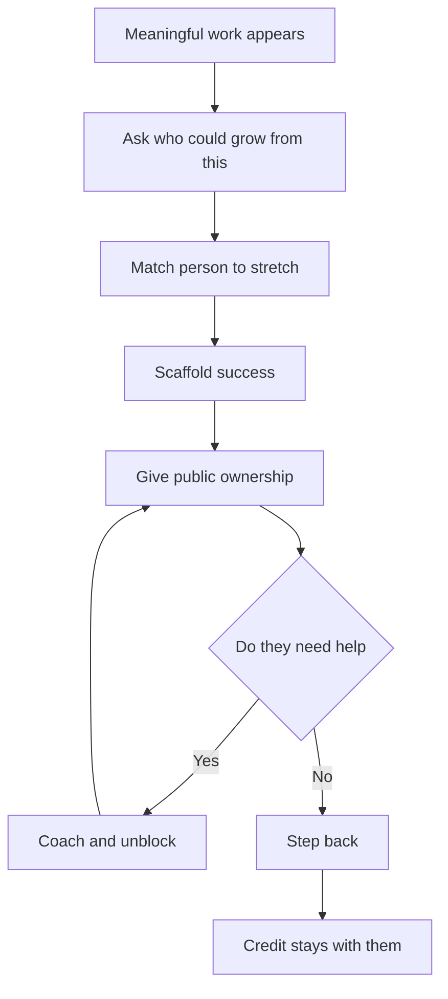

Scaffolding may include reviewing drafts, rehearsing presentations, naming risks, joining the first stakeholder meeting, or helping frame the decision.
Scaffolding is not taking over.
If your support makes the work look like yours, the sponsorship has failed.

Keep a sponsorship journal.
Track names, opportunities, actions taken, feedback sent, and follow-up dates.
This prevents sponsorship from being limited to people who are top of mind.
It also gives you material for calibration, promotion packets, and manager conversations.

## 4.6 Mentorship done well

Mentorship still matters.
The goal is growing autonomy, not dependence.
A good mentoring relationship has a purpose, cadence, and exit condition.

| Mentoring element | Good practice |
|---|---|
| Goal | “Improve design leadership for cross-team projects.” |
| Cadence | Regular but time-bounded, such as six sessions |
| Preparation | Mentee brings agenda and artifacts |
| Feedback | Specific, behavioral, and tied to outcomes |
| Practice | Mentee applies advice between sessions |
| Autonomy | Mentor asks more questions over time |
| Exit | Relationship changes when goal is met |

Mentoring questions that build autonomy:

- “What options have you considered?”
- “What trade-off are you most worried about?”
- “Who needs to be aligned before this meeting?”
- “What would a Staff engineer do next?”
- “What support do you want from me, and what should remain yours?”

A dependency smell: the mentee waits for your approval before every move.
A growth smell: the mentee starts predicting your questions and answering them independently.

## 4.7 Being a role model as passive influence

High-status engineers are copied.
How you behave is how others behave.
If you interrupt, dismiss, catastrophize, or speculate carelessly, those behaviors become more acceptable.
If you ask clear questions, admit uncertainty, give credit, and stay calm under pressure, those behaviors spread too.

Be careful thinking out loud.
A Principal engineer saying “This service is a mess” may intend a casual observation.
A team may hear “Leadership has judged our work and the migration is doomed.”
Your words carry more organizational weight than you feel.

Role-model behaviors to practice:

- crediting people by name;
- separating critique of work from critique of people;
- admitting when new evidence changed your mind;
- asking quieter engineers for input without putting them on the spot;
- staying factual in incidents;
- making uncertainty explicit.

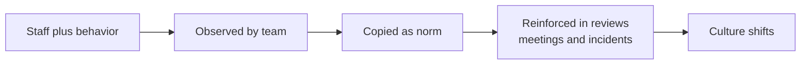

Passive influence is not enough on its own, but it sets the floor.
Active sponsorship built on poor role-model behavior will feel inconsistent and unsafe.

## 4.8 Practice drills

- Make a list of five engineers and one growth opportunity each could own.
- In the next planning cycle, suggest someone else for a visible leadership role.
- Forward one person’s work to a broader audience with specific praise and context.
- Ask a manager whether a piece of positive feedback would help an engineer’s growth record.
- Start a sponsorship journal with columns for person, opportunity, action, evidence, and follow-up.
- Convert one mentoring conversation from advice-giving to question-led coaching.
- After a win, publicly redirect credit to the person who owned the work.
- Audit your last month of sponsorship: who did you name, and who did you overlook?

## 4.9 What "good" looks like at Staff+

- People around you take on larger, more ambiguous work over time.
- You create visible opportunities, not just private advice.
- Your sponsorship produces concrete promotion evidence for others.
- You notice uneven opportunity distribution and correct it deliberately.
- You scaffold stretch work without taking ownership back.
- Managers trust your feedback because it is specific and grounded in impact.
- Your behavior under pressure becomes a positive norm others copy.

## 4.10 Common pitfalls

- Mentoring endlessly while never spending political capital.
- Sponsoring only people who already resemble you or are already visible.
- Giving someone a stretch role without support, then calling it empowerment.
- Taking back the microphone when the work succeeds.
- Providing vague praise that cannot be used in promotion evidence.
- Creating dependence through advice instead of autonomy through coaching.
- Forgetting that your casual comments are amplified by your role.

## 4.11 Further reading

- Lara Hogan, “What does sponsorship look like?”: https://larahogan.me/blog/what-sponsorship-looks-like/
- StaffEng, “Create space for others”: https://staffeng.com/guides/create-space-for-others/
- StaffEng, “What do Staff engineers actually do?”: https://staffeng.com/guides/what-do-staff-engineers-actually-do/
- Harvard Business Review, “Women Are Over-Mentored (but Under-Sponsored)”: https://hbr.org/2010/08/women-are-over-mentored-but-un

## 4.12 Check yourself

1. Aisha, a mid-level engineer, has had monthly mentoring sessions with you for a year. She is ready for Senior, but her packet lacks cross-team evidence. What helps her most now?
   - A. Move the sessions to weekly and focus them on her cross-team communication skills
   - B. Recommend books and talks on technical leadership to study between your sessions
   - C. Write her a strong peer review at the end of the cycle, describing her potential
   - D. Propose her to lead the next cross-team workstream, and back her with draft reviews

2. You want to praise an engineer who led a tricky rollout. Which message gives her the most usable promotion evidence?
   - A. “Mei is a rock star. The rollout went great thanks to her, so a huge round of kudos to Mei!”
   - B. “Mei aligned three teams on the rollout plan and changed the sequence to avoid data loss.”
   - C. “Thanks to the whole team for the rollout, and a special mention to all who stayed late.”
   - D. “The rollout shipped on time. I coordinated the plan and Mei helped with the execution.”

3. You delegated a migration design to a Senior engineer. The director review is tomorrow. Her draft is good, but you think it is 20% weaker than what you would write. What do you do?
   - A. Rewrite the weaker sections tonight, so the director sees the strongest possible design
   - B. Present the design yourself, and credit her on the closing slide for her contributions
   - C. Give her two targeted comments, rehearse with her, and let her present and own the design
   - D. Ask the director to postpone the review until the design is much closer to your own standard

<details markdown="1">
<summary>Answers</summary>

1. **D** — sponsorship: you spend credibility to create the opportunity, then scaffold her success. Mentorship builds capability; sponsorship creates access and evidence. Pair a little mentorship with considerably more sponsorship.
2. **B** — it names behaviours and outcomes a manager can reuse in a promotion case. The best sponsorship is specific. Do not say “she is great”; say what she did and what changed because of it.
3. **C** — scaffold success without taking over; when it becomes hers, let it be hers. Create space for others: ask who could grow from this, scaffold their success (reviews, rehearsal, risk framing), and keep both ownership and credit with them.

</details>

**Try it in your own system**

- List five engineers around you and one concrete growth opportunity each of them could own next quarter.
- In your next planning or staffing conversation, say someone else’s name for a visible role: “Before we assign this, has Sam been considered?”
- Forward one person’s work to a wider audience with specific praise: what they did, the outcome, and why it mattered.
- Start a sponsorship journal (person, opportunity, action, evidence, follow-up) and audit last month: who did you name, and who did you overlook?
- Turn your next mentoring session into question-led coaching: ask “What options have you considered?” before you offer any advice.

---

# B5 — Stakeholder Management, Trust & Political Capital

> How do you build and spend the trust that gives you borrowed authority?

**TL;DR**
- Staff+ authority is usually proxied from a sponsor, most often your manager; stay aligned or your influence decays.
- Never surprise your manager, and do not let your sponsor surprise you; information flow is part of the job.
- Political capital is a bank account: deposits are reliability, context, generosity, and judgment; withdrawals are asks, escalations, and decisions.
- Build peer networks before you need them; the higher you go, the lonelier and more cross-functional the work becomes.
- Represent engineering in the room, not only your own opinion, and keep disagreeing compatible with alignment.

Back to the main map: [Skills to upgrade](../02-skills-to-upgrade.md). Related leadership chapters: [B1 influence](#b1--influence-without-authority), [B2 communication](#b2--communication--executive-writing), [B3 technical leadership](#b3--technical--project-leadership), [B4 mentorship](#b4--mentorship--sponsorship), [B6 glue work](#b6--glue-work--made-visible), [B7 decisions](#b7--decision-making--disagreeing-productively), [B8 prioritization](#b8--prioritization-at-scale--work-on-what-matters). Use this with the [promotion playbook](../05-promotion-playbook.md) and [self-assessment tracker](../06-self-assessment-and-tracking.md).

*Interactive lesson:* [Lesson 05 · Stakeholders & trust](lessons/0005-stakeholder-management-and-trust.html) · *Cheat sheet:* [Stakeholders & trust cheat sheet](reference/0005-stakeholder-management-and-trust-cheatsheet.html)

## 5.1 Borrowed authority: the Staff+ operating model

A Senior engineer can often lead from ownership: they own a service, a project, or a technical area.
A Staff+ engineer often leads across ownership boundaries.
That means your authority is not command authority.
It is borrowed, delegated, and continually renewed.

Rick Boone's analogy is useful: a Staff engineer can operate like the Hand of the King.
You may speak with influence because a sponsor has delegated trust to you.
But you still serve at the pleasure of that sponsor.
If your manager or executive sponsor cannot predict your moves, defend your judgment, or explain your work, your authority collapses.

Borrowed authority has four practical implications:

| Implication | What it means in practice |
|---|---|
| Alignment precedes autonomy | You earn freedom by showing your sponsor how you think. |
| Sponsorship is conditional | Your sponsor must believe your judgment helps their goals. |
| Surprises are expensive | A surprise makes your sponsor look uninformed or exposed. |
| You represent more than yourself | In cross-functional rooms, people may hear you as engineering. |

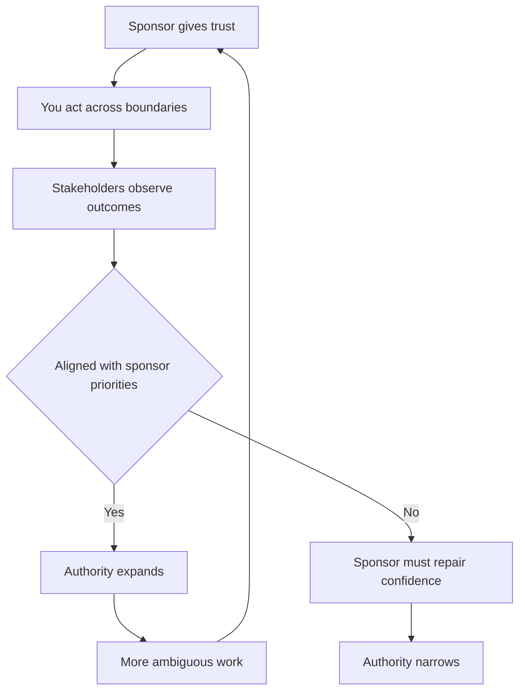

Borrowed authority is not fake authority.
It is how complex organizations scale judgment.
The trap is forgetting that the authority is proxied.
Your sponsor does not need to approve every action, but they do need to understand your direction, risks, and trade-offs.

## 5.2 Never surprise your manager

"Never surprise your manager" is not about obedience.
It is about resilience.
A manager can help you only if they know what is happening early enough to act.
A sponsor can defend your work only if they are not learning the situation from someone else.

Treat each surprise as an incident.
Ask what signal was missed, what reporting path failed, and what update cadence would have prevented it.
Common surprises include:

- A stakeholder is angry about a decision you thought was settled.
- A delivery date moved and your manager hears from Product first.
- You escalated in a meeting without warning your sponsor.
- A technical risk became urgent after weeks of private concern.
- A cross-team dependency slipped because no one owned the interface.

A good weekly update is short, regular, and decision-oriented:

| Section | Example content |
|---|---|
| Outcomes | "Search migration completed phase one; p95 latency down 18%." |
| Risks | "Data backfill confidence is lower than expected; mitigation by Friday." |
| Decisions needed | "Need sponsor call on whether to delay launch or reduce scope." |
| Stakeholder temperature | "Product aligned, Support concerned, Security needs pre-read." |
| Next moves | "Running alignment meeting Wednesday; will send options doc Tuesday." |

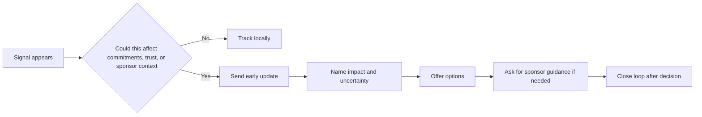

Do not wait until you have a complete answer.
Staff+ updates are valuable precisely when the situation is ambiguous.
A useful message says: "Here is what I know, what I do not know, what I am doing next, and when I will update you."

## 5.3 Do not let your sponsor surprise you

The reciprocal rule is just as important: do not let your sponsor surprise you.
If you only push information upward, you still might be steering against hidden priorities.
Managing up means learning the terrain your sponsor sees before you feel it.

Ask regularly:

- What are your top three priorities this quarter?
- What promises have you made upward that my work affects?
- Which stakeholders are most sensitive to this area?
- What risks would make you intervene?
- What would make this work obviously successful in your forum?

This is not flattery.
It is systems thinking applied to authority.
Your manager is also operating inside constraints: headcount, executive narratives, budget, reorgs, customer commitments, and political promises.
When you understand those constraints, you can make decisions that survive contact with the organization.

A simple managing-up rhythm:

1. Send a weekly written update.
2. Keep a running list of decisions and assumptions.
3. Ask what changed in leadership context.
4. Preview escalations before they happen.
5. After important meetings, send the interpretation you are acting on.

## 5.4 Political capital as a bank account

Tanya Reilly describes social or political capital like a bank account.
You pay in by being reliable, generous, truthful, and useful.
You spend it when you ask people to take risks, change plans, accept trade-offs, or trust your judgment over their local preference.

Deposits and withdrawals are not moral labels.
They are a way to reason about trust dynamics.
If you make repeated withdrawals without deposits, people experience you as expensive.
If you only deposit and never spend, you may become liked but ineffective.

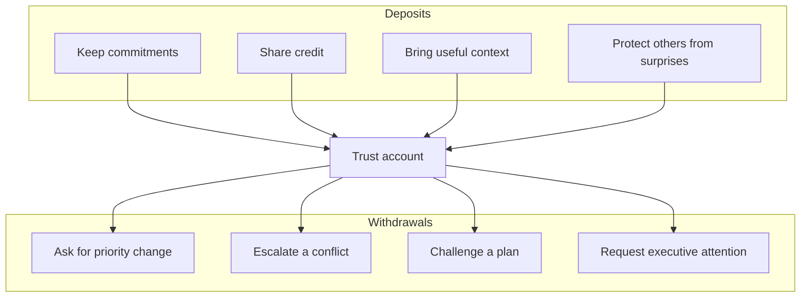

The bank account metaphor helps you decide when to act.
Before a hard ask, ask:

- Have I shown that I understand their goals?
- Have I helped them before asking them to help me?
- Have I made the trade-off explicit rather than personal?
- Have I given them time to react privately before a public forum?
- Am I spending capital on something that truly matters?

Political capital is not manipulation.
Manipulation hides intent.
Healthy political capital makes intent legible and uses trust to move the organization toward better outcomes.

## 5.5 Build a peer network before you need it

The most consistent advice from Staff+ engineers is to build a network of peers.
The work gets lonelier as scope increases because fewer people share your exact context.
You need peers who can sanity-check your read of the room, introduce you to the right owner, and tell you when you are over-rotating.

Useful peer networks include:

| Network | Purpose |
|---|---|
| Staff+ peers in your company | Understand internal politics and precedent. |
| Product and Design leads | Shape product trade-offs before plans harden. |
| Operations, Support, Security, Legal | See risks engineering often misses. |
| External communities | Normalize challenges and learn patterns. |

The Rands Leadership Slack is an example of an external community where engineering leaders exchange practical advice.
External networks are not substitutes for internal trust, but they reduce isolation and broaden your pattern library.

Invest when nothing is on fire: ask what peers are worried about, review outside your team, share postmortem lessons, and keep a lightweight map of ownership and influence.

## 5.6 Managing up: help your boss succeed

Managing up means making your manager more effective: know how they are measured, which executives they influence, what risks they carry, and what evidence helps them advocate for engineering. Bring options instead of raw problems: "Here are three paths, the trade-off I recommend, and the decision I need." Do not treat your manager as a rubber stamp or a rescue service; use them to improve judgment and sponsorship.

## 5.7 Working with Product, Design, and executives

Cross-functional leadership is how technical reality enters product and business decisions. Represent all of engineering, not just your preference: gather context, distinguish "I think" from "Engineering is concerned", and translate trade-offs into business, user, reliability, and delivery terms.

| Partner | What they need from you |
|---|---|
| Product | Feasible options, sequencing, risk, user impact. |
| Design | Constraints early enough to shape experience. |
| Executives | Recommendation, business trade-off, confidence level. |
| Support and Success | Operational consequences and customer messaging. |

```mermaid
sequenceDiagram
    participant E as Engineer
    participant P as Product
    participant D as Design
    participant X as Executive
    E->>P: Share options and trade-offs early
    P->>D: Explore product and experience paths
    D->>E: Ask about constraints and alternatives
    E->>X: Present recommendation with risk and confidence
    X-->>E: Confirm priority and acceptable trade-off
    E-->>P: Close loop and update plan
```

Late technical feedback often sounds like obstruction because the plan has already become identity, schedule, and promise.

## 5.8 Credibility and the trust equation

Credibility is more than being technically correct. Stakeholders ask whether you are competent, reliable, candid, empathetic, and optimizing for the shared goal rather than your favorite solution. You can be right and lose trust if you are late or dismissive; you can be uncertain and gain trust if you are honest, prepared, and useful.

Disagreeing while staying aligned requires a repeatable posture: state the shared goal, name the risk to that goal, offer a path, ask what constraints you are missing, and commit once the decision is made unless ethics or safety are at stake.

## 5.9 Retiring the safety-net expectation

Earlier in your career, a manager may catch missed stakeholders and absorb communication mistakes. At Staff+, you own the stakeholder system around your work: who needs to know, who can block, who is affected, who can amplify, and who needs pre-alignment. If you repeatedly need rescue after avoidable surprises, the organization will limit your scope.

## 5.10 Practice drills

- Write a weekly sponsor update for your current work for four weeks. Keep it under 200 words and include risks, decisions, and stakeholder temperature.
- Make a stakeholder map for one initiative: sponsor, blockers, affected teams, hidden influencers, and decision forums.
- Before your next cross-functional meeting, meet one key stakeholder privately and ask what outcome they need.
- Choose one relationship where you need to make a deposit before a withdrawal. Make the deposit this week.
- After any surprise, run a 15-minute personal postmortem: what signal was missed, who learned too late, and what cadence changes?
- Ask your manager: "What promise have you made upward that my work most affects?"

## 5.11 What "good" looks like at Staff+

- Your manager can explain your work, risks, and reasoning without asking you first.
- Stakeholders hear bad news from you early, with options.
- You know when you are speaking for yourself versus representing engineering.
- You spend political capital on high-leverage issues, not personal preferences.
- You have peer relationships across teams before a crisis requires them.
- You disagree clearly, then align visibly once a decision is made.
- Your sponsor trusts you with ambiguous rooms because you protect context and commitments.

## 5.12 Common pitfalls

- Treating political capital as dirty instead of as the operating currency of trust.
- Confusing autonomy with independence from your sponsor.
- Updating only when work is green, which makes red status feel like a betrayal.
- Speaking as "engineering" without gathering engineering input.
- Escalating publicly before pre-aligning privately.
- Becoming liked but ineffective because you never spend trust.
- Spending capital on style preferences rather than material outcomes.

## 5.13 Further reading

- StaffEng, "Staying aligned with authority": https://staffeng.com/guides/staying-aligned-with-authority/
- StaffEng, "Build a network of peers": https://staffeng.com/guides/network-of-peers/
- StaffEng, "What do Staff engineers actually do?": https://staffeng.com/guides/what-do-staff-engineers-actually-do/
- Rands Leadership Slack: https://randsinrepose.com/welcome-to-rands-leadership-slack/

## 5.14 Check yourself

1. Load tests show your launch will probably slip two weeks. You have a mitigation idea but no data yet. Your manager meets the VP tomorrow morning. What do you do today?
   - A. Wait until the mitigation has been validated, so you can report a complete picture with the fix
   - B. Message your manager now: what you know, what you don’t, your next step and when you will update
   - C. Tell the Product lead first, since they own the launch date and the customer messaging for it
   - D. Raise it in the VP meeting yourself, so leadership hears it directly from the source of the risk

2. You need the Payments team to delay a feature by two sprints so your platform migration can land. You have rarely worked with them. What is the strongest approach?
   - A. Help them with something they care about first, then ask privately with the trade-off explicit
   - B. Ask your director to request the delay through their director, so the ask carries organisational weight
   - C. Raise the request in the cross-team planning forum, so the trade-off is debated in the open
   - D. Write a detailed doc on why the migration matters more to the company than their feature

3. In product planning, the PM asks: “What does engineering think about building this in-house?” You have a strong personal view but have not talked to the other teams. What do you say?
   - A. Give your view as engineering’s position, since you are the most senior engineer in the room
   - B. Decline to answer until a formal architecture review has been scheduled and completed
   - C. Say engineering is fine with it to keep the momentum going, and raise your concerns later by email
   - D. Share it as your own view, name what you would check with other teams, and offer to come back

<details markdown="1">
<summary>Answers</summary>

1. **B** — never surprise your manager; give them the signal early enough to act before the VP meeting. Never surprise your manager: “Here is what I know, what I do not know, what I am doing next, and when I will update you.” Treat each surprise as an incident.
2. **A** — deposit before you withdraw, make the trade-off impersonal, and let them react privately first. Political capital is a bank account. Deposits are reliability, generosity, context and protecting others from surprises; withdrawals are asks, escalations and challenges.
3. **D** — separate “I think” from “Engineering is concerned”, and gather input before you represent the function. Represent all of engineering, not just your preference: say whether you speak for yourself or for engineering, and translate trade-offs into business, user and delivery terms.

</details>

**Try it in your own system**

- Send your manager a weekly update under 200 words for the next four weeks: outcomes, risks, decisions needed, stakeholder temperature, next moves.
- Ask your manager: “What promise have you made upward that my work most affects?” Write the answer down.
- Draw a stakeholder map for one initiative: sponsor, blockers, affected teams, hidden influencers, decision forums.
- Pick one relationship where your next move is a withdrawal, and make a genuine deposit there this week first.
- After the next surprise, run a 15-minute personal postmortem: which signal was missed, who learned too late, and what cadence would have prevented it.

---

# B6 — Glue Work — Made Visible

> How do you handle the invisible work that holds teams together without letting it derail your career?

**TL;DR**
- Glue work is the coordination, care, alignment, and question-asking that keeps teams effective.
- Managed deliberately, it demonstrates technical leadership; left unconscious, it can become career-limiting.
- The risk is highest when glue work is expected but not named, measured, rotated, or rewarded.
- Make glue work visible in planning, metrics, brag docs, and promotion packets.
- If you are junior or underrepresented, do not become the default sink for invisible work.
- Staff+ engineers advocate for the organization to value glue work instead of quietly exploiting it.

Back to the main map: [Skills to upgrade](../02-skills-to-upgrade.md). Related leadership chapters: [B1 influence](#b1--influence-without-authority), [B2 communication](#b2--communication--executive-writing), [B3 technical leadership](#b3--technical--project-leadership), [B4 mentorship](#b4--mentorship--sponsorship), [B5 stakeholders](#b5--stakeholder-management-trust--political-capital), [B7 decisions](#b7--decision-making--disagreeing-productively), [B8 prioritization](#b8--prioritization-at-scale--work-on-what-matters). Track evidence in [self-assessment and tracking](../06-self-assessment-and-tracking.md) and package it with the [promotion playbook](../05-promotion-playbook.md).

*Interactive lesson:* [Lesson 06 · Glue work made visible](lessons/0006-glue-work.html) · *Cheat sheet:* [Glue work cheat sheet](reference/0006-glue-work-cheatsheet.html)

## 6.1 What glue work is

Tanya Reilly's "Being Glue" names a pattern many engineers recognize immediately.
Glue work is the work that holds a team together but is often not counted as engineering output.
It is not one task; it is a category of coordination and care that makes technical work possible.

Examples include:

- Onboarding junior engineers.
- Updating the roadmap so reality and plan stay connected.
- Talking to users or support to understand pain.
- Noticing dropped balls and quietly picking them up.
- Asking clarifying questions on design docs.
- Keeping everyone aligned across meetings, Slack, docs, and tickets.
- Translating between Product, Design, Engineering, Support, and leadership.
- Making sure decisions have owners and follow-up.

If this describes you, you may be the glue.
That can be good.
Teams need glue.
But careers are built on work the organization sees, values, and rewards.

```mermaid
flowchart TD
    A["Ambiguous team need"] --> B{"Does anyone own it"}
    B -->|"Yes"| C["Support the owner"]
    B -->|"No"| D["Glue worker notices gap"]
    D --> E["Coordination happens"]
    E --> F{"Is work named and valued"}
    F -->|"Yes"| G["Leadership evidence"]
    F -->|"No"| H["Invisible labor"]
    H --> I["Career risk"]
```

Glue work is often the reason a team feels functional.
The problem is not the work itself.
The problem is invisible allocation and invisible credit.

## 6.2 The core tension

Glue work has a paradox.
Managed deliberately, it builds and demonstrates the skills expected at Staff+: influence, prioritization, systems thinking, mentoring, communication, and organizational judgment.
Left unconscious, it can push an engineer away from technical growth, away from promotable work, and even out of the industry.

| Managed deliberately | Left unconscious |
|---|---|
| Named in planning | Assumed as personality or helpfulness |
| Connected to outcomes | Treated as background hygiene |
| Distributed across team | Falls to the same person repeatedly |
| Included in promotion evidence | Missing from performance review |
| Paired with technical ownership | Replaces technical ownership |

```mermaid
flowchart LR
    A["Glue work appears"] --> B{"Deliberate allocation"}
    B -->|"Yes"| C["Frame as leadership"]
    C --> D["Measure outcomes"]
    D --> E["Promotion evidence"]
    B -->|"No"| F["Default sink"]
    F --> G["Less technical visibility"]
    G --> H["Career-limiting pattern"]
```

The same action can be either leadership or trap depending on context.
Onboarding a new engineer can be a high-impact leadership contribution if it improves ramp time and is recognized.
It can be career-limiting if you do it repeatedly while others take the visible technical projects.

## 6.3 Promotable and non-promotable work

Organizations do not reward all useful work equally.
Promotable work is work that decision-makers associate with the next level.
Non-promotable work is necessary but rarely converted into advancement.

At Staff+, promotable glue work usually has these properties:

- It changes how a team or organization works, not only how one task gets finished.
- It reduces future coordination cost.
- It creates durable artifacts: docs, process, templates, dashboards, rituals, ownership maps.
- It develops other engineers.
- It improves delivery, quality, reliability, or decision-making.
- It is visible to the right stakeholders.

Non-promotable glue work often looks like:

- Always taking notes without being asked.
- Always scheduling meetings.
- Always smoothing conflict privately.
- Always onboarding because you are patient.
- Always cleaning tickets because you notice disorder.
- Always translating leadership messages without credit or authority.

This trap disproportionately affects underrepresented engineers.
People may expect them to do care work, coordination, emotional labor, or diversity work while evaluating them against technical output.
That is an allocation problem and a fairness problem.

## 6.4 Make glue work explicit in planning

Invisible work becomes more visible when it competes honestly for capacity.
Planning should name glue work as work.
If onboarding will take 20% of your time, say so.
If cross-team alignment is required, put it on the plan.
If a roadmap cleanup enables better prioritization, define the outcome.

A useful planning sentence:

"I will spend one day per week for six weeks on onboarding and alignment for the payments migration; expected outcomes are two ramped engineers, reduced review bottlenecks, and a decision log that prevents repeat debates."

Turn vague helpfulness into scoped leadership:

| Vague | Better |
|---|---|
| "Helping with onboarding" | "Reducing ramp time for two new engineers from six weeks to four." |
| "Keeping roadmap updated" | "Creating a single source of truth for migration dependencies." |
| "Asking questions" | "Surfacing unresolved API ownership and security assumptions before build." |
| "Keeping people aligned" | "Running weekly dependency sync until launch readiness is stable." |

```mermaid
flowchart TD
    A["Glue task"] --> B["Name the problem"]
    B --> C["Define expected outcome"]
    C --> D["Estimate capacity"]
    D --> E["Assign owner and rotation"]
    E --> F["Track evidence"]
    F --> G["Review impact"]
```

Do not smuggle glue work into evenings or margins.
If it matters, it deserves capacity.
If it does not deserve capacity, ask why you are doing it.

## 6.5 Frame glue work as technical leadership

Glue work counts when it is connected to engineering outcomes.
The word "helped" is too weak.
Use verbs that show leadership and system change:

- aligned
- unblocked
- reduced
- clarified
- delegated
- accelerated
- de-risked
- standardized
- mentored
- operationalized

Instead of "I helped the team stay aligned," write:

"I created a dependency map and weekly decision review that reduced cross-team launch blockers from seven to two and allowed the team to cut scope before the freeze date."

Instead of "I onboarded juniors," write:

"I built a ramp plan, review checklist, and pairing rotation that made two new engineers independently ship production changes by week four."

This is not exaggeration.
It is translation.
Performance systems often miss invisible work unless you connect it to measurable outcomes.

## 6.6 Make glue work visible

Visibility is not vanity.
Visibility is how an organization learns what work mattered.
If the only record of your glue work is that things did not fall apart, your evidence will be weak.

Places to make glue work visible:

| Place | How to use it |
|---|---|
| Planning docs | Name coordination work as capacity and scope. |
| Weekly updates | Report risks reduced, decisions made, people unblocked. |
| Brag doc | Capture before and after evidence. |
| Promotion packet | Frame work as leadership, leverage, and organizational impact. |
| Retrospectives | Make invisible coordination part of the team learning. |
| Manager one-on-ones | Confirm whether the work maps to level expectations. |

Cross-link your evidence to [self-assessment and tracking](../06-self-assessment-and-tracking.md).
A brag doc is not only a list of accomplishments.
It is a memory system for outcomes that are otherwise easy to forget.

```mermaid
sequenceDiagram
    participant E as Engineer
    participant M as Manager
    participant T as Team
    participant P as Promo
    E->>T: Names glue work in planning
    E->>M: Reports capacity and expected outcomes
    T-->>E: Provides evidence of reduced friction
    E->>P: Converts evidence into leadership narrative
    M-->>P: Sponsors impact with context
```

Visibility should happen while the work is happening, not only at review time.
Late visibility can sound like self-justification.
Early visibility helps the organization allocate and value the work correctly.

## 6.7 Distribute and rotate glue work

If the same person always performs glue work, the team has an unhealthy dependency.
Staff+ engineers should make glue work systematic enough to rotate.
That protects individuals and builds organizational capacity.

Rotatable glue work includes:

- Meeting facilitation.
- Note-taking and decision logging.
- On-call process cleanup.
- Roadmap hygiene.
- New-hire onboarding buddy work.
- Postmortem follow-up tracking.
- Design doc question review.

Some glue work should be owned by the person with the right context.
But repeated default assignment is a smell.
Ask: "Is this assigned because it is the best use of this person's growth path, or because they are reliable and no one else wants it?"

A rotation should define scope, time commitment, success criteria, training, rotation date, and recognition mechanism.

## 6.8 Protect against default-sink dynamics

Junior and underrepresented engineers are often asked, implicitly, to absorb notes, onboarding, emotional labor, and coordination. Be explicit: rotate the work, name it in planning, and ask what would make it count toward growth goals. A healthy Staff+ engineer notices when invisible work concentrates on people with less power.

## 6.9 Work the organization is built to ignore

StaffEng warns that some valuable work is structurally ignored or devalued. Glue work often sits there: it creates early wins, then struggles for support. Before investing heavily, connect it to customer pain, delivery risk, quality, reliability, or talent development; find a sponsor; or reduce and rotate the work so it does not become private unpaid infrastructure.

## 6.10 How to make glue work count

Glue work counts when you can show a before and after. Use metrics, artifacts, and stakeholder quotes: onboarding time, decision latency, blockers resolved, risks found before build, support escalations reduced, or engineers ramped. In your brag doc, capture the problem, action, outcome, beneficiaries, artifacts, and feedback, then translate it into the level language in [promotion playbook](../05-promotion-playbook.md).

| Glue work | Evidence |
|---|---|
| Onboarding | Time to first merged PR, independent on-call, new-hire survey. |
| Roadmap alignment | Fewer priority reversals and clearer dependency dates. |
| Design review | Risks found before build and decisions logged. |
| Coordination | Blockers resolved and launch readiness improved. |

## 6.11 Practice drills

- For one week, write down every piece of glue work you do. Categorize it as planning, coordination, mentoring, emotional labor, or operational hygiene.
- Pick one recurring glue task and propose a rotation with a template.
- Convert one invisible contribution into a brag-doc bullet with before, action, and result.
- Ask your manager which glue work maps to your growth goals and which work should be reduced.
- In the next planning cycle, explicitly estimate glue capacity rather than absorbing it silently.
- Review a design doc by asking only clarifying questions that improve team reasoning, then record the impact.

## 6.12 What "good" looks like at Staff+

- You perform glue work deliberately and connect it to engineering outcomes.
- You make invisible work visible without making everything about yourself.
- You protect junior and underrepresented engineers from default-sink dynamics.
- You create systems, templates, and rotations that reduce dependence on heroic coordinators.
- Your promotion evidence includes leadership impact, not only coding output.
- You challenge the organization to value necessary work it has historically ignored.
- You stop doing low-value glue work when it crowds out higher-leverage responsibilities.

## 6.13 Common pitfalls

- Calling all coordination "glue work" without distinguishing high-leverage leadership from low-value chores.
- Assuming being helpful will automatically be rewarded.
- Waiting until review season to explain the impact.
- Letting glue work replace technical growth unintentionally.
- Becoming the private conflict sponge for the team.
- Taking on ignored work without a sponsor or path to recognition.
- Making work visible only as activity rather than outcomes.

## 6.14 Further reading

- Tanya Reilly, "Being Glue": https://www.noidea.dog/glue
- Tanya Reilly, "The Staff Engineer's Path": https://noidea.dog/staff
- StaffEng, "Work on what matters": https://staffeng.com/guides/work-on-what-matters/

## 6.15 Check yourself

1. For two quarters you have run the weekly dependency sync, kept the roadmap current and onboarded three hires. None of it is in planning, and your review says “strong collaborator, needs more technical impact.” What is the best next step?
   - A. Stop all glue work at once and take only coding tasks until the next review cycle comes round
   - B. Keep going quietly, because leaders will eventually notice how smoothly the whole team now runs
   - C. Put it in planning as scoped capacity with outcomes, and agree with your manager what counts
   - D. List every meeting you ran and every doc you updated this cycle in your self-review

2. Which brag-doc bullet best turns glue work into promotion evidence?
   - A. “Helped the team stay aligned across many meetings, docs and Slack threads this half.”
   - B. “Took notes in every planning meeting and kept the shared roadmap tidy each and every week.”
   - C. “Was always available to onboard new joiners and to answer all their questions patiently.”
   - D. “Built a ramp plan and pairing rotation: two new hires shipped to prod by week four.”

3. On your team, the only woman engineer has been the default note-taker and onboarding buddy for a year, while others take the visible design work. As the Staff engineer, what do you do?
   - A. Propose a rotation for notes and onboarding, and steer the next design lead role to her
   - B. Thank her publicly for the notes in the next team meeting, so her effort is recognised
   - C. Offer to mentor her on technical design, so she is better prepared for future design projects
   - D. Leave it to her manager, since deciding work allocation is a management responsibility

<details markdown="1">
<summary>Answers</summary>

1. **C** — make it explicit in planning and confirm with your manager which glue work maps to your level. The problem is not the work; it is invisible allocation and invisible credit. Name the problem, the expected outcome and the capacity, then track evidence while the work happens.
2. **D** — a leadership verb, a durable artifact and a measurable outcome. Glue work counts when it shows a before and after: use verbs like aligned, reduced, de-risked or operationalized, plus a metric, an artifact or a stakeholder quote.
3. **A** — fix the allocation: rotate the glue and pair it with visible technical ownership. Protect against default-sink dynamics: rotate the work, name it in planning, and ask whether an assignment fits the person’s growth path or just their reliability.

</details>

**Try it in your own system**

- For one week, log every piece of glue work you do and tag it: planning, coordination, mentoring, emotional labour or operational hygiene.
- Take your most frequent recurring glue task and propose a rotation with scope, time commitment, success criteria, a template and a rotation date.
- Rewrite one invisible contribution as a brag-doc bullet with before, action and result (a number, an artifact or a quote).
- In your next 1:1, ask your manager which of your glue work maps to your growth goals, and which you should reduce or hand off.
- In the next planning cycle, estimate glue capacity explicitly (for example “one day a week for six weeks”) with the expected outcomes.

---

# B7 — Decision-Making & Disagreeing Productively

> How do you make good decisions at scale and disagree without damaging relationships?

**TL;DR**
- At Staff+ scale, making decisions is less important than transferring judgment so teams decide well without you.
- Write down reasoning, circulate early, separate style from substance, and be willing to change your mind.
- Use decision frameworks such as DACI, RACI, one-way and two-way doors, and disagree-and-commit deliberately.
- Separate decision quality from outcome quality; good decisions can have bad outcomes under uncertainty.
- Productive disagreement combines safety, curiosity, calibrated questions, and clear escalation paths.

Back to the main map: [Skills to upgrade](../02-skills-to-upgrade.md). Related leadership chapters: [B1 influence](#b1--influence-without-authority), [B2 communication](#b2--communication--executive-writing), [B3 technical leadership](#b3--technical--project-leadership), [B4 mentorship](#b4--mentorship--sponsorship), [B5 stakeholders](#b5--stakeholder-management-trust--political-capital), [B6 glue work](#b6--glue-work--made-visible), [B8 prioritization](#b8--prioritization-at-scale--work-on-what-matters). Use evidence in the [promotion playbook](../05-promotion-playbook.md) and [self-assessment tracker](../06-self-assessment-and-tracking.md).

*Interactive lesson:* [Lesson 07 · Decision-making](lessons/0007-decision-making.html) · *Cheat sheet:* [Decision-making cheat sheet](reference/0007-decision-making-cheatsheet.html)

## 7.1 The real work is transferring judgment

At small scope, you can personally make many decisions.
At Staff+ scope, that does not scale.
If every important judgment waits for you, you become a bottleneck and the team stops developing decision muscle.

The real work is transferring judgment:

- Explain how you reason, not only what you decided.
- Show trade-offs and constraints.
- Let others make reversible decisions.
- Review decision quality after the fact.
- Create artifacts future teams can reuse.

A Staff+ engineer should aim for fewer decisions that depend on them and more decisions that reflect shared principles.
The best evidence of your leadership is often a high-quality decision made when you were not in the room.

```mermaid
flowchart TD
    A["Decision needed"] --> B{"Can team decide with existing principles"}
    B -->|"Yes"| C["Team decides"]
    C --> D["Review reasoning later"]
    B -->|"No"| E["Staff engineer writes reasoning"]
    E --> F["Discuss trade-offs"]
    F --> G["Create reusable principle"]
    G --> H["Delegate next similar decision"]
```

This is why "just tell me what to do" is a leadership smell.
Sometimes speed requires a direct call.
But if every call stays opaque, the organization learns dependence rather than judgment.

## 7.2 Write it down: reasoning beats direction

Writing is the primary mechanism for scaling decisions.
A decision document should teach readers how to think.
It should not merely announce an answer.

The myth of the "Feynman algorithm" says: write down the problem, think very hard, write down the answer.
That skips the useful part.
In organizations, people need your intermediate reasoning:

- What goal are we optimizing for?
- What constraints matter most?
- What alternatives did we reject?
- What evidence changed our confidence?
- What assumptions would invalidate the decision?
- What should future teams copy or avoid?

A lightweight decision record can include:

| Section | Purpose |
|---|---|
| Context | Why this decision exists now. |
| Goals and non-goals | Prevents accidental scope expansion. |
| Options | Shows real alternatives. |
| Trade-offs | Makes values explicit. |
| Recommendation | States the call and confidence. |
| Revisit trigger | Defines when to change course. |

Writing reasoning also protects relationships.
People can disagree with the argument rather than guessing your motive.

## 7.3 Circulate early, before you crystallize

If you circulate a decision after your mind has hardened, review becomes theater.
People can sense when feedback is performative.
Early circulation creates better decisions and less resistance.

Use three passes:

1. Problem framing: "Are we solving the right problem?"
2. Option shaping: "What alternatives or constraints am I missing?"
3. Decision review: "Can you live with this recommendation?"

```mermaid
sequenceDiagram
    participant A as Author
    participant P as Peer
    participant S as Stakeholder
    participant D as Decider
    A->>P: Share problem framing early
    P-->>A: Add missing constraints
    A->>S: Share options before recommendation hardens
    S-->>A: Flag impact and risks
    A->>D: Present recommendation and trade-offs
    D-->>A: Decide or delegate decision
    A-->>P: Publish decision and rationale
```

Early review is especially important when the decision crosses teams.
People support decisions more readily when they see their concerns represented, even if their preferred option is not chosen.

## 7.4 Separate style from substance

Staff+ engineers can accidentally become drive-by critics.
Because your opinion carries weight, casual style feedback may cause churn.
Before commenting, ask: "Would changing this affect the outcome?"

Substance feedback changes correctness, risk, strategy, cost, or learning.
Style feedback changes taste, personal preference, naming, formatting, or an implementation approach that is acceptable either way.

| Feedback type | Example | Should you give it? |
|---|---|---|
| Correctness | "This migration can lose writes during failover." | Yes. |
| Risk | "This assumes Security can review in one day." | Yes. |
| Strategy | "This optimizes local velocity but increases platform fragmentation." | Yes. |
| Preference | "I would have used a different library." | Usually no. |
| Style | "I dislike this diagram layout." | Only if it blocks understanding. |

When you do give style feedback, label it:

- "Non-blocking preference."
- "Nit, ignore if not useful."
- "Style only; not worth delaying."

Creating space for others means allowing acceptable decisions you would not personally make.

## 7.5 Change your mind visibly

Changing your mind is not weakness.
It is evidence that the conversation mattered.
When you change your mind, say what changed it.
That teaches the team which evidence is persuasive and rewards people for contributing.

Say what changed you: "The operational data changes my view" or "I optimized for build cost and missed support cost."

Do not use "strong opinions loosely held" as a license to dominate the room.
Strong opinions can be useful when they force clarity.
They become harmful when they make others spend all their energy dislodging you.

## 7.6 Do not weigh in on everything

At Staff+ level, attention is an intervention.
If you comment on every design doc, review every architecture choice, or join every debate, people may interpret your presence as required approval.
That slows the organization.

Ask whether your involvement adds unique value:

- Do I have context others lack?
- Is this decision irreversible or high blast radius?
- Is the team missing a principle I can teach?
- Am I needed to unblock a conflict?
- Would silence create risk, or would involvement create dependence?

```mermaid
flowchart TD
    A["Opportunity to weigh in"] --> B{"Material risk or learning opportunity"}
    B -->|"No"| C["Stay out or offer non-blocking support"]
    B -->|"Yes"| D{"Is decision reversible"}
    D -->|"Yes"| E["Ask coaching questions"]
    D -->|"No"| F["Engage deeply"]
    F --> G["Document reasoning"]
    E --> H["Let owner decide"]
```

Restraint is a form of leadership.
You create space by not filling every space.

## 7.7 Decision frameworks: choose the right tool

Frameworks are useful when they clarify roles, reversibility, or commitment.
They are harmful when they become process theater.
Use the lightest framework that prevents confusion.

| Framework | Best for | Key question | Watch out for |
|---|---|---|---|
| DACI | Cross-functional decisions | Who drives, approves, contributes, and is informed? | Confusing approver with consensus. |
| RACI | Operational ownership | Who is responsible, accountable, consulted, and informed? | Too many consulted people. |
| One-way door | Irreversible or costly decisions | Can we undo this cheaply? | Treating fear as irreversibility. |
| Two-way door | Reversible decisions | Can we learn by trying? | Over-documenting low-risk calls. |
| Disagree and commit | After debate and decision | Can I support execution despite disagreement? | Using it to silence dissent early. |

```mermaid
flowchart LR
    A["Decision"] --> B{"Reversible"}
    B -->|"Yes"| C["Two-way door"]
    C --> D["Delegate and learn"]
    B -->|"No"| E["One-way door"]
    E --> F["Document and review deeply"]
    A --> G{"Roles unclear"}
    G -->|"Yes"| H["Use DACI or RACI"]
    G -->|"No"| I["Keep process light"]
```

Disagree-and-commit is powerful only after real disagreement was allowed.
If dissent was unsafe, commitment becomes compliance.

## 7.8 Decision quality versus outcome quality

Annie Duke's "Thinking in Bets" popularized a crucial distinction: outcomes are not the same as decisions.
A good decision can lead to a bad outcome because of uncertainty.
A bad decision can get lucky.
Judging only by outcomes creates resulting: rewriting history based on what happened.

Evaluate decision quality by asking:

- Did we use the best available evidence?
- Did we consider base rates?
- Did we identify assumptions?
- Did we compare real alternatives?
- Did we match process weight to risk?
- Did we define revisit triggers?

Outcome quality still matters.
But learning requires separating what we controlled from what we did not.

| Case | Interpretation |
|---|---|
| Good decision, good outcome | Reinforce principle, but check for luck. |
| Good decision, bad outcome | Learn from uncertainty without blaming process unfairly. |
| Bad decision, good outcome | Do not let luck become precedent. |
| Bad decision, bad outcome | Fix reasoning, roles, and evidence paths. |

## 7.9 Deciding under uncertainty

Most important engineering decisions are made with incomplete information.
Waiting for certainty is often a decision to let events decide for you.
Good uncertainty practice includes:

- State confidence explicitly.
- Use base rates from similar projects.
- Identify leading indicators.
- Prefer reversible experiments when possible.
- Decide what evidence would change your mind.
- Create revisit dates before emotions attach to the plan.

A useful template:

"I am 70% confident in option B because it reduces migration risk and preserves customer commitments. The largest uncertainty is support load. If support tickets exceed X per week after beta, we should pause rollout and revisit option C."

This style gives others a place to contribute without turning every discussion into a referendum on your competence.

## 7.10 Productive disagreement

Productive disagreement requires both candor and safety.
Crucial Conversations frames high-stakes conversations around making it safe enough to discuss what matters.
Never Split the Difference emphasizes calibrated questions and tactical empathy.
Together, they produce a useful Staff+ posture: direct about the issue, curious about the person.

Use calibrated questions: "What problem are you solving?", "How would we know this works?", "What would make this unsafe?", and "What am I missing?"

Escalation is not failure.
It is a tool for resolving decisions at the right level of authority.
Escalate when the decision requires trade-offs local teams cannot make, when disagreement is stuck, or when risk exceeds delegated authority.
Escalate with a crisp summary: shared goal, options, trade-offs, recommendation, and decision needed.

## 7.11 Practice drills

- Take one recent decision and write the reasoning after the fact. Include options, trade-offs, confidence, and revisit triggers.
- In your next design review, label every comment as blocking, risk, question, or non-blocking preference.
- Choose one reversible decision and explicitly delegate it.
- Run a premortem: "It is six months later and this decision failed. What happened?"
- Practice three calibrated questions before stating your opinion in a disagreement.
- Review a past bad outcome and separate decision quality from outcome quality.

## 7.12 What "good" looks like at Staff+

- Teams make better decisions after working with you, even when you are absent.
- Your documents teach reasoning, not only conclusions.
- Stakeholders know who decides, who contributes, and when commitment begins.
- You change your mind when evidence warrants it and explain why.
- You avoid low-value drive-by opinions.
- You escalate cleanly with options and trade-offs, not drama.
- You make disagreement safer without making it soft or vague.

## 7.13 Common pitfalls

- Treating every decision as if it needs Staff+ approval.
- Circulating documents only after the decision is already made.
- Giving style feedback that creates unnecessary churn.
- Using disagree-and-commit to shut down debate instead of ending it cleanly.
- Confusing confidence with certainty.
- Rewarding lucky outcomes and punishing unlucky good decisions.
- Escalating as a threat rather than as a decision tool.

## 7.14 Further reading

- StaffEng, "Create space for others": https://staffeng.com/guides/create-space-for-others/
- StaffEng, "Learn to never be wrong": https://staffeng.com/guides/learn-to-never-be-wrong/
- Amazon Leadership Principles, including "Disagree and Commit": https://www.amazon.jobs/content/en/our-workplace/leadership-principles
- Annie Duke, "Thinking in Bets" (book)

## 7.15 Check yourself

1. You are reviewing a design doc. The author chose a library you dislike, the diagram layout is messy, and the migration can lose writes during failover. How do you comment?
   - A. Flag all three as blocking, so the doc reaches a consistently high standard before approval
   - B. Approve it as is, because the author owns the design and Staff engineers shouldn’t nitpick details
   - C. Raise the library choice first, because changing that later would be the most expensive
   - D. Block on the lost-write risk, and mark the library and the diagram as non-blocking preferences

2. Last quarter you approved a staged rollout backed by solid load tests and base rates. A rare upstream outage still caused an incident during it, and a director now wants a heavy approval gate on all rollouts. What do you argue?
   - A. Agree to the gate, because the incident proves that the original decision process was clearly wrong
   - B. Defend the rollout by showing that the incident was not your team’s fault in the first place
   - C. Separate decision quality from outcome; review evidence and assumptions before changing process
   - D. Skip the retrospective, since bad luck offers nothing useful for the team to learn from

3. A team asks you to approve their feature-flag naming convention and the config format for a new internal service. Both are cheap to change later. What do you do?
   - A. Tell them it is a two-way door, they should decide, and you will look at the outcome later
   - B. Run a DACI with all of the stakeholders, so the convention gets proper cross-team sign-off first
   - C. Ask for a full decision record with options and trade-offs before they go any further
   - D. Make the call yourself straight away, so the team is not blocked waiting for consensus

<details markdown="1">
<summary>Answers</summary>

1. **D** — correctness, risk and strategy are substance; label everything else as non-blocking. Before commenting, ask “Would changing this affect the outcome?” Give substance feedback (correctness, risk, strategy, cost) and label style or preference as non-blocking.
2. **C** — a good decision can have a bad outcome under uncertainty; check the reasoning before adding process. Separate decision quality from outcome quality. Ask whether you used the best evidence, base rates, real alternatives and revisit triggers, not just whether it worked.
3. **A** — delegate reversible decisions and review outcomes; that is how judgement transfers. Two-way doors: delegate and learn. One-way doors: document and review deeply. Do not treat fear as irreversibility, and do not over-process reversible calls.

</details>

**Try it in your own system**

- Take one recent decision and write its record after the fact: context, goals and non-goals, options, trade-offs, recommendation with a confidence level, and a revisit trigger.
- In your next design review, prefix every comment with blocking, risk, question or non-blocking preference.
- Find one reversible decision that is currently waiting on you, and explicitly delegate it.
- Run a 30-minute premortem on a live decision: “It is six months later and this failed. What happened?”
- Review one past bad outcome and write two lines: what was decision quality, and what was luck.

---

# B8 — Prioritization at Scale — "Work on What Matters"

> With more to do than time, how do you choose the work that actually creates leverage?

**TL;DR**
- Senior+ roles require accomplishing more in less time; leverage mostly comes from what you choose not to do.
- Avoid snacking, preening, and chasing ghosts: low-impact work can feel productive, visible, or heroic while wasting scarce attention.
- Invest first in existential issues, then in important areas with room and attention.
- Use longer time horizons: Future You is a stakeholder in Present You's calendar.
- Prioritize for impact, leverage, and energy; sustainability beats heroics over a forty-year career.

Back to the main map: [Skills to upgrade](../02-skills-to-upgrade.md). Related leadership chapters: [B1 influence](#b1--influence-without-authority), [B2 communication](#b2--communication--executive-writing), [B3 technical leadership](#b3--technical--project-leadership), [B4 mentorship](#b4--mentorship--sponsorship), [B5 stakeholders](#b5--stakeholder-management-trust--political-capital), [B6 glue work](#b6--glue-work--made-visible), [B7 decisions](#b7--decision-making--disagreeing-productively). Convert priorities into evidence with the [promotion playbook](../05-promotion-playbook.md) and [self-assessment tracker](../06-self-assessment-and-tracking.md).

*Interactive lesson:* [Lesson 08 · Prioritization](lessons/0008-prioritization.html) · *Cheat sheet:* [Prioritization cheat sheet](reference/0008-prioritization-cheatsheet.html)

## 8.1 Leverage starts with choice

At Senior levels, doing more can still work.
At Staff+ levels, the opportunity surface becomes too large.
There are more meetings, more documents, more incidents, more mentoring requests, more architecture questions, and more cross-team dependencies than one person can handle.

Leverage is the value created per unit of scarce attention.
That means prioritization is not an administrative task.
It is the core leadership mechanism.

You create leverage by choosing work that:

- Changes many decisions, not only one decision.
- Removes recurring friction.
- Develops other people.
- Reduces future risk.
- Aligns teams around a durable direction.
- Connects directly to business, customer, or reliability outcomes.

```mermaid
flowchart TD
    A["Too much work"] --> B["Clarify goals"]
    B --> C["Estimate leverage"]
    C --> D["Choose few bets"]
    D --> E["Say no or not now"]
    E --> F["Protect attention"]
    F --> G["Create visible outcomes"]
    G --> B
```

A Staff+ engineer is not promoted for being busy.
They are trusted because they can identify what matters before the organization has fully named it.

## 8.2 The three anti-patterns

StaffEng's "Work on what matters" names traps that feel like work but do not create enough leverage.
The three most common are snacking, preening, and chasing ghosts.

| Anti-pattern | What it feels like | Why it is dangerous |
|---|---|---|
| Snacking | Quick wins, easy fixes, inbox clearing. | Creates motion without meaningful progress. |
| Preening | Visible work that looks impressive. | Visibility can be mistaken for impact. |
| Chasing ghosts | Hard, vague, low-impact problems. | Burns effort on work the org will not value. |

Snacking is especially tempting during ambiguity.
When the important work feels unclear, easy work gives a sense of control.
But a calendar full of snacks can starve the strategic work.

Preening is low-impact but high-visibility work.
It is dangerous because companies often conflate visibility with impact.
A flashy migration, talk, dashboard, or architecture review may look important while failing to change outcomes.

Chasing ghosts is high-effort, low-impact work.
It often appears as an elegant technical problem no one has sponsored, a quality crusade with no adoption path, or a future risk with no plausible trigger.

```mermaid
flowchart LR
    subgraph sgMatrix["Impact versus effort and visibility"]
        A["Low impact<br/>Low effort<br/>Snacking"]
        B["Low impact<br/>High visibility<br/>Preening"]
        C["Low impact<br/>High effort<br/>Chasing ghosts"]
        D["High impact<br/>Right-sized effort<br/>Leverage"]
    end
    A --> E["Feels productive"]
    B --> F["Looks important"]
    C --> G["Feels heroic"]
    D --> H["Changes outcomes"]
```

The antidote is not contempt for small work.
Small work is sometimes necessary.
The antidote is honesty about whether the work deserves your Staff+ attention.

## 8.3 Invest first in existential issues

Existential issues are problems that can seriously damage the organization, product, customer trust, reliability, security, or strategic position.
They deserve attention even when they are politically awkward or technically unglamorous.

Examples:

- A reliability risk that could take down a core customer journey.
- A security gap with credible exposure.
- A platform constraint that will block the next product strategy.
- A talent or knowledge concentration risk around a critical system.
- A delivery commitment that is impossible under current assumptions.

Existential work often has three features:

1. The downside is large.
2. The organization is underestimating it.
3. A Staff+ engineer can create clarity, options, or momentum.

Do not confuse existential with loud.
The loudest problem may be a stakeholder's preference.
The existential problem may be a quiet architectural limit or team health issue.

## 8.4 Then invest where matter, room, and attention overlap

After existential issues, look for work that satisfies three conditions:

- It matters to the business, customers, reliability, or engineering system.
- There is room for meaningful improvement.
- The organization has enough attention or sponsorship to act.

```mermaid
flowchart TD
    A["Candidate work"] --> B{"Does it matter"}
    B -->|"No"| C["Decline"]
    B -->|"Yes"| D{"Is there room to improve"}
    D -->|"No"| E["Monitor"]
    D -->|"Yes"| F{"Is there attention or sponsor"}
    F -->|"No"| G["Reframe or wait"]
    F -->|"Yes"| H["Invest"]
```

Work the organization is built to ignore can produce early wins but may struggle for support.
Before committing, ask whether you can connect the work to an outcome leadership already values.
If not, you may need to build sponsorship first or choose a different lever.

## 8.5 Future You is a stakeholder

Staff+ prioritization requires a longer time horizon.
Ask: "What will Future You wish Present You had done?"

Future You often wishes Present You had:

- Written down the decision.
- Made the migration reversible.
- Built the dashboard before the incident.
- Trained another engineer before going on leave.
- Cleaned the ownership boundary before the reorg.
- Started the executive alignment before the deadline hardened.
- Said no to the low-leverage request.

Long-horizon work is rarely urgent when it is most valuable.
That is why you must telegraph what is coming.
Tell stakeholders what risk is forming, what investment will be needed, and what decision window is approaching.

## 8.6 Telegraph, tidy up, and create institutional memory

Telegraphing is the practice of making future constraints visible early.
It gives the organization time to adapt before urgency narrows options.

Tidy-up work is not random cleanup.
At Staff+ level, worthwhile tidy-up work increases future leverage:

- Simplifying an ownership boundary.
- Removing a recurring source of incidents.
- Clarifying a de facto architecture rule.
- Retiring a confusing process.
- Creating a decision log for a debated area.

Institutional memory matters because people leave, teams reorganize, and decisions repeat.
A short document can prevent months of recurring debate.

The best time to create memory is while context is fresh.
The second-best time is before the next team has to rediscover it under pressure.

## 8.7 Leverage and energy

Michelle Bu has advised considering what is energizing, not only what is impactful.
This is not self-indulgence.
Energy affects sustainability, creativity, and persistence.
A high-impact project that drains you completely may not be a good bet if it prevents the next three high-impact projects.

Use four questions:

| Question | Why it matters |
|---|---|
| Is it impactful? | Connects to outcomes. |
| Is it leveraged? | Multiplies beyond your direct effort. |
| Is it energizing enough? | Supports sustained performance. |
| Is it sponsored? | Increases chance of adoption. |

Sometimes you must do draining work because it matters.
But if all your important work is draining, redesign your portfolio.
Staff+ careers are long games.

## 8.8 No snacking: defend your time

"No snacking" does not mean ignoring small tasks.
It means refusing to let easy tasks consume the attention required for leverage.

Defend your time with explicit policies:

- Office hours for advisory requests.
- Written intake for architecture reviews.
- Clear criteria for joining meetings.
- Delegation paths for reversible decisions.
- Calendar blocks for deep work.
- A public list of current priorities and non-priorities.

Useful ways to say no:

- "I cannot take this on this week without dropping the migration review. Which is more important?"
- "This looks reversible; I trust the team to decide and I can review outcomes later."
- "I agree it is useful, but I do not think it is Staff+ leverage right now."
- "I can help frame the problem, but I should not be the owner."

Saying no is easier when your yes is visible.
People accept trade-offs more readily when they understand what your time is protecting.

## 8.9 Frameworks for prioritization

Frameworks do not make decisions for you.
They force explicit trade-offs.
Use them to structure judgment, not replace it.

The Eisenhower matrix separates urgency and importance:

```mermaid
flowchart LR
    subgraph sgEisenhower["Urgency versus importance"]
        A["Important<br/>Urgent<br/>Do now"]
        B["Important<br/>Not urgent<br/>Schedule"]
        C["Not important<br/>Urgent<br/>Delegate or contain"]
        D["Not important<br/>Not urgent<br/>Delete"]
    end
    A --> E["Crisis and commitments"]
    B --> F["Strategy and prevention"]
    C --> G["Interruptions"]
    D --> H["Noise"]
```

High-output thinking asks: what output does this activity create, and can that output be multiplied?
Opportunity cost asks: what valuable work becomes impossible if I say yes?

A practical Staff+ prioritization filter:

1. Is this connected to a meaningful organizational goal?
2. Is there a clear owner and decision forum?
3. Is my involvement uniquely useful?
4. Can the work create durable leverage?
5. What will I stop doing to make room?
6. How will I know it worked?

## 8.10 Pacing: the forty-year career

Will Larson's "forty year career" is a reminder that sustainable pacing matters.
A career is not a single launch, reorg, incident, or promotion cycle.
Heroics can be necessary in rare moments, but heroics as an operating model destroy judgment.

Sustainable Staff+ pacing means choosing fewer better bets, alternating intensity with recovery, building systems instead of dependency, delegating growth opportunities, and keeping your tools sharp.

A tired Staff+ engineer often compensates with control: more reviews, more meetings, more direct decisions.
A sustainable Staff+ engineer creates systems that keep working without constant personal force.

## 8.11 Practice drills

- Audit your calendar for one week. Mark each block as leverage, snack, preen, ghost, or necessary maintenance.
- Pick one current commitment and write the opportunity cost of continuing it.
- Create a "not doing" list and share it with your manager.
- Identify one Future You investment you can complete this month: decision log, dashboard, ownership map, or delegation plan.
- Use the matter-room-attention filter on five candidate projects.
- Practice saying no once this week with a trade-off statement rather than an apology.

## 8.12 What "good" looks like at Staff+

- You can explain why your current work is the right work, not merely assigned work.
- Your calendar reflects your stated priorities.
- You stop or delegate work that is useful but not leveraged.
- You invest ahead of future constraints before they become emergencies.
- Your sponsor understands your trade-offs and can defend them.
- You avoid high-visibility low-impact work unless there is a strategic reason.
- You pace your contribution so your judgment remains sharp over years.

## 8.13 Common pitfalls

- Mistaking busyness for impact.
- Saying yes to easy work because strategic work feels ambiguous.
- Pursuing visible work because promotion systems notice it, even when outcomes do not matter.
- Fighting ignored problems without sponsorship or adoption path.
- Treating all urgent requests as important.
- Letting your calendar be designed by other people's anxiety.
- Burning out and calling it commitment.

## 8.14 Further reading

- StaffEng, "Work on what matters": https://staffeng.com/guides/work-on-what-matters/
- The Staff Engineer's Path, Pragmatic Engineer: https://newsletter.pragmaticengineer.com/p/the-staff-engineers-path
- Will Larson, "The forty year career": https://lethain.com/forty-year-career/

## 8.15 Check yourself

1. You are invited to rebuild the team’s internal dashboard in a new framework; leadership would see it at the all-hands demo. Meanwhile, a quiet capacity limit in the order database will likely block next year’s product strategy. What do you prioritise?
   - A. The dashboard, because visible work builds the reputation you need for your promotion
   - B. The capacity limit: frame its risk and the options for leadership before it becomes urgent
   - C. Both at half capacity, so you show visible progress while the risk work carries on quietly
   - D. Neither for now; clear your backlog of small fixes first, to create more focus time for later

2. Your calendar audit shows 60% of your week goes to quick reviews, Slack answers and small fixes. The strategic migration plan has not moved in a month. What is the best change?
   - A. Work evenings on the migration plan, so you can keep helping everyone else during the day
   - B. Stop answering questions entirely until the migration plan is finished and approved
   - C. Ask your manager to schedule fewer meetings for you, so the calendar clears up by itself
   - D. Add office hours and written review intake, block deep-work time, share a not-doing list

3. A peer asks you to own a new cross-team linting initiative. It is useful, but you are already leading a critical migration review. Which reply fits Staff+ prioritisation?
   - A. “Sure, I’ll fit it in. It matters, and honestly nobody else has the context to own it well.”
   - B. “Sorry, I’m far too busy right now. Maybe ask me again next quarter, when I should be free.”
   - C. “Not without dropping the migration review. I can help frame it; someone else should own it.”
   - D. “Yes, as long as you take over my part of the migration review, so my load stays the same.”

<details markdown="1">
<summary>Answers</summary>

1. **B** — an existential issue the organisation is underestimating, where you can create clarity and options. Invest first in existential issues: large downside, underestimated by the organisation, and a place where a Staff+ engineer can create clarity, options or momentum.
2. **D** — explicit policies defend attention, and a visible not-doing list makes your yes legible. Defend your time with explicit policies: office hours, written intake, criteria for joining meetings, deep-work blocks and a public list of priorities and non-priorities.
3. **C** — a no with an explicit opportunity cost, plus the part where your involvement is uniquely useful. Say no with a trade-off, not an apology. Name the opportunity cost, and offer only the part where your involvement is uniquely useful.

</details>

**Try it in your own system**

- Audit one week of your calendar and mark each block as leverage, snack, preen, ghost or necessary maintenance.
- Write a not-doing list and share it with your manager, alongside your top three priorities.
- Run the matter, room and attention filter on five candidate projects, and pick at most two.
- Choose one Future You investment to finish this month: a decision log, a dashboard, an ownership map or a delegation plan.
- Say no once this week with a trade-off statement rather than an apology.

---

# Capstone project

**Run a 90-day leadership plan and finish with promotion-packet evidence.** Pick one real cross-team initiative and treat the next 90 days as deliberate practice for all eight skills. The output is not a certificate. It is evidence a calibration committee can use: see the packet structure in [05 · Promotion playbook](../05-promotion-playbook.md) and the weekly cadence in [06 · Self-assessment & tracking](../06-self-assessment-and-tracking.md).

Deliverables:

- **Influence plan and stakeholder map** (Lessons 01, 05): decision-owner, veto holders, shadow org chart, what each party cares about, and your fallback.
- **A one-page SCQA memo** (Lesson 02) that a director can repeat back, pre-aligned through nemawashi before the decision meeting.
- **Charter, decision log and risk register** (Lessons 03, 07), including at least three decision records with confidence levels and revisit triggers.
- **Delegation and sponsorship record** (Lessons 03, 04): two people given hard, visible work, what you said in the room, and what they shipped.
- **Twelve weekly sponsor updates** (Lesson 05) and one glue-work rotation (Lesson 06) with before and after numbers.
- **Calendar audit and not-doing list** (Lesson 08), taken at day 0 and again at day 90.

At day 90, write the scope, technical-leadership and cross-team-influence sections of your packet in STAR-E form (Situation, Task, Action, Result, Extrapolation). Answer StaffEng’s four questions: Staff projects, high-leverage impact, who you mentored, and what glue work you did. Ask a cross-team peer and a mentee for written endorsements, then bring the packet to your manager and ask them to enumerate the gaps.

---

# Self-assessment checklist

You are done when you can tick every box honestly, with an example from your own work:

- [ ] I can name the decision-owner, the veto holders and the real trade-off for every cross-team initiative I am part of.
- [ ] I ask three good questions before giving my view, and peers say I create space rather than dominate.
- [ ] I label my feedback as blocking or non-blocking, and my objections are rare enough to carry weight.
- [ ] I can open an executive conversation with the answer and the ask (SCQA) in under a minute.
- [ ] I pre-align the decision-maker and likely vetoes before any meeting where I need commitment.
- [ ] I can turn an ambiguous initiative into a one-page charter with outcome, first slice, risks and owners.
- [ ] I delegate hard, growth-producing work with guardrails, and I do not take the credit back when it succeeds.
- [ ] I do at least one specific sponsorship action a week, and I keep a sponsorship journal.
- [ ] My manager is never surprised by my work, and I know which promises they have made upward that it affects.
- [ ] I can say where I am currently making deposits and withdrawals of political capital, and why.
- [ ] My glue work shows up in planning and in my brag doc as outcomes, not as activity.
- [ ] I write decision records with confidence levels and revisit triggers, and I can tell a bad decision from bad luck.
- [ ] My calendar matches my stated priorities, and my manager has seen my not-doing list.

# Study plan

| Week | Focus | Do |
|---|---|---|
| 1 | Lesson 01 · Influence without authority | Start a two-week **influence log**. In every design review, ask three questions before giving your view. Write one one-page influence plan for a live initiative. |
| 2 | Lesson 02 · Executive communication | Rewrite your status update answer-first. Turn one live concern into a **one-page SCQA memo** and send the draft to one attending leader for a nemawashi pass. |
| 3 | Lesson 03 · Technical & project leadership | Write a **charter** for your most ambiguous initiative, map its formal and shadow org chart, and delegate one hard piece with guardrails. |
| 4 | Lesson 04 · Mentorship & sponsorship | Start the **sponsorship journal**. Name one person for a visible role, and forward one person’s work with specific praise. |
| 5 | Lesson 05 · Stakeholders & trust | Send your first **weekly sponsor update** (≤ 200 words), draw a stakeholder map, and ask your manager what they have promised upward. |
| 6 | Lesson 06 · Glue work made visible | Log one week of glue work, propose one **rotation**, and rewrite three brag-doc bullets as before → action → result. |
| 7 | Lesson 07 · Decision-making | Write a **decision record** for a live decision, with a confidence level and a revisit trigger. Label every review comment. Delegate one two-way door. |
| 8 | Lesson 08 · Prioritization | Audit your calendar, publish a **not-doing list**, and draft your 90-day leadership plan (the capstone). |
| 9–21 | Capstone · 90-day leadership plan | Run the plan. Keep the weekly updates going, review progress monthly in your career 1:1, and assemble the **packet evidence** at day 90. |

# Resources

Curated sources for every chapter are in [RESOURCES.md](RESOURCES.md); canonical terms are in [GLOSSARY.md](GLOSSARY.md). Each chapter’s *Further reading* section lists the sources it draws on. Return to the skills map in [02-skills-to-upgrade.md](../02-skills-to-upgrade.md).
