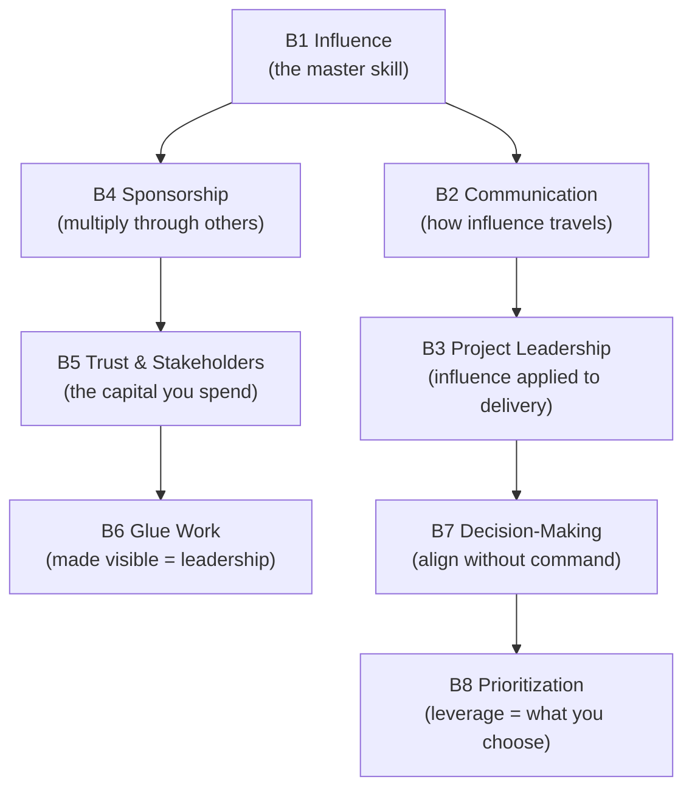

# Leadership Skills — Deep Dives (Part B)

Self-contained deep dives for the **leadership / "soft"** skill areas in [../02-skills-to-upgrade.md](../02-skills-to-upgrade.md#part-b--leadership--soft-skills-the-biggest-differentiators). These are the biggest differentiators between Senior and Staff/Principal — the jump is *not* a technical one. Every file uses Mermaid diagrams, concrete practice drills, "what good looks like at Staff+", pitfalls, and further reading.

> **Counter-intuitive truth:** at Staff+, authority *shrinks* rather than grows — you lead through **influence, communication, and force-multiplication**, not command.

| # | Topic | What you'll learn |
|---|-------|-------------------|
| B1 | **[Influence Without Authority](B1-influence-without-authority.md)** ⭐ | "Learn to never be wrong": listen through questions, define the purpose, read the room; "to lead, you have to follow"; non-blocking feedback. |
| B2 | **[Communication & Executive Writing](B2-communication-and-executive-writing.md)** ⭐ | SCQA, the Minto Pyramid Principle, *nemawashi*, and the rules for presenting to executives. |
| B3 | **[Technical & Project Leadership](B3-technical-and-project-leadership.md)** | Leading cross-team initiatives, aggressive delegation, and managing technical quality as an escalating program. |
| B4 | **[Mentorship & Sponsorship](B4-mentorship-and-sponsorship.md)** ⭐ | The difference between mentorship and sponsorship, concrete sponsorship actions, and "create space for others". |
| B5 | **[Stakeholder Management, Trust & Political Capital](B5-stakeholder-management-and-trust.md)** | "Never surprise your manager", proxied authority, building a network of peers, and spending/earning trust. |
| B6 | **[Glue Work — Made Visible](B6-glue-work.md)** | Tanya Reilly's concept: the invisible work that holds teams together, and how to make it count as leadership. |
| B7 | **[Decision-Making & Disagreeing Productively](B7-decision-making.md)** | Write it down, circulate early, separate style from substance, change your mind, "disagree and commit". |
| B8 | **[Prioritization at Scale — "Work on What Matters"](B8-prioritization.md)** | Avoid snacking/preening/chasing ghosts; invest in existential issues; think on a longer time horizon. |

---

## How the leadership skills reinforce each other

> **Rule of thumb:** most Senior engineers under-invest here and over-invest in the technical track. The promotion is usually won on **B1 (influence), B2 (communication), and B4 (sponsorship).**
