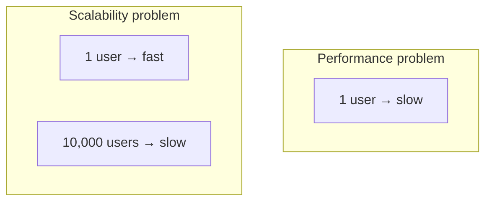
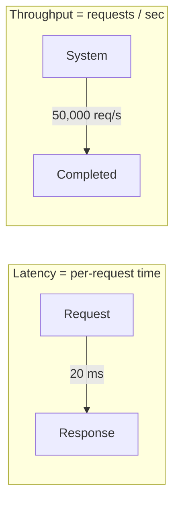
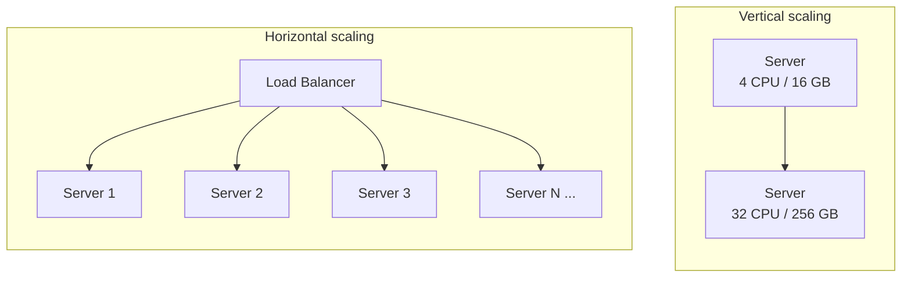
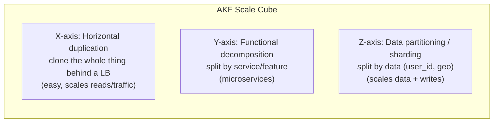
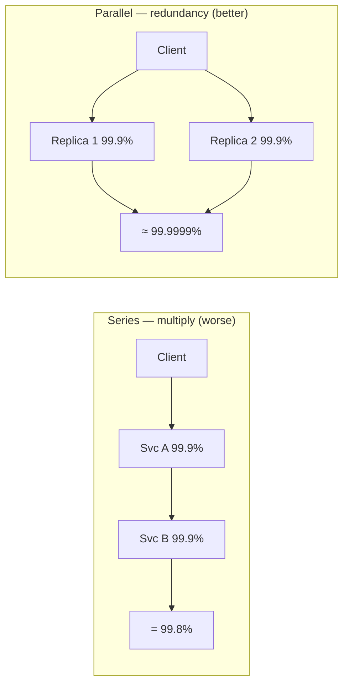

# 1 · Scalability Trade-off Axes

> **The core question:** as load grows by 10×, 100×, 1000× — does your system keep working, and at what cost? Scalability is the ability to handle growth by *adding resources*, without a rewrite and without a collapse in latency.

**TL;DR**
- **Performance** = fast for one user. **Scalability** = stays fast as users/data grow. They're different problems.
- **Latency** = time for one operation. **Throughput** = operations per unit time. You usually optimize for max throughput at *acceptable* latency.
- **Vertical scaling** (bigger machine) is simple but capped and a single point of failure. **Horizontal scaling** (more machines) is the real answer at scale — but forces you to handle statelessness, load balancing, and data partitioning.
- **Availability** is measured in "nines" and *composes* — series multiplies, parallel improves.

---

## 1. Performance vs Scalability

A useful litmus test (from the System Design Primer):

- If you have a **performance** problem, your system is **slow for a single user**.
- If you have a **scalability** problem, it's **fast for a single user but slow under load**.



A system is **scalable** if adding resources yields a *proportional* increase in capacity. The enemy is any component whose cost grows **super-linearly** with load (e.g., an O(n²) fan-out, a shared lock, or a single database everyone hits).

---

## 2. Latency vs Throughput

- **Latency** — the time to perform a single operation (e.g., 20 ms per request). Often quoted as percentiles: **p50, p95, p99, p99.9**. *Tail latency* (p99+) is what users actually feel at scale.
- **Throughput** — the number of operations per unit time (e.g., 50,000 requests/sec).

> **Goal:** maximize throughput while keeping latency under an acceptable threshold. They trade off — batching and queuing raise throughput but add latency; the two are linked by **Little's Law**: `Concurrency = Throughput × Latency`.

**Why percentiles, not averages:** if p99 latency is 1 s and each page makes 100 backend calls, the *majority* of page loads will hit at least one slow call. Averages hide this.



---

## 3. Vertical vs Horizontal Scaling

| | **Vertical (scale up)** | **Horizontal (scale out)** |
|---|---|---|
| How | Bigger CPU / RAM / disk on one box | More boxes behind a load balancer |
| Ceiling | Hard hardware limit | Effectively unlimited |
| Complexity | Low — no code changes | High — statelessness, LB, data partitioning |
| Failure | Single point of failure | Fault-tolerant (lose one node, survive) |
| Cost curve | Super-linear (big machines cost a premium) | ~Linear (commodity hardware) |
| Examples | A single Postgres primary | Web tier of 500 stateless app servers |



**The unlock for horizontal scaling is statelessness.** If application servers hold no session state locally (push it to a shared cache/DB or a signed token), any server can handle any request, and you can add/remove nodes freely. Stateful data is then concentrated in stores you scale deliberately (Topic 3).

---

## 4. The AKF Scale Cube (three ways to scale)

A powerful model: any system can scale along three independent axes.



- **X-axis — cloning:** run N identical copies behind a load balancer. Scales *traffic* and *reads*; doesn't help if the dataset is too big for one node.
- **Y-axis — functional split:** break the monolith into services by responsibility (auth, orders, search). Scales *team* and *complexity*, lets each service scale independently.
- **Z-axis — sharding:** split the *data* across nodes by a key (e.g., `user_id % N`, geography). Scales *data volume* and *writes* — the hardest and most powerful axis (see Topic 3).

Most large systems use all three: cloned stateless services (X), decomposed by domain (Y), each backed by a sharded data store (Z).

---

## 5. Availability & the "nines"

**Availability** = the fraction of time the system is up and correctly serving requests. Quoted as "nines":

| Availability | Downtime / year | Downtime / day |
|---|---|---|
| 99% ("two nines") | 3.65 days | 14.4 min |
| 99.9% ("three nines") | 8.77 hours | 1.44 min |
| 99.99% ("four nines") | 52.6 min | 8.6 sec |
| 99.999% ("five nines") | 5.26 min | 0.86 sec |

### Availability composes — and topology matters

**In series** (request must pass through *both* → multiply, availability drops):

```
A_total = A_1 × A_2      →   99.9% × 99.9% = 99.8%
```

**In parallel** (either one works → availability *rises*):

```
A_total = 1 − (1 − A_1) × (1 − A_2)   →   99.9% + 99.9% ≈ 99.9999%
```



**Design implication:** every hop in a request chain *reduces* availability, so long synchronous call chains are fragile — add redundancy (parallel replicas), remove hops, or make hops asynchronous. This is also why availability and consistency collide during failures — the subject of [Topic 2](02-cap-theorem-consistency-models.md).

> **SLA vs SLO vs SLI:** an **SLI** is the measured indicator (e.g., success rate), an **SLO** is your internal target (e.g., 99.95%), and an **SLA** is the contractual promise to customers (usually looser than the SLO). See the SRE deep-dive in [../02-skills-to-upgrade.md](../02-skills-to-upgrade.md#a3-reliability-observability--operating-at-scale-sre).

---

## 6. What "good" looks like at Staff+

- You **quantify** before you architect: state the target QPS, data size, and latency budget (Topic 7).
- You reach for **horizontal + stateless** by default and know *exactly* which component is the stateful bottleneck.
- You talk in **percentiles** (p99), not averages, and design for **tail latency**.
- You can point at any request path and say *"this hop costs us a nine — here's how we make it redundant or async."*

## Common pitfalls

- **Premature scaling** — building for 1B users when you have 1,000. Scale the design when the numbers demand it; keep it simple until then ("choose boring technology").
- **Hidden single points of failure** — one primary DB, one cache, one AZ. Redundancy on paper, series dependency in practice.
- **Optimizing average latency** while p99 quietly melts under load.
- **Stateful app servers** that block horizontal scaling and make deploys/failover painful.

---

## Further reading
- System Design Primer — "Performance vs scalability", "Latency vs throughput", "Availability patterns" — https://github.com/donnemartin/system-design-primer
- AKF Scale Cube — https://akfpartners.com/growth-blog/scale-cube
- *Designing Data-Intensive Applications*, Ch. 1 (Reliable, Scalable, Maintainable) — https://dataintensive.net/
- Google SRE Book — "Embracing Risk" (availability targets) — https://sre.google/sre-book/embracing-risk/
