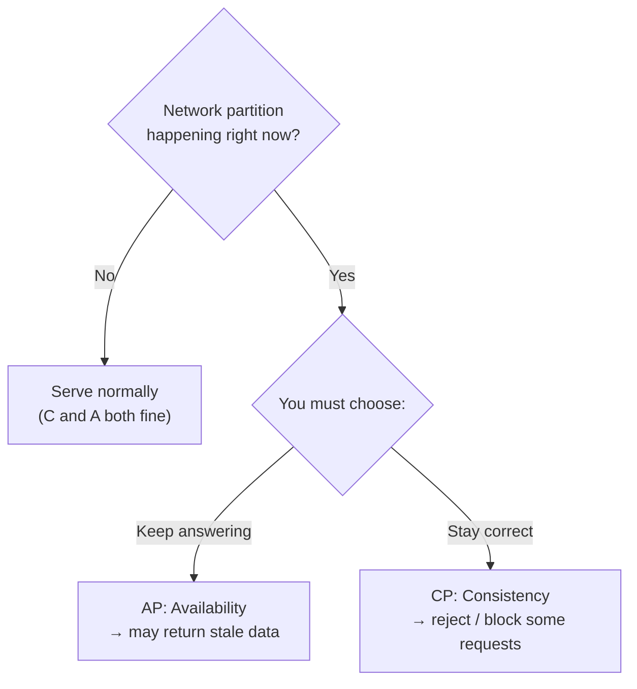
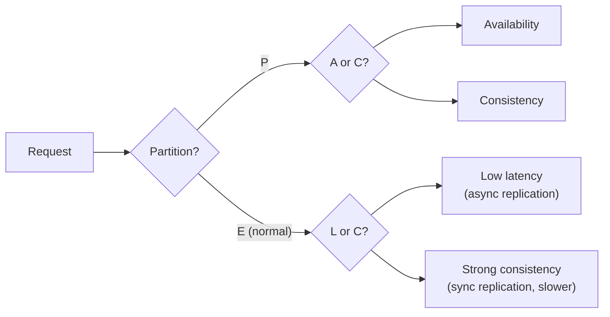
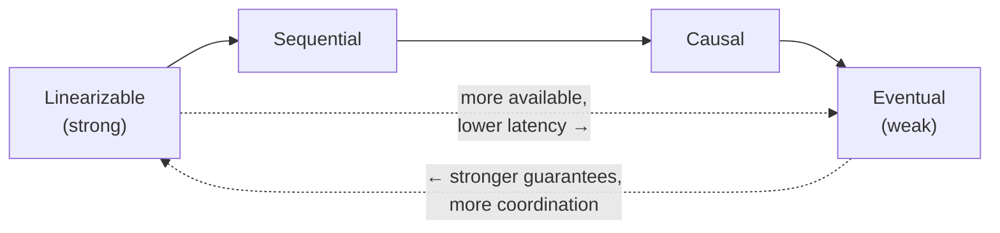
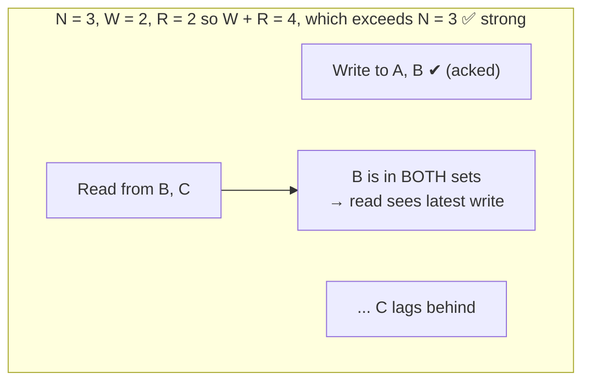
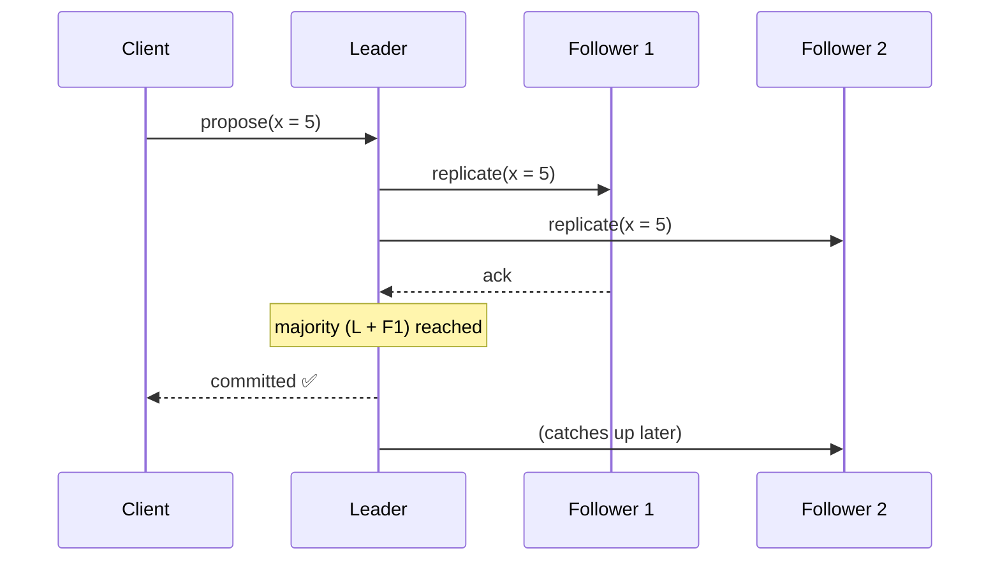

# 2 · CAP Theorem & Consistency Models

> **The core question:** when the network breaks and your nodes can't talk to each other, do you keep answering (risking stale/wrong data) or refuse to answer (staying correct)? You cannot have both. This is the single most important trade-off in distributed data.

**TL;DR**
- **CAP:** in the presence of a network **Partition**, you must choose **Consistency** *or* **Availability**. Partition tolerance isn't optional in a distributed system — so the real choice is **CP vs AP**.
- **PACELC** extends it: **E**lse (when there's no partition) you still trade **L**atency vs **C**onsistency.
- Consistency is a **spectrum**, not a boolean: *linearizable → sequential → causal → eventual* (strong to weak).
- **Quorums** (`N`, `W`, `R`) let you tune the consistency/availability dial: `W + R > N` gives strong reads.

---

## 1. The CAP Theorem

In a distributed data store you can guarantee at most **two of three**:

- **C — Consistency:** every read sees the most recent write (or an error). All nodes agree. *(This is "linearizability", not the C in ACID.)*
- **A — Availability:** every request gets a non-error response — but not necessarily the latest data.
- **P — Partition tolerance:** the system keeps working despite dropped/delayed messages between nodes.

**The key insight:** partitions *will* happen (cables cut, switches fail, GC pauses, network blips). Since you can't sacrifice **P** in a real distributed system, CAP reduces to a decision you make **only during a partition**: **CP or AP**.

### CP vs AP in practice

| | **CP (choose Consistency)** | **AP (choose Availability)** |
|---|---|---|
| During a partition | Rejects/blocks writes or reads on the minority side | Accepts reads/writes everywhere, reconciles later |
| Good for | Money, inventory, bookings, unique constraints | Feeds, likes, carts, presence, metrics |
| Examples | ZooKeeper, etcd, HBase, Spanner, most RDBMS w/ sync replication | Cassandra, DynamoDB (default), Riak, DNS |
| Failure feel | "Try again later" | "You might see slightly old data" |

> There is **no "CA" system** in the real world: you cannot drop partition tolerance and still be distributed. A single-node database is "CA" only because it isn't distributed.

---

## 2. PACELC — the more complete model

CAP only describes behavior *during* a partition. **PACELC** captures the everyday trade-off too:

> **If Partition (P): choose A or C. Else (E): choose L (latency) or C (consistency).**

Even with a healthy network, keeping replicas perfectly in sync means **waiting** for acknowledgements (higher latency). So systems like DynamoDB and Cassandra are **PA/EL** (favor availability *and* latency), while Spanner is **PC/EC** (favor consistency in both modes, paying latency for it).

---

## 3. Consistency is a spectrum

"Consistency" isn't on/off. From strongest (most intuitive, most expensive) to weakest (cheapest, most available):

- **Linearizable (strong):** the system behaves as if there's a single copy of the data and every operation happens atomically at a single instant. A read always returns the latest committed write. *Most intuitive, most expensive — requires coordination/consensus.*
- **Sequential:** all nodes see operations in the *same order*, but that order need not match real-time wall-clock order.
- **Causal:** operations that are causally related (A "happened before" B) are seen in that order by everyone; concurrent operations may be seen in any order. A great middle ground — preserves "reply after post" style ordering without global coordination.
- **Eventual:** if writes stop, all replicas *eventually* converge to the same value. Reads may return stale data in the meantime. Cheapest, most available (DNS, S3 historically, shopping-cart merges).

### The three consistency *patterns* (a simpler practitioner's lens)

- **Weak consistency** — after a write, reads may or may not see it. No guarantees. (Live video, VoIP, online games — stale data is simply dropped.)
- **Eventual consistency** — reads will see the write *after a delay*, and replicas converge. (DNS, email, most AP stores.)
- **Strong consistency** — after a write, every read sees it. (RDBMS, file systems, anything with transactions.)

### Client-centric guarantees worth knowing
- **Read-your-writes** — you always see your *own* latest write (even if others don't yet). Common UX fix on eventually-consistent stores.
- **Monotonic reads** — you never see time "go backwards" (a later read won't return older data than an earlier one).

---

## 4. Replication & Quorums — tuning the dial

Data is replicated to `N` nodes. On each operation you decide how many must acknowledge:

- `N` = number of replicas
- `W` = replicas that must **ack a write** before it's considered successful
- `R` = replicas that must **respond to a read**

**The magic inequality:** if `W + R > N`, the read and write sets are guaranteed to **overlap** on at least one node → the read sees the latest write → **strong consistency**. If `W + R ≤ N`, you get **eventual consistency** but higher availability and lower latency.

**Common configurations:**

| Config | Property | Use when |
|---|---|---|
| `W=N, R=1` | Fast reads, slow/fragile writes | Read-heavy, rarely written data |
| `W=1, R=N` | Fast writes, slow reads | Write-heavy logging/ingest |
| `W=quorum, R=quorum` (e.g. N=3,W=2,R=2) | Balanced strong consistency, tolerates 1 node down | The usual default |
| `W+R ≤ N` | Eventual, max availability | AP systems (Cassandra tunable) |

**Replication topologies** (see [Topic 3](03-databases-and-data-modeling.md#2-replication) for details): single-leader (primary/replica), multi-leader, and leaderless (Dynamo-style quorum). The more leaders, the higher the availability but the harder the **conflict resolution** (last-write-wins, version vectors, CRDTs).

---

## 5. How consistency is actually achieved: consensus

Strong consistency across nodes requires the nodes to **agree** on an order of operations despite failures. That's the job of **consensus algorithms** — **Paxos** and the more understandable **Raft**. They elect a leader and replicate an ordered log to a majority quorum; a value is committed once a majority persists it. This underpins etcd, ZooKeeper, Spanner, CockroachDB, and Kafka's controller.

> You rarely implement consensus yourself — you *use* a system that provides it (etcd, ZooKeeper) for leader election, config, and locks. The Staff+ skill is knowing **when** you need it (coordination, uniqueness, ordering) versus when eventual consistency is fine.

---

## 6. What "good" looks like at Staff+

- You ask **"what happens during a partition?"** for every stateful component and can state whether it's CP or AP — *and why that's the right call for this data*.
- You match the **consistency model to the business need**: strong for money/inventory/uniqueness; eventual for feeds/likes/metrics.
- You can tune `N/W/R` quorums and explain the resulting guarantee.
- You reach for **consensus (etcd/ZooKeeper)** only where you truly need coordination, not everywhere.

## Common pitfalls

- **Assuming "eventual" means "a few milliseconds."** Under load or partition, replication lag can be seconds to minutes — plan the UX (read-your-writes) around it.
- **Treating CAP's C as ACID's C.** They're different: CAP-C is linearizability; ACID-C is preserving invariants within a transaction.
- **Believing you picked "CA."** You didn't — you picked CP or AP; you just haven't had a partition *yet*.
- **Multi-leader without a conflict strategy** — silent lost updates. Decide LWW vs version vectors vs CRDTs up front.

---

## Further reading
- System Design Primer — "CAP theorem", "Consistency patterns", "Availability patterns" — https://github.com/donnemartin/system-design-primer#consistency-patterns
- Kleppmann, *DDIA* Ch. 5 (Replication) & Ch. 9 (Consistency & Consensus) — https://dataintensive.net/
- "Please stop calling databases CP or AP" (Kleppmann) — https://martin.kleppmann.com/2015/05/11/please-stop-calling-databases-cp-or-ap.html
- PACELC — https://en.wikipedia.org/wiki/PACELC_design_principle
- The Raft paper / visualization — https://raft.github.io/
