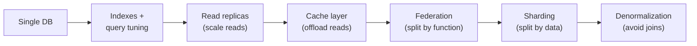
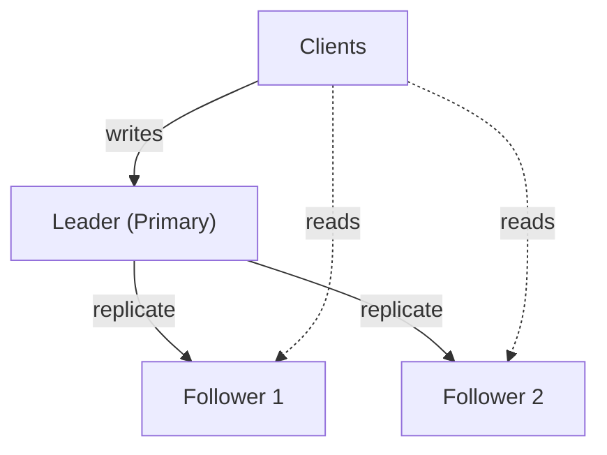
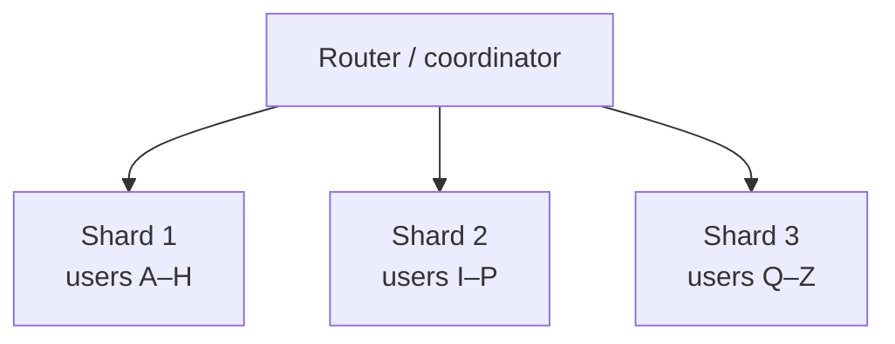
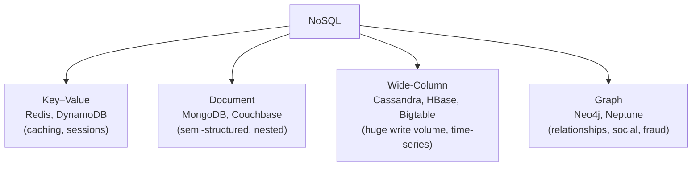
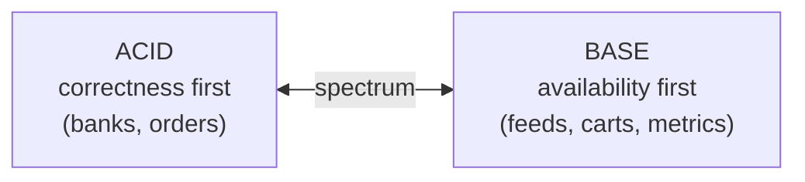
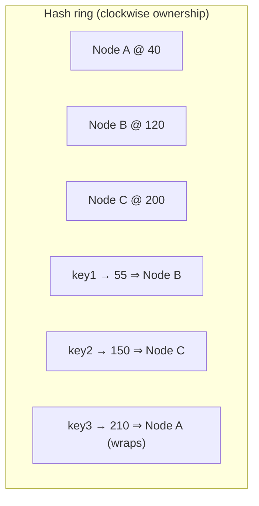
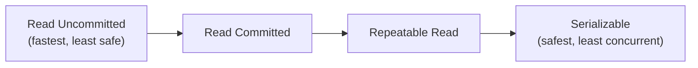
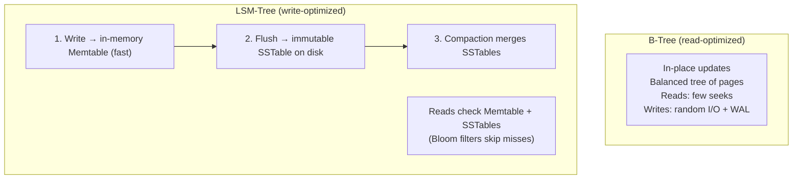

# 3 · Databases & Data Modeling

> **The core question:** where does the data live, how is it kept consistent, and how does it keep working when it outgrows a single machine? This is the stateful heart of every system — and usually the first thing to become a bottleneck.

**TL;DR**
- Scale a relational DB in this order: **indexes & query tuning → read replicas → caching → federation → sharding → denormalization.** Each step adds complexity; stop when the numbers are satisfied.
- **SQL** = structured, relational, strong consistency, joins, ACID. **NoSQL** = flexible schema, horizontal scale, high write throughput, usually BASE/eventual.
- **ACID** (correctness) vs **BASE** (availability) is the philosophical split behind SQL vs NoSQL.
- **Isolation levels** trade correctness for concurrency; know the anomalies each one allows.
- **Consistent hashing** makes sharding elastic. **B-Tree vs LSM-Tree** is the read-optimized vs write-optimized storage-engine choice.

---

## 1. Scaling a relational database (in order)

Apply the cheapest fix that meets your numbers; each step to the right adds operational cost.

- **Indexing & query tuning** — the highest-ROI step. A missing index turns a millisecond lookup into a full table scan. Tune with `EXPLAIN`.
- **Read replicas** — the primary handles writes and replicates to read-only copies. Scales *reads* (most apps are read-heavy). Cost: **replication lag** → replicas can serve stale data.
- **Caching** — put a cache in front (Topic 4) to absorb hot reads.
- **Federation** — split databases *by function* (users DB, products DB, orders DB). Smaller tables, more write throughput, parallel query. Cost: cross-DB joins become app-side.
- **Sharding** — split one big table *by data* across nodes (see §3). Scales *writes and data volume*.
- **Denormalization** — duplicate data to avoid expensive joins across replicas/shards. Trades write complexity + storage for read speed.

---

## 2. Replication

### Single-leader (primary/replica)
All writes go to the leader; reads can go to followers. Simple, strongly consistent if you read the leader; the standard RDBMS setup.

- **Synchronous replication** — leader waits for follower ack → no data loss on failover, higher write latency.
- **Asynchronous replication** — leader acks immediately → fast, but a crash can lose the last writes (replication lag). Most deployments are async or semi-sync.
- **Failover** — promote a follower when the leader dies; risk of split-brain and lost async writes.

### Multi-leader
Multiple nodes accept writes (e.g., one per region). Higher write availability and locality, but **write conflicts** must be resolved (last-write-wins, version vectors, CRDTs).

### Leaderless (Dynamo-style)
Any replica accepts writes; consistency tuned with quorums (`W + R > N`, see [Topic 2](02-cap-theorem-consistency-models.md#4-replication--quorums--tuning-the-dial)). Used by Cassandra, DynamoDB, Riak.

---

## 3. Sharding (partitioning)

Splitting one dataset across many nodes so each holds a subset. The way you choose the **shard key** determines everything.

**Sharding strategies:**

| Strategy | How | Pro | Con |
|---|---|---|---|
| **Range** | Partition by key ranges (A–H, I–P…) | Efficient range scans | **Hotspots** if data/traffic is skewed |
| **Hash** | `hash(key) % N` | Even distribution | Range queries scatter; resharding reshuffles everything |
| **Consistent hash** | Hash onto a ring (§6) | Minimal reshuffle on node change | More complex |
| **Directory / lookup** | A lookup service maps key → shard | Flexible, easy rebalancing | The lookup table is a SPOF/bottleneck |
| **Geo** | Partition by region | Data locality, compliance | Cross-region queries costly |

**The hard parts of sharding:**
- **Cross-shard joins & transactions** — no longer free; often pushed to the app or avoided by denormalizing.
- **Hotspots / celebrity problem** — one shard gets disproportionate traffic (e.g., a viral user). Mitigate with a compound key or splitting hot keys.
- **Rebalancing** — adding a shard shouldn't move *all* the data (that's why consistent hashing exists).
- **Choosing the shard key** — pick high-cardinality, evenly-accessed keys. A bad key (e.g., `country`) creates permanent skew.

---

## 4. SQL vs NoSQL

### SQL (relational)
Tables, rows, fixed schema, relationships, **joins**, and **ACID** transactions. Best when data is structured and relationships/consistency matter (finance, orders, inventory). Examples: PostgreSQL, MySQL, SQL Server.

### NoSQL — four families

- **Key–Value** — a giant hash map. Blazing fast `get/put` by key. Sessions, caches, feature flags.
- **Document** — JSON-like documents; flexible schema; query within documents. Catalogs, user profiles, content.
- **Wide-Column** — rows with dynamic columns grouped into families; optimized for massive write throughput and range scans over a partition key. Time-series, event logs, messaging.
- **Graph** — nodes and edges as first-class citizens; traverse relationships cheaply. Social graphs, recommendations, fraud rings.

### When to choose which

| Choose **SQL** when… | Choose **NoSQL** when… |
|---|---|
| Data is relational, schema is stable | Schema is fluid / varies per record |
| You need multi-row ACID transactions | You need massive horizontal write scale |
| Complex ad-hoc queries & joins | Access patterns are known & simple (by key) |
| Consistency > raw availability | Availability/latency > strict consistency |

> **Modern reality:** the line blurs. Postgres has JSONB (document-style), and "NewSQL" (Spanner, CockroachDB, YugabyteDB) offers horizontal scale *with* SQL + ACID. Pick by *access pattern*, not hype.

---

## 5. ACID vs BASE

The two consistency philosophies — the root of the SQL/NoSQL divide.

**ACID (traditional RDBMS):**
- **Atomicity** — all-or-nothing; a transaction fully commits or fully rolls back.
- **Consistency** — a transaction moves the DB from one valid state to another (invariants hold).
- **Isolation** — concurrent transactions don't corrupt each other (see §7).
- **Durability** — once committed, it survives crashes (written to disk/WAL).

**BASE (many NoSQL):**
- **Basically Available** — the system always responds (maybe with stale data).
- **Soft state** — state may change over time even without input (due to async convergence).
- **Eventual consistency** — replicas converge eventually.

---

## 6. Consistent Hashing

**Problem:** with naïve `hash(key) % N`, adding/removing a node changes `N`, so *almost every key* remaps → a storm of cache misses / data movement.

**Solution:** map both **nodes** and **keys** onto a circular hash ring `[0, 2^32)`. A key belongs to the **first node clockwise** from its hash. Adding/removing a node only remaps the keys in **one arc** — on average `K/N` keys — instead of all of them.

**Virtual nodes:** each physical node is placed at *many* points on the ring (e.g., 100–200 virtual nodes). This smooths out uneven distribution and lets heterogeneous machines take proportional load. Used by Cassandra, DynamoDB, and consistent-hash load balancers.

**Payoff:** adding a 4th node to a 3-node cluster moves ~25% of keys (to fill its arc), not ~100%.

---

## 7. Transaction Isolation Levels

Isolation controls what concurrent transactions can see of each other. Stronger isolation = fewer anomalies but less concurrency (more locking/aborts).

**The anomalies:**
- **Dirty read** — read another transaction's *uncommitted* change.
- **Non-repeatable read** — re-reading the same row returns a different value (someone committed an update in between).
- **Phantom read** — re-running the same *query* returns new/*different rows* (someone inserted/deleted matching rows).
- **Lost update / write skew** — two transactions read-modify-write and one clobbers the other, or two decisions based on the same read violate an invariant.

**The standard levels (weak → strong):**

| Level | Dirty read | Non-repeatable read | Phantom read |
|---|---|---|---|
| **Read Uncommitted** | ✅ possible | ✅ possible | ✅ possible |
| **Read Committed** | ❌ prevented | ✅ possible | ✅ possible |
| **Repeatable Read** | ❌ | ❌ prevented | ✅ possible* |
| **Serializable** | ❌ | ❌ | ❌ prevented |

\* In the SQL standard, Repeatable Read permits phantoms; **MySQL InnoDB** prevents most phantoms at this level via next-key locking, and **Serializable** (often via **Serializable Snapshot Isolation**) prevents all anomalies. **Read Committed** is the common default (Postgres, Oracle).

> **Staff+ nuance:** most bugs come from *assuming* Serializable while running on Read Committed. Know your database's **default** and pick the weakest level that still protects your invariants — escalate specific transactions (e.g., `SELECT ... FOR UPDATE`) rather than globally serializing.

---

## 8. B-Tree vs LSM-Tree (storage engines)

How a database physically stores and retrieves data on disk — the deepest layer, and a real Staff+ differentiator.

| | **B-Tree** | **LSM-Tree** |
|---|---|---|
| Writes | In-place, random I/O | Sequential appends (fast) |
| Reads | Fast, predictable | Slower (check multiple SSTables; Bloom filters help) |
| Write amplification | Moderate | Lower for writes, but **compaction** adds background I/O |
| Space | Fragmentation | Better compression (sorted immutable files) |
| Used by | PostgreSQL, MySQL/InnoDB, most RDBMS | Cassandra, RocksDB, LevelDB, HBase, ScyllaDB |
| Pick when | Read-heavy, range queries, transactions | Write-heavy ingest, time-series, logs |

**Bloom filter** — a compact probabilistic set that answers "is this key *definitely not* here?" with no false negatives. LSM engines use it to avoid scanning SSTables that can't contain the key, rescuing read performance.

---

## 9. What "good" looks like at Staff+

- You scale the DB in the **cheapest-first order** and know which step the current numbers justify.
- You choose SQL vs NoSQL (and the family) from the **access pattern**, not fashion — and can defend it.
- You choose a **shard key** that avoids hotspots and explain the cross-shard query cost.
- You know your DB's **default isolation level** and the anomalies it allows.
- You can reason about **B-Tree vs LSM** when picking a store for a write-heavy vs read-heavy workload.

## Common pitfalls

- **Sharding too early** — it removes joins/transactions and multiplies ops burden. Exhaust replicas + caching + federation first.
- **A skewed shard key** → permanent hotspots you can't fix without a migration.
- **Reading from async replicas** and being surprised by stale data (add read-your-writes routing).
- **Denormalizing without an update strategy** → duplicated data drifts out of sync.
- **Assuming ACID across services** — distributed transactions are hard; prefer sagas / the outbox pattern ([Topic 5](05-asynchronism-and-messaging.md)).

---

## Further reading
- System Design Primer — "Database" (replication, federation, sharding, denormalization, SQL tuning, NoSQL) — https://github.com/donnemartin/system-design-primer#database
- Kleppmann, *DDIA* Ch. 2 (data models), Ch. 3 (storage engines: B-Tree vs LSM), Ch. 6 (partitioning), Ch. 7 (transactions/isolation) — https://dataintensive.net/
- ByteByteGo — "Data sharding", "ACID", "Isolation levels", "B-Tree vs LSM-Tree", "Consistent Hashing" — https://github.com/ByteByteGoHq/system-design-101
- Amazon Dynamo paper (consistent hashing, quorums) — https://www.allthingsdistributed.com/files/amazon-dynamo-sosp2007.pdf
