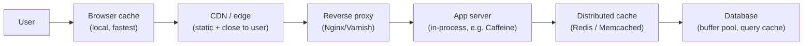
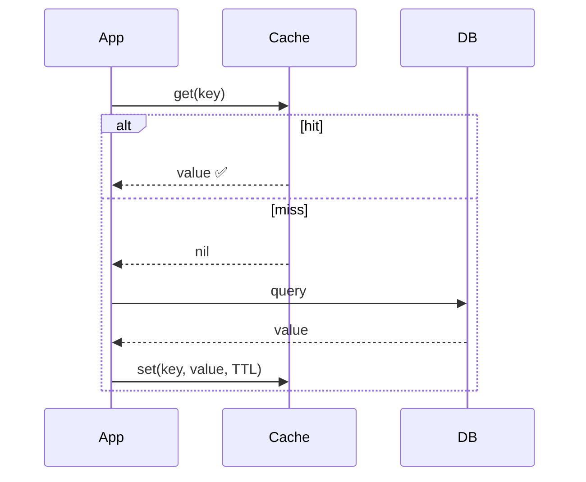
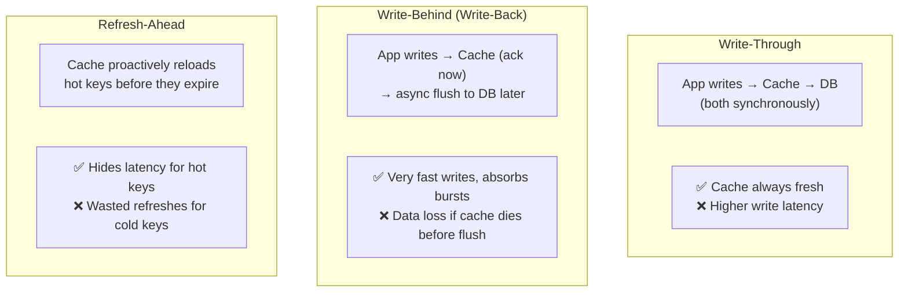
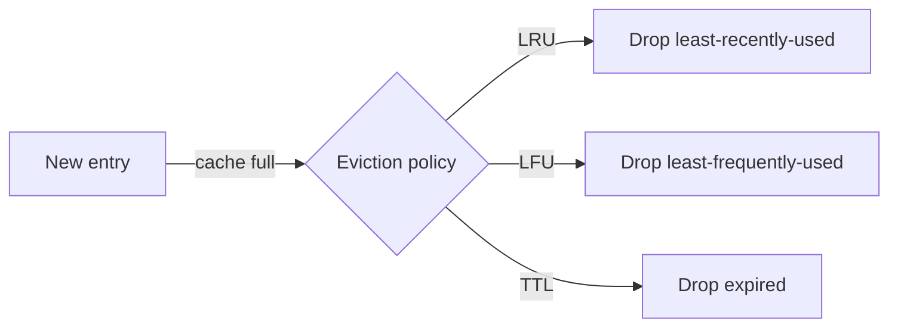
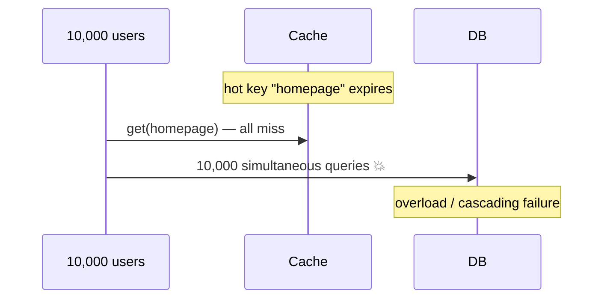

# 4 · Caching

> **The core question:** how do you serve the same expensive result many times without recomputing it? Caching stores a copy of data closer to the consumer to cut latency and offload the origin. It's the single highest-leverage performance tool — and the source of the two hardest problems in CS (naming, cache invalidation, and off-by-one errors).

**TL;DR**
- Cache at **every layer**: client → CDN → load balancer → app (in-memory) → distributed cache → database.
- Know the **read patterns** (cache-aside, read-through) and **write patterns** (write-through, write-behind, refresh-ahead) and their consistency/latency trade-offs.
- **Cache-aside** is the default; **write-through** for consistency; **write-behind** for write-heavy speed (with data-loss risk).
- The dangerous failure modes are **stampede/thundering herd**, **hot keys**, and **penetration** — each has a standard fix.

---

## 1. Where to cache — the layers

Each layer that satisfies a request saves *all* the work downstream. The closer to the user, the lower the latency but the harder to invalidate.

- **Client / browser** — HTTP caching via `Cache-Control`, `ETag`, `Expires`. Zero server cost.
- **CDN** — caches static (and cacheable dynamic) content at edge PoPs near users (Topic 6).
- **Reverse proxy** — Nginx/Varnish cache full responses in front of app servers.
- **Application (in-process)** — an in-memory map in the app (Guava/Caffeine). Nanosecond access, but per-instance (not shared) and lost on restart.
- **Distributed cache** — Redis/Memcached: a shared, network-accessible cache all app instances use. The workhorse.
- **Database** — buffer pool / page cache keeps hot pages in RAM.

---

## 2. Read patterns

### Cache-Aside (lazy loading) — the default
The application manages the cache. On a miss, it loads from the DB and populates the cache.

- ✅ Only requested data is cached (lazy); cache failure doesn't break the app (falls back to DB).
- ❌ First request per key is always a miss (cold cache); risk of stale data until TTL expiry; app owns the logic.

### Read-Through
The cache library sits inline: the app asks the *cache*, and the cache itself loads from the DB on a miss. Same effect as cache-aside but the loading logic lives in the cache layer, not the app.

---

## 3. Write patterns

| Pattern | Consistency | Write latency | Risk | Use when |
|---|---|---|---|---|
| **Write-through** | Strong (cache = DB) | Higher (2 writes) | None extra | Read-heavy, must be fresh |
| **Write-behind** | Eventual | Lowest | Data loss on cache crash | Write-heavy, tolerant of loss (metrics, counters) |
| **Write-around** | — | Normal | Cache stays cold for new data | Writes rarely re-read soon |
| **Refresh-ahead** | Fresh for hot keys | — | Wasted work on cold keys | Predictable hot keys |

**Write-around** = write straight to the DB, bypassing the cache; the key is only cached later on a read. Prevents flooding the cache with write-once data.

---

## 4. Eviction & expiration

The cache is smaller than the origin, so it must decide what to keep.

- **TTL (time-to-live)** — every entry expires after a set time. The simplest freshness control; combine with everything below.
- **LRU (Least Recently Used)** — evict what hasn't been touched longest. The most common; great for temporal locality.
- **LFU (Least Frequently Used)** — evict the least-accessed; good when popularity is stable.
- **FIFO** — evict oldest inserted, regardless of use.
- **Random** — cheap, surprisingly okay under uniform access.

---

## 5. Invalidation — keeping the cache honest

*"There are only two hard things in Computer Science: cache invalidation and naming things."* — Phil Karlton

Strategies to avoid serving stale data:
- **TTL expiry** — accept staleness up to the TTL. Simplest; tune TTL to tolerance.
- **Write-through / write-behind** — update the cache on write (§3).
- **Explicit invalidation** — on a DB write, delete/update the affected keys (event-driven, often via a CDC stream from [Topic 5](05-asynchronism-and-messaging.md)).
- **Versioned keys** — embed a version/hash in the key (`user:123:v7`); a new version naturally bypasses old entries.

---

## 6. The dangerous failure modes (and their fixes)

### Cache stampede / thundering herd
A hot key expires → thousands of concurrent requests all miss and hammer the DB at once, potentially collapsing it.

**Fixes:**
- **Request coalescing / single-flight** — only the *first* miss recomputes; others wait for its result.
- **Lock/mutex per key** — one loader repopulates; others read the fresh value.
- **TTL jitter** — randomize expiry (`TTL ± random`) so keys don't expire together.
- **Early/probabilistic refresh** — refresh slightly *before* expiry (refresh-ahead).

### Hot key
One key gets so much traffic it saturates a single cache node. **Fix:** replicate the key across nodes, add a small local (in-process) cache in front of the distributed cache, or split the value.

### Cache penetration
Requests for keys that **don't exist** always miss and fall through to the DB (common in attacks). **Fix:** cache the "not found" result (with a short TTL), or use a **Bloom filter** to reject impossible keys before hitting the DB.

### Cache avalanche
Many keys expire simultaneously (e.g., after a cache restart) → mass misses. **Fix:** TTL jitter + warm the cache on startup.

---

## 7. Redis vs Memcached (the two workhorses)

| | **Redis** | **Memcached** |
|---|---|---|
| Data types | Rich (strings, hashes, lists, sets, sorted sets, streams, HLL) | Strings/blobs only |
| Persistence | Optional (RDB snapshots, AOF) | None (pure cache) |
| Replication/HA | Yes (replicas, Sentinel, Cluster) | No (client-side sharding) |
| Threading | Mostly single-threaded (fast, simple) | Multi-threaded |
| Use when | You need structures, persistence, pub/sub, atomic ops | Pure, simple, multi-threaded key-value cache |

> Redis is the default choice today because its data structures and HA cover far more use cases (rate limiters, leaderboards, sessions, queues, locks).

---

## 8. What "good" looks like at Staff+

- You place caches **deliberately at the right layers** and know the invalidation cost of each.
- You pick the **write pattern** from the consistency/latency/durability needs, not by habit.
- You **design for the failure modes** up front — stampede, hot key, penetration — because they only appear under load.
- You treat the cache as an **optimization, not a source of truth**: the system must be correct (if slower) with the cache empty.

## Common pitfalls

- **Caching without a TTL or invalidation plan** → permanent staleness.
- **Making the app depend on the cache** — a cache outage must degrade latency, not correctness.
- **No stampede protection** on hot keys → the cache *causes* the outage it was meant to prevent.
- **Caching highly personalized data** with low hit rates → all cost, no benefit.
- **Ignoring cache-hit-ratio metrics** — you can't tune what you don't measure.

---

## Further reading
- System Design Primer — "Cache" (layers, cache-aside, write-through, write-behind, refresh-ahead) — https://github.com/donnemartin/system-design-primer#cache
- ByteByteGo — caching strategies & "Top caching strategies" — https://github.com/ByteByteGoHq/system-design-101
- AWS — "Caching best practices" & ElastiCache docs — https://aws.amazon.com/caching/best-practices/
- Redis vs Memcached — https://aws.amazon.com/elasticache/redis-vs-memcached/
