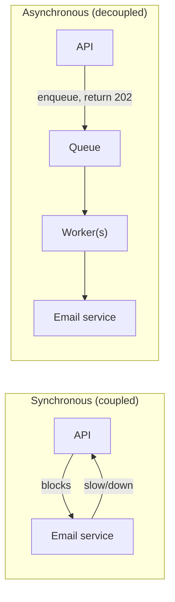
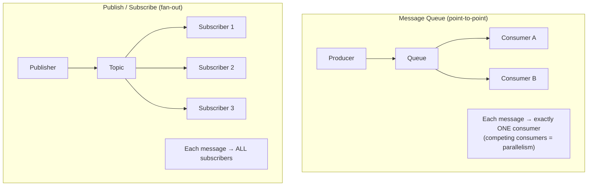
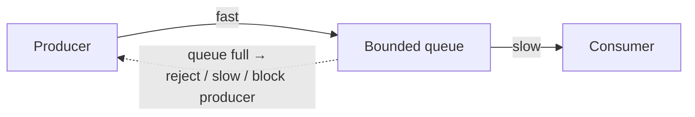
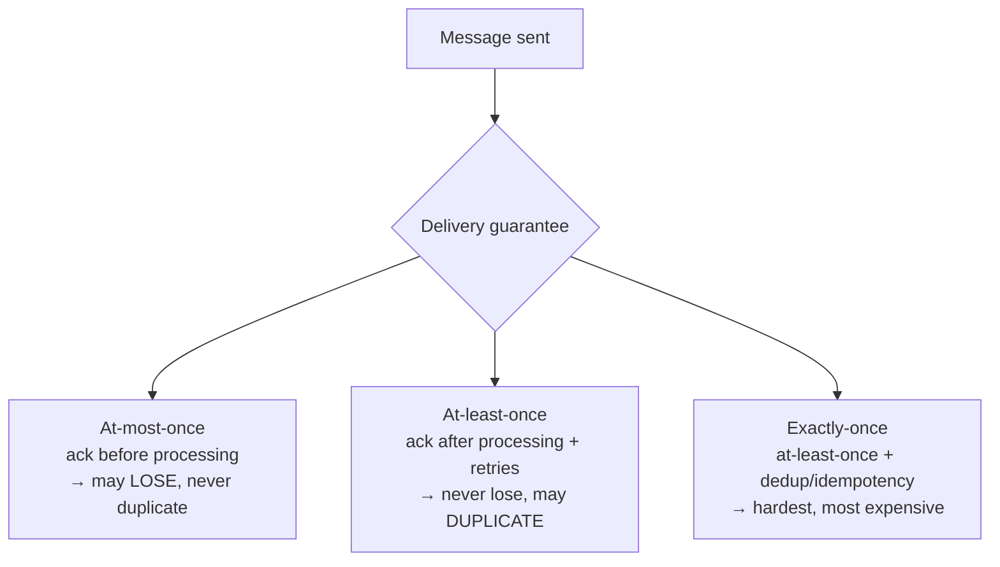
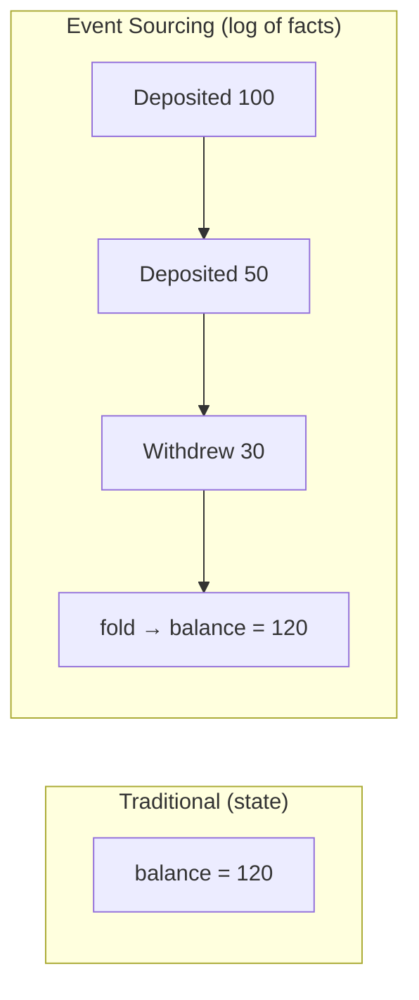
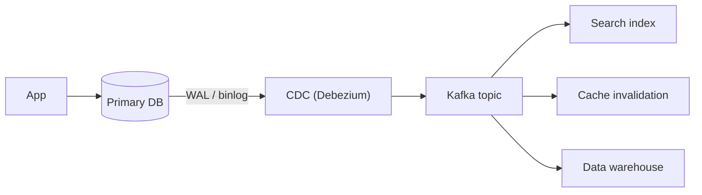
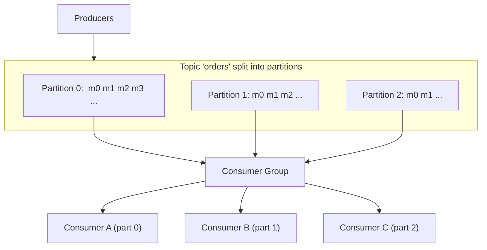

# 5 · Asynchronism & Messaging

> **The core question:** how do you decouple a fast producer from a slow consumer so neither takes the other down — and how do you guarantee the work eventually happens, even across failures? Asynchronous messaging turns tightly-coupled, synchronous call chains into resilient, independently-scalable pipelines.

**TL;DR**
- **Async decoupling** lets producers and consumers scale and fail independently; a queue absorbs bursts.
- **Message queue** (point-to-point, one consumer per message) vs **pub/sub** (fan-out to many subscribers).
- **Back-pressure** protects an overwhelmed consumer instead of letting it fall over.
- **Delivery semantics:** at-most-once (may lose), at-least-once (may duplicate → need **idempotency**), exactly-once (hardest).
- **Event sourcing** stores changes as an immutable log; **CDC** streams DB changes; **Kafka** is the durable, partitioned log that powers both.

---

## 1. Why go asynchronous?

Synchronous: the caller **waits** for the callee. One slow/failed downstream stalls the whole chain (and hurts availability — remember series multiplication from [Topic 1](01-scalability-tradeoff-axes.md#5-availability--the-nines)).

Asynchronous: the caller **hands off** the work and moves on; a broker holds the message until a consumer processes it.

**Benefits:** burst absorption (buffering), independent scaling (add workers), fault isolation (broker retries if a worker dies), and lower user-facing latency (return immediately, do the work later).

---

## 2. Message Queue vs Publish/Subscribe

- **Queue (competing consumers):** many workers pull from one queue; each message is delivered to *one* worker. This is how you parallelize a workload — add workers to drain faster. (RabbitMQ, SQS, Celery.)
- **Pub/Sub:** a message published to a topic is delivered to *every* subscriber independently. This is how you fan out an event to multiple systems. (Kafka, SNS, Google Pub/Sub, Redis pub/sub.)

**Task queue** = a queue specialized for background jobs (image resize, email, report generation), often with retries, scheduling, and priorities.

---

## 3. Back-pressure

If producers outpace consumers, the queue grows unboundedly → memory exhaustion, ballooning latency, eventual collapse. **Back-pressure** is the system pushing back to slow producers down.

**Techniques:** bounded queues that reject or block when full (returning `429/503`), rate limiting at the producer, load shedding (drop low-priority work), and buffering with a **dead-letter queue (DLQ)** for messages that repeatedly fail. The principle: **fail fast and predictably** rather than degrade unboundedly.

---

## 4. Delivery Semantics (and idempotency)

The hardest part of messaging: guarantees about *how many times* a message is processed when failures and retries happen.

| Semantic | Guarantee | Cost | Typical use |
|---|---|---|---|
| **At-most-once** | Never duplicated, may be lost | Cheapest | Metrics, non-critical telemetry |
| **At-least-once** | Never lost, may be duplicated | Moderate | **The common default** — pair with idempotency |
| **Exactly-once** | Processed once, effectively | Highest (transactions/dedup) | Payments, financial ledgers |

**Idempotency is the practical answer.** Since most brokers give *at-least-once*, make processing **idempotent** so duplicates are harmless:
- Attach an **idempotency key** (unique message/request ID); record processed IDs and skip repeats.
- Use **upserts** / conditional writes instead of blind inserts/increments.
- Design operations so applying them twice equals applying them once (`set balance = X`, not `balance += 10`).

> **"Exactly-once delivery" is largely a myth over an unreliable network; "exactly-once *processing*" is achievable** via at-least-once delivery + idempotent consumers, or transactional systems (Kafka transactions, the outbox pattern).

---

## 5. Event Sourcing

Instead of storing only the *current state*, store the **immutable sequence of events** that produced it. Current state is derived by replaying events.

- ✅ Full audit trail, time-travel/replay, natural fit for CQRS (separate read models), enables rebuilding any projection.
- ❌ More complex; queries need materialized read models; schema/versioning of events needs care.
- **Use for:** finance/ledgers, order lifecycles, anything needing "how did we get here?" and strong auditability.

---

## 6. Change Data Capture (CDC)

Stream a database's changes (inserts/updates/deletes) as events by tailing its **write-ahead log** (WAL/binlog). Lets other systems react to DB changes without dual-writes.

CDC is the clean solution to the **dual-write problem** (writing to the DB *and* a cache/queue and having them drift): write only to the DB, and let CDC reliably propagate the change everywhere else. It powers cache invalidation ([Topic 4](04-caching.md#5-invalidation--keeping-the-cache-honest)), search indexing, and analytics pipelines.

---

## 7. Kafka internals (the durable log)

Kafka is the de-facto backbone for high-throughput event streaming. Its model is a **distributed, partitioned, replicated commit log**.

**Key concepts:**
- **Topic** — a named stream, split into **partitions**.
- **Partition** — an ordered, immutable, append-only log. Ordering is guaranteed **within** a partition, not across them. Messages with the same **key** go to the same partition (preserving per-key order).
- **Offset** — each message's position in a partition. Consumers track their offset; they can replay by rewinding it. Kafka **retains** messages (by time/size) regardless of consumption — a durable log, not a transient queue.
- **Consumer group** — consumers sharing a group split the partitions among themselves → parallelism. **Max parallelism = number of partitions.** Different groups each get the full stream (pub/sub).
- **Replication** — each partition has a **leader** and follower replicas; **ISR** (in-sync replicas) enable failover without data loss. `acks=all` waits for the ISR to persist.

**Why Kafka is fast:** sequential disk I/O (append-only), zero-copy transfers, batching + compression, and no per-message broker bookkeeping (consumers track their own offsets).

> **Queue vs Kafka:** a traditional queue (RabbitMQ/SQS) *deletes* a message once acked. Kafka *retains* the log so multiple independent consumers can read it, replay it, and join it — which is why it underpins event sourcing, CDC, and stream processing.

---

## 8. What "good" looks like at Staff+

- You **decouple** with async messaging where latency, bursts, or fault isolation demand it — and keep truly synchronous paths short.
- You assume **at-least-once** delivery and make consumers **idempotent** by default.
- You add **back-pressure and a DLQ** so overload degrades gracefully.
- You reach for **CDC/outbox** to avoid dual-write inconsistency, and **Kafka** when you need a replayable, multi-consumer log.
- You partition by a **key that preserves the ordering you need** and know max parallelism = partition count.

## Common pitfalls

- **Assuming exactly-once delivery** and skipping idempotency → duplicate charges/emails.
- **Unbounded queues** with no back-pressure → memory blowups and hidden latency.
- **Dual writes** (DB + queue) without CDC/outbox → the two drift apart on partial failure.
- **Too few Kafka partitions** → a hard ceiling on consumer parallelism (repartitioning is disruptive).
- **Relying on cross-partition ordering** — it doesn't exist; design keys accordingly.

---

## Further reading
- System Design Primer — "Asynchronism" (message queues, task queues, back pressure) — https://github.com/donnemartin/system-design-primer#asynchronism
- ByteByteGo — "Why is Kafka fast?", "Kafka use cases", messaging patterns — https://github.com/ByteByteGoHq/system-design-101
- Kleppmann, *DDIA* Ch. 11 (Stream Processing) & the "logs" chapter — https://dataintensive.net/
- "The Log: What every software engineer should know about real-time data" (Jay Kreps) — https://engineering.linkedin.com/distributed-systems/log-what-every-software-engineer-should-know-about-real-time-datas-unifying
- Debezium (CDC) — https://debezium.io/
