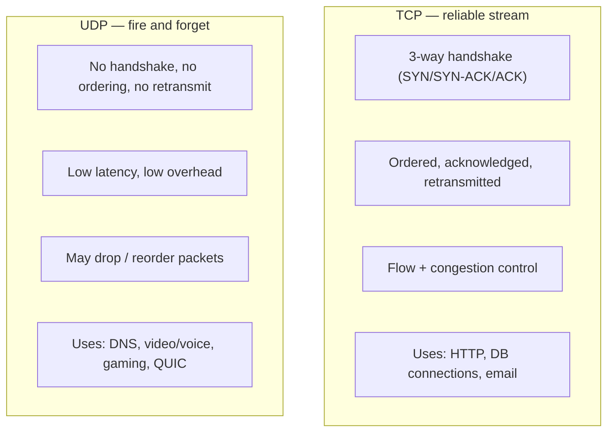
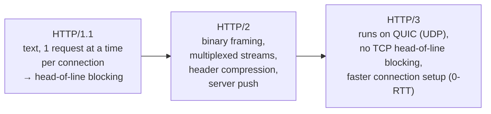
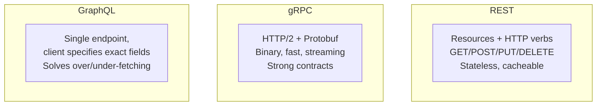
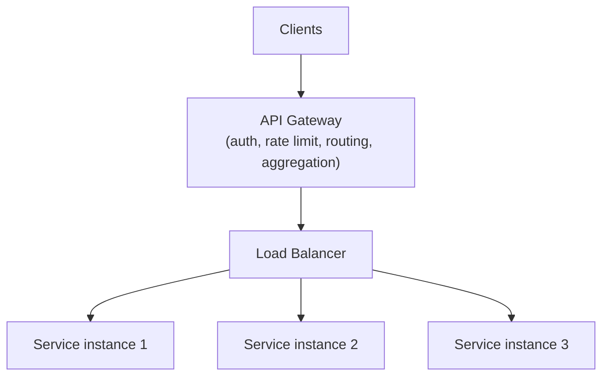
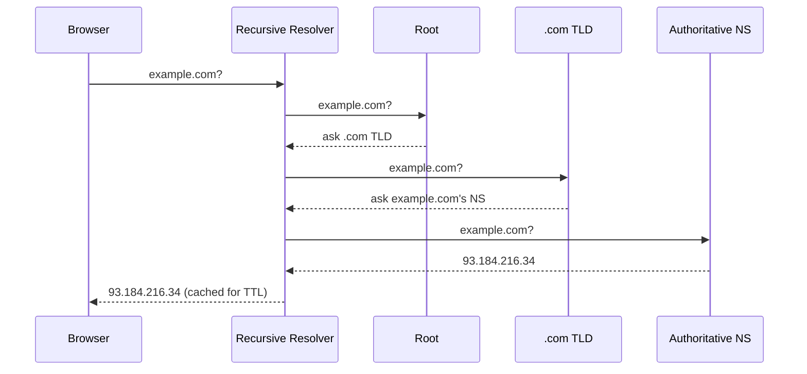
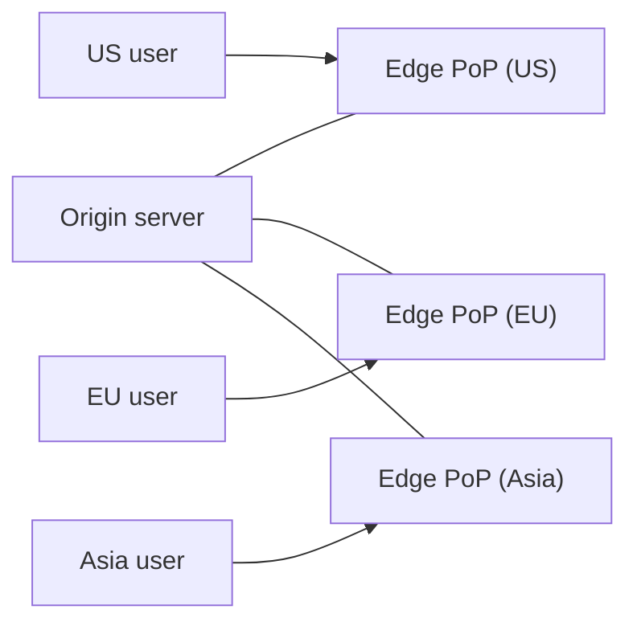
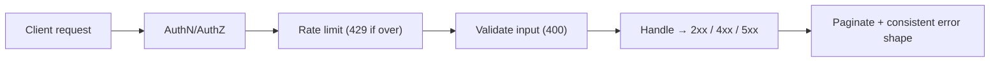

# 6 · Networking & API Design

> **The core question:** how do bytes actually get from one machine to another, and how do you design the contract (the API) that many teams and clients will depend on for years? Networking is the substrate; API design is the interface that outlives every implementation behind it.

**TL;DR**
- **TCP** = reliable, ordered, connection-based. **UDP** = fast, connectionless, best-effort.
- **HTTP/1.1 → 2 → 3**: from one-request-per-connection, to multiplexed streams, to QUIC-over-UDP that kills TCP head-of-line blocking.
- **REST vs gRPC vs GraphQL**: resource CRUD over HTTP, high-performance binary RPC, and client-shaped queries — each fits different needs.
- **L4 vs L7 load balancers**: transport-level (fast, IP:port) vs application-level (HTTP-aware, content routing).
- Great **API design** = predictable resources, correct status codes, versioning, pagination, idempotency, and rate limiting.

---

## 1. TCP vs UDP

Both run over IP. The choice is reliability vs speed.

| | **TCP** | **UDP** |
|---|---|---|
| Connection | Yes (handshake) | No |
| Reliability | Guaranteed delivery + order | Best-effort |
| Speed/overhead | Higher latency, more overhead | Fast, minimal |
| Use | Correctness matters (web, DBs) | Speed > perfection (streaming, DNS) |

---

## 2. HTTP evolution: 1.1 → 2 → 3

- **HTTP/1.1** — one outstanding request per TCP connection (browsers open ~6 to parallelize). Later requests wait behind earlier ones = **head-of-line (HOL) blocking**. Keep-alive reuses connections.
- **HTTP/2** — one connection, many concurrent **streams** (multiplexing), binary framing, **HPACK** header compression. Solves *application-level* HOL blocking — but a lost TCP packet still stalls all streams (transport-level HOL).
- **HTTP/3** — swaps TCP for **QUIC** (over UDP). Each stream is independent, so one lost packet doesn't block the others; faster handshakes (often 0-RTT) and connection migration across networks.

---

## 3. Communication styles: REST vs gRPC vs GraphQL vs SOAP

| | **REST** | **gRPC** | **GraphQL** | **SOAP** |
|---|---|---|---|---|
| Transport/format | HTTP + JSON | HTTP/2 + Protobuf (binary) | HTTP + JSON | HTTP/other + XML |
| Best for | Public APIs, CRUD, broad compatibility | Internal service-to-service, low latency | Rich clients, aggregating many sources | Legacy/enterprise, strict contracts |
| Strengths | Simple, cacheable, ubiquitous | Fast, streaming, codegen, typed | No over/under-fetch, one round trip | Formal contracts (WSDL), built-in security |
| Weaknesses | Over/under-fetching, many endpoints | Not browser-native, binary is opaque | Caching & rate-limiting harder, complex | Verbose, heavy, dated |

- **Over-fetching** (REST returns more than you need) and **under-fetching** (you must call several endpoints) are the classic REST pains GraphQL targets.
- **gRPC** shines *inside* your system (microservice ↔ microservice) where you control both ends and want speed + streaming.
- **REST** remains the default for **public** APIs due to simplicity, cacheability, and tooling.

---

## 4. Load balancers, reverse proxies & API gateways

### L4 vs L7 load balancing

| | **L4 (transport)** | **L7 (application)** |
|---|---|---|
| Sees | IP + port (TCP/UDP) | Full HTTP (URL, headers, cookies) |
| Routing | By connection | By content (path, host, header) |
| Speed | Faster, less CPU | Slightly slower, smarter |
| Can do | Simple even distribution | Path routing, sticky sessions, TLS termination, canary |

**Balancing algorithms:** round-robin, weighted round-robin, **least connections**, least response time, IP/consistent hash (sticky).

- **Reverse proxy** — sits in front of servers; terminates TLS, caches, compresses, hides backend topology (Nginx, Varnish, Envoy). A load balancer is a specialized reverse proxy.
- **API gateway** — the single front door for clients: authentication, rate limiting, request routing, response aggregation, protocol translation. Prevents each microservice from re-implementing cross-cutting concerns.

---

## 5. DNS — turning names into addresses

- **Record types:** `A` (IPv4), `AAAA` (IPv6), `CNAME` (alias), `MX` (mail), `NS` (nameserver), `TXT` (verification/SPF).
- **TTL** controls how long resolvers cache an answer — low TTL = faster failover, more lookups.
- DNS also does **traffic management**: round-robin DNS, **GeoDNS** (route to nearest region), and latency/health-based routing (e.g., Route 53). It's the first layer of load balancing.

---

## 6. CDN — content close to the user

A **Content Delivery Network** caches content at edge PoPs around the world so users fetch from a nearby server instead of the origin — cutting latency and offloading the origin.

- **Pull CDN** — the edge fetches from the origin on the first request for a URL, then caches it (TTL). Easy; first hit is slow. Good for large/varied catalogs.
- **Push CDN** — you proactively upload/publish content to the edge. More control; you manage what's stored and when it expires. Good for infrequently-changing or large media you know will be requested.

---

## 7. API design best practices

The contract you'll live with for years. Aim for **predictable, consistent, evolvable**.

- **Resource-oriented URLs** — nouns, not verbs: `GET /users/123/orders`, not `/getUserOrders`.
- **Correct HTTP methods & status codes** — `GET` (safe), `POST` (create), `PUT`/`PATCH` (update), `DELETE`. Return `200/201/204`, `400/401/403/404/409/422`, `429`, `500/503` meaningfully.
- **Idempotency** — `GET/PUT/DELETE` should be idempotent; make `POST` idempotent for retries via an **`Idempotency-Key`** header (critical for payments).
- **Pagination** — never return unbounded lists. **Offset/limit** (simple, but drifts and is slow deep in) vs **cursor/keyset** (stable, scales) — prefer cursors for large/real-time data.
- **Versioning** — `/{v1}/…` in the path or an `Accept` header; version to evolve without breaking clients.
- **Filtering/sorting/field selection** — query params (`?status=open&sort=-created&fields=id,name`).
- **Rate limiting** — protect the API; communicate limits via `429` + `Retry-After` and `X-RateLimit-*` headers. Common algorithms: **token bucket** (allows bursts), **leaky bucket** (smooths), fixed/sliding window.
- **Consistent errors** — a stable JSON error shape (`code`, `message`, `details`) so clients can handle failures programmatically.
- **Security** — HTTPS everywhere, `OAuth2`/JWT for authZ, validate input, least privilege (see the Security topic in [../02-skills-to-upgrade.md](../02-skills-to-upgrade.md#a7-security--privacy-as-a-design-concern)).

---

## 8. What "good" looks like at Staff+

- You pick the **communication style per boundary**: REST for public/CRUD, gRPC for internal high-throughput, GraphQL for aggregation-heavy clients.
- You know **where TLS terminates**, what's **L4 vs L7**, and place the **API gateway** to centralize cross-cutting concerns.
- You design APIs that are **idempotent, paginated, versioned, and rate-limited** from day one — because the contract is the hardest thing to change later.
- You use **DNS + CDN** as the outermost scaling/latency layers, not afterthoughts.

## Common pitfalls

- **Unbounded list endpoints** (no pagination) → they fall over the day data grows.
- **No versioning** → you can't evolve without breaking clients; you get stuck.
- **Non-idempotent POSTs** for payments/orders → retries create duplicates.
- **Chatty REST** forcing clients into N+1 calls (consider GraphQL or aggregation endpoints).
- **Verbs in URLs / misused status codes** → an unpredictable API nobody can cache or reason about.

---

## Further reading
- System Design Primer — "Communication" (TCP/UDP, RPC, REST), "DNS", "CDN", "Load balancer", "Reverse proxy" — https://github.com/donnemartin/system-design-primer#communication
- ByteByteGo — "REST vs GraphQL vs gRPC", "HTTP/1 vs 2 vs 3", "API design tips", "How does gRPC work?" — https://github.com/ByteByteGoHq/system-design-101
- Google API Design Guide — https://cloud.google.com/apis/design
- Cloudflare Learning — "What is QUIC/HTTP/3?" — https://www.cloudflare.com/learning/performance/what-is-http3/
