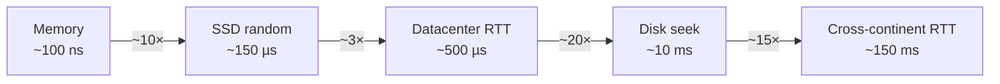
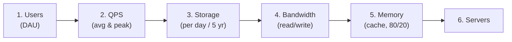
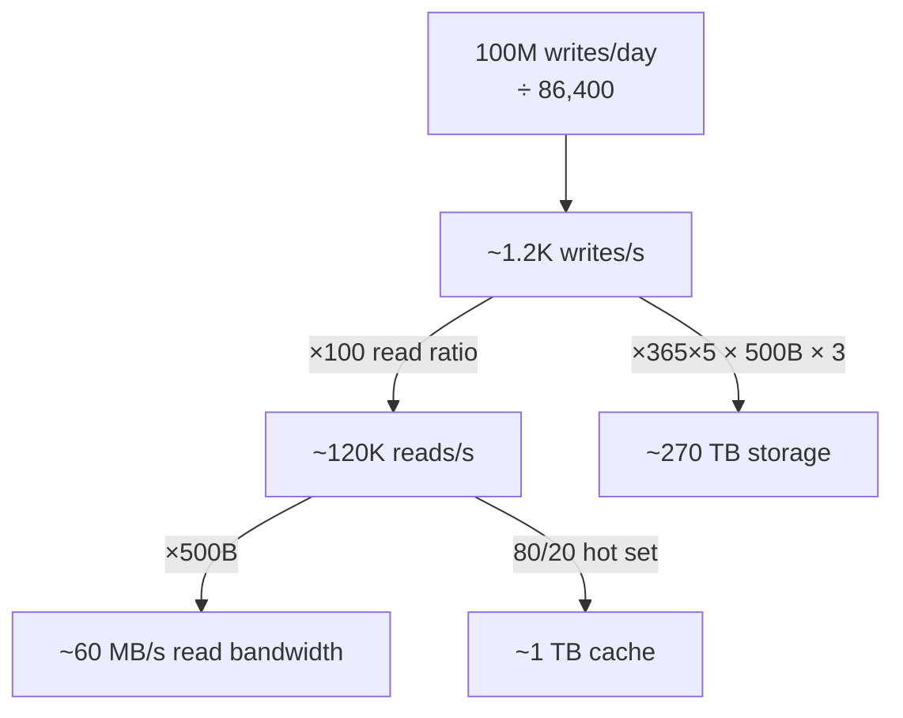

# 7 · Back-of-the-Envelope Estimation

> **The core question:** before you draw a single box, roughly how big is this system — how many requests per second, how much storage per year, how much bandwidth, how many servers? Estimation turns hand-waving into engineering: it tells you *which* bottleneck to design for and *which* trade-offs actually matter.

**TL;DR**
- Memorize three cheat sheets: **powers of two**, **latency numbers**, and **availability nines**.
- Estimate in a fixed order: **users → QPS → storage → bandwidth → memory (cache) → servers.**
- Round aggressively (use `10^x`), keep one significant figure, and always state assumptions.
- Distinguish **average QPS** from **peak QPS** (peak ≈ 2–10× average).

---

## 1. Cheat sheet: Powers of two (data sizes)

| Power | Exact-ish | Name | Bytes shorthand |
|---|---|---|---|
| 2^10 | ~1 thousand | Kilo | 1 KB |
| 2^20 | ~1 million | Mega | 1 MB |
| 2^30 | ~1 billion | Giga | 1 GB |
| 2^40 | ~1 trillion | Tera | 1 TB |
| 2^50 | ~1 quadrillion | Peta | 1 PB |

**Useful anchors:** ASCII char = 1 byte · UUID ≈ 16 bytes · a typical DB row ≈ 100 bytes–1 KB · a small image ≈ 100 KB–1 MB · 1 minute of video ≈ tens of MB.

---

## 2. Cheat sheet: Latency numbers every programmer should know

Orders of magnitude matter far more than exact values.

| Operation | Latency | Intuition |
|---|---|---|
| L1 cache reference | ~0.5 ns | |
| Branch mispredict | ~5 ns | |
| L2 cache reference | ~7 ns | 14× L1 |
| Mutex lock/unlock | ~25 ns | |
| Main memory reference | ~100 ns | 200× L1 |
| Compress 1 KB (Zippy/Snappy) | ~3 µs | |
| Send 1 KB over 1 Gbps network | ~10 µs | |
| Read 4 KB randomly from SSD | ~150 µs | |
| Read 1 MB sequentially from memory | ~250 µs | |
| Round trip within same datacenter | ~500 µs | |
| Read 1 MB sequentially from SSD | ~1 ms | 4× memory |
| Disk seek (spinning) | ~10 ms | 20,000× datacenter RTT |
| Read 1 MB sequentially from disk | ~20 ms | 80× SSD |
| Packet round trip CA ↔ Netherlands | ~150 ms | speed of light! |



**The lessons baked into these numbers:**
- **Memory is ~1000× faster than disk** → cache aggressively ([Topic 4](04-caching.md)).
- **SSD is ~20× faster than spinning disk** for random reads.
- **Sequential ≫ random** I/O → why LSM-trees and Kafka append sequentially ([Topics 3](03-databases-and-data-modeling.md), [5](05-asynchronism-and-messaging.md)).
- **Cross-region RTT (~150 ms) is bound by the speed of light** → you cannot "optimize" it away; you must move data/compute closer (CDN, regional replicas).

---

## 3. Cheat sheet: Availability nines

| Availability | Downtime / year |
|---|---|
| 99% | 3.65 days |
| 99.9% | 8.77 hours |
| 99.99% | 52.6 minutes |
| 99.999% | 5.26 minutes |

(See [Topic 1 §5](01-scalability-tradeoff-axes.md#5-availability--the-nines) for how availability composes in series vs parallel.)

---

## 4. The estimation method (a repeatable order)



**Handy conversions to memorize:**
- 1 day ≈ **86,400 s** → round to **10^5 s**.
- So **1 write/user/day at 1M users** ≈ 1M / 10^5 = **~10 QPS**.
- **Peak QPS ≈ 2–10× average** — design for peak.
- QPS a single commodity server handles: roughly **hundreds to low thousands** (depends heavily on work per request).

**Method:**
1. **Users** — start from Daily Active Users (DAU) or total users × activity rate.
2. **QPS** — actions/user/day × users ÷ 86,400. Compute **average**, then multiply for **peak**. Separate **read QPS** from **write QPS** (reads usually dominate, e.g., 100:1).
3. **Storage** — writes/day × bytes/write × retention (e.g., × 365 × 5 for five years). Add replication factor.
4. **Bandwidth** — QPS × payload size, for reads and writes separately (bytes/sec).
5. **Memory (cache)** — apply the **80/20 rule**: cache the ~20% of data serving ~80% of reads. Sized as daily-read-volume × 20%.
6. **Servers** — total peak QPS ÷ QPS-per-server (round up, add headroom + redundancy).

---

## 5. Worked example: design a URL shortener (TinyURL)

**Assumptions (state them!):**
- 100M new URLs/day written; **read:write = 100:1** → 10B redirects/day.
- Store each mapping for **5 years**.
- Each record ≈ **500 bytes** (short code, long URL, metadata).

**① QPS**
```
Writes: 100M / 86,400 s  ≈ 1,160  ≈ ~1.2K writes/sec (avg)
Reads : 100 × writes     ≈ 116K   ≈ ~120K reads/sec (avg)
Peak (×2):               writes ≈ 2.4K/s,  reads ≈ 240K/s
```

**② Storage (5 years)**
```
Records: 100M/day × 365 × 5 ≈ 1.825 × 10^11  ≈ ~180 billion records
Size   : 180B × 500 bytes    ≈ 9 × 10^13 bytes ≈ ~90 TB (before replication)
With 3× replication          ≈ ~270 TB
```

**③ Bandwidth**
```
Write BW: 1.2K/s × 500 B ≈ 600 KB/s   (trivial)
Read  BW: 120K/s × 500 B ≈ 60 MB/s     (the dominant path)
```

**④ Memory (cache the hot 20% of a day's reads)**
```
Daily reads: 10B × 500 B ≈ 5 TB/day of read volume
Cache 20%:   ≈ 1 TB in a distributed cache (shard across nodes)
```



**What the numbers *tell you to design*:**
- **Read-dominated (100:1)** → put a **cache** and **CDN/read replicas** front and center; the write path is easy.
- **~270 TB, 180B rows** → a single DB won't hold it → **shard** (by hash of the short code) — see [Topic 3](03-databases-and-data-modeling.md#3-sharding-partitioning).
- **Short codes** → base-62 of a counter/hash; 7 chars of base-62 ≈ 3.5 trillion combos → plenty.
- **60 MB/s reads** is modest bandwidth but **240K peak QPS** means you need **many stateless app servers + a load balancer** ([Topics 1](01-scalability-tradeoff-axes.md), [6](06-networking-and-api-design.md)).

That's the whole point of estimation: **five minutes of arithmetic decided the architecture** (cache-heavy, sharded, horizontally scaled) before drawing anything.

---

## 6. What "good" looks like at Staff+

- You **estimate first** and let the numbers pick the bottleneck — you don't cache/shard reflexively, you do it because the math says so.
- You **round to orders of magnitude**, keep one significant figure, and **state every assumption** out loud.
- You separate **average vs peak** and **read vs write**, because they drive different parts of the design.
- You connect each number to a **decision** ("120K reads/s → cache + replicas"; "270 TB → shard").

## Common pitfalls

- **False precision** — computing 1,157.4 QPS instead of "~1K/s". Precision you can't justify wastes time.
- **Forgetting peak** — sizing for average and falling over at the daily spike.
- **Ignoring replication/overhead** — real storage is 3× your raw estimate, plus indexes.
- **Not tying numbers to decisions** — estimation is a means to choose an architecture, not a ritual.
- **Mixing bits and bytes** — network is often quoted in **bits** (Gbps); storage in **bytes**. 1 Gbps ≈ 125 MB/s.

---

## Further reading
- System Design Primer — "Appendix: Powers of two" & "Latency numbers every programmer should know" — https://github.com/donnemartin/system-design-primer#appendix
- Jeff Dean's latency numbers (interactive) — https://colin-scott.github.io/personal_website/research/interactive_latency.html
- Alex Xu, *System Design Interview* Vol 1 — Ch. 2 "Back-of-the-envelope estimation" — https://bytebytego.com
- ByteByteGo — capacity planning cheat sheets — https://github.com/ByteByteGoHq/system-design-101
