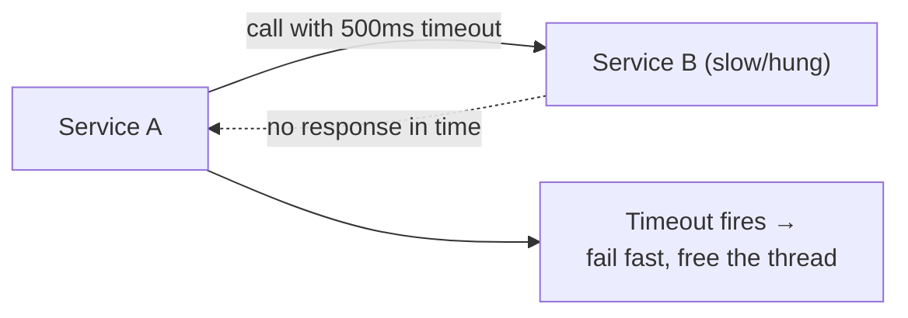
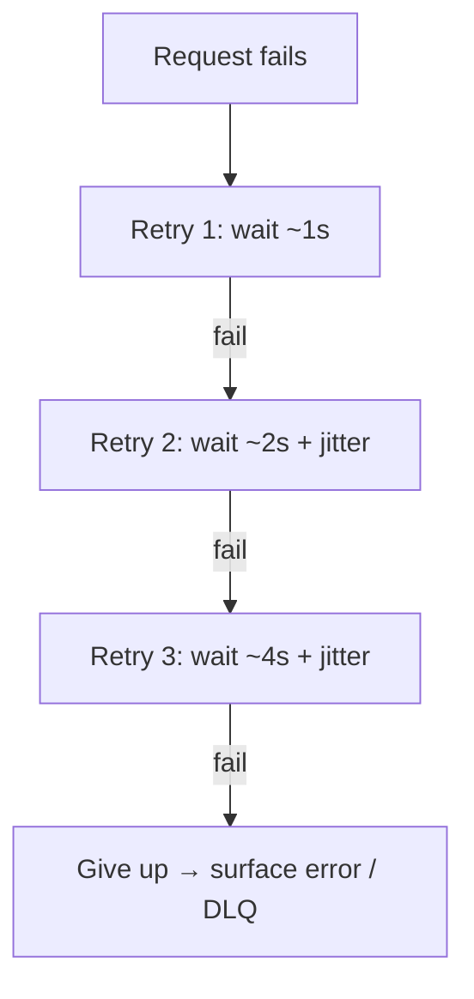
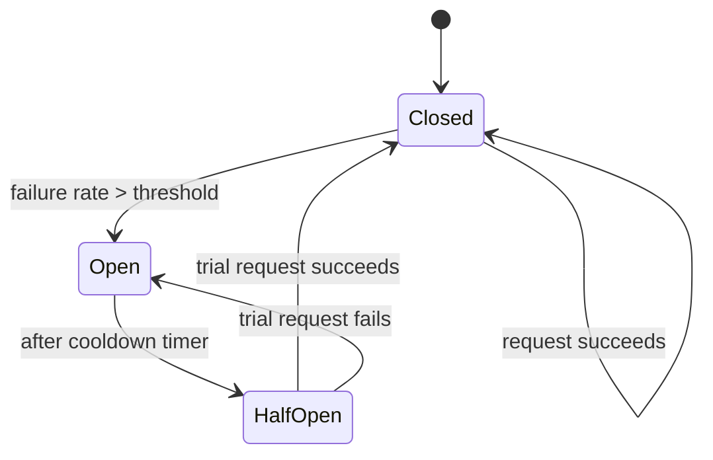
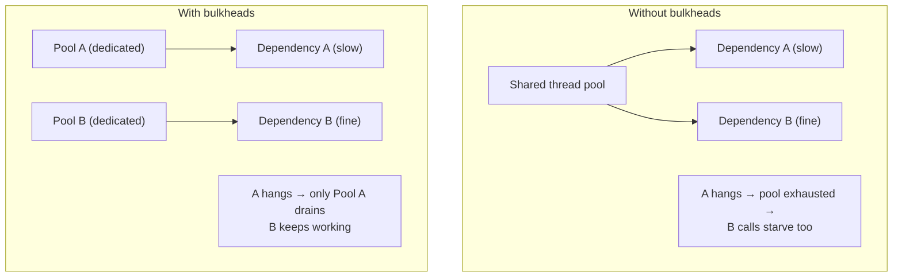
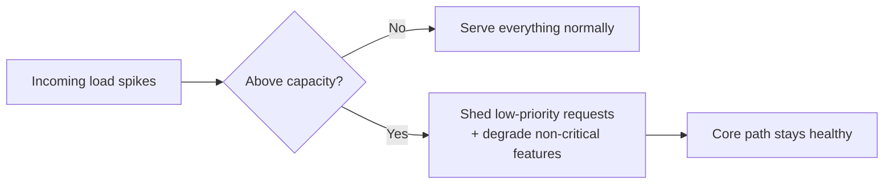
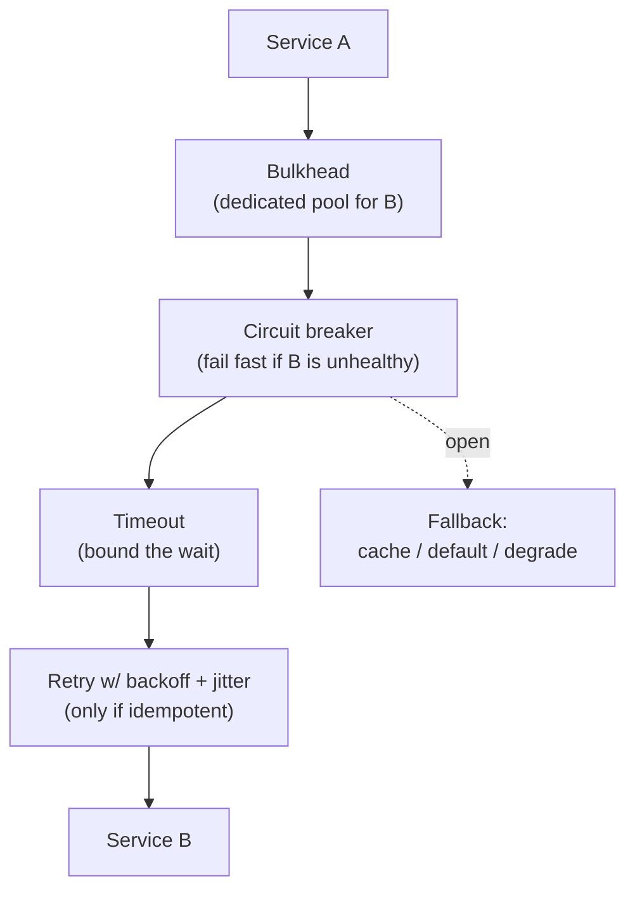

# 8 · Resilience & Fault Tolerance Patterns

> **The core question:** in a distributed system, failures are not exceptional — they're constant (a slow dependency, a dead node, a network blip). How do you stop one failing component from cascading into a full outage? Resilience patterns are the standard toolkit for containing failure blast radius.

**TL;DR**
- **Timeouts** bound how long you wait; without them, a slow dependency hangs you forever.
- **Retries** help with transient failures but must use **exponential backoff + jitter** to avoid retry storms.
- **Circuit breakers** stop calling a failing dependency, giving it time to recover and freeing your own threads.
- **Bulkheads** isolate resource pools per-dependency so one bad dependency can't starve all others.
- **Graceful degradation** and **load shedding** trade full functionality for staying up under overload.

---

## 1. Timeouts

Every network call must have a timeout. Without one, a hung dependency holds a thread/connection indefinitely, and those pile up until your service itself runs out of resources and dies — a slow dependency becomes *your* outage.

**Rule of thumb:** set timeouts based on the downstream's own SLO (p99 latency) plus margin — not an arbitrary round number. Chain timeouts should shrink as you go deeper in a call graph so the outermost caller times out *last*.

---

## 2. Retries with Backoff & Jitter

Transient failures (a blip, a momentary overload) often succeed on retry. But naive immediate retries can amplify an outage — thousands of clients retrying at the same instant hit an already-struggling service even harder (a **retry storm**).

- **Exponential backoff** — each retry waits longer (`base × 2^attempt`), giving the dependency room to recover.
- **Jitter** — add randomness to the wait so many clients don't retry in lockstep.
- **Retry budget / max attempts** — cap total retries; only retry **idempotent** operations (see [Topic 5](05-asynchronism-and-messaging.md#4-delivery-semantics-and-idempotency)).
- **Only retry retryable errors** — retry `503`/timeouts, never retry `400`/`404` (the request itself is wrong, retrying won't help).

---

## 3. Circuit Breaker

Modeled on an electrical circuit breaker: if a dependency keeps failing, **stop calling it** for a while instead of piling up timeouts and retries against it.

- **Closed** — requests flow normally; failures are counted.
- **Open** — failure threshold exceeded → **fail fast immediately** (no call made), protecting both the caller's threads and the struggling dependency. A fallback (cached value, default response) can be returned instead.
- **Half-Open** — after a cooldown, let a *trial* request through. Success → close the breaker; failure → reopen and wait again.

**Why it matters at Staff+:** without a breaker, a single degraded dependency can exhaust caller thread pools/connections across an entire fleet — turning one bad component into a full-system outage. Libraries: Resilience4j, Hystrix (legacy), Envoy/Istio built-in breakers.

---

## 4. Bulkheads

Named after a ship's watertight compartments: partition resources (thread pools, connection pools) **per dependency** so exhaustion in one doesn't starve the others.

Combine with circuit breakers: bulkheads limit *how much damage* a failing dependency can do while the breaker decides *when to stop calling it at all*.

---

## 5. Graceful Degradation & Load Shedding

When you can't serve every request at full quality, decide **what to sacrifice** deliberately rather than collapsing entirely.

- **Graceful degradation** — serve a reduced experience instead of an error: stale cache instead of live data, a simplified UI without recommendations, core checkout without the "you might also like" widget.
- **Load shedding** — under overload, deliberately reject *some* requests (usually low-priority ones) so the system stays healthy for the rest, instead of every request slowing down until all of them time out. Often implemented with priority queues or simple random sampling at the edge.
- **Feature flags / kill switches** — the operational lever to turn off an expensive, non-critical feature during an incident without a deploy.

---

## 6. Health Checks & Self-Healing

- **Liveness probe** — "is the process alive?" A failing liveness check triggers a **restart**.
- **Readiness probe** — "is the process ready to take traffic?" A failing readiness check pulls the instance **out of the load balancer** (without restarting it) — critical for slow-starting services or ones warming a cache.
- **Health checks feed the load balancer/orchestrator** (Kubernetes, ELB) so unhealthy nodes are automatically routed around — the infrastructure-level counterpart to the app-level patterns above.

---

## 7. Putting it together: defense in depth

A resilient call from Service A to Service B typically layers *all* of these:

No single pattern is sufficient alone — timeouts without breakers still hammer a dying dependency with retries; breakers without bulkheads still let one dependency's threads starve others.

---

## 8. What "good" looks like at Staff+

- Every network call in your system has an explicit **timeout**, and timeouts shrink appropriately down a call chain.
- Retries are **bounded, backed off, jittered, and limited to idempotent operations** — never a bare retry loop.
- You reach for a **circuit breaker** for any dependency that can degrade, and always define a **fallback**.
- You isolate blast radius with **bulkheads** so a single bad dependency can't take down the whole fleet.
- You've deliberately decided **what to shed first** under overload — it's a design decision, not an accident.

## Common pitfalls

- **No timeout** — a single hung dependency slowly exhausts every caller's resources.
- **Naive retries** (no backoff/jitter) — turns a small blip into a self-inflicted retry storm.
- **Retrying non-idempotent operations** — duplicate charges, duplicate emails.
- **Shared resource pools across dependencies** — one slow dependency starves all traffic, not just its own.
- **No fallback behind the circuit breaker** — "fail fast" still means the user sees an error; pair it with degraded functionality where possible.

---

## Further reading
- Release It! (Michael Nygard) — the book that popularized circuit breakers and bulkheads — https://pragprog.com/titles/mnee2/release-it-second-edition/
- Google SRE Book — "Addressing Cascading Failures" — https://sre.google/sre-book/addressing-cascading-failures/
- Resilience4j docs (circuit breaker, retry, bulkhead, rate limiter) — https://resilience4j.readme.io/
- AWS Builders' Library — "Timeouts, retries, and backoff with jitter" — https://aws.amazon.com/builders-library/timeouts-retries-and-backoff-with-jitter/
- Kubernetes — "Liveness, Readiness and Startup Probes" — https://kubernetes.io/docs/tasks/configure-pod-container/configure-liveness-readiness-startup-probes/
