# System Design & Architecture at Scale

> **The core idea in one sentence:** Lead any open-ended design conversation with one repeatable method — requirements, high-level design, core components, scale it — and name the trade-off behind every choice.

For senior engineers aiming at Staff or Principal who can already build services but want to **lead** the design conversation. Eight lessons cover the mental models (scaling axes, CAP and consistency), the building blocks (data, caching, async, networking and APIs), the quantitative glue (estimation) and how to stay up when things fail. Everything hangs off one **4-step method**: requirements &amp; constraints → high-level design → core components → scale it and name the trade-offs. This is competency A1, the core technical skill, in the [skills playbook](../02-skills-to-upgrade.md).

Self-contained deep dives for every sub-topic of **A1** in [../02-skills-to-upgrade.md](../02-skills-to-upgrade.md). Read each one and you'll gain the working knowledge a Staff/Principal engineer is expected to have. Every chapter uses Mermaid diagrams to make the concepts concrete.

> **How to read:** go in order — each builds on the last. Topics 1–2 are the mental models; 3–6 are the building blocks; 7 is the quantitative glue that ties a design together; 8 covers how to keep it standing when things fail.

This is the long-form edition of the course. Each chapter is also an interactive lesson (quizzes, a “try it in your own system” task and a primary source) — start from the [course map](index.html) — and has a one-page cheat sheet linked at the top of each chapter below.

---

## Table of contents

| # | Chapter | What you'll learn | Lesson |
|---|---|---|---|
| 1 | [Scalability Trade-off Axes](#chapter-1--scalability-trade-off-axes) | Performance vs scalability, latency vs throughput, vertical vs horizontal scaling, the AKF scale cube, availability in "nines". | [Lesson 01](lessons/0001-scalability-tradeoff-axes.html) |
| 2 | [CAP Theorem & Consistency Models](#chapter-2--cap-theorem--consistency-models) | CAP, PACELC, weak/eventual/strong consistency, the linearizability→eventual spectrum, quorums (N/W/R). | [Lesson 02](lessons/0002-cap-theorem-consistency-models.html) |
| 3 | [Databases & Data Modeling](#chapter-3--databases--data-modeling) | Replication, federation, sharding, SQL vs NoSQL, ACID vs BASE, isolation levels, consistent hashing, B-Tree vs LSM-Tree. | [Lesson 03](lessons/0003-databases-and-data-modeling.html) |
| 4 | [Caching](#chapter-4--caching) | Cache layers, cache-aside/read-through/write-through/write-behind/refresh-ahead, eviction, invalidation, stampede & hot keys. | [Lesson 04](lessons/0004-caching.html) |
| 5 | [Asynchronism & Messaging](#chapter-5--asynchronism--messaging) | Queues, back-pressure, delivery semantics, idempotency, event sourcing, CDC, Kafka internals. | [Lesson 05](lessons/0005-asynchronism-and-messaging.html) |
| 6 | [Networking & API Design](#chapter-6--networking--api-design) | TCP/UDP, HTTP/1→2→3, REST vs gRPC vs GraphQL, L4/L7 load balancers, reverse proxy, API gateway, DNS, CDN, API best practices. | [Lesson 06](lessons/0006-networking-and-api-design.html) |
| 7 | [Back-of-the-Envelope Estimation](#chapter-7--back-of-the-envelope-estimation) | Powers of two, latency numbers, availability math, QPS/storage/bandwidth estimation, a full worked example. | [Lesson 07](lessons/0007-back-of-envelope-estimation.html) |
| 8 | [Resilience & Fault Tolerance Patterns](#chapter-8--resilience--fault-tolerance-patterns) | Timeouts, retries with backoff & jitter, circuit breakers, bulkheads, graceful degradation, load shedding, health checks. | [Lesson 08](lessons/0008-resilience-and-fault-tolerance.html) |
| — | [Capstone project](#capstone-project) | Prove it end to end | — |
| — | [Self-assessment checklist](#self-assessment-checklist) and [study plan](#study-plan) | Know when you’re done | — |

## The 4-step method these topics serve

The reason to learn all of this is to lead an open-ended design conversation with a **repeatable method**:

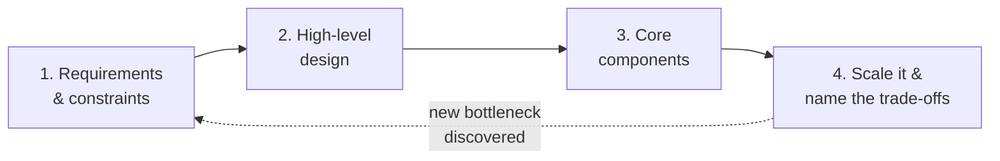

1. **Requirements & constraints** — functional + non-functional (scale, latency, consistency, availability). Estimate numbers (Topic 7).
2. **High-level design** — draw the boxes: clients → API → services → data stores.
3. **Core components** — pick the data model, storage engine, and communication style (Topics 3, 6).
4. **Scale it & name the trade-offs** — add load balancing, caching, sharding, async, replication — and *say out loud* what you're trading (Topics 1, 2, 4, 5). Then harden it against failure (Topic 8).

> **The Staff+ signal is not knowing every pattern — it's naming the trade-off behind every choice.** "Everything is a trade-off" is the through-line of all eight chapters.

---

## Canonical sources (used throughout)

- **System Design Primer** — https://github.com/donnemartin/system-design-primer
- **ByteByteGo / System Design 101** — https://github.com/ByteByteGoHq/system-design-101 · https://bytebytego.com
- **Designing Data-Intensive Applications** (Kleppmann) — https://dataintensive.net/
- **Google SRE Book** — https://sre.google/sre-book/table-of-contents/
- **Martin Fowler — Patterns of Distributed Systems** — https://martinfowler.com/articles/patterns-of-distributed-systems/
- **Release It!** (Michael Nygard) — https://pragprog.com/titles/mnee2/release-it-second-edition/

## How to study this guide (≈ 4–6 weeks part-time)

1. Go in order. Lessons 01–02 give you the vocabulary every later lesson uses; Lesson 07 makes more sense once you know what you are estimating *for*.
2. Hang every lesson on the **4-step method**: (1) requirements & constraints → (2) high-level design → (3) core components → (4) scale it & name the trade-offs. For each pattern, ask which step it serves.
3. After each lesson, state the trade-off behind every pattern in one sentence out loud ("write-behind: lowest write latency, but we lose data if the cache dies before the flush"). If you can't, re-read that section.
4. Answer the three quizzes before reading the feedback. Then do at least one *Try it* item against a system you actually own.
5. Keep the matching cheat sheet in `reference/` open during real design reviews. Print it if that helps.
6. Practise weekly on a whiteboard: one classic prompt (URL shortener, news feed, chat, rate limiter) in 45 minutes, all four steps, numbers first.
7. Use `GUIDE.md` to read end to end or to search; use the HTML lessons for practice and retrieval.

---

# Chapter 1 — Scalability Trade-off Axes

> **The core question:** as load grows by 10×, 100×, 1000× — does your system keep working, and at what cost? Scalability is the ability to handle growth by *adding resources*, without a rewrite and without a collapse in latency.

**TL;DR**
- **Performance** = fast for one user. **Scalability** = stays fast as users/data grow. They're different problems.
- **Latency** = time for one operation. **Throughput** = operations per unit time. You usually optimize for max throughput at *acceptable* latency.
- **Vertical scaling** (bigger machine) is simple but capped and a single point of failure. **Horizontal scaling** (more machines) is the real answer at scale — but forces you to handle statelessness, load balancing, and data partitioning.
- **Availability** is measured in "nines" and *composes* — series multiplies, parallel improves.

*Interactive lesson:* [Lesson 01 · Scalability trade-offs](lessons/0001-scalability-tradeoff-axes.html) · *Cheat sheet:* [Scalability trade-offs cheat sheet](reference/0001-scalability-tradeoff-axes-cheatsheet.html)

## 1.1 Performance vs Scalability

A useful litmus test (from the System Design Primer):

- If you have a **performance** problem, your system is **slow for a single user**.
- If you have a **scalability** problem, it's **fast for a single user but slow under load**.

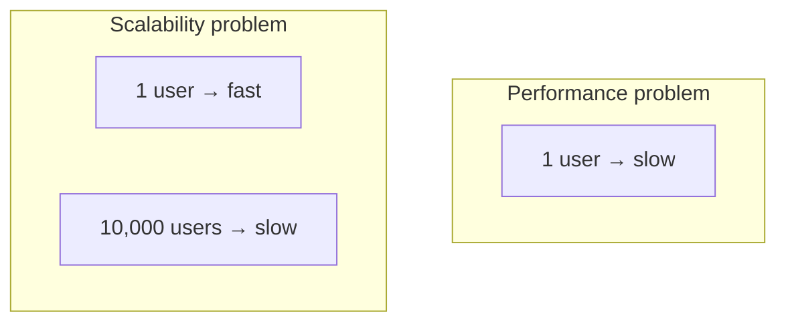

A system is **scalable** if adding resources yields a *proportional* increase in capacity. The enemy is any component whose cost grows **super-linearly** with load (e.g., an O(n²) fan-out, a shared lock, or a single database everyone hits).

## 1.2 Latency vs Throughput

- **Latency** — the time to perform a single operation (e.g., 20 ms per request). Often quoted as percentiles: **p50, p95, p99, p99.9**. *Tail latency* (p99+) is what users actually feel at scale.
- **Throughput** — the number of operations per unit time (e.g., 50,000 requests/sec).

> **Goal:** maximize throughput while keeping latency under an acceptable threshold. They trade off — batching and queuing raise throughput but add latency; the two are linked by **Little's Law**: `Concurrency = Throughput × Latency`.

**Why percentiles, not averages:** if p99 latency is 1 s and each page makes 100 backend calls, the *majority* of page loads will hit at least one slow call. Averages hide this.

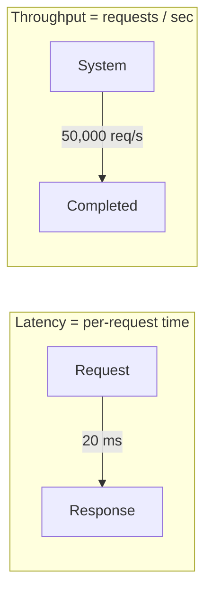

## 1.3 Vertical vs Horizontal Scaling

| | **Vertical (scale up)** | **Horizontal (scale out)** |
|---|---|---|
| How | Bigger CPU / RAM / disk on one box | More boxes behind a load balancer |
| Ceiling | Hard hardware limit | Effectively unlimited |
| Complexity | Low — no code changes | High — statelessness, LB, data partitioning |
| Failure | Single point of failure | Fault-tolerant (lose one node, survive) |
| Cost curve | Super-linear (big machines cost a premium) | ~Linear (commodity hardware) |
| Examples | A single Postgres primary | Web tier of 500 stateless app servers |

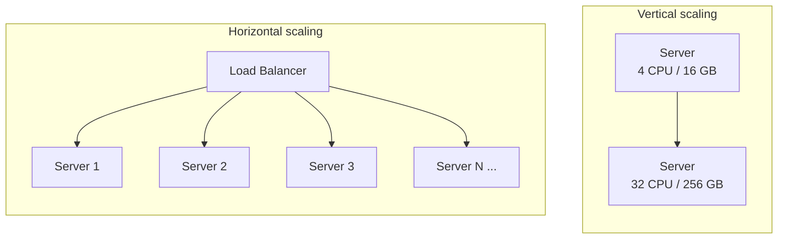

**The unlock for horizontal scaling is statelessness.** If application servers hold no session state locally (push it to a shared cache/DB or a signed token), any server can handle any request, and you can add/remove nodes freely. Stateful data is then concentrated in stores you scale deliberately (Topic 3).

## 1.4 The AKF Scale Cube (three ways to scale)

A powerful model: any system can scale along three independent axes.

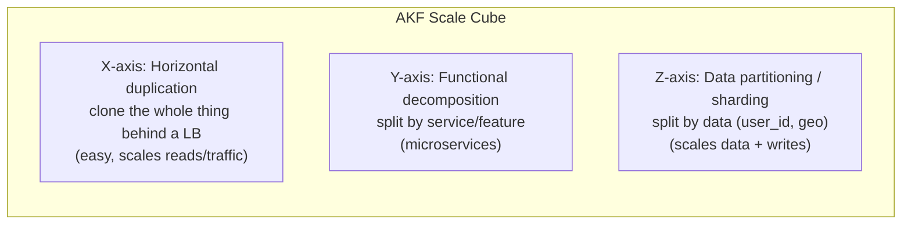

- **X-axis — cloning:** run N identical copies behind a load balancer. Scales *traffic* and *reads*; doesn't help if the dataset is too big for one node.
- **Y-axis — functional split:** break the monolith into services by responsibility (auth, orders, search). Scales *team* and *complexity*, lets each service scale independently.
- **Z-axis — sharding:** split the *data* across nodes by a key (e.g., `user_id % N`, geography). Scales *data volume* and *writes* — the hardest and most powerful axis (see Topic 3).

Most large systems use all three: cloned stateless services (X), decomposed by domain (Y), each backed by a sharded data store (Z).

## 1.5 Availability & the "nines"

**Availability** = the fraction of time the system is up and correctly serving requests. Quoted as "nines":

| Availability | Downtime / year | Downtime / day |
|---|---|---|
| 99% ("two nines") | 3.65 days | 14.4 min |
| 99.9% ("three nines") | 8.77 hours | 1.44 min |
| 99.99% ("four nines") | 52.6 min | 8.6 sec |
| 99.999% ("five nines") | 5.26 min | 0.86 sec |

### Availability composes — and topology matters

**In series** (request must pass through *both* → multiply, availability drops):

```
A_total = A_1 × A_2      →   99.9% × 99.9% = 99.8%
```

**In parallel** (either one works → availability *rises*):

```
A_total = 1 − (1 − A_1) × (1 − A_2)   →   99.9% + 99.9% ≈ 99.9999%
```

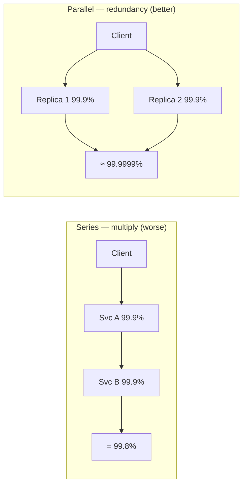

**Design implication:** every hop in a request chain *reduces* availability, so long synchronous call chains are fragile — add redundancy (parallel replicas), remove hops, or make hops asynchronous. This is also why availability and consistency collide during failures — the subject of [Topic 2](#chapter-2--cap-theorem--consistency-models).

> **SLA vs SLO vs SLI:** an **SLI** is the measured indicator (e.g., success rate), an **SLO** is your internal target (e.g., 99.95%), and an **SLA** is the contractual promise to customers (usually looser than the SLO). See the SRE deep-dive in [../02-skills-to-upgrade.md](../02-skills-to-upgrade.md#a3-reliability-observability--operating-at-scale-sre).

## 1.6 What "good" looks like at Staff+

- You **quantify** before you architect: state the target QPS, data size, and latency budget (Topic 7).
- You reach for **horizontal + stateless** by default and know *exactly* which component is the stateful bottleneck.
- You talk in **percentiles** (p99), not averages, and design for **tail latency**.
- You can point at any request path and say *"this hop costs us a nine — here's how we make it redundant or async."*

## 1.7 Common pitfalls

- **Premature scaling** — building for 1B users when you have 1,000. Scale the design when the numbers demand it; keep it simple until then ("choose boring technology").
- **Hidden single points of failure** — one primary DB, one cache, one AZ. Redundancy on paper, series dependency in practice.
- **Optimizing average latency** while p99 quietly melts under load.
- **Stateful app servers** that block horizontal scaling and make deploys/failover painful.

## 1.8 Further reading

- System Design Primer — "Performance vs scalability", "Latency vs throughput", "Availability patterns" — https://github.com/donnemartin/system-design-primer
- AKF Scale Cube — https://akfpartners.com/growth-blog/scale-cube
- *Designing Data-Intensive Applications*, Ch. 1 (Reliable, Scalable, Maintainable) — https://dataintensive.net/
- Google SRE Book — "Embracing Risk" (availability targets) — https://sre.google/sre-book/embracing-risk/

## 1.9 Check yourself

1. Checkout loads in 120 ms when an engineer tests it alone, but p99 climbs to 4 s at the daily peak while app-tier CPU sits at 30%. How do you frame the incident review?
   - A. A performance problem: profile the checkout code path for a single user
   - B. A scalability problem: find the shared part whose cost grows with load
   - C. A capacity problem: double the app-tier instance count before next peak
   - D. A dashboard problem: switch the latency panel from p99 to the average

2. A product page fans out 100 backend calls in parallel. Each backend has a median of 20 ms and a p99 of 1 s. The team says “average latency looks fine”. Your review comment:
   - A. Agreed — the average reflects what a typical page load experiences
   - B. Agreed — parallel calls mean the page waits only for the fastest one
   - C. Batch all 100 calls into one, as batching always lowers latency too
   - D. Most page loads hit at least one slow call; budget and alert on p99

3. A request goes gateway → orders → payments, each 99.9% available and called synchronously in series. Product wants 99.9% end to end. Which change moves you toward it?
   - A. Make each hop redundant, and take payments off the synchronous path
   - B. Move all three services to larger instances so each responds faster
   - C. Nothing — three hops at 99.9% each still compose to 99.9% overall
   - D. Add a retry-proxy service in front of payments to absorb failures

<details markdown="1">
<summary>Answers</summary>

1. **B** — fast for one user, slow under load. Look for a shared lock, a single database or a fan-out that grows super-linearly. Slow for one user is a performance problem; fast for one but slow under load is a scalability problem. Hunt the component whose cost grows super-linearly.
2. **D** — 1 − 0.99^100 ≈ 63% of pages wait on at least one 1 s call. Design and alert on percentiles. Fan-out amplifies tail latency: talk in percentiles (p99, p99.9), not averages, and design for the tail.
3. **A** — series multiplies to ≈ 99.7%. Parallel replicas raise each hop's availability, and an async hop leaves the chain. Availability composes: series multiplies (worse), parallel redundancy improves it. Remove hops, make them redundant, or make them async.

</details>

**Try it in your own system**

- Draw the busiest request path you own, hop by hop. Multiply the hops’ availabilities and compare the result with the SLO you promise.
- Pull p50, p99 and p99.9 for that path at peak. If dashboards or alerts show only averages, move one alert to p99 this week.
- List every piece of state on your app servers (sessions, local files, in-process caches). Which one stops you adding or removing nodes freely?
- Place your system on the AKF cube: which axes (X clone, Y split, Z shard) do you use today, and which one will the next 10× need?

---

# Chapter 2 — CAP Theorem & Consistency Models

> **The core question:** when the network breaks and your nodes can't talk to each other, do you keep answering (risking stale/wrong data) or refuse to answer (staying correct)? You cannot have both. This is the single most important trade-off in distributed data.

**TL;DR**
- **CAP:** in the presence of a network **Partition**, you must choose **Consistency** *or* **Availability**. Partition tolerance isn't optional in a distributed system — so the real choice is **CP vs AP**.
- **PACELC** extends it: **E**lse (when there's no partition) you still trade **L**atency vs **C**onsistency.
- Consistency is a **spectrum**, not a boolean: *linearizable → sequential → causal → eventual* (strong to weak).
- **Quorums** (`N`, `W`, `R`) let you tune the consistency/availability dial: `W + R > N` gives strong reads.

*Interactive lesson:* [Lesson 02 · CAP & consistency](lessons/0002-cap-theorem-consistency-models.html) · *Cheat sheet:* [CAP & consistency cheat sheet](reference/0002-cap-theorem-consistency-models-cheatsheet.html)

## 2.1 The CAP Theorem

In a distributed data store you can guarantee at most **two of three**:

- **C — Consistency:** every read sees the most recent write (or an error). All nodes agree. *(This is "linearizability", not the C in ACID.)*
- **A — Availability:** every request gets a non-error response — but not necessarily the latest data.
- **P — Partition tolerance:** the system keeps working despite dropped/delayed messages between nodes.

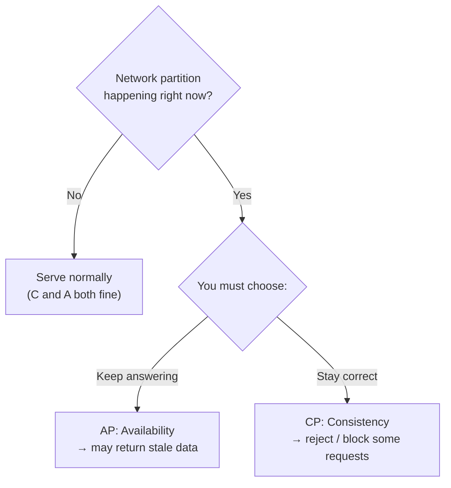

**The key insight:** partitions *will* happen (cables cut, switches fail, GC pauses, network blips). Since you can't sacrifice **P** in a real distributed system, CAP reduces to a decision you make **only during a partition**: **CP or AP**.

### CP vs AP in practice

| | **CP (choose Consistency)** | **AP (choose Availability)** |
|---|---|---|
| During a partition | Rejects/blocks writes or reads on the minority side | Accepts reads/writes everywhere, reconciles later |
| Good for | Money, inventory, bookings, unique constraints | Feeds, likes, carts, presence, metrics |
| Examples | ZooKeeper, etcd, HBase, Spanner, most RDBMS w/ sync replication | Cassandra, DynamoDB (default), Riak, DNS |
| Failure feel | "Try again later" | "You might see slightly old data" |

> There is **no "CA" system** in the real world: you cannot drop partition tolerance and still be distributed. A single-node database is "CA" only because it isn't distributed.

## 2.2 PACELC — the more complete model

CAP only describes behavior *during* a partition. **PACELC** captures the everyday trade-off too:

> **If Partition (P): choose A or C. Else (E): choose L (latency) or C (consistency).**

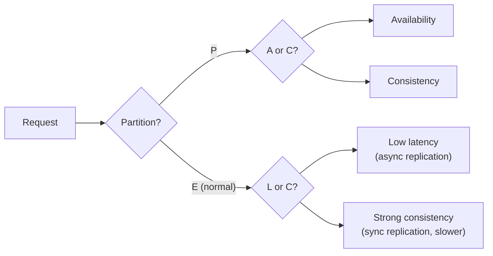

Even with a healthy network, keeping replicas perfectly in sync means **waiting** for acknowledgements (higher latency). So systems like DynamoDB and Cassandra are **PA/EL** (favor availability *and* latency), while Spanner is **PC/EC** (favor consistency in both modes, paying latency for it).

## 2.3 Consistency is a spectrum

"Consistency" isn't on/off. From strongest (most intuitive, most expensive) to weakest (cheapest, most available):

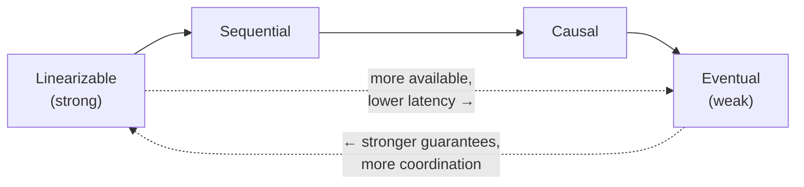

- **Linearizable (strong):** the system behaves as if there's a single copy of the data and every operation happens atomically at a single instant. A read always returns the latest committed write. *Most intuitive, most expensive — requires coordination/consensus.*
- **Sequential:** all nodes see operations in the *same order*, but that order need not match real-time wall-clock order.
- **Causal:** operations that are causally related (A "happened before" B) are seen in that order by everyone; concurrent operations may be seen in any order. A great middle ground — preserves "reply after post" style ordering without global coordination.
- **Eventual:** if writes stop, all replicas *eventually* converge to the same value. Reads may return stale data in the meantime. Cheapest, most available (DNS, S3 historically, shopping-cart merges).

### The three consistency *patterns* (a simpler practitioner's lens)

- **Weak consistency** — after a write, reads may or may not see it. No guarantees. (Live video, VoIP, online games — stale data is simply dropped.)
- **Eventual consistency** — reads will see the write *after a delay*, and replicas converge. (DNS, email, most AP stores.)
- **Strong consistency** — after a write, every read sees it. (RDBMS, file systems, anything with transactions.)

### Client-centric guarantees worth knowing
- **Read-your-writes** — you always see your *own* latest write (even if others don't yet). Common UX fix on eventually-consistent stores.
- **Monotonic reads** — you never see time "go backwards" (a later read won't return older data than an earlier one).

## 2.4 Replication & Quorums — tuning the dial

Data is replicated to `N` nodes. On each operation you decide how many must acknowledge:

- `N` = number of replicas
- `W` = replicas that must **ack a write** before it's considered successful
- `R` = replicas that must **respond to a read**

**The magic inequality:** if `W + R > N`, the read and write sets are guaranteed to **overlap** on at least one node → the read sees the latest write → **strong consistency**. If `W + R ≤ N`, you get **eventual consistency** but higher availability and lower latency.

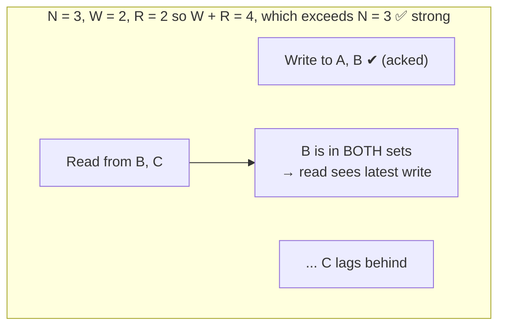

**Common configurations:**

| Config | Property | Use when |
|---|---|---|
| `W=N, R=1` | Fast reads, slow/fragile writes | Read-heavy, rarely written data |
| `W=1, R=N` | Fast writes, slow reads | Write-heavy logging/ingest |
| `W=quorum, R=quorum` (e.g. N=3,W=2,R=2) | Balanced strong consistency, tolerates 1 node down | The usual default |
| `W+R ≤ N` | Eventual, max availability | AP systems (Cassandra tunable) |

**Replication topologies** (see [Topic 3](#32-replication) for details): single-leader (primary/replica), multi-leader, and leaderless (Dynamo-style quorum). The more leaders, the higher the availability but the harder the **conflict resolution** (last-write-wins, version vectors, CRDTs).

## 2.5 How consistency is actually achieved: consensus

Strong consistency across nodes requires the nodes to **agree** on an order of operations despite failures. That's the job of **consensus algorithms** — **Paxos** and the more understandable **Raft**. They elect a leader and replicate an ordered log to a majority quorum; a value is committed once a majority persists it. This underpins etcd, ZooKeeper, Spanner, CockroachDB, and Kafka's controller.

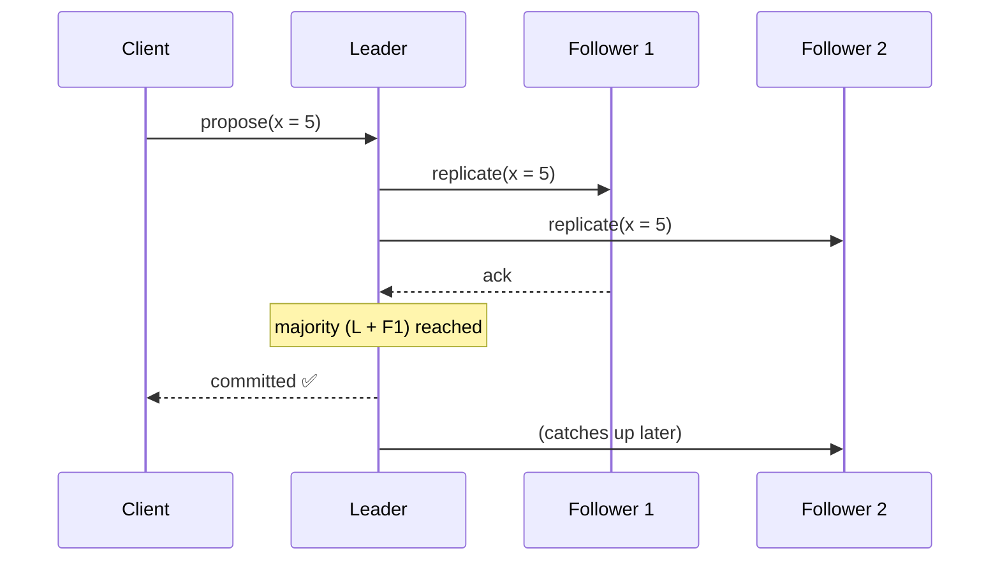

> You rarely implement consensus yourself — you *use* a system that provides it (etcd, ZooKeeper) for leader election, config, and locks. The Staff+ skill is knowing **when** you need it (coordination, uniqueness, ordering) versus when eventual consistency is fine.

## 2.6 What "good" looks like at Staff+

- You ask **"what happens during a partition?"** for every stateful component and can state whether it's CP or AP — *and why that's the right call for this data*.
- You match the **consistency model to the business need**: strong for money/inventory/uniqueness; eventual for feeds/likes/metrics.
- You can tune `N/W/R` quorums and explain the resulting guarantee.
- You reach for **consensus (etcd/ZooKeeper)** only where you truly need coordination, not everywhere.

## 2.7 Common pitfalls

- **Assuming "eventual" means "a few milliseconds."** Under load or partition, replication lag can be seconds to minutes — plan the UX (read-your-writes) around it.
- **Treating CAP's C as ACID's C.** They're different: CAP-C is linearizability; ACID-C is preserving invariants within a transaction.
- **Believing you picked "CA."** You didn't — you picked CP or AP; you just haven't had a partition *yet*.
- **Multi-leader without a conflict strategy** — silent lost updates. Decide LWW vs version vectors vs CRDTs up front.

## 2.8 Further reading

- System Design Primer — "CAP theorem", "Consistency patterns", "Availability patterns" — https://github.com/donnemartin/system-design-primer#consistency-patterns
- Kleppmann, *DDIA* Ch. 5 (Replication) & Ch. 9 (Consistency & Consensus) — https://dataintensive.net/
- "Please stop calling databases CP or AP" (Kleppmann) — https://martin.kleppmann.com/2015/05/11/please-stop-calling-databases-cp-or-ap.html
- PACELC — https://en.wikipedia.org/wiki/PACELC_design_principle
- The Raft paper / visualization — https://raft.github.io/

## 2.9 Check yourself

1. A partition splits your inventory cluster across two AZs during a flash sale. Overselling the last 50 units means refunds and angry customers. The minority side should…
   - A. keep taking orders and reconcile stock with last-write-wins afterwards
   - B. keep taking orders, since partitions are too rare to design around
   - C. reject or block writes, and tell users to try again in a moment
   - D. switch the cluster into CA mode until the network link is restored

2. A user edits their bio, refreshes, and sees the old text. Reads go to async replicas that are usually 50 ms behind but lag seconds under load. The cheapest fix that meets the need is…
   - A. read-your-writes: route this user's reads to the leader after a write
   - B. make every replica synchronous so all reads everywhere are linearizable
   - C. put profile writes through a consensus layer such as etcd with Raft
   - D. lower the cache TTL on profile pages so the stale copy expires sooner

3. A leaderless store runs with N = 3. The team wants reads to always see the latest acknowledged write, and to keep serving reads and writes with one node down. Which setting fits?
   - A. W = 1, R = 1 — fastest path, and the replicas converge eventually
   - B. W = 3, R = 1 — fast reads, and every replica holds every write
   - C. W = 1, R = 3 — fast writes, and every read checks every replica
   - D. W = 2, R = 2 — read and write sets overlap on at least one node

<details markdown="1">
<summary>Answers</summary>

1. **C** — inventory needs CP. A short ‘try again later’ is cheaper than overselling. During a partition you choose CP or AP per data type: strong for money, inventory and uniqueness; eventual for feeds, likes and metrics.
2. **A** — a client-centric guarantee fixes the UX without paying for global strong consistency. Eventual doesn't mean ‘a few ms’. Plan the UX with read-your-writes or monotonic reads before buying global strong consistency.
3. **D** — W + R = 4 > 3, so reads see the latest write, and either quorum survives one node down. If W + R > N, read and write quorums overlap and reads are strong. Quorum/quorum (N=3, W=2, R=2) is the usual balanced default.

</details>

**Try it in your own system**

- For each stateful store your team owns, write one line: CP or AP during a partition, and why that is right for *this* data.
- Find one read path served from an async replica or eventually-consistent store. Measure replication lag at peak, not at idle.
- Pick a flow where users edit and then view their own data. Does it guarantee read-your-writes? If not, sketch the routing fix.
- If you run a tunable store (Cassandra, DynamoDB, Riak), record N/W/R or the consistency level per table, and whether W + R &gt; N.

---

# Chapter 3 — Databases & Data Modeling

> **The core question:** where does the data live, how is it kept consistent, and how does it keep working when it outgrows a single machine? This is the stateful heart of every system — and usually the first thing to become a bottleneck.

**TL;DR**
- Scale a relational DB in this order: **indexes & query tuning → read replicas → caching → federation → sharding → denormalization.** Each step adds complexity; stop when the numbers are satisfied.
- **SQL** = structured, relational, strong consistency, joins, ACID. **NoSQL** = flexible schema, horizontal scale, high write throughput, usually BASE/eventual.
- **ACID** (correctness) vs **BASE** (availability) is the philosophical split behind SQL vs NoSQL.
- **Isolation levels** trade correctness for concurrency; know the anomalies each one allows.
- **Consistent hashing** makes sharding elastic. **B-Tree vs LSM-Tree** is the read-optimized vs write-optimized storage-engine choice.

*Interactive lesson:* [Lesson 03 · Databases & data modeling](lessons/0003-databases-and-data-modeling.html) · *Cheat sheet:* [Databases & data modeling cheat sheet](reference/0003-databases-and-data-modeling-cheatsheet.html)

## 3.1 Scaling a relational database (in order)

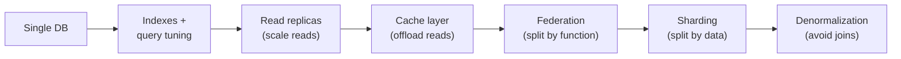

Apply the cheapest fix that meets your numbers; each step to the right adds operational cost.

- **Indexing & query tuning** — the highest-ROI step. A missing index turns a millisecond lookup into a full table scan. Tune with `EXPLAIN`.
- **Read replicas** — the primary handles writes and replicates to read-only copies. Scales *reads* (most apps are read-heavy). Cost: **replication lag** → replicas can serve stale data.
- **Caching** — put a cache in front (Topic 4) to absorb hot reads.
- **Federation** — split databases *by function* (users DB, products DB, orders DB). Smaller tables, more write throughput, parallel query. Cost: cross-DB joins become app-side.
- **Sharding** — split one big table *by data* across nodes (see §3). Scales *writes and data volume*.
- **Denormalization** — duplicate data to avoid expensive joins across replicas/shards. Trades write complexity + storage for read speed.

## 3.2 Replication

### Single-leader (primary/replica)
All writes go to the leader; reads can go to followers. Simple, strongly consistent if you read the leader; the standard RDBMS setup.

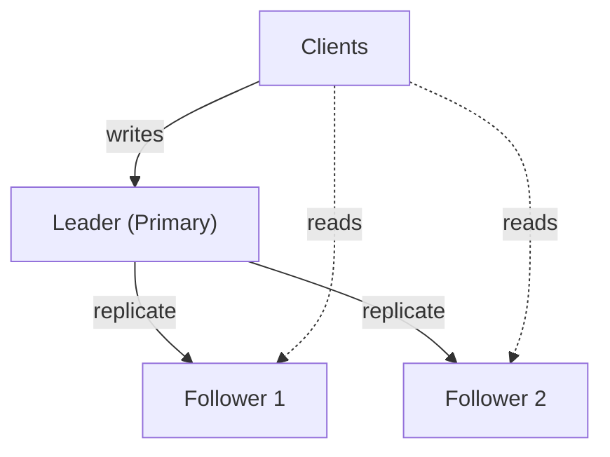

- **Synchronous replication** — leader waits for follower ack → no data loss on failover, higher write latency.
- **Asynchronous replication** — leader acks immediately → fast, but a crash can lose the last writes (replication lag). Most deployments are async or semi-sync.
- **Failover** — promote a follower when the leader dies; risk of split-brain and lost async writes.

### Multi-leader
Multiple nodes accept writes (e.g., one per region). Higher write availability and locality, but **write conflicts** must be resolved (last-write-wins, version vectors, CRDTs).

### Leaderless (Dynamo-style)
Any replica accepts writes; consistency tuned with quorums (`W + R > N`, see [Topic 2](#24-replication--quorums--tuning-the-dial)). Used by Cassandra, DynamoDB, Riak.

## 3.3 Sharding (partitioning)

Splitting one dataset across many nodes so each holds a subset. The way you choose the **shard key** determines everything.

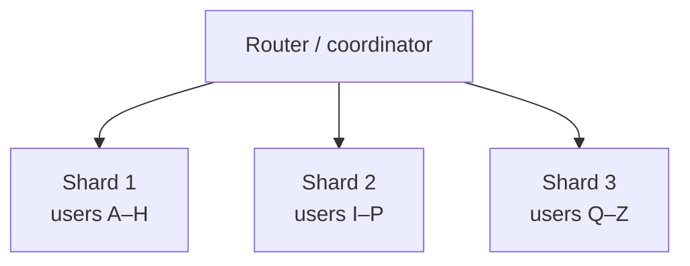

**Sharding strategies:**

| Strategy | How | Pro | Con |
|---|---|---|---|
| **Range** | Partition by key ranges (A–H, I–P…) | Efficient range scans | **Hotspots** if data/traffic is skewed |
| **Hash** | `hash(key) % N` | Even distribution | Range queries scatter; resharding reshuffles everything |
| **Consistent hash** | Hash onto a ring (§6) | Minimal reshuffle on node change | More complex |
| **Directory / lookup** | A lookup service maps key → shard | Flexible, easy rebalancing | The lookup table is a SPOF/bottleneck |
| **Geo** | Partition by region | Data locality, compliance | Cross-region queries costly |

**The hard parts of sharding:**
- **Cross-shard joins & transactions** — no longer free; often pushed to the app or avoided by denormalizing.
- **Hotspots / celebrity problem** — one shard gets disproportionate traffic (e.g., a viral user). Mitigate with a compound key or splitting hot keys.
- **Rebalancing** — adding a shard shouldn't move *all* the data (that's why consistent hashing exists).
- **Choosing the shard key** — pick high-cardinality, evenly-accessed keys. A bad key (e.g., `country`) creates permanent skew.

## 3.4 SQL vs NoSQL

### SQL (relational)
Tables, rows, fixed schema, relationships, **joins**, and **ACID** transactions. Best when data is structured and relationships/consistency matter (finance, orders, inventory). Examples: PostgreSQL, MySQL, SQL Server.

### NoSQL — four families

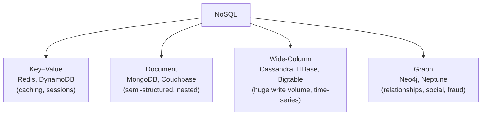

- **Key–Value** — a giant hash map. Blazing fast `get/put` by key. Sessions, caches, feature flags.
- **Document** — JSON-like documents; flexible schema; query within documents. Catalogs, user profiles, content.
- **Wide-Column** — rows with dynamic columns grouped into families; optimized for massive write throughput and range scans over a partition key. Time-series, event logs, messaging.
- **Graph** — nodes and edges as first-class citizens; traverse relationships cheaply. Social graphs, recommendations, fraud rings.

### When to choose which

| Choose **SQL** when… | Choose **NoSQL** when… |
|---|---|
| Data is relational, schema is stable | Schema is fluid / varies per record |
| You need multi-row ACID transactions | You need massive horizontal write scale |
| Complex ad-hoc queries & joins | Access patterns are known & simple (by key) |
| Consistency > raw availability | Availability/latency > strict consistency |

> **Modern reality:** the line blurs. Postgres has JSONB (document-style), and "NewSQL" (Spanner, CockroachDB, YugabyteDB) offers horizontal scale *with* SQL + ACID. Pick by *access pattern*, not hype.

## 3.5 ACID vs BASE

The two consistency philosophies — the root of the SQL/NoSQL divide.

**ACID (traditional RDBMS):**
- **Atomicity** — all-or-nothing; a transaction fully commits or fully rolls back.
- **Consistency** — a transaction moves the DB from one valid state to another (invariants hold).
- **Isolation** — concurrent transactions don't corrupt each other (see §7).
- **Durability** — once committed, it survives crashes (written to disk/WAL).

**BASE (many NoSQL):**
- **Basically Available** — the system always responds (maybe with stale data).
- **Soft state** — state may change over time even without input (due to async convergence).
- **Eventual consistency** — replicas converge eventually.

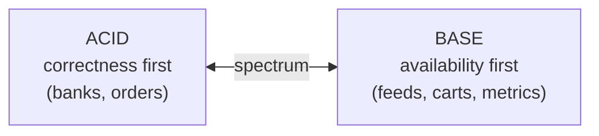

## 3.6 Consistent Hashing

**Problem:** with naïve `hash(key) % N`, adding/removing a node changes `N`, so *almost every key* remaps → a storm of cache misses / data movement.

**Solution:** map both **nodes** and **keys** onto a circular hash ring `[0, 2^32)`. A key belongs to the **first node clockwise** from its hash. Adding/removing a node only remaps the keys in **one arc** — on average `K/N` keys — instead of all of them.

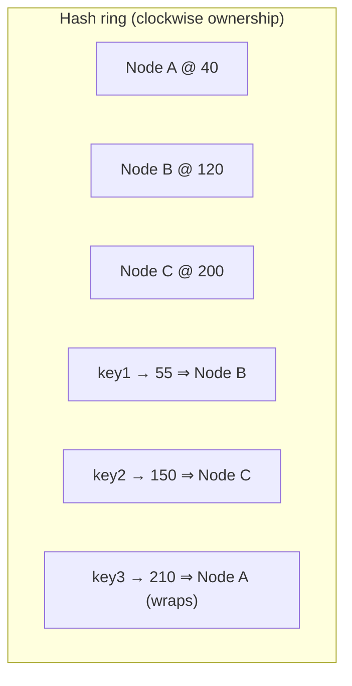

**Virtual nodes:** each physical node is placed at *many* points on the ring (e.g., 100–200 virtual nodes). This smooths out uneven distribution and lets heterogeneous machines take proportional load. Used by Cassandra, DynamoDB, and consistent-hash load balancers.

**Payoff:** adding a 4th node to a 3-node cluster moves ~25% of keys (to fill its arc), not ~100%.

## 3.7 Transaction Isolation Levels

Isolation controls what concurrent transactions can see of each other. Stronger isolation = fewer anomalies but less concurrency (more locking/aborts).

**The anomalies:**
- **Dirty read** — read another transaction's *uncommitted* change.
- **Non-repeatable read** — re-reading the same row returns a different value (someone committed an update in between).
- **Phantom read** — re-running the same *query* returns new/*different rows* (someone inserted/deleted matching rows).
- **Lost update / write skew** — two transactions read-modify-write and one clobbers the other, or two decisions based on the same read violate an invariant.

**The standard levels (weak → strong):**

| Level | Dirty read | Non-repeatable read | Phantom read |
|---|---|---|---|
| **Read Uncommitted** | ✅ possible | ✅ possible | ✅ possible |
| **Read Committed** | ❌ prevented | ✅ possible | ✅ possible |
| **Repeatable Read** | ❌ | ❌ prevented | ✅ possible* |
| **Serializable** | ❌ | ❌ | ❌ prevented |

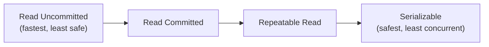

\* In the SQL standard, Repeatable Read permits phantoms; **MySQL InnoDB** prevents most phantoms at this level via next-key locking, and **Serializable** (often via **Serializable Snapshot Isolation**) prevents all anomalies. **Read Committed** is the common default (Postgres, Oracle).

> **Staff+ nuance:** most bugs come from *assuming* Serializable while running on Read Committed. Know your database's **default** and pick the weakest level that still protects your invariants — escalate specific transactions (e.g., `SELECT ... FOR UPDATE`) rather than globally serializing.

## 3.8 B-Tree vs LSM-Tree (storage engines)

How a database physically stores and retrieves data on disk — the deepest layer, and a real Staff+ differentiator.

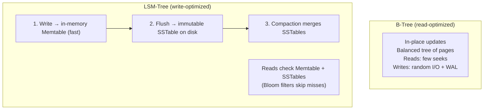

| | **B-Tree** | **LSM-Tree** |
|---|---|---|
| Writes | In-place, random I/O | Sequential appends (fast) |
| Reads | Fast, predictable | Slower (check multiple SSTables; Bloom filters help) |
| Write amplification | Moderate | Lower for writes, but **compaction** adds background I/O |
| Space | Fragmentation | Better compression (sorted immutable files) |
| Used by | PostgreSQL, MySQL/InnoDB, most RDBMS | Cassandra, RocksDB, LevelDB, HBase, ScyllaDB |
| Pick when | Read-heavy, range queries, transactions | Write-heavy ingest, time-series, logs |

**Bloom filter** — a compact probabilistic set that answers "is this key *definitely not* here?" with no false negatives. LSM engines use it to avoid scanning SSTables that can't contain the key, rescuing read performance.

## 3.9 What "good" looks like at Staff+

- You scale the DB in the **cheapest-first order** and know which step the current numbers justify.
- You choose SQL vs NoSQL (and the family) from the **access pattern**, not fashion — and can defend it.
- You choose a **shard key** that avoids hotspots and explain the cross-shard query cost.
- You know your DB's **default isolation level** and the anomalies it allows.
- You can reason about **B-Tree vs LSM** when picking a store for a write-heavy vs read-heavy workload.

## 3.10 Common pitfalls

- **Sharding too early** — it removes joins/transactions and multiplies ops burden. Exhaust replicas + caching + federation first.
- **A skewed shard key** → permanent hotspots you can't fix without a migration.
- **Reading from async replicas** and being surprised by stale data (add read-your-writes routing).
- **Denormalizing without an update strategy** → duplicated data drifts out of sync.
- **Assuming ACID across services** — distributed transactions are hard; prefer sagas / the outbox pattern ([Topic 5](#chapter-5--asynchronism--messaging)).

## 3.11 Further reading

- System Design Primer — "Database" (replication, federation, sharding, denormalization, SQL tuning, NoSQL) — https://github.com/donnemartin/system-design-primer#database
- Kleppmann, *DDIA* Ch. 2 (data models), Ch. 3 (storage engines: B-Tree vs LSM), Ch. 6 (partitioning), Ch. 7 (transactions/isolation) — https://dataintensive.net/
- ByteByteGo — "Data sharding", "ACID", "Isolation levels", "B-Tree vs LSM-Tree", "Consistent Hashing" — https://github.com/ByteByteGoHq/system-design-101
- Amazon Dynamo paper (consistent hashing, quorums) — https://www.allthingsdistributed.com/files/amazon-dynamo-sosp2007.pdf

## 3.12 Check yourself

1. A single Postgres primary is at 85% CPU. 90% of traffic is reads, and the top query does a sequential scan on `orders`. Someone proposes sharding by `customer_id`. What do you push for first?
   - A. Shard now — growth forces it later, and migrating later costs more
   - B. Federate into users, products and orders databases to split load
   - C. Move to a wide-column NoSQL store so writes scale horizontally
   - D. Fix the query with an index and EXPLAIN, then add read replicas

2. You are sharding a multi-tenant SaaS events table. One tenant drives 40% of traffic. The proposal shards by `country` “because most queries filter by country”. Your review comment:
   - A. Good — range sharding by country keeps range scans cheap and local
   - B. Low cardinality and skew: use a high-cardinality key, split hot tenants
   - C. Fine, as long as country values are placed with consistent hashing
   - D. Use a directory service instead, which removes hotspots by design

3. Two doctors are on call. Each transaction checks “at least one other doctor is on call”, then takes itself off call. Both commit, and nobody is on call. The database runs Read Committed. The right fix is…
   - A. nothing in the database; catch it with a nightly reconciliation job
   - B. drop to Read Uncommitted so each transaction sees the other's change
   - C. lock the rows you read (FOR UPDATE), or run this one as serializable
   - D. add a read replica so each check reads its own fresher copy of data

<details markdown="1">
<summary>Answers</summary>

1. **D** — indexing and query tuning is the highest-ROI step; replicas then scale a read-heavy load. Scale cheapest-first: index and tune → read replicas → cache → federation → sharding → denormalisation. Stop when the numbers are met.
2. **B** — a few countries can't spread load evenly, and a 40% tenant needs its own split or a compound key. Choose a high-cardinality, evenly-accessed shard key; a skewed key creates permanent hotspots you can't fix without a migration.
3. **C** — this is write skew. Escalate this one transaction instead of serialising the whole database. Know your default isolation level. Protect invariants by escalating specific transactions (SELECT … FOR UPDATE, serializable), not by serialising everything.

</details>

**Try it in your own system**

- Run `EXPLAIN` on your three slowest queries. For each, note the cheapest rung of the scaling ladder that would fix it.
- Look up your database’s default isolation level. Pick one invariant (balance, stock, uniqueness) and name the anomaly that could break it.
- If you shard, or plan to: list your top ten queries and mark which go cross-shard with your key. Check the key’s cardinality and skew.
- Note whether each store is B-Tree or LSM based and whether its workload is read-heavy or write-heavy. Flag any mismatch.
- Find one read from an async replica that follows a write by the same user. Is it routed for read-your-writes?

---

# Chapter 4 — Caching

> **The core question:** how do you serve the same expensive result many times without recomputing it? Caching stores a copy of data closer to the consumer to cut latency and offload the origin. It's the single highest-leverage performance tool — and the source of the two hardest problems in CS (naming, cache invalidation, and off-by-one errors).

**TL;DR**
- Cache at **every layer**: client → CDN → load balancer → app (in-memory) → distributed cache → database.
- Know the **read patterns** (cache-aside, read-through) and **write patterns** (write-through, write-behind, refresh-ahead) and their consistency/latency trade-offs.
- **Cache-aside** is the default; **write-through** for consistency; **write-behind** for write-heavy speed (with data-loss risk).
- The dangerous failure modes are **stampede/thundering herd**, **hot keys**, and **penetration** — each has a standard fix.

*Interactive lesson:* [Lesson 04 · Caching](lessons/0004-caching.html) · *Cheat sheet:* [Caching cheat sheet](reference/0004-caching-cheatsheet.html)

## 4.1 Where to cache — the layers

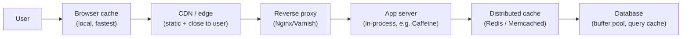

Each layer that satisfies a request saves *all* the work downstream. The closer to the user, the lower the latency but the harder to invalidate.

- **Client / browser** — HTTP caching via `Cache-Control`, `ETag`, `Expires`. Zero server cost.
- **CDN** — caches static (and cacheable dynamic) content at edge PoPs near users (Topic 6).
- **Reverse proxy** — Nginx/Varnish cache full responses in front of app servers.
- **Application (in-process)** — an in-memory map in the app (Guava/Caffeine). Nanosecond access, but per-instance (not shared) and lost on restart.
- **Distributed cache** — Redis/Memcached: a shared, network-accessible cache all app instances use. The workhorse.
- **Database** — buffer pool / page cache keeps hot pages in RAM.

## 4.2 Read patterns

### Cache-Aside (lazy loading) — the default
The application manages the cache. On a miss, it loads from the DB and populates the cache.

```mermaid
sequenceDiagram
    participant App
    participant Cache
    participant DB
    App->>Cache: get(key)
    alt hit
        Cache-->>App: value ✅
    else miss
        Cache-->>App: nil
        App->>DB: query
        DB-->>App: value
        App->>Cache: set(key, value, TTL)
    end
```

- ✅ Only requested data is cached (lazy); cache failure doesn't break the app (falls back to DB).
- ❌ First request per key is always a miss (cold cache); risk of stale data until TTL expiry; app owns the logic.

### Read-Through
The cache library sits inline: the app asks the *cache*, and the cache itself loads from the DB on a miss. Same effect as cache-aside but the loading logic lives in the cache layer, not the app.

## 4.3 Write patterns

```mermaid
flowchart TB
    subgraph WT["Write-Through"]
        WTa["App writes → Cache → DB<br/>(both synchronously)"]
        WTb["✅ Cache always fresh<br/>❌ Higher write latency"]
    end
    subgraph WB["Write-Behind (Write-Back)"]
        WBa["App writes → Cache (ack now)<br/>→ async flush to DB later"]
        WBb["✅ Very fast writes, absorbs bursts<br/>❌ Data loss if cache dies before flush"]
    end
    subgraph RA["Refresh-Ahead"]
        RAa["Cache proactively reloads<br/>hot keys before they expire"]
        RAb["✅ Hides latency for hot keys<br/>❌ Wasted refreshes for cold keys"]
    end
```

| Pattern | Consistency | Write latency | Risk | Use when |
|---|---|---|---|---|
| **Write-through** | Strong (cache = DB) | Higher (2 writes) | None extra | Read-heavy, must be fresh |
| **Write-behind** | Eventual | Lowest | Data loss on cache crash | Write-heavy, tolerant of loss (metrics, counters) |
| **Write-around** | — | Normal | Cache stays cold for new data | Writes rarely re-read soon |
| **Refresh-ahead** | Fresh for hot keys | — | Wasted work on cold keys | Predictable hot keys |

**Write-around** = write straight to the DB, bypassing the cache; the key is only cached later on a read. Prevents flooding the cache with write-once data.

## 4.4 Eviction & expiration

The cache is smaller than the origin, so it must decide what to keep.

- **TTL (time-to-live)** — every entry expires after a set time. The simplest freshness control; combine with everything below.
- **LRU (Least Recently Used)** — evict what hasn't been touched longest. The most common; great for temporal locality.
- **LFU (Least Frequently Used)** — evict the least-accessed; good when popularity is stable.
- **FIFO** — evict oldest inserted, regardless of use.
- **Random** — cheap, surprisingly okay under uniform access.

```mermaid
flowchart LR
    New["New entry"] -->|cache full| Evict{"Eviction policy"}
    Evict -->|LRU| E1["Drop least-recently-used"]
    Evict -->|LFU| E2["Drop least-frequently-used"]
    Evict -->|TTL| E3["Drop expired"]
```

## 4.5 Invalidation — keeping the cache honest

*"There are only two hard things in Computer Science: cache invalidation and naming things."* — Phil Karlton

Strategies to avoid serving stale data:
- **TTL expiry** — accept staleness up to the TTL. Simplest; tune TTL to tolerance.
- **Write-through / write-behind** — update the cache on write (§3).
- **Explicit invalidation** — on a DB write, delete/update the affected keys (event-driven, often via a CDC stream from [Topic 5](#chapter-5--asynchronism--messaging)).
- **Versioned keys** — embed a version/hash in the key (`user:123:v7`); a new version naturally bypasses old entries.

## 4.6 The dangerous failure modes (and their fixes)

### Cache stampede / thundering herd
A hot key expires → thousands of concurrent requests all miss and hammer the DB at once, potentially collapsing it.

```mermaid
sequenceDiagram
    participant Users as 10,000 users
    participant Cache
    participant DB
    Note over Cache: hot key "homepage" expires
    Users->>Cache: get(homepage) — all miss
    Users->>DB: 10,000 simultaneous queries 💥
    Note over DB: overload / cascading failure
```

**Fixes:**
- **Request coalescing / single-flight** — only the *first* miss recomputes; others wait for its result.
- **Lock/mutex per key** — one loader repopulates; others read the fresh value.
- **TTL jitter** — randomize expiry (`TTL ± random`) so keys don't expire together.
- **Early/probabilistic refresh** — refresh slightly *before* expiry (refresh-ahead).

### Hot key
One key gets so much traffic it saturates a single cache node. **Fix:** replicate the key across nodes, add a small local (in-process) cache in front of the distributed cache, or split the value.

### Cache penetration
Requests for keys that **don't exist** always miss and fall through to the DB (common in attacks). **Fix:** cache the "not found" result (with a short TTL), or use a **Bloom filter** to reject impossible keys before hitting the DB.

### Cache avalanche
Many keys expire simultaneously (e.g., after a cache restart) → mass misses. **Fix:** TTL jitter + warm the cache on startup.

## 4.7 Redis vs Memcached (the two workhorses)

| | **Redis** | **Memcached** |
|---|---|---|
| Data types | Rich (strings, hashes, lists, sets, sorted sets, streams, HLL) | Strings/blobs only |
| Persistence | Optional (RDB snapshots, AOF) | None (pure cache) |
| Replication/HA | Yes (replicas, Sentinel, Cluster) | No (client-side sharding) |
| Threading | Mostly single-threaded (fast, simple) | Multi-threaded |
| Use when | You need structures, persistence, pub/sub, atomic ops | Pure, simple, multi-threaded key-value cache |

> Redis is the default choice today because its data structures and HA cover far more use cases (rate limiters, leaderboards, sessions, queues, locks).

## 4.8 What "good" looks like at Staff+

- You place caches **deliberately at the right layers** and know the invalidation cost of each.
- You pick the **write pattern** from the consistency/latency/durability needs, not by habit.
- You **design for the failure modes** up front — stampede, hot key, penetration — because they only appear under load.
- You treat the cache as an **optimization, not a source of truth**: the system must be correct (if slower) with the cache empty.

## 4.9 Common pitfalls

- **Caching without a TTL or invalidation plan** → permanent staleness.
- **Making the app depend on the cache** — a cache outage must degrade latency, not correctness.
- **No stampede protection** on hot keys → the cache *causes* the outage it was meant to prevent.
- **Caching highly personalized data** with low hit rates → all cost, no benefit.
- **Ignoring cache-hit-ratio metrics** — you can't tune what you don't measure.

## 4.10 Further reading

- System Design Primer — "Cache" (layers, cache-aside, write-through, write-behind, refresh-ahead) — https://github.com/donnemartin/system-design-primer#cache
- ByteByteGo — caching strategies & "Top caching strategies" — https://github.com/ByteByteGoHq/system-design-101
- AWS — "Caching best practices" & ElastiCache docs — https://aws.amazon.com/caching/best-practices/
- Redis vs Memcached — https://aws.amazon.com/elasticache/redis-vs-memcached/

## 4.11 Check yourself

1. The homepage key is cached with a 60 s TTL. Every minute, database CPU spikes to 100% for two seconds and p99 jumps. What's the most direct fix?
   - A. Single-flight the reload so one request recomputes while others wait
   - B. Raise the TTL to one hour so the spike happens sixty times less often
   - C. Switch the eviction policy for the homepage key from LRU to LFU
   - D. Move the homepage key from Redis to Memcached for multi-threading

2. A metrics service records billions of counter increments a day. Losing a few seconds of increments in a crash is acceptable; write latency must be minimal. Which write pattern fits?
   - A. Write-through, so the cache and the database never disagree
   - B. Write-around, so counters skip the cache and go straight to the DB
   - C. Write-behind: ack from the cache and flush to the DB asynchronously
   - D. Cache-aside, loading each counter into the cache lazily on reads

3. A bot hammers `/users/{id}` with random IDs that don't exist. The hit ratio for real users is fine, but database load triples. What do you add?
   - A. TTL jitter on all user keys so that they never expire together
   - B. Cache ‘not found’ briefly, or put a Bloom filter before the DB
   - C. Replicate the hottest user keys across several cache nodes
   - D. Switch to write-through so every new user is cached on creation

<details markdown="1">
<summary>Answers</summary>

1. **A** — this is a stampede. Coalescing (or a per-key lock, TTL jitter or early refresh) stops the herd. Stampede fixes: request coalescing / single-flight, a lock per key, TTL jitter, early refresh. Build them in before the load arrives.
2. **C** — lowest write latency and burst absorption; the accepted risk is losing unflushed data. Pick the write pattern from consistency, latency and durability needs: write-through for freshness, write-behind for speed with loss risk, write-around for write-once data.
3. **B** — this is cache penetration. Negative-cache misses or reject impossible keys cheaply. Penetration means misses for keys that don't exist. Cache the ‘not found’ with a short TTL, or reject impossible keys with a Bloom filter.

</details>

**Try it in your own system**

- Inventory your caches by layer (browser, CDN, reverse proxy, in-process, distributed). For each, write the TTL and the invalidation path.
- Find your hottest key. What happens when it expires at peak? Look for single-flight, a lock or TTL jitter. If none, file the ticket.
- Check the hit ratio of each cache. Low hit ratios on personalised data may cost more than they save.
- Game day or thought experiment: flush the distributed cache. Does the system stay correct, and how far does latency degrade?

---

# Chapter 5 — Asynchronism & Messaging

> **The core question:** how do you decouple a fast producer from a slow consumer so neither takes the other down — and how do you guarantee the work eventually happens, even across failures? Asynchronous messaging turns tightly-coupled, synchronous call chains into resilient, independently-scalable pipelines.

**TL;DR**
- **Async decoupling** lets producers and consumers scale and fail independently; a queue absorbs bursts.
- **Message queue** (point-to-point, one consumer per message) vs **pub/sub** (fan-out to many subscribers).
- **Back-pressure** protects an overwhelmed consumer instead of letting it fall over.
- **Delivery semantics:** at-most-once (may lose), at-least-once (may duplicate → need **idempotency**), exactly-once (hardest).
- **Event sourcing** stores changes as an immutable log; **CDC** streams DB changes; **Kafka** is the durable, partitioned log that powers both.

*Interactive lesson:* [Lesson 05 · Async & messaging](lessons/0005-asynchronism-and-messaging.html) · *Cheat sheet:* [Async & messaging cheat sheet](reference/0005-asynchronism-and-messaging-cheatsheet.html)

## 5.1 Why go asynchronous?

Synchronous: the caller **waits** for the callee. One slow/failed downstream stalls the whole chain (and hurts availability — remember series multiplication from [Topic 1](#15-availability--the-nines)).

Asynchronous: the caller **hands off** the work and moves on; a broker holds the message until a consumer processes it.

```mermaid
flowchart LR
    subgraph sync["Synchronous (coupled)"]
        A1["API"] -->|blocks| B1["Email service"]
        B1 -->|slow/down| A1
    end
    subgraph async["Asynchronous (decoupled)"]
        A2["API"] -->|enqueue, return 202| Q["Queue"]
        Q --> W["Worker(s)"]
        W --> E2["Email service"]
    end
```

**Benefits:** burst absorption (buffering), independent scaling (add workers), fault isolation (broker retries if a worker dies), and lower user-facing latency (return immediately, do the work later).

## 5.2 Message Queue vs Publish/Subscribe

```mermaid
flowchart TB
    subgraph queue["Message Queue (point-to-point)"]
        P1["Producer"] --> Q1["Queue"]
        Q1 --> C1["Consumer A"]
        Q1 --> C2["Consumer B"]
        note1["Each message → exactly ONE consumer<br/>(competing consumers = parallelism)"]
    end
    subgraph pubsub["Publish / Subscribe (fan-out)"]
        P2["Publisher"] --> T["Topic"]
        T --> S1["Subscriber 1"]
        T --> S2["Subscriber 2"]
        T --> S3["Subscriber 3"]
        note2["Each message → ALL subscribers"]
    end
```

- **Queue (competing consumers):** many workers pull from one queue; each message is delivered to *one* worker. This is how you parallelize a workload — add workers to drain faster. (RabbitMQ, SQS, Celery.)
- **Pub/Sub:** a message published to a topic is delivered to *every* subscriber independently. This is how you fan out an event to multiple systems. (Kafka, SNS, Google Pub/Sub, Redis pub/sub.)

**Task queue** = a queue specialized for background jobs (image resize, email, report generation), often with retries, scheduling, and priorities.

## 5.3 Back-pressure

If producers outpace consumers, the queue grows unboundedly → memory exhaustion, ballooning latency, eventual collapse. **Back-pressure** is the system pushing back to slow producers down.

```mermaid
flowchart LR
    P["Producer"] -->|"fast"| Q["Bounded queue"]
    Q -->|"slow"| C["Consumer"]
    Q -.->|"queue full →<br/>reject / slow / block producer"| P
```

**Techniques:** bounded queues that reject or block when full (returning `429/503`), rate limiting at the producer, load shedding (drop low-priority work), and buffering with a **dead-letter queue (DLQ)** for messages that repeatedly fail. The principle: **fail fast and predictably** rather than degrade unboundedly.

## 5.4 Delivery Semantics (and idempotency)

The hardest part of messaging: guarantees about *how many times* a message is processed when failures and retries happen.

```mermaid
flowchart TD
    M["Message sent"] --> S{"Delivery guarantee"}
    S --> AM["At-most-once<br/>ack before processing<br/>→ may LOSE, never duplicate"]
    S --> AL["At-least-once<br/>ack after processing + retries<br/>→ never lose, may DUPLICATE"]
    S --> EO["Exactly-once<br/>at-least-once + dedup/idempotency<br/>→ hardest, most expensive"]
```

| Semantic | Guarantee | Cost | Typical use |
|---|---|---|---|
| **At-most-once** | Never duplicated, may be lost | Cheapest | Metrics, non-critical telemetry |
| **At-least-once** | Never lost, may be duplicated | Moderate | **The common default** — pair with idempotency |
| **Exactly-once** | Processed once, effectively | Highest (transactions/dedup) | Payments, financial ledgers |

**Idempotency is the practical answer.** Since most brokers give *at-least-once*, make processing **idempotent** so duplicates are harmless:
- Attach an **idempotency key** (unique message/request ID); record processed IDs and skip repeats.
- Use **upserts** / conditional writes instead of blind inserts/increments.
- Design operations so applying them twice equals applying them once (`set balance = X`, not `balance += 10`).

> **"Exactly-once delivery" is largely a myth over an unreliable network; "exactly-once *processing*" is achievable** via at-least-once delivery + idempotent consumers, or transactional systems (Kafka transactions, the outbox pattern).

## 5.5 Event Sourcing

Instead of storing only the *current state*, store the **immutable sequence of events** that produced it. Current state is derived by replaying events.

```mermaid
flowchart LR
    subgraph traditional["Traditional (state)"]
        T["balance = 120"]
    end
    subgraph es["Event Sourcing (log of facts)"]
        E1["Deposited 100"] --> E2["Deposited 50"] --> E3["Withdrew 30"]
        E3 --> D["fold → balance = 120"]
    end
```

- ✅ Full audit trail, time-travel/replay, natural fit for CQRS (separate read models), enables rebuilding any projection.
- ❌ More complex; queries need materialized read models; schema/versioning of events needs care.
- **Use for:** finance/ledgers, order lifecycles, anything needing "how did we get here?" and strong auditability.

## 5.6 Change Data Capture (CDC)

Stream a database's changes (inserts/updates/deletes) as events by tailing its **write-ahead log** (WAL/binlog). Lets other systems react to DB changes without dual-writes.

```mermaid
flowchart LR
    App["App"] --> DB[("Primary DB")]
    DB -->|WAL / binlog| CDC["CDC (Debezium)"]
    CDC --> K["Kafka topic"]
    K --> Search["Search index"]
    K --> Cache["Cache invalidation"]
    K --> DW["Data warehouse"]
```

CDC is the clean solution to the **dual-write problem** (writing to the DB *and* a cache/queue and having them drift): write only to the DB, and let CDC reliably propagate the change everywhere else. It powers cache invalidation ([Topic 4](#45-invalidation--keeping-the-cache-honest)), search indexing, and analytics pipelines.

## 5.7 Kafka internals (the durable log)

Kafka is the de-facto backbone for high-throughput event streaming. Its model is a **distributed, partitioned, replicated commit log**.

```mermaid
flowchart TB
    P["Producers"] --> TP
    subgraph TP["Topic 'orders' split into partitions"]
        P0["Partition 0:  m0 m1 m2 m3 ..."]
        P1["Partition 1:  m0 m1 m2 ..."]
        P2["Partition 2:  m0 m1 ..."]
    end
    P0 --> CG["Consumer Group"]
    P1 --> CG
    P2 --> CG
    CG --> C0["Consumer A (part 0)"]
    CG --> C1["Consumer B (part 1)"]
    CG --> C2["Consumer C (part 2)"]
```

**Key concepts:**
- **Topic** — a named stream, split into **partitions**.
- **Partition** — an ordered, immutable, append-only log. Ordering is guaranteed **within** a partition, not across them. Messages with the same **key** go to the same partition (preserving per-key order).
- **Offset** — each message's position in a partition. Consumers track their offset; they can replay by rewinding it. Kafka **retains** messages (by time/size) regardless of consumption — a durable log, not a transient queue.
- **Consumer group** — consumers sharing a group split the partitions among themselves → parallelism. **Max parallelism = number of partitions.** Different groups each get the full stream (pub/sub).
- **Replication** — each partition has a **leader** and follower replicas; **ISR** (in-sync replicas) enable failover without data loss. `acks=all` waits for the ISR to persist.

**Why Kafka is fast:** sequential disk I/O (append-only), zero-copy transfers, batching + compression, and no per-message broker bookkeeping (consumers track their own offsets).

> **Queue vs Kafka:** a traditional queue (RabbitMQ/SQS) *deletes* a message once acked. Kafka *retains* the log so multiple independent consumers can read it, replay it, and join it — which is why it underpins event sourcing, CDC, and stream processing.

## 5.8 What "good" looks like at Staff+

- You **decouple** with async messaging where latency, bursts, or fault isolation demand it — and keep truly synchronous paths short.
- You assume **at-least-once** delivery and make consumers **idempotent** by default.
- You add **back-pressure and a DLQ** so overload degrades gracefully.
- You reach for **CDC/outbox** to avoid dual-write inconsistency, and **Kafka** when you need a replayable, multi-consumer log.
- You partition by a **key that preserves the ordering you need** and know max parallelism = partition count.

## 5.9 Common pitfalls

- **Assuming exactly-once delivery** and skipping idempotency → duplicate charges/emails.
- **Unbounded queues** with no back-pressure → memory blowups and hidden latency.
- **Dual writes** (DB + queue) without CDC/outbox → the two drift apart on partial failure.
- **Too few Kafka partitions** → a hard ceiling on consumer parallelism (repartitioning is disruptive).
- **Relying on cross-partition ordering** — it doesn't exist; design keys accordingly.

## 5.10 Further reading

- System Design Primer — "Asynchronism" (message queues, task queues, back pressure) — https://github.com/donnemartin/system-design-primer#asynchronism
- ByteByteGo — "Why is Kafka fast?", "Kafka use cases", messaging patterns — https://github.com/ByteByteGoHq/system-design-101
- Kleppmann, *DDIA* Ch. 11 (Stream Processing) & the "logs" chapter — https://dataintensive.net/
- "The Log: What every software engineer should know about real-time data" (Jay Kreps) — https://engineering.linkedin.com/distributed-systems/log-what-every-software-engineer-should-know-about-real-time-datas-unifying
- Debezium (CDC) — https://debezium.io/

## 5.11 Check yourself

1. A payment consumer reads from SQS, which delivers at least once. After a deploy, some customers are charged twice. What's the durable fix?
   - A. Switch the queue to at-most-once so no message is delivered twice
   - B. Ack each message before processing so the broker never redelivers
   - C. Record processed idempotency keys and skip any message seen before
   - D. Get exactly-once delivery by moving to a more reliable network

2. The order service writes to Postgres, then publishes `OrderPlaced` to Kafka. A crash between the two left 0.1% of orders never shipped. What do you propose?
   - A. Publish to Kafka first, then write to Postgres, retrying on failure
   - B. Wrap both calls in a try/catch and roll back the DB if publish fails
   - C. Add a nightly job that compares both systems and patches the gaps
   - D. Write only to the DB, with an outbox, and let CDC publish the change

3. An `orders` topic has 6 partitions keyed by `order_id`. Lag is growing, so the team scales the consumer group from 6 to 20 instances. Lag doesn't move. Why?
   - A. Max parallelism is the partition count, so 14 consumers sit idle
   - B. Group members share offsets, so new consumers re-read old messages
   - C. Kafka deletes each message on ack, so new consumers find nothing
   - D. Keying by order_id forces every message onto one single partition

<details markdown="1">
<summary>Answers</summary>

1. **C** — at-least-once plus an idempotent consumer gives exactly-once processing. Assume at-least-once and make consumers idempotent: idempotency keys, upserts or conditional writes, ‘set’ rather than ‘increment’.
2. **D** — one atomic write, then CDC (e.g. Debezium) reliably propagates it. No dual write. Dual writes drift on partial failure. Write once to the database and propagate with CDC or the outbox pattern.
3. **A** — each partition goes to one consumer in a group. More partitions, not more consumers, adds parallelism. Within a consumer group, max parallelism = number of partitions. Size partitions up front; repartitioning is disruptive and reshuffles key ordering.

</details>

**Try it in your own system**

- Pick one consumer you own. Write down its delivery semantics, its idempotency key, and what happens if the same message arrives twice.
- Search your code for “write to the DB, then publish or update a cache”. Each one is a dual write; mark it for outbox or CDC.
- Check every queue for a bound, a DLQ, and an alert on depth or age. Unbounded and unalerted means hidden latency.
- For each Kafka topic, compare partition count with peak consumer count, and confirm the key preserves the ordering you rely on.

---

# Chapter 6 — Networking & API Design

> **The core question:** how do bytes actually get from one machine to another, and how do you design the contract (the API) that many teams and clients will depend on for years? Networking is the substrate; API design is the interface that outlives every implementation behind it.

**TL;DR**
- **TCP** = reliable, ordered, connection-based. **UDP** = fast, connectionless, best-effort.
- **HTTP/1.1 → 2 → 3**: from one-request-per-connection, to multiplexed streams, to QUIC-over-UDP that kills TCP head-of-line blocking.
- **REST vs gRPC vs GraphQL**: resource CRUD over HTTP, high-performance binary RPC, and client-shaped queries — each fits different needs.
- **L4 vs L7 load balancers**: transport-level (fast, IP:port) vs application-level (HTTP-aware, content routing).
- Great **API design** = predictable resources, correct status codes, versioning, pagination, idempotency, and rate limiting.

*Interactive lesson:* [Lesson 06 · Networking & APIs](lessons/0006-networking-and-api-design.html) · *Cheat sheet:* [Networking & API design cheat sheet](reference/0006-networking-and-api-design-cheatsheet.html)

## 6.1 TCP vs UDP

Both run over IP. The choice is reliability vs speed.

```mermaid
flowchart TB
    subgraph tcp["TCP — reliable stream"]
        T1["3-way handshake (SYN/SYN-ACK/ACK)"]
        T2["Ordered, acknowledged, retransmitted"]
        T3["Flow + congestion control"]
        T4["Uses: HTTP, DB connections, email"]
    end
    subgraph udp["UDP — fire and forget"]
        U1["No handshake, no ordering, no retransmit"]
        U2["Low latency, low overhead"]
        U3["May drop / reorder packets"]
        U4["Uses: DNS, video/voice, gaming, QUIC"]
    end
```

| | **TCP** | **UDP** |
|---|---|---|
| Connection | Yes (handshake) | No |
| Reliability | Guaranteed delivery + order | Best-effort |
| Speed/overhead | Higher latency, more overhead | Fast, minimal |
| Use | Correctness matters (web, DBs) | Speed > perfection (streaming, DNS) |

## 6.2 HTTP evolution: 1.1 → 2 → 3

```mermaid
flowchart LR
    H1["HTTP/1.1<br/>text, 1 request at a time<br/>per connection<br/>→ head-of-line blocking"] --> H2["HTTP/2<br/>binary framing,<br/>multiplexed streams,<br/>header compression,<br/>server push"]
    H2 --> H3["HTTP/3<br/>runs on QUIC (UDP),<br/>no TCP head-of-line blocking,<br/>faster connection setup (0-RTT)"]
```

- **HTTP/1.1** — one outstanding request per TCP connection (browsers open ~6 to parallelize). Later requests wait behind earlier ones = **head-of-line (HOL) blocking**. Keep-alive reuses connections.
- **HTTP/2** — one connection, many concurrent **streams** (multiplexing), binary framing, **HPACK** header compression. Solves *application-level* HOL blocking — but a lost TCP packet still stalls all streams (transport-level HOL).
- **HTTP/3** — swaps TCP for **QUIC** (over UDP). Each stream is independent, so one lost packet doesn't block the others; faster handshakes (often 0-RTT) and connection migration across networks.

## 6.3 Communication styles: REST vs gRPC vs GraphQL vs SOAP

```mermaid
flowchart TD
    subgraph rest["REST"]
        R["Resources + HTTP verbs<br/>GET/POST/PUT/DELETE<br/>Stateless, cacheable"]
    end
    subgraph grpc["gRPC"]
        G["HTTP/2 + Protobuf<br/>Binary, fast, streaming<br/>Strong contracts"]
    end
    subgraph gql["GraphQL"]
        Q["Single endpoint,<br/>client specifies exact fields<br/>Solves over/under-fetching"]
    end
```

| | **REST** | **gRPC** | **GraphQL** | **SOAP** |
|---|---|---|---|---|
| Transport/format | HTTP + JSON | HTTP/2 + Protobuf (binary) | HTTP + JSON | HTTP/other + XML |
| Best for | Public APIs, CRUD, broad compatibility | Internal service-to-service, low latency | Rich clients, aggregating many sources | Legacy/enterprise, strict contracts |
| Strengths | Simple, cacheable, ubiquitous | Fast, streaming, codegen, typed | No over/under-fetch, one round trip | Formal contracts (WSDL), built-in security |
| Weaknesses | Over/under-fetching, many endpoints | Not browser-native, binary is opaque | Caching & rate-limiting harder, complex | Verbose, heavy, dated |

- **Over-fetching** (REST returns more than you need) and **under-fetching** (you must call several endpoints) are the classic REST pains GraphQL targets.
- **gRPC** shines *inside* your system (microservice ↔ microservice) where you control both ends and want speed + streaming.
- **REST** remains the default for **public** APIs due to simplicity, cacheability, and tooling.

## 6.4 Load balancers, reverse proxies & API gateways

```mermaid
flowchart TB
    C["Clients"] --> GW["API Gateway<br/>(auth, rate limit, routing, aggregation)"]
    GW --> LB["Load Balancer"]
    LB --> S1["Service instance 1"]
    LB --> S2["Service instance 2"]
    LB --> S3["Service instance 3"]
```

### L4 vs L7 load balancing

| | **L4 (transport)** | **L7 (application)** |
|---|---|---|
| Sees | IP + port (TCP/UDP) | Full HTTP (URL, headers, cookies) |
| Routing | By connection | By content (path, host, header) |
| Speed | Faster, less CPU | Slightly slower, smarter |
| Can do | Simple even distribution | Path routing, sticky sessions, TLS termination, canary |

**Balancing algorithms:** round-robin, weighted round-robin, **least connections**, least response time, IP/consistent hash (sticky).

- **Reverse proxy** — sits in front of servers; terminates TLS, caches, compresses, hides backend topology (Nginx, Varnish, Envoy). A load balancer is a specialized reverse proxy.
- **API gateway** — the single front door for clients: authentication, rate limiting, request routing, response aggregation, protocol translation. Prevents each microservice from re-implementing cross-cutting concerns.

## 6.5 DNS — turning names into addresses

```mermaid
sequenceDiagram
    participant B as Browser
    participant R as Recursive Resolver
    participant Root as Root
    participant TLD as .com TLD
    participant Auth as Authoritative NS
    B->>R: example.com?
    R->>Root: example.com?
    Root-->>R: ask .com TLD
    R->>TLD: example.com?
    TLD-->>R: ask example.com's NS
    R->>Auth: example.com?
    Auth-->>R: 93.184.216.34
    R-->>B: 93.184.216.34 (cached for TTL)
```

- **Record types:** `A` (IPv4), `AAAA` (IPv6), `CNAME` (alias), `MX` (mail), `NS` (nameserver), `TXT` (verification/SPF).
- **TTL** controls how long resolvers cache an answer — low TTL = faster failover, more lookups.
- DNS also does **traffic management**: round-robin DNS, **GeoDNS** (route to nearest region), and latency/health-based routing (e.g., Route 53). It's the first layer of load balancing.

## 6.6 CDN — content close to the user

A **Content Delivery Network** caches content at edge PoPs around the world so users fetch from a nearby server instead of the origin — cutting latency and offloading the origin.

```mermaid
flowchart LR
    O["Origin server"] --- E1["Edge PoP (US)"]
    O --- E2["Edge PoP (EU)"]
    O --- E3["Edge PoP (Asia)"]
    U1["US user"] --> E1
    U2["EU user"] --> E2
    U3["Asia user"] --> E3
```

- **Pull CDN** — the edge fetches from the origin on the first request for a URL, then caches it (TTL). Easy; first hit is slow. Good for large/varied catalogs.
- **Push CDN** — you proactively upload/publish content to the edge. More control; you manage what's stored and when it expires. Good for infrequently-changing or large media you know will be requested.

## 6.7 API design best practices

The contract you'll live with for years. Aim for **predictable, consistent, evolvable**.

- **Resource-oriented URLs** — nouns, not verbs: `GET /users/123/orders`, not `/getUserOrders`.
- **Correct HTTP methods & status codes** — `GET` (safe), `POST` (create), `PUT`/`PATCH` (update), `DELETE`. Return `200/201/204`, `400/401/403/404/409/422`, `429`, `500/503` meaningfully.
- **Idempotency** — `GET/PUT/DELETE` should be idempotent; make `POST` idempotent for retries via an **`Idempotency-Key`** header (critical for payments).
- **Pagination** — never return unbounded lists. **Offset/limit** (simple, but drifts and is slow deep in) vs **cursor/keyset** (stable, scales) — prefer cursors for large/real-time data.
- **Versioning** — `/{v1}/…` in the path or an `Accept` header; version to evolve without breaking clients.
- **Filtering/sorting/field selection** — query params (`?status=open&sort=-created&fields=id,name`).
- **Rate limiting** — protect the API; communicate limits via `429` + `Retry-After` and `X-RateLimit-*` headers. Common algorithms: **token bucket** (allows bursts), **leaky bucket** (smooths), fixed/sliding window.
- **Consistent errors** — a stable JSON error shape (`code`, `message`, `details`) so clients can handle failures programmatically.
- **Security** — HTTPS everywhere, `OAuth2`/JWT for authZ, validate input, least privilege (see the Security topic in [../02-skills-to-upgrade.md](../02-skills-to-upgrade.md#a7-security--privacy-as-a-design-concern)).

```mermaid
flowchart LR
    Req["Client request"] --> A["AuthN/AuthZ"]
    A --> RL["Rate limit (429 if over)"]
    RL --> V["Validate input (400)"]
    V --> H["Handle → 2xx / 4xx / 5xx"]
    H --> P["Paginate + consistent error shape"]
```

## 6.8 What "good" looks like at Staff+

- You pick the **communication style per boundary**: REST for public/CRUD, gRPC for internal high-throughput, GraphQL for aggregation-heavy clients.
- You know **where TLS terminates**, what's **L4 vs L7**, and place the **API gateway** to centralize cross-cutting concerns.
- You design APIs that are **idempotent, paginated, versioned, and rate-limited** from day one — because the contract is the hardest thing to change later.
- You use **DNS + CDN** as the outermost scaling/latency layers, not afterthoughts.

## 6.9 Common pitfalls

- **Unbounded list endpoints** (no pagination) → they fall over the day data grows.
- **No versioning** → you can't evolve without breaking clients; you get stuck.
- **Non-idempotent POSTs** for payments/orders → retries create duplicates.
- **Chatty REST** forcing clients into N+1 calls (consider GraphQL or aggregation endpoints).
- **Verbs in URLs / misused status codes** → an unpredictable API nobody can cache or reason about.

## 6.10 Further reading

- System Design Primer — "Communication" (TCP/UDP, RPC, REST), "DNS", "CDN", "Load balancer", "Reverse proxy" — https://github.com/donnemartin/system-design-primer#communication
- ByteByteGo — "REST vs GraphQL vs gRPC", "HTTP/1 vs 2 vs 3", "API design tips", "How does gRPC work?" — https://github.com/ByteByteGoHq/system-design-101
- Google API Design Guide — https://cloud.google.com/apis/design
- Cloudflare Learning — "What is QUIC/HTTP/3?" — https://www.cloudflare.com/learning/performance/what-is-http3/

## 6.11 Check yourself

1. You're designing a payments API for mobile apps on flaky networks. Clients retry `POST /payments` when a request times out. What must the contract include?
   - A. A PUT endpoint instead, since PUT requests are faster than POST
   - B. An Idempotency-Key header so a retried POST makes one payment
   - C. A 500 status on every retry so that clients know they must stop
   - D. Offset pagination so the client can look up the payment it made

2. Internal services exchange high-volume, low-latency calls with streaming, and you control both ends. Separately, third parties need a public API they can cache. Which split fits?
   - A. gRPC between internal services; REST for the public, cacheable API
   - B. GraphQL everywhere, since one endpoint suits every kind of client
   - C. REST internally for simplicity; gRPC for the public-facing API
   - D. SOAP on both sides, because WSDL gives the strictest contracts

3. You want to route `/api/v2/*` to a new service and send 5% of traffic to a canary, based on a request header. What do you need in front of the services?
   - A. An L4 load balancer, since it routes by IP and port with less CPU
   - B. Round-robin DNS with a low TTL pointing at both service versions
   - C. A push CDN that publishes the v2 responses out to edge locations
   - D. An L7 load balancer or gateway that routes on paths and headers

<details markdown="1">
<summary>Answers</summary>

1. **B** — the server stores the key and returns the original result for repeats. Non-idempotent POSTs plus retries create duplicates. Make POST idempotent with an Idempotency-Key — critical for payments and orders.
2. **A** — gRPC is fast and typed where you own both ends; REST is simple, cacheable and ubiquitous for the public. Pick the style per boundary: REST for public/CRUD, gRPC for internal high-throughput, GraphQL for aggregation-heavy clients.
3. **D** — L7 sees full HTTP, so it can do path routing, header-based canaries and TLS termination. L4 balances connections by IP:port; L7 understands HTTP (path, host, headers, cookies) and enables content routing, TLS termination and canaries.

</details>

**Try it in your own system**

- Audit one API you own: resource-style URLs, correct status codes, pagination on every list, versioning, a consistent error shape, `429` with `Retry-After`.
- Find every `POST` that creates money, orders or messages. Does it accept an `Idempotency-Key`? If not, write the ticket.
- Draw your main ingress path: where TLS terminates, which hops are L4 and which L7, and which cross-cutting concerns live in the gateway.
- Check the DNS TTL on your primary records and work out what it means for failover time.

---

# Chapter 7 — Back-of-the-Envelope Estimation

> **The core question:** before you draw a single box, roughly how big is this system — how many requests per second, how much storage per year, how much bandwidth, how many servers? Estimation turns hand-waving into engineering: it tells you *which* bottleneck to design for and *which* trade-offs actually matter.

**TL;DR**
- Memorize three cheat sheets: **powers of two**, **latency numbers**, and **availability nines**.
- Estimate in a fixed order: **users → QPS → storage → bandwidth → memory (cache) → servers.**
- Round aggressively (use `10^x`), keep one significant figure, and always state assumptions.
- Distinguish **average QPS** from **peak QPS** (peak ≈ 2–10× average).

*Interactive lesson:* [Lesson 07 · Back-of-envelope estimation](lessons/0007-back-of-envelope-estimation.html) · *Cheat sheet:* [Estimation cheat sheet](reference/0007-back-of-envelope-estimation-cheatsheet.html)

## 7.1 Cheat sheet: Powers of two (data sizes)

| Power | Exact-ish | Name | Bytes shorthand |
|---|---|---|---|
| 2^10 | ~1 thousand | Kilo | 1 KB |
| 2^20 | ~1 million | Mega | 1 MB |
| 2^30 | ~1 billion | Giga | 1 GB |
| 2^40 | ~1 trillion | Tera | 1 TB |
| 2^50 | ~1 quadrillion | Peta | 1 PB |

**Useful anchors:** ASCII char = 1 byte · UUID ≈ 16 bytes · a typical DB row ≈ 100 bytes–1 KB · a small image ≈ 100 KB–1 MB · 1 minute of video ≈ tens of MB.

## 7.2 Cheat sheet: Latency numbers every programmer should know

Orders of magnitude matter far more than exact values.

| Operation | Latency | Intuition |
|---|---|---|
| L1 cache reference | ~0.5 ns | |
| Branch mispredict | ~5 ns | |
| L2 cache reference | ~7 ns | 14× L1 |
| Mutex lock/unlock | ~25 ns | |
| Main memory reference | ~100 ns | 200× L1 |
| Compress 1 KB (Zippy/Snappy) | ~3 µs | |
| Send 1 KB over 1 Gbps network | ~10 µs | |
| Read 4 KB randomly from SSD | ~150 µs | |
| Read 1 MB sequentially from memory | ~250 µs | |
| Round trip within same datacenter | ~500 µs | |
| Read 1 MB sequentially from SSD | ~1 ms | 4× memory |
| Disk seek (spinning) | ~10 ms | 20,000× datacenter RTT |
| Read 1 MB sequentially from disk | ~20 ms | 80× SSD |
| Packet round trip CA ↔ Netherlands | ~150 ms | speed of light! |

```mermaid
flowchart LR
    Mem["Memory<br/>~100 ns"] -->|"~10×"| SSDr["SSD random<br/>~150 µs"]
    SSDr -->|"~3×"| DC["Datacenter RTT<br/>~500 µs"]
    DC -->|"~20×"| Disk["Disk seek<br/>~10 ms"]
    Disk -->|"~15×"| Inter["Cross-continent RTT<br/>~150 ms"]
```

**The lessons baked into these numbers:**
- **Memory is ~1000× faster than disk** → cache aggressively ([Topic 4](#chapter-4--caching)).
- **SSD is ~20× faster than spinning disk** for random reads.
- **Sequential ≫ random** I/O → why LSM-trees and Kafka append sequentially ([Topics 3](#chapter-3--databases--data-modeling), [5](#chapter-5--asynchronism--messaging)).
- **Cross-region RTT (~150 ms) is bound by the speed of light** → you cannot "optimize" it away; you must move data/compute closer (CDN, regional replicas).

## 7.3 Cheat sheet: Availability nines

| Availability | Downtime / year |
|---|---|
| 99% | 3.65 days |
| 99.9% | 8.77 hours |
| 99.99% | 52.6 minutes |
| 99.999% | 5.26 minutes |

(See [Topic 1 §5](#15-availability--the-nines) for how availability composes in series vs parallel.)

## 7.4 The estimation method (a repeatable order)

```mermaid
flowchart LR
    U["1. Users<br/>(DAU)"] --> Q["2. QPS<br/>(avg & peak)"]
    Q --> St["3. Storage<br/>(per day / 5 yr)"]
    St --> Bw["4. Bandwidth<br/>(read/write)"]
    Bw --> Mem["5. Memory<br/>(cache, 80/20)"]
    Mem --> Srv["6. Servers"]
```

**Handy conversions to memorize:**
- 1 day ≈ **86,400 s** → round to **10^5 s**.
- So **1 write/user/day at 1M users** ≈ 1M / 10^5 = **~10 QPS**.
- **Peak QPS ≈ 2–10× average** — design for peak.
- QPS a single commodity server handles: roughly **hundreds to low thousands** (depends heavily on work per request).

**Method:**
1. **Users** — start from Daily Active Users (DAU) or total users × activity rate.
2. **QPS** — actions/user/day × users ÷ 86,400. Compute **average**, then multiply for **peak**. Separate **read QPS** from **write QPS** (reads usually dominate, e.g., 100:1).
3. **Storage** — writes/day × bytes/write × retention (e.g., × 365 × 5 for five years). Add replication factor.
4. **Bandwidth** — QPS × payload size, for reads and writes separately (bytes/sec).
5. **Memory (cache)** — apply the **80/20 rule**: cache the ~20% of data serving ~80% of reads. Sized as daily-read-volume × 20%.
6. **Servers** — total peak QPS ÷ QPS-per-server (round up, add headroom + redundancy).

## 7.5 Worked example: design a URL shortener (TinyURL)

**Assumptions (state them!):**
- 100M new URLs/day written; **read:write = 100:1** → 10B redirects/day.
- Store each mapping for **5 years**.
- Each record ≈ **500 bytes** (short code, long URL, metadata).

**① QPS**
```
Writes: 100M / 86,400 s  ≈ 1,160  ≈ ~1.2K writes/sec (avg)
Reads : 100 × writes     ≈ 116K   ≈ ~120K reads/sec (avg)
Peak (×2):               writes ≈ 2.4K/s,  reads ≈ 240K/s
```

**② Storage (5 years)**
```
Records: 100M/day × 365 × 5 ≈ 1.825 × 10^11  ≈ ~180 billion records
Size   : 180B × 500 bytes    ≈ 9 × 10^13 bytes ≈ ~90 TB (before replication)
With 3× replication          ≈ ~270 TB
```

**③ Bandwidth**
```
Write BW: 1.2K/s × 500 B ≈ 600 KB/s   (trivial)
Read  BW: 120K/s × 500 B ≈ 60 MB/s     (the dominant path)
```

**④ Memory (cache the hot 20% of a day's reads)**
```
Daily reads: 10B × 500 B ≈ 5 TB/day of read volume
Cache 20%:   ≈ 1 TB in a distributed cache (shard across nodes)
```

```mermaid
flowchart TD
    A["100M writes/day<br/>÷ 86,400"] --> B["~1.2K writes/s"]
    B -->|"×100 read ratio"| C["~120K reads/s"]
    B -->|"×365×5 × 500B × 3"| D["~270 TB storage"]
    C -->|"×500B"| E["~60 MB/s read bandwidth"]
    C -->|"80/20 hot set"| F["~1 TB cache"]
```

**What the numbers *tell you to design*:**
- **Read-dominated (100:1)** → put a **cache** and **CDN/read replicas** front and center; the write path is easy.
- **~270 TB, 180B rows** → a single DB won't hold it → **shard** (by hash of the short code) — see [Topic 3](#33-sharding-partitioning).
- **Short codes** → base-62 of a counter/hash; 7 chars of base-62 ≈ 3.5 trillion combos → plenty.
- **60 MB/s reads** is modest bandwidth but **240K peak QPS** means you need **many stateless app servers + a load balancer** ([Topics 1](#chapter-1--scalability-trade-off-axes), [6](#chapter-6--networking--api-design)).

That's the whole point of estimation: **five minutes of arithmetic decided the architecture** (cache-heavy, sharded, horizontally scaled) before drawing anything.

## 7.6 What "good" looks like at Staff+

- You **estimate first** and let the numbers pick the bottleneck — you don't cache/shard reflexively, you do it because the math says so.
- You **round to orders of magnitude**, keep one significant figure, and **state every assumption** out loud.
- You separate **average vs peak** and **read vs write**, because they drive different parts of the design.
- You connect each number to a **decision** ("120K reads/s → cache + replicas"; "270 TB → shard").

## 7.7 Common pitfalls

- **False precision** — computing 1,157.4 QPS instead of "~1K/s". Precision you can't justify wastes time.
- **Forgetting peak** — sizing for average and falling over at the daily spike.
- **Ignoring replication/overhead** — real storage is 3× your raw estimate, plus indexes.
- **Not tying numbers to decisions** — estimation is a means to choose an architecture, not a ritual.
- **Mixing bits and bytes** — network is often quoted in **bits** (Gbps); storage in **bytes**. 1 Gbps ≈ 125 MB/s.

## 7.8 Further reading

- System Design Primer — "Appendix: Powers of two" & "Latency numbers every programmer should know" — https://github.com/donnemartin/system-design-primer#appendix
- Jeff Dean's latency numbers (interactive) — https://colin-scott.github.io/personal_website/research/interactive_latency.html
- Alex Xu, *System Design Interview* Vol 1 — Ch. 2 "Back-of-the-envelope estimation" — https://bytebytego.com
- ByteByteGo — capacity planning cheat sheets — https://github.com/ByteByteGoHq/system-design-101

## 7.9 Check yourself

1. A new feature: 20M daily active users, each posting 5 times a day. Roughly what write QPS do you size the write path for?
   - A. About 100 writes/s, since posts arrive at a fairly even pace
   - B. Exactly 1,157 writes/s, sized for the computed daily average
   - C. About 100K writes/s, since all 20M users might post at once
   - D. About 1K/s on average; size for 2–10K/s to cover the peak

2. Your estimate shows a 100:1 read:write ratio, about 240K peak reads/s, and about 270 TB of storage over five years. Which design conclusion do the numbers support?
   - A. Optimise the write path first, since writes drive storage size
   - B. One large database server with read replicas will do for now
   - C. Cache and replicas up front, shard storage, many stateless servers
   - D. A single in-process cache will do, since 60 MB/s is small bandwidth

3. A teammate proposes serving EU users from a US-only cluster: “we’ll optimise the code to cut the 150 ms round trip.” Your response:
   - A. Agreed — faster serialisation and HTTP/2 will remove most of it
   - B. Cross-continent RTT is bound by light; move data or compute closer
   - C. Put SSDs in the US cluster; they are about 20× faster than disks
   - D. Grow the US cluster so each request spends less time in queues

<details markdown="1">
<summary>Answers</summary>

1. **D** — 20M × 5 = 10^8 per day ÷ 10^5 s ≈ 1K/s average, and peak is 2–10× that. QPS ≈ actions per day ÷ 10^5 s. Keep one significant figure and design for peak (2–10× average).
2. **C** — read-dominated → cache + replicas; hundreds of TB → shard; 240K peak QPS → scale out. Tie each number to a decision: read-heavy → cache and replicas; hundreds of TB → shard; high peak QPS → a horizontally scaled stateless tier.
3. **B** — you can't optimise physics away. Use a CDN, regional replicas or edge compute. Know latency orders of magnitude. Cross-region RTT (~150 ms) is physics: bring data and compute closer with a CDN, regional replicas or the edge.

</details>

**Try it in your own system**

- Without notes, redo the URL-shortener estimate (QPS, storage, bandwidth, cache) in under 10 minutes, then compare with the lesson.
- Estimate one system you run from first principles, then check real dashboards. Where were you off by 10×, and why?
- Pull the peak-to-average QPS ratio for your service over the last 30 days. Is capacity sized for the peak?
- Check one capacity number in a recent design doc for bits vs bytes and for missing replication and index overhead.

---

# Chapter 8 — Resilience & Fault Tolerance Patterns

> **The core question:** in a distributed system, failures are not exceptional — they're constant (a slow dependency, a dead node, a network blip). How do you stop one failing component from cascading into a full outage? Resilience patterns are the standard toolkit for containing failure blast radius.

**TL;DR**
- **Timeouts** bound how long you wait; without them, a slow dependency hangs you forever.
- **Retries** help with transient failures but must use **exponential backoff + jitter** to avoid retry storms.
- **Circuit breakers** stop calling a failing dependency, giving it time to recover and freeing your own threads.
- **Bulkheads** isolate resource pools per-dependency so one bad dependency can't starve all others.
- **Graceful degradation** and **load shedding** trade full functionality for staying up under overload.

*Interactive lesson:* [Lesson 08 · Resilience & fault tolerance](lessons/0008-resilience-and-fault-tolerance.html) · *Cheat sheet:* [Resilience patterns cheat sheet](reference/0008-resilience-and-fault-tolerance-cheatsheet.html)

## 8.1 Timeouts

Every network call must have a timeout. Without one, a hung dependency holds a thread/connection indefinitely, and those pile up until your service itself runs out of resources and dies — a slow dependency becomes *your* outage.

```mermaid
flowchart LR
    A["Service A"] -->|"call with 500ms timeout"| B["Service B (slow/hung)"]
    B -.->|"no response in time"| A
    A --> T["Timeout fires →<br/>fail fast, free the thread"]
```

**Rule of thumb:** set timeouts based on the downstream's own SLO (p99 latency) plus margin — not an arbitrary round number. Chain timeouts should shrink as you go deeper in a call graph so the outermost caller times out *last*.

## 8.2 Retries with Backoff & Jitter

Transient failures (a blip, a momentary overload) often succeed on retry. But naive immediate retries can amplify an outage — thousands of clients retrying at the same instant hit an already-struggling service even harder (a **retry storm**).

```mermaid
flowchart TD
    F["Request fails"] --> R1["Retry 1: wait ~1s"]
    R1 -->|"fail"| R2["Retry 2: wait ~2s + jitter"]
    R2 -->|"fail"| R3["Retry 3: wait ~4s + jitter"]
    R3 -->|"fail"| G["Give up → surface error / DLQ"]
```

- **Exponential backoff** — each retry waits longer (`base × 2^attempt`), giving the dependency room to recover.
- **Jitter** — add randomness to the wait so many clients don't retry in lockstep.
- **Retry budget / max attempts** — cap total retries; only retry **idempotent** operations (see [Topic 5](#54-delivery-semantics-and-idempotency)).
- **Only retry retryable errors** — retry `503`/timeouts, never retry `400`/`404` (the request itself is wrong, retrying won't help).

## 8.3 Circuit Breaker

Modeled on an electrical circuit breaker: if a dependency keeps failing, **stop calling it** for a while instead of piling up timeouts and retries against it.

```mermaid
stateDiagram-v2
    [*] --> Closed
    Closed --> Open: failure rate > threshold
    Open --> HalfOpen: after cooldown timer
    HalfOpen --> Closed: trial request succeeds
    HalfOpen --> Open: trial request fails
    Closed --> Closed: request succeeds
```

- **Closed** — requests flow normally; failures are counted.
- **Open** — failure threshold exceeded → **fail fast immediately** (no call made), protecting both the caller's threads and the struggling dependency. A fallback (cached value, default response) can be returned instead.
- **Half-Open** — after a cooldown, let a *trial* request through. Success → close the breaker; failure → reopen and wait again.

**Why it matters at Staff+:** without a breaker, a single degraded dependency can exhaust caller thread pools/connections across an entire fleet — turning one bad component into a full-system outage. Libraries: Resilience4j, Hystrix (legacy), Envoy/Istio built-in breakers.

## 8.4 Bulkheads

Named after a ship's watertight compartments: partition resources (thread pools, connection pools) **per dependency** so exhaustion in one doesn't starve the others.

```mermaid
flowchart TB
    subgraph noBulkhead["Without bulkheads"]
        Pool["Shared thread pool"] --> Dep1["Dependency A (slow)"]
        Pool --> Dep2["Dependency B (fine)"]
        Note1["A hangs → pool exhausted →<br/>B calls starve too"]
    end
    subgraph withBulkhead["With bulkheads"]
        PoolA["Pool A (dedicated)"] --> DepA["Dependency A (slow)"]
        PoolB["Pool B (dedicated)"] --> DepB["Dependency B (fine)"]
        Note2["A hangs → only Pool A drains<br/>B keeps working"]
    end
```

Combine with circuit breakers: bulkheads limit *how much damage* a failing dependency can do while the breaker decides *when to stop calling it at all*.

## 8.5 Graceful Degradation & Load Shedding

When you can't serve every request at full quality, decide **what to sacrifice** deliberately rather than collapsing entirely.

- **Graceful degradation** — serve a reduced experience instead of an error: stale cache instead of live data, a simplified UI without recommendations, core checkout without the "you might also like" widget.
- **Load shedding** — under overload, deliberately reject *some* requests (usually low-priority ones) so the system stays healthy for the rest, instead of every request slowing down until all of them time out. Often implemented with priority queues or simple random sampling at the edge.
- **Feature flags / kill switches** — the operational lever to turn off an expensive, non-critical feature during an incident without a deploy.

```mermaid
flowchart LR
    Load["Incoming load spikes"] --> Q{"Above capacity?"}
    Q -->|"No"| Normal["Serve everything normally"]
    Q -->|"Yes"| Shed["Shed low-priority requests<br/>+ degrade non-critical features"]
    Shed --> Healthy["Core path stays healthy"]
```

## 8.6 Health Checks & Self-Healing

- **Liveness probe** — "is the process alive?" A failing liveness check triggers a **restart**.
- **Readiness probe** — "is the process ready to take traffic?" A failing readiness check pulls the instance **out of the load balancer** (without restarting it) — critical for slow-starting services or ones warming a cache.
- **Health checks feed the load balancer/orchestrator** (Kubernetes, ELB) so unhealthy nodes are automatically routed around — the infrastructure-level counterpart to the app-level patterns above.

## 8.7 Putting it together: defense in depth

A resilient call from Service A to Service B typically layers *all* of these:

```mermaid
flowchart TD
    A["Service A"] --> BH["Bulkhead<br/>(dedicated pool for B)"]
    BH --> CB["Circuit breaker<br/>(fail fast if B is unhealthy)"]
    CB --> TO["Timeout<br/>(bound the wait)"]
    TO --> RT["Retry w/ backoff + jitter<br/>(only if idempotent)"]
    RT --> B["Service B"]
    CB -.->|"open"| FB["Fallback:<br/>cache / default / degrade"]
```

No single pattern is sufficient alone — timeouts without breakers still hammer a dying dependency with retries; breakers without bulkheads still let one dependency's threads starve others.

## 8.8 What "good" looks like at Staff+

- Every network call in your system has an explicit **timeout**, and timeouts shrink appropriately down a call chain.
- Retries are **bounded, backed off, jittered, and limited to idempotent operations** — never a bare retry loop.
- You reach for a **circuit breaker** for any dependency that can degrade, and always define a **fallback**.
- You isolate blast radius with **bulkheads** so a single bad dependency can't take down the whole fleet.
- You've deliberately decided **what to shed first** under overload — it's a design decision, not an accident.

## 8.9 Common pitfalls

- **No timeout** — a single hung dependency slowly exhausts every caller's resources.
- **Naive retries** (no backoff/jitter) — turns a small blip into a self-inflicted retry storm.
- **Retrying non-idempotent operations** — duplicate charges, duplicate emails.
- **Shared resource pools across dependencies** — one slow dependency starves all traffic, not just its own.
- **No fallback behind the circuit breaker** — "fail fast" still means the user sees an error; pair it with degraded functionality where possible.

## 8.10 Further reading

- Release It! (Michael Nygard) — the book that popularized circuit breakers and bulkheads — https://pragprog.com/titles/mnee2/release-it-second-edition/
- Google SRE Book — "Addressing Cascading Failures" — https://sre.google/sre-book/addressing-cascading-failures/
- Resilience4j docs (circuit breaker, retry, bulkhead, rate limiter) — https://resilience4j.readme.io/
- AWS Builders' Library — "Timeouts, retries, and backoff with jitter" — https://aws.amazon.com/builders-library/timeouts-retries-and-backoff-with-jitter/
- Kubernetes — "Liveness, Readiness and Startup Probes" — https://kubernetes.io/docs/tasks/configure-pod-container/configure-liveness-readiness-startup-probes/

## 8.11 Check yourself

1. Recommendations starts answering in 30 s instead of 50 ms. Within minutes checkout, which calls it from a shared thread pool with no timeout, stops serving every request. Which pair of changes would have contained this?
   - A. A timeout on the call plus a dedicated, bounded pool for that call
   - B. Immediate retries on the call plus a bigger shared thread pool
   - C. A liveness probe on checkout so Kubernetes restarts it when hung
   - D. Moving recommendations to a bigger instance so it answers faster

2. A downstream API blips for 10 seconds. 5,000 clients each retry immediately, three times. The API then stays down for 10 minutes. What should the retry policy have been?
   - A. Retry without limit, so every request eventually gets through
   - B. Exponential backoff with jitter, capped, idempotent calls only
   - C. A fixed one-second wait between retries, the same for all clients
   - D. Retry every error, including 400 and 404, to maximise success

3. A circuit breaker on the pricing service has been Open for 30 seconds and its cooldown just ended. What happens next, and what should users have seen while it was open?
   - A. It closes at once and all traffic flows; users saw raw errors
   - B. It stays open until an operator resets it; users saw a 503 page
   - C. It goes Half-Open and lets one trial through; users got a fallback
   - D. It replays every queued request in order; users waited for them

<details markdown="1">
<summary>Answers</summary>

1. **A** — the timeout bounds the wait; the bulkhead bounds the damage to that one pool. Timeouts bound the wait; bulkheads bound the damage. Together they stop one slow dependency from exhausting every caller's resources.
2. **B** — backoff gives the service room, jitter breaks lockstep, caps bound the load. Bounded retries with exponential backoff and jitter, only for idempotent operations and retryable errors (503, timeouts), prevent retry storms.
3. **C** — trial success closes it, failure reopens it; meanwhile a cached or default price keeps users moving. Closed → Open on the failure threshold → Half-Open after cooldown → Closed if the trial succeeds. Pair fail-fast with a fallback.

</details>

**Try it in your own system**

- List your top five downstream calls. For each, record the timeout, retry policy (backoff, jitter, max attempts), breaker, bulkhead and fallback. Fill the gaps.
- Check that timeouts shrink as you go deeper in the call chain. Flag any inner call with a longer timeout than its caller.
- Review liveness vs readiness: a slow cache warm-up should fail *readiness* (no traffic), not *liveness* (restart loop).
- Write your shedding order: which features or request classes go first under overload? Confirm each has a kill switch that needs no deploy.

---

# Capstone project

Design a **URL shortener with click analytics** — or, better, a real system your organisation is about to build — end to end with the **4-step method**, and present it as a 45-minute design review. The redirect path is read-heavy; the analytics path is write-heavy, so you have to make different trade-offs on each.

1. **Requirements & constraints** — functional and non-functional: target QPS (average and peak), data size, latency budget, availability target, and the consistency each data type needs. One-page estimate: users → QPS → storage → bandwidth → cache → servers.
2. **High-level design** — clients → DNS/CDN → gateway → services → stores, as one Mermaid diagram.
3. **Core components** — the data model and store per entity (SQL or which NoSQL family, B-Tree or LSM), the shard key, and the communication style per boundary (REST, gRPC or async).
4. **Scale it & name the trade-offs** — cache layers and patterns, replication and quorum settings, CP or AP per store, the async pipeline and its delivery semantics. Then harden it: timeouts, retries, breakers, bulkheads, shedding order, health checks.

Deliverables:

- A one-page estimate with every assumption stated and every number tied to a decision.
- An architecture diagram plus a table: *choice → trade-off we accept → when we would revisit it*.
- A failure walk-through: what happens when the cache is flushed, one shard is lost, and one region is cut off.
- Five questions you expect a Principal reviewer to ask, with your answers.

---

# Self-assessment checklist

You are done when you can tick every box honestly, with an example from your own work:

- [ ] I can tell a performance problem from a scalability problem and point at the component whose cost grows super-linearly with load.
- [ ] I can explain Little's Law and why I set budgets and alerts on p99, not on the average.
- [ ] I can place a system on the AKF scale cube (X clone, Y split, Z shard) and say which axis the next 10× needs.
- [ ] I can compute composed availability for a request path in series and in parallel, and name the hop that costs us a nine.
- [ ] I can say whether each stateful component is CP or AP during a partition, and justify it from the business data.
- [ ] I can pick N/W/R quorum settings and explain the consistency and availability they give.
- [ ] I can walk the cheapest-first database scaling ladder and say which step the current numbers justify.
- [ ] I can choose a shard key that avoids hotspots and explain which queries become cross-shard.
- [ ] I can name my database's default isolation level and the anomalies (including write skew) it allows.
- [ ] I can choose a cache read/write pattern and design for stampede, hot keys and penetration up front.
- [ ] I can make an at-least-once consumer idempotent and remove a dual write with CDC or an outbox.
- [ ] I can choose REST, gRPC or GraphQL per boundary and design an API that is paginated, versioned, idempotent and rate-limited.
- [ ] I can estimate QPS, storage, bandwidth, cache size and server count in five minutes and tie each number to a design decision.
- [ ] I can layer a timeout, bounded retries with backoff and jitter, a circuit breaker and a bulkhead on a call, and say what we shed first.

# Study plan

| Week | Focus | Do |
|---|---|---|
| 1 | Lessons 01–02 | Draw your team's busiest request path. Compute its composed availability and mark every stateful store CP or AP, with one sentence on what happens during a partition. |
| 2 | Lesson 03 | For your busiest database, record the default isolation level, the replication mode and peak lag, and where you sit on the scaling ladder. Sketch a shard key and list the queries that would go cross-shard. |
| 3 | Lessons 04–05 | Audit one cache (layer, pattern, TTL, invalidation, stampede protection, hit ratio) and one async flow (delivery semantics, idempotency key, DLQ, back-pressure). File the gaps as tickets. |
| 4 | Lessons 06–07 | Review one API you own against the API checklist. Redo the URL-shortener estimate from memory in under 10 minutes, then estimate a real system you run and compare with its dashboards. |
| 5 | Lesson 08 | Map timeouts, retries, breakers, bulkheads and fallbacks on your top five downstream calls. Check that timeouts shrink down the chain and write the shedding order. |
| 6 | Capstone | Run the capstone end to end with the 4-step method and present it to a peer as a 45-minute design review. Record the questions you could not answer. |

# Resources

Curated sources for every chapter are in [RESOURCES.md](RESOURCES.md); canonical terms are in [GLOSSARY.md](GLOSSARY.md). Each chapter’s *Further reading* section lists the sources it draws on. Return to the skills map in [02-skills-to-upgrade.md](../02-skills-to-upgrade.md).
