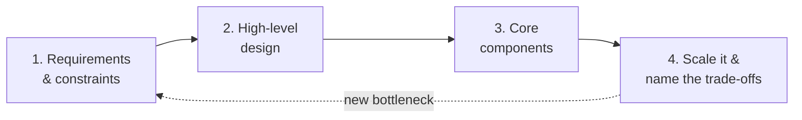

# Mission: System Design & Architecture at Scale, from senior to Staff/Principal

## Why
A senior engineer who ships solid services wants to reach **Staff/Principal**. Competency **A1** in
[`../02-skills-to-upgrade.md`](../02-skills-to-upgrade.md) is the core of that bar: leading an open-ended
design conversation and making architecture calls that hold up for years. Knowing the patterns is not
enough. The Staff+ signal is **naming the trade-off behind every choice** and defending it in a review.

Every lesson serves one repeatable method:

## Success looks like
- Tell a **performance** problem from a **scalability** problem, reason with **percentiles** and
  **Little's Law**, scale along the right **AKF axis**, and do **availability maths** in nines.
- Explain **CAP and PACELC** precisely, place a requirement on the **consistency spectrum**, and tune
  **N/W/R quorums**. Know when you really need **consensus**.
- Climb the **database scaling ladder** in order, pick a store from the access pattern, choose a
  **shard key**, and name the **isolation-level** anomaly a design is exposed to.
- Design caches with a stated **pattern, TTL and invalidation path**, plus stampede, hot-key and
  penetration protection.
- Build **async pipelines** that assume at-least-once delivery: idempotent consumers, bounded queues,
  DLQs, and the **outbox or CDC** instead of dual writes.
- Pick the **communication style per boundary**, place L4/L7 load balancers and the API gateway, and
  ship APIs that are idempotent, paginated, versioned and rate-limited from day one.
- **Estimate first**: users → QPS → storage → bandwidth → memory → servers,
  with every assumption stated and every number tied to a decision.
- Harden every call path with **timeouts, bounded jittered retries, circuit breakers, bulkheads,
  load shedding** and correct **liveness/readiness** probes.
- Lead it: run a **45-minute design review** with the 4-step method (see the capstone in [`GUIDE.md`](GUIDE.md)).

## Constraints
- ~3–5 hrs/week over **4–6 weeks**. Eight self-contained lessons, each with quizzes, “try it”
  exercises tied to your own systems, and a one-page cheat sheet.
- Vendor-neutral, with concrete examples from PostgreSQL, Redis, Kafka, Cassandra, Kubernetes and AWS.
  Containers run with **Podman**.

## Out of scope
- Interview drilling for its own sake. The method transfers to interviews, but the target is real design reviews.
- Deep internals of one product (Kafka tuning, Postgres planner). Sibling courses go deeper:
  [async messaging](../async-messaging/index.html), [event sourcing](../event-sourcing/index.html),
  [observability](../Observability/index.html), and [technical skills](../technical-skills/index.html).
- Implementing consensus or a storage engine yourself. You learn when to **use** them.
