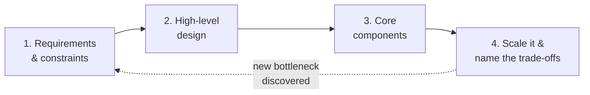

# System Design & Architecture at Scale — Deep Dives

Self-contained deep dives for every sub-topic of **A1** in [../02-skills-to-upgrade.md](../02-skills-to-upgrade.md). Read each one and you'll gain the working knowledge a Staff/Principal engineer is expected to have. Every file uses Mermaid diagrams to make the concepts concrete.

> **How to read:** go in order — each builds on the last. Topics 1–2 are the mental models; 3–6 are the building blocks; 7 is the quantitative glue that ties a design together; 8 covers how to keep it standing when things fail.

| # | Topic | What you'll learn |
|---|-------|-------------------|
| 1 | **[Scalability Trade-off Axes](01-scalability-tradeoff-axes.md)** | Performance vs scalability, latency vs throughput, vertical vs horizontal scaling, the AKF scale cube, availability in "nines". |
| 2 | **[CAP Theorem & Consistency Models](02-cap-theorem-consistency-models.md)** | CAP, PACELC, weak/eventual/strong consistency, the linearizability→eventual spectrum, quorums (N/W/R). |
| 3 | **[Databases & Data Modeling](03-databases-and-data-modeling.md)** | Replication, federation, sharding, SQL vs NoSQL, ACID vs BASE, isolation levels, consistent hashing, B-Tree vs LSM-Tree. |
| 4 | **[Caching](04-caching.md)** | Cache layers, cache-aside/read-through/write-through/write-behind/refresh-ahead, eviction, invalidation, stampede & hot keys. |
| 5 | **[Asynchronism & Messaging](05-asynchronism-and-messaging.md)** | Queues, back-pressure, delivery semantics, idempotency, event sourcing, CDC, Kafka internals. |
| 6 | **[Networking & API Design](06-networking-and-api-design.md)** | TCP/UDP, HTTP/1→2→3, REST vs gRPC vs GraphQL, L4/L7 load balancers, reverse proxy, API gateway, DNS, CDN, API best practices. |
| 7 | **[Back-of-the-Envelope Estimation](07-back-of-envelope-estimation.md)** | Powers of two, latency numbers, availability math, QPS/storage/bandwidth estimation, a full worked example. |
| 8 | **[Resilience & Fault Tolerance Patterns](08-resilience-and-fault-tolerance.md)** | Timeouts, retries with backoff & jitter, circuit breakers, bulkheads, graceful degradation, load shedding, health checks. |

---

## The 4-step method these topics serve

The reason to learn all of this is to lead an open-ended design conversation with a **repeatable method**:

1. **Requirements & constraints** — functional + non-functional (scale, latency, consistency, availability). Estimate numbers (Topic 7).
2. **High-level design** — draw the boxes: clients → API → services → data stores.
3. **Core components** — pick the data model, storage engine, and communication style (Topics 3, 6).
4. **Scale it & name the trade-offs** — add load balancing, caching, sharding, async, replication — and *say out loud* what you're trading (Topics 1, 2, 4, 5). Then harden it against failure (Topic 8).

> **The Staff+ signal is not knowing every pattern — it's naming the trade-off behind every choice.** "Everything is a trade-off" is the through-line of all eight files.

---

## Canonical sources (used throughout)

- **System Design Primer** — https://github.com/donnemartin/system-design-primer
- **ByteByteGo / System Design 101** — https://github.com/ByteByteGoHq/system-design-101 · https://bytebytego.com
- **Designing Data-Intensive Applications** (Kleppmann) — https://dataintensive.net/
- **Google SRE Book** — https://sre.google/sre-book/table-of-contents/
- **Martin Fowler — Patterns of Distributed Systems** — https://martinfowler.com/articles/patterns-of-distributed-systems/
- **Release It!** (Michael Nygard) — https://pragprog.com/titles/mnee2/release-it-second-edition/
