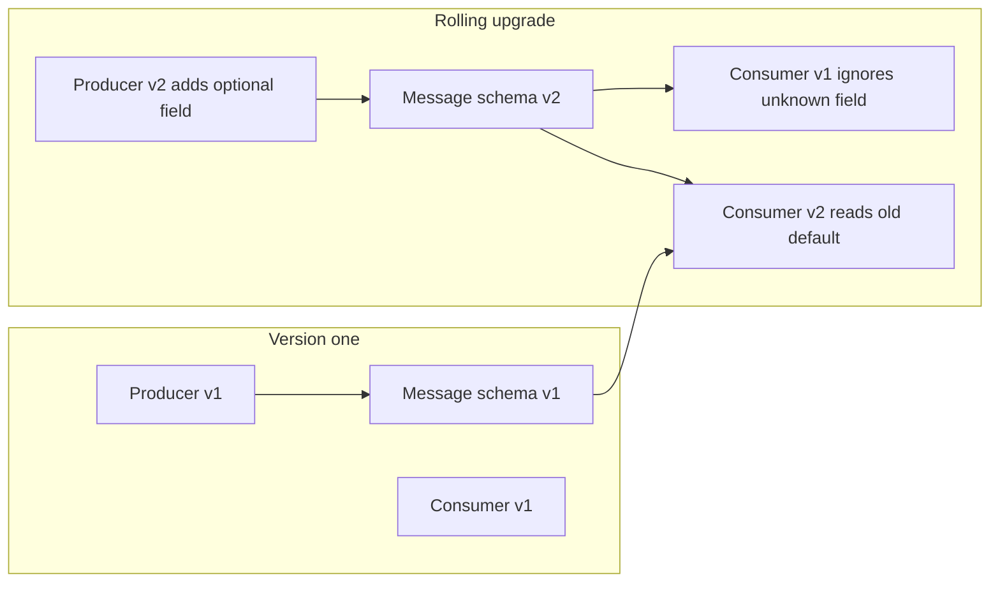
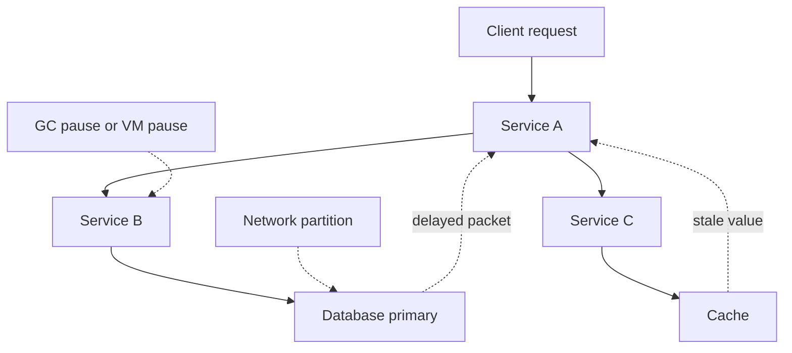
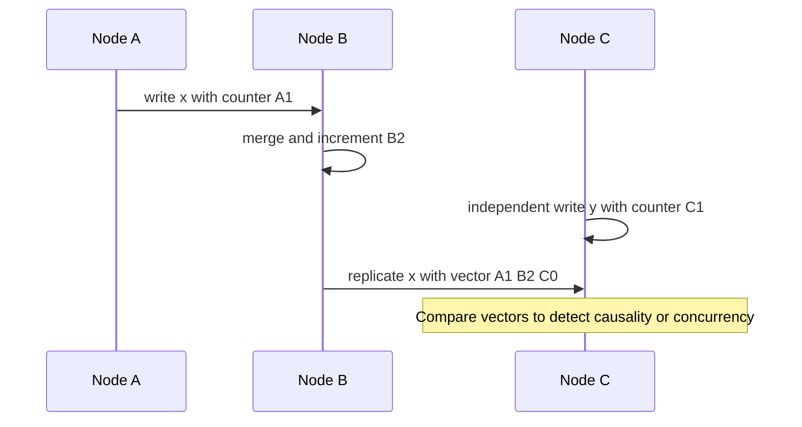
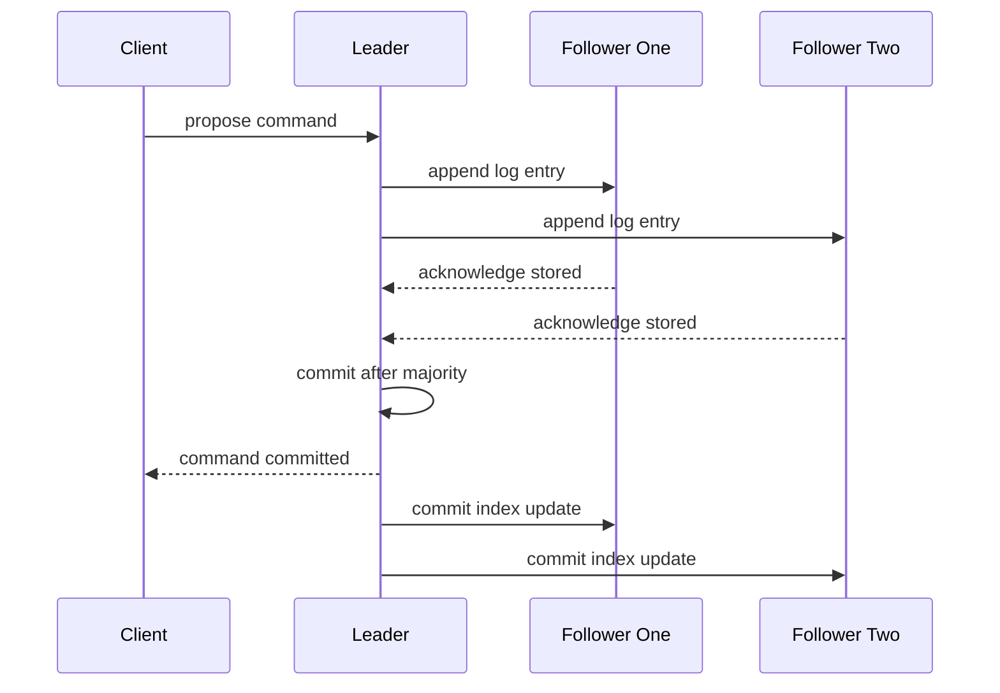
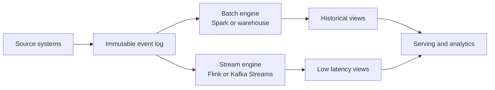

# A2 · Data-Intensive & Distributed Systems
> How do you reason correctly about data as it moves, replicates, and fails across many machines?

**TL;DR**
- Data-intensive systems are judged by reliability, scalability, and maintainability, not by clever distributed tricks.
- Most production failures come from partial failure, time assumptions, overloaded dependencies, and misunderstood consistency semantics.
- Compatibility is an engineering discipline: schema evolution, rolling upgrades, and mixed-version operation must be designed explicitly.
- Ordering is not the same as time; causality tools such as happens-before, Lamport timestamps, and vector clocks help reason about concurrent updates.
- Consensus is expensive but foundational when systems need one agreed sequence of decisions, such as leader election or configuration changes.
- Batch and stream processing are complementary ways to derive state from immutable facts.

Skill map: return to [Skills to upgrade](../02-skills-to-upgrade.md). Related deep dives: [CAP and consistency](../system-design/02-cap-theorem-consistency-models.md), [databases and data modeling](../system-design/03-databases-and-data-modeling.md), [messaging](../system-design/05-asynchronism-and-messaging.md), and sibling [A3 reliability](A3-reliability-observability-sre.md).

---

## 1. The lens: reliability, scalability, maintainability

Data-intensive systems are hard because of data volume, complexity, correctness, or movement. The Staff+ job is reasoning about guarantees and failure modes.

| Property | Practitioner definition | Staff+ question |
|---|---|---|
| Reliability | The system continues to work correctly despite faults in hardware, software, humans, networks, or dependencies. | What failures are we assuming, detecting, masking, or accepting? |
| Scalability | The system can handle increased load by adding resources or changing architecture without collapsing cost or complexity. | Which load dimension grows, and what bottleneck appears first? |
| Maintainability | Engineers can understand, operate, modify, and safely evolve the system over years. | Can a new team change this without rediscovering hidden invariants? |

Reliability is correctness under stress, not just uptime. Scalability is multi-dimensional: reads, writes, fan-out, tenants, regions, and latency can each become the bottleneck. Maintainability is the Staff+ differentiator because a design fails organizationally if only two people can operate it.

## 2. Data models and query languages

A data model shapes what is easy, what is hard, and what mistakes the system invites. See [databases and data modeling](../system-design/03-databases-and-data-modeling.md).

| Model | Best fit | Watch out for |
|---|---|---|
| Relational | Structured records, joins, constraints, reporting, transactional updates. | Object-relational impedance, schema migration discipline, accidental shared database coupling. |
| Document | Aggregate-oriented data, flexible shape, read-mostly records, product iteration. | Hard cross-document joins, duplicated facts, inconsistent update paths. |
| Graph | Many-to-many relationships, traversals, recommendations, permissions, lineage. | Operational maturity, query predictability, partitioning difficulty. |

Declarative languages specify what result is wanted; the optimizer chooses how. Imperative APIs specify steps and often embed execution strategy in application code.

Ask: what are the dominant access patterns, invariants, evolution needs, and operational risks? Do not choose by fashion.

## 3. Encoding and schema evolution

Encoding turns in-memory data into bytes. Schema evolution keeps those bytes understandable while producers and consumers upgrade independently.

| Encoding family | Examples | Strengths | Risks |
|---|---|---|---|
| Textual | JSON, XML, CSV | Human-readable, ubiquitous, easy debugging. | Ambiguous types, larger payloads, weak schema enforcement unless added separately. |
| Binary with schema | Avro, Protobuf, Thrift | Compact, typed, faster, explicit compatibility rules. | Schema registry and tooling discipline required. |
| Language-native | Java serialization, pickle | Convenient inside one runtime. | Poor long-term compatibility, security risks, tight coupling. |

Backward compatibility means new code can read old data. Forward compatibility means old code can read new data. Rolling upgrades require both during the window where old and new versions coexist.

Safe evolution means optional fields, defaults, reserved removed identifiers, no semantic reuse, and CI compatibility tests.

Compatibility is semantic too: a field changing from cents to dollars may parse while breaking downstream assumptions.

## 4. Storage engines recap: B-Tree vs LSM-Tree

Storage engines are covered in [databases and data modeling](../system-design/03-databases-and-data-modeling.md). The key distinction is read-optimized page mutation versus write-optimized append and compaction.

| Engine | Basic idea | Good at | Cost profile |
|---|---|---|---|
| B-Tree | Update fixed-size pages in a sorted tree. | Point reads, range scans, predictable latency, mature transactions. | Random writes, page splits, write amplification. |
| LSM-Tree | Append writes to memory and immutable sorted files, compact later. | High write throughput, compression, sequential I/O. | Read amplification, compaction stalls, tuning complexity. |

This choice leaks into product behavior: write-heavy ingestion often favors LSM designs; read-heavy transactional workloads often favor B-Trees.

## 5. The trouble with distributed systems

Distributed systems fail in ways single-process programs do not. Networks drop, delay, duplicate, reorder, or partition messages. Processes pause. Clocks move backward. Dependencies become slow enough to look dead.

Partial failure is central: one component can fail while others continue. If a leader stops responding, it may be dead, slow, paused, partitioned, or overloaded.

Time-of-day clocks help humans and logs but can jump because of NTP adjustments. Monotonic clocks measure elapsed duration within a process. Clock skew means machines disagree about wall time; correctness should not depend on perfect synchronization without explicit uncertainty handling.

Process pauses include garbage collection, VM suspension, host overload, container throttling, and page faults. A paused process may believe it still holds a lease while the rest of the system has moved on.

The two generals problem shows that perfect agreement over an unreliable channel is impossible with acknowledgements alone. Byzantine failures add malicious or arbitrary behavior; most business systems assume crash or omission failures because Byzantine tolerance is much more expensive.

## 6. Ordering and causality

Time order and causal order are different. If event B reads data written by event A, A happened before B. If two events happened independently, neither caused the other, even if one wall-clock timestamp is smaller.

Happens-before is the relation that captures potential causality. It is created by local process order and message send-before-receive relationships.

Lamport timestamps assign monotonically increasing counters. They preserve causality in one direction: if A happened before B, then A has a smaller Lamport timestamp. The reverse is not guaranteed; smaller timestamp does not prove causality.

Vector clocks track a counter per actor. They can detect concurrency because neither vector dominates the other when events are independent.

| Tool | What it gives | Limitation |
|---|---|---|
| Wall-clock timestamp | Human ordering and approximate recency. | Skew and jumps can violate causal reality. |
| Lamport timestamp | A total-ish ordering compatible with causality. | Cannot identify concurrent updates. |
| Vector clock | Detects causality and concurrency. | Metadata grows with number of actors. |

Causality matters for conflicts, collaborative editing, replication, event processing, and debugging. Last-write-wins can destroy meaningful updates.

## 7. Consensus, leader election, and atomic broadcast

Consensus lets nodes agree on values despite failures. In practice, systems repeatedly agree on a log, producing a replicated state machine.

Paxos and Raft are consensus families. Raft elects a leader, replicates entries through it, commits after a majority stores an entry, and applies entries in order. Real systems include etcd, ZooKeeper, Consul, and many database control planes.

Two-phase commit and consensus are often confused. 2PC coordinates a transaction across participants if the coordinator survives and participants obey. It can block indefinitely if the coordinator fails at the wrong time. Consensus elects new leaders and makes progress with a majority, but it is not a free distributed transaction mechanism.

| Mechanism | Purpose | Failure behavior |
|---|---|---|
| 2PC | Atomic commit across resources. | Blocking under coordinator failure. |
| Consensus log | Agreement on ordered decisions. | Available with majority, unavailable without majority. |
| Saga | Business transaction split into local commits and compensations. | Eventually consistent, requires domain-specific recovery. |

## 8. Consistency guarantees recap

Consistency models are covered in [CAP and consistency](../system-design/02-cap-theorem-consistency-models.md). The useful recap is:

| Guarantee | Meaning | Example user expectation |
|---|---|---|
| Linearizable | Operations appear to take effect atomically in real-time order. | After I change a password, every login check sees it. |
| Causal | Effects are observed after their causes. | A reply is not visible before the original comment. |
| Eventual | Replicas converge if no new updates arrive. | Search results catch up after indexing. |

Do not say strong or eventual without naming the actual guarantee. Translate business invariants into explicit consistency needs.

## 9. Batch versus stream processing

Batch processing consumes bounded data sets. Stream processing consumes unbounded data as it arrives. Both derive views from source facts.

MapReduce and Spark popularized batch over large files. Kafka Streams and Flink popularized continuous computation over logs. Modern platforms unbundle the database into log, storage, compute, serving indexes, and governance layers.

Lambda uses separate batch and speed layers, then merges results. It duplicates logic. Kappa uses one stream pipeline and replays the log.

| Architecture | Core idea | Trade-off |
|---|---|---|
| Lambda | Batch for correctness, stream for low latency. | Duplicate code paths and reconciliation complexity. |
| Kappa | Stream processing for both live and replay. | Requires durable log and replay-safe processors. |
| Warehouse-first | Central analytical store derives views. | Higher latency, strong governance, less app coupling. |

## What "good" looks like at Staff+

- You name guarantees precisely: durability, ordering, idempotency, linearizability, causality, convergence, and freshness.
- You choose technologies from workload shape and failure model, not trend pressure.
- You design rolling upgrades and schema compatibility before the first breaking change.
- You make partial failure explicit in diagrams, tests, runbooks, and incident reviews.
- You know when consensus is required and when a simpler lease, queue, or idempotent workflow is enough.
- You connect theory to operational consequences such as tail latency, compaction, replay time, and blast radius.

## Common pitfalls

- Treating distributed calls as local function calls with longer latency.
- Assuming clocks are reliable enough for correctness without proving the bound and failure behavior.
- Using last-write-wins where losing concurrent updates would violate user intent.
- Confusing eventual consistency with no consistency contract.
- Introducing microservices before data ownership, idempotency, and operational maturity exist.
- Using 2PC as a default solution for cross-service consistency.
- Designing a streaming system without replay, schema evolution, or poison-message handling.

## Further reading

- DDIA: https://dataintensive.net/
- DDIA references: https://github.com/ept/ddia-references
- MIT 6.824: https://pdos.csail.mit.edu/6.824/
- Kleppmann lectures: https://www.youtube.com/playlist?list=PLeKd45zvjcDFUEv_ohr_HdUFe97RItdiB
- Fowler "Patterns of Distributed Systems": https://martinfowler.com/articles/patterns-of-distributed-systems/
- Raft: https://raft.github.io/
