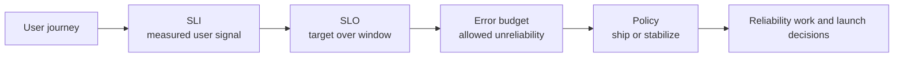
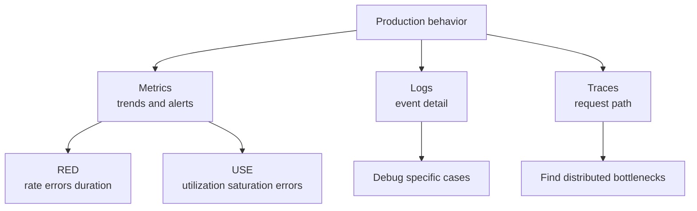
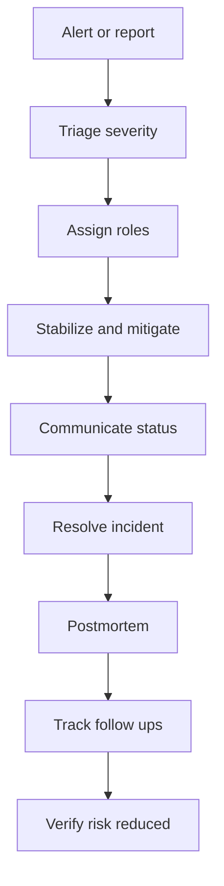
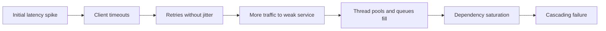
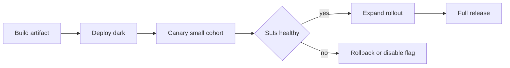

# A3 · Reliability, Observability & SRE
> How do you keep a large system dependable in production — measurably, not heroically?

**TL;DR**
- Reliability is managed through explicit user-centered objectives, not vague aspirations to have fewer incidents.
- SLOs and error budgets create a shared policy for balancing feature velocity and operational risk.
- Observability combines metrics, logs, and traces so teams can ask new questions about production behavior.
- Incident response is a system: roles, severity, communication, mitigation, learning, and follow-through.
- Resilience patterns such as load shedding, jittered retries, circuit breakers, and graceful degradation prevent local faults from becoming global outages.
- Staff+ SRE leadership reduces toil and complexity so reliability scales with the organization.

Skill map: return to [Skills to upgrade](../02-skills-to-upgrade.md). Related deep dives: [A2 distributed systems](A2-data-intensive-distributed-systems.md), [caching](../system-design/04-caching.md), [asynchronism and messaging](../system-design/05-asynchronism-and-messaging.md), and [networking and API design](../system-design/06-networking-and-api-design.md).

---

## 1. SLI, SLO, SLA, and error budgets

Reliability must be expressed from the user's point of view. A server can be healthy while the product is unusable. A database can be up while checkout is failing.

| Term | Definition | Example |
|---|---|---|
| SLI | Service Level Indicator: a measured signal that approximates user experience. | Percentage of valid checkout requests completing under 800 ms. |
| SLO | Service Level Objective: the target range for an SLI over a window. | 99.9 percent of checkout requests succeed over 30 days. |
| SLA | Service Level Agreement: an external promise with consequences. | Customer contract gives credits if monthly availability is below 99.5 percent. |

An error budget is the allowed unreliability implied by an SLO. If the SLO is 99.9 percent success over 30 days, the budget is 0.1 percent unsuccessful requests in that window.

The policy is the important part. When the budget is healthy, teams can ship normally. When burn rate is high or the budget is exhausted, the policy may freeze risky launches, prioritize reliability work, or require executive approval for changes.

Good SLOs are few, understandable, and tied to behavior users care about. Bad SLOs measure host uptime, CPU, or internal component health without proving user impact.

## 2. Golden signals, observability pillars, RED, and USE

The four golden signals are a practical dashboard baseline for user-facing systems.

| Signal | Meaning | Typical questions |
|---|---|---|
| Latency | How long successful and failed requests take. | Are users waiting, and where is the tail? |
| Traffic | How much demand the system receives. | Is load normal, spiky, or shifting by tenant? |
| Errors | Rate of failed work. | Are failures user-visible, dependency-related, or validation-related? |
| Saturation | How full critical resources are. | Which resource runs out first? |

The three pillars of observability are metrics, logs, and traces. Metrics are numeric time series, logs are discrete event records, and traces show request paths across components. None is sufficient alone.

RED focuses on request-driven services: Rate, Errors, Duration. USE focuses on resources: Utilization, Saturation, Errors. Together they connect user symptoms to infrastructure constraints.

Staff+ observability work is less about buying tools and more about designing useful telemetry: stable names, controlled cardinality, correlation IDs, sampling strategy, ownership, and retention.

## 3. Toil and automation

Toil is manual, repetitive, automatable, tactical work that grows with service size and provides little enduring value. Examples include manually restarting jobs, copying data between systems, hand-validating deployments, and repeatedly performing the same customer repair.

Not all operational work is toil. Debugging a novel incident, designing a safer deployment system, and improving an SLO are engineering work. The problem with toil is that it scales linearly with load and steals capacity from improvements.

A toil budget is a cap on how much human capacity the organization will spend on toil. When toil exceeds the budget, teams invest in automation, self-healing, better product flows, or service redesign.

Automation should remove judgment-free repetition, not hide dangerous complexity. Automating a bad process can make failure faster.

## 4. Simplicity as a reliability value

Simplicity is not aesthetic minimalism. It is a reliability control. Every moving part creates state, ownership, configuration, failure modes, and cognitive load.

Simple systems are easier to observe, test, roll back, and explain during incidents. Complex systems can be reliable, but only with matching investment in expertise and automation.

Staff+ engineers should ask whether a proposed component pays rent. Does it remove more complexity than it adds? Does it reduce blast radius? Does it have a clear owner? Can the on-call engineer explain it at 03:00?

## 5. On-call and incident response

On-call is a socio-technical system for detecting, triaging, mitigating, and learning from production harm. It should not rely on heroism.

Common incident roles:

| Role | Responsibility |
|---|---|
| Incident Commander | Owns coordination, priorities, timeline, and decision-making. |
| Operations Lead | Drives technical investigation and mitigation. |
| Communications Lead | Updates stakeholders, status pages, support, and executives. |
| Scribe | Captures timeline, decisions, commands, and hypotheses. |

Severity levels should be defined by user and business impact, not internal panic. A useful severity model maps impact to response expectations, escalation, and communication cadence.

Healthy on-call programs have actionable alerts, runbooks, escalation paths, training, reasonable rotations, and authority to improve the systems that page them.

## 6. Blameless postmortems

A blameless postmortem asks how the system allowed a failure, not which person to punish. Blame reduces learning because people hide context. Accountability still exists: teams own follow-up actions and risk reduction.

A strong postmortem includes:

- Impact: who was affected, how badly, and for how long.
- Detection: how the incident was discovered and whether detection was late.
- Timeline: key events, decisions, and signals.
- Contributing factors: technical, organizational, process, and knowledge gaps.
- What went well: defenses that worked.
- What went poorly: defenses that failed or did not exist.
- Action items: specific, owned, prioritized, and verified.

Avoid action items that only say train people, be careful, or add more monitoring. Prefer changes that alter defaults, automate checks, reduce blast radius, or make failure visible sooner.

## 7. Handling overload and cascading failures

Overload is a primary cause of outages. A service under stress gets slower; clients retry; retries add load; queues grow; timeouts fire; dependencies saturate; the failure spreads.

Key resilience patterns:

| Pattern | Purpose | Watch out for |
|---|---|---|
| Load shedding | Reject excess work before the system collapses. | Must shed low-value work first and return clear errors. |
| Graceful degradation | Preserve critical user journeys while disabling non-critical features. | Requires product decisions before the incident. |
| Exponential backoff with jitter | Spread retry load and reduce synchronization. | Retrying non-idempotent operations can duplicate effects. |
| Circuit breaker | Stop calling a failing dependency temporarily. | Bad thresholds can create oscillation or hide recovery. |
| Bulkhead | Isolate resources by tenant, feature, or dependency. | Too much partitioning can waste capacity. |

The thundering herd problem occurs when many clients wake, retry, refresh caches, or reconnect simultaneously. Jitter, request coalescing, token buckets, and cache stampede controls help.

## 8. Canarying, progressive rollouts, feature flags, and rollback

Progressive delivery reduces blast radius by exposing change gradually. A canary sends a small slice of traffic to a new version and compares key signals before wider rollout.

Feature flags separate deploy from release. They allow dark launches, targeted exposure, emergency disablement, and experimentation. They also create configuration complexity and must be cleaned up.

Fast rollback is a reliability feature. A rollback plan should be tested, compatible with database changes, and safe for mixed versions. If rollback is impossible, the rollout needs extra safeguards.

## 9. NALSD: non-abstract large system design

Non-abstract large system design is the practice of reasoning from concrete production constraints rather than generic boxes. It asks for realistic numbers, traffic patterns, failure domains, data ownership, operational processes, and rollout mechanics.

For Staff+ engineers, NALSD bridges architecture and SRE. A design is incomplete if it cannot explain how it is monitored, how it fails, how it recovers, who owns it, and how it changes safely.

## What "good" looks like at Staff+

- You define reliability in terms of user-visible SLOs and business impact.
- You use error budgets as decision policy, not dashboard decoration.
- You reduce alert noise and make pages actionable.
- You design for overload before overload happens.
- You make incident roles, severity, communication, and follow-up routine.
- You remove toil by improving systems, not by asking people to work harder.
- You keep architectures simple enough for the operating model.

## Common pitfalls

- Alerting on every metric anomaly instead of user impact and burn rate.
- Setting SLOs so strict that teams ignore them or so loose that users suffer.
- Retrying everything without timeouts, idempotency, budgets, or jitter.
- Treating postmortems as paperwork rather than risk reduction.
- Measuring mean latency while users experience tail latency.
- Leaving feature flags permanent and undocumented.
- Expecting on-call to compensate for unclear ownership or excessive complexity.

## Further reading

- Google SRE Book: https://sre.google/sre-book/table-of-contents/
- SRE Workbook: https://sre.google/workbook/table-of-contents/
- All SRE books: https://sre.google/books/
