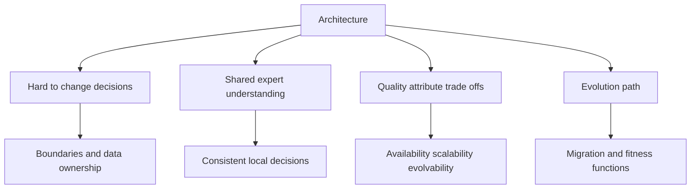
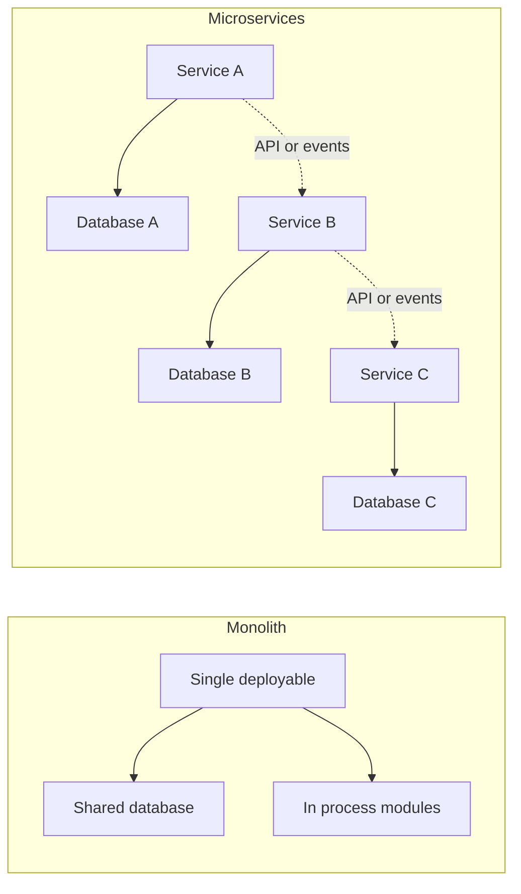
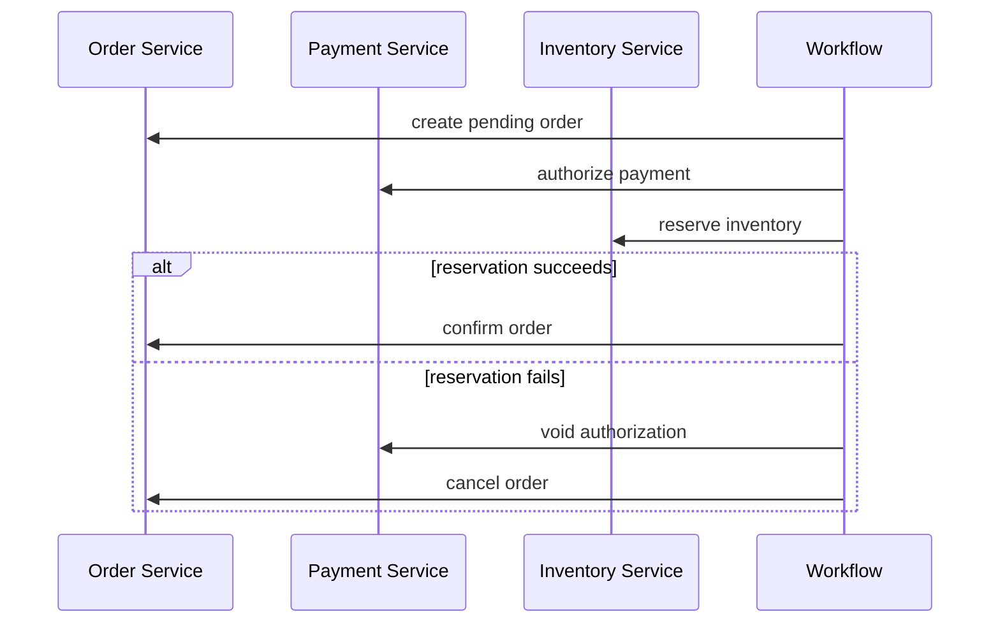
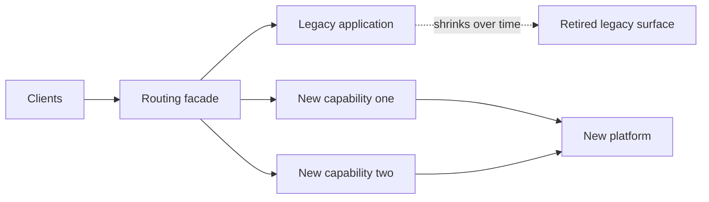
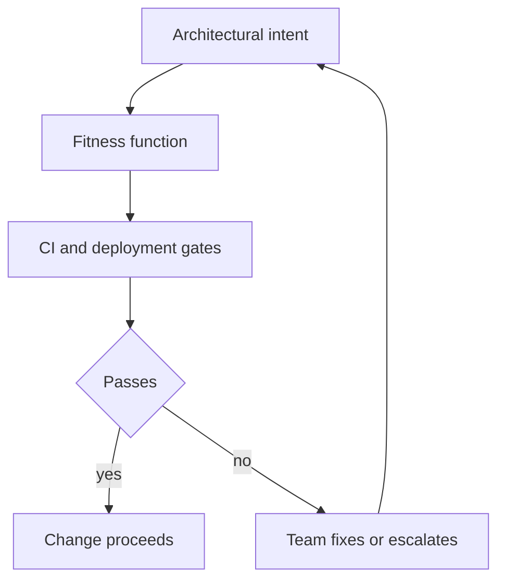

# A4 · Software Architecture & Evolutionary Design
> How do you choose and evolve the structure of a system so it stays changeable as needs shift?

**TL;DR**
- Architecture is the important stuff: the shared understanding that lets expert developers make coherent decisions.
- Internal quality is not gold-plating; it usually pays back in delivery speed within weeks when teams change software continuously.
- Architecture is trade-off management across qualities such as availability, scalability, evolvability, security, and operability.
- Monoliths, microservices, event-driven systems, SOA, and serverless each optimize different forces and impose different costs.
- The hard parts are boundaries, data ownership, transactions, migration, and organizational alignment.
- Evolutionary architecture uses fitness functions and incremental migration so architecture can change safely over time.

Skill map: return to [Skills to upgrade](../02-skills-to-upgrade.md). Related deep dives: [A2 distributed systems](A2-data-intensive-distributed-systems.md), [A3 reliability](A3-reliability-observability-sre.md), [API design](../system-design/06-networking-and-api-design.md), and [messaging](../system-design/05-asynchronism-and-messaging.md).

---

## 1. What architecture is

Martin Fowler often frames architecture as the important stuff, the decisions that are hard to change later. Ralph Johnson's formulation is that architecture is the shared understanding expert developers have of the system design.

Both definitions matter. Architecture is not only diagrams or platform choices. It is the set of decisions, constraints, patterns, and mental models that shape everyday engineering behavior.

Architecture includes:

- Component boundaries and communication paths.
- Data ownership and consistency rules.
- Deployment and runtime topology.
- Quality attribute priorities.
- Patterns for change, testing, observability, and operations.
- The reasoning behind trade-offs.

Internal quality affects speed. Poor modularity, unclear ownership, hidden coupling, and brittle tests slow delivery quickly. The payoff for quality is often measured in weeks, not months, because teams read and change code constantly.

## 2. Architecture characteristics and trade-offs

Architecture characteristics are the qualities a system must exhibit. They are sometimes called the ilities: scalability, availability, reliability, evolvability, testability, deployability, security, usability, maintainability, observability, performance, and cost efficiency.

You cannot maximize all characteristics simultaneously. Strong consistency can reduce availability during partitions. Extreme flexibility can reduce simplicity. Low latency can increase cost. Fine-grained services can improve team autonomy while increasing operational complexity.

| Characteristic | Means | Common trade-off |
|---|---|---|
| Scalability | Handles growth in load dimensions. | More distributed complexity. |
| Availability | Continues serving despite faults. | Weaker consistency or higher cost. |
| Evolvability | Adapts to changing needs. | More abstraction and governance. |
| Testability | Behavior can be verified cheaply. | More seams and design discipline. |
| Security | Protects data and operations. | Friction, constraints, specialized review. |
| Operability | Can be run safely in production. | Tooling and process investment. |

Staff+ architecture work begins by ranking characteristics for the current business problem. A decision record should say which qualities win and which are intentionally sacrificed.

## 3. Architecture styles

Architecture styles are recurring arrangements of components, data, and communication. They are starting points, not recipes.

| Style | Strengths | Costs | Good fit |
|---|---|---|---|
| Monolith | Simple deployment, local transactions, easy refactoring early. | Scaling and ownership bottlenecks if boundaries rot. | Small teams, early products, tightly coupled domains. |
| Modular monolith | Clear internal boundaries with one deployable unit. | Requires discipline to prevent boundary bypass. | Growing systems that are not operationally ready for services. |
| Layered | Familiar separation such as UI, domain, data. | Can become anemic or force all changes through layers. | CRUD and enterprise applications. |
| Microservices | Independent deployability, team autonomy, fault isolation. | Distributed systems, data duplication, observability burden. | Large orgs with separable domains and mature operations. |
| Event-driven | Loose temporal coupling, extensibility, audit trail. | Debugging, ordering, schema evolution, eventual consistency. | Workflows, integrations, activity streams. |
| SOA | Service reuse and enterprise integration. | Governance overhead and shared platform coupling. | Large enterprises with integration needs. |
| Serverless | Low ops for bursty workloads, pay per use. | Cold starts, vendor constraints, observability complexity. | Event handlers, glue, variable workloads. |

Event-driven architecture has two common coordination modes. Choreography lets services react to events without a central controller. Orchestration uses a workflow coordinator to tell participants what to do.

| Mode | Advantage | Risk |
|---|---|---|
| Choreography | Low central coupling and easy extension. | Emergent behavior can be hard to understand. |
| Orchestration | Explicit workflow and easier visibility. | Coordinator can become a coupling hotspot. |

## 4. Coupling, cohesion, and Conway's Law

Coupling is the degree to which one part depends on another. Cohesion is the degree to which things that change together live together. Good architecture lowers unnecessary coupling and raises useful cohesion.

Conway's Law says system design mirrors communication structure. If four teams own one shared service with unclear boundaries, the architecture will reflect those coordination problems. Architecture and organization must be designed together.

Common coupling types include:

- Runtime coupling: service A must call service B synchronously.
- Data coupling: multiple components share tables or data formats.
- Semantic coupling: one component knows another's business rules.
- Temporal coupling: systems must act in a strict time sequence.
- Deployment coupling: components must be released together.

Staff+ engineers intentionally choose coupling. Some coupling is good because it preserves invariants. Accidental coupling is the enemy.

## 5. The hard parts: granularity, data ownership, and sagas

Service granularity is hard because boundaries are economic decisions. Too coarse, and teams block each other. Too fine, and latency, operations, and data consistency become expensive.

Disintegrators are forces that push services apart: different scalability needs, change cadence, security boundaries, team ownership, fault isolation, or domain volatility. Integrators pull services together: transactions, query needs, shared invariants, latency, and workflow simplicity.

Data ownership is usually the real boundary. If two services freely write the same database tables, they are not independently evolvable. A service should own its data and expose behavior or events rather than tables.

Distributed transactions are expensive across service boundaries. Sagas split a business transaction into local commits with compensating actions.

Sagas are not magic rollback. Compensation is business-specific and sometimes impossible. The design must define visible intermediate states, retries, idempotency, and operator repair.

## 6. Migration patterns

Architecture evolution succeeds when it avoids big-bang rewrites. Migration patterns let teams change structure while keeping the system running.

The Strangler Fig pattern routes new behavior to a new implementation while old behavior remains in the legacy system. Over time, the new system grows around and replaces the old one.

Branch by abstraction introduces an interface around old behavior, then swaps implementations incrementally. It allows long-running changes without long-lived source branches.

Parallel run executes old and new paths together, compares outputs, and builds confidence before cutover. It is useful for migrations where correctness matters more than immediate cost.

| Pattern | Use when | Key risk |
|---|---|---|
| Strangler Fig | Replacing legacy capabilities gradually. | Routing and data synchronization complexity. |
| Branch by abstraction | Changing internals behind stable call sites. | Leaky abstractions and dual maintenance. |
| Parallel run | Validating new behavior against old. | Comparison noise and doubled resource cost. |

## 7. Evolutionary architecture and fitness functions

Evolutionary architecture accepts that requirements, teams, and technology change. Instead of freezing architecture, it creates mechanisms that keep change safe.

A fitness function is an automated check that measures an architectural property. It can be a unit test, integration test, static analysis rule, deployment policy, cost guardrail, SLO check, or dependency rule.

Examples include preventing forbidden dependencies, requiring APIs to publish OpenAPI specs, checking event schemas for compatibility, enforcing service ownership metadata, and blocking deploys that exceed latency budgets.

Governance should be automated where possible and human where judgment matters. Architecture review boards that only meet late in the process become bottlenecks.

## 8. Enterprise Integration Patterns and PoEAA

Enterprise Integration Patterns describe messaging patterns such as channels, routers, filters, translators, splitters, aggregators, and correlation identifiers. They remain useful because integration problems recur across brokers and products.

Patterns of Enterprise Application Architecture describes common application patterns such as transaction script, domain model, table data gateway, active record, data mapper, unit of work, identity map, and service layer.

The value of these pattern languages is shared vocabulary. Staff+ engineers use them to compress design conversations and identify known trade-offs.

## 9. Technical debt economics

Technical debt is not any ugly code. It is a design or implementation shortcut that creates future carrying cost. The debt metaphor is useful only when you discuss principal, interest, and repayment strategy.

| Debt type | Example | Economic signal |
|---|---|---|
| Deliberate prudent | Manual process before product fit. | Cheap now, scheduled repayment. |
| Deliberate reckless | Skipping migration plan for known scale. | Interest likely exceeds benefit. |
| Accidental | Design no longer fits new product needs. | Requires refactoring as learning emerges. |
| Neglect | Dependencies or tests decay. | Risk and change cost compound. |

Staff+ engineers translate technical debt into business language: delay cost, incident risk, opportunity cost, developer throughput, compliance exposure, and migration cost.

## What "good" looks like at Staff+

- You can explain the architecture as trade-offs tied to business goals.
- You keep boundaries aligned with domain, data ownership, and team ownership.
- You avoid distributed complexity until its benefits clearly exceed its operating cost.
- You use migration patterns that keep the system shippable.
- You create automated fitness functions for important architecture rules.
- You document decisions with context, alternatives, consequences, and review triggers.
- You treat technical debt as an economic portfolio, not a moral failing.

## Common pitfalls

- Choosing microservices to solve team problems that should be solved organizationally.
- Treating architecture as diagrams detached from code, data, deployment, and ownership.
- Maximizing one quality attribute while pretending others are unaffected.
- Sharing databases across services and calling the result independent deployment.
- Designing sagas without idempotency, compensations, or repair workflows.
- Attempting big-bang rewrites instead of incremental migration.
- Creating governance that slows teams without improving decisions.

## Further reading

- Fowler architecture: https://martinfowler.com/architecture/
- "Is High Quality Software Worth the Cost?": https://martinfowler.com/articles/is-quality-worth-cost.html
- Strangler Fig: https://martinfowler.com/bliki/StranglerFigApplication.html
- Fundamentals of Software Architecture: https://www.amazon.com/dp/1492043451
- Software Architecture: The Hard Parts: https://www.amazon.com/dp/1492086894
