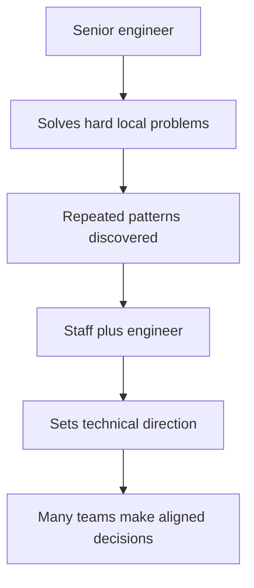
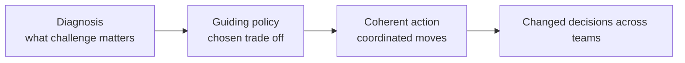
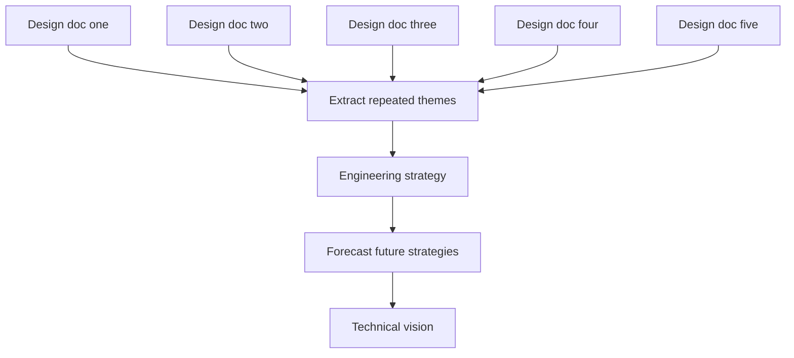
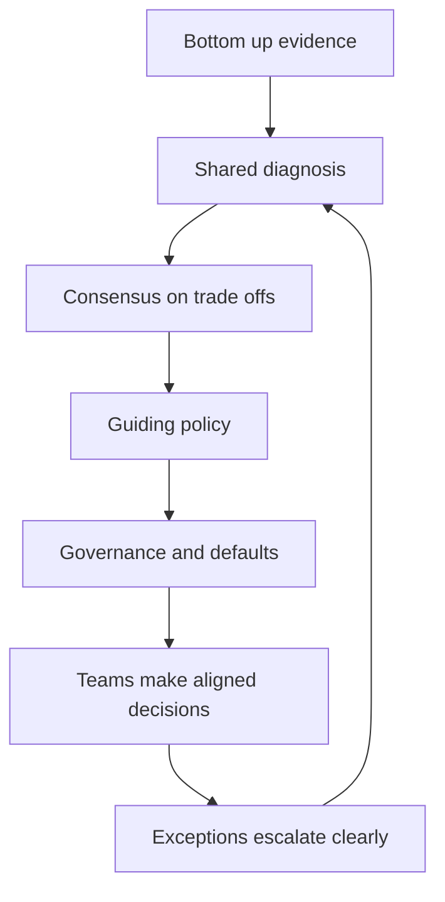

# A5 · Engineering Strategy & Technical Vision
> How do you set technical direction that many teams actually follow?

**TL;DR**
- Engineering strategy is the technical differentiator between Senior and Staff+ because it turns local expertise into aligned multi-team action.
- Rumelt's kernel is diagnosis, guiding policy, and coherent action; if the policy implies no trade-off, it is probably not strategy.
- Vision describes a plausible aspirational future; strategy tackles the current challenge that blocks progress toward it.
- Good strategy is specific, opinionated, boring, evidence-backed, and enforceable.
- The Staff-engineer recipe is to synthesize repeated design work into strategy, then forecast multiple strategies into vision.
- Enforcement is earned through bottom-up evidence, consensus, clear escalation, and resource allocation.

Skill map: return to [Skills to upgrade](../02-skills-to-upgrade.md). Related deep dives: [A4 architecture](A4-software-architecture.md), [A3 reliability](A3-reliability-observability-sre.md), and [back-of-envelope estimation](../system-design/07-back-of-envelope-estimation.md).

---

## 1. Why strategy is the Senior to Staff+ differentiator

Senior engineers usually deliver ambiguous projects. Staff+ engineers change how groups of teams make technical decisions. Strategy is the bridge.

Without strategy, every team locally optimizes. One team chooses speed, another consistency, another platform reuse, another autonomy. Each decision may be reasonable in isolation, yet the organization drifts.

Engineering strategy creates shared constraints for repeated decisions. It tells teams what problem matters most, which trade-offs are preferred, where to invest, and how to resolve disagreement.

Strategy is not seniority theater. It is useful only if it changes what teams do when the author is not in the room.

## 2. Rumelt's kernel: diagnosis, guiding policy, coherent action

Richard Rumelt's strategy kernel is a practical structure for engineering strategy.

| Kernel part | Definition | Engineering example |
|---|---|---|
| Diagnosis | A clear explanation of the challenge and why it is hard. | Product teams cannot safely launch cross-region features because data ownership is ambiguous. |
| Guiding policy | The overall approach for overcoming the challenge. | Each customer domain will have one owning service and publish events for derived views. |
| Coherent action | Coordinated steps that implement the policy. | Define ownership map, migrate three critical tables, add event contracts, block new shared writes. |

A policy must imply a trade-off. Work harder, improve quality, and collaborate more are aspirations, not policies. A real policy says what you will not do, what will be slower, and which decisions are now constrained.

The diagnosis is often the most valuable part. If leaders disagree about the challenge, action becomes scattered. A sharp diagnosis creates urgency and narrows debate.

## 3. Strategy versus vision

Strategy and vision are related but different.

| Concept | Time horizon | Purpose | Output |
|---|---|---|---|
| Strategy | Now to roughly 6 to 18 months. | Tackle today's most important technical challenge. | Diagnosis, policy, actions, ownership, trade-offs. |
| Vision | Roughly 2 to 3 years. | Describe an aspirational future state that guides investment. | Narrative of future users, capabilities, architecture, and team experience. |

Vision says where we want to be. Strategy says how we will handle the current obstacle. A vision without strategy is a poster. A strategy without vision can optimize the wrong future.

A good technical vision is optimistic but not fantasy. It is grounded in users, business direction, technology constraints, and organizational capability.

## 4. The Staff-engineer recipe

A practical recipe from Staff engineering practice is: write five design docs, then pull out the similarities to form your strategy. Forecast five strategies two years out, and the common destination becomes your vision.

Why this works:

- Design docs expose real decisions, not abstract preferences.
- Similarities reveal repeated constraints and unresolved debates.
- Bottom-up evidence makes the strategy credible.
- Future strategies force you to reason about sequencing and compounding investments.

This recipe prevents strategy from becoming a top-down essay detached from reality. It also helps the author build the coalition required for enforcement.

## 5. Properties of good strategy

Good strategy is often boring. It turns confusing debate into ordinary execution. If the strategy feels like a slogan, it probably lacks diagnosis or trade-offs.

Good strategy is specific. Generic statements create the illusion of alignment because everyone can agree while imagining different actions. Specific statements create real alignment because they constrain decisions.

| Weak statement | Stronger strategic statement |
|---|---|
| We will improve platform reliability. | Tier one APIs will adopt 99.9 percent availability SLOs, dependency timeouts, and rollback within 10 minutes before new feature investment. |
| Teams should own their services. | Every customer-facing domain has one service owner, one data owner, and no new shared database writes after Q2. |
| We will modernize the frontend. | New checkout surfaces use the design system and server-driven configuration; legacy checkout receives only compliance fixes. |

Good strategy is opinionated. It should show your work: evidence, rejected alternatives, risks, and why now. It should be clear enough that teams can disagree productively.

## 6. Structuring guiding policies

Guiding policies need the right altitude. Too high, and they are slogans. Too low, and they are project plans. The right altitude is applicable across teams, enforceable, and creates leverage.

Useful policy categories include:

- Resource allocation: where engineering capacity goes and what stops receiving investment.
- Priorities: which quality attributes win when decisions conflict.
- Fundamental rules: constraints all teams must follow.
- Escalation paths: how exceptions and conflicts are resolved.
- Sequencing: what must happen before other work becomes safe or useful.

| Policy type | Example | Why it matters |
|---|---|---|
| Resource allocation | Spend 30 percent of platform capacity on migration until shared writes are removed. | Strategy without capacity is wishful thinking. |
| Priority rule | Prefer data correctness over launch speed for billing flows. | Teams can decide without re-litigating values. |
| Fundamental rule | No new synchronous calls from checkout to experimental services. | Prevents architecture drift. |
| Escalation rule | Exceptions require domain lead and SRE approval. | Makes enforcement explicit. |

A policy should make some teams unhappy in understandable ways. If no one must change plans, the policy is probably not strategic.

## 7. When to write an engineering strategy

Write a strategy when repeated debate signals missing direction. A useful heuristic is that if the same debate recurs three or four times, the organization needs a policy, not another meeting.

Write a strategy when the future is too hazy to pick investments. Strategy can reduce uncertainty by naming the diagnosis and setting learning-oriented actions.

Other triggers:

- Multiple teams are solving the same problem inconsistently.
- A platform migration needs coordinated adoption.
- Incidents reveal systemic architectural risk.
- Product direction changed and old technical assumptions no longer fit.
- Leaders need to choose between mutually exclusive investments.

Do not write a strategy for every project. Some problems need a design doc, a decision record, or a roadmap item.

## 8. Vision doc format

A vision doc should usually be short: one to two pages. It describes a two to three year future in concrete terms.

A strong vision includes:

- The users or customers whose lives are better.
- The business capabilities enabled.
- The engineering experience in the future state.
- The technical shape of the system at a useful level of detail.
- What is intentionally not part of the future.
- A few believable milestones or signs of progress.

The tone should be optimistic, not audacious for its own sake. Grand claims reduce trust if the organization cannot see a path.

Vision should be specific enough to guide strategy. For example, "developers can launch a compliant payment method in one week without payment-platform support" is more useful than "we will have a world-class payments platform."

## 9. Enforcement is the real challenge

Writing is the easy part. Enforcement is where strategy succeeds or fails.

Enforcement does not mean authoritarian control. It means the organization changes resource allocation, review criteria, templates, platform defaults, scorecards, and escalation rules so the strategy becomes the path of least resistance.

Bottom-up evidence enables enforcement. If the strategy comes from five real design docs, affected teams can see their own problems in the diagnosis. That shared recognition creates the consensus needed to say no later.

Enforcement tools include architecture review, funding gates, platform paved roads, SLO policy, migration dashboards, RFC templates, dependency rules, and executive sponsorship.

The Staff+ skill is knowing when to persuade, when to create defaults, and when to escalate.

## 10. Example strategies to study

Study real strategies to see specificity and trade-offs. Useful examples include platform migrations, reliability strategies, API standardization, data ownership, monorepo or build system modernization, frontend consolidation, and cloud cost control.

When reading a strategy, ask:

- What is the diagnosis?
- What trade-off does the guiding policy impose?
- Which actions are coherent with the policy?
- What is being deprioritized?
- How will enforcement happen?
- What evidence would prove the strategy is wrong?

The best examples are not universally applicable. They are context-specific and clear about why the context matters.

## What "good" looks like at Staff+

- You turn recurring technical debates into explicit policy.
- You write strategies grounded in real design work and production evidence.
- You distinguish vision, strategy, roadmap, and design documents.
- You make trade-offs clear enough that teams know what to stop doing.
- You connect strategy to capacity, ownership, governance, and escalation.
- You create alignment without needing to attend every project meeting.
- You revise strategy when evidence changes rather than defending it as identity.

## Common pitfalls

- Writing generic principles that everyone can agree with and no one can execute.
- Calling a roadmap a strategy without diagnosis or trade-offs.
- Creating vision that is too audacious to guide near-term investment.
- Publishing strategy without changing funding, review, or enforcement mechanisms.
- Skipping bottom-up evidence and then being surprised by resistance.
- Setting policies at the wrong altitude: either slogans or task lists.
- Treating exceptions as failure instead of a source of learning and calibration.

## Further reading

- StaffEng "Writing engineering strategy": https://staffeng.com/guides/engineering-strategy/
- Larson "Eng strategies" with Rumelt: https://lethain.com/eng-strategies/
- "How Big Technical Changes Happen at Slack": https://slack.engineering/how-big-technical-changes-happen-at-slack/
- An Elegant Puzzle: https://lethain.com/elegant-puzzle/
