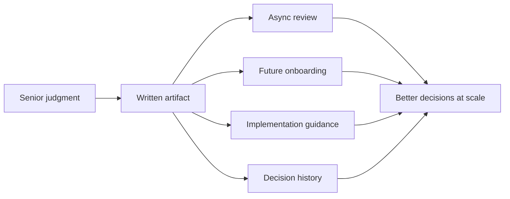
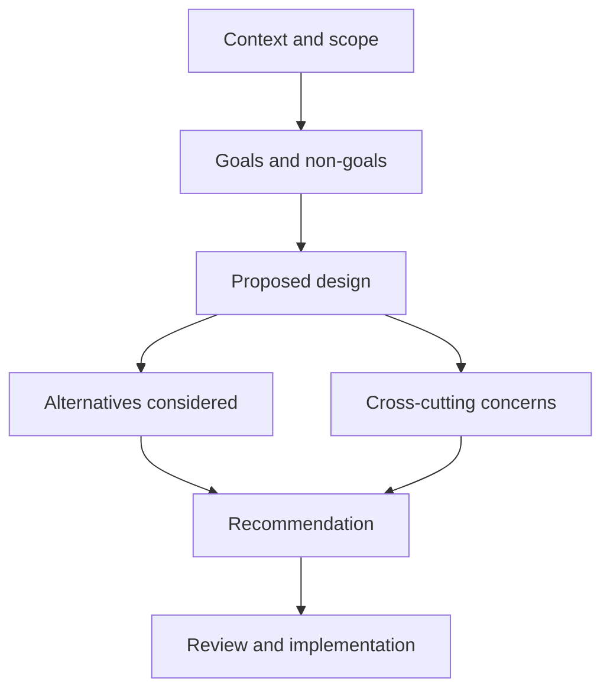
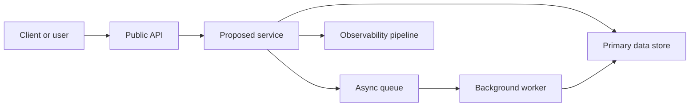
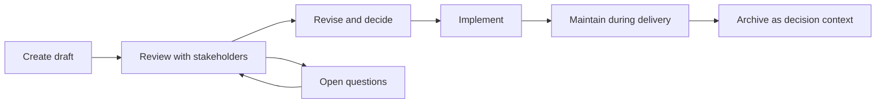
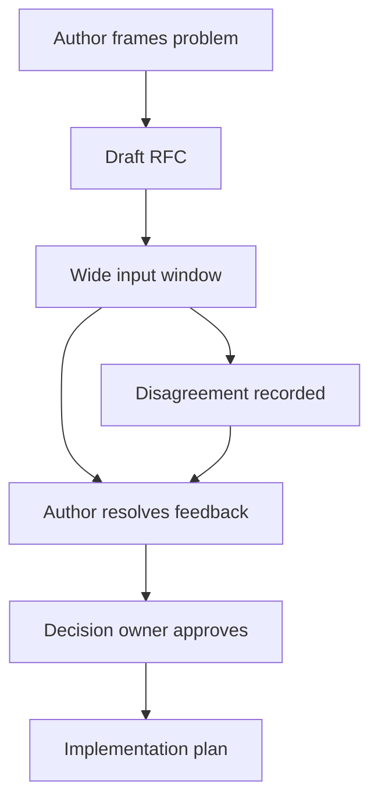
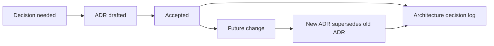

# A6 · Technical Writing — Design Docs, RFCs & ADRs
> How do you scale your judgment across an org and across time — through durable writing?

Back to the roadmap: [Skills to upgrade](../02-skills-to-upgrade.md). Related deep dives: [communication and executive writing](../leadership-skills/B2-communication-and-executive-writing.md), [API design](../system-design/06-networking-and-api-design.md), [data modeling](../system-design/03-databases-and-data-modeling.md), [asynchronism and messaging](../system-design/05-asynchronism-and-messaging.md), and sibling technical-skill files A2–A9.

**TL;DR**
- At Staff+, writing is not admin work; it is how your judgment scales beyond meetings, time zones, and your personal availability.
- A good design doc makes context, goals, non-goals, trade-offs, alternatives, and cross-cutting concerns explicit before implementation locks in expensive choices.
- RFCs and tech specs are the same family of artifact: lightweight, reviewable proposals that gather input widely while keeping single-writer clarity.
- ADRs capture one architecturally significant decision, its rationale, and consequences; they are timestamped and superseded, not rewritten.
- Strong writing craft starts with the answer, frames the tension, names the trade-offs, and makes disagreement cheap while change is still cheap.

---

## 1. Writing is Staff+ leverage

Staff+ engineers do not scale by personally attending every meeting or reviewing every pull request. They scale by creating durable artifacts that help many other engineers make better decisions without needing the author in the room.

Writing creates leverage because it:

- **Enables asynchronous alignment** across time zones and calendars.
- **Outlives the author** so future teams can understand why a system is the way it is.
- **Transfers senior judgment** by showing how constraints, alternatives, and risks were weighed.
- **Catches issues early** when changing a diagram or paragraph is cheaper than rewriting production systems.
- **Creates a decision trail** for audits, onboarding, incident review, and future migrations.



The artifact is not the goal. The goal is shared understanding and better execution. A doc that no one reads, cannot be challenged, or fails to guide implementation has not done its job.

| Mode | Strength | Failure mode |
|---|---|---|
| Meeting-only decision | Fast for small groups | Excludes absent stakeholders and loses rationale |
| Chat thread | Low friction | Hard to find, fragmented, weak long-term memory |
| Pull request only | Close to implementation | Too late for architectural trade-offs |
| Design doc, RFC, or ADR | Durable and reviewable | Can become ceremony if every small change needs one |

## 2. Design docs: the Staff+ working document

A design doc is a structured proposal for a meaningful technical change. It is most useful when the change has real trade-offs, multiple plausible approaches, cross-team impact, or long-term operational consequences.

Design docs are commonly 10–20 pages for substantial initiatives. Mini design docs of 1–3 pages are often enough for smaller changes. The point is not page count; the point is making the decision space visible.

### Anatomy of a Google-style design doc

| Section | Purpose | Staff+ question |
|---|---|---|
| Context and scope | Explain the current situation, problem, constraints, and affected systems | What world are we operating in? |
| Goals | State what success requires | What must be true when this ships? |
| Non-goals | Explicitly exclude tempting but out-of-scope work | What are we intentionally not solving? |
| Design | Describe architecture, APIs, data, flows, failure modes, and trade-offs | Why this shape and not another? |
| Alternatives considered | Present credible options and why they lost | Did we fairly explore the decision space? |
| Cross-cutting concerns | Cover security, privacy, observability, reliability, migration, and cost | What risks cut across the design? |
| Rollout and operations | Explain migration, launch, rollback, and ownership | How does this survive production? |



### Design section expectations

The design section should be concrete enough that reviewers can reason about behavior. Include:

- A **system-context diagram** showing major actors and dependencies.
- API contracts, event schemas, or interface boundaries when relevant.
- Data model and storage decisions, including ownership and retention.
- Failure modes, retries, idempotency, backpressure, and degradation.
- Observability: logs, metrics, traces, dashboards, alerts, and SLO impact.
- Trade-offs stated directly rather than hidden behind vague language.



Good design docs are opinionated. They do not merely list facts; they recommend a path and explain why it is the best fit for the context.

## 3. Design doc lifecycle

A design doc is a living artifact during execution, then a historical artifact after the decision has landed.



### Create

Start when you know enough to frame the problem but before implementation inertia dominates. Drafting too early produces fiction; drafting too late documents a decision already made.

### Review

Invite people who can identify flaws:

- Owners of dependent systems.
- Security, privacy, platform, SRE, and data stakeholders.
- Teams who will operate, integrate with, or be paged for the design.
- Engineers likely to disagree constructively.

### Implement

Use the doc to guide milestones, pull requests, and rollout. If the design changes materially, update the design doc or add a follow-up decision record.

### Maintain

During delivery, keep the doc honest. After completion, mark its status and link to implementation, runbooks, dashboards, and ADRs.

### When not to write one

Do not write a design doc when there are no real trade-offs. If the change is local, reversible, well-understood, and cheaper to demonstrate in code than explain in prose, write the code.

## 4. RFCs and tech specs

RFCs, tech specs, architecture proposals, and design docs are variations of the same practice: make an important technical proposal reviewable before committing to it.

The best RFC templates are simple:

1. Summary.
2. Motivation.
3. Goals and non-goals.
4. Proposal.
5. Alternatives.
6. Risks and mitigations.
7. Rollout plan.
8. Open questions.



Gather input widely, but write alone. Committee-written docs often become ambiguous because they optimize for avoiding conflict. A single author should synthesize feedback, make the recommendation, and explicitly record unresolved disagreements.

Prefer **good over perfect**. An RFC that helps the organization make a timely, reversible decision is more valuable than a beautiful document that arrives after the implementation is already entrenched.

| Practice | Why it helps |
|---|---|
| Short review window | Prevents indefinite debate |
| Explicit decision owner | Avoids consensus theater |
| Open questions section | Separates unknowns from blockers |
| Decision log link | Preserves outcome after review comments fade |

## 5. ADRs: architecture decisions that survive time

An Architecture Decision Record captures one architecturally significant decision. It is not a design doc. It is smaller, more focused, and optimized for future readers asking, "Why did we choose this?"

An ADR normally includes:

- **Title**: short and specific.
- **Status**: proposed, accepted, deprecated, or superseded.
- **Context**: forces, constraints, and problem.
- **Decision**: the chosen path.
- **Consequences**: benefits, costs, risks, and follow-up obligations.

ADRs are rationale-driven, timestamped, and immutable. If the decision changes, create a new ADR that supersedes the old one. Do not silently edit history.



An Architecture Decision Log is the collection of ADRs. It becomes a map of the system's architectural history.

Popular templates include Michael Nygard's original format and MADR. Use the lightest template your organization will consistently maintain.

### Example ADR

```markdown
# ADR 004: Use managed PostgreSQL for customer configuration

Date: 2026-07-17

Status: Accepted

## Context

Customer configuration is relational, must be queried transactionally, and is owned by the account platform team. The team needs point-in-time recovery and predictable operational support.

## Decision

We will store customer configuration in the cloud provider's managed PostgreSQL service. The account platform team owns schema changes, backups, and access policies.

## Consequences

Managed PostgreSQL reduces operational burden and gives us backups, monitoring, and failover primitives. We accept vendor-specific operational tooling and will avoid provider-specific SQL features unless justified by a future ADR.
```

## 6. Writing craft for technical leaders

Strong technical writing is clear thinking made visible. Use the craft patterns from [communication and executive writing](../leadership-skills/B2-communication-and-executive-writing.md), but apply them to engineering decisions.

### Use SCQA to open

SCQA means Situation, Complication, Question, Answer.

| Element | Example |
|---|---|
| Situation | The payments platform currently emits settlement events from three services |
| Complication | Downstream consumers see inconsistent ordering and duplicate reconciliation work |
| Question | How should we create a single, reliable settlement event stream? |
| Answer | Create an owned settlement event service with idempotent publication and explicit schemas |

### Lead with the answer

Busy reviewers should understand your recommendation in the first page. Details then support the recommendation rather than forcing readers to infer it.

### Be opinionated and honest

Do not pretend every option is equal. State the recommended path. Then survey alternatives honestly so disagreement focuses on facts and trade-offs rather than hidden assumptions.

### Make risk concrete

Replace "may have scalability issues" with "at 2,000 writes per second, the single-writer partition becomes the bottleneck; mitigation is sharding by tenant after milestone two."

## 7. Review culture and decision quality

Writing only works when review culture is healthy. Staff+ engineers should model disagreement that is rigorous and non-performative.

Good review comments:

- Challenge assumptions with evidence.
- Separate must-fix issues from preferences.
- Identify missing stakeholders.
- Ask whether the design can fail safely.
- Connect feedback to goals, non-goals, and constraints.

Bad review comments:

- Re-litigate scope already marked as a non-goal.
- Demand the reviewer's favorite technology without context.
- Block on style rather than decision quality.
- Hide disagreement in private side channels.

## What "good" looks like at Staff+

- You choose the right artifact: code, mini-doc, full design doc, RFC, or ADR.
- Your docs make trade-offs, alternatives, ownership, and risks explicit.
- Reviewers can disagree early without needing political escalation.
- Future engineers can reconstruct why important choices were made.
- You maintain decision artifacts during delivery and supersede them when reality changes.
- You teach others to write better docs by leaving clear examples and review comments.

## Common pitfalls

- Writing a long doc to avoid making a decision.
- Treating an RFC as a consensus vote instead of a recommendation plus accountable decision.
- Omitting non-goals, which invites infinite scope expansion.
- Hiding security, privacy, observability, migration, and operational concerns until late.
- Editing ADRs after the fact instead of creating superseding records.
- Using diagrams as decoration rather than as tools for reasoning.
- Confusing polished prose with clear thinking.

## Further reading

- Design Docs at Google: https://www.industrialempathy.com/posts/design-docs-at-google/
- ADR home and registry: https://adr.github.io/
- ADR templates: https://github.com/joelparkerhenderson/architecture-decision-record
- Michael Nygard's original ADR post: https://www.cognitect.com/blog/2011/11/15/documenting-architecture-decisions
- RFCs at scale: https://blog.pragmaticengineer.com/scaling-engineering-teams-via-writing-things-down-rfcs/
