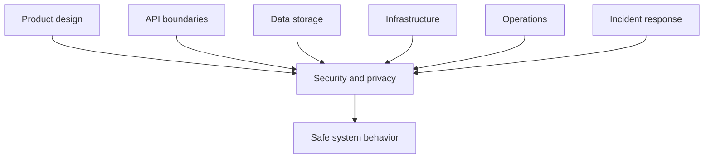
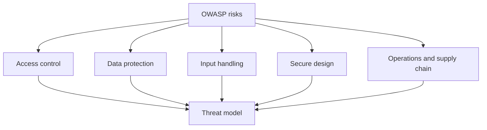
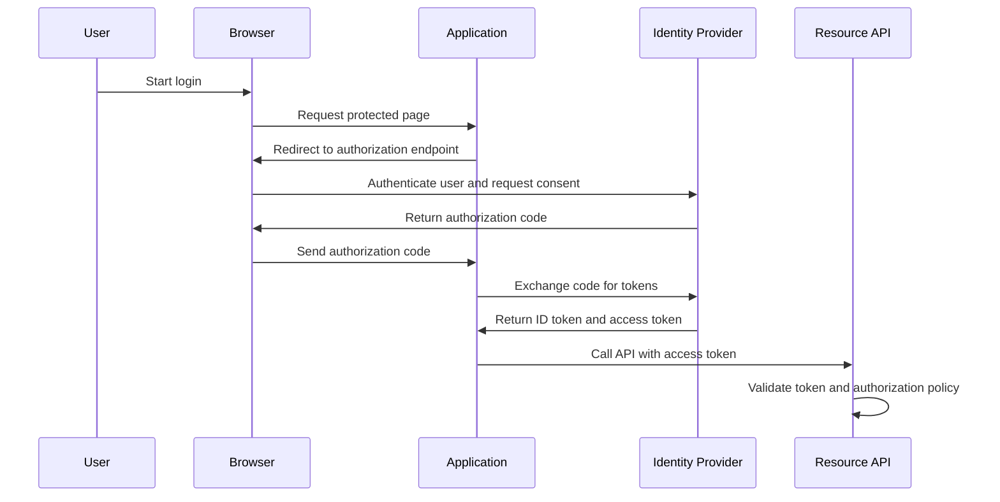
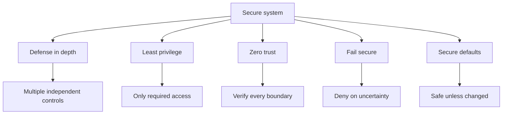
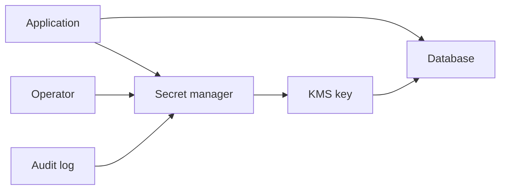
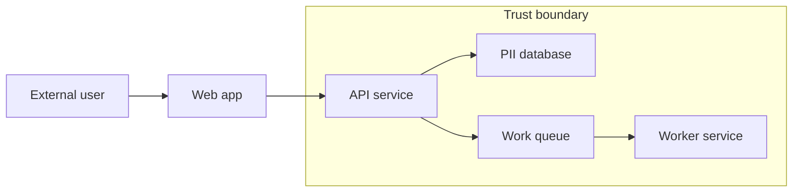

# A7 · Security & Privacy as a Design Concern
> How do you build systems that are safe by design, when no one else is asking for it?

Back to the roadmap: [Skills to upgrade](../02-skills-to-upgrade.md). Related deep dives: [API design](../system-design/06-networking-and-api-design.md), [networking](../system-design/06-networking-and-api-design.md), [databases and data modeling](../system-design/03-databases-and-data-modeling.md), [caching](../system-design/04-caching.md), [asynchronism and messaging](../system-design/05-asynchronism-and-messaging.md), and [technical writing](A6-technical-writing-docs-rfcs-adrs.md).

**TL;DR**
- Security and privacy are cross-cutting design concerns, not specialist clean-up tasks after the architecture is finished.
- Staff+ engineers often must fund security work by making risks visible, connecting them to business outcomes, and designing secure defaults.
- The OWASP Top 10 gives a practical vocabulary for common web application risks, but secure design also requires threat modeling and operational discipline.
- Authentication proves identity; authorization decides allowed actions. OAuth2, OIDC, JWTs, sessions, and MFA solve different parts of the identity problem.
- Privacy requires data minimization, clear purpose, retention discipline, and careful handling of PII, not just encryption.

---

## 1. Security is cross-cutting

Security affects product behavior, architecture, infrastructure, operations, data, and incident response. It cannot be bolted on at the end without expensive rework.

At Staff+, you are expected to notice safety gaps even when no one asks:

- Does the design expose unnecessary data?
- Are permissions checked at the correct boundary?
- What happens when a dependency is compromised?
- Can an attacker replay, tamper with, or enumerate requests?
- Will logs help detect abuse without leaking PII?

"Funding" security means translating technical risk into business language: fraud, regulatory exposure, customer trust, downtime, recovery cost, and delivery risk.

## 2. OWASP Top 10 as a practical risk map

The OWASP Top 10 is a widely used list of critical web application security risks. The 2021 edition is current here; a 2025 revision is in progress.

| OWASP 2021 category | One-line explanation |
|---|---|
| Broken Access Control | Users can act outside their intended permissions or access other users' data |
| Cryptographic Failures | Sensitive data is exposed because encryption, key handling, or hashing is weak |
| Injection | Untrusted input is interpreted as code or commands |
| Insecure Design | The architecture lacks controls for known threat scenarios |
| Security Misconfiguration | Defaults, permissions, headers, services, or cloud resources are unsafe |
| Vulnerable and Outdated Components | Dependencies contain known exploitable vulnerabilities |
| Identification and Authentication Failures | Login, session, credential, or identity flows can be bypassed or abused |
| Software and Data Integrity Failures | Code, updates, CI/CD, or data can be tampered with |
| Security Logging and Monitoring Failures | Attacks are not detected, investigated, or alerted on effectively |
| Server-Side Request Forgery | Attackers make the server send requests to unintended internal or external targets |

Use OWASP as a checklist, not a substitute for thinking. The most dangerous risks are often specific to your domain, data, and trust boundaries.

## 3. Authentication, authorization, and identity

Authentication and authorization are often confused.

| Concept | Question answered | Examples |
|---|---|---|
| Authentication | Who are you? | Password, passkey, SSO, MFA, OIDC login |
| Authorization | What are you allowed to do? | RBAC, ABAC, policy engine, resource ownership checks |
| Accounting | What did you do? | Audit logs, access logs, change history |

Authentication must not imply authorization. A valid user may still lack permission for a tenant, account, record, action, or field.

### OAuth2, OIDC, JWTs, sessions, and MFA

- **OAuth2** is an authorization framework for delegated access.
- **OIDC** adds identity on top of OAuth2 and standardizes login claims.
- **JWTs** are signed tokens containing claims; they are not automatically secure just because they are signed.
- **Sessions** store server-side state and usually use an opaque cookie as the client handle.
- **MFA** reduces account takeover risk by requiring more than one factor.

Sessions are easier to revoke centrally. Self-contained tokens are convenient for distributed systems but require careful expiry, audience validation, signing key rotation, and revocation strategy.

## 4. Secure API design

APIs are security boundaries. Design them as if clients are malicious, broken, or compromised.

| Control | What it prevents |
|---|---|
| Input validation | Unexpected types, sizes, formats, and unsafe values |
| Output encoding | Cross-site scripting and downstream interpretation bugs |
| Rate limiting | Brute force, scraping, abuse, and accidental overload |
| Least privilege | Overbroad service or user access |
| CORS discipline | Browser-based cross-origin access mistakes |
| Idempotency keys | Unsafe retries for mutation APIs |
| Audit logging | Invisible sensitive actions |

Good API security includes object-level authorization. Many breaches happen when an endpoint checks "is logged in" but not "can access this specific object."

Secure defaults matter:

- Deny by default when policy cannot be evaluated.
- Use allowlists rather than blocklists for trusted inputs.
- Avoid returning sensitive fields unless explicitly requested and authorized.
- Make pagination and filtering resistant to enumeration.
- Treat internal APIs as hostile unless protected by identity and policy.

## 5. Core security principles

### Defense in depth

Assume one control will fail. Combine identity, network segmentation, input validation, encryption, monitoring, and incident response.

### Least privilege

Grant only the permissions needed for the task, for the shortest reasonable duration, at the narrowest scope.

### Zero trust

Do not trust a request because it originates from an internal network. Verify identity, device, workload, policy, and context at each boundary.

### Fail secure

When a dependency is down or a policy is ambiguous, prefer safe denial over unsafe access.

### Secure defaults

Make the easiest path the safest path. Engineers under delivery pressure will follow defaults.

## 6. Cryptography basics for practitioners

Cryptography is easy to misuse. Prefer well-reviewed libraries, managed services, and standard protocols.

| Topic | Practical meaning |
|---|---|
| Encryption in transit | Use TLS to protect data between clients, services, and infrastructure |
| Encryption at rest | Protect stored data using database, disk, object-store, or application-level encryption |
| Hashing | One-way transformation used for integrity checks and password verification |
| Encryption | Reversible transformation that requires key management |
| Symmetric crypto | Same key encrypts and decrypts; fast and common for data encryption |
| Asymmetric crypto | Public and private keys; useful for key exchange, signatures, and identity |

Passwords must be hashed with password-specific algorithms such as bcrypt or Argon2, plus unique salts. Do not use fast hashes such as SHA-256 alone for passwords.

Secrets management is part of cryptography:

- Store secrets in Vault, cloud KMS, or a managed secret manager.
- Rotate keys and credentials.
- Separate encryption keys from encrypted data.
- Never log secrets.
- Avoid long-lived credentials where workload identity is available.

## 7. Threat modeling with STRIDE

Threat modeling is structured imagination. It helps teams ask, "How could this fail under attack?"

STRIDE categories:

| STRIDE category | Threat question |
|---|---|
| Spoofing | Can an attacker pretend to be someone or something else? |
| Tampering | Can data, requests, binaries, or configuration be modified? |
| Repudiation | Can actors deny actions because evidence is missing? |
| Information disclosure | Can sensitive data be exposed? |
| Denial of service | Can availability be degraded or exhausted? |
| Elevation of privilege | Can a low-privilege actor gain more power? |

Use data-flow diagrams to identify:

- External entities.
- Processes.
- Data stores.
- Data flows.
- Trust boundaries.

The Staff+ move is to make threat modeling lightweight enough that teams actually do it.

## 8. Privacy and PII

Privacy is about appropriate collection, use, sharing, retention, and deletion of personal data.

PII can include names, email addresses, government IDs, phone numbers, precise location, device identifiers, IP addresses, financial details, and combinations of attributes that identify a person.

Key privacy concepts:

- **Data minimization**: collect only what is needed.
- **Purpose limitation**: use data only for the purpose communicated or legally justified.
- **Retention limits**: delete data when no longer needed.
- **Access control**: restrict who and what can view or process personal data.
- **Pseudonymization**: replace direct identifiers with stable aliases while preserving analytical utility.
- **GDPR rights**: access, correction, deletion, portability, and objection depending on context.

Encryption reduces exposure but does not eliminate privacy obligations. If the system can decrypt and use the data, the organization must still govern it.

## What "good" looks like at Staff+

- You raise security and privacy risks during design, not after launch.
- You make threat models, access controls, data flows, and logging decisions visible in design docs.
- You push for secure defaults and managed security primitives instead of bespoke mechanisms.
- You connect security investments to customer trust, compliance, fraud prevention, and operational resilience.
- You ensure sensitive actions are authorized, audited, monitored, and reversible where possible.
- You mentor teams to use OWASP, STRIDE, and privacy principles pragmatically.

## Common pitfalls

- Treating authentication as sufficient authorization.
- Storing passwords with general-purpose hashes or reversible encryption.
- Logging tokens, secrets, or unnecessary PII.
- Relying on internal networks as a security boundary.
- Adding rate limits and monitoring only after abuse occurs.
- Copying OAuth2 or JWT examples without validating issuer, audience, expiry, and signature.
- Collecting data because it might be useful someday.

## Further reading

- OWASP Top 10: https://owasp.org/www-project-top-ten/
- OWASP Cheat Sheet Series: https://cheatsheetseries.owasp.org/
- Microsoft STRIDE: https://learn.microsoft.com/en-us/azure/security/develop/threat-modeling-tool-threats
