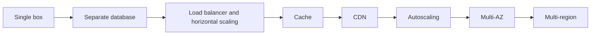
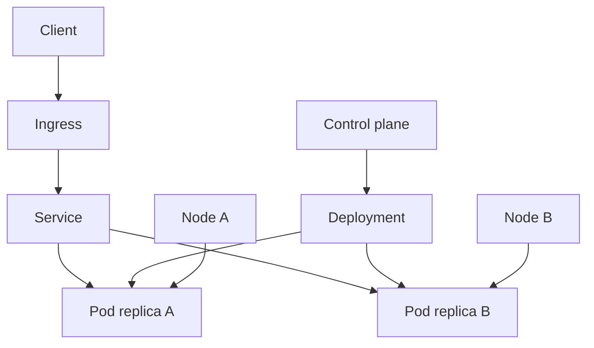
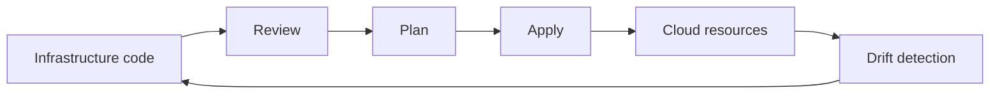
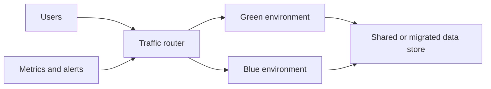
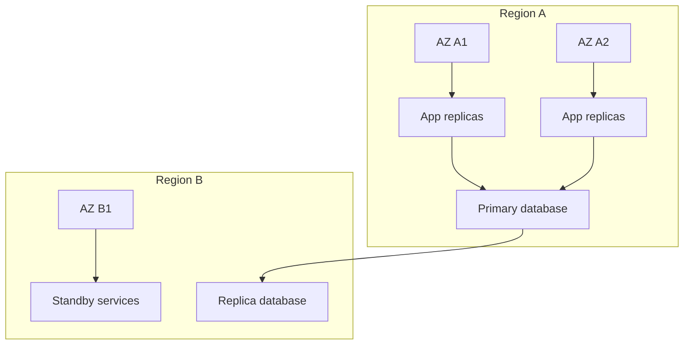
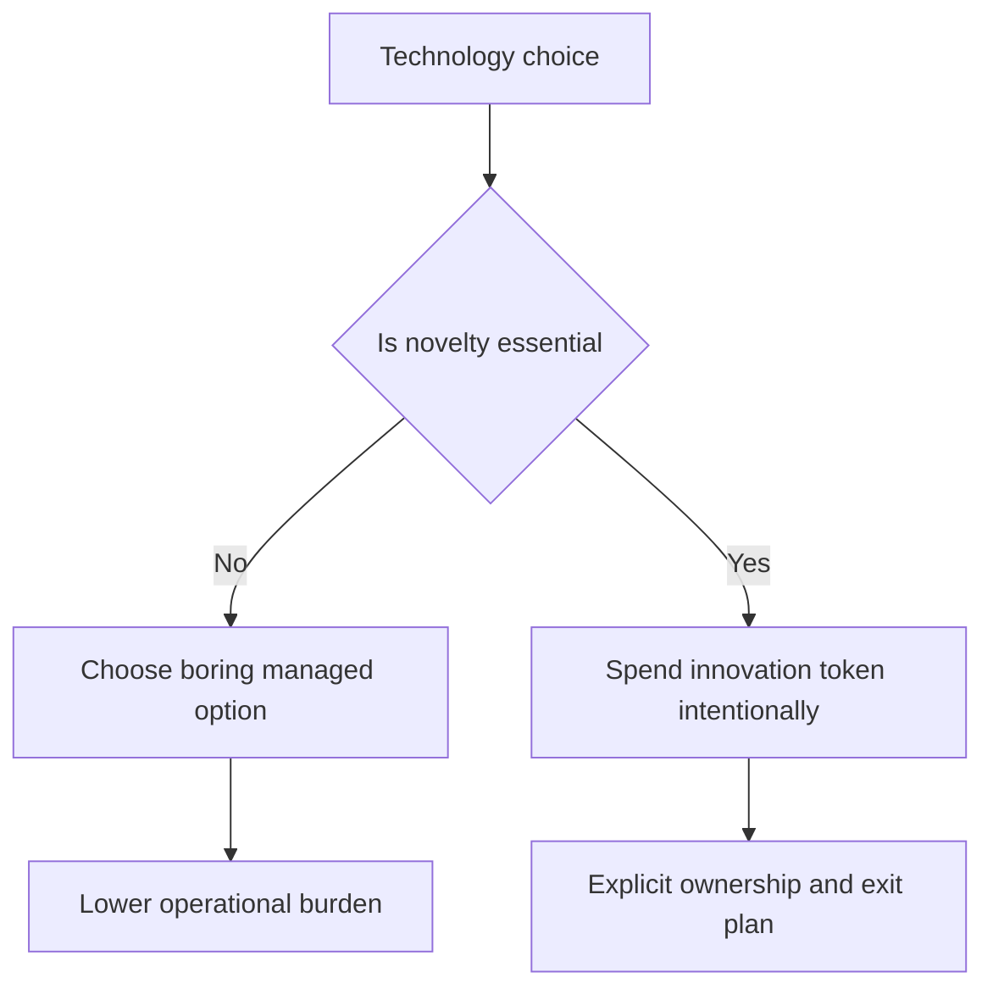

# A8 · Cloud Infrastructure & Pragmatic Tech Choices
> How do you run a system on cloud primitives at scale — and keep it simple enough to operate?

Back to the roadmap: [Skills to upgrade](../02-skills-to-upgrade.md). Related deep dives: [scalability trade-off axes](../system-design/01-scalability-tradeoff-axes.md), [caching](../system-design/04-caching.md), [asynchronism and messaging](../system-design/05-asynchronism-and-messaging.md), [networking and API design](../system-design/06-networking-and-api-design.md), [back-of-envelope estimation](../system-design/07-back-of-envelope-estimation.md), and [security and privacy](A7-security-and-privacy.md).

**TL;DR**
- Cloud architecture is a progression of scaling and operational choices, not a default jump to the most complex platform.
- Core primitives are compute, storage, networking, managed databases, queues, identity, and observability.
- Containers and Kubernetes are powerful, but they add operational complexity; many teams should prefer managed platforms or serverless.
- Infrastructure as Code, immutable infrastructure, and progressive delivery make environments repeatable and safer to change.
- Staff+ engineers choose boring technology, run less software, and optimize for reliability, cost, and operability over novelty.

---

## 1. The cloud scaling progression

Most systems do not need global multi-region architecture on day one. They evolve through pressure: traffic, data growth, availability needs, team size, compliance, and operational pain.

This progression is a set of trade-offs. See [scalability trade-off axes](../system-design/01-scalability-tradeoff-axes.md) for deeper framing.

| Stage | What improves | What gets harder |
|---|---|---|
| Single box | Simplicity and debuggability | Capacity and availability |
| Separate database | Data durability and specialization | Network latency and backups |
| Load balancer plus replicas | Throughput and availability | Statelessness and deployment coordination |
| Cache | Latency and read scalability | Invalidation and consistency |
| CDN | Global edge performance | Cache control and purge strategy |
| Autoscaling | Elastic capacity | Metrics, warm-up, and cost surprises |
| Multi-AZ | Resilience to zone failure | Data replication and failover testing |
| Multi-region | Regional disaster tolerance | Complexity, consistency, cost, and operations |

The Staff+ question is not "Can we scale?" It is "What level of scale and resilience is justified by the product and business right now?"

## 2. Core cloud primitives

Cloud providers package infrastructure as programmable primitives. The primitives are similar across AWS, Azure, and Google Cloud even when names differ.

| Primitive | Examples | Design questions |
|---|---|---|
| Compute | VMs, containers, serverless functions, managed app platforms | Who manages the runtime and scaling? |
| Storage | Object, block, file storage | What access pattern and durability model? |
| Networking | VPCs, subnets, routing, load balancers, DNS | What talks to what, and across which boundary? |
| Managed databases | Relational, document, key-value, graph, search | What data model, consistency, and operations model? |
| Queues and streams | Message queues, pub-sub, event streams | Is work synchronous, asynchronous, ordered, or replayable? |
| Identity and secrets | IAM, KMS, secret managers | Who or what is allowed to access resources? |
| Observability | Metrics, logs, traces, alerts | Can operators understand behavior and failures? |

### Compute options

| Option | Best for | Trade-offs |
|---|---|---|
| Virtual machines | Maximum control, legacy workloads, specialized runtime needs | More patching, image management, and capacity planning |
| Containers | Portable services with repeatable packaging | Requires orchestration and runtime security |
| Managed container platform | Service teams that want containers without full cluster ownership | Less control than raw Kubernetes |
| Serverless functions | Event-driven work, spiky workloads, low ops burden | Cold starts, runtime limits, vendor coupling |
| Platform as a Service | Standard web apps and APIs | Opinionated deployment and runtime model |

Choose the simplest compute model that satisfies scaling, isolation, compliance, and delivery needs.

## 3. Containers and orchestration

Docker packages an application and its runtime dependencies into an image. Containers help make local, CI, and production environments more consistent.

Kubernetes orchestrates containers across machines. Basic Kubernetes concepts:

- **Pod**: smallest deployable unit, usually one main container plus sidecars.
- **Deployment**: desired state for replicated pods and rollout behavior.
- **Service**: stable network identity and load balancing for pods.
- **Ingress**: external routing into services.
- **Control plane**: API server, scheduler, controllers, and cluster state.
- **Node**: worker machine that runs pods.

### When not to use Kubernetes

Do not use Kubernetes merely because it is industry-standard. Avoid it when:

- The team lacks operational experience and no managed platform is available.
- You run a small number of simple services.
- Serverless or a managed app platform satisfies the need.
- Your main bottleneck is product discovery, not infrastructure flexibility.
- The organization will not invest in platform ownership, upgrades, security, and observability.

Kubernetes is an operating system for distributed applications. If you adopt it, someone must operate it.

## 4. Infrastructure as Code and immutable infrastructure

Infrastructure as Code makes environments reproducible and reviewable. Terraform is a common tool, but the principle applies broadly: infrastructure changes should be versioned, reviewed, planned, applied, and audited.

Immutable infrastructure means replacing instances, containers, or images instead of mutating them manually. It reduces configuration drift and makes rollback more predictable.

Good practices:

- Separate environments while reusing modules.
- Keep secrets out of state files and source control.
- Use policy checks for risky changes.
- Prefer automated changes over console clicks.
- Track ownership and cost metadata as tags.

## 5. Deployment strategies

Deployment is a reliability problem, not just a release problem.

| Strategy | How it works | Best for |
|---|---|---|
| Rolling deploy | Replace instances gradually | Routine low-risk releases |
| Blue-green | Run old and new environments, then switch traffic | Fast rollback and major changes |
| Canary | Send a small percentage of traffic to new version first | Risky changes with measurable health signals |
| Feature flags | Decouple deploy from release | Product experimentation and gradual exposure |

Progressive delivery only works when you know what "healthy" means. Define metrics before launch: error rate, latency, saturation, business conversion, queue depth, and rollback triggers.

## 6. AWS Well-Architected pillars

The AWS Well-Architected framework names six pillars that generalize beyond AWS.

| Pillar | Staff+ interpretation |
|---|---|
| Operational Excellence | Can we run, observe, change, and improve the system safely? |
| Security | Are identity, data protection, detection, and response built in? |
| Reliability | Does the workload perform correctly and recover from failure? |
| Performance Efficiency | Are resources selected and scaled appropriately for demand? |
| Cost Optimization | Are we spending intentionally and eliminating waste? |
| Sustainability | Are we reducing unnecessary resource consumption and environmental impact? |

Use the pillars as review prompts in design docs and operational readiness reviews.

## 7. Reliability building blocks

Cloud reliability is built from failure domains and recovery plans.

| Term | Meaning |
|---|---|
| Availability Zone | Isolated data-center zone inside a region |
| Region | Geographic grouping of zones |
| Multi-AZ | Deployment resilient to one zone failure |
| Multi-region | Deployment designed for regional failure or global latency |
| RTO | Recovery Time Objective, or maximum acceptable downtime |
| RPO | Recovery Point Objective, or maximum acceptable data loss |

Backups are not a strategy unless restores are tested. Disaster recovery plans must specify ownership, triggers, communication, RTO, RPO, and verification steps.

## 8. Cost awareness and FinOps

Cloud makes spending easy and waste invisible. Staff+ engineers should treat cost as an architectural constraint.

Common cost drivers:

- Overprovisioned compute.
- Unbounded logs, metrics, traces, and retention.
- Cross-region and internet data transfer.
- Inefficient database queries and storage.
- Idle development environments.
- Premium managed services used without a clear value case.

FinOps basics:

- Tag resources by team, service, environment, and cost center.
- Review unit economics, not just total spend.
- Set budgets and anomaly alerts.
- Right-size resources based on measurements.
- Prefer reserved capacity only for stable baseline usage.
- Include cost impact in design docs.

## 9. Staff heuristics: choose boring, run less

"Choose Boring Technology" means spend innovation tokens deliberately. Novel databases, languages, orchestration systems, and messaging platforms all consume learning, hiring, operational, and debugging capacity.

"Run Less Software" means prefer managed and commodity services when they are good enough. Every self-operated component becomes a security, upgrade, monitoring, paging, and continuity obligation.

The senior trap is proving you can build it. The Staff+ discipline is deciding whether the organization should own it.

## What "good" looks like at Staff+

- You match architecture complexity to actual scale, resilience, compliance, and team maturity needs.
- You can explain cloud primitives without vendor-name dependency.
- You prefer managed services when they reduce undifferentiated operational work.
- You require IaC, tagging, observability, backup testing, and rollback paths for production systems.
- You make cost, RTO, RPO, and failure domains explicit in design reviews.
- You know when Kubernetes is justified and when it is organizational vanity.

## Common pitfalls

- Starting with multi-region architecture before proving product and traffic needs.
- Treating Kubernetes as a default instead of an operational commitment.
- Making manual cloud-console changes that bypass review and drift detection.
- Ignoring data transfer, observability, and idle-resource costs.
- Assuming backups work without restore tests.
- Using autoscaling to hide inefficient code or bad capacity models.
- Choosing novel technology without explicit ownership and training plans.

## Further reading

- AWS Well-Architected: https://aws.amazon.com/architecture/well-architected/
- Choose Boring Technology: https://mcfunley.com/choose-boring-technology
- Run Less Software: https://www.intercom.com/blog/run-less-software/
- AWS Builders' Library: https://aws.amazon.com/builders-library/
- The Twelve-Factor App: https://12factor.net/
