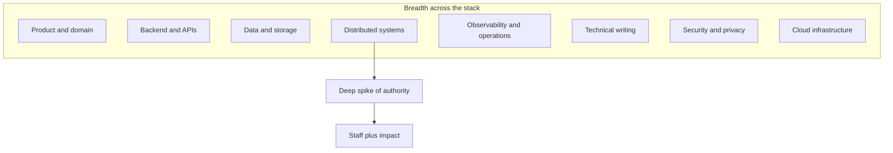
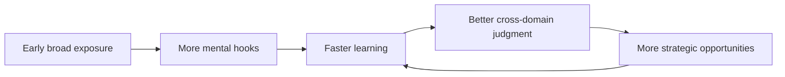
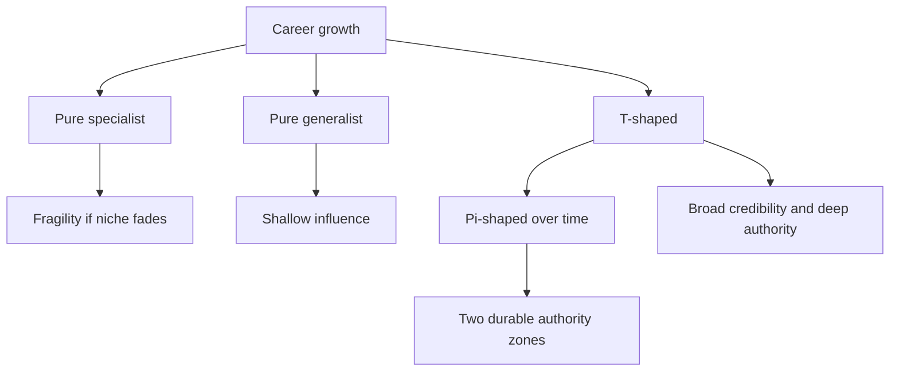
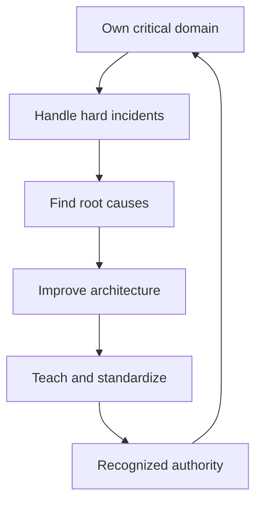

# A9 · T-shaped Breadth + Depth
> How do you become broadly credible across the whole stack AND the deep authority in one area?

Back to the roadmap: [Skills to upgrade](../02-skills-to-upgrade.md). Related deep dives: [what is required](../01-what-is-required.md), [scalability trade-offs](../system-design/01-scalability-tradeoff-axes.md), [CAP and consistency](../system-design/02-cap-theorem-consistency-models.md), [databases and data modeling](../system-design/03-databases-and-data-modeling.md), [security and privacy](A7-security-and-privacy.md), [cloud infrastructure](A8-cloud-infrastructure.md), and the rest of technical skills A1–A8.

**TL;DR**
- T-shaped engineers combine broad working fluency across many domains with one or more deep spikes of authority.
- Breadth gives Staff+ engineers architectural judgment and credibility in rooms where frontend, backend, data, infra, product, and operations collide.
- Depth gives you irreplaceable value: the ability to solve hard problems, set direction, and teach a domain from first principles.
- Generalist context compounds early; specialist authority compounds when aligned with enduring business needs.
- Over a career, many Staff+ engineers become pi-shaped: broad base plus two deep spikes.

---

## 1. The T-shape metaphor

The T-shape is a simple model for Staff+ technical growth.

- The **horizontal bar** is breadth: enough fluency across A1–A8 and related system-design domains to reason about trade-offs.
- The **vertical bar** is depth: a domain where you are a recognized authority and can create direction, not just execute tasks.

The metaphor is imperfect, but useful. Staff+ engineers are rarely the best person at every layer. They are credible enough across layers to ask good questions, spot missing constraints, and connect specialists.

## 2. Why breadth matters

Breadth gives you architectural judgment. Most important engineering decisions are not isolated to one layer:

- A database choice affects API latency, product flexibility, privacy, and disaster recovery.
- A frontend performance issue may be caused by backend aggregation, cache policy, or CDN configuration.
- A security requirement may reshape identity, data retention, logging, and support tooling.
- A cloud cost issue may involve query plans, autoscaling, observability retention, and customer behavior.

Staff+ engineers are often "in the room" for ambiguous decisions. Breadth lets you contribute without pretending to be the domain expert in every topic.

| Breadth capability | Why it matters |
|---|---|
| Ask cross-domain questions | Prevents local optimization |
| Understand specialist language | Reduces translation loss |
| Notice missing stakeholders | Avoids late surprises |
| Connect incidents to design | Turns pain into architecture learning |
| Evaluate trade-offs | Improves decisions under uncertainty |

Breadth is also credibility. Teams trust advice more when you understand enough of their constraints to avoid naive recommendations.

## 3. Why depth matters

Depth is what makes you more than a coordinator. It is the ability to solve problems others cannot, set technical direction, and teach a domain from first principles.

Depth shows up when you can:

- Diagnose hard production failures in your domain.
- Recognize patterns across years of incidents and designs.
- Explain trade-offs simply to executives and deeply to experts.
- Build reusable mental models, libraries, platforms, or standards.
- Know when common advice does not apply to your context.

Depth supports the Architect archetype from [what is required](../01-what-is-required.md), but it also helps Tech Leads, Solvers, and Right Hands. Without depth, your influence depends too much on process and relationships. With depth, your judgment has technical weight.

## 4. How breadth compounds

Charity Majors has argued that useful engineering growth often rewards generalists because broad context accelerates learning. Early breadth compounds because each new domain gives you more hooks for understanding the next one.

For example:

- Knowing networking helps you debug API latency.
- Knowing databases helps you design better product boundaries.
- Knowing observability helps you learn from every incident.
- Knowing security helps you see trust boundaries in architecture.
- Knowing cloud primitives helps you reason about cost and reliability.

Breadth does not mean shallow trivia. It means enough working knowledge to reason about constraints, risks, and interfaces.

## 5. Choosing your spike

Your deep spike should be both personally energizing and enduringly central to the business.

Good spike candidates often sit where:

- The company repeatedly makes expensive decisions.
- Incidents or bottlenecks cluster.
- Product differentiation depends on technical excellence.
- The organization lacks a clear authority.
- The domain will matter for years, not one quarter.

Examples:

| Company context | Possible spike |
|---|---|
| High-scale consumer product | Reliability, latency, experimentation platform |
| Fintech or regulated platform | Security, privacy, ledger correctness, compliance architecture |
| Data-heavy SaaS | Analytics infrastructure, data modeling, search, ML platform |
| Developer tools company | API design, platform extensibility, build systems |
| Marketplace | Ranking, payments, fraud, event-driven systems |

Align the spike with company needs. A deep specialty that the business does not need may be intellectually satisfying but strategically limiting.

## 6. Pitfalls of extremes

Pure specialists and pure generalists both face Staff+ risks.

| Extreme | Strength | Risk |
|---|---|---|
| Pure specialist | Deep authority in a niche | Fragile if the niche fades or becomes less central |
| Pure generalist | Can navigate many domains | May lack the technical depth to set direction |
| T-shaped engineer | Breadth plus one spike | Can become overloaded as the bridge for everything |
| Pi-shaped engineer | Breadth plus two spikes | Requires deliberate focus to avoid dilution |

The pi-shaped model is common over longer careers. You may build one spike in distributed systems, then another in developer productivity, security, data, or organizational architecture.

## 7. Deliberately building breadth

Breadth should be built through real exposure, not just reading summaries.

High-leverage ways to build breadth:

- Rotate across teams or take temporary assignments in adjacent domains.
- Read real architecture docs, RFCs, incident reviews, and engineering blogs.
- Shadow on-call for systems you depend on.
- Join design reviews outside your immediate area.
- Pair with specialists during migrations, outages, or performance work.
- Build small prototypes to understand unfamiliar tools.
- Ask "what breaks at 10x?" and "who operates this?" in every design.

Breadth learning checklist:

| Domain | Minimum useful fluency |
|---|---|
| Frontend | Rendering model, performance, accessibility, client-state trade-offs |
| Backend | API boundaries, concurrency, failure handling, deployment |
| Data | Modeling, indexing, transactions, retention, analytics constraints |
| Infrastructure | Compute, networking, scaling, IAM, cost |
| Security | AuthN, AuthZ, threat modeling, secure defaults |
| Operations | Observability, SLOs, incident response, capacity |
| Product | User workflows, business model, customer pain |

## 8. Deliberately building depth

Depth requires ownership under pressure. You do not become deep by passively consuming content.

Depth-building practices:

- Own a critical domain for multiple years.
- Read source code, design docs, postmortems, and historical decisions.
- Lead incident root-cause analysis and follow through on systemic fixes.
- Benchmark and measure instead of relying on folklore.
- Teach others through docs, talks, office hours, and design reviews.
- Build tools or abstractions that encode your domain knowledge.
- Track external developments but filter them through local constraints.

Depth should produce artifacts: standards, libraries, runbooks, decision records, platform capabilities, or mentoring systems. If your expertise only exists in your head, it does not scale.

## 9. Mapping to the four Staff archetypes

StaffEng describes common Staff archetypes: Tech Lead, Architect, Solver, and Right Hand. T-shaped growth supports all four.

| Archetype | Breadth need | Depth need |
|---|---|---|
| Tech Lead | Coordinate product, team, architecture, and delivery trade-offs | Enough domain depth to make credible technical calls |
| Architect | See system-wide interactions and future constraints | Deep architectural authority in one or more core domains |
| Solver | Understand where the hardest problem sits across layers | Very deep debugging and problem-solving capability |
| Right Hand | Translate executive priorities across technical domains | Deep trust and judgment in the organization's critical systems |

See [what is required](../01-what-is-required.md) for the repo's broader Staff+ framing.

Your archetype may change by role, company stage, or business need. The T-shape is portable because it creates both adaptability and authority.

## 10. A practical development plan

Use a simple quarterly loop:

1. Pick one breadth domain to improve.
2. Pick one depth capability to strengthen.
3. Find real work that forces learning.
4. Produce an artifact that scales the learning.
5. Ask specialists to critique your understanding.

Example:

| Quarter goal | Real work | Scaling artifact |
|---|---|---|
| Improve security breadth | Threat model a new API | Security review checklist |
| Deepen database authority | Lead high-write migration | Migration playbook and ADR |
| Improve cloud breadth | Join cost-reduction effort | Cost review guide |
| Deepen observability spike | Redesign service SLOs | SLO template and dashboard standard |

The point is deliberate compounding. Staff+ growth is not "learn everything." It is "learn the right adjacent things while deepening the authority the business needs."

## What "good" looks like at Staff+

- You are credible across product, system design, data, infrastructure, security, operations, and delivery discussions.
- You have at least one domain where engineers seek your judgment before committing to major decisions.
- You can translate specialist concerns into executive and cross-team language.
- You keep broadening enough to avoid local optimization and deepening enough to remain technically authoritative.
- Your expertise creates artifacts, standards, and people development, not just personal heroics.
- You align your spike with durable business needs.

## Common pitfalls

- Treating breadth as shallow awareness rather than working fluency.
- Choosing a spike because it is fashionable rather than business-critical.
- Becoming the only bridge across teams and creating a bottleneck.
- Staying in a comfortable niche after the company's needs move elsewhere.
- Confusing years of experience with depth.
- Reading broadly without doing real cross-domain work.
- Building expertise that remains private instead of teachable.

## Further reading

- StaffEng staff archetypes: https://staffeng.com/guides/staff-archetypes/
- Charity Majors on engineering levels: https://charity.wtf/p/useful-things-to-know-about-engineering-levels
- System Design Primer: https://github.com/donnemartin/system-design-primer
