# Technical Skills (Part A)

> **The core idea in one sentence:** Everything is a trade-off: the Staff+ signal is naming the trade-off behind every technical choice and writing it down so a whole org can align.

For a senior engineer working toward Staff or Principal. These eight lessons cover A2–A9 of [Part A of the skills playbook](../02-skills-to-upgrade.md#part-a--technical-skills): the theory beneath system design, keeping systems up in production, architecture and strategy across teams, the writing that scales your judgement, security, cloud, and the shape of your expertise. A1 — system design itself — is its own course: [System Design &amp; Architecture at Scale](../system-design/index.html). Every lesson ends with quizzes, a try-it list for your own system and a primary source, so you finish able to **name, defend and write down** the trade-off behind each choice.

Self-contained deep dives for the **technical** skill areas in [../02-skills-to-upgrade.md](../02-skills-to-upgrade.md#part-a--technical-skills). Read each and you'll gain the working knowledge a Staff/Principal engineer is expected to have. Every chapter uses Mermaid diagrams, comparison tables, "what good looks like at Staff+", pitfalls, and further reading.

> **A1 lives in its own folder** because it decomposes into seven big sub-topics: see **[../system-design/](../system-design/GUIDE.md)** (scalability, CAP, databases, caching, messaging, networking, estimation).

This is the long-form edition of the course. Each chapter is also an interactive lesson (quizzes, a “try it in your own system” task and a primary source) — start from the [course map](index.html) — and has a one-page cheat sheet linked at the top of each chapter below.

---

## Table of contents

| Code | Chapter | What you'll learn | Lesson |
|---|---|---|---|
| A2 | [Data-Intensive & Distributed Systems](#a2--data-intensive--distributed-systems) | The DDIA spine: encoding & schema evolution, storage engines, the *trouble* with distributed systems (clocks, partial failure), consensus, batch vs stream processing. | [Lesson 01](lessons/0001-data-intensive-distributed-systems.html) |
| A3 | [Reliability, Observability & SRE](#a3--reliability-observability--sre) | SLIs/SLOs & error budgets, the four golden signals, toil, incident response & blameless postmortems, cascading failures, canarying. | [Lesson 02](lessons/0002-reliability-observability-sre.html) |
| A4 | [Software Architecture & Evolutionary Design](#a4--software-architecture--evolutionary-design) | Monolith vs microservices, event-driven, layering, Strangler Fig migration, fitness functions, architecture characteristics & trade-off analysis. | [Lesson 03](lessons/0003-software-architecture.html) |
| A5 | [Engineering Strategy & Technical Vision](#a5--engineering-strategy--technical-vision) | Rumelt's diagnosis→policy→action, the "five design docs" recipe, boring/specific/opinionated strategy, writing a 2–3 year vision. | [Lesson 04](lessons/0004-engineering-strategy-and-vision.html) |
| A6 | [Technical Writing — Design Docs, RFCs & ADRs](#a6--technical-writing--design-docs-rfcs--adrs) | Google-style design docs, RFC culture, Architecture Decision Records, and how writing scales your influence asynchronously. | [Lesson 05](lessons/0005-technical-writing-docs-rfcs-adrs.html) |
| A7 | [Security & Privacy as a Design Concern](#a7--security--privacy-as-a-design-concern) | OWASP Top 10, secure API design (authN/authZ, OAuth/JWT), secrets, least privilege, defense-in-depth, encryption, threat modeling. | [Lesson 06](lessons/0006-security-and-privacy.html) |
| A8 | [Cloud Infrastructure & Pragmatic Tech Choices](#a8--cloud-infrastructure--pragmatic-tech-choices) | The cloud scaling progression, AWS Well-Architected 6 pillars, "Choose Boring Technology" & "Run Less Software". | [Lesson 07](lessons/0007-cloud-infrastructure.html) |
| A9 | [T-shaped Breadth + Depth](#a9--t-shaped-breadth--depth) | How to build broad architectural judgment across A1–A8 plus a deep "spike" in one business-critical domain. | [Lesson 08](lessons/0008-tshaped-breadth-and-depth.html) |
| — | [Capstone project](#capstone-project) | Prove it end to end | — |
| — | [Self-assessment checklist](#self-assessment-checklist) and [study plan](#study-plan) | Know when you’re done | — |

## How the technical skills fit together

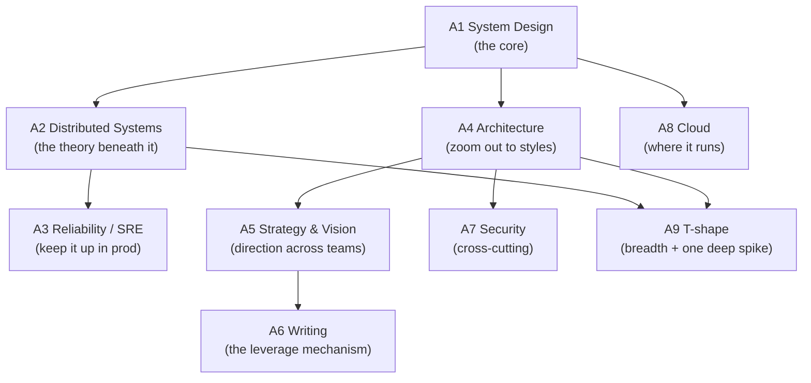

> **The through-line:** *everything is a trade-off.* The Staff+ signal isn't knowing every pattern — it's naming the trade-off behind every choice and writing it down so a whole org can align.

## How to study this guide (≈ 8–10 weeks part-time (3–5 hrs/week))

1. Start with A1 if trade-off axes, CAP, caching or estimation are not yet second nature: it is its own course, [System Design & Architecture at Scale](../system-design/index.html). Lesson 01 here is the theory beneath it.
2. Take the parts in order. Inside a part, lessons stand alone; the prerequisites on each lesson header tell you what to read first.
3. One lesson per week: read it (45–60 min), answer the three quizzes *before* revealing, then do at least one "Try it in your own system" item at work that week.
4. Every lesson should leave an artifact behind: a compatibility rule, an SLO, a fitness function, a strategy paragraph, an ADR, a threat model, an RTO/RPO table, a quarterly plan.
5. Bring the lesson's cheat sheet (in `reference/`) to real design reviews. Its review questions are meant to be asked out loud.
6. Read end to end or search in `GUIDE.md`, the long-form Markdown edition. Use the HTML lessons for quizzes and practice.
7. For A3, go deeper with PromQL, OpenTelemetry and simulators in [Reliability, Observability & SRE](../Observability/index.html). For the other half of the playbook, see [Leadership Skills (Part B)](../leadership-skills/index.html).

---

# A2 — Data-Intensive & Distributed Systems

> How do you reason correctly about data as it moves, replicates, and fails across many machines?

**TL;DR**
- Data-intensive systems are judged by reliability, scalability, and maintainability, not by clever distributed tricks.
- Most production failures come from partial failure, time assumptions, overloaded dependencies, and misunderstood consistency semantics.
- Compatibility is an engineering discipline: schema evolution, rolling upgrades, and mixed-version operation must be designed explicitly.
- Ordering is not the same as time; causality tools such as happens-before, Lamport timestamps, and vector clocks help reason about concurrent updates.
- Consensus is expensive but foundational when systems need one agreed sequence of decisions, such as leader election or configuration changes.
- Batch and stream processing are complementary ways to derive state from immutable facts.

Skill map: return to [Skills to upgrade](../02-skills-to-upgrade.md). Related deep dives: [CAP and consistency](../system-design/GUIDE.md#chapter-2--cap-theorem--consistency-models), [databases and data modeling](../system-design/GUIDE.md#chapter-3--databases--data-modeling), [messaging](../system-design/GUIDE.md#chapter-5--asynchronism--messaging), and sibling [A3 reliability](#a3--reliability-observability--sre).

*Interactive lesson:* [Lesson 01 · Distributed systems](lessons/0001-data-intensive-distributed-systems.html) · *Cheat sheet:* [Distributed systems cheat sheet](reference/0001-data-intensive-distributed-systems-cheatsheet.html)

## 1.1 The lens: reliability, scalability, maintainability

Data-intensive systems are hard because of data volume, complexity, correctness, or movement. The Staff+ job is reasoning about guarantees and failure modes.

| Property | Practitioner definition | Staff+ question |
|---|---|---|
| Reliability | The system continues to work correctly despite faults in hardware, software, humans, networks, or dependencies. | What failures are we assuming, detecting, masking, or accepting? |
| Scalability | The system can handle increased load by adding resources or changing architecture without collapsing cost or complexity. | Which load dimension grows, and what bottleneck appears first? |
| Maintainability | Engineers can understand, operate, modify, and safely evolve the system over years. | Can a new team change this without rediscovering hidden invariants? |

Reliability is correctness under stress, not just uptime. Scalability is multi-dimensional: reads, writes, fan-out, tenants, regions, and latency can each become the bottleneck. Maintainability is the Staff+ differentiator because a design fails organizationally if only two people can operate it.

## 1.2 Data models and query languages

A data model shapes what is easy, what is hard, and what mistakes the system invites. See [databases and data modeling](../system-design/GUIDE.md#chapter-3--databases--data-modeling).

| Model | Best fit | Watch out for |
|---|---|---|
| Relational | Structured records, joins, constraints, reporting, transactional updates. | Object-relational impedance, schema migration discipline, accidental shared database coupling. |
| Document | Aggregate-oriented data, flexible shape, read-mostly records, product iteration. | Hard cross-document joins, duplicated facts, inconsistent update paths. |
| Graph | Many-to-many relationships, traversals, recommendations, permissions, lineage. | Operational maturity, query predictability, partitioning difficulty. |

Declarative languages specify what result is wanted; the optimizer chooses how. Imperative APIs specify steps and often embed execution strategy in application code.

Ask: what are the dominant access patterns, invariants, evolution needs, and operational risks? Do not choose by fashion.

## 1.3 Encoding and schema evolution

Encoding turns in-memory data into bytes. Schema evolution keeps those bytes understandable while producers and consumers upgrade independently.

| Encoding family | Examples | Strengths | Risks |
|---|---|---|---|
| Textual | JSON, XML, CSV | Human-readable, ubiquitous, easy debugging. | Ambiguous types, larger payloads, weak schema enforcement unless added separately. |
| Binary with schema | Avro, Protobuf, Thrift | Compact, typed, faster, explicit compatibility rules. | Schema registry and tooling discipline required. |
| Language-native | Java serialization, pickle | Convenient inside one runtime. | Poor long-term compatibility, security risks, tight coupling. |

Backward compatibility means new code can read old data. Forward compatibility means old code can read new data. Rolling upgrades require both during the window where old and new versions coexist.

Safe evolution means optional fields, defaults, reserved removed identifiers, no semantic reuse, and CI compatibility tests.

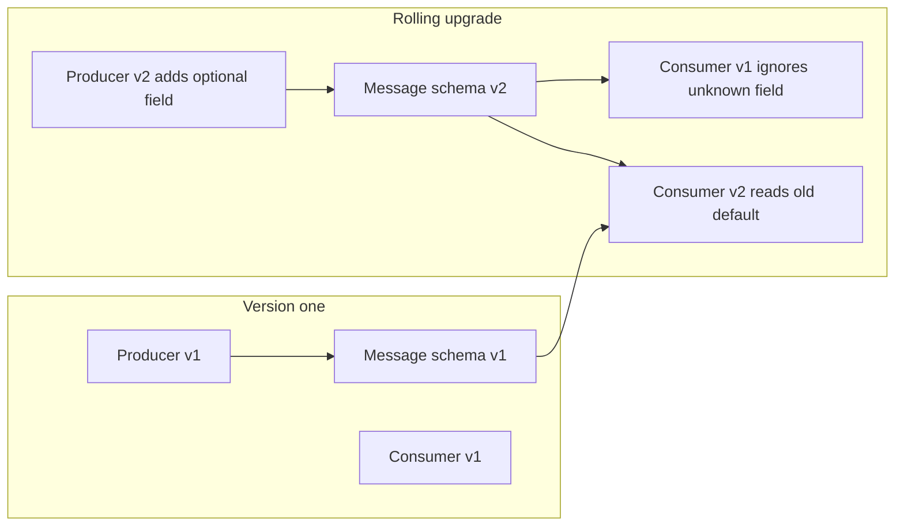

Compatibility is semantic too: a field changing from cents to dollars may parse while breaking downstream assumptions.

## 1.4 Storage engines recap: B-Tree vs LSM-Tree

Storage engines are covered in [databases and data modeling](../system-design/GUIDE.md#chapter-3--databases--data-modeling). The key distinction is read-optimized page mutation versus write-optimized append and compaction.

| Engine | Basic idea | Good at | Cost profile |
|---|---|---|---|
| B-Tree | Update fixed-size pages in a sorted tree. | Point reads, range scans, predictable latency, mature transactions. | Random writes, page splits, write amplification. |
| LSM-Tree | Append writes to memory and immutable sorted files, compact later. | High write throughput, compression, sequential I/O. | Read amplification, compaction stalls, tuning complexity. |

This choice leaks into product behavior: write-heavy ingestion often favors LSM designs; read-heavy transactional workloads often favor B-Trees.

## 1.5 The trouble with distributed systems

Distributed systems fail in ways single-process programs do not. Networks drop, delay, duplicate, reorder, or partition messages. Processes pause. Clocks move backward. Dependencies become slow enough to look dead.

Partial failure is central: one component can fail while others continue. If a leader stops responding, it may be dead, slow, paused, partitioned, or overloaded.

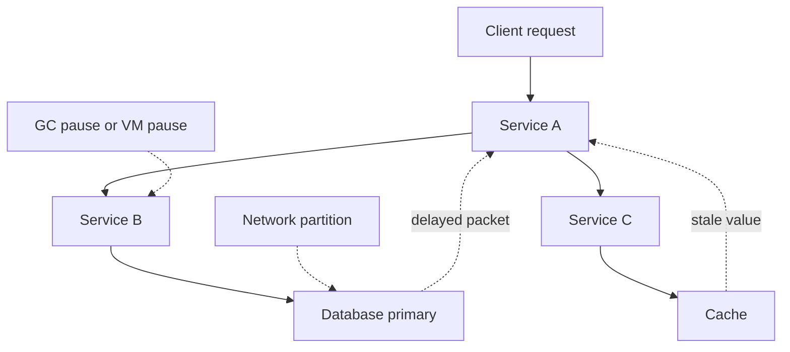

Time-of-day clocks help humans and logs but can jump because of NTP adjustments. Monotonic clocks measure elapsed duration within a process. Clock skew means machines disagree about wall time; correctness should not depend on perfect synchronization without explicit uncertainty handling.

Process pauses include garbage collection, VM suspension, host overload, container throttling, and page faults. A paused process may believe it still holds a lease while the rest of the system has moved on.

The two generals problem shows that perfect agreement over an unreliable channel is impossible with acknowledgements alone. Byzantine failures add malicious or arbitrary behavior; most business systems assume crash or omission failures because Byzantine tolerance is much more expensive.

## 1.6 Ordering and causality

Time order and causal order are different. If event B reads data written by event A, A happened before B. If two events happened independently, neither caused the other, even if one wall-clock timestamp is smaller.

Happens-before is the relation that captures potential causality. It is created by local process order and message send-before-receive relationships.

Lamport timestamps assign monotonically increasing counters. They preserve causality in one direction: if A happened before B, then A has a smaller Lamport timestamp. The reverse is not guaranteed; smaller timestamp does not prove causality.

Vector clocks track a counter per actor. They can detect concurrency because neither vector dominates the other when events are independent.

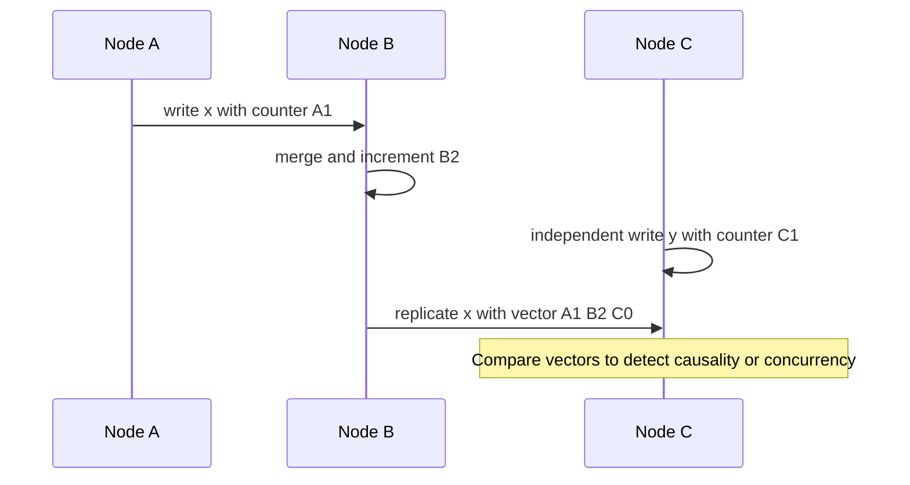

| Tool | What it gives | Limitation |
|---|---|---|
| Wall-clock timestamp | Human ordering and approximate recency. | Skew and jumps can violate causal reality. |
| Lamport timestamp | A total-ish ordering compatible with causality. | Cannot identify concurrent updates. |
| Vector clock | Detects causality and concurrency. | Metadata grows with number of actors. |

Causality matters for conflicts, collaborative editing, replication, event processing, and debugging. Last-write-wins can destroy meaningful updates.

## 1.7 Consensus, leader election, and atomic broadcast

Consensus lets nodes agree on values despite failures. In practice, systems repeatedly agree on a log, producing a replicated state machine.

Paxos and Raft are consensus families. Raft elects a leader, replicates entries through it, commits after a majority stores an entry, and applies entries in order. Real systems include etcd, ZooKeeper, Consul, and many database control planes.

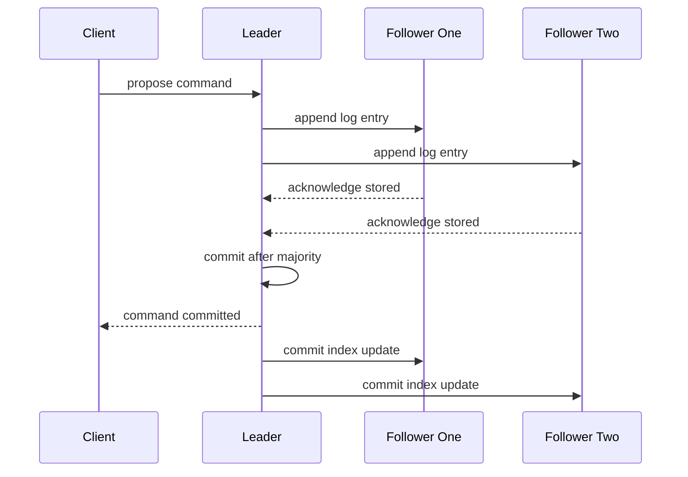

Two-phase commit and consensus are often confused. 2PC coordinates a transaction across participants if the coordinator survives and participants obey. It can block indefinitely if the coordinator fails at the wrong time. Consensus elects new leaders and makes progress with a majority, but it is not a free distributed transaction mechanism.

| Mechanism | Purpose | Failure behavior |
|---|---|---|
| 2PC | Atomic commit across resources. | Blocking under coordinator failure. |
| Consensus log | Agreement on ordered decisions. | Available with majority, unavailable without majority. |
| Saga | Business transaction split into local commits and compensations. | Eventually consistent, requires domain-specific recovery. |

## 1.8 Consistency guarantees recap

Consistency models are covered in [CAP and consistency](../system-design/GUIDE.md#chapter-2--cap-theorem--consistency-models). The useful recap is:

| Guarantee | Meaning | Example user expectation |
|---|---|---|
| Linearizable | Operations appear to take effect atomically in real-time order. | After I change a password, every login check sees it. |
| Causal | Effects are observed after their causes. | A reply is not visible before the original comment. |
| Eventual | Replicas converge if no new updates arrive. | Search results catch up after indexing. |

Do not say strong or eventual without naming the actual guarantee. Translate business invariants into explicit consistency needs.

## 1.9 Batch versus stream processing

Batch processing consumes bounded data sets. Stream processing consumes unbounded data as it arrives. Both derive views from source facts.

MapReduce and Spark popularized batch over large files. Kafka Streams and Flink popularized continuous computation over logs. Modern platforms unbundle the database into log, storage, compute, serving indexes, and governance layers.

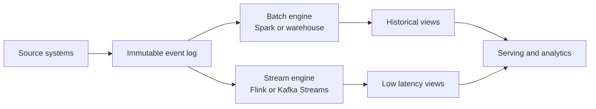

Lambda uses separate batch and speed layers, then merges results. It duplicates logic. Kappa uses one stream pipeline and replays the log.

| Architecture | Core idea | Trade-off |
|---|---|---|
| Lambda | Batch for correctness, stream for low latency. | Duplicate code paths and reconciliation complexity. |
| Kappa | Stream processing for both live and replay. | Requires durable log and replay-safe processors. |
| Warehouse-first | Central analytical store derives views. | Higher latency, strong governance, less app coupling. |

## 1.10 What "good" looks like at Staff+

- You name guarantees precisely: durability, ordering, idempotency, linearizability, causality, convergence, and freshness.
- You choose technologies from workload shape and failure model, not trend pressure.
- You design rolling upgrades and schema compatibility before the first breaking change.
- You make partial failure explicit in diagrams, tests, runbooks, and incident reviews.
- You know when consensus is required and when a simpler lease, queue, or idempotent workflow is enough.
- You connect theory to operational consequences such as tail latency, compaction, replay time, and blast radius.

## 1.11 Common pitfalls

- Treating distributed calls as local function calls with longer latency.
- Assuming clocks are reliable enough for correctness without proving the bound and failure behavior.
- Using last-write-wins where losing concurrent updates would violate user intent.
- Confusing eventual consistency with no consistency contract.
- Introducing microservices before data ownership, idempotency, and operational maturity exist.
- Using 2PC as a default solution for cross-service consistency.
- Designing a streaming system without replay, schema evolution, or poison-message handling.

## 1.12 Further reading

- DDIA: https://dataintensive.net/
- DDIA references: https://github.com/ept/ddia-references
- MIT 6.824: https://pdos.csail.mit.edu/6.824/
- Kleppmann lectures: https://www.youtube.com/playlist?list=PLeKd45zvjcDFUEv_ohr_HdUFe97RItdiB
- Fowler "Patterns of Distributed Systems": https://martinfowler.com/articles/patterns-of-distributed-systems/
- Raft: https://raft.github.io/

## 1.13 Check yourself

1. During a rolling upgrade, a producer team wants to switch the Protobuf field `amount` from dollars to cents, renaming it `amount_cents` but keeping the same tag number. Your review comment:
   - A. fine — Protobuf matches on tag numbers, so old consumers still parse it
   - B. fine, as long as producers and consumers all deploy in one release window
   - C. add a new optional field with a new tag and reserve the old tag and name
   - D. move the topic to JSON so that consumers can see the field names change

2. A nightly billing job runs on whichever node holds a lease. After a 40-second GC pause, the old holder resumes and writes results while the new holder is also running. What is the core design flaw?
   - A. it assumes a paused process still knows whether it holds the lease
   - B. it uses a lease instead of running a consensus round for every job
   - C. the garbage collector was badly tuned and should never pause that long
   - D. the nodes’ wall clocks were not synchronised tightly enough by NTP

3. Two users edit the same shared document offline and both edits replicate later. Product says neither edit may silently disappear. Which mechanism lets the system *detect* that the edits were concurrent?
   - A. last-write-wins, keeping the edit with the latest wall-clock timestamp
   - B. Lamport timestamps, keeping the edit with the larger counter
   - C. a single leader that serialises both writes as they arrive
   - D. vector clocks, flagging when neither vector dominates the other

<details markdown="1">
<summary>Answers</summary>

1. **C** — new optional field, defaults, and a reserved identifier: old and new readers both stay correct. Evolve schemas with optional fields, defaults and reserved removed identifiers. Never reuse a field with a new meaning: it parses but breaks semantics.
2. **A** — a paused process can act on a stale belief. The design must tolerate (or fence off) a holder that no longer holds the lease. Partial failure includes process pauses. Any node that acts on a belief (a lease, leadership) must cope with that belief being stale.
3. **D** — per-actor counters show concurrency when neither vector dominates, so the system can merge or ask. Lamport timestamps order events consistently with causality but cannot spot concurrency. Vector clocks can, at the cost of metadata per actor.

</details>

**Try it in your own system**

- Pick one event or message schema you own. Write down its compatibility rule (backward, forward or both) and check whether CI actually enforces it.
- Draw one critical request path and mark every place a *partial* failure can occur: slow dependency, paused process, delayed or duplicated message.
- Search your code for wall-clock timestamps that decide order or expiry (`now()` comparisons, last-write-wins). Note which would be wrong under clock skew.
- For one cross-service workflow, state the guarantee each step needs (linearizable, causal or eventual) in one sentence a product manager would accept.
- Find one place you use 2PC or a distributed lock. Could a saga, an idempotent workflow or a lease do the job with less blocking?

---

# A3 — Reliability, Observability & SRE

> How do you keep a large system dependable in production — measurably, not heroically?

**TL;DR**
- Reliability is managed through explicit user-centered objectives, not vague aspirations to have fewer incidents.
- SLOs and error budgets create a shared policy for balancing feature velocity and operational risk.
- Observability combines metrics, logs, and traces so teams can ask new questions about production behavior.
- Incident response is a system: roles, severity, communication, mitigation, learning, and follow-through.
- Resilience patterns such as load shedding, jittered retries, circuit breakers, and graceful degradation prevent local faults from becoming global outages.
- Staff+ SRE leadership reduces toil and complexity so reliability scales with the organization.

Skill map: return to [Skills to upgrade](../02-skills-to-upgrade.md). Related deep dives: [A2 distributed systems](#a2--data-intensive--distributed-systems), [caching](../system-design/GUIDE.md#chapter-4--caching), [asynchronism and messaging](../system-design/GUIDE.md#chapter-5--asynchronism--messaging), and [networking and API design](../system-design/GUIDE.md#chapter-6--networking--api-design).

*Interactive lesson:* [Lesson 02 · Reliability & SRE](lessons/0002-reliability-observability-sre.html) · *Cheat sheet:* [Reliability & SRE cheat sheet](reference/0002-reliability-observability-sre-cheatsheet.html)

## 2.1 SLI, SLO, SLA, and error budgets

Reliability must be expressed from the user's point of view. A server can be healthy while the product is unusable. A database can be up while checkout is failing.

| Term | Definition | Example |
|---|---|---|
| SLI | Service Level Indicator: a measured signal that approximates user experience. | Percentage of valid checkout requests completing under 800 ms. |
| SLO | Service Level Objective: the target range for an SLI over a window. | 99.9 percent of checkout requests succeed over 30 days. |
| SLA | Service Level Agreement: an external promise with consequences. | Customer contract gives credits if monthly availability is below 99.5 percent. |

An error budget is the allowed unreliability implied by an SLO. If the SLO is 99.9 percent success over 30 days, the budget is 0.1 percent unsuccessful requests in that window.

The policy is the important part. When the budget is healthy, teams can ship normally. When burn rate is high or the budget is exhausted, the policy may freeze risky launches, prioritize reliability work, or require executive approval for changes.

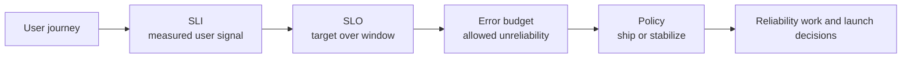

Good SLOs are few, understandable, and tied to behavior users care about. Bad SLOs measure host uptime, CPU, or internal component health without proving user impact.

## 2.2 Golden signals, observability pillars, RED, and USE

The four golden signals are a practical dashboard baseline for user-facing systems.

| Signal | Meaning | Typical questions |
|---|---|---|
| Latency | How long successful and failed requests take. | Are users waiting, and where is the tail? |
| Traffic | How much demand the system receives. | Is load normal, spiky, or shifting by tenant? |
| Errors | Rate of failed work. | Are failures user-visible, dependency-related, or validation-related? |
| Saturation | How full critical resources are. | Which resource runs out first? |

The three pillars of observability are metrics, logs, and traces. Metrics are numeric time series, logs are discrete event records, and traces show request paths across components. None is sufficient alone.

RED focuses on request-driven services: Rate, Errors, Duration. USE focuses on resources: Utilization, Saturation, Errors. Together they connect user symptoms to infrastructure constraints.

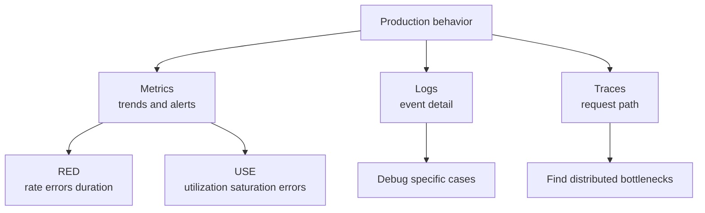

Staff+ observability work is less about buying tools and more about designing useful telemetry: stable names, controlled cardinality, correlation IDs, sampling strategy, ownership, and retention.

## 2.3 Toil and automation

Toil is manual, repetitive, automatable, tactical work that grows with service size and provides little enduring value. Examples include manually restarting jobs, copying data between systems, hand-validating deployments, and repeatedly performing the same customer repair.

Not all operational work is toil. Debugging a novel incident, designing a safer deployment system, and improving an SLO are engineering work. The problem with toil is that it scales linearly with load and steals capacity from improvements.

A toil budget is a cap on how much human capacity the organization will spend on toil. When toil exceeds the budget, teams invest in automation, self-healing, better product flows, or service redesign.

Automation should remove judgment-free repetition, not hide dangerous complexity. Automating a bad process can make failure faster.

## 2.4 Simplicity as a reliability value

Simplicity is not aesthetic minimalism. It is a reliability control. Every moving part creates state, ownership, configuration, failure modes, and cognitive load.

Simple systems are easier to observe, test, roll back, and explain during incidents. Complex systems can be reliable, but only with matching investment in expertise and automation.

Staff+ engineers should ask whether a proposed component pays rent. Does it remove more complexity than it adds? Does it reduce blast radius? Does it have a clear owner? Can the on-call engineer explain it at 03:00?

## 2.5 On-call and incident response

On-call is a socio-technical system for detecting, triaging, mitigating, and learning from production harm. It should not rely on heroism.

Common incident roles:

| Role | Responsibility |
|---|---|
| Incident Commander | Owns coordination, priorities, timeline, and decision-making. |
| Operations Lead | Drives technical investigation and mitigation. |
| Communications Lead | Updates stakeholders, status pages, support, and executives. |
| Scribe | Captures timeline, decisions, commands, and hypotheses. |

Severity levels should be defined by user and business impact, not internal panic. A useful severity model maps impact to response expectations, escalation, and communication cadence.

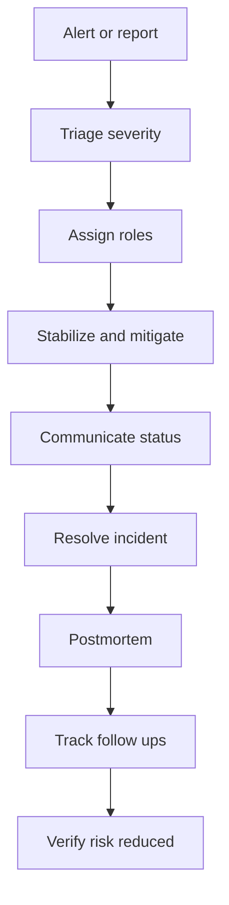

Healthy on-call programs have actionable alerts, runbooks, escalation paths, training, reasonable rotations, and authority to improve the systems that page them.

## 2.6 Blameless postmortems

A blameless postmortem asks how the system allowed a failure, not which person to punish. Blame reduces learning because people hide context. Accountability still exists: teams own follow-up actions and risk reduction.

A strong postmortem includes:

- Impact: who was affected, how badly, and for how long.
- Detection: how the incident was discovered and whether detection was late.
- Timeline: key events, decisions, and signals.
- Contributing factors: technical, organizational, process, and knowledge gaps.
- What went well: defenses that worked.
- What went poorly: defenses that failed or did not exist.
- Action items: specific, owned, prioritized, and verified.

Avoid action items that only say train people, be careful, or add more monitoring. Prefer changes that alter defaults, automate checks, reduce blast radius, or make failure visible sooner.

## 2.7 Handling overload and cascading failures

Overload is a primary cause of outages. A service under stress gets slower; clients retry; retries add load; queues grow; timeouts fire; dependencies saturate; the failure spreads.

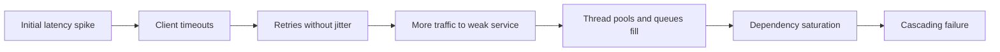

Key resilience patterns:

| Pattern | Purpose | Watch out for |
|---|---|---|
| Load shedding | Reject excess work before the system collapses. | Must shed low-value work first and return clear errors. |
| Graceful degradation | Preserve critical user journeys while disabling non-critical features. | Requires product decisions before the incident. |
| Exponential backoff with jitter | Spread retry load and reduce synchronization. | Retrying non-idempotent operations can duplicate effects. |
| Circuit breaker | Stop calling a failing dependency temporarily. | Bad thresholds can create oscillation or hide recovery. |
| Bulkhead | Isolate resources by tenant, feature, or dependency. | Too much partitioning can waste capacity. |

The thundering herd problem occurs when many clients wake, retry, refresh caches, or reconnect simultaneously. Jitter, request coalescing, token buckets, and cache stampede controls help.

## 2.8 Canarying, progressive rollouts, feature flags, and rollback

Progressive delivery reduces blast radius by exposing change gradually. A canary sends a small slice of traffic to a new version and compares key signals before wider rollout.

Feature flags separate deploy from release. They allow dark launches, targeted exposure, emergency disablement, and experimentation. They also create configuration complexity and must be cleaned up.

Fast rollback is a reliability feature. A rollback plan should be tested, compatible with database changes, and safe for mixed versions. If rollback is impossible, the rollout needs extra safeguards.

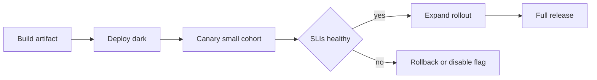

## 2.9 NALSD: non-abstract large system design

Non-abstract large system design is the practice of reasoning from concrete production constraints rather than generic boxes. It asks for realistic numbers, traffic patterns, failure domains, data ownership, operational processes, and rollout mechanics.

For Staff+ engineers, NALSD bridges architecture and SRE. A design is incomplete if it cannot explain how it is monitored, how it fails, how it recovers, who owns it, and how it changes safely.

## 2.10 What "good" looks like at Staff+

- You define reliability in terms of user-visible SLOs and business impact.
- You use error budgets as decision policy, not dashboard decoration.
- You reduce alert noise and make pages actionable.
- You design for overload before overload happens.
- You make incident roles, severity, communication, and follow-up routine.
- You remove toil by improving systems, not by asking people to work harder.
- You keep architectures simple enough for the operating model.

## 2.11 Common pitfalls

- Alerting on every metric anomaly instead of user impact and burn rate.
- Setting SLOs so strict that teams ignore them or so loose that users suffer.
- Retrying everything without timeouts, idempotency, budgets, or jitter.
- Treating postmortems as paperwork rather than risk reduction.
- Measuring mean latency while users experience tail latency.
- Leaving feature flags permanent and undocumented.
- Expecting on-call to compensate for unclear ownership or excessive complexity.

## 2.12 Further reading

- Google SRE Book: https://sre.google/sre-book/table-of-contents/
- SRE Workbook: https://sre.google/workbook/table-of-contents/
- All SRE books: https://sre.google/books/

## 2.13 Check yourself

1. Checkout’s SLO is 99.9% successful requests over 30 days. Halfway through the window the error budget is spent, and the team wants to ship a large, risky checkout redesign next week. What should happen?
   - A. ship it — the SLO is a dashboard target, not a launch gate
   - B. apply the budget policy: hold risky launches, do reliability work
   - C. loosen the SLO to 99.5% this window so that the launch can go ahead
   - D. ship it with extra alerts on host CPU and memory for the release

2. A dependency slows down. Clients time out after 2 s and retry immediately, up to 3 times. Ten minutes later its queues are full and two other services are failing. Which change most directly breaks this cascade?
   - A. raise the client timeout to 10 s so fewer requests fail
   - B. add client replicas so retries are spread across more pods
   - C. add a dashboard for the dependency’s mean latency
   - D. retry with backoff and jitter, capped by a retry budget

3. A postmortem’s action items read: “remind engineers to be careful with config”, “add more monitoring”, “run training”. As the Staff reviewer, what do you ask for?
   - A. changes that alter defaults, automate checks or shrink blast radius
   - B. the name of the engineer who pushed the config, for accountability
   - C. a longer and more detailed timeline so the document is thorough
   - D. a higher severity rating so leadership takes the follow-ups seriously

<details markdown="1">
<summary>Answers</summary>

1. **B** — an exhausted budget triggers the agreed policy: stabilise first, ship risky change later. An error budget only matters if a written policy changes behaviour: budget healthy, ship normally; budget spent, stabilise first.
2. **D** — retries are load. Bound them, spread them out, and only retry idempotent work. Retries amplify overload. Use timeouts, exponential backoff with jitter and a retry budget; shed load or open a circuit breaker when a dependency saturates.
3. **A** — action items should change the system, be owned, and be verified, not rely on vigilance. Good action items are specific, owned, prioritised and verified, and change defaults, checks, blast radius or detection speed.

</details>

**Try it in your own system**

- Pick your most important user journey. Write one SLI as good events over valid events, plus an SLO with a window. Is it measured from the user’s side?
- Count last month’s pages. What fraction were actionable and tied to user impact or burn rate? Delete or demote one noisy alert.
- List the toil your team did last sprint (manual restarts, data fixes, hand-checked deploys). Estimate the hours and pick one item to automate.
- Find one client that retries. Check for a timeout, backoff with jitter, a retry cap, and idempotency on the server side.
- Open your last postmortem. Rewrite one “be more careful” action item as a change to defaults, automation or blast radius.

---

# A4 — Software Architecture & Evolutionary Design

> How do you choose and evolve the structure of a system so it stays changeable as needs shift?

**TL;DR**
- Architecture is the important stuff: the shared understanding that lets expert developers make coherent decisions.
- Internal quality is not gold-plating; it usually pays back in delivery speed within weeks when teams change software continuously.
- Architecture is trade-off management across qualities such as availability, scalability, evolvability, security, and operability.
- Monoliths, microservices, event-driven systems, SOA, and serverless each optimize different forces and impose different costs.
- The hard parts are boundaries, data ownership, transactions, migration, and organizational alignment.
- Evolutionary architecture uses fitness functions and incremental migration so architecture can change safely over time.

Skill map: return to [Skills to upgrade](../02-skills-to-upgrade.md). Related deep dives: [A2 distributed systems](#a2--data-intensive--distributed-systems), [A3 reliability](#a3--reliability-observability--sre), [API design](../system-design/GUIDE.md#chapter-6--networking--api-design), and [messaging](../system-design/GUIDE.md#chapter-5--asynchronism--messaging).

*Interactive lesson:* [Lesson 03 · Software architecture](lessons/0003-software-architecture.html) · *Cheat sheet:* [Architecture trade-offs cheat sheet](reference/0003-software-architecture-cheatsheet.html)

## 3.1 What architecture is

Martin Fowler often frames architecture as the important stuff, the decisions that are hard to change later. Ralph Johnson's formulation is that architecture is the shared understanding expert developers have of the system design.

Both definitions matter. Architecture is not only diagrams or platform choices. It is the set of decisions, constraints, patterns, and mental models that shape everyday engineering behavior.

Architecture includes:

- Component boundaries and communication paths.
- Data ownership and consistency rules.
- Deployment and runtime topology.
- Quality attribute priorities.
- Patterns for change, testing, observability, and operations.
- The reasoning behind trade-offs.

Internal quality affects speed. Poor modularity, unclear ownership, hidden coupling, and brittle tests slow delivery quickly. The payoff for quality is often measured in weeks, not months, because teams read and change code constantly.

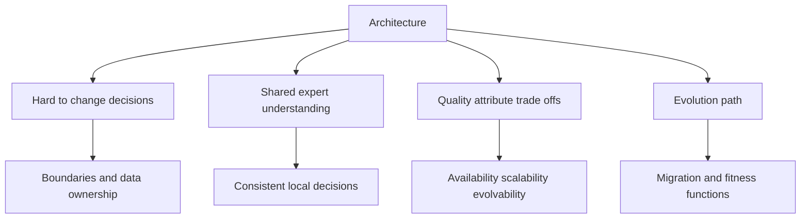

## 3.2 Architecture characteristics and trade-offs

Architecture characteristics are the qualities a system must exhibit. They are sometimes called the ilities: scalability, availability, reliability, evolvability, testability, deployability, security, usability, maintainability, observability, performance, and cost efficiency.

You cannot maximize all characteristics simultaneously. Strong consistency can reduce availability during partitions. Extreme flexibility can reduce simplicity. Low latency can increase cost. Fine-grained services can improve team autonomy while increasing operational complexity.

| Characteristic | Means | Common trade-off |
|---|---|---|
| Scalability | Handles growth in load dimensions. | More distributed complexity. |
| Availability | Continues serving despite faults. | Weaker consistency or higher cost. |
| Evolvability | Adapts to changing needs. | More abstraction and governance. |
| Testability | Behavior can be verified cheaply. | More seams and design discipline. |
| Security | Protects data and operations. | Friction, constraints, specialized review. |
| Operability | Can be run safely in production. | Tooling and process investment. |

Staff+ architecture work begins by ranking characteristics for the current business problem. A decision record should say which qualities win and which are intentionally sacrificed.

## 3.3 Architecture styles

Architecture styles are recurring arrangements of components, data, and communication. They are starting points, not recipes.

| Style | Strengths | Costs | Good fit |
|---|---|---|---|
| Monolith | Simple deployment, local transactions, easy refactoring early. | Scaling and ownership bottlenecks if boundaries rot. | Small teams, early products, tightly coupled domains. |
| Modular monolith | Clear internal boundaries with one deployable unit. | Requires discipline to prevent boundary bypass. | Growing systems that are not operationally ready for services. |
| Layered | Familiar separation such as UI, domain, data. | Can become anemic or force all changes through layers. | CRUD and enterprise applications. |
| Microservices | Independent deployability, team autonomy, fault isolation. | Distributed systems, data duplication, observability burden. | Large orgs with separable domains and mature operations. |
| Event-driven | Loose temporal coupling, extensibility, audit trail. | Debugging, ordering, schema evolution, eventual consistency. | Workflows, integrations, activity streams. |
| SOA | Service reuse and enterprise integration. | Governance overhead and shared platform coupling. | Large enterprises with integration needs. |
| Serverless | Low ops for bursty workloads, pay per use. | Cold starts, vendor constraints, observability complexity. | Event handlers, glue, variable workloads. |

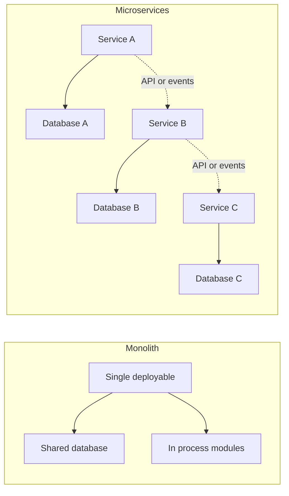

Event-driven architecture has two common coordination modes. Choreography lets services react to events without a central controller. Orchestration uses a workflow coordinator to tell participants what to do.

| Mode | Advantage | Risk |
|---|---|---|
| Choreography | Low central coupling and easy extension. | Emergent behavior can be hard to understand. |
| Orchestration | Explicit workflow and easier visibility. | Coordinator can become a coupling hotspot. |

## 3.4 Coupling, cohesion, and Conway's Law

Coupling is the degree to which one part depends on another. Cohesion is the degree to which things that change together live together. Good architecture lowers unnecessary coupling and raises useful cohesion.

Conway's Law says system design mirrors communication structure. If four teams own one shared service with unclear boundaries, the architecture will reflect those coordination problems. Architecture and organization must be designed together.

Common coupling types include:

- Runtime coupling: service A must call service B synchronously.
- Data coupling: multiple components share tables or data formats.
- Semantic coupling: one component knows another's business rules.
- Temporal coupling: systems must act in a strict time sequence.
- Deployment coupling: components must be released together.

Staff+ engineers intentionally choose coupling. Some coupling is good because it preserves invariants. Accidental coupling is the enemy.

## 3.5 The hard parts: granularity, data ownership, and sagas

Service granularity is hard because boundaries are economic decisions. Too coarse, and teams block each other. Too fine, and latency, operations, and data consistency become expensive.

Disintegrators are forces that push services apart: different scalability needs, change cadence, security boundaries, team ownership, fault isolation, or domain volatility. Integrators pull services together: transactions, query needs, shared invariants, latency, and workflow simplicity.

Data ownership is usually the real boundary. If two services freely write the same database tables, they are not independently evolvable. A service should own its data and expose behavior or events rather than tables.

Distributed transactions are expensive across service boundaries. Sagas split a business transaction into local commits with compensating actions.

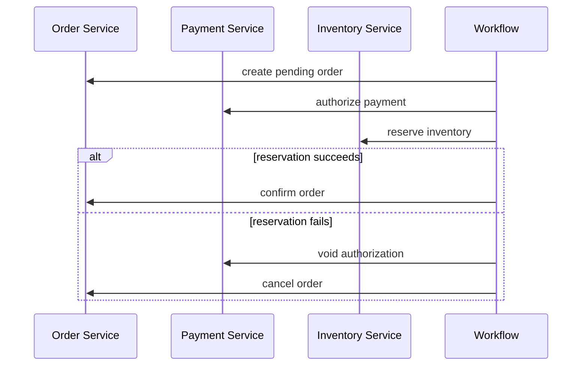

Sagas are not magic rollback. Compensation is business-specific and sometimes impossible. The design must define visible intermediate states, retries, idempotency, and operator repair.

## 3.6 Migration patterns

Architecture evolution succeeds when it avoids big-bang rewrites. Migration patterns let teams change structure while keeping the system running.

The Strangler Fig pattern routes new behavior to a new implementation while old behavior remains in the legacy system. Over time, the new system grows around and replaces the old one.

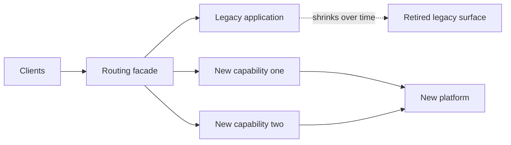

Branch by abstraction introduces an interface around old behavior, then swaps implementations incrementally. It allows long-running changes without long-lived source branches.

Parallel run executes old and new paths together, compares outputs, and builds confidence before cutover. It is useful for migrations where correctness matters more than immediate cost.

| Pattern | Use when | Key risk |
|---|---|---|
| Strangler Fig | Replacing legacy capabilities gradually. | Routing and data synchronization complexity. |
| Branch by abstraction | Changing internals behind stable call sites. | Leaky abstractions and dual maintenance. |
| Parallel run | Validating new behavior against old. | Comparison noise and doubled resource cost. |

## 3.7 Evolutionary architecture and fitness functions

Evolutionary architecture accepts that requirements, teams, and technology change. Instead of freezing architecture, it creates mechanisms that keep change safe.

A fitness function is an automated check that measures an architectural property. It can be a unit test, integration test, static analysis rule, deployment policy, cost guardrail, SLO check, or dependency rule.

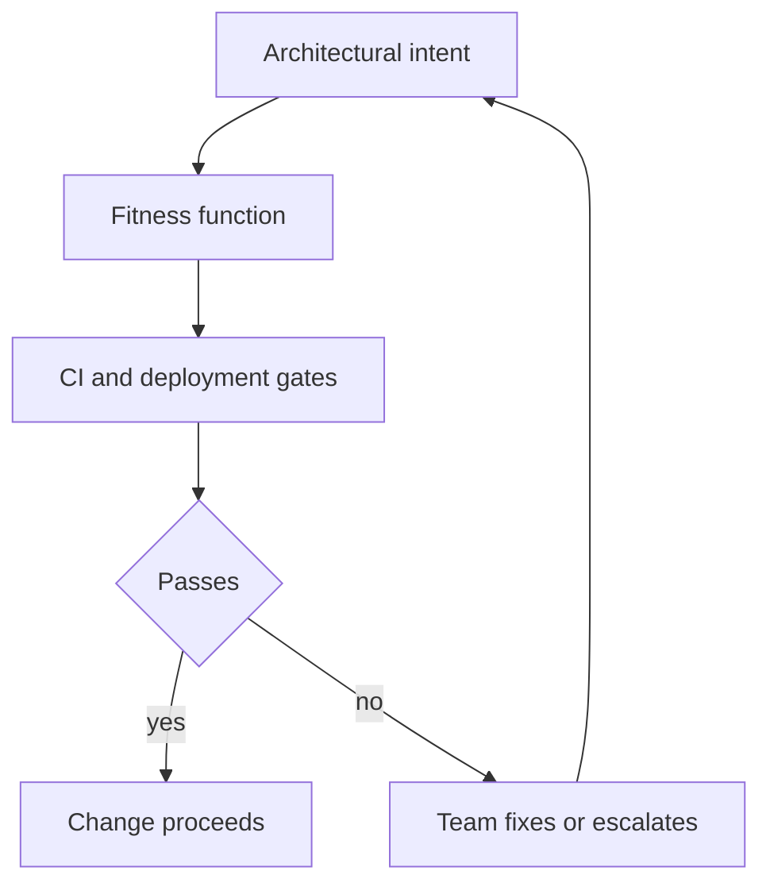

Examples include preventing forbidden dependencies, requiring APIs to publish OpenAPI specs, checking event schemas for compatibility, enforcing service ownership metadata, and blocking deploys that exceed latency budgets.

Governance should be automated where possible and human where judgment matters. Architecture review boards that only meet late in the process become bottlenecks.

## 3.8 Enterprise Integration Patterns and PoEAA

Enterprise Integration Patterns describe messaging patterns such as channels, routers, filters, translators, splitters, aggregators, and correlation identifiers. They remain useful because integration problems recur across brokers and products.

Patterns of Enterprise Application Architecture describes common application patterns such as transaction script, domain model, table data gateway, active record, data mapper, unit of work, identity map, and service layer.

The value of these pattern languages is shared vocabulary. Staff+ engineers use them to compress design conversations and identify known trade-offs.

## 3.9 Technical debt economics

Technical debt is not any ugly code. It is a design or implementation shortcut that creates future carrying cost. The debt metaphor is useful only when you discuss principal, interest, and repayment strategy.

| Debt type | Example | Economic signal |
|---|---|---|
| Deliberate prudent | Manual process before product fit. | Cheap now, scheduled repayment. |
| Deliberate reckless | Skipping migration plan for known scale. | Interest likely exceeds benefit. |
| Accidental | Design no longer fits new product needs. | Requires refactoring as learning emerges. |
| Neglect | Dependencies or tests decay. | Risk and change cost compound. |

Staff+ engineers translate technical debt into business language: delay cost, incident risk, opportunity cost, developer throughput, compliance exposure, and migration cost.

## 3.10 What "good" looks like at Staff+

- You can explain the architecture as trade-offs tied to business goals.
- You keep boundaries aligned with domain, data ownership, and team ownership.
- You avoid distributed complexity until its benefits clearly exceed its operating cost.
- You use migration patterns that keep the system shippable.
- You create automated fitness functions for important architecture rules.
- You document decisions with context, alternatives, consequences, and review triggers.
- You treat technical debt as an economic portfolio, not a moral failing.

## 3.11 Common pitfalls

- Choosing microservices to solve team problems that should be solved organizationally.
- Treating architecture as diagrams detached from code, data, deployment, and ownership.
- Maximizing one quality attribute while pretending others are unaffected.
- Sharing databases across services and calling the result independent deployment.
- Designing sagas without idempotency, compensations, or repair workflows.
- Attempting big-bang rewrites instead of incremental migration.
- Creating governance that slows teams without improving decisions.

## 3.12 Further reading

- Fowler architecture: https://martinfowler.com/architecture/
- "Is High Quality Software Worth the Cost?": https://martinfowler.com/articles/is-quality-worth-cost.html
- Strangler Fig: https://martinfowler.com/bliki/StranglerFigApplication.html
- Fundamentals of Software Architecture: https://www.amazon.com/dp/1492043451
- Software Architecture: The Hard Parts: https://www.amazon.com/dp/1492086894

## 3.13 Check yourself

1. Two teams are splitting a monolith into Orders and Billing services. Both services will keep writing the same `invoices` table “for now”. Your review comment:
   - A. they are not independently evolvable; give the table one owner
   - B. fine — separate deployables already give independent releases
   - C. fine, as long as both teams share one ORM model for the table
   - D. copy the table into two databases and sync them with a nightly job

2. An order workflow spans Payment and Inventory, and reservation can fail after payment is authorised. The team proposes a saga. What must the design spell out before you approve it?
   - A. a two-phase commit fallback for when a compensation step fails
   - B. an event bus, because sagas only work with choreography
   - C. compensations, visible intermediate states, idempotency, repair
   - D. a guarantee that every compensation fully restores the old state

3. Leadership wants to replace a 10-year-old billing system that must stay live. During the transition, correctness matters more than infrastructure cost. Which approach fits best?
   - A. freeze features for a year, then do one big-bang rewrite and cutover
   - B. Strangler Fig routing plus a parallel run that compares outputs
   - C. fork a long-lived rewrite branch and merge it when it is complete
   - D. split it into microservices first, then decide what to rewrite

<details markdown="1">
<summary>Answers</summary>

1. **A** — shared writes are data coupling. One service owns the data and exposes behaviour or events. Data ownership is usually the real boundary. A service owns its data and exposes behaviour or events, not tables.
2. **C** — sagas are not magic rollback. Spell out compensations, states, retries, idempotency and operator repair. Sagas split a business transaction into local commits with compensations. Define intermediate states, retries, idempotency and a repair path.
3. **B** — replace capability by capability behind a facade, and compare old and new outputs before each cutover. Avoid big-bang rewrites: strangle capability by capability behind a routing facade, and use parallel run where correctness matters more than doubled cost.

</details>

**Try it in your own system**

- Rank the top five architecture characteristics for one system you own. Write down which one you are deliberately sacrificing, and why.
- Find one place where two components share tables or a data format. Name the coupling type and decide who should own the data.
- Pick one architecture rule people keep breaking (a forbidden dependency, missing ownership metadata, schema compatibility). Turn it into a fitness function in CI.
- List your three biggest technical-debt items in business terms: delay cost, incident risk, or developer throughput lost per month.
- Sketch the Strangler Fig route for one legacy capability: what moves behind the facade first, and how data stays in sync.

---

# A5 — Engineering Strategy & Technical Vision

> How do you set technical direction that many teams actually follow?

**TL;DR**
- Engineering strategy is the technical differentiator between Senior and Staff+ because it turns local expertise into aligned multi-team action.
- Rumelt's kernel is diagnosis, guiding policy, and coherent action; if the policy implies no trade-off, it is probably not strategy.
- Vision describes a plausible aspirational future; strategy tackles the current challenge that blocks progress toward it.
- Good strategy is specific, opinionated, boring, evidence-backed, and enforceable.
- The Staff-engineer recipe is to synthesize repeated design work into strategy, then forecast multiple strategies into vision.
- Enforcement is earned through bottom-up evidence, consensus, clear escalation, and resource allocation.

Skill map: return to [Skills to upgrade](../02-skills-to-upgrade.md). Related deep dives: [A4 architecture](#a4--software-architecture--evolutionary-design), [A3 reliability](#a3--reliability-observability--sre), and [back-of-envelope estimation](../system-design/GUIDE.md#chapter-7--back-of-the-envelope-estimation).

*Interactive lesson:* [Lesson 04 · Strategy & vision](lessons/0004-engineering-strategy-and-vision.html) · *Cheat sheet:* [Strategy & vision cheat sheet](reference/0004-engineering-strategy-and-vision-cheatsheet.html)

## 4.1 Why strategy is the Senior to Staff+ differentiator

Senior engineers usually deliver ambiguous projects. Staff+ engineers change how groups of teams make technical decisions. Strategy is the bridge.

Without strategy, every team locally optimizes. One team chooses speed, another consistency, another platform reuse, another autonomy. Each decision may be reasonable in isolation, yet the organization drifts.

Engineering strategy creates shared constraints for repeated decisions. It tells teams what problem matters most, which trade-offs are preferred, where to invest, and how to resolve disagreement.

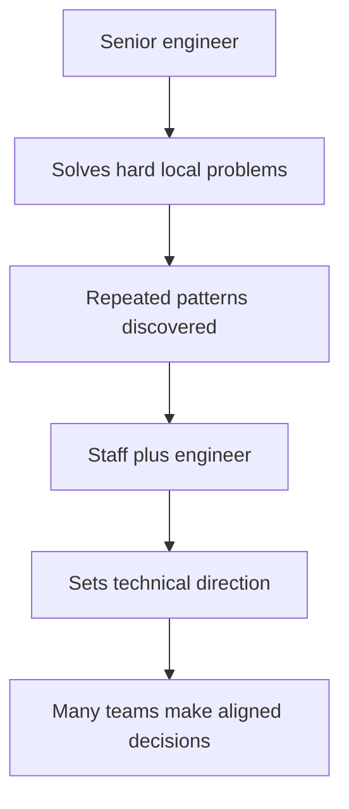

Strategy is not seniority theater. It is useful only if it changes what teams do when the author is not in the room.

## 4.2 Rumelt's kernel: diagnosis, guiding policy, coherent action

Richard Rumelt's strategy kernel is a practical structure for engineering strategy.

| Kernel part | Definition | Engineering example |
|---|---|---|
| Diagnosis | A clear explanation of the challenge and why it is hard. | Product teams cannot safely launch cross-region features because data ownership is ambiguous. |
| Guiding policy | The overall approach for overcoming the challenge. | Each customer domain will have one owning service and publish events for derived views. |
| Coherent action | Coordinated steps that implement the policy. | Define ownership map, migrate three critical tables, add event contracts, block new shared writes. |

A policy must imply a trade-off. Work harder, improve quality, and collaborate more are aspirations, not policies. A real policy says what you will not do, what will be slower, and which decisions are now constrained.

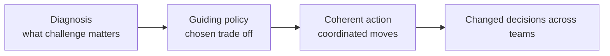

The diagnosis is often the most valuable part. If leaders disagree about the challenge, action becomes scattered. A sharp diagnosis creates urgency and narrows debate.

## 4.3 Strategy versus vision

Strategy and vision are related but different.

| Concept | Time horizon | Purpose | Output |
|---|---|---|---|
| Strategy | Now to roughly 6 to 18 months. | Tackle today's most important technical challenge. | Diagnosis, policy, actions, ownership, trade-offs. |
| Vision | Roughly 2 to 3 years. | Describe an aspirational future state that guides investment. | Narrative of future users, capabilities, architecture, and team experience. |

Vision says where we want to be. Strategy says how we will handle the current obstacle. A vision without strategy is a poster. A strategy without vision can optimize the wrong future.

A good technical vision is optimistic but not fantasy. It is grounded in users, business direction, technology constraints, and organizational capability.

## 4.4 The Staff-engineer recipe

A practical recipe from Staff engineering practice is: write five design docs, then pull out the similarities to form your strategy. Forecast five strategies two years out, and the common destination becomes your vision.

Why this works:

- Design docs expose real decisions, not abstract preferences.
- Similarities reveal repeated constraints and unresolved debates.
- Bottom-up evidence makes the strategy credible.
- Future strategies force you to reason about sequencing and compounding investments.

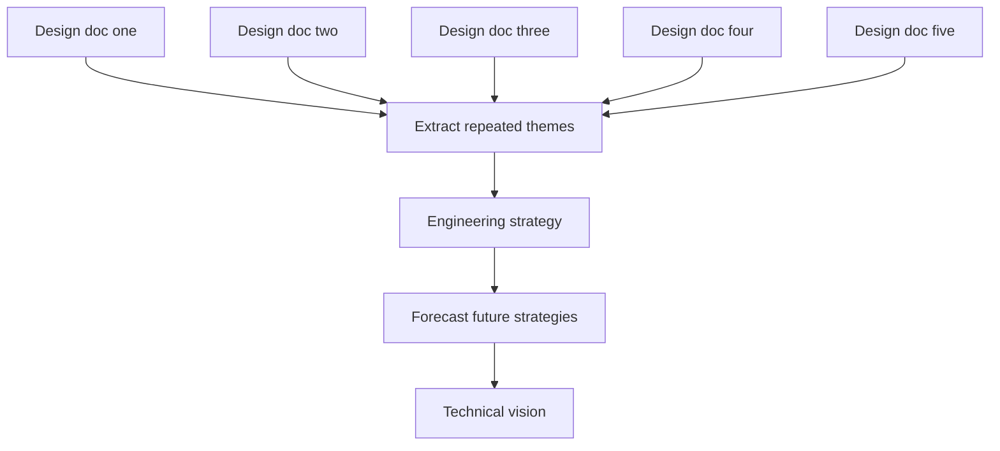

This recipe prevents strategy from becoming a top-down essay detached from reality. It also helps the author build the coalition required for enforcement.

## 4.5 Properties of good strategy

Good strategy is often boring. It turns confusing debate into ordinary execution. If the strategy feels like a slogan, it probably lacks diagnosis or trade-offs.

Good strategy is specific. Generic statements create the illusion of alignment because everyone can agree while imagining different actions. Specific statements create real alignment because they constrain decisions.

| Weak statement | Stronger strategic statement |
|---|---|
| We will improve platform reliability. | Tier one APIs will adopt 99.9 percent availability SLOs, dependency timeouts, and rollback within 10 minutes before new feature investment. |
| Teams should own their services. | Every customer-facing domain has one service owner, one data owner, and no new shared database writes after Q2. |
| We will modernize the frontend. | New checkout surfaces use the design system and server-driven configuration; legacy checkout receives only compliance fixes. |

Good strategy is opinionated. It should show your work: evidence, rejected alternatives, risks, and why now. It should be clear enough that teams can disagree productively.

## 4.6 Structuring guiding policies

Guiding policies need the right altitude. Too high, and they are slogans. Too low, and they are project plans. The right altitude is applicable across teams, enforceable, and creates leverage.

Useful policy categories include:

- Resource allocation: where engineering capacity goes and what stops receiving investment.
- Priorities: which quality attributes win when decisions conflict.
- Fundamental rules: constraints all teams must follow.
- Escalation paths: how exceptions and conflicts are resolved.
- Sequencing: what must happen before other work becomes safe or useful.

| Policy type | Example | Why it matters |
|---|---|---|
| Resource allocation | Spend 30 percent of platform capacity on migration until shared writes are removed. | Strategy without capacity is wishful thinking. |
| Priority rule | Prefer data correctness over launch speed for billing flows. | Teams can decide without re-litigating values. |
| Fundamental rule | No new synchronous calls from checkout to experimental services. | Prevents architecture drift. |
| Escalation rule | Exceptions require domain lead and SRE approval. | Makes enforcement explicit. |

A policy should make some teams unhappy in understandable ways. If no one must change plans, the policy is probably not strategic.

## 4.7 When to write an engineering strategy

Write a strategy when repeated debate signals missing direction. A useful heuristic is that if the same debate recurs three or four times, the organization needs a policy, not another meeting.

Write a strategy when the future is too hazy to pick investments. Strategy can reduce uncertainty by naming the diagnosis and setting learning-oriented actions.

Other triggers:

- Multiple teams are solving the same problem inconsistently.
- A platform migration needs coordinated adoption.
- Incidents reveal systemic architectural risk.
- Product direction changed and old technical assumptions no longer fit.
- Leaders need to choose between mutually exclusive investments.

Do not write a strategy for every project. Some problems need a design doc, a decision record, or a roadmap item.

## 4.8 Vision doc format

A vision doc should usually be short: one to two pages. It describes a two to three year future in concrete terms.

A strong vision includes:

- The users or customers whose lives are better.
- The business capabilities enabled.
- The engineering experience in the future state.
- The technical shape of the system at a useful level of detail.
- What is intentionally not part of the future.
- A few believable milestones or signs of progress.

The tone should be optimistic, not audacious for its own sake. Grand claims reduce trust if the organization cannot see a path.

Vision should be specific enough to guide strategy. For example, "developers can launch a compliant payment method in one week without payment-platform support" is more useful than "we will have a world-class payments platform."

## 4.9 Enforcement is the real challenge

Writing is the easy part. Enforcement is where strategy succeeds or fails.

Enforcement does not mean authoritarian control. It means the organization changes resource allocation, review criteria, templates, platform defaults, scorecards, and escalation rules so the strategy becomes the path of least resistance.

Bottom-up evidence enables enforcement. If the strategy comes from five real design docs, affected teams can see their own problems in the diagnosis. That shared recognition creates the consensus needed to say no later.

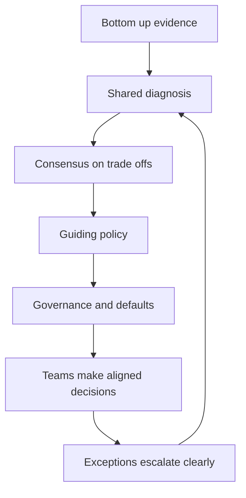

Enforcement tools include architecture review, funding gates, platform paved roads, SLO policy, migration dashboards, RFC templates, dependency rules, and executive sponsorship.

The Staff+ skill is knowing when to persuade, when to create defaults, and when to escalate.

## 4.10 Example strategies to study

Study real strategies to see specificity and trade-offs. Useful examples include platform migrations, reliability strategies, API standardization, data ownership, monorepo or build system modernization, frontend consolidation, and cloud cost control.

When reading a strategy, ask:

- What is the diagnosis?
- What trade-off does the guiding policy impose?
- Which actions are coherent with the policy?
- What is being deprioritized?
- How will enforcement happen?
- What evidence would prove the strategy is wrong?

The best examples are not universally applicable. They are context-specific and clear about why the context matters.

## 4.11 What "good" looks like at Staff+

- You turn recurring technical debates into explicit policy.
- You write strategies grounded in real design work and production evidence.
- You distinguish vision, strategy, roadmap, and design documents.
- You make trade-offs clear enough that teams know what to stop doing.
- You connect strategy to capacity, ownership, governance, and escalation.
- You create alignment without needing to attend every project meeting.
- You revise strategy when evidence changes rather than defending it as identity.

## 4.12 Common pitfalls

- Writing generic principles that everyone can agree with and no one can execute.
- Calling a roadmap a strategy without diagnosis or trade-offs.
- Creating vision that is too audacious to guide near-term investment.
- Publishing strategy without changing funding, review, or enforcement mechanisms.
- Skipping bottom-up evidence and then being surprised by resistance.
- Setting policies at the wrong altitude: either slogans or task lists.
- Treating exceptions as failure instead of a source of learning and calibration.

## 4.13 Further reading

- StaffEng "Writing engineering strategy": https://staffeng.com/guides/engineering-strategy/
- Larson "Eng strategies" with Rumelt: https://lethain.com/eng-strategies/
- "How Big Technical Changes Happen at Slack": https://slack.engineering/how-big-technical-changes-happen-at-slack/
- An Elegant Puzzle: https://lethain.com/elegant-puzzle/

## 4.14 Check yourself

1. A draft engineering strategy says: “We will improve reliability, collaborate across teams and raise code quality.” What is the most important gap?
   - A. it needs a longer time horizon so that teams can plan for it
   - B. it should list more initiatives so every team sees its own work
   - C. it needs a target-architecture diagram to make the vision concrete
   - D. it has no diagnosis, and its policies imply no trade-off at all

2. The same “shared event bus or direct calls?” debate has come up in four design reviews this quarter, each time with a different outcome. What is the Staff move?
   - A. attend every future review so the answer stays consistent
   - B. write a strategy grounded in those docs and set a policy
   - C. let each team decide locally, since autonomy beats consistency
   - D. write a two-to-three-year vision of the ideal future platform

3. Your strategy — “no new shared database writes after Q2” — was approved. Three months later teams are still adding shared writes. What is most likely missing?
   - A. a clearer vision document describing the future data platform
   - B. more precise policy wording so that nobody can misread it
   - C. enforcement: capacity, review criteria, defaults, escalation
   - D. a firmer tone so that teams understand the policy is mandatory

<details markdown="1">
<summary>Answers</summary>

1. **D** — everyone can agree with it and nobody has to change. That is aspiration, not strategy. Rumelt’s kernel is diagnosis → guiding policy → coherent action. If a policy implies no trade-off, it is an aspiration, not strategy.
2. **B** — a debate that recurs three or four times needs a policy, and those design docs are your evidence. When the same debate recurs three or four times, the organisation needs a policy, not another meeting. Real design docs make the diagnosis credible.
3. **C** — strategy sticks when funding, reviews, paved-road defaults and escalation make it the easy path. Writing is the easy part. Strategy works when capacity, review criteria, templates, defaults, dependency rules and escalation make it the path of least resistance.

</details>

**Try it in your own system**

- List the last five design docs in your area. Write down the three themes that recur: that is the raw material for your diagnosis.
- Write a one-paragraph diagnosis of your group’s biggest technical challenge. Would your peers sign it without edits?
- Rewrite one generic principle in your org (“own your services”, “improve reliability”) as a specific policy that tells someone what to stop doing.
- For one policy you care about, name its enforcement mechanism: capacity, review criteria, a template, a platform default, a dependency rule or an escalation path.
- Draft one vision sentence in the form “In two years, a developer can … without …”. Check it is concrete enough to guide this quarter.

---

# A6 — Technical Writing — Design Docs, RFCs & ADRs

> How do you scale your judgment across an org and across time — through durable writing?

**TL;DR**
- At Staff+, writing is not admin work; it is how your judgment scales beyond meetings, time zones, and your personal availability.
- A good design doc makes context, goals, non-goals, trade-offs, alternatives, and cross-cutting concerns explicit before implementation locks in expensive choices.
- RFCs and tech specs are the same family of artifact: lightweight, reviewable proposals that gather input widely while keeping single-writer clarity.
- ADRs capture one architecturally significant decision, its rationale, and consequences; they are timestamped and superseded, not rewritten.
- Strong writing craft starts with the answer, frames the tension, names the trade-offs, and makes disagreement cheap while change is still cheap.

Back to the roadmap: [Skills to upgrade](../02-skills-to-upgrade.md). Related deep dives: [communication and executive writing](../leadership-skills/GUIDE.md#b2--communication--executive-writing), [API design](../system-design/GUIDE.md#chapter-6--networking--api-design), [data modeling](../system-design/GUIDE.md#chapter-3--databases--data-modeling), [asynchronism and messaging](../system-design/GUIDE.md#chapter-5--asynchronism--messaging), and sibling technical-skill chapters A2–A9.

*Interactive lesson:* [Lesson 05 · Technical writing](lessons/0005-technical-writing-docs-rfcs-adrs.html) · *Cheat sheet:* [Design docs, RFCs & ADRs cheat sheet](reference/0005-technical-writing-docs-rfcs-adrs-cheatsheet.html)

## 5.1 Writing is Staff+ leverage

Staff+ engineers do not scale by personally attending every meeting or reviewing every pull request. They scale by creating durable artifacts that help many other engineers make better decisions without needing the author in the room.

Writing creates leverage because it:

- **Enables asynchronous alignment** across time zones and calendars.
- **Outlives the author** so future teams can understand why a system is the way it is.
- **Transfers senior judgment** by showing how constraints, alternatives, and risks were weighed.
- **Catches issues early** when changing a diagram or paragraph is cheaper than rewriting production systems.
- **Creates a decision trail** for audits, onboarding, incident review, and future migrations.

```mermaid
flowchart LR
    A["Senior judgment"] --> B["Written artifact"]
    B --> C["Async review"]
    B --> D["Future onboarding"]
    B --> E["Implementation guidance"]
    B --> F["Decision history"]
    C --> G["Better decisions at scale"]
    D --> G
    E --> G
    F --> G
```

The artifact is not the goal. The goal is shared understanding and better execution. A doc that no one reads, cannot be challenged, or fails to guide implementation has not done its job.

| Mode | Strength | Failure mode |
|---|---|---|
| Meeting-only decision | Fast for small groups | Excludes absent stakeholders and loses rationale |
| Chat thread | Low friction | Hard to find, fragmented, weak long-term memory |
| Pull request only | Close to implementation | Too late for architectural trade-offs |
| Design doc, RFC, or ADR | Durable and reviewable | Can become ceremony if every small change needs one |

## 5.2 Design docs: the Staff+ working document

A design doc is a structured proposal for a meaningful technical change. It is most useful when the change has real trade-offs, multiple plausible approaches, cross-team impact, or long-term operational consequences.

Design docs are commonly 10–20 pages for substantial initiatives. Mini design docs of 1–3 pages are often enough for smaller changes. The point is not page count; the point is making the decision space visible.

### Anatomy of a Google-style design doc

| Section | Purpose | Staff+ question |
|---|---|---|
| Context and scope | Explain the current situation, problem, constraints, and affected systems | What world are we operating in? |
| Goals | State what success requires | What must be true when this ships? |
| Non-goals | Explicitly exclude tempting but out-of-scope work | What are we intentionally not solving? |
| Design | Describe architecture, APIs, data, flows, failure modes, and trade-offs | Why this shape and not another? |
| Alternatives considered | Present credible options and why they lost | Did we fairly explore the decision space? |
| Cross-cutting concerns | Cover security, privacy, observability, reliability, migration, and cost | What risks cut across the design? |
| Rollout and operations | Explain migration, launch, rollback, and ownership | How does this survive production? |

```mermaid
flowchart TD
    A["Context and scope"] --> B["Goals and non-goals"]
    B --> C["Proposed design"]
    C --> D["Alternatives considered"]
    C --> E["Cross-cutting concerns"]
    D --> F["Recommendation"]
    E --> F
    F --> G["Review and implementation"]
```

### Design section expectations

The design section should be concrete enough that reviewers can reason about behavior. Include:

- A **system-context diagram** showing major actors and dependencies.
- API contracts, event schemas, or interface boundaries when relevant.
- Data model and storage decisions, including ownership and retention.
- Failure modes, retries, idempotency, backpressure, and degradation.
- Observability: logs, metrics, traces, dashboards, alerts, and SLO impact.
- Trade-offs stated directly rather than hidden behind vague language.

```mermaid
flowchart LR
    User["Client or user"] --> API["Public API"]
    API --> Service["Proposed service"]
    Service --> DB["Primary data store"]
    Service --> Queue["Async queue"]
    Service --> Metrics["Observability pipeline"]
    Queue --> Worker["Background worker"]
    Worker --> DB
```

Good design docs are opinionated. They do not merely list facts; they recommend a path and explain why it is the best fit for the context.

## 5.3 Design doc lifecycle

A design doc is a living artifact during execution, then a historical artifact after the decision has landed.

```mermaid
flowchart LR
    A["Create draft"] --> B["Review with stakeholders"]
    B --> C["Revise and decide"]
    C --> D["Implement"]
    D --> E["Maintain during delivery"]
    E --> F["Archive as decision context"]
    B --> G["Open questions"]
    G --> B
```

### Create

Start when you know enough to frame the problem but before implementation inertia dominates. Drafting too early produces fiction; drafting too late documents a decision already made.

### Review

Invite people who can identify flaws:

- Owners of dependent systems.
- Security, privacy, platform, SRE, and data stakeholders.
- Teams who will operate, integrate with, or be paged for the design.
- Engineers likely to disagree constructively.

### Implement

Use the doc to guide milestones, pull requests, and rollout. If the design changes materially, update the design doc or add a follow-up decision record.

### Maintain

During delivery, keep the doc honest. After completion, mark its status and link to implementation, runbooks, dashboards, and ADRs.

### When not to write one

Do not write a design doc when there are no real trade-offs. If the change is local, reversible, well-understood, and cheaper to demonstrate in code than explain in prose, write the code.

## 5.4 RFCs and tech specs

RFCs, tech specs, architecture proposals, and design docs are variations of the same practice: make an important technical proposal reviewable before committing to it.

The best RFC templates are simple:

1. Summary.
2. Motivation.
3. Goals and non-goals.
4. Proposal.
5. Alternatives.
6. Risks and mitigations.
7. Rollout plan.
8. Open questions.

```mermaid
flowchart TD
    A["Author frames problem"] --> B["Draft RFC"]
    B --> C["Wide input window"]
    C --> D["Author resolves feedback"]
    D --> E["Decision owner approves"]
    E --> F["Implementation plan"]
    C --> G["Disagreement recorded"]
    G --> D
```

Gather input widely, but write alone. Committee-written docs often become ambiguous because they optimize for avoiding conflict. A single author should synthesize feedback, make the recommendation, and explicitly record unresolved disagreements.

Prefer **good over perfect**. An RFC that helps the organization make a timely, reversible decision is more valuable than a beautiful document that arrives after the implementation is already entrenched.

| Practice | Why it helps |
|---|---|
| Short review window | Prevents indefinite debate |
| Explicit decision owner | Avoids consensus theater |
| Open questions section | Separates unknowns from blockers |
| Decision log link | Preserves outcome after review comments fade |

## 5.5 ADRs: architecture decisions that survive time

An Architecture Decision Record captures one architecturally significant decision. It is not a design doc. It is smaller, more focused, and optimized for future readers asking, "Why did we choose this?"

An ADR normally includes:

- **Title**: short and specific.
- **Status**: proposed, accepted, deprecated, or superseded.
- **Context**: forces, constraints, and problem.
- **Decision**: the chosen path.
- **Consequences**: benefits, costs, risks, and follow-up obligations.

ADRs are rationale-driven, timestamped, and immutable. If the decision changes, create a new ADR that supersedes the old one. Do not silently edit history.

```mermaid
flowchart LR
    A["Decision needed"] --> B["ADR drafted"]
    B --> C["Accepted"]
    C --> D["Architecture decision log"]
    C --> E["Future change"]
    E --> F["New ADR supersedes old ADR"]
    F --> D
```

An Architecture Decision Log is the collection of ADRs. It becomes a map of the system's architectural history.

Popular templates include Michael Nygard's original format and MADR. Use the lightest template your organization will consistently maintain.

### Example ADR

```markdown
# ADR 004: Use managed PostgreSQL for customer configuration

Date: 2026-07-17

Status: Accepted

## Context

Customer configuration is relational, must be queried transactionally, and is owned by the account platform team. The team needs point-in-time recovery and predictable operational support.

## Decision

We will store customer configuration in the cloud provider's managed PostgreSQL service. The account platform team owns schema changes, backups, and access policies.

## Consequences

Managed PostgreSQL reduces operational burden and gives us backups, monitoring, and failover primitives. We accept vendor-specific operational tooling and will avoid provider-specific SQL features unless justified by a future ADR.
```

## 5.6 Writing craft for technical leaders

Strong technical writing is clear thinking made visible. Use the craft patterns from [communication and executive writing](../leadership-skills/GUIDE.md#b2--communication--executive-writing), but apply them to engineering decisions.

### Use SCQA to open

SCQA means Situation, Complication, Question, Answer.

| Element | Example |
|---|---|
| Situation | The payments platform currently emits settlement events from three services |
| Complication | Downstream consumers see inconsistent ordering and duplicate reconciliation work |
| Question | How should we create a single, reliable settlement event stream? |
| Answer | Create an owned settlement event service with idempotent publication and explicit schemas |

### Lead with the answer

Busy reviewers should understand your recommendation in the first page. Details then support the recommendation rather than forcing readers to infer it.

### Be opinionated and honest

Do not pretend every option is equal. State the recommended path. Then survey alternatives honestly so disagreement focuses on facts and trade-offs rather than hidden assumptions.

### Make risk concrete

Replace "may have scalability issues" with "at 2,000 writes per second, the single-writer partition becomes the bottleneck; mitigation is sharding by tenant after milestone two."

## 5.7 Review culture and decision quality

Writing only works when review culture is healthy. Staff+ engineers should model disagreement that is rigorous and non-performative.

Good review comments:

- Challenge assumptions with evidence.
- Separate must-fix issues from preferences.
- Identify missing stakeholders.
- Ask whether the design can fail safely.
- Connect feedback to goals, non-goals, and constraints.

Bad review comments:

- Re-litigate scope already marked as a non-goal.
- Demand the reviewer's favorite technology without context.
- Block on style rather than decision quality.
- Hide disagreement in private side channels.

## 5.8 What "good" looks like at Staff+

- You choose the right artifact: code, mini-doc, full design doc, RFC, or ADR.
- Your docs make trade-offs, alternatives, ownership, and risks explicit.
- Reviewers can disagree early without needing political escalation.
- Future engineers can reconstruct why important choices were made.
- You maintain decision artifacts during delivery and supersede them when reality changes.
- You teach others to write better docs by leaving clear examples and review comments.

## 5.9 Common pitfalls

- Writing a long doc to avoid making a decision.
- Treating an RFC as a consensus vote instead of a recommendation plus accountable decision.
- Omitting non-goals, which invites infinite scope expansion.
- Hiding security, privacy, observability, migration, and operational concerns until late.
- Editing ADRs after the fact instead of creating superseding records.
- Using diagrams as decoration rather than as tools for reasoning.
- Confusing polished prose with clear thinking.

## 5.10 Further reading

- Design Docs at Google: https://www.industrialempathy.com/posts/design-docs-at-google/
- ADR home and registry: https://adr.github.io/
- ADR templates: https://github.com/joelparkerhenderson/architecture-decision-record
- Michael Nygard's original ADR post: https://www.cognitect.com/blog/2011/11/15/documenting-architecture-decisions
- RFCs at scale: https://blog.pragmaticengineer.com/scaling-engineering-teams-via-writing-things-down-rfcs/

## 5.11 Check yourself

1. A team plans a 15-page design doc for renaming an internal function used in one service. The change is local, well understood and easy to revert. Your advice:
   - A. write a mini design doc so the decision is on record for later
   - B. skip the doc: there are no real trade-offs, so show it in a PR
   - C. write an ADR instead, since every change deserves a decision record
   - D. open an RFC so other teams can weigh in before the change ships

2. Two years ago an accepted ADR chose managed PostgreSQL for customer configuration. The team is now moving that data to a document store. What should happen to the ADR?
   - A. write a new ADR that supersedes it; mark the old one superseded
   - B. edit the old ADR’s decision section so the log reflects reality
   - C. delete the old ADR so that nobody follows any outdated guidance
   - D. add a comment to the old ADR and change its date to today

3. An RFC has had a six-week comment window, 140 comments and three co-authors rewriting sections to address every concern. There is still no decision. What is the fix?
   - A. add more co-authors so that every affected team is represented
   - B. extend the review window until every single comment is resolved
   - C. hold a vote among commenters and adopt the majority position
   - D. one author synthesises, a named owner decides, dissent is logged

<details markdown="1">
<summary>Answers</summary>

1. **B** — local, reversible and well understood: the code is cheaper than the prose. Write a design doc when there are real trade-offs. If a change is local, reversible and well understood, write the code.
2. **A** — the log stays a true history: the old reasoning and the new decision are both visible. ADRs are timestamped and immutable. A change of mind is a new ADR that supersedes the old one.
3. **D** — gather input widely, write alone, decide explicitly, and record the disagreement. Gather input widely, but write alone: a short review window, a single author, an explicit decision owner and recorded disagreement.

</details>

**Try it in your own system**

- Pick a decision your team made in a meeting or chat last month. Write it up as an ADR: title, status, context, decision, consequences.
- Open your last design doc. Does it have explicit non-goals, and an “alternatives considered” section a fair critic would accept?
- Rewrite the opening of a doc you own with SCQA, so the recommendation is on the first page.
- Find one vague risk (“may not scale”) in a doc and replace it with a number, the bottleneck and a mitigation.
- Check your RFC process: is there a review window, a named decision owner, and a place where disagreement is recorded?

---

# A7 — Security & Privacy as a Design Concern

> How do you build systems that are safe by design, when no one else is asking for it?

**TL;DR**
- Security and privacy are cross-cutting design concerns, not specialist clean-up tasks after the architecture is finished.
- Staff+ engineers often must fund security work by making risks visible, connecting them to business outcomes, and designing secure defaults.
- The OWASP Top 10 gives a practical vocabulary for common web application risks, but secure design also requires threat modeling and operational discipline.
- Authentication proves identity; authorization decides allowed actions. OAuth2, OIDC, JWTs, sessions, and MFA solve different parts of the identity problem.
- Privacy requires data minimization, clear purpose, retention discipline, and careful handling of PII, not just encryption.

Back to the roadmap: [Skills to upgrade](../02-skills-to-upgrade.md). Related deep dives: [API design](../system-design/GUIDE.md#chapter-6--networking--api-design), [networking](../system-design/GUIDE.md#chapter-6--networking--api-design), [databases and data modeling](../system-design/GUIDE.md#chapter-3--databases--data-modeling), [caching](../system-design/GUIDE.md#chapter-4--caching), [asynchronism and messaging](../system-design/GUIDE.md#chapter-5--asynchronism--messaging), and [technical writing](#a6--technical-writing--design-docs-rfcs--adrs).

*Interactive lesson:* [Lesson 06 · Security & privacy](lessons/0006-security-and-privacy.html) · *Cheat sheet:* [Security & privacy cheat sheet](reference/0006-security-and-privacy-cheatsheet.html)

## 6.1 Security is cross-cutting

Security affects product behavior, architecture, infrastructure, operations, data, and incident response. It cannot be bolted on at the end without expensive rework.

At Staff+, you are expected to notice safety gaps even when no one asks:

- Does the design expose unnecessary data?
- Are permissions checked at the correct boundary?
- What happens when a dependency is compromised?
- Can an attacker replay, tamper with, or enumerate requests?
- Will logs help detect abuse without leaking PII?

```mermaid
flowchart TD
    A["Product design"] --> S["Security and privacy"]
    B["API boundaries"] --> S
    C["Data storage"] --> S
    D["Infrastructure"] --> S
    E["Operations"] --> S
    F["Incident response"] --> S
    S --> G["Safe system behavior"]
```

"Funding" security means translating technical risk into business language: fraud, regulatory exposure, customer trust, downtime, recovery cost, and delivery risk.

## 6.2 OWASP Top 10 as a practical risk map

The OWASP Top 10 is a widely used list of critical web application security risks. The 2021 edition is current here; a 2025 revision is in progress.

| OWASP 2021 category | One-line explanation |
|---|---|
| Broken Access Control | Users can act outside their intended permissions or access other users' data |
| Cryptographic Failures | Sensitive data is exposed because encryption, key handling, or hashing is weak |
| Injection | Untrusted input is interpreted as code or commands |
| Insecure Design | The architecture lacks controls for known threat scenarios |
| Security Misconfiguration | Defaults, permissions, headers, services, or cloud resources are unsafe |
| Vulnerable and Outdated Components | Dependencies contain known exploitable vulnerabilities |
| Identification and Authentication Failures | Login, session, credential, or identity flows can be bypassed or abused |
| Software and Data Integrity Failures | Code, updates, CI/CD, or data can be tampered with |
| Security Logging and Monitoring Failures | Attacks are not detected, investigated, or alerted on effectively |
| Server-Side Request Forgery | Attackers make the server send requests to unintended internal or external targets |

```mermaid
flowchart TD
    A["OWASP risks"] --> B["Access control"]
    A --> C["Data protection"]
    A --> D["Input handling"]
    A --> E["Secure design"]
    A --> F["Operations and supply chain"]
    B --> G["Threat model"]
    C --> G
    D --> G
    E --> G
    F --> G
```

Use OWASP as a checklist, not a substitute for thinking. The most dangerous risks are often specific to your domain, data, and trust boundaries.

## 6.3 Authentication, authorization, and identity

Authentication and authorization are often confused.

| Concept | Question answered | Examples |
|---|---|---|
| Authentication | Who are you? | Password, passkey, SSO, MFA, OIDC login |
| Authorization | What are you allowed to do? | RBAC, ABAC, policy engine, resource ownership checks |
| Accounting | What did you do? | Audit logs, access logs, change history |

Authentication must not imply authorization. A valid user may still lack permission for a tenant, account, record, action, or field.

### OAuth2, OIDC, JWTs, sessions, and MFA

- **OAuth2** is an authorization framework for delegated access.
- **OIDC** adds identity on top of OAuth2 and standardizes login claims.
- **JWTs** are signed tokens containing claims; they are not automatically secure just because they are signed.
- **Sessions** store server-side state and usually use an opaque cookie as the client handle.
- **MFA** reduces account takeover risk by requiring more than one factor.

```mermaid
sequenceDiagram
    participant User as User
    participant Browser as Browser
    participant App as Application
    participant IdP as Identity Provider
    participant API as Resource API
    User->>Browser: Start login
    Browser->>App: Request protected page
    App->>Browser: Redirect to authorization endpoint
    Browser->>IdP: Authenticate user and request consent
    IdP->>Browser: Return authorization code
    Browser->>App: Send authorization code
    App->>IdP: Exchange code for tokens
    IdP->>App: Return ID token and access token
    App->>API: Call API with access token
    API->>API: Validate token and authorization policy
```

Sessions are easier to revoke centrally. Self-contained tokens are convenient for distributed systems but require careful expiry, audience validation, signing key rotation, and revocation strategy.

## 6.4 Secure API design

APIs are security boundaries. Design them as if clients are malicious, broken, or compromised.

| Control | What it prevents |
|---|---|
| Input validation | Unexpected types, sizes, formats, and unsafe values |
| Output encoding | Cross-site scripting and downstream interpretation bugs |
| Rate limiting | Brute force, scraping, abuse, and accidental overload |
| Least privilege | Overbroad service or user access |
| CORS discipline | Browser-based cross-origin access mistakes |
| Idempotency keys | Unsafe retries for mutation APIs |
| Audit logging | Invisible sensitive actions |

Good API security includes object-level authorization. Many breaches happen when an endpoint checks "is logged in" but not "can access this specific object."

Secure defaults matter:

- Deny by default when policy cannot be evaluated.
- Use allowlists rather than blocklists for trusted inputs.
- Avoid returning sensitive fields unless explicitly requested and authorized.
- Make pagination and filtering resistant to enumeration.
- Treat internal APIs as hostile unless protected by identity and policy.

## 6.5 Core security principles

```mermaid
flowchart TD
    A["Secure system"] --> B["Defense in depth"]
    A --> C["Least privilege"]
    A --> D["Zero trust"]
    A --> E["Fail secure"]
    A --> F["Secure defaults"]
    B --> G["Multiple independent controls"]
    C --> H["Only required access"]
    D --> I["Verify every boundary"]
    E --> J["Deny on uncertainty"]
    F --> K["Safe unless changed"]
```

### Defense in depth

Assume one control will fail. Combine identity, network segmentation, input validation, encryption, monitoring, and incident response.

### Least privilege

Grant only the permissions needed for the task, for the shortest reasonable duration, at the narrowest scope.

### Zero trust

Do not trust a request because it originates from an internal network. Verify identity, device, workload, policy, and context at each boundary.

### Fail secure

When a dependency is down or a policy is ambiguous, prefer safe denial over unsafe access.

### Secure defaults

Make the easiest path the safest path. Engineers under delivery pressure will follow defaults.

## 6.6 Cryptography basics for practitioners

Cryptography is easy to misuse. Prefer well-reviewed libraries, managed services, and standard protocols.

| Topic | Practical meaning |
|---|---|
| Encryption in transit | Use TLS to protect data between clients, services, and infrastructure |
| Encryption at rest | Protect stored data using database, disk, object-store, or application-level encryption |
| Hashing | One-way transformation used for integrity checks and password verification |
| Encryption | Reversible transformation that requires key management |
| Symmetric crypto | Same key encrypts and decrypts; fast and common for data encryption |
| Asymmetric crypto | Public and private keys; useful for key exchange, signatures, and identity |

Passwords must be hashed with password-specific algorithms such as bcrypt or Argon2, plus unique salts. Do not use fast hashes such as SHA-256 alone for passwords.

Secrets management is part of cryptography:

- Store secrets in Vault, cloud KMS, or a managed secret manager.
- Rotate keys and credentials.
- Separate encryption keys from encrypted data.
- Never log secrets.
- Avoid long-lived credentials where workload identity is available.

```mermaid
flowchart LR
    A["Application"] --> B["Secret manager"]
    B --> C["KMS key"]
    A --> D["Database"]
    C --> D
    E["Operator"] --> B
    F["Audit log"] --> B
```

## 6.7 Threat modeling with STRIDE

Threat modeling is structured imagination. It helps teams ask, "How could this fail under attack?"

STRIDE categories:

| STRIDE category | Threat question |
|---|---|
| Spoofing | Can an attacker pretend to be someone or something else? |
| Tampering | Can data, requests, binaries, or configuration be modified? |
| Repudiation | Can actors deny actions because evidence is missing? |
| Information disclosure | Can sensitive data be exposed? |
| Denial of service | Can availability be degraded or exhausted? |
| Elevation of privilege | Can a low-privilege actor gain more power? |

Use data-flow diagrams to identify:

- External entities.
- Processes.
- Data stores.
- Data flows.
- Trust boundaries.

```mermaid
flowchart LR
    User["External user"] --> Web["Web app"]
    Web --> API["API service"]
    API --> DB["PII database"]
    API --> Queue["Work queue"]
    Queue --> Worker["Worker service"]
    subgraph sgTrust["Trust boundary"]
        API
        DB
        Queue
        Worker
    end
```

The Staff+ move is to make threat modeling lightweight enough that teams actually do it.

## 6.8 Privacy and PII

Privacy is about appropriate collection, use, sharing, retention, and deletion of personal data.

PII can include names, email addresses, government IDs, phone numbers, precise location, device identifiers, IP addresses, financial details, and combinations of attributes that identify a person.

Key privacy concepts:

- **Data minimization**: collect only what is needed.
- **Purpose limitation**: use data only for the purpose communicated or legally justified.
- **Retention limits**: delete data when no longer needed.
- **Access control**: restrict who and what can view or process personal data.
- **Pseudonymization**: replace direct identifiers with stable aliases while preserving analytical utility.
- **GDPR rights**: access, correction, deletion, portability, and objection depending on context.

Encryption reduces exposure but does not eliminate privacy obligations. If the system can decrypt and use the data, the organization must still govern it.

## 6.9 What "good" looks like at Staff+

- You raise security and privacy risks during design, not after launch.
- You make threat models, access controls, data flows, and logging decisions visible in design docs.
- You push for secure defaults and managed security primitives instead of bespoke mechanisms.
- You connect security investments to customer trust, compliance, fraud prevention, and operational resilience.
- You ensure sensitive actions are authorized, audited, monitored, and reversible where possible.
- You mentor teams to use OWASP, STRIDE, and privacy principles pragmatically.

## 6.10 Common pitfalls

- Treating authentication as sufficient authorization.
- Storing passwords with general-purpose hashes or reversible encryption.
- Logging tokens, secrets, or unnecessary PII.
- Relying on internal networks as a security boundary.
- Adding rate limits and monitoring only after abuse occurs.
- Copying OAuth2 or JWT examples without validating issuer, audience, expiry, and signature.
- Collecting data because it might be useful someday.

## 6.11 Further reading

- OWASP Top 10: https://owasp.org/www-project-top-ten/
- OWASP Cheat Sheet Series: https://cheatsheetseries.owasp.org/
- Microsoft STRIDE: https://learn.microsoft.com/en-us/azure/security/develop/threat-modeling-tool-threats

## 6.12 Check yourself

1. Endpoint `GET /invoices/{id}` checks that the caller has a valid session, then returns the invoice. A pen test downloads other customers’ invoices by changing the id. What is the root cause?
   - A. the session should have been a signed JWT, not an opaque session cookie
   - B. the invoice ids are sequential numbers instead of random UUIDs
   - C. authentication was treated as authorization: no per-object check
   - D. the API has no rate limiting, so the scraping was not throttled

2. A service accepts incoming JWTs after checking the signature only. What else must it validate before it trusts the claims?
   - A. nothing more: a valid signature proves the token is safe to use
   - B. that the client keeps the token in local storage, not a cookie
   - C. that the payload is encrypted so that the claims cannot be read
   - D. issuer, audience and expiry, plus a plan for key rotation

3. Product wants to store users’ precise location on every request “in case analytics needs it later”. It will be encrypted at rest. Your privacy review comment:
   - A. fine — encryption at rest removes our privacy obligations
   - B. collect only what a stated purpose needs, with a retention limit
   - C. fine, as long as it is pseudonymised before it reaches any of the logs
   - D. store it in a separate database so a breach exposes less of it

<details markdown="1">
<summary>Answers</summary>

1. **C** — a valid user may still not own this invoice. Check object-level permission on every request. Authentication proves identity; authorization decides what that identity may do to this specific object.
2. **D** — validate issuer, audience, expiry and signature, and plan key rotation and revocation. Never copy JWT examples blindly: validate issuer, audience, expiry and signature, rotate signing keys, and have a revocation strategy.
3. **B** — data minimisation, purpose limitation and retention discipline come before encryption. Privacy is minimisation, purpose limitation and retention discipline. Encryption reduces exposure but does not remove the duty to govern data you can decrypt.

</details>

**Try it in your own system**

- Pick three endpoints you own. For each, confirm there is an object-level authorization check, not just “is logged in”.
- Search your logs for tokens, secrets and unnecessary PII (emails, IPs, full names). File one fix.
- Run a 30-minute STRIDE pass on one data-flow diagram: mark the trust boundaries and write one threat per category.
- List the long-lived credentials your services use. Which could move to workload identity or a secret manager with rotation?
- For one table holding personal data, write down its purpose, its retention period and who can read it. Is any column collected “just in case”?

---

# A8 — Cloud Infrastructure & Pragmatic Tech Choices

> How do you run a system on cloud primitives at scale — and keep it simple enough to operate?

**TL;DR**
- Cloud architecture is a progression of scaling and operational choices, not a default jump to the most complex platform.
- Core primitives are compute, storage, networking, managed databases, queues, identity, and observability.
- Containers and Kubernetes are powerful, but they add operational complexity; many teams should prefer managed platforms or serverless.
- Infrastructure as Code, immutable infrastructure, and progressive delivery make environments repeatable and safer to change.
- Staff+ engineers choose boring technology, run less software, and optimize for reliability, cost, and operability over novelty.

Back to the roadmap: [Skills to upgrade](../02-skills-to-upgrade.md). Related deep dives: [scalability trade-off axes](../system-design/GUIDE.md#chapter-1--scalability-trade-off-axes), [caching](../system-design/GUIDE.md#chapter-4--caching), [asynchronism and messaging](../system-design/GUIDE.md#chapter-5--asynchronism--messaging), [networking and API design](../system-design/GUIDE.md#chapter-6--networking--api-design), [back-of-envelope estimation](../system-design/GUIDE.md#chapter-7--back-of-the-envelope-estimation), and [security and privacy](#a7--security--privacy-as-a-design-concern).

*Interactive lesson:* [Lesson 07 · Cloud infrastructure](lessons/0007-cloud-infrastructure.html) · *Cheat sheet:* [Cloud infrastructure cheat sheet](reference/0007-cloud-infrastructure-cheatsheet.html)

## 7.1 The cloud scaling progression

Most systems do not need global multi-region architecture on day one. They evolve through pressure: traffic, data growth, availability needs, team size, compliance, and operational pain.

```mermaid
flowchart LR
    A["Single box"] --> B["Separate database"]
    B --> C["Load balancer and horizontal scaling"]
    C --> D["Cache"]
    D --> E["CDN"]
    E --> F["Autoscaling"]
    F --> G["Multi-AZ"]
    G --> H["Multi-region"]
```

This progression is a set of trade-offs. See [scalability trade-off axes](../system-design/GUIDE.md#chapter-1--scalability-trade-off-axes) for deeper framing.

| Stage | What improves | What gets harder |
|---|---|---|
| Single box | Simplicity and debuggability | Capacity and availability |
| Separate database | Data durability and specialization | Network latency and backups |
| Load balancer plus replicas | Throughput and availability | Statelessness and deployment coordination |
| Cache | Latency and read scalability | Invalidation and consistency |
| CDN | Global edge performance | Cache control and purge strategy |
| Autoscaling | Elastic capacity | Metrics, warm-up, and cost surprises |
| Multi-AZ | Resilience to zone failure | Data replication and failover testing |
| Multi-region | Regional disaster tolerance | Complexity, consistency, cost, and operations |

The Staff+ question is not "Can we scale?" It is "What level of scale and resilience is justified by the product and business right now?"

## 7.2 Core cloud primitives

Cloud providers package infrastructure as programmable primitives. The primitives are similar across AWS, Azure, and Google Cloud even when names differ.

| Primitive | Examples | Design questions |
|---|---|---|
| Compute | VMs, containers, serverless functions, managed app platforms | Who manages the runtime and scaling? |
| Storage | Object, block, file storage | What access pattern and durability model? |
| Networking | VPCs, subnets, routing, load balancers, DNS | What talks to what, and across which boundary? |
| Managed databases | Relational, document, key-value, graph, search | What data model, consistency, and operations model? |
| Queues and streams | Message queues, pub-sub, event streams | Is work synchronous, asynchronous, ordered, or replayable? |
| Identity and secrets | IAM, KMS, secret managers | Who or what is allowed to access resources? |
| Observability | Metrics, logs, traces, alerts | Can operators understand behavior and failures? |

### Compute options

| Option | Best for | Trade-offs |
|---|---|---|
| Virtual machines | Maximum control, legacy workloads, specialized runtime needs | More patching, image management, and capacity planning |
| Containers | Portable services with repeatable packaging | Requires orchestration and runtime security |
| Managed container platform | Service teams that want containers without full cluster ownership | Less control than raw Kubernetes |
| Serverless functions | Event-driven work, spiky workloads, low ops burden | Cold starts, runtime limits, vendor coupling |
| Platform as a Service | Standard web apps and APIs | Opinionated deployment and runtime model |

Choose the simplest compute model that satisfies scaling, isolation, compliance, and delivery needs.

## 7.3 Containers and orchestration

Docker packages an application and its runtime dependencies into an image. Containers help make local, CI, and production environments more consistent.

Kubernetes orchestrates containers across machines. Basic Kubernetes concepts:

- **Pod**: smallest deployable unit, usually one main container plus sidecars.
- **Deployment**: desired state for replicated pods and rollout behavior.
- **Service**: stable network identity and load balancing for pods.
- **Ingress**: external routing into services.
- **Control plane**: API server, scheduler, controllers, and cluster state.
- **Node**: worker machine that runs pods.

```mermaid
flowchart TD
    Client["Client"] --> Ingress["Ingress"]
    Ingress --> Service["Service"]
    Service --> PodA["Pod replica A"]
    Service --> PodB["Pod replica B"]
    Deployment["Deployment"] --> PodA
    Deployment --> PodB
    Control["Control plane"] --> Deployment
    NodeA["Node A"] --> PodA
    NodeB["Node B"] --> PodB
```

### When not to use Kubernetes

Do not use Kubernetes merely because it is industry-standard. Avoid it when:

- The team lacks operational experience and no managed platform is available.
- You run a small number of simple services.
- Serverless or a managed app platform satisfies the need.
- Your main bottleneck is product discovery, not infrastructure flexibility.
- The organization will not invest in platform ownership, upgrades, security, and observability.

Kubernetes is an operating system for distributed applications. If you adopt it, someone must operate it.

## 7.4 Infrastructure as Code and immutable infrastructure

Infrastructure as Code makes environments reproducible and reviewable. Terraform is a common tool, but the principle applies broadly: infrastructure changes should be versioned, reviewed, planned, applied, and audited.

```mermaid
flowchart LR
    A["Infrastructure code"] --> B["Review"]
    B --> C["Plan"]
    C --> D["Apply"]
    D --> E["Cloud resources"]
    E --> F["Drift detection"]
    F --> A
```

Immutable infrastructure means replacing instances, containers, or images instead of mutating them manually. It reduces configuration drift and makes rollback more predictable.

Good practices:

- Separate environments while reusing modules.
- Keep secrets out of state files and source control.
- Use policy checks for risky changes.
- Prefer automated changes over console clicks.
- Track ownership and cost metadata as tags.

## 7.5 Deployment strategies

Deployment is a reliability problem, not just a release problem.

| Strategy | How it works | Best for |
|---|---|---|
| Rolling deploy | Replace instances gradually | Routine low-risk releases |
| Blue-green | Run old and new environments, then switch traffic | Fast rollback and major changes |
| Canary | Send a small percentage of traffic to new version first | Risky changes with measurable health signals |
| Feature flags | Decouple deploy from release | Product experimentation and gradual exposure |

```mermaid
flowchart LR
    Users["Users"] --> Router["Traffic router"]
    Router --> Blue["Blue environment"]
    Router --> Green["Green environment"]
    Metrics["Metrics and alerts"] --> Router
    Green --> DB["Shared or migrated data store"]
    Blue --> DB
```

Progressive delivery only works when you know what "healthy" means. Define metrics before launch: error rate, latency, saturation, business conversion, queue depth, and rollback triggers.

## 7.6 AWS Well-Architected pillars

The AWS Well-Architected framework names six pillars that generalize beyond AWS.

| Pillar | Staff+ interpretation |
|---|---|
| Operational Excellence | Can we run, observe, change, and improve the system safely? |
| Security | Are identity, data protection, detection, and response built in? |
| Reliability | Does the workload perform correctly and recover from failure? |
| Performance Efficiency | Are resources selected and scaled appropriately for demand? |
| Cost Optimization | Are we spending intentionally and eliminating waste? |
| Sustainability | Are we reducing unnecessary resource consumption and environmental impact? |

Use the pillars as review prompts in design docs and operational readiness reviews.

## 7.7 Reliability building blocks

Cloud reliability is built from failure domains and recovery plans.

| Term | Meaning |
|---|---|
| Availability Zone | Isolated data-center zone inside a region |
| Region | Geographic grouping of zones |
| Multi-AZ | Deployment resilient to one zone failure |
| Multi-region | Deployment designed for regional failure or global latency |
| RTO | Recovery Time Objective, or maximum acceptable downtime |
| RPO | Recovery Point Objective, or maximum acceptable data loss |

```mermaid
flowchart TD
    subgraph sgRegionA["Region A"]
        A1["AZ A1"] --> AppA["App replicas"]
        A2["AZ A2"] --> AppB["App replicas"]
        AppA --> DBA["Primary database"]
        AppB --> DBA
    end
    subgraph sgRegionB["Region B"]
        B1["AZ B1"] --> Standby["Standby services"]
        DRDB["Replica database"]
    end
    DBA --> DRDB
```

Backups are not a strategy unless restores are tested. Disaster recovery plans must specify ownership, triggers, communication, RTO, RPO, and verification steps.

## 7.8 Cost awareness and FinOps

Cloud makes spending easy and waste invisible. Staff+ engineers should treat cost as an architectural constraint.

Common cost drivers:

- Overprovisioned compute.
- Unbounded logs, metrics, traces, and retention.
- Cross-region and internet data transfer.
- Inefficient database queries and storage.
- Idle development environments.
- Premium managed services used without a clear value case.

FinOps basics:

- Tag resources by team, service, environment, and cost center.
- Review unit economics, not just total spend.
- Set budgets and anomaly alerts.
- Right-size resources based on measurements.
- Prefer reserved capacity only for stable baseline usage.
- Include cost impact in design docs.

## 7.9 Staff heuristics: choose boring, run less

"Choose Boring Technology" means spend innovation tokens deliberately. Novel databases, languages, orchestration systems, and messaging platforms all consume learning, hiring, operational, and debugging capacity.

"Run Less Software" means prefer managed and commodity services when they are good enough. Every self-operated component becomes a security, upgrade, monitoring, paging, and continuity obligation.

```mermaid
flowchart TD
    A["Technology choice"] --> B{"Is novelty essential"}
    B -->|No| C["Choose boring managed option"]
    B -->|Yes| D["Spend innovation token intentionally"]
    C --> E["Lower operational burden"]
    D --> F["Explicit ownership and exit plan"]
```

The senior trap is proving you can build it. The Staff+ discipline is deciding whether the organization should own it.

## 7.10 What "good" looks like at Staff+

- You match architecture complexity to actual scale, resilience, compliance, and team maturity needs.
- You can explain cloud primitives without vendor-name dependency.
- You prefer managed services when they reduce undifferentiated operational work.
- You require IaC, tagging, observability, backup testing, and rollback paths for production systems.
- You make cost, RTO, RPO, and failure domains explicit in design reviews.
- You know when Kubernetes is justified and when it is organizational vanity.

## 7.11 Common pitfalls

- Starting with multi-region architecture before proving product and traffic needs.
- Treating Kubernetes as a default instead of an operational commitment.
- Making manual cloud-console changes that bypass review and drift detection.
- Ignoring data transfer, observability, and idle-resource costs.
- Assuming backups work without restore tests.
- Using autoscaling to hide inefficient code or bad capacity models.
- Choosing novel technology without explicit ownership and training plans.

## 7.12 Further reading

- AWS Well-Architected: https://aws.amazon.com/architecture/well-architected/
- Choose Boring Technology: https://mcfunley.com/choose-boring-technology
- Run Less Software: https://www.intercom.com/blog/run-less-software/
- AWS Builders' Library: https://aws.amazon.com/builders-library/
- The Twelve-Factor App: https://12factor.net/

## 7.13 Check yourself

1. A three-person team runs two simple HTTP services on a managed app platform. They propose moving to self-managed Kubernetes “because it is the industry standard”. Your response:
   - A. stay on the managed platform; nobody would own and run the cluster
   - B. approve it — Kubernetes is portable, so it lowers long-term risk
   - C. approve it, but run one cluster per service to isolate the failures
   - D. go multi-region first, then decide which orchestrator to standardise

2. A team’s DR plan says “nightly backups copied to another region”. The business needs an RPO of 15 minutes and an RTO of 1 hour. What is the most important gap?
   - A. nothing: backups in a second region already cover regional loss
   - B. nightly backups mean up to ~24 h RPO, and restores are untested
   - C. the backups should be encrypted with a key held in the same region
   - D. the plan should go straight to active-active across two regions

3. A team wants to adopt a new graph database for one feature; the rest of the stack runs on PostgreSQL. Applying “Choose Boring Technology”, what do you ask first?
   - A. which managed vendor offers the most features for the price
   - B. whether everything else could be migrated onto it later on
   - C. is novelty essential here, and who owns it, with what exit plan
   - D. whether it has more community adoption than the other alternatives

<details markdown="1">
<summary>Answers</summary>

1. **A** — Kubernetes is an operational commitment. With a small team and simple services, the managed platform already fits. Kubernetes is an operating system for distributed apps. Adopt it only when someone will own it and simpler managed options do not fit.
2. **B** — the plan can lose a day of data, and nobody knows how long a restore takes. RPO bounds data loss and RTO bounds downtime. Backups are not a strategy until restores are tested against both.
3. **C** — spend an innovation token only on purpose, with explicit ownership and an exit plan. Spend innovation tokens deliberately. If novelty is not essential, choose the boring managed option; if it is, assign ownership and an exit plan.

</details>

**Try it in your own system**

- Place your main system on the scaling progression (single box → multi-region). Which next step is justified by real traffic, availability or compliance needs, and which is not?
- Write down the RTO and RPO for one critical data store, then find out when a restore was last tested end to end.
- Find one resource changed by hand in the cloud console last quarter. Bring it under IaC and turn on drift detection.
- Break last month’s bill down by tag. What share is untagged, and what is your unit cost per request, tenant or order?
- List every component you operate yourself (brokers, databases, clusters). For each one, ask whether a managed service would be good enough.

---

# A9 — T-shaped Breadth + Depth

> How do you become broadly credible across the whole stack AND the deep authority in one area?

**TL;DR**
- T-shaped engineers combine broad working fluency across many domains with one or more deep spikes of authority.
- Breadth gives Staff+ engineers architectural judgment and credibility in rooms where frontend, backend, data, infra, product, and operations collide.
- Depth gives you irreplaceable value: the ability to solve hard problems, set direction, and teach a domain from first principles.
- Generalist context compounds early; specialist authority compounds when aligned with enduring business needs.
- Over a career, many Staff+ engineers become pi-shaped: broad base plus two deep spikes.

Back to the roadmap: [Skills to upgrade](../02-skills-to-upgrade.md). Related deep dives: [what is required](../01-what-is-required.md), [scalability trade-offs](../system-design/GUIDE.md#chapter-1--scalability-trade-off-axes), [CAP and consistency](../system-design/GUIDE.md#chapter-2--cap-theorem--consistency-models), [databases and data modeling](../system-design/GUIDE.md#chapter-3--databases--data-modeling), [security and privacy](#a7--security--privacy-as-a-design-concern), [cloud infrastructure](#a8--cloud-infrastructure--pragmatic-tech-choices), and the rest of technical skills A1–A8.

*Interactive lesson:* [Lesson 08 · T-shaped expertise](lessons/0008-tshaped-breadth-and-depth.html) · *Cheat sheet:* [T-shape development cheat sheet](reference/0008-tshaped-breadth-and-depth-cheatsheet.html)

## 8.1 The T-shape metaphor

The T-shape is a simple model for Staff+ technical growth.

- The **horizontal bar** is breadth: enough fluency across A1–A8 and related system-design domains to reason about trade-offs.
- The **vertical bar** is depth: a domain where you are a recognized authority and can create direction, not just execute tasks.

```mermaid
flowchart TD
    subgraph sgBreadth["Breadth across the stack"]
        A1["Product and domain"]
        A2["Backend and APIs"]
        A3["Data and storage"]
        A4["Distributed systems"]
        A5["Observability and operations"]
        A6["Technical writing"]
        A7["Security and privacy"]
        A8["Cloud infrastructure"]
    end
    A4 --> Spike["Deep spike of authority"]
    Spike --> Impact["Staff plus impact"]
```

The metaphor is imperfect, but useful. Staff+ engineers are rarely the best person at every layer. They are credible enough across layers to ask good questions, spot missing constraints, and connect specialists.

## 8.2 Why breadth matters

Breadth gives you architectural judgment. Most important engineering decisions are not isolated to one layer:

- A database choice affects API latency, product flexibility, privacy, and disaster recovery.
- A frontend performance issue may be caused by backend aggregation, cache policy, or CDN configuration.
- A security requirement may reshape identity, data retention, logging, and support tooling.
- A cloud cost issue may involve query plans, autoscaling, observability retention, and customer behavior.

Staff+ engineers are often "in the room" for ambiguous decisions. Breadth lets you contribute without pretending to be the domain expert in every topic.

| Breadth capability | Why it matters |
|---|---|
| Ask cross-domain questions | Prevents local optimization |
| Understand specialist language | Reduces translation loss |
| Notice missing stakeholders | Avoids late surprises |
| Connect incidents to design | Turns pain into architecture learning |
| Evaluate trade-offs | Improves decisions under uncertainty |

Breadth is also credibility. Teams trust advice more when you understand enough of their constraints to avoid naive recommendations.

## 8.3 Why depth matters

Depth is what makes you more than a coordinator. It is the ability to solve problems others cannot, set technical direction, and teach a domain from first principles.

Depth shows up when you can:

- Diagnose hard production failures in your domain.
- Recognize patterns across years of incidents and designs.
- Explain trade-offs simply to executives and deeply to experts.
- Build reusable mental models, libraries, platforms, or standards.
- Know when common advice does not apply to your context.

Depth supports the Architect archetype from [what is required](../01-what-is-required.md), but it also helps Tech Leads, Solvers, and Right Hands. Without depth, your influence depends too much on process and relationships. With depth, your judgment has technical weight.

## 8.4 How breadth compounds

Charity Majors has argued that useful engineering growth often rewards generalists because broad context accelerates learning. Early breadth compounds because each new domain gives you more hooks for understanding the next one.

For example:

- Knowing networking helps you debug API latency.
- Knowing databases helps you design better product boundaries.
- Knowing observability helps you learn from every incident.
- Knowing security helps you see trust boundaries in architecture.
- Knowing cloud primitives helps you reason about cost and reliability.

```mermaid
flowchart LR
    A["Early broad exposure"] --> B["More mental hooks"]
    B --> C["Faster learning"]
    C --> D["Better cross-domain judgment"]
    D --> E["More strategic opportunities"]
    E --> C
```

Breadth does not mean shallow trivia. It means enough working knowledge to reason about constraints, risks, and interfaces.

## 8.5 Choosing your spike

Your deep spike should be both personally energizing and enduringly central to the business.

Good spike candidates often sit where:

- The company repeatedly makes expensive decisions.
- Incidents or bottlenecks cluster.
- Product differentiation depends on technical excellence.
- The organization lacks a clear authority.
- The domain will matter for years, not one quarter.

Examples:

| Company context | Possible spike |
|---|---|
| High-scale consumer product | Reliability, latency, experimentation platform |
| Fintech or regulated platform | Security, privacy, ledger correctness, compliance architecture |
| Data-heavy SaaS | Analytics infrastructure, data modeling, search, ML platform |
| Developer tools company | API design, platform extensibility, build systems |
| Marketplace | Ranking, payments, fraud, event-driven systems |

Align the spike with company needs. A deep specialty that the business does not need may be intellectually satisfying but strategically limiting.

## 8.6 Pitfalls of extremes

Pure specialists and pure generalists both face Staff+ risks.

| Extreme | Strength | Risk |
|---|---|---|
| Pure specialist | Deep authority in a niche | Fragile if the niche fades or becomes less central |
| Pure generalist | Can navigate many domains | May lack the technical depth to set direction |
| T-shaped engineer | Breadth plus one spike | Can become overloaded as the bridge for everything |
| Pi-shaped engineer | Breadth plus two spikes | Requires deliberate focus to avoid dilution |

```mermaid
flowchart TD
    A["Career growth"] --> B["Pure specialist"]
    A --> C["Pure generalist"]
    A --> D["T-shaped"]
    D --> E["Pi-shaped over time"]
    B --> F["Fragility if niche fades"]
    C --> G["Shallow influence"]
    D --> H["Broad credibility and deep authority"]
    E --> I["Two durable authority zones"]
```

The pi-shaped model is common over longer careers. You may build one spike in distributed systems, then another in developer productivity, security, data, or organizational architecture.

## 8.7 Deliberately building breadth

Breadth should be built through real exposure, not just reading summaries.

High-leverage ways to build breadth:

- Rotate across teams or take temporary assignments in adjacent domains.
- Read real architecture docs, RFCs, incident reviews, and engineering blogs.
- Shadow on-call for systems you depend on.
- Join design reviews outside your immediate area.
- Pair with specialists during migrations, outages, or performance work.
- Build small prototypes to understand unfamiliar tools.
- Ask "what breaks at 10x?" and "who operates this?" in every design.

Breadth learning checklist:

| Domain | Minimum useful fluency |
|---|---|
| Frontend | Rendering model, performance, accessibility, client-state trade-offs |
| Backend | API boundaries, concurrency, failure handling, deployment |
| Data | Modeling, indexing, transactions, retention, analytics constraints |
| Infrastructure | Compute, networking, scaling, IAM, cost |
| Security | AuthN, AuthZ, threat modeling, secure defaults |
| Operations | Observability, SLOs, incident response, capacity |
| Product | User workflows, business model, customer pain |

## 8.8 Deliberately building depth

Depth requires ownership under pressure. You do not become deep by passively consuming content.

Depth-building practices:

- Own a critical domain for multiple years.
- Read source code, design docs, postmortems, and historical decisions.
- Lead incident root-cause analysis and follow through on systemic fixes.
- Benchmark and measure instead of relying on folklore.
- Teach others through docs, talks, office hours, and design reviews.
- Build tools or abstractions that encode your domain knowledge.
- Track external developments but filter them through local constraints.

```mermaid
flowchart TD
    A["Own critical domain"] --> B["Handle hard incidents"]
    B --> C["Find root causes"]
    C --> D["Improve architecture"]
    D --> E["Teach and standardize"]
    E --> F["Recognized authority"]
    F --> A
```

Depth should produce artifacts: standards, libraries, runbooks, decision records, platform capabilities, or mentoring systems. If your expertise only exists in your head, it does not scale.

## 8.9 Mapping to the four Staff archetypes

StaffEng describes common Staff archetypes: Tech Lead, Architect, Solver, and Right Hand. T-shaped growth supports all four.

| Archetype | Breadth need | Depth need |
|---|---|---|
| Tech Lead | Coordinate product, team, architecture, and delivery trade-offs | Enough domain depth to make credible technical calls |
| Architect | See system-wide interactions and future constraints | Deep architectural authority in one or more core domains |
| Solver | Understand where the hardest problem sits across layers | Very deep debugging and problem-solving capability |
| Right Hand | Translate executive priorities across technical domains | Deep trust and judgment in the organization's critical systems |

See [what is required](../01-what-is-required.md) for the repo's broader Staff+ framing.

Your archetype may change by role, company stage, or business need. The T-shape is portable because it creates both adaptability and authority.

## 8.10 A practical development plan

Use a simple quarterly loop:

1. Pick one breadth domain to improve.
2. Pick one depth capability to strengthen.
3. Find real work that forces learning.
4. Produce an artifact that scales the learning.
5. Ask specialists to critique your understanding.

Example:

| Quarter goal | Real work | Scaling artifact |
|---|---|---|
| Improve security breadth | Threat model a new API | Security review checklist |
| Deepen database authority | Lead high-write migration | Migration playbook and ADR |
| Improve cloud breadth | Join cost-reduction effort | Cost review guide |
| Deepen observability spike | Redesign service SLOs | SLO template and dashboard standard |

The point is deliberate compounding. Staff+ growth is not "learn everything." It is "learn the right adjacent things while deepening the authority the business needs."

## 8.11 What "good" looks like at Staff+

- You are credible across product, system design, data, infrastructure, security, operations, and delivery discussions.
- You have at least one domain where engineers seek your judgment before committing to major decisions.
- You can translate specialist concerns into executive and cross-team language.
- You keep broadening enough to avoid local optimization and deepening enough to remain technically authoritative.
- Your expertise creates artifacts, standards, and people development, not just personal heroics.
- You align your spike with durable business needs.

## 8.12 Common pitfalls

- Treating breadth as shallow awareness rather than working fluency.
- Choosing a spike because it is fashionable rather than business-critical.
- Becoming the only bridge across teams and creating a bottleneck.
- Staying in a comfortable niche after the company's needs move elsewhere.
- Confusing years of experience with depth.
- Reading broadly without doing real cross-domain work.
- Building expertise that remains private instead of teachable.

## 8.13 Further reading

- StaffEng staff archetypes: https://staffeng.com/guides/staff-archetypes/
- Charity Majors on engineering levels: https://charity.wtf/p/useful-things-to-know-about-engineering-levels
- System Design Primer: https://github.com/donnemartin/system-design-primer

## 8.14 Check yourself

1. You are choosing a deep spike. You work at a regulated fintech where costly decisions and incidents keep clustering around ledger correctness. A trendy frontend framework excites you most. The best choice:
   - A. the frontend framework, because personal energy matters more than fit
   - B. whatever skill is most in demand on the job market this year
   - C. no spike yet: stay a pure generalist until the path is clear
   - D. ledger correctness, where costly decisions and incidents recur

2. A Staff engineer has become the only bridge between the data and platform teams. Every cross-team decision now waits for them. What does this lesson recommend?
   - A. keep going: being the bridge for everything is exactly what Staff means
   - B. drop cross-team work and focus only on deepening their spike
   - C. turn the knowledge into docs, standards and people who share it
   - D. ask management to hire a second bridge with the same profile

3. An engineer says: “I’ve read summaries of security, cloud and data for a year, so my breadth is done.” What is missing?
   - A. real cross-domain work, such as threat-modelling an actual API
   - B. more summaries, since breadth is mostly about awareness of key terms
   - C. a certification in each domain to prove the knowledge is real
   - D. nothing: reading broadly is exactly how breadth compounds

<details markdown="1">
<summary>Answers</summary>

1. **D** — central, durable and lacking an authority. Find the part of it that energises you. A good spike is energising and enduringly central to the business: where expensive decisions recur, incidents cluster and no clear authority exists.
2. **C** — expertise should produce artifacts and people development, not personal heroics. Breadth and depth must produce artifacts (standards, runbooks, ADRs, mentoring) so expertise scales instead of becoming a bottleneck.
3. **A** — breadth is working fluency, and it comes from real exposure: reviews, rotations, on-call, prototypes. Breadth means working fluency, built through real exposure (rotations, design reviews, on-call shadowing, prototypes), not reading alone.

</details>

**Try it in your own system**

- Score yourself 0–3 on each breadth domain: frontend, backend, data, infrastructure, security, operations, product. Circle your two weakest.
- Write down your current or intended spike, plus three pieces of evidence that the business will need it for years.
- Join one design review outside your area this month, with one cross-domain question prepared in advance.
- Plan next quarter with the loop: one breadth domain, one depth capability, the real work that forces learning, and the artifact you will publish.
- List knowledge only you hold. Pick one item and turn it into a doc, a runbook or a talk.

---

# Capstone project

Pick one real, cross-team system in your organisation that is due for a significant change: a migration, a new capability or a recurring reliability problem. Produce the package a Principal engineer would bring to an architecture review, written so it can be decided **asynchronously**.

- **Design doc** (Lesson 05): context, goals, non-goals, design, alternatives considered, cross-cutting concerns, rollout and rollback.
- **Guarantees and failure model** (Lesson 01): the consistency guarantee each step needs, schema-compatibility rules, and behaviour under partial failure.
- **Architecture trade-offs** (Lesson 03): ranked characteristics, data ownership, the migration pattern, and two fitness functions.
- **Reliability** (Lesson 02): SLIs, SLOs, error-budget policy, overload protections and the progressive-rollout plan.
- **Security and privacy** (Lesson 06): a STRIDE pass on the data-flow diagram, authorization at each boundary, and a PII inventory with retention.
- **Cloud and cost** (Lesson 07): failure domains, RTO/RPO, and an estimated unit cost.
- **ADRs** (Lesson 05): two or three, for the decisions that will be hardest to reverse.
- **Strategy link** (Lesson 04): one paragraph showing which guiding policy this change follows, or the policy it should create.

You are done when a peer outside your team can read it in 30 minutes, state the main trade-off back to you, and disagree with something specific. Then note which section felt weakest: that is a candidate breadth domain for your Lesson 08 plan.

---

# Self-assessment checklist

You are done when you can tick every box honestly, with an example from your own work:

- [ ] I can explain backward vs forward compatibility and plan a schema change that survives a rolling upgrade.
- [ ] I can show where partial failure, process pauses and clock skew break a design, and where my own system depends on them.
- [ ] I can say when a problem needs consensus, when 2PC would block, and when a saga, lease or idempotent workflow is enough.
- [ ] I can name the consistency guarantee (linearizable, causal, eventual) that a business invariant needs, in words a PM accepts.
- [ ] I can write an SLI, an SLO and an error-budget policy for a user journey, and alert on burn rate instead of raw metrics.
- [ ] I can stop a retry storm with timeouts, backoff with jitter, retry budgets, load shedding and circuit breakers.
- [ ] I can run an incident with clear roles and write a blameless postmortem whose action items change the system.
- [ ] I can rank architecture characteristics for a business problem and say which one I am deliberately sacrificing.
- [ ] I can draw service boundaries around data ownership and design a saga with compensations, idempotency and a repair path.
- [ ] I can plan a migration with Strangler Fig, branch by abstraction or parallel run, guarded by automated fitness functions.
- [ ] I can write a strategy with a diagnosis, a guiding policy that implies a trade-off, coherent actions and an enforcement plan.
- [ ] I can choose between a design doc, an RFC and an ADR, and write each so reviewers can disagree early.
- [ ] I can threat-model a data flow with STRIDE and spot a missing object-level authorization check in an API.
- [ ] I can state RTO, RPO, failure domains and unit cost for a system, and justify or reject Kubernetes and multi-region.

# Study plan

| Week | Focus | Do |
|---|---|---|
| 1 | Lesson 01 · Distributed systems (A2) | Read the DDIA chapters on encoding and on the trouble with distributed systems. Write the compatibility rule for one schema you own and add a CI check for it. |
| 2 | Lesson 02 · Reliability & SRE (A3) | Draft an SLI, SLO and error-budget policy for your most important user journey. Demote or delete one noisy alert. |
| 3 | Lesson 03 · Software architecture (A4) | Rank the architecture characteristics of one system, map who owns one shared table, and add one fitness function to CI. |
| 4 | Lesson 04 · Strategy & vision (A5) | Collect five recent design docs from your area. Write a one-page diagnosis and one guiding policy that makes someone stop doing something. |
| 5 | Lesson 05 · Technical writing (A6) | Write two ADRs for decisions made in meetings last month. Rewrite the opening of one design doc with SCQA. |
| 6 | Lesson 06 · Security & privacy (A7) | Run a 30-minute STRIDE pass on one data-flow diagram. Check object-level authorization on three endpoints and grep logs for secrets and PII. |
| 7 | Lesson 07 · Cloud infrastructure (A8) | Write down RTO and RPO for one critical data store and test a restore. Break last month's bill down by tag and compute one unit cost. |
| 8 | Lesson 08 · T-shaped expertise (A9) | Score your breadth 0–3 per domain, choose your spike with evidence the business needs it, and write next quarter's plan. |
| 9–10 | Capstone | Produce the architecture-review package described below and get it reviewed asynchronously by a peer outside your team. |

# Resources

Curated sources for every chapter are in [RESOURCES.md](RESOURCES.md); canonical terms are in [GLOSSARY.md](GLOSSARY.md). Each chapter’s *Further reading* section lists the sources it draws on. Return to the skills map in [02-skills-to-upgrade.md](../02-skills-to-upgrade.md).
