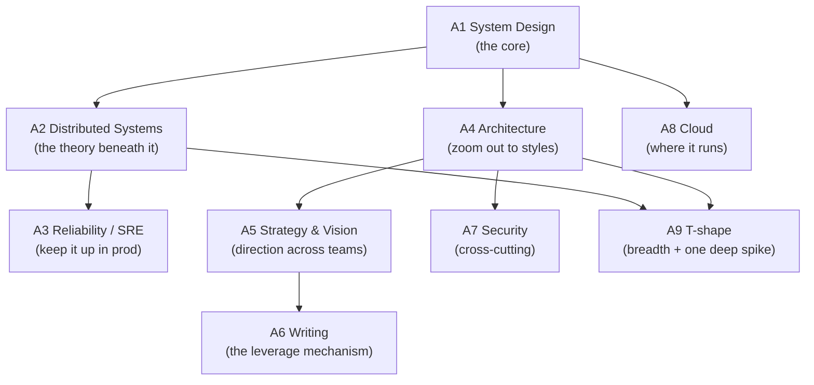

# Technical Skills — Deep Dives (Part A)

Self-contained deep dives for the **technical** skill areas in [../02-skills-to-upgrade.md](../02-skills-to-upgrade.md#part-a--technical-skills). Read each and you'll gain the working knowledge a Staff/Principal engineer is expected to have. Every file uses Mermaid diagrams, comparison tables, "what good looks like at Staff+", pitfalls, and further reading.

> **A1 lives in its own folder** because it decomposes into seven big sub-topics: see **[../system-design/](../system-design/README.md)** (scalability, CAP, databases, caching, messaging, networking, estimation).

| # | Topic | What you'll learn |
|---|-------|-------------------|
| A2 | **[Data-Intensive & Distributed Systems](A2-data-intensive-distributed-systems.md)** | The DDIA spine: encoding & schema evolution, storage engines, the *trouble* with distributed systems (clocks, partial failure), consensus, batch vs stream processing. |
| A3 | **[Reliability, Observability & SRE](A3-reliability-observability-sre.md)** | SLIs/SLOs & error budgets, the four golden signals, toil, incident response & blameless postmortems, cascading failures, canarying. |
| A4 | **[Software Architecture & Evolutionary Design](A4-software-architecture.md)** | Monolith vs microservices, event-driven, layering, Strangler Fig migration, fitness functions, architecture characteristics & trade-off analysis. |
| A5 | **[Engineering Strategy & Technical Vision](A5-engineering-strategy-and-vision.md)** ⭐ | Rumelt's diagnosis→policy→action, the "five design docs" recipe, boring/specific/opinionated strategy, writing a 2–3 year vision. |
| A6 | **[Technical Writing — Design Docs, RFCs, ADRs](A6-technical-writing-docs-rfcs-adrs.md)** | Google-style design docs, RFC culture, Architecture Decision Records, and how writing scales your influence asynchronously. |
| A7 | **[Security & Privacy as a Design Concern](A7-security-and-privacy.md)** | OWASP Top 10, secure API design (authN/authZ, OAuth/JWT), secrets, least privilege, defense-in-depth, encryption, threat modeling. |
| A8 | **[Cloud Infrastructure & Pragmatic Tech Choices](A8-cloud-infrastructure.md)** | The cloud scaling progression, AWS Well-Architected 6 pillars, "Choose Boring Technology" & "Run Less Software". |
| A9 | **[T-shaped Breadth + Depth](A9-tshaped-breadth-and-depth.md)** | How to build broad architectural judgment across A1–A8 plus a deep "spike" in one business-critical domain. |

---

## How the technical skills fit together

> **The through-line:** *everything is a trade-off.* The Staff+ signal isn't knowing every pattern — it's naming the trade-off behind every choice and writing it down so a whole org can align.
